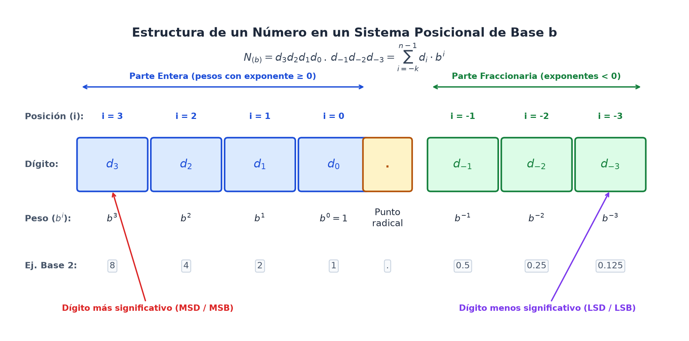

<!-- _class: portada -->
<!-- _paginate: false -->
<!-- _header: "" -->
<!-- _footer: "" -->

# 1.1 Sistemas Numéricos
## Binario, Octal, Decimal y Hexadecimal

- **Unidad 1:** Sistemas Numéricos · Matemáticas Discretas (`LISSI0211`)
- **Propósito:** Comprender los sistemas posicionales, su notación exponencial y sus equivalencias fundamentales en computación.

---

## Sistemas Aditivos frente a Sistemas Posicionales

Un **sistema numérico** es un conjunto de símbolos y reglas para representar cantidades:

1. **Sistemas aditivos (no posicionales):** cada símbolo posee un valor fijo sin importar su posición; la cantidad total se suma.
   - *Ejemplos:* egipcio ($\mid = 1, \cap = 10, \varrho = 100$) y romano ($\text{MDLXXIII} = 1573$).
   - *Desventaja:* imprácticos para fracciones, cifras grandes y operaciones.
2. **Sistemas posicionales (ponderados):** el valor de cada dígito depende de su **valor facial** y su **valor posicional** (potencia de la base).
   - *Ejemplos:* babilónico ($b = 60$) y maya ($b = 20$, introdujo el **cero** $\emptyset$).

---

## Teorema Fundamental: Base y Dígitos

- En un sistema posicional de **base** (o *raíz*) $b \in \mathbb{Z}$ con $b > 1$, se emplean exactamente $b$ **dígitos**:
  $$D_b = \{0, 1, 2, \dots, b - 1\}$$
- Para bases $b > 10$, se utilizan letras mayúsculas después del $9$:
  $$\text{A} = 10,\quad \text{B} = 11,\quad \text{C} = 12,\quad \text{D} = 13,\quad \text{E} = 14,\quad \text{F} = 15,\quad \text{G} = 16,\; \dots$$
- **Convención de notación:** para evitar ambigüedades (como $1011$), la base se escribe como subíndice: $1011_{(2)}$ o $1011_2$.

---

## Notación Exponencial (Forma Expandida)

Un real positivo $N$ en base $b$ con $n$ dígitos enteros y $k$ fraccionarios se escribe:
$$N_{(b)} = d_{n-1}d_{n-2}\dots d_1d_0\,.\,d_{-1}d_{-2}\dots d_{-k} = \sum_{i=-k}^{n-1} d_i \cdot b^i$$

- **Punto radical $(\,.\,)$:** separa parte entera ($i = 0, 1, \dots, n-1$, crece $\leftarrow$) y fraccionaria ($i = -1, \dots, -k$, decrece $\rightarrow$).
- **MSD / MSB ($d_{n-1}$):** dígito o bit **más significativo** (mayor peso).
- **LSD / LSB ($d_{-k}$ o $d_0$):** dígito o bit **menos significativo** (menor peso).

---

<!-- _class: figura -->

## Estructura de un Número en Base $b$

Pesos posicionales enteros ($i \ge 0$) y fraccionarios ($i < 0$) a partir del punto radical.

---

## Sistema Decimal ($b = 10$)

Sistema de uso cotidiano (origen antropológico en el conteo con los diez dedos).

- **Base:** $b = 10$ | **Dígitos válidos:** $\{0, 1, 2, 3, 4, 5, 6, 7, 8, 9\}$ (mayor: $b - 1 = 9$).
- **Pesos posicionales:** potencias de $10$ ($\dots, 10^2 = 100,\; 10^1 = 10,\; 10^0 = 1\;.\; 10^{-1} = 0.1, \dots$).
- **Ejemplo:** descomposición de $836.74_{(10)}$:
  - Aportes: $8\times 100 = 800$, $3\times 10 = 30$, $6\times 1 = 6$, $7\times 0.1 = 0.7$, $4\times 0.01 = 0.04$.
  $$836.74_{(10)} = 8 \times 10^2 + 3 \times 10^1 + 6 \times 10^0 + 7 \times 10^{-1} + 4 \times 10^{-2}$$

---

## Sistema Binario ($b = 2$): Conceptos y Unidades

- Descrito por Pingala (s. III a. C.) y formalizado por **G. W. von Leibniz** (s. XVII).
- Lenguaje fundamental de la computación por los circuitos electrónicos **biestables** (encendido/apagado).
- **Base:** $b = 2$ | **Dígitos válidos:** $\{0, 1\}$ (**bit**, *binary digit*).
- **Agrupaciones comunes de bits:**
  - **Nibble (semibyte):** $4$ bits (p. ej., $1011_2$).
  - **Byte (octeto):** $8$ bits (p. ej., $11001010_2$).
  - **Palabra (*word*):** unidad nativa del procesador ($16$, $32$ o $64$ bits).

---

<!-- _class: tabla-ancha -->

## Sistema Binario: Potencias No Negativas ($2^{10}$ a $2^0$)

| Potencia $2^i$ | $2^{10}$ | $2^9$ | $2^8$ | $2^7$ | $2^6$ | $2^5$ | $2^4$ | $2^3$ | $2^2$ | $2^1$ | $2^0$ |
| :--- | :---: | :---: | :---: | :---: | :---: | :---: | :---: | :---: | :---: | :---: | :---: |
| **Valor decimal** | $1024$ | $512$ | $256$ | $128$ | $64$ | $32$ | $16$ | $8$ | $4$ | $2$ | $1$ |

- En binario, los dígitos únicamente valen $0$ o $1$.
- El equivalente decimal de un número binario es la **suma de las potencias de $2$** en las posiciones donde aparece un bit igual a **$1$**.

---

## Sistema Binario: Potencias Negativas ($2^{-1}$ a $2^{-4}$) y Ejemplo

| Potencia $2^i$ | $2^{-1}$ | $2^{-2}$ | $2^{-3}$ | $2^{-4}$ |
| :--- | :---: | :---: | :---: | :---: |
| **Fracción** | $\frac{1}{2}$ | $\frac{1}{4}$ | $\frac{1}{8}$ | $\frac{1}{16}$ |
| **Valor decimal** | $0.5$ | $0.25$ | $0.125$ | $0.0625$ |

- **Ejemplo ($101.1101_{(2)}$):**
  $$101.1101_{(2)} = 1\times 2^2 + 0\times 2^1 + 1\times 2^0 + 1\times 2^{-1} + 1\times 2^{-2} + 0\times 2^{-3} + 1\times 2^{-4}$$
  $$= 4 + 0 + 1 + 0.5 + 0.25 + 0 + 0.0625 = 5.8125_{(10)}$$

---

<!-- _class: tabla-ancha -->

## Sistema Octal ($b = 8$)

- Agrupa bits de $3$ en $3$ ($8 = 2^3$); se usa en permisos UNIX/Linux (`chmod`, grupos `rwx`).
- **Base:** $b = 8$ | **Dígitos válidos:** $\{0, 1, 2, 3, 4, 5, 6, 7\}$ (no existen $8$ ni $9$).

| Potencia $8^i$ | $8^4$ | $8^3$ | $8^2$ | $8^1$ | $8^0$ | $8^{-1}$ | $8^{-2}$ | $8^{-3}$ |
| :--- | :---: | :---: | :---: | :---: | :---: | :---: | :---: | :---: |
| **Valor exacto** | $4096$ | $512$ | $64$ | $8$ | $1$ | $\frac{1}{8}$ | $\frac{1}{64}$ | $\frac{1}{512}$ |
| **Decimal** | $4096$ | $512$ | $64$ | $8$ | $1$ | $0.125$ | $0.015625$ | $\approx 0.001953$ |

- **Ejemplo:** $631.54_{(8)} = 6(8^2) + 3(8^1) + 1(8^0) + 5(8^{-1}) + 4(8^{-2}) = 384 + 24 + 1 + 0.625 + 0.0625 = 409.6875_{(10)}$

---

## Sistema Hexadecimal ($b = 16$): Conceptos

- Como $16 = 2^4$, cada dígito hexadecimal equivale a **$4$ bits** (*nibble*), y **un byte ($8$ bits) se escribe exactamente con dos dígitos** (`00` a `FF`).
- **Base:** $b = 16$ | **Dígitos válidos:** $\{0\dots 9, \text{A}, \text{B}, \text{C}, \text{D}, \text{E}, \text{F}\}$:
  $$\text{A} = 10,\quad \text{B} = 11,\quad \text{C} = 12,\quad \text{D} = 13,\quad \text{E} = 14,\quad \text{F} = 15$$
- **Notaciones en programación:** prefijo `0x` (`0x3FA0`), sufijo `h` (`3FA0h`) y `#RRGGBB` en CSS.

---

<!-- _class: tabla-ancha -->

## Sistema Hexadecimal: Pesos Posicionales y Ejemplo

| Potencia $16^i$ | $16^4$ | $16^3$ | $16^2$ | $16^1$ | $16^0$ | $16^{-1}$ | $16^{-2}$ | $16^{-3}$ |
| :--- | :---: | :---: | :---: | :---: | :---: | :---: | :---: | :---: |
| **Valor exacto** | $65\,536$ | $4096$ | $256$ | $16$ | $1$ | $\frac{1}{16}$ | $\frac{1}{256}$ | $\frac{1}{4096}$ |
| **Decimal** | $65\,536$ | $4096$ | $256$ | $16$ | $1$ | $0.0625$ | $0.00390625$ | $\approx 0.000244$ |

- **Ejemplo ($3\text{D}5.\text{C}_{(16)}$):** con $\text{D} = 13$ y $\text{C} = 12$:
  $$3\text{D}5.\text{C}_{(16)} = 3 \times 16^2 + 13 \times 16^1 + 5 \times 16^0 + 12 \times 16^{-1}$$
  $$= 768 + 208 + 5 + 0.75 = 981.75_{(10)}$$

---

## Tabla Comparativa de Equivalencias ($0$ al $6$) (1/3)

| Decimal ($b=10$) | Binario ($b=2$) | Octal ($b=8$) | Hexadecimal ($b=16$) | Base $5$ ($b=5$) |
| :---: | :---: | :---: | :---: | :---: |
| $0$ | $0000$ | $0$ | $0$ | $0$ |
| $1$ | $0001$ | $1$ | $1$ | $1$ |
| $2$ | $0010$ | $2$ | $2$ | $2$ |
| $3$ | $0011$ | $3$ | $3$ | $3$ |
| $4$ | $0100$ | $4$ | $4$ | $4$ |
| $5$ | $0101$ | $5$ | $5$ | $10$ |
| $6$ | $0110$ | $6$ | $6$ | $11$ |

---

## Tabla Comparativa de Equivalencias ($7$ al $13$) (2/3)

| Decimal ($b=10$) | Binario ($b=2$) | Octal ($b=8$) | Hexadecimal ($b=16$) | Base $5$ ($b=5$) |
| :---: | :---: | :---: | :---: | :---: |
| $7$ | $0111$ | $7$ | $7$ | $12$ |
| $8$ | $1000$ | $10$ | $8$ | $13$ |
| $9$ | $1001$ | $11$ | $9$ | $14$ |
| $10$ | $1010$ | $12$ | $\text{A}$ | $20$ |
| $11$ | $1011$ | $13$ | $\text{B}$ | $21$ |
| $12$ | $1100$ | $14$ | $\text{C}$ | $22$ |
| $13$ | $1101$ | $15$ | $\text{D}$ | $23$ |

---

## Tabla Comparativa de Equivalencias ($14$ al $20$) (3/3)

| Decimal ($b=10$) | Binario ($b=2$) | Octal ($b=8$) | Hexadecimal ($b=16$) | Base $5$ ($b=5$) |
| :---: | :---: | :---: | :---: | :---: |
| $14$ | $1110$ | $16$ | $\text{E}$ | $24$ |
| $15$ | $1111$ | $17$ | $\text{F}$ | $30$ |
| $16$ | $10000$ | $20$ | $10$ | $31$ |
| $17$ | $10001$ | $21$ | $11$ | $32$ |
| $18$ | $10010$ | $22$ | $12$ | $33$ |
| $19$ | $10011$ | $23$ | $13$ | $34$ |
| $20$ | $10100$ | $24$ | $14$ | $40$ |

---

## Capacidad de Representación en Base $b$

- Con **$n$ dígitos** en un sistema de base $b$, se forman exactamente **$b^n$ combinaciones** distintas.
- El rango de enteros sin signo va desde **$0$** hasta **$b^n - 1$**.
- En **binario** ($b = 2$), con $n$ bits el entero positivo máximo representable es **$2^n - 1$**.
- *Ejemplo:* con $8$ bits ($1$ byte) se tienen $2^8 = 256$ estados, del $0$ al $2^8 - 1 = 255$.

---

<!-- _class: seccion -->
<!-- _header: "" -->
<!-- _footer: "" -->

## Ejemplos de Práctica
Resolución paso a paso de validez, valor posicional, forma expandida y conteo.

---

<!-- _class: compacta -->

## Ejemplo 1.1: Validez de Representaciones en Distintas Bases

Determine si las siguientes cadenas están bien escritas en su base y enumere sus dígitos válidos:
a) $3102_{(4)}$ &nbsp;|&nbsp; b) $5713_{(6)}$ &nbsp;|&nbsp; c) $7\text{G}5\text{A}.4\text{B}_{(18)}$

**Solución:**
- **a) $3102_{(4)}$:** En base $b = 4$, los dígitos válidos son $\{0, 1, 2, 3\}$. Todos los símbolos pertenecen al conjunto $\implies$ **sí es válido**.
- **b) $5713_{(6)}$:** En base $b = 6$, los dígitos válidos son $\{0, 1, 2, 3, 4, 5\}$. Contiene el dígito $7 \ge 6 \implies$ **no es válido**.
- **c) $7\text{G}5\text{A}.4\text{B}_{(18)}$:** En base $b = 18$, los valores válidos van de $0$ a $17$ ($\text{A}=10, \dots, \text{G}=16, \text{H}=17$). Como $\text{G}=16 < 18$, $\text{A}=10 < 18$ y $\text{B}=11 < 18 \implies$ **sí es válido**.

---

## Ejemplo 1.2: Valor Facial y Posicional (1/2)

Determine valor facial, valor posicional y aportación neta (en decimal) del dígito subrayado:
a) $7\underline{4}25.3_{(10)}$ &nbsp;|&nbsp; b) $1\underline{0}110.\underline{1}01_{(2)}$ &nbsp;|&nbsp; c) $4\underline{5}0.2_{(8)}$ &nbsp;|&nbsp; d) $2\underline{\text{B}}4.\text{A}_{(16)}$

- **a) En $7\underline{4}25.3_{(10)}$:** dígito $4$ en posición $i = 2$:
  - **Valor facial:** $4$ | **Valor posicional:** $10^2 = 100$ | **Aportación:** $4 \times 100 = 400_{(10)}$.
- **b) En $1\underline{0}110.\underline{1}01_{(2)}$:**
  - Primer bit ($0$, $i = 3$): facial $= 0$, posicional $= 2^3 = 8$, aportación $= 0 \times 8 = 0$.
  - Segundo bit ($1$, $i = -1$): facial $= 1$, posicional $= 2^{-1} = 0.5$, aportación $= 1 \times 0.5 = 0.5_{(10)}$.

---

## Ejemplo 1.2: Valor Facial y Posicional (2/2)

- **c) En $4\underline{5}0.2_{(8)}$:** el dígito $5$ ocupa la posición $i = 1$:
  - **Valor facial:** $5$
  - **Valor posicional:** $8^1 = 8$
  - **Aportación:** $5 \times 8 = 40_{(10)}$
- **d) En $2\underline{\text{B}}4.\text{A}_{(16)}$:** el dígito $\text{B}$ ocupa la posición $i = 1$:
  - **Valor facial:** $\text{B} = 11$
  - **Valor posicional:** $16^1 = 16$
  - **Aportación:** $11 \times 16 = 176_{(10)}$

---

## Ejemplo 1.3: Notación Expandida y Evaluación (1/2)

Escriba en notación exponencial y calcule el valor decimal equivalente de:
a) $11011.011_{(2)}$ &nbsp;|&nbsp; b) $507.6_{(8)}$ &nbsp;|&nbsp; c) $1\text{A}7.48_{(16)}$

- **a) Para $11011.011_{(2)}$:**
  $$11011.011_{(2)} = 1(2^4) + 1(2^3) + 0(2^2) + 1(2^1) + 1(2^0) + 0(2^{-1}) + 1(2^{-2}) + 1(2^{-3})$$
  $$= 16 + 8 + 0 + 2 + 1 + 0 + 0.25 + 0.125 = \mathbf{27.375_{(10)}}$$
- **b) Para $507.6_{(8)}$:**
  $$507.6_{(8)} = 5(8^2) + 0(8^1) + 7(8^0) + 6(8^{-1}) = 320 + 0 + 7 + 0.75 = \mathbf{327.75_{(10)}}$$

---

## Ejemplo 1.3: Notación Expandida y Evaluación (2/2)

- **c) Para $1\text{A}7.48_{(16)}$:** recordando que $\text{A} = 10$:
  $$1\text{A}7.48_{(16)} = 1\times 16^2 + 10\times 16^1 + 7\times 16^0 + 4\times 16^{-1} + 8\times 16^{-2}$$
  $$= 1(256) + 10(16) + 7(1) + \frac{4}{16} + \frac{8}{256}$$
  $$= 256 + 160 + 7 + 0.25 + 0.03125 = \mathbf{423.28125_{(10)}}$$

---

<!-- _class: compacta -->

## Ejemplo 1.4: Conteo y Sucesor en Distintas Bases

Escriba los siguientes tres enteros consecutivos después de: a) $10111_{(2)}$ &nbsp;|&nbsp; b) $276_{(8)}$ &nbsp;|&nbsp; c) $9\text{F}8_{(16)}$

- **a) En binario después de $10111_{(2)}$:**
  Al sumar $1$ se propaga acarreo en los tres unos finales ($0111_2 + 1_2 = 1000_2$):
  $$11000_{(2)},\quad 11001_{(2)},\quad 11010_{(2)}$$
- **b) En octal después de $276_{(8)}$:**
  El dígito máximo es $7$; tras $277_{(8)}$, $77_{(8)}$ pasa a $100_{(8)}$:
  $$277_{(8)},\quad 300_{(8)},\quad 301_{(8)}$$
- **c) En hexadecimal después de $9\text{F}8_{(16)}$:**
  Después del $9$ siguen las letras $\text{A}, \text{B}, \dots, \text{F}$:
  $$9\text{F}9_{(16)},\quad 9\text{FA}_{(16)},\quad 9\text{FB}_{(16)}$$

---

<!-- _class: seccion -->
<!-- _header: "" -->
<!-- _footer: "" -->

## Ejercicios de Tarea
Práctica en casa: resuelva cada problema justificando su procedimiento paso a paso.

---

<!-- _class: compacta -->

## Ejercicios de Tarea (1/2)

1. **Identificación de bases y dígitos válidos:**  
   Para cada uno de los siguientes sistemas posicionales: (i) base $b = 7$, (ii) base $b = 12$, (iii) base $b = 22$, indique cuál es el conjunto completo de dígitos válidos y el símbolo de mayor valor. Explique si la cantidad $4\text{C}9.\text{B}_{(12)}$ es válida o no en base $12$.

2. **Análisis de valor posicional:**  
   Determine el valor facial, el peso (como potencia y en decimal) y el valor que aporta el dígito subrayado en cada caso:  
   a) $9\underline{3}045.12_{(10)}$ &nbsp;|&nbsp; b) $110\underline{1}01.0\underline{1}_{(2)}$ &nbsp;|&nbsp; c) $7\underline{6}2.\underline{4}_{(8)}$ &nbsp;|&nbsp; d) $\underline{\text{E}}0\text{A}.\underline{8}_{(16)}$

---

<!-- _class: compacta -->

## Ejercicios de Tarea (2/2)

3. **Notación exponencial (forma expandida):**  
   Exprese cada número en su representación exponencial $\sum d_i b^i$ y obtenga su equivalente decimal:  
   a) $101101.101_{(2)}$ &nbsp;|&nbsp; b) $740.24_{(8)}$ &nbsp;|&nbsp; c) $2\text{F}9.\text{A}4_{(16)}$ &nbsp;|&nbsp; d) $4302.13_{(5)}$

4. **Sucesiones numéricas y capacidad de representación:**  
   a) Escriba los cuatro números consecutivos que siguen a $76_{(8)}$ en el sistema octal.  
   b) Escriba los cuatro números consecutivos que siguen a $1\text{F}9\text{D}_{(16)}$ en el sistema hexadecimal.  
   c) ¿Cuál es el entero positivo más grande (en decimal y en la propia base) representable con $12$ bits en binario y con $4$ dígitos en hexadecimal?
