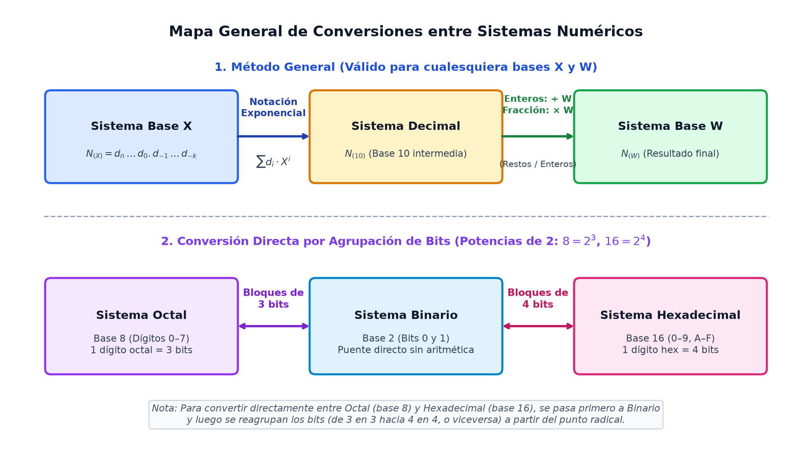
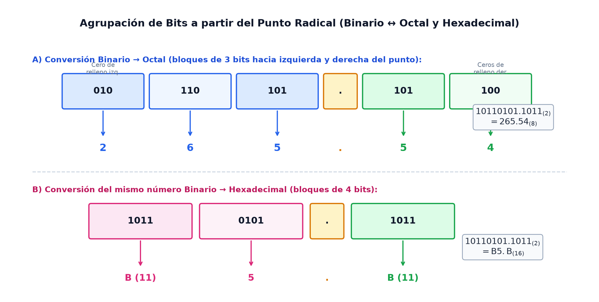

<!-- _class: portada -->
<!-- _paginate: false -->
<!-- _header: "" -->
<!-- _footer: "" -->

# 1.2 Conversiones entre Sistemas Numéricos
## Métodos General, de Horner y Directo por Agrupación de Bits

- **Unidad 1:** Sistemas Numéricos · Matemáticas Discretas (`LISSI0211`)
- **Propósito:** Dominar la traducción exacta entre bases arbitrarias y la conversión directa entre binario, octal y hexadecimal.

---

## Panorama General de las Conversiones

Traducir una magnitud desde una **base de origen $X$** a una **base de destino $W$** cuenta con dos estrategias:

1. **Método general** (para cualesquiera bases $X$ y $W$, pasando por base $10$):
   $$\text{Base } X \xrightarrow{\text{Notación Exponencial}} \text{Base } 10 \xrightarrow{\substack{\text{Enteros: Divisiones entre } W \\ \text{Fracciones: Multiplicaciones por } W}} \text{Base } W$$
2. **Método directo por agrupación de bits** (bases potencias de $2$: $b = 2$, $8 = 2^3$, $16 = 2^4$):
   - Sustituye bloques de $3$ o $4$ bits sin aritmética intermedia.

---

<!-- _class: figura -->

## Mapa General de Conversiones entre Sistemas Numéricos

Estrategia general vía decimal y puente directo entre binario, octal y hexadecimal.

---

## 1. Conversión de Base $b$ a Decimal ($b \to 10$)

### 1.1 Método de la Notación Exponencial
Se evalúa la forma expandida directamente en aritmética decimal:
$$N_{(10)} = \sum_{i=-k}^{n-1} d_i \cdot b^i = d_{n-1}b^{n-1} + \dots + d_0b^0 + d_{-1}b^{-1} + \dots + d_{-k}b^{-k}$$

### 1.2 Método de Horner (parte entera)
Factoriza el polinomio de forma anidada sin calcular potencias elevadas:
$$N_I = \left(\left(\left(d_{n-1}\cdot b + d_{n-2}\right)\cdot b + d_{n-3}\right)\cdot b + \dots + d_1\right)\cdot b + d_0$$
- Se toma $d_{n-1}$, se multiplica por $b$ y se suma $d_{n-2}$; se repite hasta sumar $d_0$.

---

## 2. Decimal a Base $b$ ($10 \to b$): Parte Entera ($N_I$)

Cuando $N_{(10)} = N_I + N_F$, parte entera y fraccionaria se convierten **por separado**:

1. Dividir $N_I$ entre $b$: anotar cociente entero $q_1$ y residuo $r_0 \in \{0, \dots, b - 1\}$.
2. Dividir sucesivamente cada cociente entre $b$ hasta que el cociente sea **$0$**.
3. Leer los residuos **en orden inverso** ($\uparrow$, de abajo hacia arriba):
   $$N_{I(b)} = (r_{m}\dots r_2 r_1 r_0)_{(b)}$$

- **Nota (calculadora):** si $108\,605 / 8 = 13\,575.625$, el cociente es $13\,575$ y el residuo es $0.625 \times 8 = 5$.

---

## 2. Decimal a Base $b$ ($10 \to b$): Parte Fraccionaria ($N_F$)

1. Multiplicar la parte fraccionaria $N_F$ por la base destino $b$.
2. Extraer la **parte entera** del producto como dígito $d_{-1}$ y conservar solo la nueva **parte fraccionaria**.
3. Repetir hasta que la fracción sea $0$, aparezca un periodo o se obtengan las cifras deseadas ($4$ a $6$).
4. Leer los enteros extraídos **de arriba hacia abajo** ($\downarrow$): $N_{F(b)} = 0.d_{-1}d_{-2}d_{-3}\dots_{(b)}$.

- **Fracciones periódicas:** una fracción decimal exacta puede ser periódica infinita en otra base (p. ej., $0.6_{(10)} = 0.\overline{1001}_{(2)}$).

---

<!-- _class: tabla-ancha -->

## 3. Equivalencias Directas ($2$, $8$ y $16$)

Dado que $8 = 2^3$ y $16 = 2^4$, cada dígito octal equivale a **$3$ bits** y cada dígito hexadecimal a **$4$ bits**:

| Octal | Binario ($3$ bits) | Hexadecimal | Decimal | Binario ($4$ bits) | Hexadecimal | Decimal | Binario ($4$ bits) |
| :---: | :---: | :---: | :---: | :---: | :---: | :---: | :---: |
| $0$ | $000$ | $0$ | $0$ | $0000$ | $8$ | $8$ | $1000$ |
| $1$ | $001$ | $1$ | $1$ | $0001$ | $9$ | $9$ | $1001$ |
| $2$ | $010$ | $2$ | $2$ | $0010$ | $\text{A}$ | $10$ | $1010$ |
| $3$ | $011$ | $3$ | $3$ | $0011$ | $\text{B}$ | $11$ | $1011$ |
| $4$ | $100$ | $4$ | $4$ | $0100$ | $\text{C}$ | $12$ | $1100$ |
| $5$ | $101$ | $5$ | $5$ | $0101$ | $\text{D}$ | $13$ | $1101$ |
| $6$ | $110$ | $6$ | $6$ | $0110$ | $\text{E}$ | $14$ | $1110$ |
| $7$ | $111$ | $7$ | $7$ | $0111$ | $\text{F}$ | $15$ | $1111$ |

---

## Reglas de Agrupación desde el Punto Radical

- **Binario $\to$ Octal ($2 \to 8$) o Hexadecimal ($2 \to 16$):**
  1. **Parte entera:** agrupar de $3$ o $4$ bits del punto radical **hacia la izquierda** ($\leftarrow$); completar con **ceros a la izquierda** si falta.
  2. **Parte fraccionaria:** agrupar del punto radical **hacia la derecha** ($\rightarrow$); completar con **ceros a la derecha** si falta.
  3. Reemplazar cada bloque por su dígito octal o hexadecimal.
- **Octal / Hexadecimal $\to$ Binario ($8 \to 2$ o $16 \to 2$):** sustituir cada dígito por sus $3$ o $4$ bits.
- **Octal $\leftrightarrow$ Hexadecimal ($8 \leftrightarrow 16$):** convertir primero a **binario** y luego reagrupar bits.

---

<!-- _class: figura -->

## Agrupación de Bits a partir del Punto Radical

Conversión directa $2 \to 8$ (bloques de $3$ bits) y $2 \to 16$ (bloques de $4$ bits) con relleno de ceros.

---

<!-- _class: seccion -->
<!-- _header: "" -->
<!-- _footer: "" -->

## Ejemplos de Práctica
Resolución paso a paso de conversiones por divisiones, agrupación directa, bases arbitrarias y Horner.

---

<!-- _class: compacta -->

## Ejemplo 1.1: Decimal a Binario ($10 \to 2$) (1/2)

Convierta $28.37_{(10)}$ a binario con $4$ cifras después del punto binario.

**1. Parte entera ($N_I = 28$):** divisiones sucesivas entre $2$:

| División | Cociente entero | Residuo | Orden de lectura |
| :--- | :---: | :---: | :---: |
| $28 \div 2$ | $14$ | $0$ | LSB $\uparrow$ |
| $14 \div 2$ | $7$ | $0$ | $\uparrow$ |
| $7 \div 2$ | $3$ | $1$ | $\uparrow$ |
| $3 \div 2$ | $1$ | $1$ | $\uparrow$ |
| $1 \div 2$ | $0$ | $1$ | MSB $\uparrow$ |

Leyendo los residuos de abajo hacia arriba: **$28_{(10)} = 11100_{(2)}$**.

---

<!-- _class: compacta -->

## Ejemplo 1.1: Decimal a Binario ($10 \to 2$) (2/2)

**2. Parte fraccionaria ($N_F = 0.37$):** multiplicaciones sucesivas por $2$:

| Multiplicación | Producto | Parte entera extraída | Nueva fracción | Orden de lectura |
| :--- | :---: | :---: | :---: | :---: |
| $0.37 \times 2$ | $0.74$ | $0$ | $0.74$ | $\downarrow$ 1.º |
| $0.74 \times 2$ | $1.48$ | $1$ | $0.48$ | $\downarrow$ 2.º |
| $0.48 \times 2$ | $0.96$ | $0$ | $0.96$ | $\downarrow$ 3.º |
| $0.96 \times 2$ | $1.92$ | $1$ | $0.92$ | $\downarrow$ 4.º |

- Leyendo los enteros de arriba hacia abajo: **$0.37_{(10)} \approx 0.0101_{(2)}$**.
- **Resultado final:** $28.37_{(10)} \approx \mathbf{11100.0101_{(2)}}$.

---

<!-- _class: compacta -->

## Ejemplo 1.2: Hexadecimal a Octal ($16 \to 8$) (1/2)

Convierta $\text{E}8\text{A}7.3\text{D}_{(16)}$ a octal por **(a) tablas vía binario** y **(b) método general vía decimal**.

**a) Mediante tablas de equivalencia (vía binario):**
1. Cada dígito hex $\to 4$ bits ($\text{E}=1110, 8=1000, \text{A}=1010, 7=0111, 3=0011, \text{D}=1101$):
   $$\text{E}8\text{A}7.3\text{D}_{(16)} = \underbrace{1110}_{\text{E}}\;\underbrace{1000}_{8}\;\underbrace{1010}_{\text{A}}\;\underbrace{0111}_{7}\,.\,\underbrace{0011}_{3}\;\underbrace{1101}_{\text{D}\,(2)}$$
2. Reagrupar en bloques de **$3$ bits** desde el punto (agregando dos ceros a la izquierda y uno a la derecha):
   $$\underbrace{001}_{1}\;\underbrace{110}_{6}\;\underbrace{100}_{4}\;\underbrace{010}_{2}\;\underbrace{100}_{4}\;\underbrace{111}_{7}\,.\,\underbrace{001}_{1}\;\underbrace{111}_{7}\;\underbrace{010}_{2\,(2)} = \mathbf{164247.172_{(8)}}$$

---

<!-- _class: compacta -->

## Ejemplo 1.2: Hexadecimal a Octal ($16 \to 8$) (2/2)

**b) Mediante el método general (vía decimal):**
1. **A decimal:** $14(16^3) + 8(16^2) + 10(16^1) + 7(16^0) + 3(16^{-1}) + 13(16^{-2}) = 57\,344 + 2048 + 160 + 7 + 0.1875 + 0.05078125 = \mathbf{59\,559.23828125_{(10)}}$.
2. **Parte entera ($59\,559 \div 8$):**
   - $59\,559\div 8 = 7444$ ($r=7$), $7444\div 8 = 930$ ($r=4$), $930\div 8 = 116$ ($r=2$),
   - $116\div 8 = 14$ ($r=4$), $14\div 8 = 1$ ($r=6$), $1\div 8 = 0$ ($r=1$) $\implies 164247_{(8)}$.
3. **Parte fraccionaria ($0.23828125 \times 8$):**
   - $0.23828125\times 8 = 1.90625$ ($1$); $0.90625\times 8 = 7.25$ ($7$); $0.25\times 8 = 2.00$ ($2$) $\implies 0.172_{(8)}$.
- **Resultado:** $\mathbf{164247.172_{(8)}}$ (coincide con el método por tablas).

---

## Ejemplo 1.3: Conversión entre Bases Arbitrarias ($15 \to 20$) (1/2)

Convierta $\text{CD}057.\text{EC}_{(15)}$ a base $20$ con $4$ cifras fraccionarias.

**Paso 1 (Base $15 \to$ Base $10$):** usando $\text{C}=12,\; \text{D}=13,\; \text{E}=14$:
$$\text{CD}057.\text{EC}_{(15)} = 12(15^4) + 13(15^3) + 0(15^2) + 5(15^1) + 7(15^0) + 14(15^{-1}) + 12(15^{-2})$$
$$= 12(50\,625) + 13(3375) + 75 + 7 + \frac{14}{15} + \frac{12}{225}$$
$$= 607\,500 + 43\,875 + 82 + 0.9333 + 0.0533 = \mathbf{651\,457.9866_{(10)}}$$

---

<!-- _class: compacta -->

## Ejemplo 1.3: Conversión entre Bases Arbitrarias ($15 \to 20$) (2/2)

**Paso 2 (Base $10 \to$ Base $20$):** en base $20$, $\text{C}=12, \text{E}=14, \text{G}=16, \text{H}=17, \text{J}=19$.

- **Parte entera ($651\,457 \div 20$):**
  - $651\,457 \div 20 = 32\,572$ ($r = 17 = \text{H}$); $32\,572 \div 20 = 1628$ ($r = 12 = \text{C}$);
  - $1628 \div 20 = 81$ ($r = 8$); $81 \div 20 = 4$ ($r = 1$); $4 \div 20 = 0$ ($r = 4$) $\implies 418\text{CH}_{(20)}$.
- **Parte fraccionaria ($0.9866 \times 20$):**
  - $0.9866 \times 20 = 19.732$ ($\text{J}$); $0.732 \times 20 = 14.64$ ($\text{E}$);
  - $0.64 \times 20 = 12.8$ ($\text{C}$); $0.8 \times 20 = 16.0$ ($\text{G}$) $\implies 0.\text{JECG}_{(20)}$.
- **Resultado final:** $\text{CD}057.\text{EC}_{(15)} = \mathbf{418\text{CH}.\text{JECG}_{(20)}}$.

---

## Ejemplo 1.4: Conversión Rápida por el Método de Horner

Convierta el entero octal $25146_{(8)}$ a decimal empleando el esquema de Horner.

**Solución:** multiplicamos acumulativamente por $b = 8$ y sumamos el dígito siguiente (de izquierda a derecha):
1. Primer dígito: $2$
2. $2 \times 8 + 5 = 16 + 5 = 21$
3. $21 \times 8 + 1 = 168 + 1 = 169$
4. $169 \times 8 + 4 = 1352 + 4 = 1356$
5. $1356 \times 8 + 6 = 10\,848 + 6 = \mathbf{10\,854_{(10)}}$

---

<!-- _class: seccion -->
<!-- _header: "" -->
<!-- _footer: "" -->

## Ejercicios de Tarea
Práctica en casa: detalle divisiones, multiplicaciones o agrupaciones de bits empleadas.

---

<!-- _class: compacta -->

## Ejercicios de Tarea (1/2)

1. **Conversiones directas por tablas de equivalencia ($2 \leftrightarrow 8 \leftrightarrow 16$):**  
   Realice las conversiones usando exclusivamente agrupación de bits (sin pasar por decimal):  
   a) $1001000111010100100010.0101_{(2)}$ a octal y a hexadecimal.  
   b) $4\text{EC}7.\text{B}5_{(16)}$ a binario y a octal.  
   c) $475320.47_{(8)}$ a binario y a hexadecimal.

2. **Conversiones entre Decimal y Binario / Octal / Hexadecimal:**  
   Convierta $437.40625_{(10)}$ a: **a)** binario ($b=2$), **b)** octal ($b=8$) y **c)** hexadecimal ($b=16$). Verifique que sus tres resultados son consistentes mediante agrupación de bits.

---

<!-- _class: compacta -->

## Ejercicios de Tarea (2/2)

3. **Conversiones por el método general entre bases cualesquiera (Jiménez Murillo, Prob. 1.3):**  
   Convierta pasando por el sistema decimal (calcule $4$ dígitos fraccionarios):  
   a) $730568.23_{(9)}$ a base $14$ &nbsp;|&nbsp; b) $4\text{A}7\text{E}8.52_{(18)}$ a base $15$ &nbsp;|&nbsp; c) $93\text{AF}5.36_{(17)}$ a base $13$

4. **Fracciones periódicas en binario y demostración con series geométricas (Lipschutz, Prob. 1.15):**  
   a) Convierta $0.6_{(10)}$ a binario y muestre que se obtiene la fracción periódica $0.100110011001\dots_{(2)} = 0.\overline{1001}_{(2)}$.  
   b) Usando la suma de una serie geométrica infinita $\sum_{k=0}^{\infty} r^k = \frac{1}{1 - r}$ ($|r| < 1$), demuestre analíticamente que $0.\overline{1001}_{(2)} = \frac{3}{5} = 0.6_{(10)}$.
