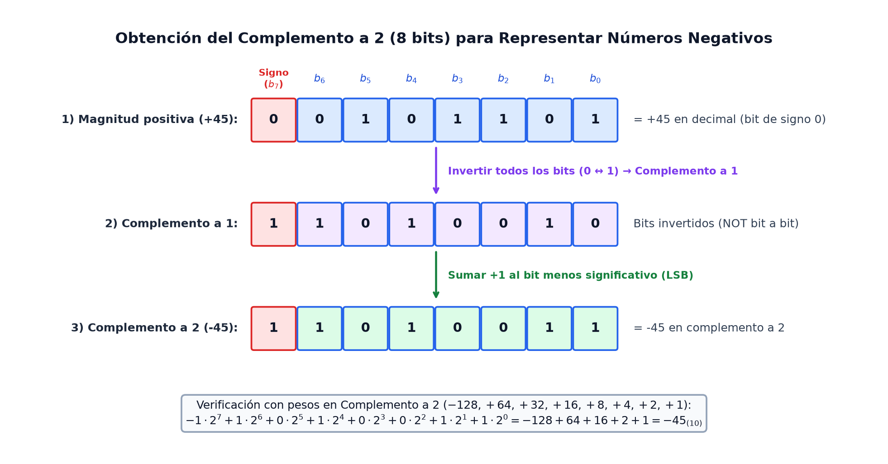

<!-- _class: portada -->
<!-- _paginate: false -->
<!-- _header: "" -->
<!-- _footer: "" -->

# 1.3 Operaciones Básicas
## Suma, Resta, Multiplicación, División y Complemento a 2

- **Unidad 1:** Sistemas Numéricos · Matemáticas Discretas (`LISSI0211`)
- **Propósito:** Ejecutar aritmética posicional directamente en distintas bases y operar enteros con signo en complemento a $2$.

---

## Principio General y 1.3.1 Suma en Base $b$

- **Condición indispensable:** ambos operandos deben estar en la **misma base $b$** antes de operar.
- **Regla de la suma** (alinear en el punto radical, de derecha a izquierda):
  - Si la suma $S$ de una columna cumple **$S < b$**: se anota $S$ y el acarreo es $0$.
  - Si **$S \ge b$**, se divide $S$ entre la base $b$:
    $$S = q \cdot b + r \qquad (0 \le r < b)$$
    - El **residuo $r$** se anota debajo de la columna actual.
    - El **cociente $q$** pasa como **acarreo** (*carry*) a la columna inmediata a la izquierda.

---

## Tabla de Adición Binaria ($b = 2$)

| Operación | Resultado en base $10$ | División entre $2$ | Suma ($r$) | Acarreo ($q$) |
| :---: | :---: | :---: | :---: | :---: |
| $0 + 0$ | $0$ | $0 \div 2 = 0,\; r = 0$ | $0$ | $0$ |
| $0 + 1$ | $1$ | $1 \div 2 = 0,\; r = 1$ | $1$ | $0$ |
| $1 + 0$ | $1$ | $1 \div 2 = 0,\; r = 1$ | $1$ | $0$ |
| $1 + 1$ | $2$ | $2 \div 2 = 1,\; r = 0$ | $0$ | $1$ ($10_{(2)}$) |
| $1 + 1 + 1$ | $3$ | $3 \div 2 = 1,\; r = 1$ | $1$ | $1$ ($11_{(2)}$) |

---

## 1.3.2 Resta en Base $b$ ($M - S = D$)

En $M - S = D$: $M$ es el **minuendo**, $S$ el **sustraendo** y $D$ la **diferencia**. Existen dos métodos equivalentes:

- **Método A (Suma de la base al minuendo; Jiménez Murillo, 2012):**
  - Si en una columna $\text{sustraendo} > \text{minuendo}$, se suma la base $b$ al minuendo: $(\text{minuendo} + b) - \text{sustraendo}$.
  - En la columna inmediata a la izquierda, se suma $1$ al sustraendo ($\text{sustraendo}' = \text{sustraendo} + 1$) antes de comparar.
- **Método B (Préstamo a la izquierda; Lipschutz, 1992):**
  - Se toma prestado $1$ de la columna izquierda (vale **$b$ unidades**); los ceros intermedios se convierten en $b - 1$ (binario: $1$, octal: $7$, hex: $\text{F}$).

---

## Tabla Básica de Sustracción Binaria ($b = 2$)

| Operación | Diferencia | Préstamo requerido |
| :---: | :---: | :--- |
| $0 - 0$ | $0$ | Ninguno |
| $1 - 0$ | $1$ | Ninguno |
| $1 - 1$ | $0$ | Ninguno |
| $0 - 1$ | $1$ | Sumar base $2$ al minuendo: $(0 + 2) - 1 = 1$ y llevar/prestar $1$ a la siguiente columna |

---

## 1.3.3 Multiplicación en Base $b$

1. Multiplicar cada dígito del **multiplicador** (de derecha a izquierda) por todo el **multiplicando**, generando productos parciales desplazados.
2. Para cada producto individual $p = d_i \times d_j + \text{acarreo previo}$:
   - Si $p < b$, se anota directamente.
   - Si $p \ge b$, se divide $p \div b$: se anota el **residuo** y se lleva el **cociente** como acarreo.
3. Sumar los productos parciales con las reglas de suma en base $b$.
4. El **punto radical** se ubica sumando las cifras fraccionarias de ambos factores.
- **Ventaja en binario:** cada producto parcial es copia del multiplicando ($1$) o ceros ($0$).

---

## 1.3.4 División Desarrollada en Base $b$

1. **Divisor entero:** si el divisor tiene decimales, recorrer el punto radical en divisor y dividendo el mismo número de posiciones a la derecha.
2. Tomar de izquierda a derecha cifras del dividendo que formen una cantidad $\ge$ divisor.
3. Estimar cuántas veces $c_i \in \{0, \dots, b - 1\}$ cabe el divisor, multiplicar $c_i \times \text{divisor}$ y restar en base $b$.
4. Bajar la siguiente cifra y repetir hasta alcanzar las posiciones fraccionarias requeridas.
5. **Comprobación en base $b$:**
   $$\text{Dividendo} = (\text{Divisor} \times \text{Cociente}) + \text{Residuo}$$

---

## 1.3.5 Números con Signo ($n$ bits)

La ALU opera sobre palabras de $n$ bits y convierte las restas en **sumas mediante complementos**:

1. **Magnitud verdadera (Signo y Magnitud):** el MSB es el **bit de signo** ($0 = +$, $1 = -$) y los $n - 1$ bits restantes expresan la magnitud.
2. **Complemento a 1 ($C_1$):** para un negativo, se conserva el signo $1$ y se **invierten todos los bits de magnitud** ($0 \leftrightarrow 1$).
3. **Complemento a 2 ($C_2$):** se **suma $1$ al bit menos significativo (LSB)** del complemento a 1:
   $$C_2(N) = C_1(N) + 1$$

---

<!-- _class: figura -->

## Obtención del Complemento a 2 en 8 Bits

Conversión de $+45$ a $-45$ mediante inversión de bits ($C_1$) y suma de $+1$ ($C_2$).

---

## Reglas para Sumar en Complemento a 2 y Desbordamiento

- **Preparación:** los positivos llevan bit de signo $0$; los negativos se convierten a **complemento a 2**.
- **Suma binaria** (incluyendo el bit de signo):
  - Cualquier **acarreo final fuera del bit de signo se descarta**.
  - Signo $= 0 \implies$ resultado **positivo** (ya en magnitud verdadera).
  - Signo $= 1 \implies$ resultado **negativo** en $C_2$ (aplicar $C_2$ para leer su magnitud).
- **Desbordamiento (*overflow*):** ocurre únicamente al sumar dos cantidades del **mismo signo** cuya magnitud excede la capacidad de los bits (cambiando erróneamente el signo). Se evita ampliando el tamaño de palabra (p. ej., de $8$ a $16$ bits).

---

<!-- _class: seccion -->
<!-- _header: "" -->
<!-- _footer: "" -->

## Ejemplos de Práctica
Resolución paso a paso de suma, resta, multiplicación, división y suma en complemento a $2$.

---

<!-- _class: compacta -->

## Ejemplo 1.1 (a): Suma en Binario ($b = 2$)

Realice la suma: $11011.01_{(2)} + 101.1101_{(2)}$

$$\begin{array}{r l}
  11011.0100_{(2)} & \\
+\; 00101.1101_{(2)} & \\
\hline
 100001.0001_{(2)} &
\end{array}$$

- **Col. $-4$ a $-1$:** $0+1=\mathbf{1}$; $0+0=\mathbf{0}$; $1+1=2 \to r=\mathbf{0}$ (lleva $1$); $1+0+1=2 \to r=\mathbf{0}$ (lleva $1$).
- **Col. $0$:** $1+1+1=3 \implies 3 \div 2 = 1$, residuo $\mathbf{1}$ (lleva $1$).
- **Col. $1$ a $3$:** $1+1+0=2 \to \mathbf{0}(1)$; $1+0+1=2 \to \mathbf{0}(1)$; $1+1+0=2 \to \mathbf{0}(1)$.
- **Col. $4$:** $1+1+0=2 \to$ residuo $\mathbf{0}$ y acarreo final $\mathbf{1} \implies \mathbf{100001.0001_{(2)}}$.

---

## Ejemplo 1.1 (b): Suma en Octal ($b = 8$)

Realice la suma: $7346_{(8)} + 5263_{(8)}$

- **Columna $0$:** $6 + 3 = 9 \implies 9 \div 8 = 1$, residuo **$\mathbf{1}$** (lleva $1$).
- **Columna $1$:** $1 + 4 + 6 = 11 \implies 11 \div 8 = 1$, residuo **$\mathbf{3}$** (lleva $1$).
- **Columna $2$:** $1 + 3 + 2 = 6 < 8 \implies$ se anota **$\mathbf{6}$** (lleva $0$).
- **Columna $3$:** $7 + 5 = 12 \implies 12 \div 8 = 1$, residuo **$\mathbf{4}$** y acarreo **$\mathbf{1}$**.
- **Resultado:** $\mathbf{14631_{(8)}}$.

---

<!-- _class: compacta -->

## Ejemplo 1.1 (c): Suma en Hexadecimal ($b = 16$)

Realice la suma: $\text{A}6\text{FC}9.7\text{B}2_{(16)} + 4\text{E}7\text{D}0.73\text{E}_{(16)}$

$$\begin{array}{r}
  \text{A}6\text{FC}9.7\text{B}2_{(16)} \\
+\; 4\text{E}7\text{D}0.73\text{E}_{(16)} \\
\hline
  \text{F}5799.\text{EF}0_{(16)}
\end{array}$$

- **Col. $-3$ a $-1$:** $2+\text{E}(14)=16 \to \mathbf{0}(1)$; $1+\text{B}(11)+3=15=\mathbf{F}$; $7+7=14=\mathbf{E}$.
- **Col. $0$ a $2$:** $9+0=\mathbf{9}$; $\text{C}(12)+\text{D}(13)=25 \to \mathbf{9}(1)$; $1+\text{F}(15)+7=23 \to \mathbf{7}(1)$.
- **Col. $3$ y $4$:** $1+6+\text{E}(14)=21 \to \mathbf{5}(1)$; $1+\text{A}(10)+4=15=\mathbf{F}$.
- **Resultado:** $\mathbf{\text{F}5799.\text{EF}0_{(16)}}$.

---

<!-- _class: compacta -->

## Ejemplo 1.2 (a): Resta en Binario ($b = 2$)

Efectúe la resta: $1101.101_{(2)} - 11.10111_{(2)}$

$$\begin{array}{r}
  1101.10100_{(2)} \\
-\; 0011.10111_{(2)} \\
\hline
  1001.11101_{(2)}
\end{array}$$

- **Col. $-5$ a $-3$:** $(0+2)-1 = \mathbf{1}$; $(0+2)-(1+1) = \mathbf{0}$; $(1+2)-(1+1) = \mathbf{1}$.
- **Col. $-2$ y $-1$:** $(0+2)-(0+1) = \mathbf{1}$; $(1+2)-(1+1) = \mathbf{1}$.
- **Col. $0$ y $1$:** $(1+2)-(1+1) = \mathbf{1}$; $(0+2)-(1+1) = \mathbf{0}$.
- **Col. $2$ y $3$:** $1-(0+1) = \mathbf{0}$; $1-0 = \mathbf{1} \implies \mathbf{1001.11101_{(2)}}$.

---

<!-- _class: compacta -->

## Ejemplo 1.2 (b): Resta en Octal ($b = 8$)

Efectúe la resta: $41072.14_{(8)} - 36043.713_{(8)}$

$$\begin{array}{r}
  41072.140_{(8)} \\
-\; 36043.713_{(8)} \\
\hline
  03026.225_{(8)}
\end{array}$$

- **Col. $-3$ a $-1$:** $(0+8)-3 = \mathbf{5}$; $4-(1+1) = \mathbf{2}$; $(1+8)-7 = \mathbf{2}$.
- **Col. $0$ a $2$:** $(2+8)-(3+1) = \mathbf{6}$; $7-(4+1) = \mathbf{2}$; $0-0 = \mathbf{0}$.
- **Col. $3$ y $4$:** $(1+8)-6 = \mathbf{3}$; $4-(3+1) = \mathbf{0} \implies \mathbf{3026.225_{(8)}}$.

---

<!-- _class: compacta -->

## Ejemplo 1.3 (a): Multiplicación Desarrollada Binaria

Multiplique $10011.01_{(2)} \times 1.101_{(2)}$:

$$\begin{array}{r}
        10011.01_{(2)} \\
\times \quad 1.101_{(2)} \\
\hline
        1001101\phantom{000} \\
       0000000\phantom{00} \\
      1001101\phantom{0} \\
+\;  1001101 \\
\hline
    11111.01001_{(2)}
\end{array}$$

- Los factores poseen $2$ y $3$ posiciones fraccionarias $\implies 2 + 3 = 5$ cifras después del punto.
- **Resultado:** $\mathbf{11111.01001_{(2)}}$ (en decimal: $19.25 \times 1.625 = 31.28125$).

---

<!-- _class: compacta -->

## Ejemplo 1.3 (b): División Desarrollada Hexadecimal (1/2)

Divida $1\text{AF}578.2\text{B}_{(16)} \div \text{A}.7\text{E}2_{(16)}$ hasta obtener $1$ cifra fraccionaria y compruebe.

- **Desplazamiento del punto ($3$ lugares a la derecha):**
  $$1\text{AF}5782\text{B}0_{(16)} \div \text{A}7\text{E}2_{(16)}$$
- **Primeros tres pasos:**
  1. $1\text{AF}57_{(16)} \div \text{A}7\text{E}2_{(16)} = \mathbf{2}$ ($2 \times \text{A}7\text{E}2 = 14\text{FC}4$); resta: $1\text{AF}57 - 14\text{FC}4 = 05\text{F}93_{(16)}$.
  2. Baja $8$: $5\text{F}938_{(16)} \div \text{A}7\text{E}2_{(16)} = \mathbf{9}$ ($9 \times \text{A}7\text{E}2 = 5\text{E}6\text{F}2$); resta: $1246_{(16)}$.
  3. Baja $2$: $12462_{(16)} \div \text{A}7\text{E}2_{(16)} = \mathbf{1}$; resta: $12462 - \text{A}7\text{E}2 = 7\text{C}80_{(16)}$.

---

<!-- _class: compacta -->

## Ejemplo 1.3 (b): División Desarrollada Hexadecimal (2/2)

- **Pasos finales:**
  4. Baja $\text{B}$: $7\text{C}80\text{B}_{(16)} \div \text{A}7\text{E}2_{(16)} = \mathbf{B}(11)$ ($\text{B} \times \text{A}7\text{E}2 = 736\text{B}6$); resta: $9155_{(16)}$.
  5. Baja $0$: $91550_{(16)} \div \text{A}7\text{E}2_{(16)} = \mathbf{D}(13)$ ($\text{D} \times \text{A}7\text{E}2 = 8867\text{A}$); resta: $8\text{ED}6_{(16)}$.
  6. Agrega $0$ (fracción): $8\text{ED}60_{(16)} \div \text{A}7\text{E}2_{(16)} = \mathbf{D}$; resta: $66\text{E}6_{(16)}$.
- **Resultado:** Cociente $= \mathbf{291\text{BD}.\text{D}_{(16)}}$, Residuo $= \mathbf{66\text{E}.6_{(16)}}$ (respecto al dividendo desplazado).
- **Comprobación:**
  $$291\text{BD}.\text{D}_{(16)} \times \text{A}7\text{E}2_{(16)} + 66\text{E}.6_{(16)} = 1\text{AF}577\text{C}41.\text{A}_{(16)} + 66\text{E}.6_{(16)} = 1\text{AF}5782\text{B}0.0_{(16)}$$

---

<!-- _class: compacta -->

## Ejemplo 1.4 (a): Suma en Complemento a 2 ($-225 + 76$)

Usando $9$ bits ($1$ bit de signo y $8$ de magnitud), sume $A = -225_{(10)}$ y $B = +76_{(10)}$:

1. **Magnitud verdadera:** $-225_{(10)} = 1\;11100001_{(2)}$; $+76_{(10)} = 0\;01001100_{(2)}$.
2. **$C_2$ de $-225$:** $C_1 = 1\;00011110_{(2)} \xrightarrow{+1} 1\;00011111_{(2)}$.
3. **Suma binaria:**
   $$\begin{array}{r l}
     1\;00011111_{(2)} & (-225 \text{ en } C_2) \\
   +\; 0\;01001100_{(2)} & (+76) \\
   \hline
     1\;01101011_{(2)} & (\text{Bit de signo } 1 \implies \text{negativo en } C_2)
   \end{array}$$
4. **Magnitud verdadera ($C_2$):** $1\;10010100_{(2)} \xrightarrow{+1} 1\;10010101_{(2)} = -(128+16+4+1) = \mathbf{-149_{(10)}}$.

---

## Ejemplo 1.4 (b): Evitando Desbordamiento ($-225 - 76$)

Efectúe $A = -225_{(10)}$ más $B = -76_{(10)}$ evitando desbordamiento:

- Como $|-225 + (-76)| = 301 > 255$, en $8$ bits de magnitud hay **desbordamiento**.
- Ampliamos a **$16$ bits** ($1$ de signo y $15$ de magnitud):
  - $-225$ en $C_2$: $1\;111111100011111_{(2)}$
  - $-76$ en $C_2$: $1\;111111110110100_{(2)}$
- **Suma:** $(1)\;1\;111111011010011_{(2)}$ *(se descarta acarreo externo; signo $1$)*.
- **Magnitud verdadera ($C_2$):** $1\;000000100101101_{(2)} = -(256 + 32 + 8 + 4 + 1) = \mathbf{-301_{(10)}}$.

---

<!-- _class: seccion -->
<!-- _header: "" -->
<!-- _footer: "" -->

## Ejercicios de Tarea
Práctica en casa: muestre acarreos, préstamos, productos parciales y comprobaciones.

---

<!-- _class: compacta -->

## Ejercicios de Tarea (1/2)

1. **Suma en diferentes sistemas numéricos (Jiménez Murillo, Prob. 1.5):**  
   Efectúe las siguientes sumas directamente en la base indicada:  
   a) $11001110.0111_{(2)} + 1101011.1101_{(2)}$  
   b) $3\text{A}567\text{B}.12_{(13)} + 9\text{C}0172.34_{(13)}$  
   c) $42061231.325_{(7)} + 5014232.03_{(7)}$  
   d) $82\text{C}5.9\text{D}_{(16)} + 9\text{D}86.\text{E}8_{(16)}$

2. **Resta en diferentes sistemas numéricos (Jiménez Murillo, Prob. 1.7 y 1.8):**  
   Realice las restas directamente en su base y compruebe sumando diferencia más sustraendo:  
   a) $1000110.001_{(2)} - 110011.101_{(2)}$  
   b) $\text{A}7501\text{B}3.\text{E}_{(16)} - 91\text{D}35\text{CB}.8\text{C}_{(16)}$ &nbsp;|&nbsp; c) $5347012.12_{(9)} - 3725408.67_{(9)}$

---

<!-- _class: compacta -->

## Ejercicios de Tarea (2/2)

3. **Multiplicación y División en distintas bases:**  
   a) Multiplique en binario: $111001_{(2)} \times 1011_{(2)}$ y $11.101_{(2)} \times 11.01_{(2)}$.  
   b) Multiplique en octal: $670143.2_{(8)} \times 53.24_{(8)}$.  
   c) Divida en binario hasta dos posiciones fraccionarias: $111001_{(2)} \div 1001_{(2)}$.

4. **Aritmética en Complemento a 2 (Jiménez Murillo, Prob. 1.14):**  
   Considere variables enteras de $1$ byte ($1$ bit de signo y $7$ de magnitud, ampliando a $2$ bytes si detecta desbordamiento). Efectúe mediante suma en complemento a $2$:  
   a) $+195_{(10)} + 76_{(10)}$ &nbsp;|&nbsp; b) $-195_{(10)} + 76_{(10)}$ &nbsp;|&nbsp; c) $+195_{(10)} - 76_{(10)}$ &nbsp;|&nbsp; d) $-195_{(10)} - 76_{(10)}$
