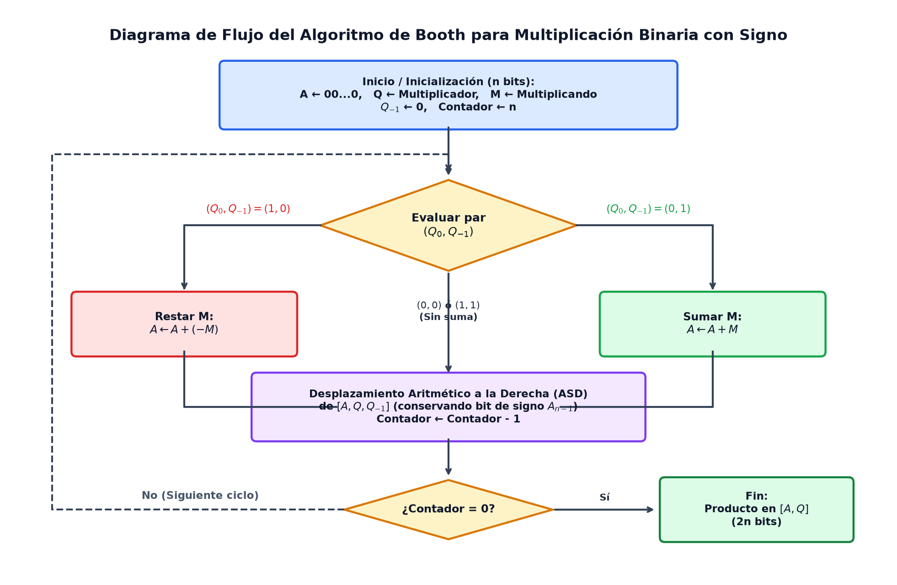
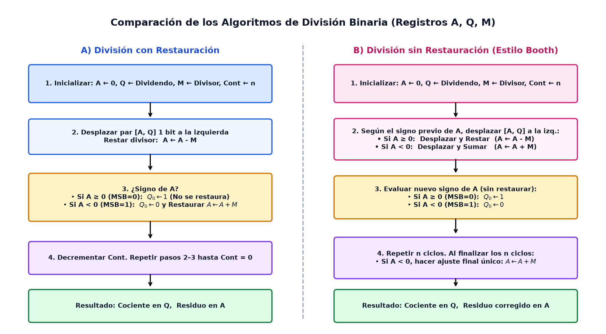

<!-- _class: portada -->
<!-- _paginate: false -->
<!-- _header: "" -->
<!-- _footer: "" -->

# 1.4 Algoritmos de Booth
## Multiplicación y División Binaria a Nivel de Registros

- **Unidad 1:** Sistemas Numéricos · Matemáticas Discretas (`LISSI0211`)
- **Propósito:** Aplicar los algoritmos de hardware de Booth para multiplicar enteros con signo y dividir mediante registros en la ALU.

---

## Introducción: Aritmética Binaria en la ALU

- En procesadores digitales, multiplicación y división operan con **registros de desplazamiento** y un **sumador/restador en complemento a 2**.
- **Algoritmo de Booth (1950):** multiplica dos enteros **con signo en $C_2$** de forma uniforme, sin convertir a positivos ni separar signos.
- **Fundamento de recodificación:** una cadena de unos desde la posición $i$ hasta $j$ ($j > i$) equivale a una resta y una suma:
  $$\sum_{k=i}^{j} 2^k = 2^{j+1} - 2^i \qquad (\text{ej. } 00111100_{(2)} = 2^6 - 2^2 = 60)$$
- Recorriendo el multiplicador de derecha a izquierda $(Q_0, Q_{-1})$:
  - $(1,0) \to$ restar $M$ | $(0,1) \to$ sumar $M$ | $(0,0)$ o $(1,1) \to$ solo desplazar.

---

## Arquitectura de Registros (Multiplicación de Booth)

Para dos enteros con signo de $n$ bits en complemento a $2$ ($n$ al menos $1$ bit mayor que los bits de magnitud máxima):

- **$M$ (Multiplicando):** $n$ bits en $C_2$; se precalcula **$-M$** para restar sumando $A + (-M)$.
- **$A$ (Acumulador):** $n$ bits inicializados en `00...0`.
- **$Q$ (Multiplicador):** $n$ bits en $C_2$; su bit menos significativo es **$Q_0$**.
- **$Q_{-1}$ (Bit auxiliar):** $1$ bit a la derecha de $Q_0$, inicializado en **`0`**.
- **Contador ($n$):** indica el número exacto de ciclos a ejecutar.

---

<!-- _class: compacta -->

## Tabla de Decisiones de Booth

En cada uno de los $n$ ciclos se inspecciona el par $(Q_0, Q_{-1})$:

| Bit $Q_0$ | Bit $Q_{-1}$ | Interpretación en la cadena | Acción (antes de desplazar) | Paso posterior |
| :---: | :---: | :--- | :--- | :--- |
| **$0$** | **$0$** | En medio de una cadena de $0\text{s}$ | **Ninguna operación** aritmética | Desplazamiento **ASD** |
| **$0$** | **$1$** | Fin de una cadena de $1\text{s}$ | **Sumar:** $A \leftarrow A + M$ | Desplazamiento **ASD** |
| **$1$** | **$0$** | Inicio de una cadena de $1\text{s}$ | **Restar:** $A \leftarrow A + (-M)$ | Desplazamiento **ASD** |
| **$1$** | **$1$** | En medio de una cadena de $1\text{s}$ | **Ninguna operación** aritmética | Desplazamiento **ASD** |

---

## Desplazamiento Aritmético a la Derecha (ASD)

Los registros concatenados $[A,\; Q,\; Q_{-1}]$ ($2n + 1$ bits en total) se desplazan **una posición hacia la derecha**:

- El bit de signo de $A$ ($A_{n-1}$, extremo izquierdo) **se conserva y se duplica** en $A_{n-1}$ (extensión de signo).
- El bit menos significativo de $A$ ($A_0$) pasa a ser el bit más significativo de $Q$ ($Q_{n-1}$).
- El bit $Q_0$ pasa a ocupar $Q_{-1}$ (y el valor anterior de $Q_{-1}$ se descarta).
- Al concluir los $n$ ciclos, el producto de $2n$ bits en $C_2$ se lee directamente en **$[A,\; Q]$**.

---

<!-- _class: figura -->

## Diagrama de Flujo: Multiplicación de Booth

Evaluación del par $(Q_0, Q_{-1})$, operación sobre $A$ y desplazamiento aritmético a la derecha (ASD).

---

## División Binaria a Nivel de Registros

Para dividir un **dividendo** de $n$ bits entre un **divisor** de $n$ bits en binario:

- **$M$ (Divisor):** registro de $n + 1$ bits (con bit de signo $0$ a la izquierda) y su complemento **$-M$** en $C_2$.
- **$A$ (Acumulador / Residuo parcial):** registro de $n + 1$ bits inicializado en `00...0`.
- **$Q$ (Dividendo / Cociente):** registro de $n$ bits inicializado con el dividendo; sus bits se desplazan a la izquierda y por $Q_0$ entra el cociente.
- **Contador ($n$):** igual al número de bits de $Q$.

---

<!-- _class: figura -->

## División Binaria con Restauración y sin Restauración

Comparación entre el método con restauración y el método sin restauración (estilo Booth).

---

## 1. Algoritmo de División con Restauración

En cada uno de los $n$ ciclos:
1. **Desplazamiento lógico a la izquierda (SL):** mover $[A,\; Q]$ un bit a la izquierda (el MSB de $Q$ entra a $A$ y $Q_0$ queda vacante).
2. **Resta de prueba:** $A \leftarrow A - M = A + (-M)$.
3. **Verificación del signo de $A$:**
   - **Si $A \ge 0$ (signo $0$):** el divisor cabe $\implies$ **$Q_0 \leftarrow 1$** y se conserva $A$.
   - **Si $A < 0$ (signo $1$):** se excedió $\implies$ **$Q_0 \leftarrow 0$** y **se restaura** $A \leftarrow A + M$.
4. Al terminar $n$ ciclos: **cociente en $Q$**, **residuo en $A$**.

---

<!-- _class: compacta -->

## 2. Algoritmo de División sin Restauración

Si $A < 0$ en el ciclo $k$, restaurar y desplazar equivale a $2(A + M) - M = 2A + M$: basta desplazar en el siguiente ciclo y **sumar $M$**.

**Pasos por cada uno de los $n$ ciclos:**
1. Revisar el signo previo de $A$ y desplazar $[A,\; Q]$ un bit a la izquierda:
   - Si $A \ge 0$: **restar** $A \leftarrow A - M$ &nbsp;|&nbsp; Si $A < 0$: **sumar** $A \leftarrow A + M$.
2. Asignar $Q_0$ según el **nuevo** signo de $A$: $Q_0 \leftarrow 1$ si $A \ge 0$, o $Q_0 \leftarrow 0$ si $A < 0$.
3. **Ajuste final único:** tras $n$ ciclos, si $A < 0$, ejecutar $A \leftarrow A + M$.

- **Con signos arbitrarios:** dividir magnitudes; $\text{signo}(Q) = \text{signo}(D) \oplus \text{signo}(d)$ y $\text{signo}(R) = \text{signo}(D)$, cumpliendo $D = d \cdot Q + R$.

---

<!-- _class: seccion -->
<!-- _header: "" -->
<!-- _footer: "" -->

## Ejemplos de Práctica
Traza completa ciclo por ciclo de multiplicación de Booth y división en registros.

---

## Ejemplo 1.1: Booth $+7 \times (-3)$ en $n = 4$ bits (1/2)

Multiplique $M = +7_{(10)}$ por $Q = -3_{(10)}$ usando el algoritmo de Booth con $n = 4$ bits.

**1. Codificación en $4$ bits (complemento a $2$):**
- **Multiplicando:** $M = +7_{(10)} = 0111_{(2)}$.
- **Complemento a 2 de $M$:** $-M = -7_{(10)} = 1000 + 1 = 1001_{(2)}$.
- **Multiplicador:** $+3 = 0011_{(2)} \implies Q = -3_{(10)} = 1101_{(2)}$.
- **Inicialización:** $A = 0000$, $Q = 1101$, $Q_{-1} = 0$, $\text{Contador} = 4$.

---

<!-- _class: tabla-ancha -->

## Ejemplo 1.1: Booth $+7 \times (-3)$ en $n = 4$ bits (2/2)

| Ciclo | $(Q_0, Q_{-1})$ | Operación ejecutada | $A$ | $Q$ | $Q_{-1}$ | Comentario |
| :---: | :---: | :--- | :---: | :---: | :---: | :--- |
| **Inicio** | — | Valores iniciales | `0000` | `1101` | `0` | $M=0111,\; -M=1001$ |
| **1** | $(1, 0)$ | $A \leftarrow A + (-M) = 0000 + 1001$ Desplazamiento ASD | `1001` **`1100`** | `1101` **`1110`** | `0` **`1`** | Resta $M$ Duplica $A_3 = 1$ |
| **2** | $(0, 1)$ | $A \leftarrow A + M = 1100 + 0111$ Desplazamiento ASD | `0011` **`0001`** | `1110` **`1111`** | `1` **`0`** | Suma $M$ (ignora acarreo) Duplica $A_3 = 0$ |
| **3** | $(1, 0)$ | $A \leftarrow A + (-M) = 0001 + 1001$ Desplazamiento ASD | `1010` **`1101`** | `1111` **`0111`** | `0` **`1`** | Resta $M$ Duplica $A_3 = 1$ |
| **4** | $(1, 1)$ | Sin operación aritmética Desplazamiento ASD | `1101` **`1110`** | `0111` **`1011`** | `1` **`1`** | Fin de los $4$ ciclos |

- **Resultado $[A, Q] = 11101011_{(2)}$:** signo $1 \implies C_2$ de $11101011$: $00010100 + 1 = 00010101_{(2)} = 21 \implies \mathbf{-21_{(10)}}$.

---

## Ejemplo 1.2: Booth $(-5) \times (-6)$ en $n = 4$ bits (1/2)

Multiplique $M = -5_{(10)}$ por $Q = -6_{(10)}$ usando el algoritmo de Booth con $n = 4$ bits.

**1. Preparación de registros ($n = 4$):**
- $+5 = 0101_{(2)} \implies M = -5 = 1011_{(2)}$, y por tanto $-M = +5 = 0101_{(2)}$.
- $+6 = 0110_{(2)} \implies Q = -6 = 1010_{(2)}$.
- **Estado inicial:** $A = 0000$, $Q = 1010$, $Q_{-1} = 0$, $\text{Contador} = 4$.

---

<!-- _class: tabla-ancha -->

## Ejemplo 1.2: Booth $(-5) \times (-6)$ en $n = 4$ bits (2/2)

| Ciclo | Par $(Q_0, Q_{-1})$ | Operación ejecutada | Registro $A$ | Registro $Q$ | Bit $Q_{-1}$ |
| :---: | :---: | :--- | :---: | :---: | :---: |
| **Inicio** | — | Inicialización | `0000` | `1010` | `0` |
| **1** | $(0, 0)$ | Solo ASD | **`0000`** | **`0101`** | **`0`** |
| **2** | $(1, 0)$ | $A \leftarrow A + (-M) = 0000 + 0101$ ASD | `0101` **`0010`** | `0101` **`1010`** | `0` **`1`** |
| **3** | $(0, 1)$ | $A \leftarrow A + M = 0010 + 1011$ ASD | `1101` **`1110`** | `1010` **`1101`** | `1` **`0`** |
| **4** | $(1, 0)$ | $A \leftarrow A + (-M) = 1110 + 0101$ ASD | `0011` **`0001`** | `1101` **`1110`** | `0` **`1`** |

- **Resultado final:** $[A,\; Q] = 00011110_{(2)} = +(16 + 8 + 4 + 2) = \mathbf{+30_{(10)}}$.

---

## Ejemplo 1.3: División con Restauración $11 \div 3$ (1/3)

Divida $11_{(10)} = 1011_{(2)}$ entre $3_{(10)} = 0011_{(2)}$ con el algoritmo **con restauración** ($n = 4$ bits en $Q$, $5$ bits en $A$ y $M$).

**1. Inicialización:**
- **Dividendo:** $Q = 1011_{(2)}$ ($4$ bits, $\text{Contador} = 4$).
- **Divisor ($5$ bits):** $M = 00011_{(2)} \implies -M = 11101_{(2)}$ (en $C_2$ de $5$ bits).
- **Acumulador ($5$ bits):** $A = 00000_{(2)}$.

---

<!-- _class: tabla-ancha -->

## Ejemplo 1.3: División con Restauración $11 \div 3$ (2/3)

| Ciclo | Paso / Acción | $A$ ($5$ bits) | $Q$ ($4$ bits) | Explicación |
| :---: | :--- | :---: | :---: | :--- |
| **Inicio** | Valores iniciales | `00000` | `1011` | $M = 00011,\; -M = 11101$ |
| **1** | Desplazar izq. $[A, Q]$ Restar $M$: $A \leftarrow A + (-M)$ $A < 0 \implies Q_0 \leftarrow 0$ y Restaurar $A + M$ | `00001` `11110` **`00001`** | `011_` `011_` **`0110`** | Entra $1$ a $A$ Signo de $A$ es $1$ (negativo) Fija $Q_0=0$ y restaura $A$ |
| **2** | Desplazar izq. $[A, Q]$ Restar $M$: $A \leftarrow A + (-M)$ $A < 0 \implies Q_0 \leftarrow 0$ y Restaurar $A + M$ | `00010` `11111` **`00010`** | `110_` `110_` **`1100`** | Entra $0$ a $A$ Signo de $A$ es $1$ (negativo) Fija $Q_0=0$ y restaura $A$ |

---

<!-- _class: tabla-ancha -->

## Ejemplo 1.3: División con Restauración $11 \div 3$ (3/3)

| Ciclo | Paso / Acción | $A$ ($5$ bits) | $Q$ ($4$ bits) | Explicación |
| :---: | :--- | :---: | :---: | :--- |
| **3** | Desplazar izq. $[A, Q]$ Restar $M$: $A \leftarrow A + (-M)$ $A \ge 0 \implies Q_0 \leftarrow 1$ (No restaura) | `00101` **`00010`** | `100_` **`1001`** | Entra $1$ a $A$ ($A = 5$) $5 - 3 = 2 \ge 0$ (signo $0$) Se fija $Q_0 = 1$ |
| **4** | Desplazar izq. $[A, Q]$ Restar $M$: $A \leftarrow A + (-M)$ $A \ge 0 \implies Q_0 \leftarrow 1$ (No restaura) | `00101` **`00010`** | `001_` **`0011`** | Entra $1$ a $A$ ($A = 5$) $5 - 3 = 2 \ge 0$ (signo $0$) Se fija $Q_0 = 1$ |

- **Cociente ($Q$):** $0011_{(2)} = \mathbf{3_{(10)}}$ | **Residuo ($A$):** $00010_{(2)} = \mathbf{2_{(10)}}$ ($11 = 3 \times 3 + 2$).

---

<!-- _class: tabla-ancha -->

## Ejemplo 1.4: División sin Restauración $11 \div 3$ (1/2)

Resuelva $11_{(10)} \div 3_{(10)}$ sin restauración ($A = 00000,\; Q = 1011,\; M = 00011,\; -M = 11101$):

| Ciclo | Signo previo | Acción realizada | $A$ | $Q$ | Asignación de $Q_0$ |
| :---: | :---: | :--- | :---: | :---: | :--- |
| **Inicio** | $A \ge 0$ (`0`) | Estado inicial | `00000` | `1011` | — |
| **1** | $A \ge 0$ | Desplazar izq. $[A, Q]$ Restar $M$: $00001 + 11101$ | `00001` **`11110`** | `011_` **`0110`** | $A < 0 \implies Q_0 \leftarrow 0$ *(No se restaura)* |
| **2** | $A < 0$ | Desplazar izq. $[A, Q]$ Sumar $M$: $11100 + 00011$ | `11100` **`11111`** | `110_` **`1100`** | $A < 0 \implies Q_0 \leftarrow 0$ *(No se restaura)* |

---

<!-- _class: tabla-ancha -->

## Ejemplo 1.4: División sin Restauración $11 \div 3$ (2/2)

| Ciclo | Signo previo | Acción realizada | $A$ | $Q$ | Asignación de $Q_0$ |
| :---: | :---: | :--- | :---: | :---: | :--- |
| **3** | $A < 0$ | Desplazar izq. $[A, Q]$ Sumar $M$: $11111 + 00011$ | `11111` **`00010`** | `100_` **`1001`** | $A \ge 0 \implies Q_0 \leftarrow 1$ |
| **4** | $A \ge 0$ | Desplazar izq. $[A, Q]$ Restar $M$: $00101 + 11101$ | `00101` **`00010`** | `001_` **`0011`** | $A \ge 0 \implies Q_0 \leftarrow 1$ |

- Al terminar el ciclo 4, $A = 00010_{(2)} \ge 0$, por lo que **no requiere ajuste final**.
- **Cociente ($Q$):** $0011_{(2)} = \mathbf{3_{(10)}}$ | **Residuo ($A$):** $00010_{(2)} = \mathbf{2_{(10)}}$.

---

<!-- _class: seccion -->
<!-- _header: "" -->
<!-- _footer: "" -->

## Ejercicios de Tarea
Práctica en casa: construya la tabla completa de registros ciclo por ciclo.

---

## Ejercicios de Tarea (1/2)

1. **Multiplicación de Booth (positivo por negativo):**  
   Con registros de $n = 4$ bits, multiplique $M = +6_{(10)}$ por $Q = -4_{(10)}$. Muestre la tabla de estados de $A$, $Q$ y $Q_{-1}$ en los $4$ ciclos y compruebe el producto final en complemento a $2$.

2. **Multiplicación de Booth con operandos de $5$ bits:**  
   Utilice el algoritmo de Booth con registros de $n = 5$ bits para calcular $M = -9_{(10)}$ por $Q = +5_{(10)}$.

---

## Ejercicios de Tarea (2/2)

3. **División binaria con restauración:**  
   Divida $13_{(10)} = 1101_{(2)}$ entre $4_{(10)} = 0100_{(2)}$ utilizando el algoritmo de división **con restauración** ($n = 4$ bits en $Q$ y $5$ bits en $A$ y $M$).

4. **División binaria sin restauración (con ajuste final del residuo):**  
   Divida $14_{(10)} = 1110_{(2)}$ entre $3_{(10)} = 0011_{(2)}$ aplicando división **sin restauración** ($n = 4$ bits en $Q$ y $5$ bits en $A$ y $M$). Verifique si al concluir el cuarto ciclo es necesario aplicar el ajuste final $A \leftarrow A + M$.
