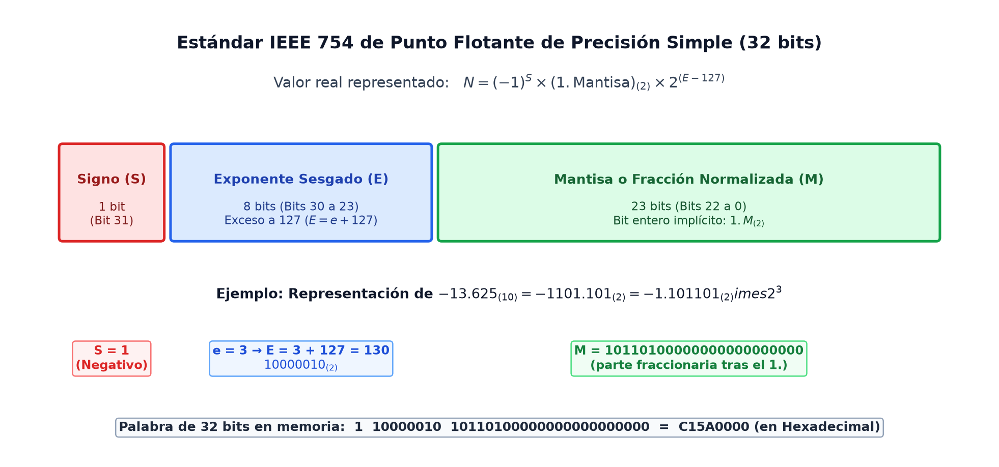

<!-- _class: portada -->
<!-- _paginate: false -->
<!-- _header: "" -->
<!-- _footer: "" -->

# 1.5 Aplicación de los Sistemas Numéricos en la Computación
## Memoria, Punto Flotante IEEE 754, Códigos, Redes y Errores Numéricos

- **Unidad 1:** Sistemas Numéricos · Matemáticas Discretas (`LISSI0211`)
- **Propósito:** Vincular los sistemas binario, octal y hexadecimal con la representación interna de datos, hardware, redes y gráficos.

---

<!-- _class: compacta -->

## 1. Lenguaje Máquina y Unidades de Almacenamiento

Memoria principal (RAM), registros de CPU y buses operan en **binario** ($b = 2$) mediante **potencias de $2$**:

| Unidad | Equivalencia | Potencia de $2$ (IEC) | Valor exacto en Bytes |
| :--- | :---: | :---: | :---: |
| **Bit (b)** | Unidad mínima ($0$ o $1$) | — | $\frac{1}{8}\text{ B}$ |
| **Nibble** | $4\text{ bits}$ ($1$ dígito hex) | — | $\frac{1}{2}\text{ B}$ |
| **Byte (B) / Octeto** | $8\text{ bits}$ ($2$ dígitos hex) | $2^0\text{ B}$ | $1\text{ B}$ ($256$ estados: $0$–$255$) |
| **Kilobyte / Kibibyte (KiB)** | $1024\text{ B}$ | $2^{10}\text{ B}$ | $1\,024\text{ B}$ |
| **Megabyte / Mebibyte (MiB)** | $1024\text{ KiB}$ | $2^{20}\text{ B}$ | $1\,048\,576\text{ B}$ |
| **Gigabyte / Gibibyte (GiB)** | $1024\text{ MiB}$ | $2^{30}\text{ B}$ | $1\,073\,741\,824\text{ B}$ |
| **Terabyte / Tebibyte (TiB)** | $1024\text{ GiB}$ | $2^{40}\text{ B}$ | $1\,099\,511\,627\,776\text{ B}$ |

---

## Direccionamiento de Memoria y Hexadecimal

- Un **bus de direcciones de $k$ bits** puede direccionar exactamente **$2^k$ celdas** distintas (desde $0$ hasta $2^k - 1$).
- Para evitar escribir cadenas de $32$ o $64$ bits, las direcciones y volcados de memoria (*memory dumps*) se expresan en **hexadecimal**:
  - **Bus de $16$ bits:** direcciona $2^{16} = 65\,536\text{ B} = 64\text{ KiB}$, desde `0x0000` hasta `0xFFFF`.
  - **Bus de $32$ bits:** direcciona $2^{32}\text{ B} = 4\text{ GiB}$, desde `0x00000000` hasta `0xFFFFFFFF`.

---

## 2.1 Enteros en Punto Fijo (Sin Signo y Complemento a 2)

En una variable de $n$ bits (`int8`, `int16`, `int32`), el rango depende de la interpretación:

| Tamaño ($n$ bits) | Rango sin signo ($0$ a $2^n - 1$) | Rango en Complemento a 2 ($-2^{n-1}$ a $+2^{n-1} - 1$) |
| :---: | :---: | :---: |
| **$8$ bits ($1\text{ B}$)** | $0$ a $255$ | $-128$ a $+127$ |
| **$16$ bits ($2\text{ B}$)** | $0$ a $65\,535$ | $-32\,768$ a $+32\,767$ |
| **$32$ bits ($4\text{ B}$)** | $0$ a $4\,294\,967\,295$ | $-2\,147\,483\,648$ a $+2\,147\,483\,647$ |

---

## 2.2 Punto Flotante (Estándar IEEE 754 de 32 bits)

Para almacenar reales (`float` y `double`) se emplea notación exponencial binaria normalizada:
$$N = (-1)^S \times (1.M)_{(2)} \times 2^e$$

- **Signo ($S$, $1$ bit, bit 31):** $0$ positivo, $1$ negativo.
- **Exponente sesgado ($E$, $8$ bits, bits 30 a 23):** exceso a $127$ ($E = e + 127 \iff e = E - 127$).
- **Mantisa ($M$, $23$ bits, bits 22 a 0):** omite el $1$ entero de $1.\text{M}$ (*bit implícito*) y almacena solo la fracción.
- *(En **doble precisión de $64$ bits**: $1$ bit $S$, $11$ bits $E$ con exceso a $1023$ y $52$ bits $M$).*

---

<!-- _class: figura -->

## Estándar IEEE 754 de Precisión Simple (32 bits)

Distribución de campos ($S$, $E$, $M$) y ejemplo de codificación en memoria.

---

## 3.1 Códigos Decimales Codificados en Binario (BCD y Gray)

Para evitar errores al convertir fracciones como $0.1_{(10)}$ a binario, cada dígito decimal ($0$–$9$) se codifica en **$4$ bits**:

- **BCD Ponderado $8\text{-}4\text{-}2\text{-}1$:** binario natural de $4$ bits (los grupos de $1010_2$ a $1111_2$ son inválidos).
- **Código Exceso-Tres (XS-3):** no ponderado y **autocomplementario** (invertir bits da el complemento a $9$); se suma $3_{(10)} = 0011_{(2)}$ al BCD $8\text{-}4\text{-}2\text{-}1$.
- **Código de Gray (Binario Reflejado):** cíclico no ponderado donde **dos números consecutivos difieren en un único bit** (encoders y Mapas de Karnaugh).

---

## Tabla de Códigos BCD y Gray ($0$ al $4$) (1/2)

| Dígito Decimal | BCD $8\text{-}4\text{-}2\text{-}1$ | BCD Exceso-$3$ (XS-3) | Código de Gray ($4$ bits) |
| :---: | :---: | :---: | :---: |
| $0$ | `0000` | `0011` | `0000` |
| $1$ | `0001` | `0100` | `0001` |
| $2$ | `0010` | `0101` | `0011` |
| $3$ | `0011` | `0110` | `0010` |
| $4$ | `0100` | `0111` | `0110` |

---

## Tabla de Códigos BCD y Gray ($5$ al $9$) (2/2)

| Dígito Decimal | BCD $8\text{-}4\text{-}2\text{-}1$ | BCD Exceso-$3$ (XS-3) | Código de Gray ($4$ bits) |
| :---: | :---: | :---: | :---: |
| $5$ | `0101` | `1000` | `0111` |
| $6$ | `0110` | `1001` | `0101` |
| $7$ | `0111` | `1010` | `0100` |
| $8$ | `1000` | `1011` | `1100` |
| $9$ | `1001` | `1100` | `1101` |

---

<!-- _class: compacta -->

## 3.2 Códigos Alfanuméricos y Bit de Paridad

- **ASCII ($7$ bits, $2^7 = 128$ caracteres):**
  - `'0'`–`'9'`: $48$–$57_{(10)}$ (`0x30`–`0x39`) &nbsp;|&nbsp; Espacio `' '`: $32_{(10)}$ (`0x20`).
  - `'A'`–`'Z'`: $65$–$90_{(10)}$ (`0x41`–`0x5A`) &nbsp;|&nbsp; `'a'`–`'z'`: $97$–$122_{(10)}$ (`0x61`–`0x7A`, difieren en el bit $2^5 = 32$).
- **Unicode / UTF-8:** usa de $1$ a $4$ bytes por carácter en puntos hexadecimales `U+XXXX` (ej. `'ñ'` = `U+00F1`).
- **Bit de paridad (8.º bit para detectar errores):**
  - **Paridad par:** se elige ($0$ o $1$) para que el total de unos en el byte sea **par**.
  - **Paridad impar:** se elige para que el total de unos en el byte sea **impar**.

---

## 4. Aplicaciones en Redes, Gráficos y Sistemas Operativos

- **Redes de computadoras:**
  - **IPv4 ($32$ bits):** $4$ octetos decimales; ej. `192.168.1.1` $= 11000000.10101000.00000001.00000001_{(2)} = \text{C0.A8.01.01}_{(16)}$.
  - **IPv6 ($128$ bits)** y **direcciones MAC ($48$ bits):** en **hexadecimal** (ej. `00:1A:2B:3C:4D:5E`).
- **Color digital RGB ($24$ bits):** $3$ canales de $8$ bits ($00$–$\text{FF}$, $2^{24} = 16\,777\,216$ colores). Ej. `#1E90FF` $\to R=30, G=144, B=255$.
- **Permisos en UNIX/Linux (Octal):** $3$ grupos (`r=4, w=2, x=1`); `rwxr-xr--` ($111\;101\;100_2$) $=$ **`754`**.

---

## 5. Errores Numéricos en la Aritmética del Computador

Los registros finitos de $P$ bits introducen imprecisiones en el cálculo numérico:

- **Error de truncamiento y redondeo:** al cortar o aproximar mantisas infinitas (como $1/3$ o $0.1_{(10)}$ en binario) a $P$ bits.
- **Error absoluto y error relativo** (valor exacto $A$, aproximado $\tilde{A}$):
  $$e = A - \tilde{A} \quad (\text{Error absoluto}), \qquad r = \frac{A - \tilde{A}}{A} \quad (\text{Error relativo})$$
- **Cancelación sustractiva:** pérdida severa de cifras significativas al restar dos números casi iguales con errores de redondeo previos.

---

<!-- _class: seccion -->
<!-- _header: "" -->
<!-- _footer: "" -->

## Ejemplos de Práctica
Resolución paso a paso en IEEE 754, BCD/XS-3, ASCII con paridad, IPv4 y RGB.

---

## Ejemplo 1.1: Codificación IEEE 754 ($32$ bits) (1/2)

Obtenga la representación IEEE 754 de precisión simple ($32$ bits) y su equivalente hexadecimal para $A = -419.8125_{(10)}$.

1. **Signo ($S$):** el número es negativo $\implies \mathbf{S = 1}$.
2. **Conversión de magnitud a binario:**
   - Entera: $419_{(10)} = 256 + 128 + 32 + 2 + 1 = 110100011_{(2)}$.
   - Fraccionaria: $0.8125_{(10)} = 0.5 + 0.25 + 0.0625 = 0.1101_{(2)} \implies 110100011.1101_{(2)}$.
3. **Normalización ($1.M \times 2^e$):** recorremos $8$ lugares a la izquierda:
   $$110100011.1101_{(2)} = 1.\underbrace{101000111101}_{M\text{ (12 bits)}} \times 2^8 \implies e = 8$$

---

## Ejemplo 1.1: Codificación IEEE 754 ($32$ bits) (2/2)

4. **Exponente sesgado ($E = e + 127$):**
   $$E = 8 + 127 = 135_{(10)} = 10000111_{(2)}$$
5. **Mantisa ($M$, $23$ bits):** completamos con $11$ ceros a la derecha:
   $$M = \texttt{10100011110100000000000}$$
6. **Palabra de $32$ bits y compactación hexadecimal:**
   $$\underbrace{1}_{S}\;\underbrace{10000111}_{E}\;\underbrace{10100011110100000000000}_{M}$$
   $$\texttt{1100 0011 1101 0001 1110 1000 0000 0000}_{(2)} = \mathbf{\text{C3D1E800}_{(16)}}$$

---

<!-- _class: compacta -->

## Ejemplo 1.2: Codificación y Decodificación BCD y XS-3

- **a) Codifique $N = 469_{(10)}$ en BCD $8\text{-}4\text{-}2\text{-}1$, XS-3 y binario puro:**
  - **BCD $8\text{-}4\text{-}2\text{-}1$** ($4\to 0100,\; 6\to 0110,\; 9\to 1001$): $\texttt{0100 0110 1001}_{\text{(BCD)}}$ ($12$ bits).
  - **BCD Exceso-3 (XS-3)** ($+3$: $7\to 0111,\; 9\to 1001,\; 12\to 1100$): $\texttt{0111 1001 1100}_{\text{(XS-3)}}$ ($12$ bits).
  - **Binario puro:** $469_{(10)} = 256+128+64+16+4+1 = \texttt{111010101}_{(2)}$ ($9$ bits, ahorra $3$ bits).
- **b) Decodifique la cadena XS-3 `1010 0101 1100 0100`** (restar $3$ a cada bloque):
  - `1010` $= 10 - 3 = \mathbf{7}$ &nbsp;|&nbsp; `0101` $= 5 - 3 = \mathbf{2}$ &nbsp;|&nbsp; `1100` $= 12 - 3 = \mathbf{9}$ &nbsp;|&nbsp; `0100` $= 4 - 3 = \mathbf{1}$.
  - Número decodificado: **$\mathbf{7291_{(10)}}$**.

---

## Ejemplo 1.3: ASCII, Hexadecimal y Bit de Paridad

Codifique `"MD2"` en ASCII ($7$ bits), hexadecimal y octavo bit inicial para **paridad impar**:

1. **`'M'`:** `'A'` $= 65_{(10)} \implies 65 + 12 = 77_{(10)} = 4\text{D}_{(16)} = 1001101_{(2)}$.
   - Tiene $4$ unos (par) $\to$ bit de paridad impar = **`1`** $\implies \texttt{11001101}_{(2)}$.
2. **`'D'`:** $65 + 3 = 68_{(10)} = 44_{(16)} = 1000100_{(2)}$.
   - Tiene $2$ unos (par) $\to$ bit de paridad impar = **`1`** $\implies \texttt{11000100}_{(2)}$.
3. **`'2'`:** `'0'` $= 48_{(10)} \implies 50_{(10)} = 32_{(16)} = 0110010_{(2)}$.
   - Tiene $3$ unos (ya es impar) $\to$ bit de paridad impar = **`0`** $\implies \texttt{00110010}_{(2)}$.

---

## Ejemplo 1.4: Direcciones IPv4 y Colores RGB

- **a) Convierta la IPv4 `172.16.254.1` a binario ($32$ bits) y hexadecimal:**
  - $172_{(10)} = 10101100_{(2)} = \text{AC}_{(16)}$ &nbsp;|&nbsp; $16_{(10)} = 00010000_{(2)} = 10_{(16)}$
  - $254_{(10)} = 11111110_{(2)} = \text{FE}_{(16)}$ &nbsp;|&nbsp; $1_{(10)} = 00000001_{(2)} = 01_{(16)}$
  - **Binario:** `10101100.00010000.11111110.00000001` (`0xAC10FE01`).
- **b) Niveles de intensidad en decimal para el color `#FF5733`:**
  - Rojo ($R$): $\text{FF}_{(16)} = 15(16) + 15 = \mathbf{255_{(10)}}$ (máximo).
  - Verde ($G$): $57_{(16)} = 5(16) + 7 = \mathbf{87_{(10)}}$ &nbsp;|&nbsp; Azul ($B$): $33_{(16)} = 3(16) + 3 = \mathbf{51_{(10)}}$.

---

<!-- _class: seccion -->
<!-- _header: "" -->
<!-- _footer: "" -->

## Ejercicios de Tarea
Práctica en casa: aplique los conceptos de representación interna, codificación y redes.

---

<!-- _class: compacta -->

## Ejercicios de Tarea (1/3)

1. **Capacidad de memoria y direccionamiento:**  
   a) Un microcontrolador tiene un bus de direcciones de $24$ bits y cada celda almacena $1$ byte. ¿Cuántos Megabytes (MiB) puede direccionar como máximo, y cuál es su última dirección en hexadecimal?  
   b) ¿Cuántos bits requiere el bus de direcciones para direccionar exactamente $16\text{ GiB}$ de memoria RAM?

2. **Punto Flotante IEEE 754 de 32 bits (Lipschutz, Prob. 3.13 y 3.35):**  
   a) Obtenga la representación de $32$ bits ($S$, $E$ con exceso a $127$ y $M$ de $23$ bits) y su hexadecimal para $A = +93.625_{(10)}$ y $B = -50.375_{(10)}$.  
   b) Decodifique a decimal la palabra IEEE 754 de $32$ bits escrita en hexadecimal como `0x41C40000`.

---

## Ejercicios de Tarea (2/3)

3. **Códigos BCD $8\text{-}4\text{-}2\text{-}1$ y Exceso-$3$ (Lipschutz, Prob. 2.31, 2.32 y 2.34):**  
   a) Codifique el número decimal $37\,926_{(10)}$ tanto en BCD ponderado $8\text{-}4\text{-}2\text{-}1$ como en código Exceso-$3$ (XS-3).  
   b) Decodifique el siguiente número expresado en BCD $8\text{-}4\text{-}2\text{-}1$: `0111 0011 0000 1001`.  
   c) Explique por qué la cadena `0100 1010 0110` contiene un error si pretende estar codificada en BCD $8\text{-}4\text{-}2\text{-}1$.

---

<!-- _class: compacta -->

## Ejercicios de Tarea (3/3)

4. **Aplicaciones en ASCII, Redes, Color y Permisos UNIX:**  
   a) Escriba la codificación en ASCII de $7$ bits y en hexadecimal del texto `"SOL"`, agregando un bit inicial (octavo bit a la izquierda) para **paridad par**.  
   b) Un administrador en Linux ejecuta `chmod 640 reporte.txt`. Exprese `640` en binario ($9$ bits) e indique los permisos (`r`, `w`, `x`) de propietario, grupo y otros usuarios.  
   c) Una tarjeta de red tiene configurada la dirección IPv4 `192.168.10.200` con máscara de subred `255.255.255.0`. Exprese ambas en binario y en hexadecimal.
