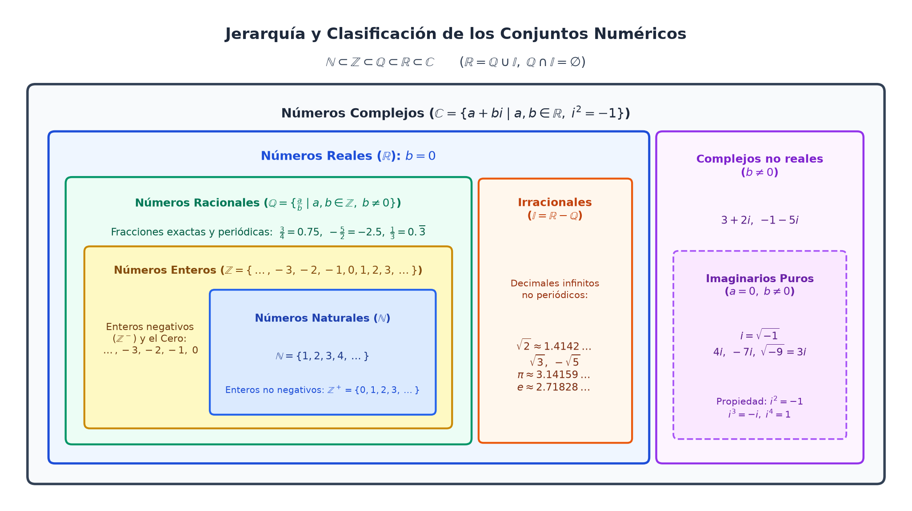
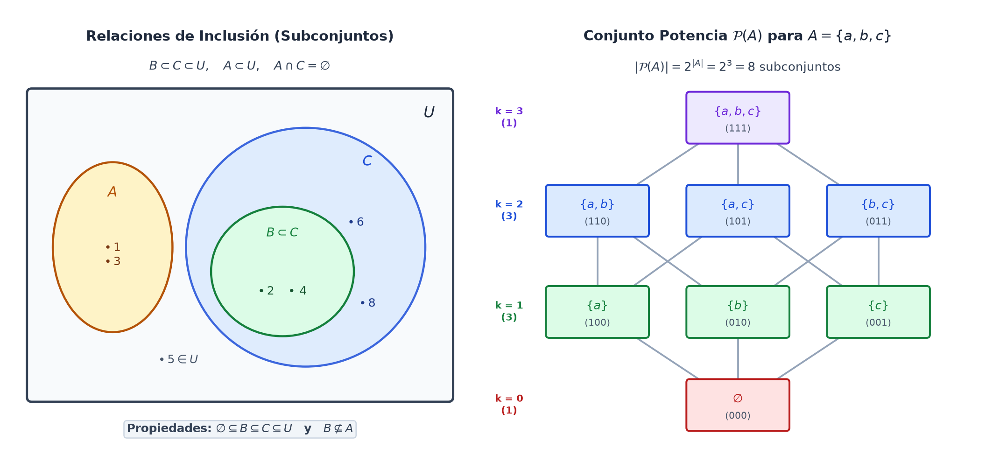

<!-- _class: portada -->
<!-- _paginate: false -->
<!-- _header: "" -->
<!-- _footer: "" -->

# 2.1 Características de los conjuntos
## Notación, conjuntos numéricos, subconjuntos y conjunto potencia

- **Asignatura:** Matemáticas Discretas (`LISSI0211` · Unidad 2)
- **Objetivos:** Formalizar la pertenencia, cardinalidad, conjuntos especiales ($U, \emptyset$), jerarquía numérica, inclusión y $\mathcal{P}(A)$.

---

## Concepto de Conjunto y Criterio «Bien Definido»

- Un **conjunto** es una **colección bien definida de objetos reales o abstractos**, llamados **elementos** o **miembros** (Cantor, 1895).
- **«Bien definida»** significa que existe un criterio objetivo e inequívoco para decidir si un objeto pertenece o no a la colección.
- **Sí son conjuntos:** dígitos hexadecimales; procesos activos con `PID` $< 1000$; números primos menores que $50$.
- **Ambiguos (no son conjuntos):** «los mejores profesores», «los lenguajes más fáciles», «los números grandes».

---

## Notación, Pertenencia y Estructura

- Conjuntos con **mayúsculas** ($A, B, C, \dots$) y elementos con **minúsculas** ($a, b, c, \dots$), entre llaves $\{\;\}$ separados por comas.
- **Pertenencia:** $x \in A$ ($x$ pertenece a $A$) y $x \notin A$ ($x$ no pertenece a $A$).
  - Ej.: si $A = \{1, 3, 5, 7, 9\}$, entonces $3 \in A$ y $6 \notin A$.
- **El orden es irrelevante:** $\{a, e, i, o, u\} = \{u, i, a, e, o\}$.
- **Sin elementos repetidos:** en `"mandarina"`, $B = \{m, a, n, d, a, r, i, n, a\} = \{m, a, n, d, r, i\}$.

---

## Formas de Especificar un Conjunto

- **1. Por extensión (enumeración o tabular):** se listan todos los elementos entre llaves (o con `...` si el patrón es evidente).
  - $A = \{0, 2, 4, 6, 8\}$, $\qquad D = \{0, 1, 2, 3, 4, 5, 6, 7\}$.
- **2. Por comprensión (descriptiva o constructiva):** $A = \{x \mid P(x)\}$ o $A = \{x \in S \mid P(x)\}$ (`|` o `:` se leen *«tal que»*).
  - $A = \{x \mid x \in \mathbb{Z}^+;\; x \text{ es par};\; x < 10\}$, $\quad D = \{x \mid x \text{ es dígito octal}\}$.
- **Condiciones múltiples:** `;` o `,` equivalen a **«y» ($\land$)**, p. ej., $C = \{x \mid x \in \mathbb{R};\; 2 < x < 3\}$.

---

## Cardinalidad, Conjuntos Finitos e Infinitos

- La **cardinalidad** ($|A|$, $n(A)$, $\#(A)$) es el número de elementos **distintos** de $A$.
- **Conjunto finito:** tiene un número entero no negativo $m$ de elementos ($|A| = m$). Ej.: $|\{\text{rojo, verde, azul}\}| = 3$.
- **Infinito numerable (contable):** correspondencia biunívoca con $\mathbb{N}$ (listables como $a_1, a_2, \dots$), p. ej., $\mathbb{N}, \mathbb{Z}, \mathbb{Q}$.
- **Infinito no numerable:** no puede listarse en sucesión discreta, como $\mathbb{R}$ o $[a, b]$ con $a < b$ (argumento diagonal de Cantor).

---

## 2.1.1 Conjunto Universo, Vacío y Unitario

- **Conjunto Universo ($U$):** marco referencial con todos los elementos del problema (ej.: alumnos; $8$ bits sin signo $\{0, 1, \dots, 255\}$).
- **Diagramas de Venn** (John Venn, 1880): rectángulo para $U$ y círculos u óvalos para subconjuntos.
- **Conjunto Vacío ($\emptyset$ o $\{\;\}$):** carece de elementos ($|\emptyset| = 0$). Ej.: $\{x \in \mathbb{R} \mid x^2 + 1 = 0\}$, $\{x \in \mathbb{N} \mid x + 4 = 3\}$.
- **Conjunto Unitario (*Singleton*):** $|A| = 1$, como $S = \{5\}$ o $T = \{0\}$.

---

## Advertencia: $\emptyset$ frente a $\{0\}$ y $\{\emptyset\}$

- $\emptyset = \{\;\}$ es una «caja vacía» y tiene cardinalidad $|\emptyset| = 0$.
- $\{0\}$ **no es vacío:** es un conjunto unitario cuyo único elemento es el número cero ($|\{0\}| = 1$).
- $\{\emptyset\}$ **tampoco es vacío:** es un conjunto unitario cuyo único elemento es el conjunto vacío (caja que contiene otra caja vacía), por lo que:
  $$|\{\emptyset\}| = 1 \qquad \text{y} \qquad \emptyset \in \{\emptyset\}$$

---

## 2.1.2 Conjuntos Numéricos: $\mathbb{N}$, $\mathbb{Z}$ y $\mathbb{Q}$

- **Naturales ($\mathbb{N}$):** $\{1, 2, 3, 4, 5, \dots\}$; **enteros no negativos ($\mathbb{Z}^+$ o $\mathbb{N}_0$):** $\{0, 1, 2, 3, \dots\}$ *(en otros textos $\mathbb{Z}^+ = \{1, 2, \dots\}$)*.
- **Enteros ($\mathbb{Z}$, *Zahlen*):** $\{\dots, -2, -1, 0, 1, 2, \dots\}$; cerrados bajo $+, -, \times$, pero no bajo $\div$ ($3 \div 2 \notin \mathbb{Z}$).
- **Racionales ($\mathbb{Q}$, *Quotient*):** $\mathbb{Q} = \left\{\frac{a}{b} \;\middle|\; a, b \in \mathbb{Z};\;\; b \neq 0\right\}$ (incluye a $\mathbb{Z}$ pues $n = \frac{n}{1}$).
- **Decimal de $\mathbb{Q}$:** finita exacta ($\frac{3}{8} = 0.375$) o infinita periódica ($\frac{1}{3} = 0.\overline{3}$, $\frac{15}{11} = 1.\overline{36}$).

---

## 2.1.2 Irracionales ($\mathbb{I}$), Reales ($\mathbb{R}$) e Intervalos

- **Irracionales ($\mathbb{I}$ o $\mathbb{Q}'$):** $\{x \in \mathbb{R} \mid x \notin \mathbb{Q}\}$, expansión decimal **infinita no periódica** ($\sqrt{2}, \sqrt{3}, -\sqrt{5}, \varphi = \frac{1+\sqrt{5}}{2}, \pi, e$).
- **Reales ($\mathbb{R}$):** unión disjunta $\mathbb{R} = \mathbb{Q} \cup \mathbb{I}$ ($\mathbb{Q} \cap \mathbb{I} = \emptyset$); en biyección con la **recta real**.
- **Intervalos reales ($a < b$):**
  - Abierto: $(a, b) = \{x \in \mathbb{R} \mid a < x < b\}$; $\;\;$ Cerrado: $[a, b] = \{x \in \mathbb{R} \mid a \le x \le b\}$.
  - Semiabiertos: $[a, b) = \{x \in \mathbb{R} \mid a \le x < b\}$ y $(a, b] = \{x \in \mathbb{R} \mid a < x \le b\}$.

---

## 2.1.2 Números Imaginarios y Complejos ($\mathbb{C}$)

- $x^2 + 1 = 0$ carece de solución en $\mathbb{R}$; se define la **unidad imaginaria**: $i = \sqrt{-1} \iff i^2 = -1$.
- **Potencias cíclicas (mód. $4$):** $i^0 = 1,\; i^1 = i,\; i^2 = -1,\; i^3 = -i,\; i^4 = 1 \implies i^n = i^{n \bmod 4}$.
- **Imaginarios puros:** $bi$ con $b \in \mathbb{R}, b \neq 0$ (ej.: $3i, -5i, \sqrt{-16} = 4i$); $(bi)^2 = -b^2 < 0$.
- **Complejos ($\mathbb{C}$):** $\mathbb{C} = \{a + bi \mid a, b \in \mathbb{R};\; i^2 = -1\}$, con $\operatorname{Re}(z) = a$, $\operatorname{Im}(z) = b$ ($b=0 \implies \mathbb{R}$).

---

<!-- _class: figura -->

## Jerarquía y clasificación de los conjuntos numéricos

Cadena de inclusión $\mathbb{N} \subset \mathbb{Z} \subset \mathbb{Q} \subset \mathbb{R} \subset \mathbb{C}$, base para elegir tipos de datos (`uint`, `int`, `float`, `complex`).

---

## 2.1.3 Subconjuntos e Inclusión

- **Subconjunto ($A \subseteq B$):** todo elemento de $A$ pertenece a $B$:
  $$A \subseteq B \iff \forall x\;(x \in A \implies x \in B)$$
  *(Nota: algunos textos usan $\subset$ general; otros distinguen $\subseteq$ general y $\subset$ propio).*
- **Subconjunto propio ($A \subset B$):** $A \subseteq B$ y $A \neq B$ (ej.: $\{1, 2\} \subset \{1, 2, 3\}$).
- **No inclusión ($A \nsubseteq B$):** $\exists x\;(x \in A \;\land\; x \notin B)$.
- **Igualdad:** $A = B \iff (A \subseteq B \;\land\; B \subseteq A)$.
- **Comparables** ($A \subseteq B$ o $B \subseteq A$) vs **incomparables**; **disjuntos** (sin elementos comunes).

---

## Teoremas Fundamentales de los Subconjuntos

Para todo conjunto $A$ en un universo $U$:

1. **Reflexividad:** $A \subseteq A$ (todo conjunto es subconjunto de sí mismo).
2. **El vacío es subconjunto de todo conjunto:** $\emptyset \subseteq A,\; \emptyset \subseteq U,\; \emptyset \subseteq \emptyset$.
   *(La implicación $x \in \emptyset \implies x \in A$ es **vacuamente verdadera**, pues $x \in \emptyset$ es siempre falso).*
3. **Inclusión en el universo:** $A \subseteq U$.
4. **Transitividad:** Si $A \subseteq B$ y $B \subseteq C$, entonces $A \subseteq C$.

---

## 2.1.4 Conjunto Potencia $\mathcal{P}(A)$

- **Definición:** $\mathcal{P}(A)$ (o $2^A$) es el conjunto de todos los subconjuntos de $A$ (incluidos $\emptyset$ y $A$):
  $$\mathcal{P}(A) = \{S \mid S \subseteq A\}, \qquad X \in \mathcal{P}(A) \iff X \subseteq A$$
- **Teorema de cardinalidad:** si $|A| = n$, entonces $|\mathcal{P}(A)| = 2^{|A|} = 2^n$.
- **Subconjuntos propios:** $2^n - 1$; $\;\;$ **subconjuntos no vacíos:** $2^n - 1$.
- **Enfoque binario y combinatorio:** cada elemento decide bit `1` o `0` ($2^n$ cadenas de `00...0` a `11...1`), con $\sum_{k=0}^{n} \binom{n}{k} = 2^n$.

---

<!-- _class: figura -->

## Relaciones de inclusión y conjunto potencia

Diagrama de inclusión y retículo de $\mathcal{P}(\{a, b, c\})$ con $2^3 = 8$ subconjuntos codificados en binario.

---

## Clases de Conjuntos y Particiones

- **Clase o familia de conjuntos:** conjunto cuyos elementos son a su vez conjuntos (notación caligráfica o entre corchetes $[\;]$).
- **Partición de un conjunto no vacío $S$:** colección $\mathcal{A} = \{A_1, A_2, \dots, A_m\}$ de subconjuntos de $S$ que satisface:
  1. **Ningún bloque es vacío:** $A_i \neq \emptyset$ para todo $i = 1, 2, \dots, m$.
  2. **Mutuamente disjuntos (ajenos por pares):** si $i \neq j$, $A_i$ y $A_j$ no tienen elementos en común.
  3. **Exhaustivos (cubren todo $S$):** $A_1 \cup A_2 \cup \dots \cup A_m = S$.

---

<!-- _class: seccion -->
<!-- _header: "" -->
<!-- _footer: "" -->

## Ejemplos de Práctica
Resolución paso a paso de especificación, clasificación numérica, subconjuntos, $\mathcal{P}(A)$ y particiones

---

## Ejemplo 2.1.1: Enunciado

Determine explícitamente (por extensión) los elementos de cada conjunto e indique su cardinalidad:

- **a)** $A = \{x \mid x \text{ es un dígito del número } 103836\}$
- **b)** $B = \{x \mid x \in \mathbb{Z}^+;\; x - 4 < 3\}$
- **c)** $C = \{x \mid x \in \mathbb{Z};\; x \text{ es divisible entre } 3;\; -4 < x < 17\}$
- **d)** $D = \{x \mid x \in \mathbb{Z}^+;\; x \text{ es primo};\; x \text{ es par}\}$
- **e)** $E = \{x \mid x \in \mathbb{R};\; x^2 + 9 = 0\}$

---

## Ejemplo 2.1.1: Solución (1/2)

- **a) Conjunto $A$:** los dígitos en $103836$ son $1, 0, 3, 8, 3, 6$. Eliminando el $3$ repetido y ordenando:
  $$A = \{0, 1, 3, 6, 8\}, \qquad |A| = 5$$
- **b) Conjunto $B$:** $x - 4 < 3 \iff x < 7$. Con $x \in \mathbb{Z}^+ = \{0, 1, 2, \dots\}$:
  $$B = \{0, 1, 2, 3, 4, 5, 6\}, \qquad |B| = 7$$
- **c) Conjunto $C$:** múltiplos enteros de $3$ con $-4 < x < 17$ (incluyendo $0 = 3 \times 0$):
  $$C = \{-3, 0, 3, 6, 9, 12, 15\}, \qquad |C| = 7$$

---

## Ejemplo 2.1.1: Solución (2/2)

- **d) Conjunto $D$:** el único entero positivo simultáneamente primo y par es el $2$:
  $$D = \{2\}, \qquad |D| = 1 \quad (\text{conjunto unitario})$$
- **e) Conjunto $E$:** despejando $x^2 = -9$ se obtiene $x = \pm 3i \in \mathbb{C}$, que son imaginarios puros y no pertenecen a $\mathbb{R}$:
  $$E = \emptyset, \qquad |E| = 0 \quad (\text{conjunto vacío})$$

---

## Ejemplo 2.1.2: Expresión por Comprensión

Escriba cada conjunto en forma constructiva $\{x \mid P(x)\}$ especificando su conjunto numérico:

- **a)** $F = \{3, 6, 9, 12, 15, 18\}$
- **b)** $G = \{1, 4, 9, 16, 25, 36\}$
- **c)** $H = \{1, 2, 4, 8, 16, 32, 64\}$

---

<!-- _class: compacta -->

## Ejemplo 2.1.2: Solución

- **a) $F = \{3, 6, 9, 12, 15, 18\}$:** múltiplos positivos de $3$ menores o iguales que $18$:
  $$F = \{x \mid x \in \mathbb{N};\; x \text{ es múltiplo de } 3;\; x \le 18\} \quad \text{o} \quad F = \{3k \mid k \in \mathbb{N};\; 1 \le k \le 6\}$$
- **b) $G = \{1, 4, 9, 16, 25, 36\}$:** cuadrados perfectos de los primeros seis naturales ($1^2$ a $6^2$):
  $$G = \{x^2 \mid x \in \mathbb{N};\; 1 \le x \le 6\} \quad \text{o} \quad G = \{x \mid x = k^2;\; k \in \mathbb{N};\; k \le 6\}$$
- **c) $H = \{1, 2, 4, 8, 16, 32, 64\}$:** potencias de $2$ desde $2^0 = 1$ hasta $2^6 = 64$:
  $$H = \{2^k \mid k \in \mathbb{Z}^+;\; 0 \le k \le 6\}$$

---

## Ejemplo 2.1.3: Clasificación en Conjuntos Numéricos

Clasifique cada número indicando a cuáles de los conjuntos $\mathbb{N}$, $\mathbb{Z}^+$, $\mathbb{Z}$, $\mathbb{Q}$, $\mathbb{I}$ (irracionales), $\mathbb{R}$, Imaginarios puros y $\mathbb{C}$ pertenece:

- **a)** $-12$
- **b)** $\frac{7}{8}$
- **c)** $\sqrt{5}$
- **d)** $\sqrt{-25}$
- **e)** $0$

---

<!-- _class: tabla-ancha -->

## Ejemplo 2.1.3: Tabla de Pertenencia ($\in$ / $\notin$)

| Número | Simplificación | $\mathbb{N}$ | $\mathbb{Z}^+$ | $\mathbb{Z}$ | $\mathbb{Q}$ | $\mathbb{I}$ | $\mathbb{R}$ | Imag. puro | $\mathbb{C}$ |
| :---: | :---: | :---: | :---: | :---: | :---: | :---: | :---: | :---: | :---: |
| **a) $-12$** | $-\frac{12}{1} + 0i$ | $\notin$ | $\notin$ | $\in$ | $\in$ | $\notin$ | $\in$ | $\notin$ | $\in$ |
| **b) $\frac{7}{8}$** | $0.875 + 0i$ | $\notin$ | $\notin$ | $\notin$ | $\in$ | $\notin$ | $\in$ | $\notin$ | $\in$ |
| **c) $\sqrt{5}$** | $2.236067\dots$ | $\notin$ | $\notin$ | $\notin$ | $\notin$ | $\in$ | $\in$ | $\notin$ | $\in$ |
| **d) $\sqrt{-25}$** | $0 + 5i$ | $\notin$ | $\notin$ | $\notin$ | $\notin$ | $\notin$ | $\notin$ | $\in$ | $\in$ |
| **e) $0$** | $\frac{0}{1} + 0i$ | $\notin$ | $\in$ | $\in$ | $\in$ | $\notin$ | $\in$ | $\notin$ | $\in$ |

---

## Ejemplo 2.1.4: Subconjuntos y Pertenencia

Sean $A = \{x \mid x \in \mathbb{Z};\; 10 \le x \le 100\}$, $B = \{2, 3, 5, 11, 12, 15, 21, 30, 45, 82\}$ y $C = \{12, 15, 45\}$.

Determine el valor de verdad (Verdadero o Falso) y justifique:

- **a)** $C \subseteq B$ $\qquad$ **b)** $C \subseteq A$ $\qquad$ **c)** $B \subseteq A$
- **d)** $\{12\} \in C$ $\quad$ **e)** $\emptyset \subseteq C$ $\quad$ **f)** $\emptyset \in C$

---

## Ejemplo 2.1.4: Solución (1/2)

- **a) $C \subseteq B$: Verdadero.** Los tres elementos de $C$ ($12, 15, 45$) están en $B$; además $2 \in B, 2 \notin C$, por lo que $C \subset B$.
- **b) $C \subseteq A$: Verdadero.** Los números $12, 15$ y $45$ son enteros comprendidos entre $10$ y $100$.
- **c) $B \subseteq A$: Falso ($B \nsubseteq A$).** Los elementos $2, 3, 5 \in B$ son menores que $10$ y no pertenecen a $A$.

---

## Ejemplo 2.1.4: Solución (2/2)

- **d) $\{12\} \in C$: Falso.** El número $12$ es un elemento de $C$ ($12 \in C$), pero $\{12\}$ es un **subconjunto** ($\{12\} \subseteq C$), no un elemento.
- **e) $\emptyset \subseteq C$: Verdadero.** Por teorema general, el conjunto vacío es subconjunto de todo conjunto.
- **f) $\emptyset \in C$: Falso.** Los únicos elementos de $C$ son $12, 15$ y $45$; $\emptyset$ no figura como elemento dentro de $C$.

---

## Ejemplo 2.1.5: Enunciado — $\mathcal{P}(A)$ y Particiones

- **a)** Si $A = \{\text{manzana}, \text{pera}, \text{fresa}, \text{sandía}\}$, calcule $|\mathcal{P}(A)|$, cuántos subconjuntos propios tiene $A$ y liste todos los elementos de $\mathcal{P}(A)$ por cardinalidad $k$.
- **b)** Dado $S = \{1, 2, 3, 4, 5, 6, 7, 8, 9\}$, determine cuál es una partición de $S$:
  - $\mathcal{A}_1 = [\{1, 3, 5\}, \{2, 6\}, \{4, 8, 9\}]$
  - $\mathcal{A}_2 = [\{1, 3, 5\}, \{2, 4, 6, 8\}, \{5, 7, 9\}]$
  - $\mathcal{A}_3 = [\{1, 3, 5\}, \{2, 4, 6, 8\}, \{7, 9\}]$

---

<!-- _class: compacta -->

## Ejemplo 2.1.5: Solución (1/2) — Conjunto Potencia

Abreviando $A = \{m, p, f, s\}$ ($|A| = 4$): $|\mathcal{P}(A)| = 2^4 = 16$ subconjuntos, y $2^4 - 1 = 15$ propios.

- **$k = 0$ ($\binom{4}{0} = 1$):** $\emptyset$.
- **$k = 1$ ($\binom{4}{1} = 4$):** $\{m\}, \{p\}, \{f\}, \{s\}$.
- **$k = 2$ ($\binom{4}{2} = 6$):** $\{m, p\}, \{m, f\}, \{m, s\}, \{p, f\}, \{p, s\}, \{f, s\}$.
- **$k = 3$ ($\binom{4}{3} = 4$):** $\{m, p, f\}, \{m, p, s\}, \{m, f, s\}, \{p, f, s\}$.
- **$k = 4$ ($\binom{4}{4} = 1$):** $\{m, p, f, s\} = A$.

Reuniendo todos en llaves se obtiene $\mathcal{P}(A)$ con $1 + 4 + 6 + 4 + 1 = 16$ elementos.

---

## Ejemplo 2.1.5: Solución (2/2) — Particiones de $S$

Para $S = \{1, 2, 3, 4, 5, 6, 7, 8, 9\}$:

- **$\mathcal{A}_1$ no es una partición de $S$:** el elemento $7 \in S$ no aparece en ninguno de los subconjuntos (no cubre a $S$).
- **$\mathcal{A}_2$ no es una partición de $S$:** los bloques $\{1, 3, 5\}$ y $\{5, 7, 9\}$ no son disjuntos (comparten el elemento $5$).
- **$\mathcal{A}_3$ sí es una partición de $S$:** ningún bloque es vacío, son mutuamente disjuntos dos a dos y su unión es exactamente $S$.

---

<!-- _class: seccion -->
<!-- _header: "" -->
<!-- _footer: "" -->

## Ejercicios de Tarea
Práctica en casa · Resuelva de forma clara, ordenada y justificando cada paso

---

## Ejercicios de Tarea (1/5)

**1. Especificación por extensión y cardinalidad (Jiménez Murillo, Prob. 3.1 y 3.2):**
Determine cuáles son los elementos de los siguientes conjuntos escritos por comprensión e indique la cardinalidad de cada uno:

- **a)** $A = \{x \mid x \text{ es una letra de la palabra }\text{``america''}\text{ diferente de vocal}\}$
- **b)** $B = \{x \mid x \text{ es un dígito válido en el sistema hexadecimal}\}$
- **c)** $C = \{x \mid x \in \mathbb{Z}^+;\; 5 > x - 2\}$
- **d)** $D = \{x \mid x \in \mathbb{Z}^+;\; x \text{ es múltiplo de } 7;\; x < 100;\; x \text{ es impar}\}$
- **e)** $E = \{x \mid x \in \mathbb{Z};\; 0 < x^3 < 100\}$

---

## Ejercicios de Tarea (2/5)

**2. Notación por comprensión (Jiménez Murillo, Prob. 3.3 y 3.4):**
Exprese cada uno de los siguientes conjuntos en la forma abstracta $\{x \mid P(x)\}$:

- **a)** $A = \{\text{suma}, \text{resta}, \text{multiplicación}, \text{división}\}$
- **b)** $B = \{1, 4, 7, 10, 13, 16, 19\}$
- **c)** $C = \{6, 12, 18, 24, 30\}$
- **d)** $D = \{-2, -1, 0, 1, 2, 3, 4\}$

---

## Ejercicios de Tarea (3/5)

**3. Conjuntos numéricos y ecuaciones (Lipschutz & Lipson, Cap. 1):**
Considere las siguientes ecuaciones algebraicas:

- **(i)** $2x + 6 = 0 \qquad$ **(ii)** $3x - 7 = 0$
- **(iii)** $x^2 - 2 = 0 \qquad$ **(iv)** $x^2 + 16 = 0$

Para cada ecuación, determine el conjunto solución según el universo numérico en que se busque la incógnita $x$: **(a)** en $\mathbb{N}$, **(b)** en $\mathbb{Z}$, **(c)** en $\mathbb{Q}$, **(d)** en $\mathbb{R}$, y **(e)** en $\mathbb{C}$.

---

## Ejercicios de Tarea (4/5)

**4. Subconjuntos, igualdad y conjuntos de conjuntos (Epp, Cap. 6.1):**
Sea $A = \{1, 2, \{3\}, \{4, 5\}\}$. Indique la cardinalidad $|A|$ y determine si cada afirmación es **Verdadera (V)** o **Falsa (F)**, corrigiendo las que sean falsas:

- **a)** $1 \in A \qquad$ **b)** $\{1, 2\} \subseteq A \qquad$ **c)** $\{1, 2\} \in A$
- **d)** $3 \in A \qquad$ **e)** $\{3\} \in A \qquad$ **f)** $\{3\} \subseteq A$
- **g)** $\{\{3\}\} \subseteq A \qquad$ **h)** $\{4, 5\} \subseteq A \qquad$ **i)** $\{\{4, 5\}\} \subseteq A \qquad$ **j)** $\emptyset \subseteq A$

---

## Ejercicios de Tarea (5/5)

**5. Conjunto potencia $\mathcal{P}(A)$ (Jiménez Murillo, Prob. 3.6):**
Sea $A = \{x \mid x \text{ es una letra vocal del alfabeto español}\}$.

- **a)** ¿Cuántos elementos pertenecen al conjunto potencia $\mathcal{P}(A)$ y cuántos subconjuntos propios tiene $A$?
- **b)** ¿Cuántos subconjuntos de $A$ contienen exactamente $3$ vocales? Lístelos todos explícitamente.
- **c)** Si otro conjunto $B$ cumple que $|\mathcal{P}(\mathcal{P}(B))| = 256$, ¿cuántos elementos tiene el conjunto $B$?
