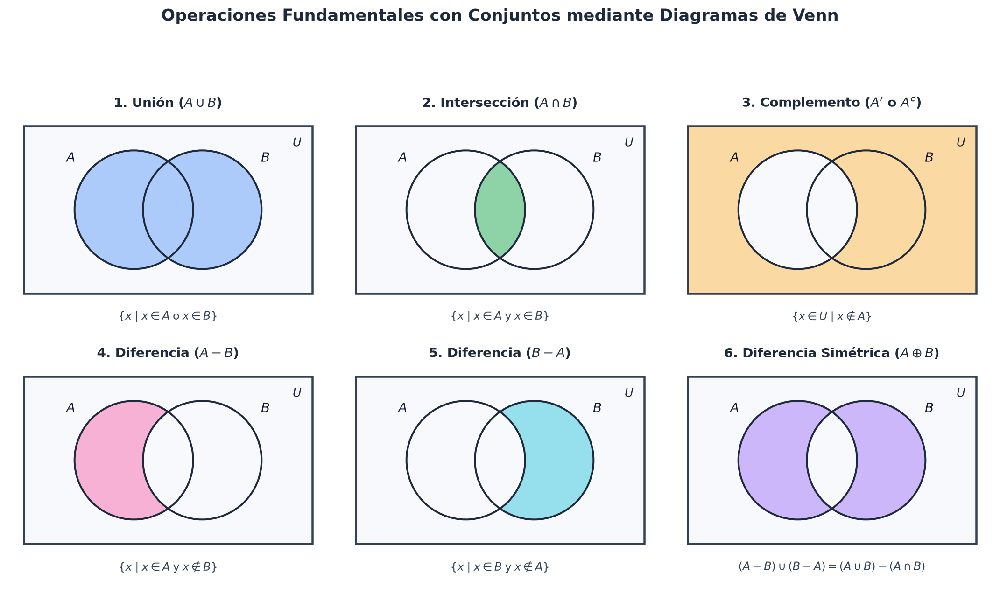

<!-- _class: portada -->
<!-- _paginate: false -->
<!-- _header: "" -->
<!-- _footer: "" -->

# 2.2 Operaciones con conjuntos
## Unión, intersección, complemento, diferencia y diferencia simétrica

- **Asignatura:** Matemáticas Discretas (`LISSI0211` · Unidad 2)
- **Objetivos:** Operar conjuntos en universos finitos, infinitos e intervalos reales, y extender $\cup$ e $\cap$ a familias indexadas.

---

## Introducción: El Álgebra de Operaciones con Conjuntos

- Las **operaciones conjuntistas** combinan conjuntos dentro de un universo referencial $U$ para construir nuevos conjuntos.
- Las cinco operaciones clave son **unión**, **intersección**, **complemento**, **diferencia** y **diferencia simétrica**.
- En bases de datos relacionales sustentan consultas SQL (`UNION`, `INTERSECT`, `EXCEPT`).
- En programación corresponden directamente a operadores lógicos y bit a bit (`||`, `&&`, `!`, `|`, `&`, `~`, `^`).

---

<!-- _class: figura -->

## Operaciones fundamentales mediante diagramas de Venn

Representación gráfica de unión, intersección, complemento, diferencias relativas y diferencia simétrica.

---

## Unión ($A \cup B$)

Elementos que pertenecen a $A$, a $B$, o a **ambos** (**disyunción inclusiva $\lor$**):
$$A \cup B = \{x \in U \mid x \in A \;\lor\; x \in B\}$$

- **Inclusión:** $A \subseteq (A \cup B)$ y $B \subseteq (A \cup B)$.
- **Conmutativa e idempotente:** $A \cup B = B \cup A$, $\quad A \cup A = A$.
- **Neutro y absorbente:** $A \cup \emptyset = A$, $\quad A \cup U = U$.
- **Caracterización de subconjunto:** $A \subseteq B \iff A \cup B = B$.
- **Ejemplo:** si $A = \{1, 2, 3, 6, 7, 8\}$ y $B = \{2, 4, 6, 8, 10, 12\}$, entonces $A \cup B = \{1, 2, 3, 4, 6, 7, 8, 10, 12\}$.

---

## Intersección ($A \cap B$) y Conjuntos Disjuntos

Elementos **comunes** simultáneamente a $A$ y $B$ (**conjunción $\land$**):
$$A \cap B = \{x \in U \mid x \in A \;\land\; x \in B\} = \{x \mid x \in A;\; x \in B\}$$

- **Conjuntos disjuntos (ajenos):** $A \cap B = \emptyset$; si $S = A \cup B$, $S$ es la **unión disjunta**.
- **Cadena de contención:** $(A \cap B) \subseteq A \subseteq (A \cup B)$ y $(A \cap B) \subseteq B \subseteq (A \cup B)$.
- **Propiedades:** $A \cap B = B \cap A$, $A \cap A = A$, $A \cap U = A$, $A \cap \emptyset = \emptyset$; $A \subseteq B \iff A \cap B = A$.
- **Ejemplo:** con $A = \{1, 2, 3, 6, 7, 8\}$ y $B = \{2, 4, 6, 8, 10, 12\}$, $A \cap B = \{2, 6, 8\}$.

---

## Complemento ($A'$, $A^c$ o $\overline{A}$)

Elementos del universo $U$ que **no pertenecen** a $A$ (**negación $\neg$**):
$$A' = A^c = \{x \in U \mid x \notin A\} = U - A$$

*(Es indispensable conocer $U$ antes de calcular cualquier complemento).*

- **Involución (doble negación):** $(A')' = A$.
- **Complementación (partición de $U$):** $A \cup A' = U \quad$ y $\quad A \cap A' = \emptyset$.
- **Extremos:** $U' = \emptyset \quad$ y $\quad \emptyset' = U$.
- **Contraposición:** $A \subseteq B \iff B' \subseteq A'$.

---

## Complemento: Ejemplos en Universo Finito e Infinito

- **Universo finito:**
  Si $U = \{1, 2, 3, 4, 5, 6, 7, 8, 9, 10\}$ y $A = \{1, 3, 6, 7, 9, 10\}$, entonces:
  $$A' = \{2, 4, 5, 8\}$$

- **Universo infinito:**
  Si $U = \mathbb{Z}$ y $A = \{1, 3, 5, 8\}$, no es posible listar todos los enteros restantes; se expresa por comprensión excluyendo $A$:
  $$A' = \{x \mid x \in \mathbb{Z};\; x \notin \{1, 3, 5, 8\}\}$$

---

<!-- _class: compacta -->

## Diferencia ($A - B$ o $A \setminus B$)

Elementos en $A$ que **no están** en $B$ (**complemento relativo** de $B$ respecto a $A$):
$$A - B = \{x \in U \mid x \in A \;\land\; x \notin B\}, \qquad B - A = \{x \in U \mid x \in B \;\land\; x \notin A\}$$

- **Identidad fundamental:** $A - B = A \cap B' = A - (A \cap B)$.
- **No es conmutativa ni asociativa:** en general, $A - B \neq B - A$.
- **Casos particulares:** $A - \emptyset = A$, $\;\emptyset - A = \emptyset$, $\;A - A = \emptyset$, $\;A - U = \emptyset$, $\;U - A = A'$.
- **Descomposición disjunta:** $A = (A - B) \cup (A \cap B)$ con $(A - B) \cap (A \cap B) = \emptyset$.
- **Ejemplo:** $A = \{1, 2, 3, 4, 7, 9, 10\}$, $B = \{3, 4, 5, 6, 7, 8\} \implies A - B = \{1, 2, 9, 10\}$ y $B - A = \{5, 6, 8\}$.

---

<!-- _class: compacta -->

## Diferencia Simétrica ($A \oplus B$ o $A \triangle B$)

Elementos en $A$ o en $B$, **pero no en ambos** (**OR exclusivo / `XOR`**):
$$A \oplus B = \{x \in U \mid (x \in A \;\land\; x \notin B) \;\lor\; (x \in B \;\land\; x \notin A)\}$$

- **Fórmulas equivalentes:**
  - $A \oplus B = (A - B) \cup (B - A) = (A \cap B') \cup (A' \cap B)$
  - $A \oplus B = (A \cup B) - (A \cap B) = (A \cup B) \cap (A \cap B)'$
- **Propiedades:** conmutativa ($A \oplus B = B \oplus A$) y asociativa ($(A \oplus B) \oplus C = A \oplus (B \oplus C)$).
- **Neutro e inverso:** $A \oplus \emptyset = A$, $\;A \oplus A = \emptyset$, $\;A \oplus U = A'$, $\;A \oplus A' = U$.
- **Ejemplo:** con los mismos $A, B$, $A \oplus B = (A - B) \cup (B - A) = \{1, 2, 5, 6, 8, 9, 10\}$.

---

## Operaciones Generalizadas en Colecciones de Conjuntos

Para una colección finita $A_1, A_2, \dots, A_m$:

- **Unión generalizada:** elementos que pertenecen a **por lo menos uno** de los conjuntos $A_i$:
  $$\bigcup_{i=1}^{m} A_i = A_1 \cup A_2 \cup \dots \cup A_m = \{x \mid \exists i \in \{1, \dots, m\}\text{ tal que } x \in A_i\}$$
- **Intersección generalizada:** elementos que pertenecen a **todos y cada uno** de los conjuntos $A_i$:
  $$\bigcap_{i=1}^{m} A_i = A_1 \cap A_2 \cap \dots \cap A_m = \{x \mid \forall i \in \{1, \dots, m\},\; x \in A_i\}$$

---

<!-- _class: seccion -->
<!-- _header: "" -->
<!-- _footer: "" -->

## Ejemplos de Práctica
Operaciones combinadas sobre universos finitos, infinitos, intervalos reales y familias indexadas

---

## Ejemplo 2.2.1: Enunciado — Universo Finito

Considere $U = \{a, b, c, d, e, f, g, h, i, j\}$ y los subconjuntos:
$$A = \{f, g, i, j\},\quad B = \{a, c, d, f, h, i\},\quad C = \{c, d, e, f, g, h\},\quad D = \{a, b, c\}$$

Calcule paso a paso:

- **a)** $(A \cup B) \cap (C \cup D) \qquad$ **b)** $[(A \cap D) \cup B] - C$
- **c)** $(A \cap C \cap D)' \cup B \qquad$ **d)** $(D \oplus B) \cap A'$
- **e)** $[(A - B) \cap (D \oplus B)] - (C \oplus D')$

---

<!-- _class: compacta -->

## Ejemplo 2.2.1: Solución (1/2)

- **a) $(A \cup B) \cap (C \cup D)$:**
  - $A \cup B = \{a, c, d, f, g, h, i, j\}$ y $C \cup D = \{a, b, c, d, e, f, g, h\}$.
  - Intersección: $(A \cup B) \cap (C \cup D) = \{a, c, d, f, g, h\}$.
- **b) $[(A \cap D) \cup B] - C$:**
  - $A \cap D = \emptyset \implies (A \cap D) \cup B = B = \{a, c, d, f, h, i\}$.
  - Restamos $C = \{c, d, e, f, g, h\}$: $[(A \cap D) \cup B] - C = \{a, i\}$.
- **c) $(A \cap C \cap D)' \cup B$:**
  - Como $A \cap D = \emptyset$, entonces $A \cap C \cap D = \emptyset \implies \emptyset' = U$.
  - Por tanto: $U \cup B = U = \{a, b, c, d, e, f, g, h, i, j\}$.

---

<!-- _class: compacta -->

## Ejemplo 2.2.1: Solución (2/2)

- **d) $(D \oplus B) \cap A'$:**
  - $D = \{a, b, c\}$ y $B = \{a, c, d, f, h, i\}$ (excluimos comunes $a, c$):
    $$D \oplus B = \{b, d, f, h, i\}$$
  - Complemento de $A = \{f, g, i, j\}$ en $U$: $A' = \{a, b, c, d, e, h\}$.
  - Intersectamos: $(D \oplus B) \cap A' = \{b, d, h\}$.
- **e) $[(A - B) \cap (D \oplus B)] - (C \oplus D')$:**
  - $A - B = \{g, j\}$ y $D \oplus B = \{b, d, f, h, i\} \implies (A - B) \cap (D \oplus B) = \emptyset$.
  - Como $\emptyset - X = \emptyset$, sin importar $C \oplus D'$, el resultado es $\emptyset$.

---

## Ejemplo 2.2.2: Enunciado — Universo Infinito ($U = \mathbb{Z}$)

Sea $U = \{x \mid x \in \mathbb{Z}\}$ y sean los conjuntos:
- $A = \{1, 2, 5, 7, 10, 12\}$
- $B = \{x \mid x \in \mathbb{Z};\; 3 < x < 15;\; x \text{ es primo}\}$
- $C = \{3, 5, 9, 10, 12, 13, 14\}$ y $D = \{2, 4, 8, 10, 11\}$

Obtenga:

- **a)** $(A \cap B)'$ $\qquad$ **b)** $(C \cup D') \oplus B'$
- **c)** $C' - (D \oplus A)$ $\qquad$ **d)** $[(A \cup B') - C] \oplus D'$

---

<!-- _class: compacta -->

## Ejemplo 2.2.2: Solución (1/3) — Expresión de $B$ e Incisos a) y b)

Primero expresamos $B$ por extensión: $B = \{5, 7, 11, 13\}$.

- **a) $(A \cap B)'$:**
  - $A \cap B = \{5, 7\} \implies (A \cap B)' = \{x \mid x \in \mathbb{Z};\; x \notin \{5, 7\}\}$.
- **b) $(C \cup D') \oplus B'$:**
  - $D' = \mathbb{Z} - \{2, 4, 8, 10, 11\}$. Al unir $C$, se recupera el $10$:
    $$C \cup D' = \{x \mid x \in \mathbb{Z};\; x \notin \{2, 4, 8, 11\}\}$$
  - Con $B' = \{x \mid x \in \mathbb{Z};\; x \notin \{5, 7, 11, 13\}\}$, un entero está en uno solo si falta en el otro ($11$ falta en ambos):
    $$(C \cup D') \oplus B' = \{2, 4, 5, 7, 8, 13\}$$

---

## Ejemplo 2.2.2: Solución (2/3) — Inciso c)

**c) Cálculo de $C' - (D \oplus A)$:**

- $C' = \{x \mid x \in \mathbb{Z};\; x \notin \{3, 5, 9, 10, 12, 13, 14\}\}$.
- Diferencia simétrica entre $D = \{2, 4, 8, 10, 11\}$ y $A = \{1, 2, 5, 7, 10, 12\}$ (excluyendo los comunes $2$ y $10$):
  $$D \oplus A = \{1, 4, 5, 7, 8, 11, 12\}$$
- Restar $D \oplus A$ a $C'$ excluye de $\mathbb{Z}$ tanto $C$ como $D \oplus A$:
  $$C' - (D \oplus A) = \{x \mid x \in \mathbb{Z};\; x \notin \{1, 3, 4, 5, 7, 8, 9, 10, 11, 12, 13, 14\}\}$$

---

## Ejemplo 2.2.2: Solución (3/3) — Inciso d)

**d) Cálculo de $[(A \cup B') - C] \oplus D'$:**

- En $B' = \mathbb{Z} - \{5, 7, 11, 13\}$, al unir $A$ se recuperan $5$ y $7$:
  $$A \cup B' = \{x \mid x \in \mathbb{Z};\; x \notin \{11, 13\}\}$$
- Al restar $C = \{3, 5, 9, 10, 12, 13, 14\}$:
  $$(A \cup B') - C = \{x \mid x \in \mathbb{Z};\; x \notin \{3, 5, 9, 10, 11, 12, 13, 14\}\}$$
- Con $D' = \mathbb{Z} - \{2, 4, 8, 10, 11\}$ (eliminando excluidos comunes $10, 11$):
  $$[(A \cup B') - C] \oplus D' = \{2, 3, 4, 5, 8, 9, 12, 13, 14\}$$

---

## Ejemplo 2.2.3: Enunciado — Intervalos Reales

Considere el universo $U = \mathbb{R}$ y los intervalos $A = [-2, 4)$ y $B = (1, 6]$.

Determine y exprese en notación de intervalos:

- **a)** $A \cup B$
- **b)** $A \cap B$
- **c)** $A - B$
- **d)** $B - A$
- **e)** $A \oplus B$
- **f)** $A'$

---

## Ejemplo 2.2.3: Solución (1/2)

- **a) Unión $A \cup B$:** abarca todos los reales desde $-2$ (incluido) hasta $6$ (incluido):
  $$A \cup B = [-2, 6]$$
- **b) Intersección $A \cap B$:** traslape de $-2 \le x < 4$ con $1 < x \le 6$ (sin incluir $1 \notin B$ ni $4 \notin A$):
  $$A \cap B = (1, 4)$$
- **c) Diferencia $A - B$:** quitamos $B = (1, 6]$ a $A = [-2, 4)$; como $1 \in A$ y $1 \notin B$, el extremo $1$ **se conserva**:
  $$A - B = [-2, 1]$$

---

## Ejemplo 2.2.3: Solución (2/2)

- **d) Diferencia $B - A$:** quitamos $A = [-2, 4)$ a $B = (1, 6]$; como $4 \in B$ y $4 \notin A$, el extremo $4$ **se conserva**:
  $$B - A = [4, 6]$$
- **e) Diferencia simétrica $A \oplus B$:** unión de $A - B$ y $B - A$:
  $$A \oplus B = [-2, 1] \cup [4, 6]$$
- **f) Complemento $A'$:** reales menores estrictamente que $-2$ o mayores o iguales que $4$:
  $$A' = (-\infty, -2) \cup [4, +\infty)$$

---

## Ejemplo 2.2.4: Operaciones Generalizadas

**Enunciado:** Para cada $i \in \{1, 2, 3, 4\}$, defínase $A_i = \{x \in \mathbb{N} \mid x \text{ es múltiplo de } i \text{ y } x \le 12\}$. Encuentre:
**a)** $\bigcup_{i=2}^{4} A_i \qquad$ **b)** $\bigcap_{i=2}^{4} A_i$

**Solución:**
- Listamos para $i = 2, 3, 4$: $A_2 = \{2, 4, 6, 8, 10, 12\}$, $\;A_3 = \{3, 6, 9, 12\}$, $\;A_4 = \{4, 8, 12\}$.
- **a) Unión:** $\bigcup_{i=2}^{4} A_i = A_2 \cup A_3 \cup A_4 = \{2, 3, 4, 6, 8, 9, 10, 12\}$.
- **b) Intersección:** múltiplos comunes de $2, 3$ y $4$ ($\operatorname{mcm}(2, 3, 4) = 12$):
  $$\bigcap_{i=2}^{4} A_i = A_2 \cap A_3 \cap A_4 = \{12\}$$

---

<!-- _class: seccion -->
<!-- _header: "" -->
<!-- _footer: "" -->

## Ejercicios de Tarea
Práctica en casa · Muestre todas las operaciones intermedias de forma ordenada

---

<!-- _class: compacta -->

## Ejercicios de Tarea (1/5)

**1. Operaciones en un universo finito (Lipschutz & Lipson, Prob. 1.4 y 1.5):**
Sea $U = \{1, 2, 3, 4, 5, 6, 7, 8, 9\}$ y sean:
$$A = \{1, 2, 3, 4, 5\},\quad B = \{4, 5, 6, 7\},\quad C = \{5, 6, 7, 8, 9\}$$
$$D = \{1, 3, 5, 7, 9\},\quad E = \{2, 4, 6, 8\},\quad F = \{1, 5, 9\}$$

Encuentre:
- **a)** $A \cup B$, $A \cap B$, $D \cup F$ y $D \cap F$.
- **b)** $A'$, $B'$, $D'$ y $E'$.
- **c)** $A - B$, $B - A$, $D - E$ y $F - D$.
- **d)** $A \oplus B$, $C \oplus D$ y $E \oplus F$.

---

<!-- _class: compacta -->

## Ejercicios de Tarea (2/5)

**2. Operaciones combinadas en universo acotado (Jiménez Murillo, Prob. 3.12-I):**
Sean los conjuntos:
- $U = \{x \mid x \in \mathbb{Z};\; 0 < x \le 20\}$
- $A = \{x \mid x \in \mathbb{Z}^+;\; x \text{ es par};\; x \le 10\}$, $\quad B = \{1, 2, 4, 5, 6, 7\}$
- $C = \{x \mid x \in \mathbb{Z}^+;\; x \text{ es divisible entre } 3;\; x < 16\}$

Determine por extensión:
- **a)** $(A \cap B)' - C$ $\qquad$ **b)** $(A \cup C) \cap B'$
- **c)** $(B \oplus C) - A$ $\qquad$ **d)** $[(A - B) \cup (C - B)]'$

---

## Ejercicios de Tarea (3/5)

**3. Conjuntos definidos mediante ecuaciones reales (Jiménez Murillo, Prob. 3.11-II):**
Sea $U = \{x \mid x \in \mathbb{R}\}$ y sean los conjuntos:
$$A = \{x \mid x \in \mathbb{R};\; x^2 - 1 = 0\}, \qquad B = \{-1, 2, 4\}$$

Calcule:
- **a)** $(A \cup B)'$ $\qquad$ **b)** $(A \cap B)'$ $\qquad$ **c)** $B - A'$
- **d)** $(A - B) \oplus B'$ $\qquad$ **e)** $[B \oplus (B - A)'] \cap A$

---

## Ejercicios de Tarea (4/5)

**4. Diagramas de Venn bajo restricciones de inclusión (Jiménez Murillo, Prob. 3.7a):**
Sean $A, B, C, D$ y $E$ conjuntos no vacíos dentro de un universo $U$.

Describa cómo deben ubicarse geométricamente las regiones en un diagrama de Venn (y proponga un ejemplo numérico concreto con elementos para cada conjunto) de modo que se cumplan simultáneamente todas las condiciones:
$$A \subset (C \cap D),\qquad E \subset D,\qquad C \cap D \neq \emptyset,\qquad B \subset E,\qquad E \nsubseteq (C \cap D)$$

---

## Ejercicios de Tarea (5/5)

**5. Operaciones con intervalos reales:**
Considerando $U = \mathbb{R}$ y los intervalos $P = (-3, 2]$, $Q = [0, 5)$ y $R = (2, 7]$, determine y exprese como intervalos o unión de intervalos:

- **a)** $(P \cup Q) \cap R$
- **b)** $(P \cap Q)'$
- **c)** $(P \cup R) - Q$
- **d)** $P \oplus Q$
