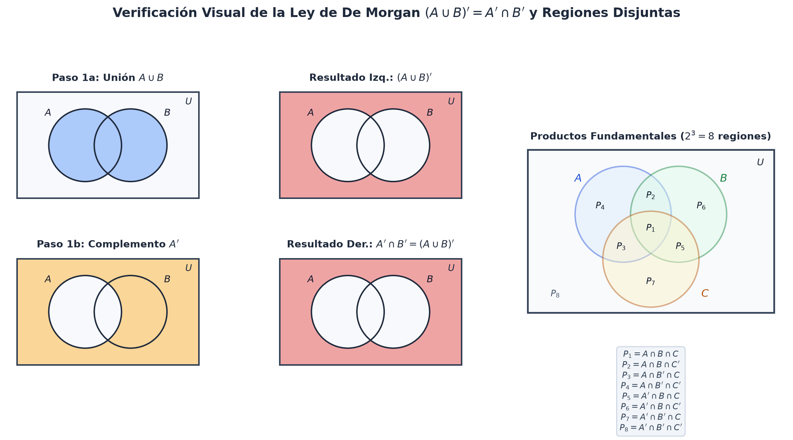

<!-- _class: portada -->
<!-- _paginate: false -->
<!-- _header: "" -->
<!-- _footer: "" -->

# 2.3 Propiedades de los conjuntos
## Leyes del álgebra de conjuntos, dualidad y métodos de demostración

- **Asignatura:** Matemáticas Discretas (`LISSI0211` · Unidad 2)
- **Objetivos:** Dominar las leyes del álgebra de conjuntos, el principio de dualidad, las tablas de pertenencia y la simplificación algebraica.

---

## 1. Leyes del Álgebra de Conjuntos y Precedencia

- Los subconjuntos de $U$ con $\cup$, $\cap$ y $'$ forman el **Álgebra de Conjuntos**.
- Estas identidades permiten **simplificar expresiones conjuntistas**, consultas en bases de datos y condiciones lógicas sin listar elementos.
- **Convención de precedencia (sin paréntesis):**
  1. Primero el **complemento ($'$)**.
  2. Luego la **intersección ($\cap$)**.
  3. Finalmente la **unión ($\cup$)**.
- **Ejemplo:** $A \cup A' \cap B$ significa $A \cup (A' \cap B)$ (Jiménez Murillo, 2012).

---

<!-- _class: compacta -->

## Leyes del Álgebra de Conjuntos (1/2)

| N.º | Nombre de la Ley / Propiedad | Forma con Unión ($\cup$) | Forma Dual con Intersección ($\cap$) |
| :---: | :--- | :---: | :---: |
| **1** | **Doble negación (Involución)** | $(A')' = A$ | — |
| **2** | **Ley conmutativa** | $A \cup B = B \cup A$ | $A \cap B = B \cap A$ |
| **3** | **Ley asociativa** | $A \cup (B \cup C) = (A \cup B) \cup C$ | $A \cap (B \cap C) = (A \cap B) \cap C$ |
| **4** | **Ley distributiva** | $A \cup (B \cap C) = (A \cup B) \cap (A \cup C)$ | $A \cap (B \cup C) = (A \cap B) \cup (A \cap C)$ |
| **5** | **Ley de idempotencia** | $A \cup A = A$ | $A \cap A = A$ |
| **6a** | **De Morgan** ($2$ conjuntos) | $(A \cup B)' = A' \cap B'$ | $(A \cap B)' = A' \cup B'$ |
| **6b** | **De Morgan** ($3$ conjuntos) | $(A \cup B \cup C)' = A' \cap B' \cap C'$ | $(A \cap B \cap C)' = A' \cup B' \cup C'$ |

*(Nota en Ley 5: también aplican $U \cup U = U$, $\emptyset \cup \emptyset = \emptyset$, $U \cap U = U$ y $\emptyset \cap \emptyset = \emptyset$).*

---

<!-- _class: compacta -->

## Leyes del Álgebra de Conjuntos (2/2)

| N.º | Nombre de la Ley / Propiedad | Forma con Unión ($\cup$) | Forma Dual con Intersección ($\cap$) |
| :---: | :--- | :---: | :---: |
| **7** | **Equivalencia** *(absorción parcial)* | $A \cup (A' \cap B) = A \cup B$ | $A \cap (A' \cup B) = A \cap B$ |
| **8** | **Contradicción** *(no contradicción)* | — | $A \cap A' = \emptyset$ |
| **9** | **Complemento** *(tercero excluido y extremos)* | $A \cup A' = U,\quad \emptyset' = U$ | $U' = \emptyset$ |
| **10a** | **Identidad** | $A \cup \emptyset = A$ | $A \cap U = A$ |
| **10b** | **Dominación** | $A \cup U = U$ | $A \cap \emptyset = \emptyset$ |
| **10c** | **Absorción total** | $A \cup (A \cap B) = A$ | $A \cap (A \cup B) = A$ |
| **11** | **Ley de la diferencia** | — | $A - B = A \cap B'$ |

---

## 2.1 El Principio de Dualidad

Sea $E$ una identidad que involucra únicamente $\cup$, $\cap$, $'$, $U$ y $\emptyset$. Su **dual** $E^*$ se obtiene intercambiando simultáneamente:
$$\cup \;\longleftrightarrow\; \cap \qquad \text{y} \qquad U \;\longleftrightarrow\; \emptyset$$

- **Teorema (Principio de Dualidad):** si $E$ es una identidad válida en el álgebra de conjuntos, su ecuación dual $E^*$ también es automáticamente válida.
- **Ejemplos:**
  - $A \cup (A \cap B) = A \quad \Longrightarrow \quad A \cap (A \cup B) = A$
  - $(U \cap A) \cup (B \cap A) = A \quad \Longrightarrow \quad (\emptyset \cup A) \cap (B \cup A) = A$

---

## 2.2 Productos Fundamentales (Regiones Disjuntas)

Dados $n$ conjuntos $A_1, A_2, \dots, A_n \subseteq U$, un **producto fundamental** (**minitérmino**) es:
$$P_k = A_1^* \cap A_2^* \cap \dots \cap A_n^*$$
donde cada $A_i^*$ es $A_i$ sin complementar o bien su complemento $A_i'$.

- Existen exactamente $m = 2^n$ productos fundamentales posibles.
- **Mutuamente disjuntos:** $P_i \cap P_j = \emptyset$ para $i \neq j$.
- **Partición geométrica de $U$:** su unión cubre todo $U$; para $A, B, C$ hay $2^3 = 8$ regiones disjuntas ($P_1$ a $P_8$).

---

<!-- _class: figura -->

## Verificación visual de De Morgan y regiones disjuntas

Comprobación geométrica de $(A \cup B)' = A' \cap B'$ y partición de $U$ en los $2^3 = 8$ productos fundamentales.

---

## 3. Métodos de Verificación y Demostración (1/2)

- **Método 1: Diagramas de Venn (ilustración geométrica)**
  - Se sombrea la región del miembro izquierdo y la del miembro derecho en diagramas separados y se comprueba coincidencia exacta.
- **Método 2: Tablas de Pertenencia (exhaustivo por regiones)**
  - Se construye una tabla de $2^n$ filas con todas las combinaciones de pertenencia de $x \in U$ (`1` si pertenece, `0` si no pertenece).
  - Dos expresiones son idénticas **si y sólo si sus columnas finales coinciden fila por fila**.

---

<!-- _class: tabla-ancha -->

## Ejemplo de Tabla de Pertenencia

Verificación de la **Ley de De Morgan** $(A \cap B)' = A' \cup B'$ y la **Ley de Equivalencia** $A \cup (A' \cap B) = A \cup B$:

| $A$ | $B$ | $A'$ | $B'$ | $A \cap B$ | **$(A \cap B)'$** | **$A' \cup B'$** | $A' \cap B$ | **$A \cup (A' \cap B)$** | **$A \cup B$** |
| :---: | :---: | :---: | :---: | :---: | :---: | :---: | :---: | :---: | :---: |
| $0$ | $0$ | $1$ | $1$ | $0$ | **$1$** | **$1$** | $0$ | **$0$** | **$0$** |
| $0$ | $1$ | $1$ | $0$ | $0$ | **$1$** | **$1$** | $1$ | **$1$** | **$1$** |
| $1$ | $0$ | $0$ | $1$ | $0$ | **$1$** | **$1$** | $0$ | **$1$** | **$1$** |
| $1$ | $1$ | $0$ | $0$ | $1$ | **$0$** | **$0$** | $0$ | **$1$** | **$1$** |

Las columnas coinciden exactamente (`1, 1, 1, 0` y `0, 1, 1, 1`), verificando ambas identidades.

---

<!-- _class: compacta -->

## 3. Métodos de Verificación y Demostración (2/2)

- **Método 3: Método del Elemento (doble inclusión / equivalencias $\iff$)**
  - Se demuestra $X \subseteq Y$ y $Y \subseteq X$, o se encadenan equivalencias lógicas:
    $$x \in (A \cup B)' \iff x \notin (A \cup B) \iff \neg(x \in A \lor x \in B) \iff (x \notin A \land x \notin B) \iff x \in A' \cap B'$$
- **Método 4: Simplificación Algebraica mediante Leyes**
  - Transformar un lado paso a paso citando cada ley aplicada.
  - **Estrategia clave:** factorizar partes comunes para formar $B \cup B' = U$ y reducir con $X \cap U = X$.
- **Refutación por Contraejemplo:** para refutar una igualdad falsa basta exhibir conjuntos numéricos pequeños donde ambos lados difieran.

---

<!-- _class: compacta -->

## 4. Conjuntos, Lógica y Álgebra Booleana (1/2)

Sus leyes son **estructuralmente idénticas**; sólo cambia la notación (Jiménez Murillo, Tabla 3.2):

| Concepto | Teoría de Conjuntos | Lógica Matemática | Álgebra Booleana |
| :--- | :---: | :---: | :---: |
| **Igualdad / Equivalencia** | $A = B$ | $p \leftrightarrow q \;\;(\text{o } p \equiv q)$ | $A = B$ |
| **Unión / OR** | $A \cup B$ | $p \lor q$ | $A + B$ |
| **Intersección / AND** | $A \cap B$ | $p \land q$ | $A \cdot B \;\;(\text{o } AB)$ |
| **Complemento / NOT** | $A'$ | $\neg p \;\;(\text{o } p')$ | $A' \;\;(\text{o } \overline{A})$ |
| **Diferencia** | $A - B = A \cap B'$ | $p \land \neg q$ | $AB'$ |
| **Universo / Tautología / $1$** | $U$ | $V \;\;(\text{o } 1)$ | $1$ |
| **Vacío / Contradicción / $0$** | $\emptyset$ | $F \;\;(\text{o } 0)$ | $0$ |

---

<!-- _class: compacta -->

## 4. Conjuntos, Lógica y Álgebra Booleana (2/2)

| Ley equivalente | Teoría de Conjuntos | Lógica Matemática | Álgebra Booleana |
| :--- | :---: | :---: | :---: |
| **De Morgan ($\cup$ / OR)** | $(A \cup B)' = A' \cap B'$ | $\neg(p \lor q) \equiv \neg p \land \neg q$ | $(A + B)' = A'B'$ |
| **De Morgan ($\cap$ / AND)** | $(A \cap B)' = A' \cup B'$ | $\neg(p \land q) \equiv \neg p \lor \neg q$ | $(AB)' = A' + B'$ |
| **Distributiva ($\cap$ / $\cup$)** | $A \cap (B \cup C) = (A \cap B) \cup (A \cap C)$ | $p \land (q \lor r) \equiv (p \land q) \lor (p \land r)$ | $A(B + C) = AB + AC$ |
| **Distributiva ($\cup$ / $\cap$)** | $A \cup (B \cap C) = (A \cup B) \cap (A \cup C)$ | $p \lor (q \land r) \equiv (p \lor q) \land (p \lor r)$ | $A + BC = (A + B)(A + C)$ |
| **Ley de Equivalencia** | $A \cup (A' \cap B) = A \cup B$ | $p \lor (\neg p \land q) \equiv p \lor q$ | $A + A'B = A + B$ |

---

<!-- _class: seccion -->
<!-- _header: "" -->
<!-- _footer: "" -->

## Ejemplos de Práctica
Simplificación algebraica, comprobación con tablas de pertenencia y refutación por contraejemplo

---

## Ejemplo 2.3.1: Enunciado — Factorización Sucesiva

Utilizando las leyes del álgebra de conjuntos, demuestre paso a paso la siguiente identidad (Jiménez Murillo, 2012, Ej. 3.15):

$$(A' \cap B' \cap C) \cup (A' \cap B \cap C) \cup (A \cap B' \cap C) \cup (A \cap B \cap C) \cup (A \cap B \cap C') = C \cup (A \cap B)$$

---

<!-- _class: compacta -->

## Ejemplo 2.3.1: Solución (1/2)

Partimos del miembro izquierdo:

1. **Agrupamos términos $1\text{–}2$ y $3\text{–}4$ por la Ley distributiva (4b):**
   $$[(A' \cap C) \cap (B' \cup B)] \cup [(A \cap C) \cap (B' \cup B)] \cup (A \cap B \cap C')$$
2. **Propiedad del complemento (9a: $B' \cup B = U$):**
   $$[(A' \cap C) \cap U] \cup [(A \cap C) \cap U] \cup (A \cap B \cap C')$$
3. **Ley de identidad (10a: $X \cap U = X$):**
   $$(A' \cap C) \cup (A \cap C) \cup (A \cap B \cap C')$$
4. **Factorizamos $C$ en los dos primeros términos (4b):**
   $$[C \cap (A' \cup A)] \cup (A \cap B \cap C')$$

---

<!-- _class: compacta -->

## Ejemplo 2.3.1: Solución (2/2)

5. **Propiedad del complemento (9a: $A' \cup A = U$):**
   $$(C \cap U) \cup (A \cap B \cap C')$$
6. **Ley de identidad (10a: $C \cap U = C$):**
   $$C \cup (A \cap B \cap C')$$
7. **Reordenamos factores por la Ley conmutativa (2b):**
   $$C \cup [C' \cap (A \cap B)]$$
8. **Ley de equivalencia (7a: $X \cup (X' \cap Y) = X \cup Y$):**
   $$C \cup (A \cap B) = C \cup (A \cap B) \qquad \blacksquare$$

---

## Ejemplo 2.3.2: Enunciado — De Morgan y Dominación

Demuestre mediante las leyes de conjuntos que la siguiente expresión se simplifica al conjunto universo $U$ (Jiménez Murillo, 2012, Ej. 3.16):

$$(A' \cap B) \cup (A \cap B \cap C)' \cup [C \cap (B' \cup A)] = U$$

---

<!-- _class: compacta -->

## Ejemplo 2.3.2: Solución (1/2)

Desarrollamos el miembro izquierdo paso a paso:

1. **Ley de De Morgan (6b) en $(A \cap B \cap C)' = A' \cup B' \cup C'$:**
   $$(A' \cap B) \cup A' \cup B' \cup C' \cup [C \cap (B' \cup A)]$$
2. **Ley distributiva (4b) en $C \cap (B' \cup A)$:**
   $$(A' \cap B) \cup A' \cup B' \cup C' \cup (C \cap B') \cup (C \cap A)$$
3. **Agrupamos $(A' \cap B) \cup A'$ y $B' \cup (C \cap B')$ factorizando $A'$ y $B'$ (4b):**
   $$[A' \cap (B \cup U)] \cup [B' \cap (U \cup C)] \cup C' \cup (C \cap A)$$
4. **Ley de dominación (10b: $B \cup U = U$, $U \cup C = U$) e identidad (10a: $X \cap U = X$):**
   $$A' \cup B' \cup C' \cup (C \cap A)$$

---

<!-- _class: compacta -->

## Ejemplo 2.3.2: Solución (2/2)

Continuamos desde $A' \cup B' \cup C' \cup (C \cap A)$:

5. **Ley de equivalencia (7a) en $C' \cup (C \cap A) = C' \cup A$:**
   $$A' \cup B' \cup C' \cup A$$
6. **Reordenamos por la Ley conmutativa (2a):**
   $$(A' \cup A) \cup B' \cup C'$$
7. **Propiedad del complemento (9a: $A' \cup A = U$):**
   $$U \cup B' \cup C'$$
8. **Aplicando dos veces la Ley de dominación (10b: $U \cup X = U$):**
   $$U \cup C' = U \qquad \blacksquare$$

---

<!-- _class: compacta -->

## Ejemplo 2.3.3: Simplificación con Diferencia ($-$)

Simplifique $(A - B)' \cap A$ con leyes de conjuntos y compruebe con tabla de pertenencia:

1. **Ley de la diferencia (11: $A - B = A \cap B'$):**
   $$(A - B)' \cap A = (A \cap B')' \cap A$$
2. **De Morgan (6a) y Doble negación (1):**
   $$= (A' \cup B) \cap A$$
3. **Ley conmutativa (2b) y Ley distributiva (4b):**
   $$= A \cap (A' \cup B) = (A \cap A') \cup (A \cap B)$$
4. **Contradicción (8: $A \cap A' = \emptyset$) e Identidad (10a):**
   $$= \emptyset \cup (A \cap B) = \mathbf{A \cap B}$$

---

## Ejemplo 2.3.3: Tabla de Pertenencia

Comprobación exhaustiva de $(A - B)' \cap A = A \cap B$:

| $A$ | $B$ | $A - B$ | $(A - B)'$ | **$(A - B)' \cap A$** | **$A \cap B$** |
| :---: | :---: | :---: | :---: | :---: | :---: |
| $0$ | $0$ | $0$ | $1$ | **$0$** | **$0$** |
| $0$ | $1$ | $0$ | $1$ | **$0$** | **$0$** |
| $1$ | $0$ | $1$ | $0$ | **$0$** | **$0$** |
| $1$ | $1$ | $0$ | $1$ | **$1$** | **$1$** |

Las dos últimas columnas son idénticas ($0, 0, 0, 1$).

---

<!-- _class: compacta -->

## Ejemplo 2.3.4: Refutación por Contraejemplo

**Enunciado (Epp, 2012, Cap. 6.3):**
Un estudiante afirma que para cualesquiera conjuntos $A, B, C$:
*«si $A \cap B = A \cap C$ y $A \neq \emptyset$, entonces necesariamente $B = C$»*.
Determine si es verdadera o falsa; si es falsa, dé un contraejemplo.

**Solución:**
- La afirmación es **FALSA** (la intersección no cumple la ley de cancelación).
- **Contraejemplo:** elegimos $B$ y $C$ iguales dentro de $A$, pero distintos fuera de $A$:
  $$A = \{1, 2\}, \qquad B = \{1, 3\}, \qquad C = \{1, 4\}$$
- **Verificación:** $A \neq \emptyset$ y $A \cap B = \{1\} = A \cap C$, pero $B = \{1, 3\} \neq \{1, 4\} = C$.

---

<!-- _class: seccion -->
<!-- _header: "" -->
<!-- _footer: "" -->

## Ejercicios de Tarea
Práctica en casa · Indique en cada paso el nombre de la ley de conjuntos aplicada

---

## Ejercicios de Tarea (1/5)

**1. Demostración mediante leyes de conjuntos (Jiménez Murillo, Prob. 3.13a y 3.13b):**
Usando las leyes de conjuntos vistas en clase, demuestre paso a paso que:

- **a)** $(A \cap B) \cup (A \cap B') = A$
- **b)** $A \cup B = (A \cap B') \cup (A' \cap B) \cup (A \cap B)$

---

## Ejercicios de Tarea (2/5)

**2. Simplificación de expresiones de tres conjuntos (Jiménez Murillo, Prob. 3.13d y 3.14a):**
Demuestre algebraicamente usando las leyes de conjuntos las siguientes igualdades:

- **a)** $[A \cup (B \cap C')] \cap (B' \cup C) = A \cap (B' \cup C)$
- **b)** $(A' \cap B' \cap C') \cup (A' \cap B \cap C') \cup (A \cap B' \cap C') \cup (A \cap B \cap C') = C'$

---

## Ejercicios de Tarea (3/5)

**3. Principio de Dualidad (Lipschutz & Lipson, Prob. 1.11 y 1.50):**
Escriba la ecuación dual $E^*$ para cada una de las siguientes identidades de conjuntos:

- **a)** $(U \cap A) \cup (B \cap A) = A$
- **b)** $(A \cap U) \cap (\emptyset \cup A') = \emptyset$
- **c)** $[A \cup (B \cap C)]' = (A' \cap B') \cup (A' \cap C')$

---

## Ejercicios de Tarea (4/5)

**4. Tablas de Pertenencia y Método Algebraico:**
Considere las identidades $A \cup (B \cap C) = (A \cup B) \cap (A \cup C)$ y $A - (B \cup C) = (A - B) \cap (A - C)$:

- **a)** Construya la tabla de pertenencia de $8$ filas ($2^3 = 8$) para verificar que $A - (B \cup C) = (A - B) \cap (A - C)$.
- **b)** Demuestre $A - (B \cup C) = (A - B) \cap (A - C)$ algebraicamente usando la ley de la diferencia ($X - Y = X \cap Y'$) y las Leyes de De Morgan.

---

## Ejercicios de Tarea (5/5)

**5. Análisis de validez o refutación por contraejemplo (Epp, Cap. 6.3):**
Determine si cada una de las siguientes afirmaciones es **Verdadera** para cualesquiera conjuntos $A, B, C$ (en cuyo caso demuéstrela algebraicamente) o **Falsa** (en cuyo caso exhiba un contraejemplo numérico explícito):

- **a)** $(A - B) - C = A - (B - C)$
- **b)** $(A - B) \cup (B - A) = (A \cup B) - (A \cap B)$
