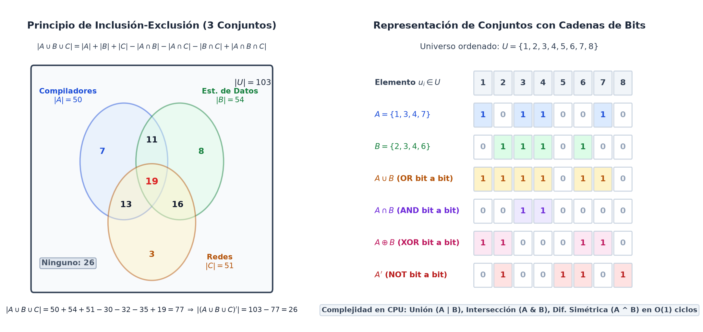

<!-- _class: portada -->
<!-- _paginate: false -->
<!-- _header: "" -->
<!-- _footer: "" -->

# 2.4 Aplicaciones de conjuntos
## Conteo, inclusión-exclusión, cadenas de bits, SQL y argumentos lógicos

- **Asignatura:** Matemáticas Discretas (`LISSI0211` · Unidad 2)
- **Objetivos:** Resolver problemas de conteo finito, representar conjuntos en memoria con *bitmasks*, traducir operaciones a SQL y validar argumentos lógicos.

---

## 1.1 Reglas Básicas de Cardinalidad Finita

En auditoría de bitácoras, redes o bases de datos suele importarnos **cuántos elementos** cumplen una condición. Para conjuntos finitos $A, B \subseteq U$:

- **Principio de la suma (disjuntos, $A \cap B = \emptyset$):**
  $$|A \cup B| = |A| + |B|$$
- **Cardinalidad de la diferencia:** $|A - B| = |A| - |A \cap B|$.
- **Cardinalidad del complemento:** $|A'| = |U| - |A|$.
- **Cardinalidad de la diferencia simétrica:**
  $$|A \oplus B| = |A - B| + |B - A| = |A| + |B| - 2|A \cap B|$$

---

## 1.2 Principio de Inclusión-Exclusión ($2$ y $3$ Conjuntos)

Cuando los conjuntos **no son disjuntos**, se corrige el doble o triple conteo:

- **Para $2$ conjuntos finitos ($A$ y $B$):**
  $$|A \cup B| = |A| + |B| - |A \cap B|$$
- **Para $3$ conjuntos finitos ($A, B$ y $C$):**
  Al restar las intersecciones dobles, $A \cap B \cap C$ se sumó $3$ veces y se restó $3$ veces, por lo que debe sumarse de nuevo:
  $$|A \cup B \cup C| = |A| + |B| + |C| - |A \cap B| - |A \cap C| - |B \cap C| + |A \cap B \cap C|$$

---

<!-- _class: compacta -->

## 1.2 Generalización para $n$ Conjuntos ($n \ge 4$)

Se **suman** las cardinalidades de intersecciones de un número **impar** de conjuntos y se **restan** las de un número **par** ($2^n - 1$ términos en total).

Para **cuatro conjuntos ($n = 4$, con $2^4 - 1 = 15$ términos):**
$$\begin{aligned}
|A \cup B \cup C \cup D| &= |A| + |B| + |C| + |D| \\
&\quad - |A \cap B| - |A \cap C| - |A \cap D| - |B \cap C| - |B \cap D| - |C \cap D| \\
&\quad + |A \cap B \cap C| + |A \cap B \cap D| + |A \cap C \cap D| + |B \cap C \cap D| \\
&\quad - |A \cap B \cap C \cap D|
\end{aligned}$$

---

<!-- _class: compacta -->

## 1.3 Método en Diagramas de Venn: «De Adentro hacia Afuera»

Para rellenar las regiones disjuntas de $2$ o $3$ conjuntos sin errores:

1. **Paso 1 (Centro):** colocar primero $|A \cap B \cap C|$ en la región central.
2. **Paso 2 (Pétalos dobles):** restar el valor central en cada intersección de dos conjuntos:
   - Sólo $A$ y $B$ (sin $C$): $|(A \cap B) - C| = |A \cap B| - |A \cap B \cap C|$ (y análogamente $(A \cap C) - B$, $(B \cap C) - A$).
3. **Paso 3 (Regiones de un solo conjunto):** restar a cada $|X|$ las tres regiones adyacentes ya colocadas dentro de su círculo.
4. **Paso 4 (Exterior):** $|(A \cup B \cup C)'| = |U| - |A \cup B \cup C|$.

---

<!-- _class: figura -->

## Principio de inclusión-exclusión y cadenas de bits



Desglose de $8$ regiones en Venn de adentro hacia afuera y representación computacional mediante vectores de bits.

---

## 2. Representación Computacional con Cadenas de Bits (*Bitmasks*)

Cuando $U$ es finito y manejable, cada subconjunto se representa en memoria como un **vector de bits** (*bitset* o *bitmask*) en lugar de listas enlazadas:

1. **Ordenamiento fijo del universo:**
   $$U = \{u_1, u_2, u_3, \dots, u_n\}$$
2. **Función característica de $A \subseteq U$:** cadena $B(A) = b_1 b_2 \dots b_n$ donde:
   $$b_i = \begin{cases} 1, & \text{si } u_i \in A \\ 0, & \text{si } u_i \notin A \end{cases} \qquad (i = 1, 2, \dots, n)$$

---

<!-- _class: compacta -->

## Operaciones de Conjuntos Bit a Bit en $O(1)$

Las operaciones se ejecutan directamente en la ALU mediante instrucciones *bitwise* por palabra de $64$ bits:

| Operación de Conjuntos | Operación Bit a Bit (posición $i$) | C / C++ / Java / Python |
| :--- | :---: | :---: |
| **Unión ($A \cup B$)** | $\text{OR}$ ($b_i(A) \lor b_i(B)$) | `A \| B` |
| **Intersección ($A \cap B$)** | $\text{AND}$ ($b_i(A) \land b_i(B)$) | `A & B` |
| **Complemento ($A'$)** | $\text{NOT}$ ($\neg b_i(A)$) | `~A` *(máscara de $n$ bits)* |
| **Diferencia ($A - B = A \cap B'$)** | $\text{AND NOT}$ ($b_i(A) \land \neg b_i(B)$) | `A & (~B)` |
| **Diferencia simétrica ($A \oplus B$)** | $\text{XOR}$ ($b_i(A) \oplus b_i(B)$) | `A ^ B` |
| **Subconjunto ($A \subseteq B$)** | Verificar $A - B = \emptyset$ | `(A & (~B)) == 0` |
| **Cardinalidad ($|A|$)** | Contar bits en `1` (*Hamming*) | `__builtin_popcount(A)` / `A.bit_count()` |

---

## 3.1 Bases de Datos Relacionales y SQL (1/3)

En el **modelo relacional** (Edgar F. Codd, 1970), cada **tabla (relación)** es un conjunto de **tuplas** (filas sin duplicados y sin orden).

- **Selección por comprensión** $\{x \in A \mid P(x)\}$ ($\sigma_{P}(A)$):
  ```sql
  SELECT * FROM A WHERE condicion;
  ```
- **Unión** ($A \cup B$):
  ```sql
  SELECT * FROM A UNION SELECT * FROM B;
  ```

---

## 3.1 Bases de Datos Relacionales y SQL (2/3)

- **Intersección** ($A \cap B$):
  ```sql
  SELECT * FROM A INTERSECT SELECT * FROM B;
  -- Equivalente con JOIN:
  -- SELECT * FROM A INNER JOIN B USING (id);
  ```
- **Diferencia** ($A - B$):
  ```sql
  SELECT * FROM A EXCEPT SELECT * FROM B;
  -- Equivalente: LEFT JOIN B ... WHERE B.id IS NULL
  ```

---

## 3.1 Bases de Datos Relacionales y SQL (3/3)

- **Diferencia simétrica** ($A \oplus B$, en Álgebra Relacional: $(A - B) \cup (B - A)$):
  ```sql
  SELECT * FROM A
  FULL OUTER JOIN B USING (id)
  WHERE A.id IS NULL OR B.id IS NULL;
  ```

---

## 3.2 Lenguajes Formales y 3.3 Redes / Grafos

- **Lenguajes formales y compiladores:**
  - **Alfabeto ($\Sigma$):** conjunto finito no vacío de símbolos (ej. ASCII o $\{0, 1\}$).
  - **Lenguaje formal ($L$):** subconjunto de cadenas sobre $\Sigma$ ($L \subseteq \Sigma^*$).
  - **Gramática formal:** $G = (V_N, V_T, P, S)$ con no terminales $V_N$ y terminales $V_T$ disjuntos ($V_N \cap V_T = \emptyset$).
- **Redes y Teoría de Grafos (Unidad 6):**
  - Un grafo $G = (V, E)$ consta de **vértices ($V$)** y **aristas ($E$)**.
  - Fusionar subredes ($G_1 \cup G_2$), enlaces compartidos ($G_1 \cap G_2$) o aislar nodos fallidos ($V - V_{\text{falla}}$) son operaciones conjuntistas.

---

## 3.4 Verificación de Argumentos Lógicos con Venn

Las proposiciones categóricas del lenguaje natural se traducen a relaciones entre conjuntos:

- *«Todos los elementos de $A$ son $B$»* $\;\longrightarrow\;$ **$A \subseteq B$**
- *«Ningún elemento de $A$ es $B$»* $\;\longrightarrow\;$ **$A \cap B = \emptyset$** *(disjuntos)*
- *«Algunos elementos de $A$ son $B$»* $\;\longrightarrow\;$ **$A \cap B \neq \emptyset$**

Al representar las **premisas** en un diagrama de Venn, un argumento es **válido** si la **conclusión** queda forzosamente satisfecha sin añadir suposiciones extra.

---

<!-- _class: seccion -->
<!-- _header: "" -->
<!-- _footer: "" -->

## Ejemplos de Práctica
Inclusión-exclusión, desglose de regiones de Venn, cadenas de bits y silogismos

---

## Ejemplo 2.4.1: Auditoría de Programas en C++

**Enunciado (Jiménez Murillo, 2012, Ej. 3.17):**
De $34$ programas revisados en C++, $23$ marcaron error de compilación, $12$ tuvieron fallas de lógica y $5$ presentaron ambos errores. Determine:

- **a)** ¿Cuántos tuvieron **al menos un** tipo de error?
- **b)** ¿Cuántos tuvieron **únicamente** error de compilación?
- **c)** ¿Cuántos tuvieron **exactamente un** tipo de error?
- **d)** ¿Cuántos funcionaron correctamente (sin ningún error)?

---

## Ejemplo 2.4.1: Solución

Sea $|U| = 34$, $A = \{\text{error de compilación}\}$ ($|A| = 23$), $B = \{\text{falla de lógica}\}$ ($|B| = 12$) y $|A \cap B| = 5$:

- **a) Al menos un error ($|A \cup B|$):**
  $$|A \cup B| = |A| + |B| - |A \cap B| = 23 + 12 - 5 = \mathbf{30\text{ programas}}$$
- **b) Únicamente compilación ($|A - B|$):** $|A - B| = 23 - 5 = \mathbf{18\text{ programas}}$ *(y sólo lógica: $|B - A| = 12 - 5 = 7$)*.
- **c) Exactamente un error ($|A \oplus B|$):** $|A \oplus B| = 18 + 7 = \mathbf{25\text{ programas}}$.
- **d) Sin ningún error ($|(A \cup B)'|$):** $|(A \cup B)'| = 34 - 30 = \mathbf{4\text{ programas}}$.

---

## Ejemplo 2.4.2: Enunciado — Acervo Bibliográfico

En la biblioteca hay $103$ libros sobre **Compiladores ($A$)**, **Estructuras de datos ($B$)** y **Redes ($C$)** con:
$|A| = 50$, $|B| = 54$, $|C| = 51$, $|A \cap B| = 30$, $|A \cap C| = 32$, $|B \cap C| = 35$ y $|A \cap B \cap C| = 19$.

Determine cuántos libros:

- **a)** Tratan **exclusivamente** de uno de los tres temas.
- **b)** **No** tienen material de redes.
- **c)** **No** tratan de ninguno de los tres temas.
- **d)** Tienen material de compiladores y redes, pero **no** de estructuras de datos.

---

<!-- _class: compacta -->

## Ejemplo 2.4.2: Solución (1/2) — Regiones de Venn

Calculamos las $8$ regiones disjuntas **de adentro hacia afuera** ($|U| = 103$):

1. **Centro ($3$ temas):** $|A \cap B \cap C| = 19$.
2. **Exactamente $2$ temas:**
   - $(A \cap B) - C = 30 - 19 = 11$; $\;\;(A \cap C) - B = 32 - 19 = 13$; $\;\;(B \cap C) - A = 35 - 19 = 16$.
3. **Exactamente $1$ tema:**
   - Sólo $A$: $50 - (11 + 19 + 13) = 7$; $\;\;$ Sólo $B$: $54 - (11 + 19 + 16) = 8$; $\;\;$ Sólo $C$: $51 - (13 + 19 + 16) = 3$.
4. **Unión y exterior:**
   $$|A \cup B \cup C| = 50 + 54 + 51 - 30 - 32 - 35 + 19 = 77 \implies |(A \cup B \cup C)'| = 103 - 77 = 26$$

---

## Ejemplo 2.4.2: Solución (2/2) — Respuestas

A partir del desglose de regiones:

- **a) Exclusivamente de un tema:** $7 + 8 + 3 = \mathbf{18\text{ libros}}$.
- **b) Sin material de redes ($|C'|$):** $|U| - |C| = 103 - 51 = \mathbf{52\text{ libros}}$ *(o $26 + 7 + 11 + 8 = 52$)*.
- **c) Ninguno de los tres temas ($|(A \cup B \cup C)'|$):** $\mathbf{26\text{ libros}}$.
- **d) Compiladores y redes, pero no estructuras ($|(A \cap C) - B|$):** $\mathbf{13\text{ libros}}$.

---

## Ejemplo 2.4.3: Cadenas de Bits — Enunciado e Inciso a)

**Enunciado:** Sea $U = \{1, 2, 3, 4, 5, 6, 7, 8, 9, 10\}$ con $A = \{1, 3, 5, 7, 9\}$, $B = \{1, 2, 3, 8, 10\}$ y $C = \{2, 4, 6, 8, 10\}$.

- **a)** Represente $A, B$ y $C$ como cadenas de $10$ bits.
- **b)** Obtenga bit a bit las cadenas y los elementos de $X = (A \cup B) \cap C'$ y $Y = A \oplus B$.

**Solución a) Cadenas de $10$ bits (posiciones $1$ a $10$ de izquierda a derecha):**

- $B(A) = \texttt{1010101010}$
- $B(B) = \texttt{1110000101}$
- $B(C) = \texttt{0101010101}$

---

<!-- _class: compacta -->

## Ejemplo 2.4.3: Solución — Evaluación Bit a Bit, Inciso b)

- **Para $X = (A \cup B) \cap C'$:**
  1. $A \cup B$ (`B(A) OR B(B)`): $\;\texttt{1010101010} \;\lor\; \texttt{1110000101} = \texttt{1110101111}$
  2. $C'$ (`NOT B(C)`): $\;\neg(\texttt{0101010101}) = \texttt{1010101010}$
  3. $(A \cup B) \cap C'$ (`AND`): $\;\texttt{1110101111} \;\land\; \texttt{1010101010} = \texttt{1010101010}$
     Posiciones en `1` ($1, 3, 5, 7, 9$): $\;\mathbf{X = \{1, 3, 5, 7, 9\} = A}$.

- **Para $Y = A \oplus B$ (`B(A) XOR B(B)`):**
  $$\texttt{1010101010} \;\oplus\; \texttt{1110000101} = \texttt{0100101111}$$
  Posiciones en `1` ($2, 5, 7, 8, 9, 10$): $\;\mathbf{A \oplus B = \{2, 5, 7, 8, 9, 10\}}$.

---

## Ejemplo 2.4.4: Validez de un Argumento Deductivo

**Enunciado (Lewis Carroll, en Lipschutz & Lipson, 2009, Ej. 1.3):**
Determine si el siguiente argumento es lógicamente válido mediante diagramas de Venn:

- **Hipótesis $S_1$:** Todos mis objetos de estaño son cazos.
- **Hipótesis $S_2$:** Encuentro muy útiles todos tus regalos.
- **Hipótesis $S_3$:** Ninguno de mis cazos es útil.
- **Conclusión $S$:** $\therefore$ Tus regalos no son de estaño.

---

<!-- _class: compacta -->

## Ejemplo 2.4.4: Solución — Traducción y Deducción

Definimos los conjuntos dentro del universo $U$ de objetos:
- $E = \{\text{mis objetos de estaño}\}$, $\quad C = \{\text{mis cazos}\}$, $\quad U_{\text{til}} = \{\text{objetos útiles}\}$, $\quad R = \{\text{tus regalos}\}$.

**Traducción de las premisas a relaciones conjuntistas:**
1. Por $S_1$: **$E \subseteq C$** (el círculo $E$ queda dentro de $C$).
2. Por $S_2$: **$R \subseteq U_{\text{til}}$** (el círculo $R$ queda dentro de $U_{\text{til}}$).
3. Por $S_3$: **$C \cap U_{\text{til}} = \emptyset$** ($C$ y $U_{\text{til}}$ son totalmente disjuntos).

**Deducción:** como $E \subseteq C$, $R \subseteq U_{\text{til}}$ y $C \cap U_{\text{til}} = \emptyset$, es imposible que $R$ y $E$ compartan elementos; forzosamente **$R \cap E = \emptyset$**. El argumento es **VÁLIDO**.

---

<!-- _class: seccion -->
<!-- _header: "" -->
<!-- _footer: "" -->

## Ejercicios de Tarea
Práctica en casa · Plantee los conjuntos y aplique inclusión-exclusión, Venn, bitmasks o SQL

---

<!-- _class: compacta -->

## Ejercicios de Tarea (1/5)

**1. Encuesta sobre lectura de publicaciones (Lipschutz & Lipson, Prob. 1.15):**
En una encuesta a $120$ profesionales de TI sobre tres revistas ($N, T, F$): $65$ leen $N$, $45$ leen $T$, $42$ leen $F$, $20$ leen $N$ y $T$, $25$ leen $N$ y $F$, $15$ leen $T$ y $F$, y $8$ leen las tres.

- **a)** Encuentre el número de personas que leen **por lo menos una** de las tres publicaciones.
- **b)** Determine cuántas personas corresponden a cada una de las $8$ regiones disjuntas del diagrama de Venn.
- **c)** ¿Cuántas personas leen **exactamente una** publicación, y cuántas no leen **ninguna**?

---

<!-- _class: compacta -->

## Ejercicios de Tarea (2/5)

**2. Causas de accidentes automovilísticos (Jiménez Murillo, Prob. 3.17):**
De $93$ accidentes ocurridos el fin de semana: $45$ por exceso de velocidad ($A$), $43$ por bebidas alcohólicas ($B$), $32$ por fallas mecánicas ($C$), $20$ por $A$ y $B$, $15$ por $A$ y $C$, $13$ por $B$ y $C$, y $8$ por las tres causas simultáneamente.

- **a)** ¿Cuántos ocurrieron **solamente** por bebidas alcohólicas?
- **b)** ¿Cuántos por exceso de velocidad y fallas mecánicas, pero **no** por alcohol?
- **c)** ¿Cuántos ocurrieron por **otras causas distintas** a las tres mencionadas?
- **d)** ¿Cuántos tuvieron como causa **cuando mucho uno** de los tres motivos?

---

## Ejercicios de Tarea (3/5)

**3. Inclusión-Exclusión para $4$ conjuntos (Jiménez Murillo, Prob. 3.20):**
En una auditoría sobre $200$ servidores corporativos se analizaron cuatro protocolos activos: $A$ (HTTP), $B$ (SSH), $C$ (FTP) y $D$ (SMTP):

- $|A| = 80$, $|B| = 75$, $|C| = 70$, $|D| = 65$.
- $|A \cap B| = 35$, $|A \cap C| = 30$, $|A \cap D| = 25$, $|B \cap C| = 30$, $|B \cap D| = 25$, $|C \cap D| = 20$.
- $|A \cap B \cap C| = 15$, $|A \cap B \cap D| = 12$, $|A \cap C \cap D| = 10$, $|B \cap C \cap D| = 8$, $|A \cap B \cap C \cap D| = 5$.

Calcule cuántos servidores tienen activo **por lo menos uno** de los cuatro protocolos ($|A \cup B \cup C \cup D|$) y cuántos no tienen activo **ninguno**.

---

## Ejercicios de Tarea (4/5)

**4. Representación de conjuntos mediante Cadenas de Bits:**
Dado el universo ordenado de un byte $U = \{0, 1, 2, 3, 4, 5, 6, 7\}$ (de izquierda a derecha), dos subconjuntos se representan en memoria como `B(A) = 0xD6` y `B(B) = 0x5B`.

- **a)** Convierta `0xD6` y `0x5B` a binario de $8$ bits y liste por extensión los elementos de $A$ y $B$.
- **b)** Calcule en binario y en hexadecimal las máscaras de $A \cup B$, $A \cap B$, $A - B$ y $A \oplus B$, indicando los elementos resultantes en cada caso.

---

<!-- _class: compacta -->

## Ejercicios de Tarea (5/5)

**5. Traducción entre Álgebra de Conjuntos y SQL:**
En una plataforma educativa existen tres tablas (conjuntos de `id_alumno`): `Inscritos_Python` ($P$), `Inscritos_Java` ($J$) y `Becados` ($B$).

- **a)** Escriba la expresión en notación de conjuntos y la consulta equivalente en SQL (usando `UNION`, `INTERSECT` y `EXCEPT`) para obtener los alumnos inscritos en **Python o Java, pero que no están becados**.
- **b)** Si un programador escribe la consulta correspondiente a $(P - B) \cup (J - B)$, demuestre mediante leyes de conjuntos que obtiene exactamente el mismo conjunto de alumnos que en el inciso (a).
