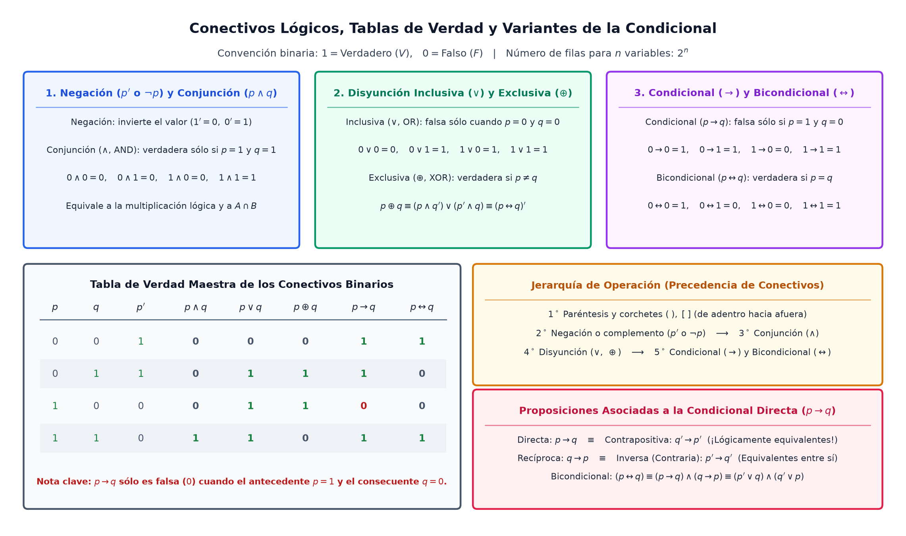
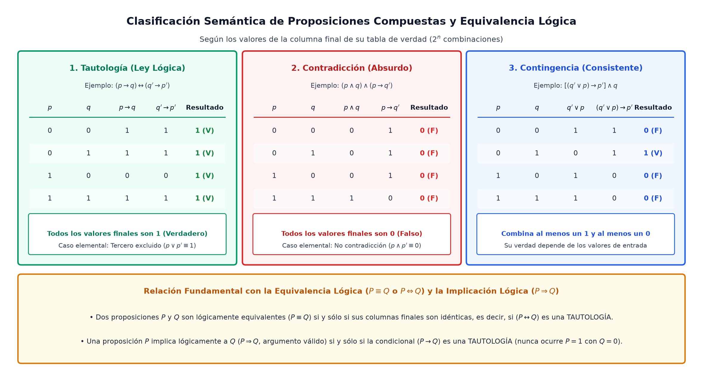
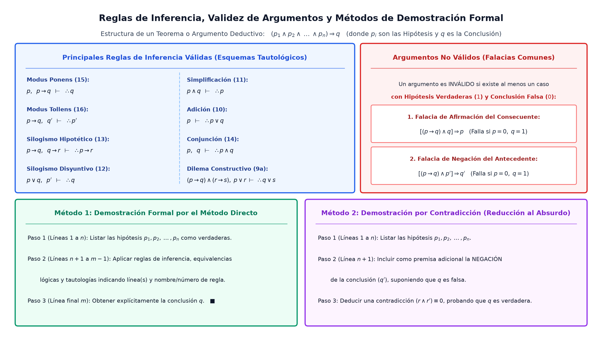

<!-- _class: portada -->
<!-- _paginate: false -->
<!-- _header: "" -->
<!-- _footer: "" -->

# 3.1 Lógica Proposicional
## Proposiciones, conectivos, tablas de verdad, equivalencias, inferencia y demostración formal

- **Asignatura:** Matemáticas Discretas (`LISSI0211`) · Unidad 3
- **Objetivo:** Formalizar enunciados en notación proposicional, evaluar su validez mediante tablas de verdad y demostrar teoremas paso a paso.

---

## 3.1.1 Concepto de Proposición

- **Proposición:** Toda oración declarativa, frase o expresión matemática a la que se puede asignar, sin ambigüedad, exactamente un valor de verdad: **Verdadero** o **Falso**.
- **Principios de la lógica clásica bivalente (Aristóteles):**
  1. **Tercero excluido (*tertium non datur*):** Toda proposición es verdadera o falsa; no existe una tercera posibilidad intermedia.
  2. **No contradicción:** Ninguna proposición puede ser simultáneamente verdadera y falsa en el mismo contexto y momento.

---

## Notación de Variables y Valores de Verdad

- **Variables proposicionales:** Las proposiciones simples (*atómicas*, sin conectivos) se denotan con letras minúsculas ($p, q, r, s, t, u, w, \dots$) seguidas de `:` y su enunciado.
- **Convenciones equivalentes para valores de verdad:**
  - **Binaria (computación):** $1 = \text{Verdadero}, \qquad 0 = \text{Falso}$
  - **Por iniciales (matemáticas):** $V \text{ (o } T\text{)} = \text{Verdadero}, \qquad F = \text{Falso}$
- Preferimos $1$ y $0$ por su vínculo con el sistema binario (U1) y el álgebra booleana (U4).

---

<!-- _class: compacta -->

## Clasificación de Oraciones (1/3)

| Tipo de expresión | ¿Es proposición? | Ejemplos y justificación |
| :--- | :---: | :--- |
| **1. Afirmaciones declarativas fácticas o científicas** | **Sí** | • $p$: «EE. UU. es el país más extenso de América» ($0$, es Canadá). • $s$: «El hielo flota en el agua» ($1$). • $w$: «Carlos Salinas de Gortari fue presidente de España» ($0$). |
| **2. Igualdades y desigualdades matemáticas cerradas** | **Sí** | Expresan relaciones numéricas con valor de verdad fijo: • $q$: «$-19 + 50 = 31$» ($1$). • $m$: «$2 + 2 = 5$» ($0$). |

---

<!-- _class: compacta -->

## Clasificación de Oraciones (2/3)

| Tipo de expresión | ¿Es proposición? | Ejemplos y justificación |
| :--- | :---: | :--- |
| **3. Oraciones interrogativas** | **No** | Solicitan información; no afirman ni niegan: • $u$: «¿Cómo estás?» o «¿A dónde vas?» |
| **4. Oraciones imperativas** | **No** | Expresan órdenes, mandatos o súplicas: • $v$: «Formatea el disco antes de usarlo» o «Haz tu tarea». |
| **5. Exclamativas o deseos** | **No** | Expresan emociones o estados de ánimo: • «¡Qué excelente algoritmo!» o «Ojalá no falle el servidor». |

---

<!-- _class: compacta -->

## Clasificación de Oraciones (3/3)

| Tipo de expresión | ¿Es proposición? | Ejemplos y justificación |
| :--- | :---: | :--- |
| **6. Paradojas autorreferenciales** | **No** | Violan el principio de no contradicción: • «Esta oración es falsa» (*paradoja del mentiroso*). |
| **7. Expresiones con variables libres** (*funciones proposicionales*) | **Depende de la asignación** | • $r$: «$x > (y - 13)^7$» o «$x + 2 = 7$». Sin valor fijo hasta asignar valores (ej., $x=5, y=13 \implies 5>0$ vale $1$) o cuantificarlas (`3.2`). |

---

## 3.1.2 Proposiciones Compuestas

- Una **proposición compuesta** (o *molecular*) se construye combinando proposiciones simples mediante **conectivos u operadores lógicos**.
- **Propiedad fundamental:** Su valor de verdad queda **unívocamente determinado** por los valores de verdad de las proposiciones simples que la integran y por la definición de cada conectivo.
- **Operadores fundamentales:** Conjunción ($\land$), Disyunción inclusiva ($\lor$) y exclusiva ($\oplus$), Negación ($'$ o $\neg$), Condicional ($\to$) y Bicondicional ($\leftrightarrow$).

---

<!-- _class: figura -->

## Conectivos Lógicos y Tablas de Verdad

Síntesis visual de los operadores fundamentales, la tabla maestra, la precedencia y las variantes de la condicional.

---

<!-- _class: compacta -->

## 1. Conjunción ($\land$, operador `AND` / multiplicación lógica)

- Se denota $p \land q$ (también $p \cdot q$ o $p\text{ \& }q$) y se lee **«$p$ y $q$»**.
- **Regla semántica:** Es **verdadera ($1$) sólo si $p$ y $q$ son ambas verdaderas**; basta que una sea falsa para que resulte falsa ($0$).
- **Multiplicación lógica en $\{0, 1\}$:** $0 \land 0 = 0,\; 0 \land 1 = 0,\; 1 \land 0 = 0,\; 1 \land 1 = 1$.
- **En español:** *«y»/«e», «pero», «sin embargo», «además», «aunque», «no obstante», «a la vez que»*, o un **punto y seguido (`.`)** entre hipótesis.

| $p$ | $q$ | $p \land q$ |
| :---: | :---: | :---: |
| $0$ | $0$ | **$0$** |
| $0$ | $1$ | **$0$** |
| $1$ | $0$ | **$0$** |
| $1$ | $1$ | **$1$** |

---

## 2a. Disyunción Inclusiva ($\lor$, `OR` / suma lógica)

- Se denota $p \lor q$ (también $p + q$) y se lee **«$p$ o $q$ (o ambas)»**.
- **Regla semántica:** Es **verdadera ($1$)** si al menos una proposición es verdadera; es **falsa ($0$)** únicamente si ambas son falsas.
- **Suma lógica:** $0 \lor 0 = 0,\; 0 \lor 1 = 1,\; 1 \lor 0 = 1,\; 1 \lor 1 = 1$ (ej.: entrar al cine con boleto, con pase o con ambos).
- **Convención estándar:** Salvo exclusión explícita, «o» en matemáticas y programación significa **$\lor$**.

---

## 2b. Disyunción Exclusiva ($\oplus$, `XOR`) y Comparativa

- **$p \oplus q$** (o $p \veebar q$) significa *«o bien $p$ o bien $q$, pero no ambas»* (ej.: viajar por avión o por barco): vale $1$ si $p \neq q$ y $0$ si $p = q$.
  $$p \oplus q \;\equiv\; (p' \land q) \lor (p \land q') \;\equiv\; (p \leftrightarrow q)'$$

| $p$ | $q$ | Inclusiva ($p \lor q$) | Exclusiva ($p \oplus q$) |
| :---: | :---: | :---: | :---: |
| $0$ | $0$ | **$0$** | **$0$** |
| $0$ | $1$ | **$1$** | **$1$** |
| $1$ | $0$ | **$1$** | **$1$** |
| $1$ | $1$ | **$1$** | **$0$** |

---

## 3. Negación ($p'$ o $\neg p$, operador `NOT` / complemento)

- Se denota por $p'$ (también $\neg p$, $\sim p$ o $\overline{p}$) y se lee *«no $p$»*, *«no es cierto que $p$»* o *«es falso que $p$»*.
- **Regla semántica:** Invierte el valor de verdad ($1 \to 0$, $0 \to 1$).
- **Propiedad de paridad:** Número **par** de negaciones equivale a la proposición original ($(p')' = p'' \equiv p$, $p'''' \equiv p$); número **impar** equivale a una negación ($p''' \equiv p'$).

| $p$ | $p'$ ($\neg p$) | $p''$ ($\neg\neg p$) |
| :---: | :---: | :---: |
| $0$ | **$1$** | $0$ |
| $1$ | **$0$** | $1$ |

---

<!-- _class: compacta -->

## 4. Condicional o Implicación Material ($p \to q$)

- Se lee **«si $p$, entonces $q$»** (*$p$*: antecedente/hipótesis/condición suficiente; *$q$*: consecuente/conclusión/condición necesaria).
- **Regla semántica:** Sólo es **falsa ($0$)** cuando $p = 1$ y $q = 0$.

| $p$ | $q$ | $p \to q$ | Promesa: *«Si salgo electo ($p$), habrá $7\%$ de crecimiento ($q$)»* |
| :---: | :---: | :---: | :--- |
| $0$ | $0$ | **$1$** | No fue electo ni hubo $7\%$: no mintió (**verdadero por vacuidad**). |
| $0$ | $1$ | **$1$** | No fue electo, hubo $7\%$ ajeno: no mintió (**por vacuidad**). |
| $1$ | $0$ | **$0$** | Sí fue electo y no hubo $7\%$: **incumplió (único caso falso)**. |
| $1$ | $1$ | **$1$** | Sí fue electo y hubo $7\%$: **cumplió su promesa (verdadero)**. |

---

## Formas Equivalentes de $p \to q$ en Español

Todas las expresiones siguientes se traducen exactamente como $p \to q$:

- «Si $p$, entonces $q$» / «Si $p$, $q$».
- «$q$ si $p$» / «$q$ cuando $p$» / «$q$ siempre que $p$» *(el antecedente $p$ aparece al final)*.
- «$p$ sólo si $q$» / «$p$ solamente si $q$» *(equivale a $q' \to p' \equiv p \to q$)*.
- «$p$ es condición suficiente para $q$».
- «$q$ es condición necesaria para $p$».

---

<!-- _class: compacta -->

## Condicionales Asociadas a la Directa $p \to q$

A partir de $p \to q$ se definen tres proposiciones condicionales derivadas:

| Nombre | Expresión simbólica | Lectura | ¿Equivalente a $p \to q$? |
| :--- | :---: | :--- | :--- |
| **1. Condicional directa** | $p \to q$ | «Si $p$, entonces $q$» | — |
| **2. Contrapositiva** *(contrarrecíproca)* | $q' \to p'$ ($\neg q \to \neg p$) | «Si no $q$, entonces no $p$» | **SÍ:** $(p \to q) \equiv (q' \to p')$ |
| **3. Recíproca** *(conversa)* | $q \to p$ | «Si $q$, entonces $p$» | **NO** *(equivale a la inversa)* |
| **4. Inversa** *(contraria)* | $p' \to q'$ ($\neg p \to \neg q$) | «Si no $p$, entonces no $q$» | **NO:** $(q \to p) \equiv (p' \to q')$ |

---

<!-- _class: compacta -->

## 5. Bicondicional o Doble Implicación ($p \leftrightarrow q$)

- Se lee **«$p$ si y sólo si $q$»** (*«$p$ ssi $q$»*, *«$p$ es condición necesaria y suficiente para $q$»*).
- **Regla semántica:** Es **verdadera ($1$)** cuando $p$ y $q$ tienen el mismo valor de verdad ($0\leftrightarrow 0 = 1$, $1\leftrightarrow 1 = 1$), y **falsa ($0$)** si difieren.
- **Equivalencias y compuerta `XNOR`:**
  $$p \leftrightarrow q \;\equiv\; (p \to q) \land (q \to p) \;\equiv\; (p \land q) \lor (p' \land q') \;\equiv\; (p \oplus q)'$$

| $p$ | $q$ | $p \leftrightarrow q$ |
| :---: | :---: | :---: |
| $0$ | $0$ | **$1$** |
| $0$ | $1$ | **$0$** |
| $1$ | $0$ | **$0$** |
| $1$ | $1$ | **$1$** |

---

## 3.1.3 Tablas de Verdad

- Una **tabla de verdad** (Peirce, ~1880; Wittgenstein y Russell, 1918) muestra el valor de verdad de una proposición compuesta para **todas las combinaciones** de sus $n$ variables simples:
  $$\text{Número de filas} = 2^n \qquad (n=1 \to 2,\; n=2 \to 4,\; n=3 \to 8,\; n=4 \to 16)$$
- **Ordenamiento binario estándar (Jiménez Murillo, 2012):**
  1. Variables simples en orden alfabético ($p, q, r, \dots$).
  2. Valores de $00\dots 0_2$ a $11\dots 1_2$: bloques de $2^{n-1}, 2^{n-2}, \dots, 1$.
  3. Columnas de negaciones simples ($p', q'$), subexpresiones y fórmula completa al final.

---

<!-- _class: compacta -->

## Jerarquía de Operación (Precedencia Lógica)

Cuando faltan paréntesis explícitos, los conectivos se evalúan de mayor a menor prioridad:

| Prioridad | Operador / Símbolo | Regla de desempate (asociatividad) |
| :---: | :---: | :--- |
| **$1.^\circ$ (Máxima)** | Paréntesis y corchetes: $(\;),\; [\;],\; \{\;\}$ | De **adentro hacia afuera**; al mismo nivel, de izquierda a derecha. |
| **$2.^\circ$** | Negación: $'$ o $\neg$ | Afecta únicamente a la variable o paréntesis contiguo. |
| **$3.^\circ$** | Conjunción: $\land$ | De izquierda a derecha (prioridad mayor que $\lor$). |
| **$4.^\circ$** | Disyunción: $\lor,\; \oplus$ | De izquierda a derecha. |
| **$5.^\circ$ (Mínima)** | Condicional y Bicondicional: $\to,\; \leftrightarrow$ | Comparten el nivel $5.^\circ$ y se evalúan **de izquierda a derecha** (JM). |

---

## Aplicación de la Jerarquía de Operadores

Evaluación paso a paso de $F = p' \to (r' \lor q \land p) \leftrightarrow r \lor q' \to p$ (JM, Ej. 4.9):

1. **Dentro del paréntesis** $(r' \lor q \land p)$: primero la negación $r'$ ($2.^\circ$), luego la conjunción $q \land p$ ($3.^\circ$) y después la disyunción $r' \lor (q \land p)$ ($4.^\circ$).
2. **Fuera del paréntesis:** se evalúan las negaciones $p'$ y $q'$ ($2.^\circ$), y luego la disyunción $r \lor q'$ ($4.^\circ$).
3. **Nivel $5.^\circ$ de izquierda a derecha:** quedan $p' \to A \leftrightarrow B \to p$, evaluándose primero $[p' \to (r' \lor q \land p)]$, después con $\leftrightarrow (r \lor q')$, y finalmente con $\to p$.

---

<!-- _class: figura -->

## Clasificación Semántica y Equivalencia Lógica

Criterio de clasificación según la columna final de la tabla de verdad y vínculo con equivalencia e implicación.

---

## 3.1.4 Tautologías, Contradicción y Contingencia

Al analizar la **última columna** de su tabla de verdad, toda proposición compuesta pertenece a una de tres categorías:

1. **Tautología (Ley lógica):** Resultado **siempre verdadero ($1$)** en todas las $2^n$ filas (ej.: tercero excluido $p \lor p' \equiv 1$). Sustenta las reglas de inferencia y demostraciones.
2. **Contradicción (Absurdo):** Resultado **siempre falso ($0$)** en todas las $2^n$ filas (ej.: no contradicción $p \land p' \equiv 0$). Es dual de la tautología ($1'=0$, $0'=1$).
3. **Contingencia:** Contiene **al menos un $1$ y al menos un $0$**; su valor depende de las entradas.

---

## Implicación Lógica o Tautológica ($P \Rightarrow Q$)

- Cuando la proposición condicional $P \to Q$ es una **tautología**, se dice que **$P$ implica lógicamente a $Q$** y se denota con flecha doble:
  $$P \Rightarrow Q$$
- **Verificación mediante tabla de verdad:** Se sustituye $\Rightarrow$ por el condicional ordinario $\to$ y se comprueba que todas las filas de la columna final valen $1$ (nunca ocurre $P = 1$ con $Q = 0$).

---

<!-- _class: compacta -->

## Tautologías de Implicación Comunes · Tabla 4.1 (1/2)

| N.º | Nombre de la Tautología | Expresión simbólica ($P \Rightarrow Q$) |
| :---: | :--- | :--- |
| **1a** | **Adición** | $p \Rightarrow (p \lor q)$ |
| **2a** | **Simplificación** | $(p \land q) \Rightarrow p$ |
| **3a** | **Absurdo (Reducción al absurdo)** | $(p \to 0) \Rightarrow p'$ |
| **4a** | **Modus ponens** | $[p \land (p \to q)] \Rightarrow q$ |
| **5a** | **Modus tollens** | $[(p \to q) \land q'] \Rightarrow p'$ |
| **6a** | **Transitividad de la bicondicional** | $[(p \leftrightarrow q) \land (q \leftrightarrow r)] \Rightarrow (p \leftrightarrow r)$ |

---

<!-- _class: compacta -->

## Tautologías de Implicación Comunes · Tabla 4.1 (2/2)

| N.º | Nombre de la Tautología | Expresión simbólica ($P \Rightarrow Q$) |
| :---: | :--- | :--- |
| **7a** | **Transitividad de la condicional** *(Silogismo hipotético)* | $[(p \to q) \land (q \to r)] \Rightarrow (p \to r)$ |
| **8a** **8b** **8c** | **Extensión de la condicional** | a) $(p \to q) \Rightarrow [(p \lor r) \to (q \lor r)]$ b) $(p \to q) \Rightarrow [(p \land r) \to (q \land r)]$ c) $(p \to q) \Rightarrow [(q \to r) \to (p \to r)]$ |
| **9a** **9b** | **Dilemas constructivos** | a) $[(p \to q) \land (r \to s)] \Rightarrow [(p \lor r) \to (q \lor s)]$ b) $[(p \to q) \land (r \to s)] \Rightarrow [(p \land r) \to (q \land s)]$ |

---

## 3.1.5 Equivalencias Lógicas

- Dos proposiciones $P$ y $Q$ son **lógicamente equivalentes**, denotado por:
  $$P \equiv Q \qquad \text{o bien} \qquad P \Leftrightarrow Q$$
  si y sólo si **producen exactamente los mismos valores de verdad en todas las filas** de su tabla de verdad.
- Equivalentemente, $P \equiv Q$ ocurre si y sólo si el bicondicional $P \leftrightarrow Q$ es una **tautología**.
- Permite sustituir y simplificar proposiciones sin recurrir a tablas de verdad completas.

---

<!-- _class: compacta -->

## Catálogo de Equivalencias Lógicas · Tabla 4.3 (1/3)

| Código | Nombre de la Ley | Expresiones Equivalentes ($P \equiv Q$) |
| :---: | :--- | :--- |
| **17a** | **Doble negación (Involución)** | $p'' \equiv p \qquad (\neg\neg p \equiv p)$ |
| **18a–c** | **Leyes conmutativas** | a) $(p \lor q) \equiv (q \lor p)$ b) $(p \land q) \equiv (q \land p)$ c) $(p \leftrightarrow q) \equiv (q \leftrightarrow p)$ |
| **19a–b** | **Leyes asociativas** | a) $[(p \lor q) \lor r] \equiv [p \lor (q \lor r)]$ b) $[(p \land q) \land r] \equiv [p \land (q \land r)]$ |
| **20a–b** | **Leyes distributivas** | a) $[p \lor (q \land r)] \equiv [(p \lor q) \land (p \lor r)]$ b) $[p \land (q \lor r)] \equiv [(p \land q) \lor (p \land r)]$ |
| **21a–b** | **Leyes de idempotencia** | a) $(p \lor p) \equiv p \qquad$ b) $(p \land p) \equiv p$ |

---

<!-- _class: compacta -->

## Catálogo de Equivalencias Lógicas · Tabla 4.3 (2/3)

| Cód. | Nombre de la Ley | Expresiones Equivalentes ($P \equiv Q$) |
| :---: | :--- | :--- |
| **22a–b** | **Leyes de De Morgan** | a) $(p \lor q)' \equiv (p' \land q') \quad$ b) $(p \land q)' \equiv (p' \lor q')$ |
| **23a** | **Contrapositiva** | $(p \to q) \equiv (q' \to p')$ |
| **24a–d** | **Variantes del condicional** | a) $(p \to q) \equiv (p' \lor q)$ *(Implicación material)* b) $(p \to q) \equiv (p \land q')'$ *(o $(p \to q)' \equiv p \land q'$)* c) $(p \lor q) \equiv (p' \to q) \quad$ d) $(p \land q) \equiv (p \to q')'$ |
| **24e–f** | **Casos y exportación** | e) $[(p \to r) \land (q \to r)] \equiv [(p \lor q) \to r]$ *(Prueba por casos)* f) $[(p \to q) \land (p \to r)] \equiv [p \to (q \land r)]$ *Exportación:* $[(p \land q) \to r] \equiv [p \to (q \to r)]$ |

---

<!-- _class: compacta -->

## Catálogo de Equivalencias Lógicas · Tabla 4.3 (3/3)

| Cód. | Nombre de la Ley | Expresiones Equivalentes ($P \equiv Q$) |
| :---: | :--- | :--- |
| **25a–c** | **Variantes del bicondicional** | a) $(p \leftrightarrow q) \equiv [(p \to q) \land (q \to p)]$ b) $(p \leftrightarrow q) \equiv [(p' \lor q) \land (q' \lor p)]$ c) $(p \leftrightarrow q) \equiv [(p \land q) \lor (p' \land q')]$ |
| **26a** | **Contradicción** | $(p \land p') \equiv 0$ |
| **27a–f** | **Identidad, dominación, tercero excluido y absorción** | a, e) $(p \lor 0) \equiv p,\; (p \land 1) \equiv p$ *(Identidad)* b, c) $(p \lor 1) \equiv 1,\; (p \land 0) \equiv 0$ *(Dominación)* d) $(p \lor p') \equiv 1$ *(Tercero excluido)* f) $(p \land q) \lor q \equiv q,\; p \land (p \lor q) \equiv p$ *(Absorción)* *Absorción parcial:* $p \lor (p' \land q) \equiv p \lor q$ |
| **28a** | **Disyunción exclusiva** | $(p \oplus q) \equiv (p \leftrightarrow q)' \equiv (p \land q') \lor (p' \land q)$ |

---

## Negación de una Proposición Condicional (Regla 24b)

- **Error frecuente:** Negar «Si $p$, entonces $q$» escribiendo «Si no $p$, entonces no $q$» (que en realidad es la inversa $p' \to q'$).
- **Derivación algebraica correcta** (reglas $24\text{a}$ y De Morgan $22\text{a}$):
  $$(p \to q)' \;\equiv\; (p' \lor q)' \;\equiv\; p'' \land q' \;\equiv\; p \land q'$$
- La negación de una condicional **NO es otra condicional**, sino la conjunción del antecedente verdadero con el consecuente falso ($p \land q'$).
- *Ejemplo (Lipschutz, Prob. 4.9):* La negación de *«Si ella trabaja, ganará dinero»* es *«Ella trabaja y no ganará dinero»*.

---

## 3.1.6 Reglas de Inferencia

- Son esquemas deductivos basados en tautologías que permiten deducir una **conclusión** verdadera a partir de **premisas** (o **hipótesis**) aceptadas como verdaderas.
- **Formatos equivalentes de representación** (vertical, $\vdash$ y $\Rightarrow$):
  $$\begin{array}{l} P_1 \\ P_2 \\ \hline \therefore Q \end{array} \qquad \Longleftrightarrow \qquad P_1, P_2 \vdash Q \qquad \Longleftrightarrow \qquad (P_1 \land P_2) \Rightarrow Q$$

---

<!-- _class: compacta -->

## Reglas de Inferencia Fundamentales · Tabla 4.2 (1/3)

| Cód. | Regla de Inferencia | Esquema deductivo | Tautología asociada | Ejemplo |
| :---: | :--- | :---: | :--- | :--- |
| **10** | **Adición** | $p \;\vdash\; \therefore\, p \lor q$ | $p \Rightarrow (p \lor q)$ | «Programo en Python. $\therefore$ Programo en Python o en Rust.» |
| **11** | **Simplificación** | $p \land q \;\vdash\; \therefore\, p$ | $(p \land q) \Rightarrow p$ | «Tiene red y energía. $\therefore$ Tiene red.» |
| **12** | **Silogismo disyuntivo** | $p \lor q,\; p' \;\vdash\; \therefore\, q$ | $[(p \lor q) \land p'] \Rightarrow q$ | «Falla hardware o software. No es hardware. $\therefore$ Es software.» |

---

<!-- _class: compacta -->

## Reglas de Inferencia Fundamentales · Tabla 4.2 (2/3)

| Cód. | Regla de Inferencia | Esquema deductivo | Tautología asociada | Ejemplo |
| :---: | :--- | :---: | :--- | :--- |
| **13** | **Silogismo hipotético** | $p \to q,\; q \to r \;\vdash\; \therefore\, p \to r$ | $[(p \to q) \land (q \to r)] \Rightarrow (p \to r)$ | «Si es gato, come carne; si come carne, es felino. $\therefore$ Si es gato, es felino.» |
| **14** | **Conjunción** | $p,\; q \;\vdash\; \therefore\, p \land q$ | $(p \text{ y } q) \Rightarrow (p \land q)$ | «Existe archivo. Hay permiso. $\therefore$ Existe y hay permiso.» |
| **15** | **Modus ponens** | $p,\; p \to q \;\vdash\; \therefore\, q$ | $[p \land (p \to q)] \Rightarrow q$ | «Bajan impuestos. Si bajan, sube el ingreso. $\therefore$ Sube el ingreso.» |

---

<!-- _class: compacta -->

## Reglas de Inferencia Fundamentales · Tabla 4.2 (3/3)

| Cód. | Regla de Inferencia | Esquema deductivo | Tautología asociada | Ejemplo |
| :---: | :--- | :---: | :--- | :--- |
| **16** | **Modus tollens** | $p \to q,\; q' \;\vdash\; \therefore\, p'$ | $[(p \to q) \land q'] \Rightarrow p'$ | «Si compila, genera ejecutable. No lo generó. $\therefore$ No compiló.» |
| **9a/b** | **Dilema constructivo** | $(p \to q) \land (r \to s),\; p \lor r \;\vdash\; \therefore\, q \lor s$ | $[(p \to q) \land (r \to s) \land (p \lor r)] \Rightarrow (q \lor s)$ | «Si llueve uso paraguas y si hay sol gorra. Llueve o hay sol. $\therefore$ Uso paraguas o gorra.» |
| **Extra** | **Resolución lógica** *(IA / Prolog)* | $p \lor q,\; p' \lor r \;\vdash\; \therefore\, q \lor r$ | $[(p \lor q) \land (p' \lor r)] \Rightarrow (q \lor r)$ | Base de demostradores automáticos sobre cláusulas disyuntivas. |

---

## Principio de Sustitución en Reglas de Inferencia

- Las reglas se aplican **por su forma estructural**, sin importar la complejidad de las subexpresiones que reemplacen a $p, q$ o $r$ (JM, Ej. 4.12):
  $$\begin{array}{l} [(p \leftrightarrow s') \lor q] \to (q' \land s) \\ (q' \land s) \to (s' \lor p) \\ \hline \therefore [(p \leftrightarrow s') \lor q] \to (s' \lor p) \end{array}$$
- Se aplica directamente el **Silogismo hipotético (13)** tomando $P = (p \leftrightarrow s') \lor q$, $Q = q' \land s$ y $R = s' \lor p$.

---

## 3.1.7 Argumentos Válidos y No Válidos

- Un **argumento** (o **teorema**) une hipótesis finitas $p_1, \dots, p_n$ con una conclusión $q$:
  $$(p_1 \land p_2 \land \dots \land p_n) \Rightarrow q$$
- En español, las oraciones separadas por punto y seguido (`.`) antes de *«Por lo tanto»*, *«Por consiguiente»* o *«En conclusión»* son las hipótesis; lo posterior es $q$.
- **Cuando se conocen los valores concretos** de $p_1, \dots, p_n$ y $q$:
  - Si $P = p_1 \land \dots \land p_n = 1$ y $q = 1 \implies 1 \to 1 = 1$ (**válido**).
  - Si $P = 0$ (alguna hipótesis falsa) $\implies 0 \to q = 1$ (**válido por vacuidad**).
  - **Único caso inválido:** $P = 1$ (todas ciertas) y $q = 0$ ($1 \to 0 = 0$).

---

## Criterio de Validez para Argumentos Simbólicos

- **Teorema 4.3 (Lipschutz & Lipson):** Un argumento simbólico $(p_1 \land p_2 \land \dots \land p_n) \Rightarrow q$ es **universalmente válido** si y sólo si nunca puede tener todas las hipótesis verdaderas ($1$) y la conclusión falsa ($0$):
  $$\text{Argumento VÁLIDO} \;\Longleftrightarrow\; [(p_1 \land p_2 \land \dots \land p_n) \to q] \text{ es una TAUTOLOGÍA}$$
- Si en la tabla de verdad existe **al menos un renglón crítico (contraejemplo)** con $p_1 = \dots = p_n = 1$ y $q = 0$, el argumento es **NO VÁLIDO (falacia)**.

---

<!-- _class: compacta -->

## Las Dos Falacias Formales Clásicas

| Nombre de la Falacia | Esquema Inválido | Contraejemplo | Ejemplo engañoso |
| :--- | :---: | :--- | :--- |
| **1. Afirmación del consecuente** *(Confundir $p \to q$ con $q \to p$)* | $p \to q,\; q \;\vdash\; \therefore\, p$ | Si $p=0,\; q=1$: premisas valen $1$, pero $p = 0$. | «Si hay error de sintaxis ($p$), no ejecuta ($q$). No ejecuta. $\therefore$ Hay error de sintaxis.» *(Pudo faltar memoria).* |
| **2. Negación del antecedente** *(Confundir $p \to q$ con $p' \to q'$)* | $p \to q,\; p' \;\vdash\; \therefore\, q'$ | Si $p=0,\; q=1$: premisas valen $1$, pero $q' = 0$. | «Si llueve ($p$), la calle se moja ($q$). No llovió. $\therefore$ No está mojada.» *(Pudieron regarla).* |

---

## Argumentos Deductivos frente a Inductivos

- **Argumento deductivo:** Va **de lo general a lo particular**.
  - A partir de hipótesis generales y mediante reglas formales (inferencia, tautologías, equivalencias), garantiza con certeza absoluta la conclusión si las premisas son ciertas.
- **Argumento inductivo:** Va **de lo particular a lo general**.
  - Parte de observaciones o casos particulares para proponer una ley general.
  - En matemáticas discretas, la generalización rigurosa sobre $\mathbb{N}$ se formaliza mediante el **Principio de Inducción Matemática** (`3.2`).

---

<!-- _class: figura -->

## Reglas de Inferencia, Validez y Demostración Formal

Panorama de las reglas de inferencia válidas, las dos falacias clásicas y los dos métodos de demostración formal.

---

## 3.1.8 Demostración Formal: Reglas de Operación

Cuando un argumento tiene $4, 5$ o más variables ($16, 32, 64\dots$ filas), la tabla de verdad es impráctica y se usa una secuencia finita y numerada de deducciones (**demostración formal**).

- **Diferencia operativa en demostraciones (JM, p. 146):**
  - **Equivalencias lógicas (`17`–`28`):** Pueden aplicarse a una **línea completa** o a una **subexpresión** (principio de sustitución).
  - **Reglas de inferencia (`10`–`16`, `9`):** Sólo se aplican a **líneas completas** con la forma exacta de la regla.
  - **Tautologías (`1`–`9`):** Pueden aplicarse a una línea existente o insertarse como línea nueva cambiando $\Rightarrow$ por $\to$.

---

## 1. Demostración por el Método Directo

Para demostrar $(p_1 \land p_2 \land \dots \land p_n) \Rightarrow q$:

1. **Líneas $1$ a $n$:** Se listan al inicio todas las hipótesis $p_1, p_2, \dots, p_n$ con la justificación `Hipótesis`.
2. **Líneas $(n+1)$ a $(m-1)$:** Se deducen nuevas proposiciones aplicando reglas de inferencia, equivalencias o tautologías, anotando a la derecha el número de línea(s) y el nombre/código de la regla.
3. **Línea final $m$:** Se obtiene exactamente la conclusión $q$, cerrando la demostración ($\blacksquare$).

---

## 2. Demostración por Contradicción (*Reductio ad Absurdum*)

Se sustenta en la equivalencia:
$$[(p_1 \land p_2 \land \dots \land p_n) \to q] \;\equiv\; [(p_1 \land p_2 \land \dots \land p_n \land q') \to 0]$$

1. **Líneas $1$ a $n$:** Se colocan las hipótesis $p_1, \dots, p_n$ (`Hipótesis`).
2. **Línea $(n+1)$:** Se agrega la **negación de la conclusión ($q'$)** (`Negación de la conclusión`).
3. **Líneas siguientes:** Se descompone $q'$ (p. ej., $(a \to b)' \equiv a \land b'$ aporta $a$ y $b'$) y se combina con las hipótesis.
4. **Cierre:** Se deduce $r \land r'$ y en la última línea se escribe $0$ justificando `Contradicción; 26a` ($\blacksquare$).

---

<!-- _class: seccion -->
<!-- _header: "" -->
<!-- _footer: "" -->

## Ejemplos de Práctica · Subtema 3.1
Resolución paso a paso de clasificación, simbolización, tablas, equivalencias, validez y demostración formal

---

## Ejemplo 3.1.1 (a): Identificación de Proposiciones

Clasifique cuáles enunciados son proposiciones y determine su valor de verdad cuando sea posible:

- $p_1$: «El número $101101_2$ equivale a $45_{10}$.» $\to$ **Sí es proposición; Verdadero ($1$)**, pues $32 + 8 + 4 + 1 = 45$.
- $p_2$: «¡Reinicia el enrutador inmediatamente!» $\to$ **No es proposición** (oración imperativa / orden).
- $p_3$: «Todo número entero primo es impar.» $\to$ **Sí es proposición; Falso ($0$)**, pues $2$ es primo y es par.
- $p_4$: «$3x - 9 = 12$.» $\to$ **Proposición abierta (función proposicional)**; depende de $x$ (vale $1$ si $x = 7$, $0$ en otro caso).

---

## Ejemplo 3.1.1 (b): Simbolización — Enunciado I

**Enunciado I (JM, Ej. 4.7):** *«Si no estudio matemáticas para computación y no hago la tarea de fundamentos de programación, entonces reprobaré el semestre o no podré ir de vacaciones a Cancún.»*

- **Variables:** $p$: Estudio matemáticas para computación · $q$: Hago tarea de fundamentos · $r$: Reprobaré el semestre · $s$: Iré de vacaciones a Cancún.
- **Traducción simbólica:**
  $$(p' \land q') \to (r \lor s')$$

---

<!-- _class: compacta -->

## Ejemplo 3.1.1 (b): Simbolización — Enunciado II

**Enunciado II (JM, Ej. 4.7):** *«Si no pago el teléfono, entonces me cortarán el servicio telefónico. Si pago el teléfono, entonces me quedaré sin dinero o pediré prestado. Si me quedo sin dinero y pido prestado, entonces no podré pagar la tarjeta de crédito, si y sólo si soy una persona desorganizada.»*

- **Variables:** $p$: Pago teléfono · $q$: Cortan servicio · $r$: Sin dinero · $s$: Pediré prestado · $t$: Puedo pagar tarjeta · $w$: Soy desorganizado.
- **Traducción (cada punto y seguido se une con $\land$):**
  $$(p' \to q) \;\land\; [p \to (r \lor s)] \;\land\; \{[(r \land s) \to t'] \leftrightarrow w\}$$

---

## Ejemplo 3.1.2: Tabla de Verdad (Planteamiento)

Construya la tabla de verdad y clasifique semánticamente (JM, Ej. 4.8):
$$F = [(p \to q) \lor (q' \land r)] \leftrightarrow (r \to q)$$

- **Número de filas:** Intervienen $n = 3$ variables ($p, q, r$), por lo que hay $2^3 = 8$ filas de $000_2$ a $111_2$.
- **Orden de evaluación por jerarquía:**
  1. Negación: $q'$
  2. Paréntesis internos: $(p \to q)$, $(q' \land r)$ y $(r \to q)$
  3. Corchete izquierdo: $A = (p \to q) \lor (q' \land r)$
  4. Bicondicional final: $F = A \leftrightarrow (r \to q)$

---

<!-- _class: tabla-ancha -->

## Ejemplo 3.1.2: Tabla de Verdad y Clasificación

| Fila | $p$ | $q$ | $r$ | $q'$ | $p \to q$ | $q' \land r$ | $A = (p \to q) \lor (q' \land r)$ | $r \to q$ | **$F = A \leftrightarrow (r \to q)$** |
| :---: | :---: | :---: | :---: | :---: | :---: | :---: | :---: | :---: | :---: |
| **1** | $0$ | $0$ | $0$ | $1$ | $1$ | $0$ | $1$ | $1$ | **$1$** |
| **2** | $0$ | $0$ | $1$ | $1$ | $1$ | $1$ | $1$ | $0$ | **$0$** |
| **3** | $0$ | $1$ | $0$ | $0$ | $1$ | $0$ | $1$ | $1$ | **$1$** |
| **4** | $0$ | $1$ | $1$ | $0$ | $1$ | $0$ | $1$ | $1$ | **$1$** |
| **5** | $1$ | $0$ | $0$ | $1$ | $0$ | $0$ | $0$ | $1$ | **$0$** |
| **6** | $1$ | $0$ | $1$ | $1$ | $0$ | $1$ | $1$ | $0$ | **$0$** |
| **7** | $1$ | $1$ | $0$ | $0$ | $1$ | $0$ | $1$ | $1$ | **$1$** |
| **8** | $1$ | $1$ | $1$ | $0$ | $1$ | $0$ | $1$ | $1$ | **$1$** |

**Conclusión:** Como la columna final contiene unos ($5$ veces) y ceros ($3$ veces), $F$ es una **contingencia**.

---

<!-- _class: compacta -->

## Ejemplo 3.1.3 (a): Demostración Algebraica de Equivalencia

Sin usar tablas de verdad, demuestre mediante la Tabla 4.3 que:
$$[(p \to r) \land (q \to r)] \equiv [(p \lor q) \to r]$$

$$\begin{aligned}
[(p \to r) \land (q \to r)] &\equiv [(p' \lor r) \land (q' \lor r)] && \text{(Variante de la condicional; 24a)} \\
&\equiv [(r \lor p') \land (r \lor q')] && \text{(Ley conmutativa; 18a)} \\
&\equiv [r \lor (p' \land q')] && \text{(Ley distributiva factorizando } r\text{; 20a)} \\
&\equiv [(p' \land q') \lor r] && \text{(Ley conmutativa; 18a)} \\
&\equiv [(p \lor q)' \lor r] && \text{(Ley de De Morgan; 22a)} \\
&\equiv [(p \lor q) \to r] && \text{(Variante de la condicional; 24a)} \quad \blacksquare
\end{aligned}$$

---

## Ejemplo 3.1.3 (b): Demostración Algebraica de Equivalencia

Demuestre sin tablas de verdad (Lipschutz, Prob. 4.5):
$$\neg(p \lor q) \lor (\neg p \land q) \equiv \neg p \qquad \text{es decir,} \qquad (p \lor q)' \lor (p' \land q) \equiv p'$$

$$\begin{aligned}
(p \lor q)' \lor (p' \land q) &\equiv (p' \land q') \lor (p' \land q) && \text{(Ley de De Morgan; 22a)} \\
&\equiv p' \land (q' \lor q) && \text{(Ley distributiva; 20b)} \\
&\equiv p' \land (q \lor q') && \text{(Ley conmutativa; 18a)} \\
&\equiv p' \land 1 && \text{(Ley del tercero excluido; 27d)} \\
&\equiv p' && \text{(Ley de identidad; 27e)} \quad \blacksquare
\end{aligned}$$

---

## Ejemplo 3.1.4 (a): Validez de Argumento (Análisis Lógico)

Determine si el argumento $[(q \land p') \land (r \to q')] \Rightarrow r'$ es **válido** o **no válido** (JM, Ej. 4.19):

- Para que la primera hipótesis $(q \land p') = 1$, necesariamente $q = 1$ y $p' = 1$ ($p = 0$), luego $q' = 0$.
- Para que la segunda hipótesis $(r \to q') = (r \to 0)$ también sea $1$, es obligatorio que $r = 0$.
- Con $r = 0$, la conclusión $r' = 0' = 1$ resulta necesariamente **verdadera ($1$)**.
- Nunca ocurre que todas las hipótesis sean $1$ y la conclusión sea $0$.

---

<!-- _class: tabla-ancha -->

## Ejemplo 3.1.4 (a): Verificación por Tabla de Verdad

Sea $H = (q \land p') \land (r \to q')$. Verificamos $H \to r'$:

| $p$ | $q$ | $r$ | $p'$ | $q'$ | $r'$ | $q \land p'$ | $r \to q'$ | Hipótesis $H$ | **$H \to r'$** |
| :---: | :---: | :---: | :---: | :---: | :---: | :---: | :---: | :---: | :---: |
| $0$ | $0$ | $0$ | $1$ | $1$ | $1$ | $0$ | $1$ | $0$ | **$1$** |
| $0$ | $0$ | $1$ | $1$ | $1$ | $0$ | $0$ | $1$ | $0$ | **$1$** |
| **$0$** | **$1$** | **$0$** | **$1$** | **$0$** | **$1$** | **$1$** | **$1$** | **$1$** | **$1$** |
| $0$ | $1$ | $1$ | $1$ | $0$ | $0$ | $1$ | $0$ | $0$ | **$1$** |
| $1$ | $0$ | $0$ | $0$ | $1$ | $1$ | $0$ | $1$ | $0$ | **$1$** |
| $1$ | $0$ | $1$ | $0$ | $1$ | $0$ | $0$ | $1$ | $0$ | **$1$** |
| $1$ | $1$ | $0$ | $0$ | $0$ | $1$ | $0$ | $1$ | $0$ | **$1$** |
| $1$ | $1$ | $1$ | $0$ | $0$ | $0$ | $0$ | $0$ | $0$ | **$1$** |

Como $H \to r'$ es una **tautología**, el argumento (a) es **VÁLIDO**.

---

## Ejemplo 3.1.4 (b): Refutación por Contraejemplo

Analice la validez de $[(p \to r') \land (q \lor r)] \Rightarrow (q \to p')$ (JM, Ej. 4.20):

- Buscamos un caso donde la conclusión $(q \to p')$ sea **falsa ($0$)**: requiere $q = 1$ y $p' = 0$ ($p = 1$).
- Tomando $r = 0$, la combinación **$p = 1,\; q = 1,\; r = 0$** produce:
  - Hipótesis 1: $p \to r' = 1 \to 0' = 1 \to 1 = 1$ (Verdadera).
  - Hipótesis 2: $q \lor r = 1 \lor 0 = 1$ (Verdadera).
  - Conclusión: $q \to p' = 1 \to 0 = 0$ (Falsa).
- Como $(1 \land 1) \to 0 = 0$, no es tautología y el argumento (b) es **NO VÁLIDO**.

---

<!-- _class: compacta -->

## Ejemplo 3.1.5 (a): Simbolización del Teorema

> *«Si no le acelero al automóvil, entonces el automóvil no correrá. Si no le freno al automóvil, entonces el automóvil no se detendrá. Si el automóvil no corre o no se detiene, entonces el automóvil está fallando. De tal manera que si el automóvil no está fallando, entonces puedo acelerar y frenar el automóvil.»* (JM, Ej. 4.23)

- **Proposiciones:** $p$: Le acelero · $q$: Corre · $r$: Le freno · $s$: Se detiene · $t$: Está fallando.
- **Hipótesis y conclusión:**
  - $H_1:\; p' \to q' \qquad H_2:\; r' \to s' \qquad H_3:\; (q' \lor s') \to t \qquad C:\; t' \to (p \land r)$
- **Teorema:**
  $$(p' \to q') \;\land\; (r' \to s') \;\land\; [(q' \lor s') \to t] \;\Rightarrow\; [t' \to (p \land r)]$$

---

<!-- _class: compacta -->

## Ejemplo 3.1.5 (b): Demostración por el Método Directo

| Línea | Proposición | Justificación (Líneas; Regla; Código JM) |
| :---: | :--- | :--- |
| **1.** | $p' \to q'$ | Hipótesis |
| **2.** | $r' \to s'$ | Hipótesis |
| **3.** | $(q' \lor s') \to t$ | Hipótesis |
| **4.** | $(p' \to q') \land (r' \to s')$ | $1, 2$; Conjunción; $14$ |
| **5.** | $(p' \lor r') \to (q' \lor s')$ | $4$; Dilema constructivo; $9\text{a}$ |
| **6.** | $(p' \lor r') \to t$ | $5, 3$; Silogismo hipotético; $13$ |
| **7.** | $t' \to (p' \lor r')'$ | $6$; Contrapositiva; $23\text{a}$ |
| **8.** | $t' \to (p'' \land r'')$ | $7$; Ley de De Morgan; $22\text{a}$ |
| **9.** | $t' \to (p \land r)$ | $8$; Doble negación; $17\text{a}$ $\quad \blacksquare$ |

---

<!-- _class: compacta -->

## Ejemplo 3.1.5 (c): Método por Contradicción (1/2)

Agregamos la negación de la conclusión en la línea $4$ para deducir un absurdo:

| Línea | Proposición | Justificación (Líneas; Regla; Código JM) |
| :---: | :--- | :--- |
| **1.** | $p' \to q'$ | Hipótesis |
| **2.** | $r' \to s'$ | Hipótesis |
| **3.** | $(q' \lor s') \to t$ | Hipótesis |
| **4.** | $[t' \to (p \land r)]'$ | **Negación de la conclusión** |
| **5.** | $[t'' \lor (p \land r)]'$ | $4$; Variante de la condicional; $24\text{a}$ |
| **6.** | $[t \lor (p \land r)]'$ | $5$; Doble negación; $17\text{a}$ |
| **7.** | $t' \land (p \land r)'$ | $6$; Ley de De Morgan; $22\text{a}$ |
| **8.** | $t'$ | $7$; Simplificación; $11$ |

---

<!-- _class: compacta -->

## Ejemplo 3.1.5 (c): Método por Contradicción (2/2)

| Línea | Proposición | Justificación (Líneas; Regla; Código JM) |
| :---: | :--- | :--- |
| **9.** | $(p \land r)'$ | $7$; Simplificación; $11$ |
| **10.** | $(p' \to q') \land (r' \to s')$ | $1, 2$; Conjunción; $14$ |
| **11.** | $(p' \lor r') \to (q' \lor s')$ | $10$; Dilema constructivo; $9\text{a}$ |
| **12.** | $(p \land r)' \to (q' \lor s')$ | $11$; Ley de De Morgan; $22\text{b}$ |
| **13.** | $(p \land r)' \to t$ | $12, 3$; Silogismo hipotético; $13$ |
| **14.** | $t$ | $9, 13$; Modus ponens; $15$ |
| **15.** | $t' \land t$ | $8, 14$; Conjunción; $14$ |
| **16.** | $0$ | $15$; Contradicción; $26\text{a}$ $\quad \blacksquare$ |

Al obtener el absurdo $t' \land t \equiv 0$, el teorema queda formalmente demostrado.

---

<!-- _class: seccion -->
<!-- _header: "" -->
<!-- _footer: "" -->

## Ejercicios de Tarea · Subtema 3.1
Práctica en casa: resuelva de manera completa, ordenada y justificando cada regla aplicada

---

<!-- _class: compacta -->

## Ejercicio 1 (1/2): Representación en Forma de Teorema

Defina las proposiciones simples y represente como $(p_1 \land \dots \land p_n) \Rightarrow Q$ (JM, Prob. 4.1 y 4.2):

- **a)** *«Si se realiza un buen diseño de la base de datos y se hace una buena programación, entonces se accederá rápidamente a la información. Si no se hace una buena programación, entonces toma mucho tiempo corregir el programa. Por lo tanto, si no se accede rápidamente a la información y toma mucho tiempo corregir el programa, entonces no se ha realizado un buen diseño de la base de datos.»*
- **b)** *«El programa corre si y sólo si no tiene errores de compilación. Si no tiene errores de lógica y no tiene errores de compilación, entonces el programa está bien y los resultados son satisfactorios. Por lo tanto, si tiene errores de compilación o tiene errores de lógica, entonces el programa no corre y los resultados no son satisfactorios.»*

---

## Ejercicio 1 (2/2): Representación en Forma de Teorema

Defina las proposiciones simples y represente en forma de teorema $(p_1 \land \dots \land p_n) \Rightarrow Q$:

- **c)** *«Si tengo conocimientos de computación y domino el inglés, entonces no tendré problemas para encontrar trabajo. Si tengo problemas para encontrar trabajo, entonces tengo más de 40 años o no me preparé lo suficiente. Por lo tanto, si me preparo lo suficiente y no tengo más de 40 años y domino el inglés, entonces no tendré problemas para encontrar trabajo.»*

---

## Ejercicio 2: Tablas de Verdad y Clasificación Semántica

Elabore la tabla de verdad completa ($8$ filas en orden binario $000$ a $111$) e indique si cada proposición es **tautología**, **contradicción** o **contingencia** (JM, Prob. 4.3, 4.7 y 4.8):

- **a)** $F_1 = [(p \to q)' \to r] \to (p' \lor r' \land q)$
- **b)** $F_2 = [(p \to q) \land (q \to r)] \to (p \to r)$ *(Verificación de la Regla 7a)*
- **c)** $F_3 = (p \to q) \to [(q \to r) \to (p \to r)]$ *(Verificación de la Regla 8c)*

---

## Ejercicio 3: Equivalencias Lógicas y Negación

**I)** Usando exclusivamente las equivalencias lógicas de la Tabla 4.3, demuestre paso a paso (JM, Prob. 4.5 y 4.6):
- **a)** $[(p \to q) \land (p \to r)] \equiv [p \to (q \land r)]$
- **b)** $[p \land (s \lor r')] \equiv [p \to (s \lor r')']'$
- **c)** $[p \lor (q \land r)] \equiv [(p \land p) \lor (p \land r) \lor (p \land q) \lor (q \land r)]$

**II)** Escriba la **contrapositiva** y la **negación simplificada** (sin usar *«no es cierto que»*) de: *«Si el procesador se sobrecalienta, entonces el sistema se apaga o reduce su frecuencia»* (Lipschutz, Prob. 4.9).

---

## Ejercicio 4: Evaluación de Validez de Argumentos

Determine si cada argumento es **válido** o **no válido**, justificando mediante tabla de verdad o exhibiendo el contraejemplo que hace verdaderas las hipótesis y falsa la conclusión (JM, Prob. 4.9 y 4.10):

- **a)** $(q' \lor p') \land (r \land q) \Rightarrow (p \leftrightarrow r')$
- **b)** $(r \to p') \land (q' \lor r') \Rightarrow (p' \to q)$
- **c)** $[(p' \lor r) \to q] \land q' \Rightarrow (p' \lor r)'$

---

## Ejercicio 5 (1/2): Demostración Formal — Parte I

Represente en forma de teorema el siguiente enunciado y demuéstrelo tanto por el **método directo** como por el **método de contradicción** (JM, Prob. 4.12):

> *«Si estudio electrónica, entonces realizaré investigación en sistemas digitales. Si estudio informática, entonces manejaré la información de una empresa. Si realizo investigaciones en sistemas digitales o manejo la información de una empresa, entonces estaré feliz. Por lo tanto, si no estoy feliz, entonces no estudié electrónica y no estudié informática.»*

---

## Ejercicio 5 (2/2): Demostración Formal — Parte II

Demuestre formalmente por el **método directo** y por el **método de contradicción** los siguientes teoremas (JM, Prob. 4.14a, b):

- **a)** $[p \to (q \land r)] \land [(q \lor s) \to t] \land (p \lor s) \Rightarrow (r \lor t)$
- **b)** $[(p \land q) \to r] \land (q' \to s') \Rightarrow [(r' \land s) \to p']$
