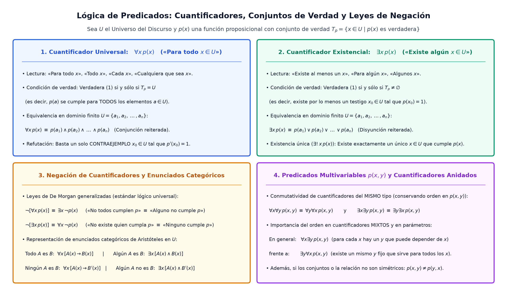
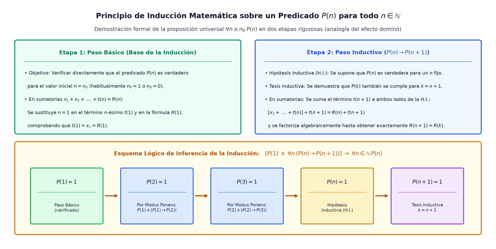

<!-- _class: portada -->
<!-- _paginate: false -->
<!-- _header: "" -->
<!-- _footer: "" -->

# 3.2 Lógica de Predicados
## Predicados, cuantificadores, negación, cuantificadores anidados e inducción matemática

- **Asignatura:** Matemáticas Discretas (`LISSI0211`) · Unidad 3
- **Objetivo:** Representar afirmaciones sobre dominios finitos e infinitos mediante predicados y cuantificadores, evaluar su verdad y demostrar propiedades sobre $\mathbb{N}$ por inducción matemática.

---

## De la Lógica Proposicional a la de Predicados

- La lógica proposicional trata cada oración como bloque indivisible ($1$ o $0$) y no captura su estructura interna:
  $$\text{«Todos los humanos son mortales. Sócrates es humano. }\therefore\text{ Sócrates es mortal.»}$$
- Como $(p \land q) \to r$ es contingencia, tampoco evalúa expresiones abiertas como $x + 2 > 7$.
- La **lógica de predicados (primer orden)** añade:
  1. **Funciones proposicionales o predicados** ($p(x), q(x, y), \dots$).
  2. **Universo del discurso o dominio ($U$).**
  3. **Cuantificadores ($\forall$ y $\exists$).**

---

<!-- _class: figura -->

## Cuantificadores y Lógica de Predicados



Resumen de cuantificadores, conjuntos de verdad, leyes de De Morgan generalizadas y cuantificadores anidados.

---

## 3.2.1 Predicado, Dominio y Conjunto de Verdad

- **Función proposicional (predicado) $p(x)$ sobre $U \neq \emptyset$:** Expresión con variable $x$ tal que, al sustituir $x = a \in U$, $p(a)$ se vuelve proposición ($1$ o $0$).
- **Dominio ($U$):** Conjunto referencial donde $p(a)$ tiene sentido (ej.: $x + 2 > 5$ es válida en $\mathbb{N}, \mathbb{Z}, \mathbb{R}$, pero **no** en $\mathbb{C}$).
- **Conjunto de verdad ($T_p$):**
  $$T_p = \{x \in U \mid p(x) \text{ es verdadera}\} = \{x \in U \mid p(x) = 1\}$$
- **Ejemplo sobre $U = \mathbb{N}$:** $p(x): x+2>7 \implies T_p=\{6,7,8,\dots\}$; $\;q(x): x+5<3 \implies T_q=\emptyset$; $\;r(x): x+5>1 \implies T_r=\mathbb{N}$.

---

## Cuantificador Universal ($\forall$)

- Introducido por Gerhard Gentzen ($1935$): $\forall x\, p(x)$ o $(\forall x \in U)\, p(x)$ (*«Para todo $x$»*, *«Para cada $x$»*, *«Todos cumplen $p(x)$»*).
- **Valor de verdad:**
  $$\forall x\, p(x) = \begin{cases} 1, & \text{si } p(a) \text{ es verdadera para todo } a \in U \;\;(T_p = U), \\ 0, & \text{si existe al menos un } x_0 \in U \text{ con } p(x_0) = 0 \;\;(T_p \neq U). \end{cases}$$
- **Contraejemplo:** Un único $x_0 \in U$ con $p(x_0) = 0$ basta para refutar $\forall x\, p(x)$.
- **Dominio finito $U = \{a_1, \dots, a_n\}$:** $(\forall x \in U)\, p(x) \equiv p(a_1) \land \dots \land p(a_n)$.

---

## Cuantificación Universal Implícita

- En textos matemáticos y en Jiménez Murillo ($2012$, p. 152), cuando se afirma un predicado $p(x)$ como ley sin anteponer un cuantificador explícito, se sobreentiende el cuantificador universal:
  $$\forall x\, p(x) \;\equiv\; p(x) \qquad (x \in U)$$
- *Ejemplo:* Escribir $\operatorname{sen}^2(x) + \cos^2(x) = 1$ para $x \in \mathbb{R}$ equivale a $\forall x \in \mathbb{R}\,[\operatorname{sen}^2(x) + \cos^2(x) = 1]$.
- **Buena práctica:** Escribir siempre explícitamente $\forall x$ para evitar ambigüedad entre proposición abierta y cerrada.

---

<!-- _class: compacta -->

## Cuantificador Existencial ($\exists$) y de Unicidad ($\exists!$)

- Introducido por Giuseppe Peano ($1897$): $\exists x\, p(x)$ o $(\exists x \in U)\, p(x)$ (*«Existe algún $x$»*, *«Hay al menos un $x$»*, *«Algunos $x$ cumplen $p(x)$»*).
- **Valor de verdad** (un $x_0$ que cumple $p(x_0)=1$ se llama **testigo** o **ejemplar**):
  $$\exists x\, p(x) = \begin{cases} 1, & \text{si existe al menos un } x_0 \in U \text{ con } p(x_0) = 1 \;\;(T_p \neq \emptyset), \\ 0, & \text{si } p(a) = 0 \text{ para todo } a \in U \;\;(T_p = \emptyset). \end{cases}$$
- **Dominio finito $U = \{a_1, \dots, a_n\}$:** $(\exists x \in U)\, p(x) \equiv p(a_1) \lor \dots \lor p(a_n)$.
- **Existencia única ($\exists!$):** Verdadera si y sólo si $|T_p| = 1$ (*«Existe exactamente un $x$»*):
  $$\exists! x\, p(x) \;\equiv\; \exists x\,\big[p(x) \;\land\; \forall y\,\big(p(y) \to y = x\big)\big]$$

---

<!-- _class: compacta -->

## 3.2.2 Predicados y Conjuntos de Verdad

Los conectivos lógicos sobre $p(x)$ y $q(x)$ en $U$ corresponden a operaciones entre conjuntos:

| Expresión con predicados | Significado para cada $a \in U$ | Conjunto de verdad en $U$ |
| :---: | :--- | :---: |
| **$p'(x)$** (o $\neg p(x)$) | Verdadera cuando $p(a)$ es falsa, y viceversa. | $(T_p)' = U - T_p$ *(Complemento)* |
| **$p(x) \land q(x)$** | Verdadera cuando $p(a)$ y $q(a)$ son ambas verdaderas. | $T_{p \land q} = T_p \cap T_q$ *(Intersección)* |
| **$p(x) \lor q(x)$** | Verdadera cuando al menos una es verdadera. | $T_{p \lor q} = T_p \cup T_q$ *(Unión)* |
| **$p(x) \to q(x)$** | Falsa sólo cuando $p(a) = 1$ y $q(a) = 0$. | $T_{p \to q} = (T_p)' \cup T_q$ |
| **$\forall x\,[p(x) \to q(x)]$** | Todo elemento que cumple $p$ cumple $q$. | $T_p \subseteq T_q$ *(Inclusión)* |
| **$\forall x\,[p(x) \leftrightarrow q(x)]$** | Los mismos elementos cumplen $p$ y $q$. | $T_p = T_q$ *(Igualdad)* |

---

## Enunciados Categóricos · Estilo A (Dominio Restringido)

Restringiendo el dominio de cada variable a un subconjunto $A, B \subseteq U$ (JM, Ej. 4.24):

- Sean $A = \{\text{artistas}\} \subseteq U$, $B = \{\text{políticos}\} \subseteq U$, $p$: *«es rico»* y $q$: *«es corrupto»*.
- *«Todos los artistas son ricos»:* $\forall x\, p(x)$ con $x \in A$.
- *«Algunos políticos son corruptos»:* $\exists y\, q(y)$ con $y \in B$.
- *«Ningún artista es rico»:* $\forall x\, p'(x)$ (o $[\exists x\, p(x)]'$) con $x \in A$.
- *«Algunos artistas no son ricos»:* $\exists x\, p'(x)$ (o $[\forall x\, p(x)]'$) con $x \in A$.

---

<!-- _class: compacta -->

## Estilo B: Cuatro Enunciados Categóricos de Aristóteles

En un universo general $U = \{\text{animales}\}$ con predicados clasificadores ($g$: gato, $c$: carnívoro, $m$: canta, $a$: alas, $v$: vuela, $k$: gallina, $h$: pone huevos):

| Tipo | Enunciado en español | Representación en $U$ | Regla clave de traducción |
| :---: | :--- | :---: | :--- |
| **Universal Afirmativo (A)** | *«Todos los gatos son carnívoros»* | $\forall x\,[g(x) \to c(x)]$ | $\forall x$ se asocia con **$\to$**, nunca con $\land$. |
| **Universal Negativo (E)** | *«Ningún gato canta»* | $\forall x\,[g(x) \to m'(x)]$ | Equivale a $\neg\exists x\,[g(x) \land m(x)]$. |
| **Particular Afirmativo (I)** | *«Algunos animales tienen alas y vuelan»* | $\exists x\,[a(x) \land v(x)]$ | $\exists x$ se asocia con **$\land$**, nunca con $\to$. |
| **Particular Negativo (O)** | *«Algunas gallinas no ponen huevos»* | $\exists x\,[k(x) \land h'(x)]$ | Existe al menos un individuo con $k(x)$ y $h'(x)$. |

---

## Leyes de De Morgan para Cuantificadores (1/2)

- Negar que **todos cumplen $p(x)$** equivale a afirmar que **existe al menos uno que no cumple $p(x)$**.
- Negar que **existe alguno que cumple $p(x)$** (*ninguno cumple $p$*) equivale a afirmar que **todos incumplen $p(x)$**.

$$\boxed{\neg\big[\forall x\, p(x)\big] \;\equiv\; \exists x\, \neg p(x) \qquad \big(\big[\forall x\, p(x)\big]' \;\equiv\; \exists x\, p'(x)\big)}$$

$$\boxed{\neg\big[\exists x\, p(x)\big] \;\equiv\; \forall x\, \neg p(x) \qquad \big(\big[\exists x\, p(x)\big]' \;\equiv\; \forall x\, p'(x)\big)}$$

---

<!-- _class: compacta -->

## Leyes de De Morgan para Cuantificadores (2/2)

| Original | Negación equivalente | Lectura en español de la negación | Conjunto de verdad |
| :---: | :---: | :--- | :---: |
| $\forall x\, p(x)$ | $\exists x\, p'(x)$ | *«Alguno no cumple $p$»* | $T_p \neq U \iff (T_p)' \neq \emptyset$ |
| $\exists x\, p(x)$ | $\forall x\, p'(x)$ | *«Ninguno cumple $p$»* / *«Todos incumplen $p$»* | $T_p = \emptyset \iff (T_p)' = U$ |
| $\forall x\, p'(x)$ | $\exists x\, p(x)$ | *«Alguno cumple $p$»* | $(T_p)' \neq U \iff T_p \neq \emptyset$ |
| $\exists x\, p'(x)$ | $\forall x\, p(x)$ | *«Todos cumplen $p$»* | $(T_p)' = \emptyset \iff T_p = U$ |

> **Nota sobre Jiménez Murillo (pp. 153, 155, 159):** El autor usa $[\forall x\, p(x)]' = \forall x\, p'(x)$ para el *contrario lingüístico* («Todos» vs. «Ninguno»), aunque en el Ej. 4.25 invierte el valor lógico correctamente ($0'=1$). En el estándar lógico internacional, al meter la negación siempre se intercambia $\forall \leftrightarrow \exists$.

---

## Evaluación de Proposiciones Cuantificadas Compuestas

Para determinar el valor de verdad ($1$ o $0$) de una expresión que combina varios cuantificadores mediante conectivos lógicos ($\land, \lor, \to, \leftrightarrow$):

1. Se evalúa individualmente el valor de verdad ($1$ o $0$) de cada subproposición cuantificada ($\forall x\, p(x)$ o $\exists x\, q(x)$) sobre el universo $U$.
2. Se sustituyen esos valores binarios en la fórmula y se evalúan los conectivos aplicando las mismas **tablas de verdad y jerarquía de operación** de la lógica proposicional (`3.1`).

---

<!-- _class: compacta -->

## Predicados Multivariables y Cuantificadores Anidados

Un predicado binario $p(x, y)$ requiere un cuantificador por cada variable para cerrarse:

| Expresión cuantificada | Lectura formal | Condición para ser Verdadera ($1$) |
| :---: | :--- | :--- |
| **$\forall x \forall y\, p(x, y)$**<br>$\equiv \forall y \forall x\, p(x, y)$ | «Para todo $x$ y todo $y$, $p(x, y)$.» | $p(a, b)=1$ para **toda pareja** $(a, b) \in U \times U$. |
| **$\forall x \exists y\, p(x, y)$** | «Para todo $x$, existe algún $y$, $p(x, y)$.» | Para cada $x$ hay un $y$ (**puede depender de $x$**). |
| **$\exists x \forall y\, p(x, y)$** | «Existe un $x$ tal que $\forall y$, $p(x, y)$.» | Existe **un mismo $x_0$ fijo** válido para todo $y \in U$. |
| **$\exists x \exists y\, p(x, y)$**<br>$\equiv \exists y \exists x\, p(x, y)$ | «Existe algún $x$ y algún $y$, $p(x, y)$.» | Basta **una sola pareja** $(x_0, y_0) \in U \times U$. |

---

## Advertencia 1: Posición de los Parámetros $p(x, y)$

- Si el predicado $p(x, y)$ no es simétrico o $x \in A,\; y \in B$ pertenecen a conjuntos distintos, **invertir el orden de los argumentos dentro del paréntesis cambia el significado**:
  $$p(x, y) \neq p(y, x)$$
- **Ejemplo (JM, Ej. 4.26):** Sean $A = \{\text{ladrones}\}$, $B = \{\text{víctimas}\}$ y $p$: *«asaltaron a»*:
  - $\forall x \forall y\, p(x, y)$: *«Todos los ladrones asaltaron a todas las víctimas.»*
  - $\forall y \forall x\, p(y, x)$: *«Todas las víctimas asaltaron a todos los ladrones.»*

---

## Advertencia 2: Orden de Cuantificadores Mixtos

- **Del mismo tipo:** Siempre conmutan (manteniendo el orden en $p(x,y)$):
  $\forall x \forall y\, p(x,y) \equiv \forall y \forall x\, p(x,y)$ y $\exists x \exists y\, p(x,y) \equiv \exists y \exists x\, p(x,y)$.
- **Mixtos:** El cuantificador de la izquierda tiene mayor alcance; en general sólo vale:
  $$\exists y \forall x\, p(x, y) \;\Rightarrow\; \forall x \exists y\, p(x, y)$$
  *(En $\mathbb{R}$, para $x + y = 0$: $\forall x \exists y\,(x+y=0)$ es verdadera con $y=-x$, pero $\exists y \forall x\,(x+y=0)$ es falsa).*
- *(Nota JM, Ej. 4.27: en ese libro se leen los cuantificadores en el orden de las variables en $p(x,y)$; en los ejemplos indicaremos ambas lecturas).*

---

## Negación con Múltiples Cuantificadores

Aplicando sucesivamente las Leyes de De Morgan de izquierda a derecha, cada $\forall$ cambia a $\exists$, cada $\exists$ cambia a $\forall$, y se niega el predicado final:

- $\neg\big[\forall x \forall y\, p(x, y)\big] \;\equiv\; \exists x \exists y\, p'(x, y)$
- $\neg\big[\forall x \exists y\, p(x, y)\big] \;\equiv\; \exists x \forall y\, p'(x, y)$
- $\neg\big[\exists x \forall y\, p(x, y)\big] \;\equiv\; \forall x \exists y\, p'(x, y)$
- $\neg\big[\exists x \exists y\, p(x, y)\big] \;\equiv\; \forall x \forall y\, p'(x, y)$

---

## Variables Libres y Variables Ligadas

- **Variable ligada (acotada):** Está asociada a un cuantificador $\forall$ o $\exists$ dentro de su alcance (actúa como variable *local*).
- **Variable libre:** No está afectada por ningún cuantificador.
- **Ejemplo (JM, p. 159):** En la expresión:
  $$\forall x\, p(x) \;\lor\; \exists z\,\big[q(y) \land r(z) \land s(w)\big]$$
  las variables **$x$ y $z$ son ligadas** (por $\forall x$ y $\exists z$), mientras que **$y$ y $w$ son variables libres**.

---

<!-- _class: figura -->

## Principio de Inducción Matemática sobre $P(n)$



Etapas del método (paso básico y paso inductivo) y esquema lógico de inferencia en cadena sobre $\mathbb{N}$.

---

## 3.2.3 Principio de Inducción Matemática

Para demostrar que un predicado $P(n)$ (sumatoria, cota de algoritmo o invariante) vale para todo entero $n \ge n_0$ (habitualmente $n_0 = 1$):

$$\underbrace{x_1}_{\text{Inicio }(n=1)} + x_2 + x_3 + \dots + \underbrace{t(n)}_{\text{Término }n\text{-ésimo}} = \underbrace{R(n)}_{\text{Resultado generalizado}}$$

1. **Paso Básico ($k = 1$ o $k = n_0$):**
   Se verifica que $P(1)$ es verdadera sustituyendo $n = 1$ en $t(n)$ y $R(n)$ y comprobando la coincidencia con $x_1$:
   $$t(1) = x_1 = R(1)$$

---

## Paso Inductivo ($k = n + 1$) en Sumatorias

2. **Paso Inductivo:** Si se cumplen el Paso Básico y el Paso Inductivo, entonces $\forall n \ge n_0\; P(n)$ es **verdadera**.
   - **Hipótesis Inductiva (H.I.):** Suponemos que $P(n)$ es verdadera para un entero arbitrario $n \ge 1$.
   - **Tesis Inductiva:** Demostramos que $P(n) \to P(n + 1)$.
   - **Procedimiento algebraico (JM, p. 160):** Calculamos $t(n+1)$ y lo sumamos a ambos miembros de la H.I.:
     $$x_1 + x_2 + \dots + t(n) + t(n + 1) = R(n) + t(n + 1)$$
     y factorizamos el miembro derecho hasta obtener exactamente $R(k) = R(n + 1)$.

---

<!-- _class: seccion -->
<!-- _header: "" -->
<!-- _footer: "" -->

## Ejemplos de Práctica · Subtema 3.2
Resolución paso a paso de conjuntos de verdad, cuantificadores anidados e inducción matemática

---

<!-- _class: compacta -->

## Ejemplo 3.2.1 (a): Evaluación y Negación en Dominio Finito

Sea $A = \{1, 2, 3, 4, 5\}$. Determine el valor de verdad y la negación simplificada (Lipschutz, Prob. 4.15 y 4.27):

- **(i) $(\exists x \in A)(x + 3 = 10)$:** Requiere $x = 7 \notin A$ ($T_p = \emptyset$) $\implies$ **Falsa ($0$)**.
  *Negación:* $(\forall x \in A)(x + 3 \neq 10)$.
- **(ii) $(\forall x \in A)(x + 3 < 10)$:** El mayor es $5$, y $5 + 3 = 8 < 10$ ($T_p = A$) $\implies$ **Verdadera ($1$)**.
  *Negación:* $(\exists x \in A)(x + 3 \ge 10)$.
- **(iii) $(\exists x \in A)(x + 3 < 5)$:** Para $x_0 = 1$, $1 + 3 = 4 < 5$ ($T_p = \{1\}$) $\implies$ **Verdadera ($1$)**.
  *Negación:* $(\forall x \in A)(x + 3 \ge 5)$.
- **(iv) $(\forall x \in A)(x + 3 \le 7)$:** Falla para $x_0 = 5$ ($8 \not\le 7$) $\implies$ **Falsa ($0$)**.
  *Negación:* $(\exists x \in A)(x + 3 > 7)$.

---

## Ejemplo 3.2.1 (b): Refutación mediante Contraejemplos

Encuentre un **contraejemplo** para refutar cada afirmación universal (Lipschutz, Ej. 4.11 y Prob. 4.28):

- **(v) $\forall x \in \mathbb{R},\; x^2 \ge x$:**
  Es **Falsa ($0$)**. Tomando $x_0 = \frac{1}{2} \in \mathbb{R}$, resulta $\left(\frac{1}{2}\right)^2 = \frac{1}{4} < \frac{1}{2}$.
  *(Sobre $\mathbb{N}$ o $\mathbb{Z}$, la proposición sí sería verdadera).*
- **(vi) $\forall x \in U,\; x \text{ es primo}$, con $U = \{3, 5, 7, 9\}$:**
  Es **Falsa ($0$)**. El único contraejemplo en $U$ es $x_0 = 9$, pues $9 = 3 \times 3$ es compuesto.

---

<!-- _class: compacta -->

## Ejemplo 3.2.2: Enunciado Compuesto — Simbolización (1/2)

> *«Algunas elecciones son limpias y no es cierto que todas las elecciones sean dudosas o en algunas de ellas no se cuenta con información.»* (JM, Ej. 4.25)

- **Universo y predicados:** $U = \{x \mid x \text{ es una elección}\}$;
  $p(x)$: es limpia · $q(x)$: es dudosa · $r(x)$: se cuenta con información.
- **Componentes:**
  - *«Algunas elecciones son limpias»:* $\exists x\, p(x)$
  - *«No es cierto que todas sean dudosas»:* $[\forall x\, q(x)]' \equiv \exists x\, q'(x)$
  - *«En algunas no se cuenta con información»:* $\exists x\, r'(x)$
- **Expresión completa:** $\exists x\, p(x) \;\land\; \big[\forall x\, q(x)\big]' \;\lor\; \exists x\, r'(x)$

---

## Ejemplo 3.2.2: Evaluación del Valor de Verdad (2/2)

Evaluamos cada subproposición cuantificada según su valor de verdad empírico en $U$:

- $\exists x\, p(x)$ (*«Algunas elecciones son limpias»*) $= 1$.
- $\forall x\, q(x)$ (*«Todas las elecciones son dudosas»*) $= 0 \implies \big[\forall x\, q(x)\big]' = 0' = 1$.
- $\exists x\, r'(x)$ (*«De algunas no se tiene información»*) $= 1$.

Sustituyendo y respetando la precedencia ($\land$ antes que $\lor$):
$$1 \land 0' \lor 1 \;=\; (1 \land 1) \lor 1 \;=\; 1 \lor 1 \;=\; 1 \quad (\text{Verdadero})$$

---

## Ejemplo 3.2.3: Predicados sobre Dominio Animal (1/2)

Sea $U = \{x \mid x \text{ es un animal}\}$. Defina predicados, simbolice e indique el valor de verdad (JM, Prob. 4.25):

- **a)** *«Todos los animales tienen alas.»*
- **b)** *«Algunos animales tienen alas y no vuelan.»*
- **c)** *«Si es ave, entonces tiene alas.»*
- **d)** *«Si es ave, pone huevos y cacaraquea, entonces es gallina.»*

**Predicados sobre $U$:** $a(x)$: tiene alas · $v(x)$: vuela · $b(x)$: es ave · $h(x)$: pone huevos · $c(x)$: cacaraquea · $g(x)$: es gallina.

---

## Ejemplo 3.2.3: Solución Paso a Paso (2/2)

- **a)** $\forall x\, a(x)$ — **Falso ($0$):** perros o caballos no tienen alas.
- **b)** $\exists x\,\big[a(x) \land v'(x)\big]$ — **Verdadero ($1$):** avestruces o pingüinos tienen alas y no vuelan.
- **c)** $\forall x\,\big[b(x) \to a(x)\big]$ — **Verdadero ($1$):** biológicamente toda ave posee alas.
- **d)** $\forall x\,\big[\big(b(x) \land h(x) \land c(x)\big) \to g(x)\big]$ — **Verdadero ($1$)**.

---

## Ejemplo 3.2.4: Cuantificadores Anidados (1/2)

Sea $U = \{x, y \mid x, y \in \mathbb{Z}^+\}$ y sea $p(x, y): (x - 1) < y$ (JM, Ej. 4.27). Analice:

- **a) $\forall x \forall y\, [(x - 1) < y]$:**
  *«Para todo entero positivo $x$ y todo $y$, $(x - 1) < y$.»*
  **Falso ($0$):** contraejemplo $x = 5,\; y = 2 \implies 4 \not< 2$.
- **b) $\forall x \exists y\, [(x - 1) < y]$:**
  *«Para todo entero positivo $x$, existe al menos un $y$ tal que $(x - 1) < y$.»*
  **Verdadero ($1$):** para cualquier $x \in \mathbb{Z}^+$, basta elegir $y = x \in \mathbb{Z}^+$ y se cumple $(x - 1) < x$.

---

## Ejemplo 3.2.4: Cuantificadores Anidados (2/2)

Sobre $U = \mathbb{Z}^+ \times \mathbb{Z}^+$ con $p(x, y): (x - 1) < y$:

- **c) $\exists x \forall y\, [(x - 1) < y]$:**
  *«Existe al menos un entero positivo $x$ fijo tal que, para todo $y \in \mathbb{Z}^+$, $(x - 1) < y$.»*
  **Verdadero ($1$):** eligiendo $x_0 = 1$, queda $(1 - 1) = 0 < y$, válido para todo $y \in \{1, 2, 3, \dots\}$.
- **d) $\exists x \exists y\, [(x - 1) < y]$:**
  *«Existe algún $x$ y algún $y$ en $\mathbb{Z}^+$ tales que $(x - 1) < y$.»*
  **Verdadero ($1$):** basta tomar $x = 1,\; y = 1$ ($0 < 1$).

---

## Ejemplo 3.2.5: Inducción en Sumatoria — Planteamiento (1/2)

Demuestre para todo $n \in \mathbb{N}$ (JM, Ej. 4.30):
$$P(n): \qquad 2 + 5 + 8 + \dots + (3n - 1) = \frac{n(3n + 1)}{2}$$

- **Elementos:** Inicio $x_1 = 2$ · Término $n$-ésimo $t(n) = 3n - 1$ · Resultado $R(n) = \frac{n(3n + 1)}{2}$.
- **1. Paso básico ($k = n = 1$):**
  $$t(1) = 3(1) - 1 = 2 \qquad \text{y} \qquad R(1) = \frac{1\big(3(1) + 1\big)}{2} = \frac{4}{2} = 2$$
  Coincide con $x_1 = 2$; se cumple el paso básico.

---

<!-- _class: compacta -->

## Ejemplo 3.2.5: Inducción — Paso Inductivo (2/2)

- **2. Paso inductivo ($k = n + 1$):**
  - *Hipótesis inductiva:* $2 + 5 + 8 + \dots + (3n - 1) = \frac{n(3n + 1)}{2}$.
  - Sumamos $t(n + 1) = 3(n + 1) - 1$ a ambos miembros y simplificamos el lado derecho:
    $$\begin{aligned}
    \text{Miembro derecho} &= \frac{n(3n + 1)}{2} + \big[3(n + 1) - 1\big] \\
    &= \frac{n(3n + 1) + 2(3n + 2)}{2} = \frac{3n^2 + 7n + 4}{2} \\
    &= \frac{(n + 1)(3n + 4)}{2} = \frac{(n + 1)\big[3(n + 1) + 1\big]}{2} = \frac{k(3k + 1)}{2} = R(k)
    \end{aligned}$$
  - Se cumple el paso inductivo; $P(n)$ vale para todo $n \in \mathbb{N}$. $\blacksquare$

---

## Ejemplo 3.2.6: Algoritmo Iterativo (Enunciado)

Trace para $n = 1, 2, 3, 4$, deduzca $s = R(n)$ y verifique por inducción (JM, Prob. 4.20):

```text
x = 1;
s = 0;
Mientras (x <= n) hacer
Inicio
    e = 2 * x + 1;
    s = s + e;
    Imprimir (e);
    x = x + 1;
Fin
Imprimir (s).
```

---

## Ejemplo 3.2.6 (a): Traza y Modelado Matemático

- **Traza por iteraciones:**
  - $x = 1$: $e = 3,\;\; s = 3$
  - $x = 2$: $e = 5,\;\; s = 3 + 5 = 8$
  - $x = 3$: $e = 7,\;\; s = 3 + 5 + 7 = 15$
  - $x = 4$: $e = 9,\;\; s = 3 + 5 + 7 + 9 = 24$
- En la $n$-ésima iteración se suma $t(n) = 2n + 1$, y las sumas $3, 8, 15, 24$ corresponden a $(n+1)^2 - 1 = n^2 + 2n = n(n+2)$:
  $$P(n): \qquad 3 + 5 + 7 + \dots + (2n + 1) = n(n + 2)$$

---

<!-- _class: compacta -->

## Ejemplo 3.2.6 (b): Verificación por Inducción Matemática

1. **Paso básico ($k = n = 1$):**
   $$t(1) = 2(1) + 1 = 3 \qquad \text{y} \qquad R(1) = 1(1 + 2) = 3$$
   Coincide con $x_1 = 3$; se cumple el paso básico.
2. **Paso inductivo ($k = n + 1$):** Sumando $t(n + 1) = 2(n + 1) + 1$ a la H.I.:
   $$\begin{aligned}
   3 + 5 + \dots + (2n + 1) + \big[2(n + 1) + 1\big] &= n(n + 2) + 2n + 3 \\
   &= n^2 + 4n + 3 = (n + 1)(n + 3) \\
   &= (n + 1)\big[(n + 1) + 2\big] = k(k + 2)
   \end{aligned}$$
   Se cumple el paso inductivo; el algoritmo queda verificado para todo $n \in \mathbb{N}$. $\blacksquare$

---

<!-- _class: seccion -->
<!-- _header: "" -->
<!-- _footer: "" -->

## Ejercicios de Tarea · Subtema 3.2
Práctica en casa: defina explícitamente el universo del discurso y los predicados cuando corresponda

---

<!-- _class: compacta -->

## Ejercicio 1: Predicados en un Dominio Animal

Sea $U = \{x \mid x \text{ es un animal}\}$. Defina los predicados necesarios, simbolice cada enunciado e indique si es **Verdadero ($1$)** o **Falso ($0$)** justificando brevemente (JM, Prob. 4.26):

- **a)** *«Todos los gatos son carnívoros.»*
- **b)** *«Si es carnívoro y no es perro, entonces es un gato.»*
- **c)** *«Es carnívoro si y sólo si es perro o gato.»*
- **d)** *«Ningún gato canta.»*
- **e)** *«Si canta, entonces no es perro ni gato.»*
- **f)** *«Es carnívoro. No canta. No es perro ni gato. En conclusión, es un león.»*

---

<!-- _class: compacta -->

## Ejercicio 2: Conjuntos de Verdad y Negación

**I)** Sea $A = \{1, 2, \dots, 10\}$. Indique si cada expresión es **proposición cerrada** (halle su valor de verdad) o **función proposicional** (halle su conjunto de verdad en $A$) (Lipschutz, Prob. 4.25 y 4.26):
- **a)** $(\forall x \in A)(\exists y \in A)(x + y < 14) \qquad$ **b)** $(\forall y \in A)(x + y < 14)$
- **c)** $(\forall x \in A)(\forall y \in A)(x + y < 14) \qquad$ **d)** $(\exists y \in A)(x + y < 14)$

**II)** Escriba la negación lógica simplificada (aplicando Leyes de De Morgan) de:
- **e)** *«Si el profesor está ausente, entonces algunos estudiantes no terminan su tarea.»*
- **f)** *«Todos los estudiantes terminaron su tarea y el profesor está presente.»*

---

## Ejercicio 3: Cuantificadores Anidados en $\mathbb{R}$

Sea $U = \{x, y \mid x, y \in \mathbb{R}\}$ (JM, Prob. 4.27 y 4.28):

- **I)** Para $p(x, y): x^2 - 1 = y$, exprese en palabras el significado de cada inciso y determine su valor de verdad ($1$ o $0$):
  - **a)** $\forall x \exists y\, p(x, y) \qquad$ **b)** $\exists x \forall y\, p(x, y) \qquad$ **c)** $\forall y \exists x\, p(x, y)$
  - **d)** $\forall x \forall y\, p(x, y) \qquad$ **e)** $\exists x \exists y\, p(x, y)$
- **II)** Repita el análisis para $q(x, y): x - y = 1$ en $\forall x \exists y\, q(x, y)$ y $\forall y \exists x\, q(x, y)$.

---

## Ejercicio 4: Traducción Simbólica en $\mathbb{R}$

Sea $U = \{x, y \mid x, y \in \mathbb{R}\}$ con $p(x, y): y = 2x - 1$, $\;q(x, y): x > y$ y $r(x, y): y = \frac{1}{x}$. Simbolice cada enunciado (JM, Prob. 4.29 y 4.30):

- **a)** *«Existen algunas $y$ que para toda $x$ cumplen que si $y = 2x - 1$ y $x > y$, entonces $y = \frac{1}{x}$.»*
- **b)** *«Para toda $y$ existe alguna $x$ tal que si $y \neq 2x - 1$ o $y = \frac{1}{x}$, entonces $x \le y$.»*
- **c)** *«Para alguna $x$ existe alguna $y$ tal que $y = \frac{1}{x}$, o para toda $x$ se cumple $x > y$ y existe alguna $y$ tal que $y \neq 2x - 1$.»*

---

## Ejercicio 5: Demostración por Inducción Matemática

Demuestre formalmente usando el Principio de Inducción Matemática (**Paso básico** y **Paso inductivo**) (JM, Prob. 4.18 y 4.19):

- **a)** $5 + 15 + 25 + 35 + \dots + (10n - 5) = 5n^2 \qquad (\forall n \in \mathbb{N})$
- **b)** $\frac{3}{1 \cdot 3} + \frac{3}{3 \cdot 5} + \frac{3}{5 \cdot 7} + \dots + \frac{3}{(2n - 1)(2n + 1)} = \frac{3n}{2n + 1} \qquad (\forall n \in \mathbb{N})$
- **c)** $0 + 3 + 8 + \dots + (n^2 - 1) = \frac{n(2n + 5)(n - 1)}{6} \qquad (\forall n \in \mathbb{N})$
- **d)** $2^n > n^2 \qquad (\forall n \in \mathbb{Z}^+ \text{ con } n \ge 5)$

---

## Ejercicio 6 (a): Verificación de Algoritmo por Inducción

Exprese como sumatoria, halle $t(n)$ y $s$, y demuestre su validez por inducción (JM, Prob. 4.21):

```text
x = 1;
s = 0;
Mientras (x <= n) hacer
Inicio
    e = 3 * x - 1;
    s = s + e;
    Imprimir (e);
    x = x + 1;
Fin
Imprimir (s);
```

---

## Ejercicio 6 (b): Ordenamiento de la Burbuja (*Bubble Sort*)

Demuestre mediante el Principio de Inducción Matemática que el algoritmo de **ordenamiento de la burbuja (*bubble sort*)** sobre una lista de $n$ elementos realiza en el peor de los casos (JM, Prob. 4.23):

$$(n - 1) + (n - 2) + \dots + 2 + 1 = \frac{n(n - 1)}{2}$$

comparaciones para todo entero $n \ge 1$.
