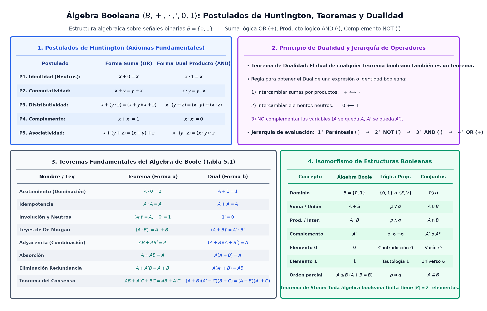

<!-- _class: portada -->
<!-- _paginate: false -->
<!-- _header: "" -->
<!-- _footer: "" -->

# 4.1 Teoremas y postulados
## Álgebra Booleana y Estructura Axiomática

**Asignatura:** Matemáticas Discretas (`LISSI0211`) · Unidad 4
**Objetivo:** Dominar los postulados de Huntington, el principio de dualidad y los teoremas booleanos para demostrar identidades y analizar expresiones binarias.

---

## Señales Analógicas frente a Señales Binarias

En sistemas digitales, la información se representa mediante **señales físicas** (voltaje, corriente, presión o luz):

- **Señal analógica:** Su magnitud varía de forma **continua** en un intervalo infinito de valores (temperatura, presión, onda sonora).
- **Señal digital binaria (biestable):** Admite únicamente **dos estados** mutuamente excluyentes:

$$\text{Conectado / Desconectado}, \quad \text{Verdadero / Falso}, \quad +5\text{ V / }0\text{ V}, \quad \mathbf{1} \text{ / } \mathbf{0}$$

- **Boole (1854)** formalizó el cálculo lógico, **Huntington (1904)** propuso sus axiomas y **Shannon (1938)** los aplicó a circuitos de conmutación.

---

<!-- _class: figura -->

## Mapa Conceptual del Álgebra Booleana

Síntesis de los postulados de Huntington, la regla de dualidad, los teoremas de la Tabla 5.1 y su isomorfismo con lógica y conjuntos.

---

## 1. Definición Axiomática del Álgebra Booleana

Un **álgebra booleana** es la séxtupla $\langle B,\; +,\; \cdot,\; ',\; 0,\; 1 \rangle$ que consta de:

- Un conjunto no vacío $B$ con al menos **dos elementos distintos**: el **cero ($0$)** y la **unidad ($1$)** ($0 \neq 1$).
- Dos operaciones binarias cerradas en $B$: **suma lógica `OR` ($+$)** y **producto lógico `AND` ($\cdot$ o $*$)**.
- Una operación unaria: **complemento o inversión `NOT` ($'$)**.
- Satisfacción de los **postulados de Huntington** para todo $x, y, z \in B$.

---

<!-- _class: compacta -->

## Postulados Fundamentales (Huntington, 1904)

| Postulado | Nombre | Suma Lógica ($+$) | Dual: Producto ($\cdot$) |
| :---: | :--- | :---: | :---: |
| **P0** | **Cerradura** | $x + y \in B$ | $x \cdot y \in B$ |
| **P1 (`B3`)** | **Identidad (Neutros)** | $x + 0 = x$ | $x \cdot 1 = x$ |
| **P2 (`B1`)** | **Conmutatividad** | $x + y = y + x$ | $x \cdot y = y \cdot x$ |
| **P3** | **Asociatividad** | $x + (y + z) = (x + y) + z$ | $x \cdot (y \cdot z) = (x \cdot y) \cdot z$ |
| **P4 (`B2`)** | **Distributividad mutua** | $x + (y \cdot z) = (x + y) \cdot (x + z)$ | $x \cdot (y + z) = (x \cdot y) + (x \cdot z)$ |
| **P5 (`B4`)** | **Existencia de complementos** | $x + x' = 1$ | $x \cdot x' = 0$ |

---

## Observaciones Clave sobre los Postulados

- **Independencia de la asociatividad:** Los cuatro axiomas `B1`, `B2`, `B3` y `B4` bastan para definir un álgebra booleana; `P3` puede deducirse como teorema.
- **Distributividad mutua:** A diferencia de $\mathbb{R}$, en un álgebra booleana la suma también se distribuye sobre el producto:

$$x + yz = (x + y)(x + z)$$

- **Notación:** El producto $x \cdot y$ se abrevia por yuxtaposición $xy$ o $(x)(y)$; el complemento se escribe $x'$ o $\bar{x}$.

---

## 2. El Álgebra Bivalente $B = \{0, 1\}$: Operadores `AND` y `OR`

Las operaciones binarias del **álgebra de conmutación** se definen sobre $B = \mathbb{Z}_2 = \{0, 1\}$:

| $A$ | $B$ | Producto `AND` ($A \cdot B$) | Suma `OR` ($A + B$) |
| :---: | :---: | :---: | :---: |
| $0$ | $0$ | **$0$** | **$0$** |
| $0$ | $1$ | **$0$** | **$1$** |
| $1$ | $0$ | **$0$** | **$1$** |
| $1$ | $1$ | **$1$** | **$1$** |

---

## Operador `NOT` y Regla de Saturación Lógica

| $A$ | Complemento `NOT` ($A'$) |
| :---: | :---: |
| $0$ | **$1$** |
| $1$ | **$0$** |

- **Sin acarreo en la suma lógica (`OR`):** Equivale a $\text{máx}(A, B)$, mientras que `AND` equivale a $\text{mín}(A, B)$:

$$1 + 1 = 1, \qquad 1 + 1 + 1 = 1, \qquad 0 + 1 = 1, \qquad 0 + 0 = 0$$

---

## Definición Recursiva de Expresiones Booleanas

Una expresión booleana $E(x_1, x_2, \dots, x_n)$ se define recursivamente así:

- **Caso base:** Las constantes $0$ y $1$, así como cada variable $x_1, x_2, \dots, x_n$, son expresiones booleanas.
- **Paso recursivo:** Si $X_1$ y $X_2$ son expresiones booleanas, entonces también lo son:

$$(X_1), \qquad X_1', \qquad X_1 + X_2, \qquad X_1 \cdot X_2$$

---

## Propiedades de Funciones y Precedencia de Operadores

- **Literal:** Variable sola o complementada ($A, A', x, x'$); modela una señal de entrada.
- **Función $F: B^n \to B$:** Su tabla de verdad tiene **$2^n$ filas** y existen exactamente **$2^{(2^n)}$ funciones distintas** ($n=2 \to 16$, $n=3 \to 256$, $n=4 \to 65\,536$).
- **Jerarquía de precedencia (de mayor a menor):**

$$1^\circ\text{ Paréntesis } (\;) \;\longrightarrow\; 2^\circ\text{ Complemento } (') \;\longrightarrow\; 3^\circ\text{ Producto } (\cdot) \;\longrightarrow\; 4^\circ\text{ Suma } (+)$$

- Ejemplos: $A + BC = A + (BC) \neq (A + B)C$ y $AB' = A(B') \neq (AB)'$.

---

## 3. Ejemplos de Álgebras Booleanas e Isomorfismo (1/2)

Cualquier teorema deducido de los postulados es válido en todo sistema que los cumpla:

- **Cadenas de $n$ bits $B^n$:** Con $+, \cdot, '$ operando **bit a bit**; tiene $2^n$ elementos con $\mathbf{0} = 00\dots 0$ y $\mathbf{1} = 11\dots 1$.
- **Álgebra de conjuntos $\langle \mathcal{P}(U), \cup, \cap, ', \emptyset, U \rangle$:** Unión como $+$, intersección como $\cdot$, $\emptyset$ como $0$ y $U$ como $1$.
- **Álgebra de proposiciones lógicas:** Disyunción ($\lor$), conjunción ($\land$), negación ($'$), contradicción ($0$) y tautología ($1$).

---

<!-- _class: compacta -->

## Ejemplos de Álgebras Booleanas: Divisores $D_m$ (2/2)

- Sea $m > 0$ **libre de cuadrados** (producto de primos distintos, ej. $6, 30, 70, 210$) y $D_m$ el conjunto de sus divisores positivos:

$$a + b = \operatorname{mcm}(a, b), \qquad a \cdot b = \operatorname{mcd}(a, b), \qquad a' = \frac{m}{a}$$

- $\langle D_m, +, \cdot, ', 1, m \rangle$ es un álgebra booleana con elemento cero $\mathbf{0} = 1$ y elemento unidad $\mathbf{1} = m$.
- **Advertencia:** Si $m$ tiene un factor primo al cuadrado (ej. $m = 8$), $D_m$ **NO** es álgebra booleana: en $D_8$, $2' = 4$, pero $\operatorname{mcm}(2,4) = 4 \neq 8$ y $\operatorname{mcd}(2,4) = 2 \neq 1$.

---

## Teorema de Representación de Stone

- **Teorema 15.6 de Lipschutz:** Toda álgebra booleana finita $B$ es **isomorfa** al álgebra de conjuntos $\mathcal{P}(A)$, donde $A$ es el conjunto de sus **átomos** (los elementos que suceden inmediatamente a $0$).
- En el álgebra de divisores $D_m$, los átomos son exactamente los divisores primos de $m$.
- **Corolario 15.7:**

$$\boxed{\text{Toda álgebra booleana finita } B \text{ tiene exactamente } |B| = 2^n \text{ elementos } (n \ge 1).}$$

---

## 4. El Principio de Dualidad

El **dual** de cualquier proposición o identidad booleana se obtiene aplicando simultáneamente:

1. Intercambiar cada **suma ($+$)** por un **producto ($\cdot$)** y viceversa (conservando paréntesis).
2. Intercambiar cada **$0$** por **$1$** y cada **$1$** por **$0$**.
3. **NO complementar las literales** ($A$ permanece $A$; $A'$ permanece $A'$).

- **Dual vs. Complemento:** Para $E = A + B'C$, su dual es $E^{\text{dual}} = A(B' + C)$, mientras que su complemento $E'$ por De Morgan además niega todas las variables.

---

## Teorema del Principio de Dualidad

> **Teorema 15.1 (Principio de Dualidad):**
> *El dual de cualquier teorema en un álgebra booleana también es un teorema.*

- **Justificación:** Todo postulado de Huntington viene acompañado de su forma dual.
- Si una identidad $T$ se demuestra en $k$ pasos desde los postulados, sustituir cada paso por su dual produce una demostración válida de $T^{\text{dual}}$.
- Reduce a la mitad el esfuerzo necesario para probar todos los teoremas booleanos.

---

<!-- _class: compacta -->

## 5. Teoremas del Álgebra de Boole (Tabla 5.1) (1/3)

*(Aquí $A, B, C$ representan variables individuales o subexpresiones booleanas complejas).*

| Núm. | Nombre del Teorema | Forma `a` | Forma Dual (`b`) |
| :---: | :--- | :---: | :---: |
| **1a / 1b** | **Acotamiento (Dominación)** | $0 \cdot A = 0$ | $1 + A = 1$ |
| **2a / 2b** | **Existencia de Neutros** | $1 \cdot A = A$ | $0 + A = A$ |
| **3a / 3b** | **Idempotencia** | $A \cdot A = A$ | $A + A = A$ |
| **4a / 4b** | **Complementación** | $A \cdot A' = 0$ | $A + A' = 1$ |
| **—** | **Complemento de neutros** | $0' = 1$ | $1' = 0$ |
| **—** | **Involución** | $(A')' = A$ | $(A')' = A$ |

---

<!-- _class: compacta -->

## Teoremas del Álgebra de Boole (Tabla 5.1) (2/3)

| Núm. | Nombre del Teorema | Forma `a` | Forma Dual (`b`) |
| :---: | :--- | :---: | :---: |
| **—** | **Unicidad del complemento** | $A + X = 1$ y $AX = 0 \implies X = A'$ | *(Autodual)* |
| **5a / 5b** | **Conmutatividad** | $AB = BA$ | $A + B = B + A$ |
| **6a / 6b** | **Asociatividad** | $ABC = A(BC) = (AB)C$ | $A + B + C = A + (B + C)$ |
| **7a / 7b** | **Leyes de De Morgan** | $(AB \dots Z)' = A' + B' + \dots + Z'$ | $(A + B + \dots + Z)' = A'B' \dots Z'$ |
| **8a / 8b** | **Distributividad** | $AB + AC = A(B + C)$ | $(A + B)(A + C) = A + BC$ |

---

<!-- _class: compacta -->

## Teoremas del Álgebra de Boole (Tabla 5.1) (3/3)

| Núm. | Nombre del Teorema | Forma `a` | Forma Dual (`b`) |
| :---: | :--- | :---: | :---: |
| **9a / 9b** | **Adyacencia Lógica** | $AB + AB' = A$ | $(A + B)(A + B') = A$ |
| **10a / 10b** | **Absorción** | $A + AB = A$ | $A(A + B) = A$ |
| **11a / 11b** | **Eliminación de redundancia** | $A + A'B = A + B$ | $A(A' + B) = AB$ |
| **12a / 12b** | **Redundancia con factor $C$** | $CA + CA'B = CA + CB$ | $(C + A)(C + A' + B) = (C + A)(C + B)$ |
| **13a / 13b** | **Teorema del Consenso** | $AB + A'C + BC = AB + A'C$ | $(A + B)(A' + C)(B + C) = (A + B)(A' + C)$ |

---

## Equivalencias de Orden Parcial (Teorema 15.5)

En cualquier álgebra booleana $B$, la relación de orden parcial $A \le B$ (en conjuntos $A \subseteq B$, en lógica $p \Rightarrow q$, en divisores $a \mid b$) equivale a cuatro igualdades intercambiables:

$$(1)\;\; A + B = B \iff (2)\;\; A \cdot B = A \iff (3)\;\; A' + B = 1 \iff (4)\;\; A \cdot B' = 0$$

- Cualquiera de estas cuatro condiciones implica automáticamente las otras tres en toda álgebra booleana.

---

<!-- _class: compacta -->

## 6. Métodos de Demostración e Idempotencia (`3a`, `3b`)

Dos métodos rigurosos: **1) Demostración deductiva** (válida en cualquier $B$ abstracta) e **2) Inducción perfecta** por tabla de verdad (válida en $B = \{0, 1\}$).

**Demostración de Idempotencia ($A + A = A$):**

$$\begin{aligned}
A &= A + 0 && \text{(Identidad P1: } x + 0 = x\text{)} \\
  &= A + (A \cdot A') && \text{(Complemento P5: } A \cdot A' = 0\text{)} \\
  &= (A + A) \cdot (A + A') && \text{(Distributividad P4)} \\
  &= (A + A) \cdot 1 && \text{(Complemento P5: } A + A' = 1\text{)} \\
  &= A + A && \text{(Identidad P1: } x \cdot 1 = x\text{)} \quad \blacksquare
\end{aligned}$$

Por el **Principio de Dualidad**, también se cumple $A \cdot A = A$.

---

<!-- _class: compacta -->

## Demostración de la Ley de Acotamiento (`1a`, `1b`)

**Teorema `1b`: $A + 1 = 1$**

$$\begin{aligned}
A + 1 &= (A + 1) \cdot 1 && \text{(Identidad P1: } x \cdot 1 = x\text{)} \\
      &= (A + 1) \cdot (A + A') && \text{(Complemento P5: } A + A' = 1\text{)} \\
      &= A + (1 \cdot A') && \text{(Distributividad P4 a la inversa)} \\
      &= A + (A' \cdot 1) && \text{(Conmutatividad P2)} \\
      &= A + A' = 1 && \text{(Identidad P1 y Complemento P5)} \quad \blacksquare
\end{aligned}$$

Por el **Principio de Dualidad**, se concluye inmediatamente que $A \cdot 0 = 0$ (`1a`).

---

<!-- _class: compacta -->

## Demostración de la Ley de Absorción (`10a`, `10b`)

**Teorema `10a`: $A + AB = A$**

$$\begin{aligned}
A + A \cdot B &= (A \cdot 1) + (A \cdot B) && \text{(Identidad P1: } A = A \cdot 1\text{)} \\
              &= A \cdot (1 + B) && \text{(Distributividad P4)} \\
              &= A \cdot (B + 1) && \text{(Conmutatividad P2)} \\
              &= A \cdot 1 && \text{(Acotamiento 1b: } B + 1 = 1\text{)} \\
              &= A && \text{(Identidad P1)} \quad \blacksquare
\end{aligned}$$

Por el **Principio de Dualidad**, se cumple también $A(A + B) = A$ (`10b`).

---

<!-- _class: compacta -->

## Unicidad del Complemento, Involución y Neutros

- **Unicidad del complemento:** Si $A + X = 1$ y $A \cdot X = 0$, entonces:

$$\begin{aligned}
X &= X \cdot 1 = X(A + A') = AX + XA' = 0 + XA' \\
  &= AA' + XA' = A'(A + X) = A' \cdot 1 = A' \quad \blacksquare
\end{aligned}$$

- **Involución $(A')' = A$:** Como $A' + A = 1$ y $A' \cdot A = 0$, por unicidad $A$ es el complemento de $A'$. $\blacksquare$
- **Complemento de $0$ y $1$:** Como $0 + 1 = 1$ y $0 \cdot 1 = 0$, por unicidad $0' = 1$ y $1' = 0$. $\blacksquare$

---

<!-- _class: compacta -->

## Demostración de las Leyes de De Morgan (`7a`, `7b`)

Para probar $(A + B)' = A'B'$ por unicidad del complemento verificamos dos condiciones:

- **Suma igual a $1$:**

$$\begin{aligned}
(A + B) + A'B' &= B + (A + A')(A + B') = B + 1 \cdot (A + B') \\
               &= A + (B + B') = A + 1 = 1
\end{aligned}$$

- **Producto igual a $0$:**

$$(A + B) \cdot (A'B') = A(A'B') + B(A'B') = (AA')B' + A'(BB') = 0 + 0 = 0$$

Por unicidad, $(A + B)' = A'B'$; por **dualidad**, $(AB)' = A' + B'$. $\blacksquare$

---

<!-- _class: compacta -->

## Eliminación de Redundancia (`11a`) y Consenso (`13a`)

- **Teorema `11a` ($A + A'B = A + B$):** Por distributividad P4:

$$A + A'B = (A + A')(A + B) = 1 \cdot (A + B) = A + B \quad \blacksquare$$

*(Multiplicando por $C$ se obtiene `12a`: $CA + CA'B = CA + CB$).*

- **Teorema del Consenso `13a` ($AB + A'C + BC = AB + A'C$):**

$$\begin{aligned}
AB + A'C + BC &= AB + A'C + (A + A')BC = AB + A'C + ABC + A'BC \\
              &= AB(1 + C) + A'C(1 + B) = AB + A'C \quad \blacksquare
\end{aligned}$$

---

<!-- _class: seccion -->
<!-- _header: "" -->
<!-- _footer: "" -->

## Ejemplos de Práctica
### Evaluación, dualidad, De Morgan, demostraciones, $D_{70}$ y cadenas de bits

---

## Ejemplo 4.1.1: Evaluación y Tabla de Verdad (1/2)

Sea la expresión de tres variables:

$$F(A, B, C) = \big(A \cdot (B' + C)\big) + B' \cdot (A + C)'$$

**a) Evaluación puntual para $A = 1,\; B = 0,\; C = 0$:**

$$\begin{aligned}
F(1, 0, 0) &= \big(1 \cdot (0' + 0)\big) + 0' \cdot (1 + 0)' \\
           &= \big(1 \cdot (1 + 0)\big) + 1 \cdot (1)' && (0' = 1,\; 1+0 = 1) \\
           &= (1 \cdot 1) + (1 \cdot 0) = 1 + 0 = \mathbf{1} && (1' = 0)
\end{aligned}$$

---

<!-- _class: tabla-ancha -->

## Ejemplo 4.1.1: Tabla de Verdad Completa (2/2)

| Fila | $A$ | $B$ | $C$ | $B'$ | $B'+C$ | $A(B'+C)$ | $A+C$ | $(A+C)'$ | $B'(A+C)'$ | $F$ |
| :---: | :---: | :---: | :---: | :---: | :---: | :---: | :---: | :---: | :---: | :---: |
| **0** | $0$ | $0$ | $0$ | $1$ | $1$ | $0$ | $0$ | $1$ | $1$ | **$1$** |
| **1** | $0$ | $0$ | $1$ | $1$ | $1$ | $0$ | $1$ | $0$ | $0$ | **$0$** |
| **2** | $0$ | $1$ | $0$ | $0$ | $0$ | $0$ | $0$ | $1$ | $0$ | **$0$** |
| **3** | $0$ | $1$ | $1$ | $0$ | $1$ | $0$ | $1$ | $0$ | $0$ | **$0$** |
| **4** | $1$ | $0$ | $0$ | $1$ | $1$ | $1$ | $1$ | $0$ | $0$ | **$1$** |
| **5** | $1$ | $0$ | $1$ | $1$ | $1$ | $1$ | $1$ | $0$ | $0$ | **$1$** |
| **6** | $1$ | $1$ | $0$ | $0$ | $0$ | $0$ | $1$ | $0$ | $0$ | **$0$** |
| **7** | $1$ | $1$ | $1$ | $0$ | $1$ | $1$ | $1$ | $0$ | $0$ | **$1$** |

Algebraicamente, $F = B'C' + AC$ (vale $1$ en filas $0, 4, 5, 7$).

---

## Ejemplo 4.1.2: Dual de Ecuaciones Booleanas (1/2)

Obtenga el **dual** intercambiando $+ \leftrightarrow \cdot$ y $0 \leftrightarrow 1$ (sin alterar $x, x'$):

- **a)** $(a \cdot 1) \cdot (0 + a') = 0$
  $$\text{Dual:} \quad (a + 0) + (1 \cdot a') = 1$$
- **b)** $a + a'b = a + b$ *(es decir, $a + (a' \cdot b) = a + b$)*
  $$\text{Dual:} \quad a \cdot (a' + b) = a \cdot b \quad \Longrightarrow \quad a(a' + b) = ab$$
- **c)** $(x + y)(x + 1) = x + xy + y$
  $$\text{Dual:} \quad (x \cdot y) + (x \cdot 0) = x \cdot (x + y) \cdot y$$

---

## Ejemplo 4.1.2: Dual vs. Complemento (2/2)

Para **d)** $E = (A' \cdot B) + \big[C \cdot (D' + 0)\big]$:

- **Expresión Dual ($E^{\text{dual}}$):** Sólo se intercambian $+ \leftrightarrow \cdot$ y $0 \leftrightarrow 1$, conservando intactas las literales:

$$E^{\text{dual}} = (A' + B) \cdot \big[C + (D' \cdot 1)\big]$$

- **Complemento ($E'$):** Por De Morgan e involución, además de cambiar $+ \leftrightarrow \cdot$ y $0 \leftrightarrow 1$, **se complementa cada variable**:

$$E' = \Big[(A' \cdot B) + \big[C \cdot (D' + 0)\big]\Big]' = (A + B') \cdot \big[C' + (D \cdot 1)\big]$$

---

<!-- _class: compacta -->

## Ejemplo 4.1.3: Leyes de De Morgan en Expresiones Multinivel

Lleve el complemento ($'$) únicamente a las variables individuales:

- **a) $F_1 = (A'B + CD')'$:**

$$\begin{aligned}
F_1 &= (A'B)' \cdot (CD')' && \text{(Teorema 7b)} \\
    &= \big[(A')' + B'\big] \cdot \big[C' + (D')'\big] && \text{(Teorema 7a)} \\
    &= (A + B')(C' + D) && \text{(Involución)}
\end{aligned}$$

- **b) $F_2 = \big((XY)'Z\big)' \cdot \big((X' + Z)(Y' + Z')\big)'$:**
  - Primer factor: $\big((XY)'Z\big)' = ((XY)')' + Z' = XY + Z'$.
  - Segundo factor: $(X' + Z)' + (Y' + Z')' = XZ' + YZ$.
  - Resultado: $F_2 = (XY + Z')(XZ' + YZ)$.

---

<!-- _class: compacta -->

## Ejemplo 4.1.4: Demostración de Identidades (1/2)

**a)** Demuestre que $F = A'B + (ABC)' + C(B' + A) = 1$:

$$\begin{aligned}
F &= A'B + A' + B' + C' + C(B' + A) && \text{(7a: De Morgan)} \\
  &= A'B + A' + B' + C' + CB' + CA && \text{(8a: Distributividad)} \\
  &= A'(B + 1) + B'(1 + C) + (C' + CA) && \text{(5b, 6b, 8a)} \\
  &= A'(1) + B'(1) + (C' + A) && \text{(1b y 11a: } C'+CA = C'+A\text{)} \\
  &= (A + A') + B' + C' = 1 + B' + C' = \mathbf{1} && \text{(2a, 4b y 1b)} \quad \blacksquare
\end{aligned}$$

Al reducirse a $1$, la expresión es una **tautología**.

---

<!-- _class: compacta -->

## Ejemplo 4.1.4: Demostración del Dual del Consenso (2/2)

**b)** Demuestre $(A + B)(A' + C)(B + C) = (A + B)(A' + C)$ (`13b`):

$$\begin{aligned}
(A+B)(A'+C)(B+C) &= (A+B)(A'+C)(0 + B + C) && \text{(2b: Neutro } 0\text{)} \\
                  &= (A+B)(A'+C)(AA' + B + C) && \text{(4a: } 0 = AA'\text{)} \\
                  &= (A+B)(A'+C)(A+B+C)(A'+B+C) && \text{(8b: Distributividad)} \\
                  &= \big[(A+B)(A+B+C)\big]\big[(A'+C)(A'+B+C)\big] && \text{(5a, 6a)} \\
                  &= (A+B)(A'+C) && \text{(10b: Absorción)} \quad \blacksquare
\end{aligned}$$

---

## Ejemplo 4.1.5: Álgebra de Divisores $D_{70}$ (1/2)

Sea $D_{70} = \{1, 2, 5, 7, 10, 14, 35, 70\}$ con $a + b = \operatorname{mcm}(a, b)$, $a \cdot b = \operatorname{mcd}(a, b)$ y $a' = 70 / a$.

**a) Elementos neutros y átomos:**
- Como $70 = 2 \cdot 5 \cdot 7$ es libre de cuadrados, $|D_{70}| = 2^3 = 8$.
- **Elemento cero:** $\mathbf{0}_{D_{70}} = 1$ ($\operatorname{mcm}(a, 1) = a$).
- **Elemento unidad:** $\mathbf{1}_{D_{70}} = 70$ ($\operatorname{mcd}(a, 70) = a$).
- **Átomos (divisores primos):** $A = \{2, 5, 7\}$.

---

## Ejemplo 4.1.5: Operaciones en $D_{70}$ (2/2)

**b) Evalúe $(10' + 14) \cdot 35'$:**
- Complementos: $10' = 70/10 = 7$ y $35' = 70/35 = 2$.
- Suma: $10' + 14 = \operatorname{mcm}(7, 14) = 14$.
- Producto: $(10' + 14) \cdot 35' = \operatorname{mcd}(14, 2) = \mathbf{2}$.

**c) Verifique $(a + b)' = a' \cdot b'$ para $a = 2,\; b = 5$:**
- Miembro izquierdo: $(2 + 5)' = (\operatorname{mcm}(2, 5))' = 10' = 70/10 = \mathbf{7}$.
- Miembro derecho: $2' \cdot 5' = \operatorname{mcd}(35, 14) = \mathbf{7}$. *(Coinciden).*

---

<!-- _class: compacta -->

## Ejemplo 4.1.6: Operaciones Bitwise en $B^6$

En el microprocesador, las operaciones lógicas operan bit a bit sobre registros de longitud $n$. Sean $A = 110010$ y $B = 011011$ en $B^6$:

**a) Operaciones básicas:**

$$\begin{aligned}
A \cdot B &= 110010 \;\land\; 011011 = \mathbf{010010}, & A' &= (110010)' = \mathbf{001101} \\
A + B     &= 110010 \;\lor\; 011011  = \mathbf{111011}, & B' &= (011011)' = \mathbf{100100}
\end{aligned}$$

**b) Verificación de $(A \cdot B)' = A' + B'$:**

$$(A \cdot B)' = (010010)' = \mathbf{101101}, \qquad A' + B' = 001101 + 100100 = \mathbf{101101}$$

---

<!-- _class: seccion -->
<!-- _header: "" -->
<!-- _footer: "" -->

## Ejercicios de Tarea
### Práctica en casa — Justifique cada paso con postulados y teoremas

---

<!-- _class: compacta -->

## Ejercicios de Tarea (1/3)

1. **Tablas de verdad de expresiones booleanas:** Construya la tabla de verdad completa (u obtenga primero una forma algebraica equivalente para comprobarla) para:
   a) $F(A, B, C, D) = (A + BD')(C'DB + AB' + DA)'$
   b) $F(A, B, C, D) = \big[A'(BC + D')' + B'A\big]$

2. **Obtención del Dual y del Complemento:** Escriba la ecuación o expresión **dual** de cada inciso (y en **(d)** halle además su **complemento simplificado $E'$**):
   a) $(x' + y')' = xy$
   b) $x + x(y + 1) = x$
   c) $(a + 0) \cdot (b + 1) \cdot (a' + b') = ab'$
   d) $E(A, B, C, D) = A(B' + C) + D'(A' + B \cdot 1)$

---

<!-- _class: compacta -->

## Ejercicios de Tarea (2/3)

3. **Demostración deductiva desde los Postulados de Huntington:** Sean $x, y, z \in B$ (sin usar tablas de verdad):
   a) **Cancelación conjunta:** Si $x + y = x + z$ y $x' + y = x' + z$, entonces $y = z$. *(Explique con un contraejemplo en $B = \{0, 1\}$ por qué una sola condición no basta).*
   b) $x + y = 0$ si y sólo si $x = 0$ y $y = 0$.
   c) Escriba y justifique por dualidad la proposición dual de (b).

4. **Demostración de equivalencias booleanas (Tabla 5.1):** Indique el teorema aplicado en cada paso:
   a) $(A + B)(A' + C) = AC + A'B$
   b) $AB + A'B' + BC = AB + A'B' + A'C$
   c) $\big[(A + B)' + C' + D'\big]\big[(AC)' + \big(A + (BC)'\big)' + D\big] = (A'B' + C' + D')(A' + C' + D)$

---

<!-- _class: compacta -->

## Ejercicios de Tarea (3/3)

5. **Álgebra booleana de divisores $D_{210}$ y subálgebras:** Con $a + b = \operatorname{mcm}(a, b)$, $a \cdot b = \operatorname{mcd}(a, b)$ y $a' = 210/a$:
   a) Explique por qué $D_{210}$ es álgebra booleana; halle $|D_{210}|$, elemento cero, elemento unidad y átomos $A$.
   b) Calcule $(6' \cdot 15) + (10 \cdot 21)'$ en $D_{210}$.
   c) Determine si $X = \{1, 2, 6, 210\}$, $Y = \{1, 2, 3, 6\}$ y $Z = \{1, 2, 3, 6, 35, 70, 105, 210\}$ son **subálgebras booleanas** de $D_{210}$.

6. **Criterio compacto de subálgebra booleana:** Sea $\langle S, +, \cdot, ', 0, 1 \rangle$ un álgebra booleana y $A \subseteq S$. Demuestre que $A$ es subálgebra booleana si y sólo si:

$$\text{(i)}\;\; 1 \in A \qquad\text{y}\qquad \text{(ii)}\;\; \forall x, y \in A,\;\; x \cdot y' \in A$$
