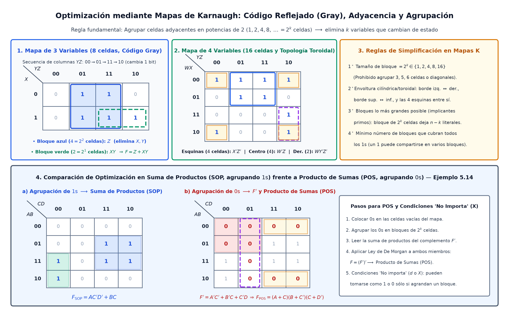

<!-- _class: portada -->
<!-- _paginate: false -->
<!-- _header: "" -->
<!-- _footer: "" -->

# 4.2 Optimización de expresiones booleanas
## Simplificación Algebraica, Consenso y Mapas de Karnaugh

**Asignatura:** Matemáticas Discretas (`LISSI0211`) · Unidad 4
**Objetivo:** Minimizar funciones booleanas mediante teoremas algebraicos, el método del consenso de Quine y mapas de Karnaugh en formas SOP y POS.

---

## ¿Por qué Optimizar una Expresión Booleana?

Las expresiones extraídas directamente de una tabla de verdad suelen tener términos y variables redundantes. Minimizarlas conserva su equivalencia lógica y aporta ventajas clave:

- **Menor costo y área en silicio:** Reduce compuertas e integrados en chips VLSI/FPGA.
- **Menos interconexiones:** Cada literal eliminada equivale a un cable o pin menos.
- **Mayor velocidad:** Disminuye niveles lógicos y retardo de propagación.
- **Menor consumo y mayor confiabilidad:** Menos componentes disipan menos calor y fallan menos.

**Métodos principales:** 1) Algebraico (teoremas y consenso de Quine) y 2) Gráfico/Tabular (Mapas de Karnaugh).

---

<!-- _class: figura -->

## Mapas de Karnaugh: Código Gray, Adyacencia y Agrupación

Reglas de agrupación en potencias de $2$, topología toroidal en $4$ variables y obtención simultánea de SOP y POS.

---

## 1. Criterios Formales y Métricas de Simplicidad

- **Producto fundamental:** Literal única o producto de literales sin repetir variable (ej. $XZ'$, $A'B'CD$; en cambio $XYX'Z = 0$ y $XYZY = XYZ$).
- **Contención:** $P_1$ está contenido en $P_2$ si todas las literales de $P_1$ están en $P_2$ (por absorción `10a`, $P_1 + P_2 = P_1$).
- **Métricas de costo en Suma de Productos (SOP):**
  - **$E_L$:** Total de literales contadas con multiplicidad (entradas a compuertas `AND`).
  - **$E_S$:** Número de sumandos (compuertas `AND`). En $E = XYZ' + X'Y'T + XY'Z'T + X'YZT$, $E_L = 14$ y $E_S = 4$.
- **$E$ es más simple que $F$** si $(E_L < F_L \text{ y } E_S \le F_S)$ o $(E_L \le F_L \text{ y } E_S < F_S)$. Es **minimal** si ninguna SOP equivalente es más simple.

---

## Implicantes Primos y Teorema de Minimalidad

- **Implicante:** Un producto fundamental $P$ es implicante de $E$ si $P + E = E$ (cuando $P = 1$, necesariamente $E = 1$).
- **Implicante primo:** Es un implicante $P$ de $E$ tal que ningún producto más corto (eliminando alguna literal de $P$) sigue siendo implicante de $E$.

$$\boxed{\text{Teorema 15.9: Toda forma SOP minimal de } E \text{ es una suma de implicantes primos de } E.}$$

---

<!-- _class: compacta -->

## 2. Estrategias Algebraicas de Simplificación (1/2)

| Técnica Algebraica | Teorema(s) | Transformación e Intuición |
| :--- | :---: | :--- |
| **1. Quitar paréntesis negados** | **De Morgan (`7a`, `7b`) e Involución** | $(AB)' \to A' + B'$, $(A + B)' \to A'B'$, $(A')' \to A$. |
| **2. Combinación adyacente** | **Adyacencia (`9a`)** | $AB + AB' = A(B+B') = A$. *(Elimina la variable que cambia de estado).* |
| **3. Duplicación idempotente** | **Idempotencia (`3b`)** | Como $X = X + X$, un término se duplica para agrupar dos veces: $XYZ + XY'Z + X'YZ = XZ + YZ$. |

---

<!-- _class: compacta -->

## Estrategias Algebraicas de Simplificación (2/2)

| Técnica Algebraica | Teorema(s) | Transformación e Intuición |
| :--- | :---: | :--- |
| **4. Absorción directa** | **Absorción (`10a`, `10b`)** | $A + AB = A$ y $A(A+B) = A$. *(El término corto absorbe al grande).* |
| **5. Absorción condicional** | **Teoremas `11a`, `11b`, `12a`** | $A + A'B = A + B$ y $CA + CA'B = CA + CB$. *(Elimina la literal complementada).* |
| **6. Eliminación por consenso** | **Consenso (`13a`)** | $AB + A'C + BC = AB + A'C$. *(Suprime el término cruzado redundante $BC$).* |

---

<!-- _class: compacta -->

## Método Algebraico del Consenso de Quine (Algoritmos 15.3–15.4)

- **Consenso ($Q$):** Si $P_1, P_2$ difieren en **exactamente una variable** ($x_k$ y $x_k'$), $Q$ es el producto (sin repetir literales) de las demás literales. *(Si difieren en $\ge 2$ variables, no existe).*
- **Algoritmo 15.3 (Todos los implicantes primos — Teorema 15.11):**
  1. Eliminar todo término $P_i$ que contenga a otro más corto $P_j$ (absorción).
  2. Agregar el consenso $Q$ de cualquier par $P_i, P_j$ ($P_i + P_j + Q = P_i + P_j$) siempre que $Q$ no contenga a un término ya presente.
  3. Repetir pasos 1 y 2 hasta no poder absorber ni añadir consensos nuevos.
- **Algoritmo 15.4 (Eliminar superfluos):** Expandir cada implicante primo en minitérminos y suprimir aquellos totalmente cubiertos por los demás.

---

## 3. Mapas de Karnaugh (K-Mapas) y Código Gray

Propuesto por **E. W. Veitch (1952)** y perfeccionado por **M. Karnaugh (1953)**, representa gráficamente la tabla de verdad en una cuadrícula de:

$$\boxed{\text{Número de casillas (celdas)} = 2^n}$$

- Dos minitérminos son **lógicamente adyacentes** si difieren en **exactamente una variable**: $PX + PX' = P$.
- Para que queden físicamente contiguos, filas y columnas usan **Código Reflejado (Gray)** (cambia 1 bit por paso, incluso de `10` a `00`):

$$\mathbf{00 \quad\longrightarrow\quad 01 \quad\longrightarrow\quad 11 \quad\longrightarrow\quad 10}$$

---

<!-- _class: compacta -->

## Distribución Estándar de K-Mapas ($n = 2$ a $6$ variables)

| Variables ($n$) | Celdas ($2^n$) | Distribución Estándar |
| :---: | :---: | :--- |
| **$n = 2$** ($X, Y$) | $4$ ($2 \times 2$) | Filas: $X \in \{0, 1\}$. Columnas: $Y \in \{0, 1\}$. |
| **$n = 3$** ($X, Y, Z$) | $8$ ($2 \times 4$) | Filas: $X \in \{0, 1\}$. Columnas: $YZ \in \{00, 01, 11, 10\}$. |
| **$n = 4$** ($A, B, C, D$) | $16$ ($4 \times 4$) | Filas: $AB \in \{00, 01, 11, 10\}$. Columnas: $CD \in \{00, 01, 11, 10\}$. |
| **$n = 5$** ($A, B, C, D, E$) | $32$ ($4 \times 8$) | Dos submapas de $4$ vars con eje **espejo**: $AB$ en filas; $CDE \in \{000, 001, 011, 010 \mid 110, 111, 101, 100\}$ ($5$ adyacentes por celda). |
| **$n = 6$** ($A\text{–}F$) | $64$ ($8 \times 8$) | Cuatro submapas de $4$ vars ($2 \times 2$) con ejes espejo horizontal y vertical ($6$ adyacentes por celda). |

---

## Topología Cilíndrica / Toroidal en K-Mapas

Por ser cíclico el código Gray (`10` adyacente a `00`), los bordes opuestos del mapa están conectados:

- **Adyacencia horizontal (cilindro):** La primera columna (`00`) es adyacente a la última columna (`10`).
- **Adyacencia vertical (cilindro):** En $n = 4$, la primera fila (`00`) es adyacente a la última fila (`10`).
- **Adyacencia de las 4 esquinas (toro):** Las celdas `0000`, `0010`, `1000` y `1010` son mutuamente adyacentes y forman un bloque de $4$ celdas (término $B'D'$ o $X'Z'$).

---

## Reglas de Agrupación y Lectura (1/2)

1. **Completar términos con variables faltantes:** Cada término incompleto cubre todas las celdas donde sus variables presentes conservan su valor (ej. $A'B'C = A'B'CD' + A'B'CD$ cubre $2$ celdas; $CD$ cubre $4$ celdas).
2. **Tamaños válidos (potencias de $2$):** Sólo bloques rectangulares o cuadrados de:

$$2^k \in \{1,\; 2,\; 4,\; 8,\; 16,\; 32, \dots\}$$

*(Nunca agrupar $3, 5, 6, 7$ celdas, ni en diagonal o en «L»).*

---

<!-- _class: compacta -->

## Reglas de Agrupación y Lectura (2/2)

3. **Un bloque de $2^k$ celdas elimina $k$ variables** (las que cambian) y deja un término con **$n - k$ literales** (las constantes):

| Tamaño ($2^k$ celdas) | Eliminadas ($k$) | Literales si $n = 3$ | Literales si $n = 4$ |
| :---: | :---: | :---: | :---: |
| **$1 = 2^0$ celda** | $0$ | $3$ (minitérmino) | $4$ (minitérmino) |
| **$2 = 2^1$ celdas** | $1$ | $2$ | $3$ |
| **$4 = 2^2$ celdas** | $2$ | $1$ | $2$ |
| **$8 = 2^3$ celdas** | $3$ | $0$ ($F = 1$) | $1$ |
| **$16 = 2^4$ celdas** | $4$ | — | $0$ ($F = 1$) |

4. **Maximizar bloques:** Hacer cada grupo lo más grande posible (traslape permitido).
5. **Evitar redundancias:** Usar el mínimo de bloques; cada bloque debe cubrir al menos un $1$ exclusivo.

---

## 4. Obtención de SOP y POS en un K-Mapa

- **Suma de Productos (SOP) — agrupando los $1$s:**
  - Colocar $1$s en las celdas de $F$ y formar bloques maximales de $2^k$ celdas.
  - En cada bloque: variable constante en **$1 \to A$**, constante en **$0 \to A'$**; luego sumar (`+`) los productos.
- **Producto de Sumas (POS) — agrupando los $0$s:**
  - Llenar celdas vacías con **$0$s** y agruparlos en bloques maximales de $2^k$.
  - Leer los productos como $F' = P_1 + P_2 + \dots + P_m$ ($1 \to A$, $0 \to A'$).
  - Aplicar **De Morgan** para obtener $F = (F')' = P_1' \cdot P_2' \cdots P_m'$.

---

## Condiciones de Indiferencia (*Don't Care*, $X$ o $d$)

En muchos sistemas digitales hay combinaciones de entrada que **nunca ocurren** (por ejemplo, en BCD de $4$ bits sólo existen `0000` a `1001`; del $10 = 1010_2$ al $15 = 1111_2$ no se presentan) o cuya salida no afecta al sistema.

- Se marcan en el mapa de Karnaugh con **$X$** (o $d$).
- **Regla de uso como comodín:** Una celda $X$ puede tomarse como **$1$** (en SOP) o como **$0$** (en POS) **únicamente si permite formar un bloque más grande ($2^k$)**.
- Las celdas $X$ que no amplían ningún bloque se ignoran (no es obligatorio cubrirlas).

---

<!-- _class: seccion -->
<!-- _header: "" -->
<!-- _footer: "" -->

## Ejemplos de Práctica
### Simplificación algebraica, K-mapas de 3 y 4 variables, SOP/POS y método de Quine

---

<!-- _class: compacta -->

## Ejemplo 4.2.1: Simplificación Algebraica (4 Variables)

Simplifique al máximo $F(W, X, Y, Z) = Z'X + XY'Z + X'Z'W$:

$$\begin{aligned}
F &= Z'X + XY'Z + X'Z'W && (E_L = 8,\; E_S = 3) \\
  &= (Z'X + X'Z'W) + XY'Z && \text{(5b, 6b: Agrupación)} \\
  &= Z'(X + X'W) + XY'Z && \text{(8a: Factorización)} \\
  &= Z'(X + W) + XY'Z && \text{(11a: } X + X'W = X + W\text{)} \\
  &= (Z'X + XY'Z) + Z'W && \text{(8a, 5b, 6b)} \\
  &= X(Z' + ZY') + Z'W = X(Z' + Y') + Z'W && \text{(8a y 11a)} \\
  &= \mathbf{XZ' + XY' + Z'W} && \text{(SOP minimal: } E_L = 6,\; E_S = 3\text{)}
\end{aligned}$$

*(Factorizada multinivel: $F = X(Y' + Z') + WZ'$ usa sólo $5$ literales).*

---

## Ejemplo 4.2.2: Control de Calidad en Embotelladora (1/3)

Cuatro sensores ($A, B, C, D$) en una banda transportadora activan un actuador ($F = 1$) en cinco combinaciones (`0001`, `0011`, `1001`, `1011`, `1010`):

$$F = A'B'C'D + A'B'CD + AB'C'D + AB'CD + AB'CD'$$

- **a)** Simplifique $F$ mediante teoremas del álgebra booleana.
- **b)** Verifique mediante un **Mapa de Karnaugh de 4 variables** y compare la complejidad antes y después de optimizar.

---

<!-- _class: compacta -->

## Ejemplo 4.2.2: Simplificación Algebraica (2/3)

**a) Simplificación paso a paso con teoremas:**

$$\begin{aligned}
F &= (A'B'C'D + A'B'CD) + (AB'C'D + AB'CD) + AB'CD' \\
  &= A'B'D(C' + C) + AB'D(C' + C) + AB'CD' && \text{(8a: Factorización)} \\
  &= A'B'D(1) + AB'D(1) + AB'CD' && \text{(4b: } C' + C = 1\text{)} \\
  &= A'B'D + AB'D + AB'CD' && \text{(2a: Identidad)} \\
  &= B'D(A' + A) + AB'CD' = B'D + AB'CD' && \text{(8a, 4b, 2a)} \\
  &= B'(D + D'AC) = B'(D + AC) && \text{(8a y 11a)} \\
  &= \mathbf{B'D + AB'C} && \text{(8a a la inversa)}
\end{aligned}$$

---

<!-- _class: compacta -->

## Ejemplo 4.2.2: K-Mapa y Comparación de Eficiencia (3/3)

**b) Mapa de Karnaugh ($0001, 0011, 1001, 1011, 1010$):**

| $AB \setminus CD$ | `00` | `01` | `11` | `10` |
| :---: | :---: | :---: | :---: | :---: |
| **`00`** | $0$ | $\mathbf{1}$ | $\mathbf{1}$ | $0$ |
| **`01`** | $0$ | $0$ | $0$ | $0$ |
| **`11`** | $0$ | $0$ | $0$ | $0$ |
| **`10`** | $0$ | $\mathbf{1}$ | $\mathbf{1}$ | $\mathbf{1}$ |

- **Bloque 1 ($4$ celdas: filas `00, 10` $\times$ cols `01, 11`):** Cambian $A, C$; constantes $B=0, D=1 \implies \mathbf{B'D}$.
- **Bloque 2 ($2$ celdas: fila `10`, cols `11, 10`):** Cambia $D$; constantes $A=1, B=0, C=1 \implies \mathbf{AB'C}$.
- **Resultado:** $F = B'D + AB'C = B'(D + AC)$ (reduce de **$20$ literales** a **$5$ literales**, un $75\%$ menos).

---

<!-- _class: compacta -->

## Ejemplo 4.2.3: K-Mapas de 3 Variables (1/2)

**a)** $F_1(X, Y, Z) = XY'Z' + XY'Z + XYZ' + X'YZ'$ (`100, 101, 110, 010`):

| $X \setminus YZ$ | `00` | `01` | `11` | `10` |
| :---: | :---: | :---: | :---: | :---: |
| **`0`** | $0$ | $0$ | $0$ | $\mathbf{1}$ |
| **`1`** | $\mathbf{1}$ | $\mathbf{1}$ | $0$ | $\mathbf{1}$ |

- **Bloque 1 (fila $X=1$, cols `00, 01`):** Elimina $Z \implies \mathbf{XY'}$.
- **Bloque 2 (col `10`, filas `0, 1`):** Elimina $X \implies \mathbf{YZ'}$.
- *(El par extremo `(1,00)-(1,10)` da $XZ'$, pero sus $1$s ya están cubiertos)*.
- **Solución mínima única:** $F_1 = XY' + YZ'$.

---

<!-- _class: compacta -->

## Ejemplo 4.2.3: Soluciones Múltiples Equivalentes (2/2)

**b)** $F_2(X, Y, Z) = XYZ + XYZ' + X'YZ' + X'Y'Z' + X'Y'Z$ (`111, 110, 010, 000, 001`):

| $X \setminus YZ$ | `00` | `01` | `11` | `10` |
| :---: | :---: | :---: | :---: | :---: |
| **`0`** | $\mathbf{1}$ | $\mathbf{1}$ | $0$ | $\mathbf{1}$ |
| **`1`** | $0$ | $0$ | $\mathbf{1}$ | $\mathbf{1}$ |

- **Implicantes primos esenciales:** **$X'Y'$** (cubre `001`) y **$XY$** (cubre `111`).
- La celda `(0, 10)` ($X'YZ'$) puede agruparse verticalmente con `(1, 10)` (**$YZ'$**) o por los extremos con `(0, 00)` (**$X'Z'$**).
- **Dos soluciones mínimas equivalentes:**

$$F_2 = X'Y' + XY + YZ' \qquad \text{o bien} \qquad F_2 = X'Y' + XY + X'Z'$$

---

<!-- _class: compacta -->

## Ejemplo 4.2.4: Términos Incompletos y 4 Esquinas (1/2)

Simplifique $F(W, X, Y, Z) = W'X' + W'XY'Z + W'XYZ + WXY'Z' + WX'Y'Z' + WX'YZ'$.

1. **Expansión de $W'X'$ (fila $WX = 00$ completa):**
   $W'X' = W'X'Y'Z' + W'X'Y'Z + W'X'YZ + W'X'YZ'$.
2. **Mapa de Karnaugh ($4 \times 4$):**

| $WX \setminus YZ$ | `00` | `01` | `11` | `10` |
| :---: | :---: | :---: | :---: | :---: |
| **`00`** | $\mathbf{1}$ | $\mathbf{1}$ | $\mathbf{1}$ | $\mathbf{1}$ |
| **`01`** | $0$ | $\mathbf{1}$ | $\mathbf{1}$ | $0$ |
| **`11`** | $\mathbf{1}$ | $0$ | $0$ | $0$ |
| **`10`** | $\mathbf{1}$ | $0$ | $0$ | $\mathbf{1}$ |

---

## Ejemplo 4.2.4: Agrupación y Solución Óptima (2/2)

3. **Agrupación óptima de bloques:**
   - **Bloque 1 (las $4$ esquinas `(00,00), (00,10), (10,00), (10,10)`):** Cubre `(10,10)`. Cambian $W, Y$; constantes $X=0, Z=0 \implies \mathbf{X'Z'}$.
   - **Bloque 2 (cuadrado `00, 01` $\times$ `01, 11`):** Cubre `(01,01)` y `(01,11)`. Cambian $X, Y \implies \mathbf{W'Z}$.
   - **Bloque 3 (par vertical `11, 10` en col `00`):** Cubre `(11,00)` $\implies \mathbf{WY'Z'}$.
4. **Expresión simplificada:**

$$F = X'Z' + W'Z + WY'Z'$$

*(La fila completa $W'X'$ no se agrega porque sus cuatro $1$s ya quedaron cubiertos).*

---

<!-- _class: compacta -->

## Ejemplo 4.2.5: SOP y POS Simultáneos (1/3)

Dada $F(A, B, C, D) = A'B'C'D + A'B'C + CD + AB'CD + AB'CD'$:

1. **Expansión para poblar el mapa:**
   - $A'B'C = A'B'CD' + A'B'CD$ (`0010, 0011`).
   - $CD = A'B'CD + A'BCD + ABCD + AB'CD$ (toda la columna `11`).
2. **Mapa de Karnaugh ($7$ unos y $9$ ceros):**

| $AB \setminus CD$ | `00` | `01` | `11` | `10` |
| :---: | :---: | :---: | :---: | :---: |
| **`00`** | $0$ | $\mathbf{1}$ | $\mathbf{1}$ | $\mathbf{1}$ |
| **`01`** | $0$ | $0$ | $\mathbf{1}$ | $0$ |
| **`11`** | $0$ | $0$ | $\mathbf{1}$ | $0$ |
| **`10`** | $0$ | $0$ | $\mathbf{1}$ | $\mathbf{1}$ |

---

## Ejemplo 4.2.5: Suma de Productos — SOP (2/3)

**a) Agrupación de los $1$s en el mapa:**

- **Bloque 1 ($4$ celdas, toda la columna `11`):** Elimina $A, B \implies \mathbf{CD}$.
- **Bloque 2 ($4$ celdas, filas extremas `00, 10` $\times$ cols `11, 10`):** Elimina $A, D \implies \mathbf{B'C}$.
- **Bloque 3 ($2$ celdas, fila `00`, cols `01, 11`):** Cubre `(00,01)`, elimina $C \implies \mathbf{A'B'D}$.

$$\boxed{F_{\text{SOP}} = B'C + CD + A'B'D}$$

---

<!-- _class: compacta -->

## Ejemplo 4.2.5: Producto de Sumas — POS (3/3)

**b) Agrupación de los $9$ ceros en cuatro bloques de $4$ celdas:**

- **Bloque $a$ (toda la col `00`):** $C'D'$.
- **Bloque $b$ (filas `01, 11` $\times$ cols `00, 10`):** $BD'$.
- **Bloque $c$ (filas `01, 11` $\times$ cols `00, 01`):** $BC'$.
- **Bloque $d$ (filas `11, 10` $\times$ cols `00, 01`):** $AC'$.

Sumando los bloques de ceros obtenemos $F'$ y aplicamos De Morgan (`7a`, `7b`):

$$F' = C'D' + BD' + BC' + AC'$$

$$\boxed{F_{\text{POS}} = (F')' = (C + D)(B' + D)(B' + C)(A' + C)}$$

---

<!-- _class: compacta -->

## Ejemplo 4.2.6: Método del Consenso de Quine (1/2)

Halle los implicantes primos y la suma minimal de $E(x, y, z) = xyz + x'z' + xyz' + x'y'z + x'yz'$:

**Paso 1 (Algoritmo 15.3 — Consensos y absorciones):**
1. *Absorción inicial:* $x'yz'$ contiene a $x'z'$ $\implies E = xyz + x'z' + xyz' + x'y'z$.
2. *Consenso de $xyz$ y $xyz'$:* es **$xy$** (absorbe a ambos) $\implies E = x'z' + x'y'z + xy$.
3. *Consenso de $x'z'$ y $x'y'z$:* es **$x'y'$** (absorbe a $x'y'z$) $\implies E = x'z' + xy + x'y'$.
4. *Consenso de $x'z'$ y $xy$:* es **$yz'$** $\implies E = x'z' + xy + x'y' + yz'$.

Los cuatro implicantes primos son **$x'z'$**, **$xy$**, **$x'y'$** y **$yz'$**.

---

<!-- _class: compacta -->

## Ejemplo 4.2.6: Eliminación de Superfluos (2/2)

**Paso 2 (Algoritmo 15.4 — Expansión en minitérminos):**

- $x'z' = x'z'(y + y') = x'yz' + x'y'z'$
- $xy = xy(z + z') = xyz + xyz'$
- $x'y' = x'y'(z + z') = x'y'z + x'y'z'$
- $yz' = yz'(x + x') = xyz' + x'yz'$

Los dos minitérminos de $x'z'$ ($x'yz'$ y $x'y'z'$) ya están cubiertos por $yz'$ y $x'y'$. Por tanto $x'z'$ es **superfluo** y se elimina:

$$\boxed{E = xy + x'y' + yz'}$$

---

<!-- _class: seccion -->
<!-- _header: "" -->
<!-- _footer: "" -->

## Ejercicios de Tarea
### Práctica en casa — Desarrollo algebraico y Mapas de Karnaugh

---

<!-- _class: compacta -->

## Ejercicios de Tarea (1/3)

1. **Simplificación por teoremas y verificación con K-Mapa:** Simplifique paso a paso con teoremas y compruebe mediante un mapa de Karnaugh de $4$ variables:
   a) $F_1(A, B, C, D) = A'B'D' + A'BD' + A'BD + ABD$
   b) $F_2(A, B, C, D) = A'CD + ACD + A'B'D + A'B'C + AB'D + AB'CD'$

2. **Simplificación de suma de minitérminos ($4$ variables):** Simplifique usando teoremas y verifique con mapas de Karnaugh:
   a) $F_a = A'B'C'D' + A'B'CD' + A'BC'D + A'BCD + ABC'D' + ABCD' + AB'C'D' + AB'CD'$
   b) $F_b = A'B'C'D + A'B'CD + A'B'CD' + A'BCD + ABCD' + AB'C'D + AB'CD + AB'CD'$

---

<!-- _class: compacta -->

## Ejercicios de Tarea (2/3)

3. **Obtención de SOP y POS en $4$ variables:** Dada:

   $$F(A, B, C, D) = A'B'C'D' + A'B'CD' + A'BC'D' + A'BCD' + ABC'D' + ABCD + ABCD' + AB'CD + AB'CD'$$

   a) Construya el K-mapa de $4$ variables y halle la forma mínima **SOP**.
   b) Agrupe los $0$s para hallar $F'$ y aplique De Morgan para obtener **POS**.

4. **Mapa de Karnaugh de $5$ variables ($A, B, C, D, E$):** Los $1$s se ubican en:
   - Fila `AB = 00`: cols `CDE = 000, 100` | Fila `AB = 01`: cols `000, 011, 010, 110, 100`
   - Fila `AB = 11`: cols `000, 011, 010, 110, 100` | Fila `AB = 10`: cols `000, 100`

   Obtenga la expresión simplificada en **a) SOP** y en **b) POS**.

---

<!-- _class: compacta -->

## Ejercicios de Tarea (3/3)

5. **Implicantes primos y suma minimal (Método del Consenso):** Aplique los Algoritmos 15.3 y 15.4 para hallar todos los implicantes primos y la SOP minimal de:
   a) $E_1(x, y, z) = xy' + xyz' + x'yz'$
   b) $E_2(x, y, z, t) = xy + y't + x'yz' + xy'zt'$

6. **Condiciones «No importa» (*Don't Care*) en detector BCD:** Para un dígito BCD de $4$ bits ($A, B, C, D$, del $0 = 0000_2$ al $9 = 1001_2$), $F = 1$ si el dígito es $\ge 5$ ($5\text{–}9$), $F = 0$ para $0\text{–}4$, y $10\text{–}15$ son condiciones $X$:
   a) Construya el K-mapa ubicando los $1$s, $0$s y $X$.
   b) Halle la expresión mínima **SOP** usando las celdas $X$ y compárela con la obtenida sin usar $X$.
