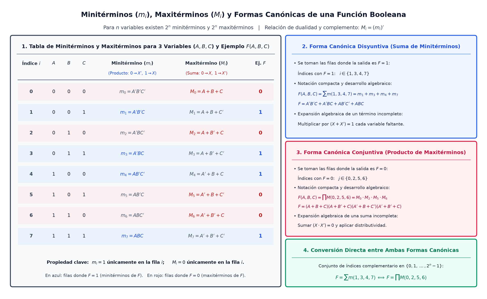
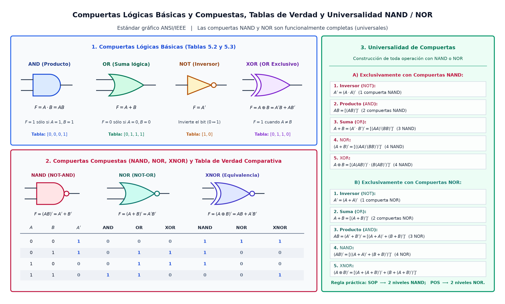
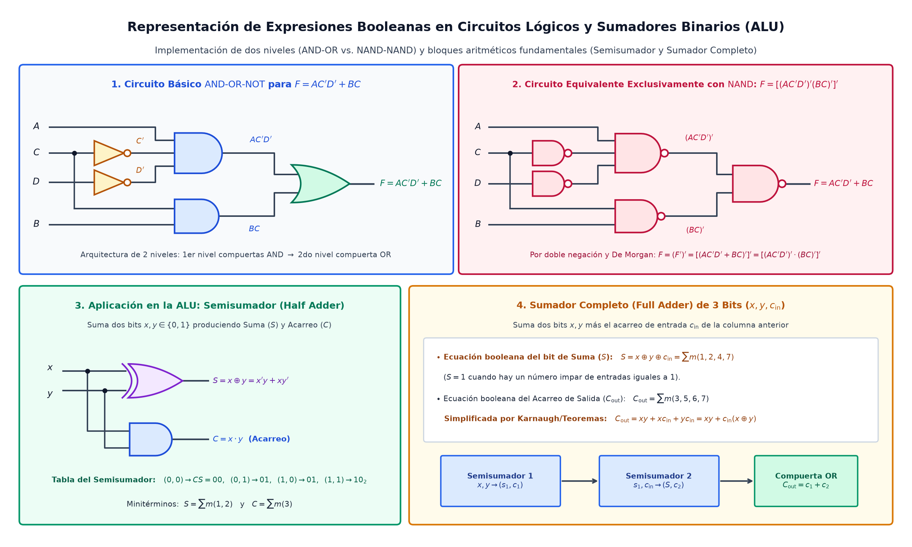

<!-- _class: portada -->
<!-- _paginate: false -->
<!-- _header: "" -->
<!-- _footer: "" -->

# 4.3 Aplicación del álgebra booleana
## Mini y Maxitérminos, Compuertas Lógicas y Circuitos Digitales

**Asignatura:** Matemáticas Discretas (`LISSI0211`) · Unidad 4
**Objetivo:** Traducir especificaciones lógicas a formas canónicas e implementar circuitos combinatorios óptimos con compuertas básicas y universales (`NAND`, `NOR`).

---

## Del Modelo Matemático al Hardware Digital

Transformar tablas de verdad (de sensores, protocolos o instrucciones de CPU) en **circuitos lógicos físicos** requiere dos fases:

1. **Síntesis matemática (`4.3.1 Mini y maxi términos`):**
   Expresar cualquier función booleana de manera única y estandarizada mediante **Suma de Minitérminos** o **Producto de Maxitérminos**.
2. **Implementación física (`4.3.2 Representación de expresiones`):**
   Construir la función optimizada con compuertas básicas (`AND`, `OR`, `NOT`, `XOR`) o universales (`NAND`, `NOR`, `XNOR`) para sistemas de control, la **ALU**, sumadores y memorias.

---

<!-- _class: seccion -->
<!-- _header: "" -->
<!-- _footer: "" -->

## 4.3.1 Mini y maxitérminos
### Formas canónicas disyuntiva ($\sum m$) y conjuntiva ($\prod M$)

---

<!-- _class: figura -->

## Minitérminos, Maxitérminos y Formas Canónicas

Correspondencia entre filas de la tabla de verdad, minitérminos $m_i$, maxitérminos $M_i = (m_i)'$ y formas canónicas.

---

## 1. Minitérminos ($m_i$)

Un **minitérmino** (o producto canónico) de $n$ variables es un **producto fundamental donde aparecen todas las $n$ variables**, exactamente una vez, directa o complementada:

$$m_i = y_1 \cdot y_2 \cdots y_n, \qquad y_k = \begin{cases} x_k, & \text{si } a_k = 1, \\ x_k', & \text{si } a_k = 0, \end{cases} \quad i = (a_1 \dots a_n)_2$$

- **Regla nemotécnica:** Es un **producto (`AND`)** donde **$0 \to X'$** y **$1 \to X$**.
- **Propiedad fundamental:** Existen $2^n$ minitérminos; cada $m_i$ vale **$1$ única y exclusivamente en la fila $i$** y $0$ en las $2^n - 1$ filas restantes.

---

## Forma Canónica Disyuntiva (Suma de Minitérminos)

> **Teorema 15.8 / 11.4.6:** *Toda función booleana $F(x_1, \dots, x_n) \not\equiv 0$ se representa de **manera única** como la suma lógica (`OR`) de los minitérminos donde $F = 1$.*

- Nombres equivalentes: **Suma de Minitérminos (SOM)**, **Forma Normal Disyuntiva (FND)** o **Forma Canónica Disyuntiva**.
- Notación compacta con $\sum$:

$$\boxed{F(A, B, C, \dots) = \sum m(i_1, i_2, \dots, i_k) = m_{i_1} + m_{i_2} + \dots + m_{i_k}}$$

*(donde $i_1, \dots, i_k$ son los índices de fila con $F = 1$).*

---

<!-- _class: compacta -->

## 2. Maxitérminos ($M_i$) y Relación de De Morgan

Por dualidad, un **maxitérmino** (o suma canónica) es una **suma lógica (`OR`) con todas las $n$ variables**:

$$M_i = y_1 + y_2 + \dots + y_n, \qquad y_k = \begin{cases} x_k, & \text{si } a_k = 0, \\ x_k', & \text{si } a_k = 1, \end{cases} \quad i = (a_1 \dots a_n)_2$$

- **Regla nemotécnica (inversa al minitérmino):** **$0 \to X$** y **$1 \to X'$**.
- **Relación de De Morgan:** $\boxed{M_i = (m_i)' \quad \text{y} \quad m_i = (M_i)'}$
  *(Ejemplo: $m_5 = AB'C \implies M_5 = (AB'C)' = A' + B + C'$).*
- **Propiedad fundamental:** Cada $M_i$ vale **$0$ única y exclusivamente en la fila $i$** y $1$ en las demás.

---

## Forma Canónica Conjuntiva (Producto de Maxitérminos)

Toda función booleana $F(x_1, \dots, x_n) \not\equiv 1$ se expresa de **manera única** como el producto lógico (`AND`) de los maxitérminos correspondientes a las filas donde **$F = 0$**.

- Nombres equivalentes: **Producto de Maxitérminos (POM)**, **Forma Normal Conjuntiva (FNC)** o **Forma Canónica Conjuntiva**.
- Notación compacta con $\prod$:

$$\boxed{F(A, B, C, \dots) = \prod M(j_1, j_2, \dots, j_r) = M_{j_1} \cdot M_{j_2} \cdots M_{j_r}}$$

*(donde $j_1, \dots, j_r$ son los índices de fila con $F = 0$).*

---

<!-- _class: compacta -->

## 3. Catálogo de Minitérminos y Maxitérminos ($n = 3$)

| Índice $i$ | $A B C$ | Minitérmino $m_i$ ($0 \to X', 1 \to X$) | Maxitérmino $M_i$ ($0 \to X, 1 \to X'$) |
| :---: | :---: | :---: | :---: |
| **$0$** | `000` | $m_0 = A'B'C'$ | $M_0 = A + B + C$ |
| **$1$** | `001` | $m_1 = A'B'C$ | $M_1 = A + B + C'$ |
| **$2$** | `010` | $m_2 = A'BC'$ | $M_2 = A + B' + C$ |
| **$3$** | `011` | $m_3 = A'BC$ | $M_3 = A + B' + C'$ |
| **$4$** | `100` | $m_4 = AB'C'$ | $M_4 = A' + B + C$ |
| **$5$** | `101` | $m_5 = AB'C$ | $M_5 = A' + B + C'$ |
| **$6$** | `110` | $m_6 = ABC'$ | $M_6 = A' + B' + C$ |
| **$7$** | `111` | $m_7 = ABC$ | $M_7 = A' + B' + C'$ |

*(Para $n = 4$ variables se extiende de $m_0 = A'B'C'D'$, $M_0 = A+B+C+D$ hasta $m_{15}, M_{15}$).*

---

## Conversión Directa entre $\sum m$ y $\prod M$

En cada fila $i \in U = \{0, 1, \dots, 2^n - 1\}$ la función $F$ vale $1$ o $0$. Por tanto, los índices de los maxitérminos forman el **complemento conjuntista** de los índices de los minitérminos:

- Si $S \subseteq \{0, 1, \dots, 2^n - 1\}$ es el conjunto de índices donde $F = 1$:

$$F = \sum_{i \in S} m_i = \prod_{j \notin S} M_j$$

- Y para la función complemento $F'$:

$$F' = \sum_{j \notin S} m_j = \prod_{i \in S} M_i$$

---

## 4. Expansión a Suma de Minitérminos (Algoritmo 15.2)

Para transformar una expresión algebraica incompleta a su forma canónica disyuntiva sin construir la tabla de verdad:

1. Desarrollar la expresión como suma de productos (De Morgan y distributividad `8a`).
2. Si a un término $P$ le falta la variable $X$, **multiplicar $P$ por $1 = (X + X')$**:

$$P = P \cdot 1 = P(X + X') = PX + PX'$$

3. Repetir para todas las variables faltantes y eliminar duplicados ($m_i + m_i = m_i$).

---

## Expansión a Producto de Maxitérminos (Dual 15.2)

Para transformar una expresión algebraica incompleta a su forma canónica conjuntiva:

1. Llevar la expresión a producto de sumas aplicando distributividad `8b`: $X + YZ = (X + Y)(X + Z)$.
2. Si a un factor suma $S$ le falta la variable $X$, **sumarle $0 = (X \cdot X')$ y aplicar `8b`**:

$$S = S + 0 = S + X \cdot X' = (S + X)(S + X')$$

3. Repetir para cada variable faltante y eliminar maxitérminos repetidos ($M_j \cdot M_j = M_j$).

---

<!-- _class: seccion -->
<!-- _header: "" -->
<!-- _footer: "" -->

## 4.3.2 Representación de expresiones
### Compuertas lógicas, universalidad NAND/NOR y circuitos en la ALU

---

<!-- _class: figura -->

## Compuertas Lógicas y Universalidad `NAND` / `NOR`

Simbología estándar ANSI/IEEE, tablas de verdad y construcción de cualquier operador usando sólo `NAND` o sólo `NOR`.

---

<!-- _class: compacta -->

## 1. Catálogo de Compuertas Lógicas Básicas (1/2)

Una **compuerta lógica** (*logic gate*) representa un dispositivo físico (transistores en chips, relevadores o válvulas) que procesa señales binarias:

| Compuerta | Expresión | Descripción Funcional | Salida `(00,01,10,11)` |
| :---: | :---: | :--- | :---: |
| **`OR`** *(Suma)* | $F = A + B$ | Salida **$1$** si **al menos una** entrada es $1$. | `[0, 1, 1, 1]` |
| **`AND`** *(Producto)* | $F = A \cdot B$ | Salida **$1$** sólo si **todas** las entradas son $1$. | `[0, 0, 0, 1]` |
| **`NOT`** *(Inversor)* | $F = A'$ | Invierte una **sola entrada** ($0 \leftrightarrow 1$). | $A \in (0,1) \to$ `[1, 0]` |
| **`XOR`** *(OR excl.)* | $F = A \oplus B = AB'+A'B$ | Salida **$1$** si las entradas son **diferentes** ($A \neq B$). | `[0, 1, 1, 0]` |

---

<!-- _class: compacta -->

## Catálogo de Compuertas Lógicas Compuestas (2/2)

| Compuerta | Expresión | Descripción Funcional | Salida `(00,01,10,11)` |
| :---: | :---: | :--- | :---: |
| **`NAND`** *(Universal)* | $F = (AB)' = A'+B'$ *(Sheffer $A \uparrow B$)* | `AND` seguido de inversor `NOT`. Vale **$0$** sólo si todas son $1$. | `[1, 1, 1, 0]` |
| **`NOR`** *(Universal)* | $F = (A+B)' = A'B'$ *(Peirce $A \downarrow B$)* | `OR` seguido de inversor `NOT`. Vale **$1$** sólo si todas son $0$. | `[1, 0, 0, 0]` |
| **`XNOR`** *(Equiv.)* | $F = (A \oplus B)' = AB+A'B'$ | Comparador de igualdad ($A = B$). | `[1, 0, 0, 1]` |

- **Múltiples entradas:** `AND`, `OR`, `NAND` y `NOR` admiten $2, 3, 4$ o más entradas; `NOT` sólo admite $1$.
- **Inversor con `NAND`/`NOR`:** Al unir sus entradas, $(A \cdot A)' = A'$ y $(A + A)' = A'$.

---

## 2. Completitud Funcional y Universalidad (`NAND` / `NOR`)

En tecnologías CMOS y TTL se prefieren circuitos con un solo tipo de compuerta (`NAND` o `NOR`) por menor tamaño, costo y retardo.

- **Conjunto funcionalmente completo:** Permite construir un circuito para cualquier función $F: B^n \to B$.
  - $\{\text{AND}, \text{OR}, \text{NOT}\}$ es funcionalmente completo (por Suma de Minitérminos).
  - Por De Morgan, $\{\text{AND}, \text{NOT}\}$ y $\{\text{OR}, \text{NOT}\}$ también lo son; en cambio, $\{\text{AND}, \text{OR}\}$ sin inversor **no** lo es.
- **Teorema de Universalidad:** Tanto **$\{\text{NAND}\}$** por sí solo como **$\{\text{NOR}\}$** por sí solo son **funcionalmente completos**.

---

<!-- _class: compacta -->

## Construcción Universal con `NAND` y `NOR` (1/2)

| Operación | Sólo con **`NAND`** | Sólo con **`NOR`** |
| :--- | :--- | :--- |
| **1. `NOT` ($A'$)** | $A' = (A \cdot A)'$ *(1 `NAND`)* | $A' = (A + A)'$ *(1 `NOR`)* |
| **2. `AND` ($AB$)** | $AB = \big[(AB)'\big]'$ *(2 `NAND`)* | $AB = \big[(A+A)' + (B+B)'\big]'$ *(3 `NOR`)* |
| **3. `OR` ($A+B$)** | $A+B = \big[(AA)' \cdot (BB)'\big]'$ *(3 `NAND`)* | $A+B = \big[(A+B)'\big]'$ *(2 `NOR`)* |
| **4. `NOR` ($(A+B)'$)** | $(A+B)' = \Big[\big[(AA)'(BB)'\big]'\Big]'$ *(4 `NAND`)* | $(A+B)'$ *(1 `NOR`)* |

---

<!-- _class: compacta -->

## Construcción Universal con `NAND` y `NOR` (2/2)

| Operación | Sólo con **`NAND`** | Sólo con **`NOR`** |
| :--- | :--- | :--- |
| **5. `NAND` ($(AB)'$)** | $(AB)'$ *(1 `NAND`)* | $(AB)' = \Big[\big[(A+A)'+(B+B)'\big]'\Big]'$ *(4 `NOR`)* |
| **6. `XOR` ($A \oplus B$)** | $\Big[\big(A(AB)'\big)' \cdot \big(B(AB)'\big)'\Big]'$ *(4 `NAND`)* | $\Big[\big[\big(A+(A+B)'\big)'+\big(B+(A+B)'\big)'\big]'\Big]'$ *(5 `NOR`)* |
| **7. `XNOR` ($(A \oplus B)'$)** | $\big[(AB)' \cdot (A'B')'\big]'$ *(5 `NAND`)* | $\Big[\big(A+(A+B)'\big)'+\big(B+(A+B)'\big)'\Big]'$ *(4 `NOR`)* |

---

<!-- _class: figura -->

## Circuitos Combinatorios y Sumadores Binarios (ALU)

Implementación de dos niveles (`AND-OR` vs. sólo `NAND`) y bloques aritméticos fundamentales en la ALU.

---

## 3. Diseño de Circuitos: `AND-OR` y Sólo `NAND` (1/2)

1. **Arquitectura con compuertas básicas (`AND-OR-NOT`):**
   - Para una expresión SOP (ej. $F = AC'D' + BC$), el primer nivel usa compuertas `AND` (con `NOT` en entradas complementadas) y el segundo nivel una `OR` final.
2. **Arquitectura exclusivamente `NAND` (ideal desde SOP):**
   - Se aplica doble negación $F = (F')'$ y De Morgan (`7b`) al complemento interior:

$$F = \big(P_1 + P_2 + \dots + P_k\big)'' = \Big[(P_1)' \cdot (P_2)' \cdots (P_k)'\Big]'$$

   - Basta reemplazar cada `AND`, `OR` y `NOT` de dos niveles por compuertas `NAND`.

---

## Diseño de Circuitos: Sólo `NOR` (2/2)

3. **Arquitectura exclusivamente `NOR` (ideal desde POS):**
   - Se parte de Producto de Sumas $F = S_1 \cdot S_2 \cdots S_m$.
   - Se aplica doble negación $F = (F')'$ y De Morgan (`7a`) al complemento interior:

$$F = \big(S_1 \cdot S_2 \cdots S_m\big)'' = \Big[(S_1)' + (S_2)' + \dots + (S_m)'\Big]'$$

   - Cada producto se convierte en sumas negadas (`NOR`), implementándose directamente en dos niveles de compuertas `NOR`.

---

<!-- _class: compacta -->

## 4. Aplicaciones: Semisumador (*Half Adder*) en la ALU

La **ALU** ejecuta operaciones lógicas y aritméticas. El **Semisumador** suma dos bits $x, y \in \{0, 1\}$ (columna menos significativa) produciendo **Suma ($S$)** y **Acarreo ($C$)** tales que $(CS)_2 = x + y$:

| $x$ | $y$ | Acarreo $C$ | Suma $S$ |
| :---: | :---: | :---: | :---: |
| $0$ | $0$ | $0$ | $0$ |
| $0$ | $1$ | $0$ | $1$ |
| $1$ | $0$ | $0$ | $1$ |
| $1$ | $1$ | $1$ | $0$ |

- **Bit de Suma ($S$):** $S = x'y + xy' = x \oplus y = \sum m(1, 2)$ *(1 `XOR`; o $(x+y)(xy)'$ con 4 compuertas básicas)*.
- **Bit de Acarreo ($C$):** $C = x \cdot y = \sum m(3)$ *(1 `AND`)*.

---

<!-- _class: compacta -->

## Aplicaciones: Sumador Completo (*Full Adder*)

Suma **tres bits**: dos datos $x, y$ más el acarreo de entrada $z = c_{\text{in}}$, generando $(C_{\text{out}}S)_2 = x + y + c_{\text{in}}$ (de $00_2$ a $11_2 = 3_{10}$):

- **Bit de Suma ($S$):** Vale $1$ si hay $1$ o $3$ entradas en $1$:
  $$S(x, y, c_{\text{in}}) = \sum m(1, 2, 4, 7) = x'y'c_{\text{in}} + x'yc_{\text{in}}' + xy'c_{\text{in}}' + xyc_{\text{in}} = \mathbf{x \oplus y \oplus c_{\text{in}}}$$
- **Bit de Acarreo de salida ($C_{\text{out}}$):** Función de mayoría ($\ge 2$ entradas en $1$):
  $$C_{\text{out}} = \sum m(3, 5, 6, 7) \implies \boxed{C_{\text{out}} = xy + xc_{\text{in}} + yc_{\text{in}} = xy + c_{\text{in}}(x \oplus y)}$$
- **Sumador en cascada (*Ripple-Carry Adder*):** $1$ semisumador + $(n-1)$ sumadores completos en serie suman $n$ bits; el último acarreo indica *overflow*.

---

## Aplicaciones: Memorias y Robótica Mecatrónica

- **Memorias `ROM` y `EEPROM` (BIOS/UEFI):** Almacenan código binario de arranque mediante matrices de compuertas grabables/borrables eléctricamente.
- **Memorias `SRAM` y `DRAM`:**
  - `SRAM` (caché del procesador): cada bit reside en un *flip-flop* biestable de compuertas `NAND` o `NOR` acopladas.
  - `DRAM`: almacena cada bit como carga en un condensador controlado por transistores.
- **Robótica y automatización:** El controlador evalúa señales ($0/1$) de sensores ópticos, térmicos, ultrasónicos o de nivel en un circuito optimizado para activar motores y pistones.

---

<!-- _class: seccion -->
<!-- _header: "" -->
<!-- _footer: "" -->

## Ejemplos de Práctica
### Formas canónicas, compuertas universales, análisis integral, bits y sensores

---

<!-- _class: compacta -->

## Ejemplo 4.3.1: Detector de Mayoría de 3 Entradas (1/2)

Salida $F(A,B,C) = 1$ si y sólo si **dos o tres** entradas valen $1$.

**a) Tabla de verdad con minitérminos $m_i$ y maxitérminos $M_i$:**

| Índice $i$ | $A B C$ | $F$ | Minitérmino / Maxitérmino |
| :---: | :---: | :---: | :--- |
| **$0$** | `000` | $0$ | $M_0 = A + B + C$ |
| **$1$** | `001` | $0$ | $M_1 = A + B + C'$ |
| **$2$** | `010` | $0$ | $M_2 = A + B' + C$ |
| **$3$** | `011` | **$1$** | $m_3 = A'BC$ |
| **$4$** | `100` | $0$ | $M_4 = A' + B + C$ |
| **$5$** | `101` | **$1$** | $m_5 = AB'C$ |
| **$6$** | `110` | **$1$** | $m_6 = ABC'$ |
| **$7$** | `111` | **$1$** | $m_7 = ABC$ |

---

## Ejemplo 4.3.1: Formas Canónicas Disyuntiva y Conjuntiva (2/2)

- **b) Forma Canónica Disyuntiva (Suma de Minitérminos — filas donde $F = 1$):**

$$F(A, B, C) = \sum m(3, 5, 6, 7) = m_3 + m_5 + m_6 + m_7$$

$$\boxed{F(A, B, C) = A'BC + AB'C + ABC' + ABC}$$

- **c) Forma Canónica Conjuntiva (Producto de Maxitérminos — filas donde $F = 0$):**

$$F(A, B, C) = \prod M(0, 1, 2, 4) = M_0 \cdot M_1 \cdot M_2 \cdot M_4$$

$$\boxed{F(A, B, C) = (A + B + C)(A + B + C')(A + B' + C)(A' + B + C)}$$

---

<!-- _class: compacta -->

## Ejemplo 4.3.2: Expansión Algebraica a Formas Canónicas (1/2)

Sea $E(x, y, z) = x(y'z)'$.

**a) Expansión a Suma de Minitérminos (Algoritmos 15.1 y 15.2):**

1. *De Morgan y distributividad:*
   $$E(x, y, z) = x\big((y')' + z'\big) = x(y + z') = xy + xz'$$
2. *Inclusión de variables faltantes ($z+z'=1$ e $y+y'=1$):*
   $$\begin{aligned}
   E(x, y, z) &= xy(z + z') + xz'(y + y') \\
              &= xyz + xyz' + xyz' + xy'z' \\
              &= \mathbf{xyz + xyz' + xy'z'} = m_7 + m_6 + m_4 = \sum m(4, 6, 7)
   \end{aligned}$$

---

## Ejemplo 4.3.2: Deducción de Maxitérminos (2/2)

**b) Obtención del Producto de Maxitérminos:**

- Los índices de $\{0, 1, 2, 3, 4, 5, 6, 7\}$ que no pertenecen a $\{4, 6, 7\}$ son $\{0, 1, 2, 3, 5\}$.

$$E(x, y, z) = \prod M(0, 1, 2, 3, 5)$$

$$E = (x+y+z)(x+y+z')(x+y'+z)(x+y'+z')(x'+y+z')$$

*(Los cuatro primeros factores se reducen a $x$, y el quinto es $M_5 = x'+y+z'$, verificando $x(x'+y+z') = x(y+z')$).*

---

<!-- _class: compacta -->

## Ejemplo 4.3.3: Implementación Sólo con `NAND` y `NOR` (1/2)

**a)** Implemente $F_1 = A(B + C') + A'D$ **exclusivamente con compuertas `NAND`**:

1. *Llevar a SOP:* $F_1 = AB + AC' + A'D$.
2. *Doble negación y De Morgan (`7b`):*

$$F_1 = \big(AB + AC' + A'D\big)'' = \Big[\big(AB\big)' \cdot \big(AC'\big)' \cdot \big(A'D\big)'\Big]'$$

3. **Estructura del circuito `NAND`:**
   - *Inversores:* $2$ `NAND` de $1$ entrada para $A' = (AA)'$ y $C' = (CC)'$.
   - *Primer nivel:* $3$ `NAND` de $2$ entradas para $N_1=(AB)'$, $N_2=(AC')'$, $N_3=(A'D)'$.
   - *Segundo nivel:* $1$ `NAND` de $3$ entradas: $F_1 = (N_1 \cdot N_2 \cdot N_3)'$.

---

<!-- _class: compacta -->

## Ejemplo 4.3.3: Implementación de $F_2$ en POS (2/2)

**b)** Para $F_2 = (A + B' + C)(B + C' + D)$:

- **Exclusivamente con compuertas `NOR` (directo desde POS):**

$$F_2 = \Big[\big(A + B' + C\big) \cdot \big(B + C' + D\big)\Big]'' = \Big[\big(A + B' + C\big)' + \big(B + C' + D\big)'\Big]'$$

*(Usa $2$ `NOR` inversoras para $B', C'$; $2$ `NOR` de $3$ entradas para $R_1, R_2$; y $1$ `NOR` final $(R_1 + R_2)'$).*

- **Exclusivamente con compuertas `NAND`:** Como $S_1 = (A'BC')'$ y $S_2 = (B'CD')'$, se obtiene con una `NAND` seguida de inversor `NAND`:

$$F_2 = \Big[\big(S_1 \cdot S_2\big)'\Big]' = \Big[\Big(\big(A'BC'\big)' \cdot \big(B'CD'\big)'\Big)'\Big]'$$

---

<!-- _class: compacta -->

## Ejemplo 4.3.4: Problema Integrador — Teoremas (1/5)

Analice y rediseñe el circuito correspondiente a $F(A, B, C, D) = AC'(C + D') + BC(A' + B)$.

**a) Simplificación por teoremas del álgebra booleana:**

$$\begin{aligned}
F &= AC'C + AC'D' + A'BC + BBC && \text{(8a: Distributividad)} \\
  &= A(0) + AC'D' + A'BC + BC && \text{(4a: } C'C = 0 \text{ y 3a: } BB = B\text{)} \\
  &= 0 + AC'D' + BC(A' + 1) && \text{(1a y 8a: factorizando } BC\text{)} \\
  &= \mathbf{AC'D' + BC} && \text{(1b y 2a: } A'+1 = 1,\; BC(1)=BC\text{)}
\end{aligned}$$

---

<!-- _class: compacta -->

## Ejemplo 4.3.4: SOP y POS por Mapa de Karnaugh (2/5)

Expandiendo a minitérminos ($AC'D' \to 1000, 1100$; $BC \to 0110, 0111, 1110, 1111$):

| $AB \setminus CD$ | `00` | `01` | `11` | `10` |
| :---: | :---: | :---: | :---: | :---: |
| **`00`** | $0$ | $0$ | $0$ | $0$ |
| **`01`** | $0$ | $0$ | $\mathbf{1}$ | $\mathbf{1}$ |
| **`11`** | $\mathbf{1}$ | $0$ | $\mathbf{1}$ | $\mathbf{1}$ |
| **`10`** | $\mathbf{1}$ | $0$ | $0$ | $0$ |

- **b) SOP (agrupando los $6$ unos):** Bloque de $4$ ($BC$) + par ($AC'D'$) $\implies \mathbf{F_{\text{SOP}} = AC'D' + BC}$.
- **c) POS (agrupando los $10$ ceros en tres bloques de $4$):** $F' = A'C' + B'C + C'D$ $\implies$ por De Morgan: $\mathbf{F_{\text{POS}} = (A + C)(B + C')(C + D')}$.

---

<!-- _class: tabla-ancha -->

## Ejemplo 4.3.4: Verificación por Tabla de Verdad (3/5 — filas 0–7)

| $A$ | $B$ | $C$ | $D$ | $AC'D'$ | $BC$ | $F_{\text{SOP}}$ | $A+C$ | $B+C'$ | $C+D'$ | $F_{\text{POS}}$ |
| :---: | :---: | :---: | :---: | :---: | :---: | :---: | :---: | :---: | :---: | :---: |
| $0$ | $0$ | $0$ | $0$ | $0$ | $0$ | **$0$** | $0$ | $1$ | $1$ | **$0$** |
| $0$ | $0$ | $0$ | $1$ | $0$ | $0$ | **$0$** | $0$ | $1$ | $0$ | **$0$** |
| $0$ | $0$ | $1$ | $0$ | $0$ | $0$ | **$0$** | $1$ | $0$ | $1$ | **$0$** |
| $0$ | $0$ | $1$ | $1$ | $0$ | $0$ | **$0$** | $1$ | $0$ | $1$ | **$0$** |
| $0$ | $1$ | $0$ | $0$ | $0$ | $0$ | **$0$** | $0$ | $1$ | $1$ | **$0$** |
| $0$ | $1$ | $0$ | $1$ | $0$ | $0$ | **$0$** | $0$ | $1$ | $0$ | **$0$** |
| $0$ | $1$ | $1$ | $0$ | $0$ | $1$ | **$1$** | $1$ | $1$ | $1$ | **$1$** |
| $0$ | $1$ | $1$ | $1$ | $0$ | $1$ | **$1$** | $1$ | $1$ | $1$ | **$1$** |

*(Donde $F_{\text{SOP}} = AC'D' + BC$ y $F_{\text{POS}} = (A+C)(B+C')(C+D')$).*

---

<!-- _class: tabla-ancha -->

## Ejemplo 4.3.4: Verificación por Tabla de Verdad (4/5 — filas 8–15)

| $A$ | $B$ | $C$ | $D$ | $AC'D'$ | $BC$ | $F_{\text{SOP}}$ | $A+C$ | $B+C'$ | $C+D'$ | $F_{\text{POS}}$ |
| :---: | :---: | :---: | :---: | :---: | :---: | :---: | :---: | :---: | :---: | :---: |
| $1$ | $0$ | $0$ | $0$ | $1$ | $0$ | **$1$** | $1$ | $1$ | $1$ | **$1$** |
| $1$ | $0$ | $0$ | $1$ | $0$ | $0$ | **$0$** | $1$ | $1$ | $0$ | **$0$** |
| $1$ | $0$ | $1$ | $0$ | $0$ | $0$ | **$0$** | $1$ | $0$ | $1$ | **$0$** |
| $1$ | $0$ | $1$ | $1$ | $0$ | $0$ | **$0$** | $1$ | $0$ | $1$ | **$0$** |
| $1$ | $1$ | $0$ | $0$ | $1$ | $0$ | **$1$** | $1$ | $1$ | $1$ | **$1$** |
| $1$ | $1$ | $0$ | $1$ | $0$ | $0$ | **$0$** | $1$ | $1$ | $0$ | **$0$** |
| $1$ | $1$ | $1$ | $0$ | $0$ | $1$ | **$1$** | $1$ | $1$ | $1$ | **$1$** |
| $1$ | $1$ | $1$ | $1$ | $0$ | $1$ | **$1$** | $1$ | $1$ | $1$ | **$1$** |

$F_{\text{SOP}}$ y $F_{\text{POS}}$ coinciden en las $16$ filas (`0110, 0111, 1000, 1100, 1110, 1111`).

---

<!-- _class: compacta -->

## Ejemplo 4.3.4: Tres Arquitecturas de Implementación (5/5)

- **(i) Con compuertas básicas (`AND-OR-NOT`):**
  $$F = (A \cdot C' \cdot D') + (B \cdot C) \qquad \text{(2 `NOT`, 2 `AND`, 1 `OR`)}$$
- **(ii) Exclusivamente con compuertas `NAND`:**
  $$F = \Big[\big(AC'D'\big)' \cdot \big(BC\big)'\Big]' \qquad \big(C' = (CC)',\; D' = (DD)'\big)$$
- **(iii) Exclusivamente con compuertas `NOR`:**
  - Desde $F_{\text{POS}}$: $F = \big[(A + C)' + (B + C')' + (C + D')'\big]'$.
  - O desde $F_{\text{SOP}}$: $F = \Big[\big((A' + C + D)' + (B' + C')'\big)'\Big]'$.

---

<!-- _class: compacta -->

## Ejemplo 4.3.5: Evaluación Rápida por Secuencias de Bits

Calcule la salida $T(Y)$ de $Y(A, B, C) = A \cdot B \cdot C + A \cdot B' \cdot C + A' \cdot B$ (Algoritmo 15.5):

1. **Secuencias de $2^3 = 8$ bits (`000` a `111`):**
   - $A = 00001111 \implies A' = 11110000$
   - $B = 00110011 \implies B' = 11001100$
   - $C = 01010101 \implies C' = 10101010$
2. **Productos `AND` bit a bit:**
   - $A \cdot B \cdot C = \mathbf{00000001}$ | $A \cdot B' \cdot C = \mathbf{00000100}$ | $A' \cdot B = \mathbf{00110000}$
3. **Suma `OR` bit a bit:**
   $$Y = 00000001 + 00000100 + 00110000 = \mathbf{00110101} \quad \big(m_2, m_3, m_5, m_7\big)$$

---

<!-- _class: compacta -->

## Ejemplo 4.3.6: Alarma Industrial con Sensores (1/2)

Sensores: $A$ (presión alta $= 1$), $B$ (temperatura $> 120\,^\circ\text{C} = 1$), $C$ (refrigerante normal $= 1$, **bajo $= 0$**). La alarma $F = 1$ si: *(1)* ($A=1$ o $B=1$) y $C=0$, o *(2)* $A=1$ y $B=1$.

**a) Análisis de las $8$ combinaciones $(A, B, C)$ y formas canónicas:**
- Vale $1$ en `010` ($m_2$), `100` ($m_4$), `110` ($m_6$) y `111` ($m_7$).
- Vale $0$ en `000` ($M_0$), `001` ($M_1$), `011` ($M_3$) y `101` ($M_5$).
- **Suma de Minitérminos:** $F = \sum m(2, 4, 6, 7) = A'BC' + AB'C' + ABC' + ABC$.
- **Producto de Maxitérminos:** $F = \prod M(0, 1, 3, 5) = (A+B+C)(A+B+C')(A+B'+C')(A'+B+C')$.

---

<!-- _class: compacta -->

## Ejemplo 4.3.6: Simplificación e Implementación (2/2)

**b) Simplificación por teoremas (o K-mapa) e implementación:**

$$\begin{aligned}
F &= (A'BC' + ABC') + (AB'C' + ABC') + (ABC' + ABC) \\
  &= BC'(A' + A) + AC'(B' + B) + AB(C' + C) \\
  &= \mathbf{BC' + AC' + AB} = C'(A + B) + AB
\end{aligned}$$

- **Compuertas básicas (factorizada):** $1$ `NOT` ($C'$), $1$ `OR` ($A+B$), $2$ `AND` ($C'(A+B)$ y $AB$) y $1$ `OR` final.
- **Exclusivamente con `NAND` (desde SOP):**
  $$F = \Big[\big(BC'\big)' \cdot \big(AC'\big)' \cdot \big(AB\big)'\Big]' \qquad \text{con } C' = (CC)'$$

---

<!-- _class: seccion -->
<!-- _header: "" -->
<!-- _footer: "" -->

## Ejercicios de Tarea
### Práctica en casa — Formas canónicas, compuertas universales y circuitos ALU

---

<!-- _class: compacta -->

## Ejercicios de Tarea (1/3)

1. **Formas Canónicas desde expresiones algebraicas:** Para cada función de $(x, y, z)$, *(i)* exprésela como suma de productos fundamentales, *(ii)* expándala a **Suma de Minitérminos** ($\sum m$), y *(iii)* deduzca su **Producto de Maxitérminos** ($\prod M$):
   a) $E_1(x, y, z) = z(x' + y) + y'$
   b) $E_2(x, y, z) = (x' + y)' + x'y$

2. **Implementación de SOP en tres arquitecturas:** Dada $F(A, B, C, D) = AB'C + A'B'D' + AD$, diseñe y describa nivel por nivel el circuito usando:
   a) Compuertas básicas (`AND`, `OR`, `NOT`).
   b) Exclusivamente compuertas `NAND`.
   c) Exclusivamente compuertas `NOR`.

---

<!-- _class: compacta -->

## Ejercicios de Tarea (2/3)

3. **Representación de una función factorizada (POS):** Dada $F(A, B, C, D) = (B' + C + D')(A + C' + D)B'$:
   a) Simplifique primero $F$ mediante los teoremas del álgebra booleana.
   b) Implemente tanto la expresión original como la simplificada con: *(i)* compuertas básicas, *(ii)* sólo `NOR` y *(iii)* sólo `NAND`.

4. **Demostración completa de la Universalidad de `NAND` y `NOR`:**
   a) Obtenga y demuestre algebraicamente las expresiones para `NOT`, `AND`, `OR`, `NOR`, `XOR` y `XNOR` usando **exclusivamente compuertas `NAND`**.
   b) Obtenga y demuestre algebraicamente `NOT`, `OR`, `AND`, `NAND`, `XNOR` y `XOR` usando **exclusivamente compuertas `NOR`**.

---

<!-- _class: compacta -->

## Ejercicios de Tarea (3/3)

5. **Análisis e ingeniería inversa de un circuito lógico:** Dada la salida de tres ramas en una compuerta `OR` final:

   $$F(A, B, C, D) = A'(B + C') + ABC' + C'(B' + D)$$

   a) Simplifique en **SOP** y **b) POS**; **c)** elabore la tabla de verdad de equivalencia; **d)** escriba las ecuaciones sólo `NAND` (de SOP) y sólo `NOR` (de POS).

6. **Multiplicador Binario Combinatorio de $2 \times 2$ bits en la ALU:** Multiplique $X = (x_2 x_1)_2$ por $Y = (y_2 y_1)_2$ obteniendo $Z = (z_4 z_3 z_2 z_1)_2$:
   a) Deduzca las ecuaciones simplificadas para $z_1, z_2, z_3$ y $z_4$.
   b) Explique su implementación con compuertas `AND` y dos **Semisumadores (*Half Adders*)**.
