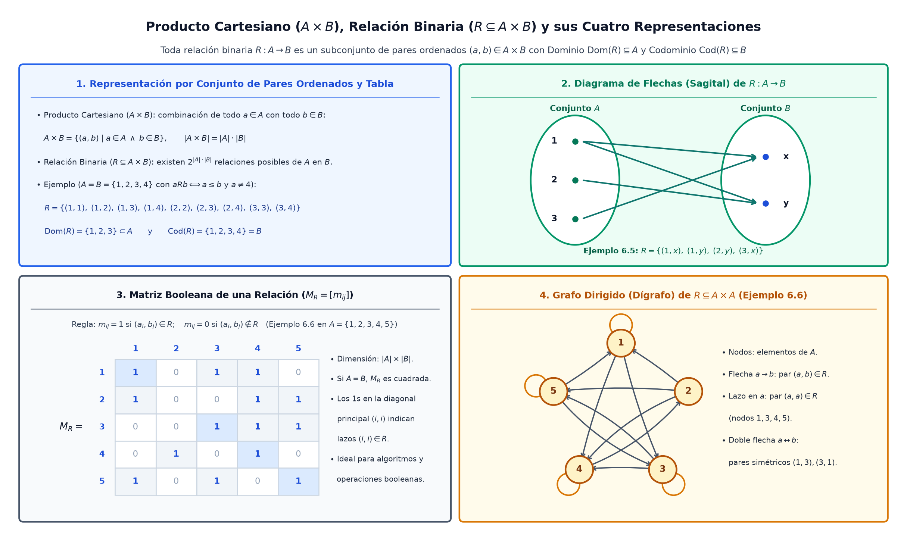

<!-- _class: portada -->
<!-- _paginate: false -->
<!-- _header: "" -->
<!-- _footer: "" -->

# 5.1 Conceptos básicos
## Producto cartesiano, relaciones binarias, representaciones y operaciones

- **Unidad:** 5. Relaciones | **Subtemas:** 5.1.1 – 5.1.4
- **Objetivo:** Formalizar los vínculos entre conjuntos mediante pares ordenados y operar relaciones con conjuntos, matrices booleanas y dígrafos.

---

## Introducción

- En la vida cotidiana y la computación vinculamos constantemente objetos de distinta o igual naturaleza:
  - Un profesor con las asignaturas que imparte.
  - Un número de control con el expediente de un alumno.
  - Una página web con los hipervínculos hacia otras páginas.
  - Dos computadoras capaces de intercambiar paquetes en una red.
- Estas conexiones se formalizan con **pares ordenados**, **producto cartesiano** y **relaciones binarias**, representadas con conjuntos, tablas, flechas, matrices booleanas y dígrafos.

---
<!-- _class: figura -->

## Producto cartesiano, relación binaria y representaciones

Toda relación $R \subseteq A \times B$ admite representaciones equivalentes: conjuntos, diagrama sagital, matriz booleana y dígrafo.

---

## 5.1.1 Par Ordenado y $n$-tupla Ordenada

- En un conjunto $\{a, b\} = \{b, a\}$ el orden no importa; en un **par ordenado $(a, b)$** sí ($a$ es la primera componente y $b$ la segunda).
- **Criterio de igualdad de pares ordenados:**
  $$(a, b) = (c, d) \iff a = c \quad\land\quad b = d$$
  Si $a \neq b$, entonces $(a, b) \neq (b, a)$. *(Kuratowski, 1921: $(a, b) = \{\{a\}, \{a, b\}\}$).*
- **Generalización a $n$-tuplas:**
  $$A_1 \times \dots \times A_n = \big\{(a_1, \dots, a_n) \mid a_1 \in A_1, \dots, a_n \in A_n\big\}$$
  con cardinalidad $|A_1 \times \dots \times A_n| = |A_1| \cdot |A_2| \cdots |A_n|$.

---

## 5.1.1 Definición de Producto Cartesiano ($A \times B$)

- Dados dos conjuntos no vacíos $A$ y $B$, su **producto cartesiano** (*$A$ cruz $B$*) reúne todos los pares ordenados posibles:
  $$\boxed{A \times B = \big\{(a, b) \;\big|\; a \in A \;\land\; b \in B\big\}}$$
- **Caso $A = B$:** se denota $A \times A = A^2$.
- **No conmutatividad:** si $A \neq B$ (no vacíos), $A \times B \neq B \times A$.
- **Producto con $\emptyset$:** $A \times \emptyset = \emptyset \times B = \emptyset$.
- **Cardinalidad:** si $|A| = m$ y $|B| = n$, entonces $|A \times B| = m \cdot n$.

---

## 5.1.1 Leyes Distributivas del Producto Cartesiano

Para cualesquiera conjuntos $A, B$ y $C$, el producto cartesiano distribuye sobre las operaciones de conjuntos:

- **Sobre la unión:**
  $$A \times (B \cup C) = (A \times B) \cup (A \times C)$$
- **Sobre la intersección:**
  $$A \times (B \cap C) = (A \times B) \cap (A \times C)$$
- **Sobre la diferencia:**
  $$A \times (B - C) = (A \times B) - (A \times C)$$

---

## 5.1.2 Relación Binaria — Definición Formal

- Dados $A, B \neq \emptyset$, una **relación binaria** $R: A \to B$ es cualquier subconjunto de $A \times B$ vinculado por una propiedad $P(a, b)$:
  $$\boxed{R \subseteq A \times B \quad\text{donde}\quad R = \big\{(a, b) \in A \times B \;\big|\; P(a, b)\text{ es verdadera}\big\}}$$
- **Notación infija:** si $(a, b) \in R$, se escribe $a R b$; si $(a, b) \notin R$, se escribe $a \not R b$.
- **Relación sobre $A$:** cuando $A = B$, se escribe $R \subseteq A \times A$.
- **Relaciones $n$-arias:** $R \subseteq A_1 \times \dots \times A_n$ (ternarias, cuaternarias, etc.), base de las tablas en bases de datos relacionales.

---

## 5.1.2 Universo, Casos Extremos y Conteo

- El producto cartesiano $U = A \times B$ funciona como **conjunto universo** de todas las relaciones de $A$ en $B$.
- **Casos extremos:**
  - **Relación vacía:** $\emptyset \subseteq A \times B$.
  - **Relación universal (total):** $A \times B \subseteq A \times B$.
- **Número total de relaciones binarias** de $A$ en $B$ (subconjuntos en $\mathcal{P}(A \times B)$), con $|A| = m$ y $|B| = n$:
  $$\boxed{\text{Total de relaciones de } A \text{ en } B \;=\; 2^{|A \times B|} = 2^{m \cdot n}}$$

---

## 5.1.2 Dominio y Codominio (Rango)

Dada una relación binaria $R \subseteq A \times B$, se definen dos subconjuntos clave:

- **Dominio de $R$ ($\operatorname{Dom}(R)$):** primeros elementos que aparecen en los pares de $R$:
  $$\operatorname{Dom}(R) = \big\{a \in A \;\big|\; \exists b \in B \text{ tal que } (a, b) \in R\big\} \subseteq A$$
- **Codominio o Rango ($\operatorname{Cod}(R)$ / $\operatorname{Ran}(R)$):** segundos elementos que pertenecen efectivamente a $R$:
  $$\operatorname{Cod}(R) = \big\{b \in B \;\big|\; \exists a \in A \text{ tal que } (a, b) \in R\big\} \subseteq B$$

*(Algunos autores llaman rango $\operatorname{Ran}(R)$ al subconjunto de llegada activo y reservan codominio para todo $B$).*

---

## 5.1.3 Conjuntos, Tablas y Diagrama de Flechas

Una relación $R: A \to B$ se puede representar de formas equivalentes:

- **Por extensión:** listando todos los pares ordenados, p. ej. $R = \{(1, 2), (1, 3), (2, 2), \dots\}$.
- **Por comprensión:** indicando la regla lógica, p. ej. $R = \{(a, b) \mid a \in A,\; b \in B,\; b \text{ divisible entre } a\}$.
- **En forma de tabla:** dos columnas (p. ej. `Maestro` y `Materia`), donde cada fila es un par $(a, b) \in R$.
- **Diagrama de flechas (sagital):** dos óvalos separados ($A$ a la izquierda, $B$ a la derecha) con una flecha $a \to b$ por cada par $(a, b) \in R$.

---

## 5.1.3 Representación Matricial ($M_R$)

- Si $A = \{a_1, \dots, a_m\}$ (filas) y $B = \{b_1, \dots, b_n\}$ (columnas), la **matriz booleana** $M_R = [m_{ij}]$ de tamaño $m \times n$ se define como:
  $$\boxed{m_{ij} = \begin{cases} 1, & \text{si } (a_i, b_j) \in R, \\ 0, & \text{si } (a_i, b_j) \notin R. \end{cases}}$$
- Cuando $A = B$ con $|A| = n$, la matriz $M_R$ es **cuadrada de orden $n \times n$**.
- Es indispensable en computación porque permite programar operaciones sobre relaciones grandes mediante **álgebra de matrices booleanas**.

---

## 5.1.3 Representación por Grafo Dirigido (Dígrafo)

Visualiza la relación con **nodos (vértices)** y **flechas (aristas dirigidas)**:

- **Si $A \neq B$:** nodos para elementos de $A$ y de $B$, con flechas $a \to b$ por cada $(a, b) \in R$.
- **Si $A = B$ ($R$ sobre $A$):** un único nodo por cada elemento de $A$:
  - Si $(a, b) \in R$ ($a \neq b$): flecha dirigida del nodo $a$ al nodo $b$ ($a \to b$).
  - Si $(a, a) \in R$: flecha que sale de $a$ y regresa a $a$, llamada **lazo** (o *bucle*).
  - Si todo par relacionado va en ambos sentidos ($(a, b)$ y $(b, a)$): puede simplificarse en un **grafo no dirigido**.

---
<!-- _class: compacta -->

## 5.1.4 Operaciones entre Relaciones (1/2): Conjuntistas

Sean $R, S \subseteq A \times B$ con matrices booleanas $M_R = [r_{ij}]$ y $M_S = [s_{ij}]$ ($m \times n$):

| Operación | Notación | Definición por Conjuntos | Matriz Booleana |
| :--- | :---: | :--- | :--- |
| **1. Complemento** | $R'$ ($\bar{R}$) | $\{(a, b) \in A \times B \mid (a, b) \notin R\}$ | $M_{R'} = (M_R)'$ (invierte $1 \leftrightarrow 0$) |
| **2. Intersección** | $R \cap S$ | $\{(a, b) \mid (a, b) \in R \land (a, b) \in S\}$ | $M_{R \cap S} = [r_{ij} \cdot s_{ij}]$ (`AND` celda a celda) |
| **3. Unión** | $R \cup S$ | $\{(a, b) \mid (a, b) \in R \lor (a, b) \in S\}$ | $M_{R \cup S} = [r_{ij} + s_{ij}]$ (`OR`, $1+1=1$) |
| **4. Diferencia** | $R - S$ | $R \cap S' = \{(a, b) \mid (a, b) \in R \land (a, b) \notin S\}$ | $M_{R - S} = M_R \cap (M_S)' = [r_{ij} \cdot s_{ij}']$ |

---
<!-- _class: compacta -->

## 5.1.4 Operaciones entre Relaciones (2/2): Inversa y Composición

Para $R \subseteq A \times B$ ($M_R$ de $m \times n$) y $T \subseteq B \times C$ ($M_T$ de $n \times p$):

| Operación | Notación | Definición por Conjuntos | Matriz Booleana |
| :--- | :---: | :--- | :--- |
| **5. Inversa** | $R^{-1}$ | $\{(b, a) \in B \times A \mid (a, b) \in R\}$ | $M_{R^{-1}} = (M_R)^T = [r_{ji}]$ (transpuesta) |
| **6. Composición** | $R \circ T$ | $\{(a, c) \mid \exists b \in B,\; (a, b) \in R \land (b, c) \in T\}$ | $M_{R \circ T} = M_R \odot M_T$, $c_{ik} = \sum_{j=1}^n r_{ij} t_{jk}$ |

- **Orden de lectura en $R \circ T$:** de izquierda a derecha ($(a, b) \in R$ y $(b, c) \in T \implies (a, c) \in R \circ T$), por lo que su matriz es exactamente $M_R \odot M_T$.

---
<!-- _class: seccion -->
<!-- _header: "" -->
<!-- _footer: "" -->

## Ejemplos de Práctica

Construcción de relaciones, matrices booleanas y operaciones combinadas paso a paso.

---
<!-- _class: compacta -->

## Ejemplo 5.1.1: Relación por comprensión y dominio (1/2)

**1.** Sean $A_1 = \{a \in \mathbb{Z} \mid 10 < a < 30\}$ y $B_1 = \{b \in \mathbb{Z}^+ \mid b \le 20\}$, con $R_1: A_1 \to B_1$ donde $a$ es divisible entre $13$ y $b$ es primo. Halle $R_1$, $\operatorname{Dom}(R_1)$ y $\operatorname{Cod}(R_1)$.

**Solución:**
- Enteros en $(10, 30)$ divisibles entre $13$: $\{13, 26\}$.
- Primos $\le 20$ en $B_1$: $\{2, 3, 5, 7, 11, 13, 17, 19\}$ ($8$ primos).
- Como no hay restricción cruzada, se forman $2 \times 8 = 16$ pares ordenados:
  $$\begin{aligned}
  R_1 = \big\{&(13, 2), (13, 3), (13, 5), (13, 7), (13, 11), (13, 13), (13, 17), (13, 19), \\
              &(26, 2), (26, 3), (26, 5), (26, 7), (26, 11), (26, 13), (26, 17), (26, 19)\big\}
  \end{aligned}$$
- $\operatorname{Dom}(R_1) = \{13, 26\} \subset A_1$ y $\operatorname{Cod}(R_1) = \{2, 3, 5, 7, 11, 13, 17, 19\} \subset B_1$.

---
<!-- _class: compacta -->

## Ejemplo 5.1.1: Relación por comprensión y dominio (2/2)

**2.** Sean $A_2 = \{2, 4, 5, 6, 7, 11\}$ y $B_2 = \{b \in \mathbb{Z} \mid 1 \le b \le 10\}$, con $a R_2 b \iff b$ es divisible entre $a$. Halle $R_2$, $\operatorname{Dom}(R_2)$ y $\operatorname{Cod}(R_2)$.

**Solución:**
- Evaluando cada $a \in A_2$ frente a $B_2$:
  - $a = 2$ divide a $\{2, 4, 6, 8, 10\}$; $a = 4$ a $\{4, 8\}$; $a = 5$ a $\{5, 10\}$.
  - $a = 6$ divide a $\{6\}$; $a = 7$ a $\{7\}$; $a = 11$ no divide a ninguno.
- **Conjunto de pares:**
  $$R_2 = \{(2, 2), (2, 4), (2, 6), (2, 8), (2, 10), (4, 4), (4, 8), (5, 5), (5, 10), (6, 6), (7, 7)\}$$
- **Dominio:** $\operatorname{Dom}(R_2) = \{2, 4, 5, 6, 7\} \subset A_2$ *(el $11$ queda fuera)*.
- **Codominio:** $\operatorname{Cod}(R_2) = \{2, 4, 5, 6, 7, 8, 10\} \subset B_2$ *(quedan fuera $1, 3, 9$)*.

---

## Ejemplo 5.1.2: Producto cartesiano y conteo de relaciones

Sean $A = \{1, 2, 3\}$ y $B = \{a, b\}$.  
a) Obtenga $A \times B$ y $B \times A$, y compruebe que $A \times B \neq B \times A$.  
b) ¿Cuántas relaciones binarias distintas pueden definirse de $A$ en $B$?

**Solución:**
- **a) Productos cartesianos:**
  $$A \times B = \{(1, a), (1, b), (2, a), (2, b), (3, a), (3, b)\}$$
  $$B \times A = \{(a, 1), (a, 2), (a, 3), (b, 1), (b, 2), (b, 3)\}$$
  Como $(1, a) \in A \times B$ pero $(1, a) \notin B \times A$, se tiene $A \times B \neq B \times A$, aunque ambos poseen $|A \times B| = |B \times A| = 3 \times 2 = 6$ elementos.
- **b) Total de relaciones:** Existen $2^{|A \times B|} = 2^6 = \mathbf{64}$ relaciones posibles.

---
<!-- _class: compacta -->

## Ejemplo 5.1.3: Matriz booleana de una relación rectangular

Sean $A = \{1, 2, 3, 4, 5\}$ y $B = \{1, 2, 3, 4, 5, 6, 7\}$, y la relación $R: A \to B$:
$$R = \{(1, 2), (1, 3), (2, 2), (2, 5), (3, 2), (3, 7), (4, 2), (4, 5), (5, 6)\}$$

**Solución — Matriz booleana $M_R$ ($5 \times 7$):**
$$M_R = \begin{array}{c|ccccccc}
A \setminus B & 1 & 2 & 3 & 4 & 5 & 6 & 7 \\
\hline
1 & 0 & \mathbf{1} & \mathbf{1} & 0 & 0 & 0 & 0 \\
2 & 0 & \mathbf{1} & 0 & 0 & \mathbf{1} & 0 & 0 \\
3 & 0 & \mathbf{1} & 0 & 0 & 0 & 0 & \mathbf{1} \\
4 & 0 & \mathbf{1} & 0 & 0 & \mathbf{1} & 0 & 0 \\
5 & 0 & 0 & 0 & 0 & 0 & \mathbf{1} & 0
\end{array}$$

- **Dominio (filas con al menos un $1$):** $\operatorname{Dom}(R) = \{1, 2, 3, 4, 5\} = A$.
- **Codominio (columnas con al menos un $1$):** $\operatorname{Cod}(R) = \{2, 3, 5, 6, 7\}$.

---

<!-- _class: compacta -->

## Ejemplo 5.1.4: Operaciones combinadas (Planteamiento)

Sean $A = B = C = D = \{1, 2, 3, 4\}$ y las relaciones $R: A \to B$, $S: B \to C$ y $T: C \to D$:
$$\begin{aligned}
R &= \{(1, 1), (1, 3), (1, 4), (2, 1), (2, 2), (2, 4), (3, 2), (3, 3), (4, 1), (4, 3), (4, 4)\} \\
S &= \{(1, 2), (1, 3), (2, 3), (2, 4), (3, 1), (3, 2), (3, 3), (4, 2), (4, 3)\} \\
T &= \{(1, 3), (1, 4), (2, 1), (2, 3), (2, 4), (3, 1), (3, 2), (4, 2)\}
\end{aligned}$$

Determine el resultado de la operación compuesta:
$$W = (S^{-1} \cap R)' \circ (T \cup R')$$
mediante **conjuntos de pares ordenados** y verificando con **matrices booleanas**.

---
<!-- _class: compacta -->

## Ejemplo 5.1.4: Método 1 — Conjuntos (1/3)

1. **Relación inversa $S^{-1}$ (invirtiendo cada par de $S$):**
   $$S^{-1} = \{(2, 1), (3, 1), (3, 2), (4, 2), (1, 3), (2, 3), (3, 3), (2, 4), (3, 4)\}$$
2. **Intersección $S^{-1} \cap R$ (pares comunes a $S^{-1}$ y $R$):**
   $$S^{-1} \cap R = \{(1, 3), (2, 1), (2, 4), (3, 2), (3, 3)\}$$
3. **Complemento $(S^{-1} \cap R)'$ respecto a $A \times B$ ($16 - 5 = 11$ pares):**
   $$(S^{-1} \cap R)' = \{(1, 1), (1, 2), (1, 4), (2, 2), (2, 3), (3, 1), (3, 4), (4, 1), (4, 2), (4, 3), (4, 4)\}$$

---
<!-- _class: compacta -->

## Ejemplo 5.1.4: Método 1 — Conjuntos (2/3)

4. **Complemento $R'$ respecto a $A \times B$ ($16 - 11 = 5$ pares):**
   $$R' = \{(1, 2), (2, 3), (3, 1), (3, 4), (4, 2)\}$$
5. **Unión $T \cup R'$:**
   $$T \cup R' = \{(1, 2), (1, 3), (1, 4), (2, 1), (2, 3), (2, 4), (3, 1), (3, 2), (3, 4), (4, 2)\}$$

---
<!-- _class: compacta -->

## Ejemplo 5.1.4: Método 1 — Composición $W$ (3/3)

6. **Composición $W = (S^{-1} \cap R)' \circ (T \cup R')$**, enlazando $(a, b)$ con $(b, c)$:
   - **$a = 1$** ($b \in \{1, 2, 4\}$): $b=1 \to \{2,3,4\}$, $b=2 \to \{1,3,4\}$, $b=4 \to \{2\} \implies \{1, 2, 3, 4\}$.
   - **$a = 2$** ($b \in \{2, 3\}$): $b=2 \to \{1,3,4\}$, $b=3 \to \{1,2,4\} \implies \{1, 2, 3, 4\}$.
   - **$a = 3$** ($b \in \{1, 4\}$): $b=1 \to \{2,3,4\}$, $b=4 \to \{2\} \implies \{2, 3, 4\}$ *(falta $(3, 1)$)*.
   - **$a = 4$** ($b \in \{1, 2, 3, 4\}$): genera todos los elementos $\{1, 2, 3, 4\}$.

- **Resultado final:** $W$ contiene todos los pares de $A \times D$ excepto $(3, 1)$:
  $$\begin{aligned}
  W = \big\{&(1,1), (1,2), (1,3), (1,4), (2,1), (2,2), (2,3), (2,4), \\
            &(3,2), (3,3), (3,4), (4,1), (4,2), (4,3), (4,4)\big\}
  \end{aligned}$$

---
<!-- _class: compacta -->

## Ejemplo 5.1.4: Método 2 — Matrices Booleanas (1/2)

Escribimos las matrices $M_R$, $M_S$ y $M_T$:
$$M_R = \begin{pmatrix} 1 & 0 & 1 & 1 \\ 1 & 1 & 0 & 1 \\ 0 & 1 & 1 & 0 \\ 1 & 0 & 1 & 1 \end{pmatrix}, \qquad M_S = \begin{pmatrix} 0 & 1 & 1 & 0 \\ 0 & 0 & 1 & 1 \\ 1 & 1 & 1 & 0 \\ 0 & 1 & 1 & 0 \end{pmatrix}, \qquad M_T = \begin{pmatrix} 0 & 0 & 1 & 1 \\ 1 & 0 & 1 & 1 \\ 1 & 1 & 0 & 0 \\ 0 & 1 & 0 & 0 \end{pmatrix}$$

Calculamos $M_{S^{-1}} = M_S^T$ y la intersección $M_{S^{-1} \cap R}$:
$$M_{S^{-1}} = \begin{pmatrix} 0 & 0 & 1 & 0 \\ 1 & 0 & 1 & 1 \\ 1 & 1 & 1 & 1 \\ 0 & 1 & 0 & 0 \end{pmatrix} \implies M_{S^{-1} \cap R} = \begin{pmatrix} 0 & 0 & 1 & 0 \\ 1 & 0 & 0 & 1 \\ 0 & 1 & 1 & 0 \\ 0 & 0 & 0 & 0 \end{pmatrix}$$

---
<!-- _class: compacta -->

## Ejemplo 5.1.4: Método 2 — Matrices Booleanas (2/2)

Obtenemos $(S^{-1} \cap R)'$, $R'$ y $M_{T \cup R'} = M_T + M_{R'}$:
$$M_{(S^{-1} \cap R)'} = \begin{pmatrix} 1 & 1 & 0 & 1 \\ 0 & 1 & 1 & 0 \\ 1 & 0 & 0 & 1 \\ 1 & 1 & 1 & 1 \end{pmatrix}, \quad M_{R'} = \begin{pmatrix} 0 & 1 & 0 & 0 \\ 0 & 0 & 1 & 0 \\ 1 & 0 & 0 & 1 \\ 0 & 1 & 0 & 0 \end{pmatrix}, \quad M_{T \cup R'} = \begin{pmatrix} 0 & 1 & 1 & 1 \\ 1 & 0 & 1 & 1 \\ 1 & 1 & 0 & 1 \\ 0 & 1 & 0 & 0 \end{pmatrix}$$

Multiplicación booleana $M_W = M_{(S^{-1} \cap R)'} \odot M_{T \cup R'}$:
$$M_W = \begin{pmatrix} 1 & 1 & 0 & 1 \\ 0 & 1 & 1 & 0 \\ 1 & 0 & 0 & 1 \\ 1 & 1 & 1 & 1 \end{pmatrix} \odot \begin{pmatrix} 0 & 1 & 1 & 1 \\ 1 & 0 & 1 & 1 \\ 1 & 1 & 0 & 1 \\ 0 & 1 & 0 & 0 \end{pmatrix} = \begin{pmatrix} 1 & 1 & 1 & 1 \\ 1 & 1 & 1 & 1 \\ \mathbf{0} & 1 & 1 & 1 \\ 1 & 1 & 1 & 1 \end{pmatrix}$$

El único $0$ está en la fila $3$, columna $1$ —par $(3, 1)$—, coincidiendo con el Método 1.

---
<!-- _class: seccion -->
<!-- _header: "" -->
<!-- _footer: "" -->

## Ejercicios de Tarea (Práctica en Casa)

Muestre claramente los pares ordenados, matrices booleanas y diagramas o grafos solicitados.

---

## Tarea 1: Construcción, matriz y grafo

*(Jiménez Murillo, Prob. 6.1, p. 272)* En cada inciso, determine por extensión los pares ordenados de la relación $R: A \to B$, indique $\operatorname{Dom}(R)$ y $\operatorname{Cod}(R)$, construya la matriz booleana $M_R$ y describa su representación gráfica:

- **a)** $A = \{a, b, c, d\}$, $B = \{1, 2, 3, 4, 5\}$, y la relación $R$ está integrada por todos los pares $(x, y)$ en donde $x$ es una vocal y $y$ es un número par.
- **b)** $A = B = \{1, 2, 3, 4, 5\}$ y la relación es:
  $$R = \big\{(x, y) \;\big|\; x \in A,\; y \in B,\; 2x \ge y^2\big\}$$

---

## Tarea 2: Operaciones entre relaciones

*(Jiménez Murillo, Prob. 6.7a y 6.7b, p. 274)* Sean $A = B = C = \{1, 2, 3, 4\}$ y las relaciones:
$$\begin{aligned}
R &= \{(1, 1), (1, 2), (2, 3), (3, 1), (4, 2), (4, 4)\} \\
S &= \{(1, 2), (1, 3), (2, 1), (3, 3), (3, 4), (4, 2)\} \\
T &= \{(1, 4), (2, 2), (2, 3), (3, 2), (4, 1)\}
\end{aligned}$$

Calcule por medio de conjuntos y verifique mediante matrices booleanas:
- **a)** $(R \cup S) \circ T^{-1}$
- **b)** $(R^{-1} \cap S)' \circ T$

---

## Tarea 3: Dígrafo, matriz booleana y grados

Sea $A = \{1, 2, 3, 4, 5\}$ y sea $R$ la relación sobre $A$ cuya matriz booleana es:
$$M_R = \begin{pmatrix} 1 & 1 & 0 & 0 & 1 \\ 0 & 0 & 1 & 1 & 0 \\ 1 & 0 & 1 & 0 & 0 \\ 0 & 1 & 0 & 1 & 1 \\ 1 & 0 & 0 & 0 & 0 \end{pmatrix}$$

- **a)** Escriba la relación $R$ y la relación inversa $R^{-1}$ como conjuntos de pares ordenados.
- **b)** Determine para cada nodo $v \in A$ su **grado de salida** (flechas que salen de $v$) y su **grado de entrada** (flechas que entran a $v$) desde las sumas de filas y columnas de $M_R$.

---

## Tarea 4: Demostración de leyes distributivas

*(Lipschutz & Lipson, Prob. 2.3, p. 29)* Sean $A, B, C$ conjuntos cualesquiera. Demuestre formalmente mediante doble inclusión de elementos (tomando un par ordenado arbitrario $(x, y)$) que:

- **a)** $A \times (B \cap C) = (A \times B) \cap (A \times C)$
- **b)** $A \times (B - C) = (A \times B) - (A \times C)$
