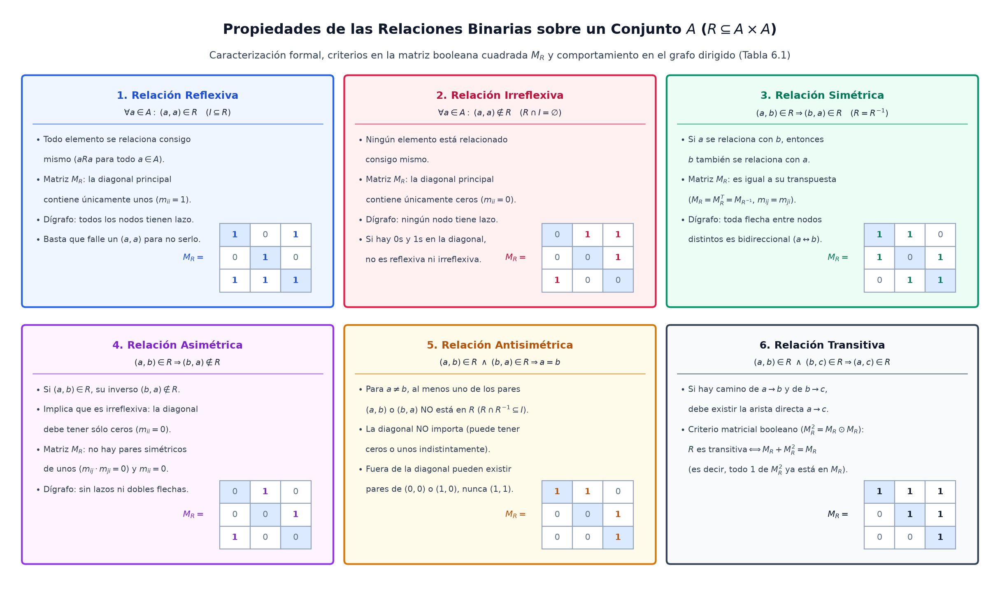

<!-- _class: portada -->
<!-- _paginate: false -->
<!-- _header: "" -->
<!-- _footer: "" -->

# 5.2 Propiedades de las relaciones
## Reflexiva, irreflexiva, simétrica, asimétrica, antisimétrica y transitiva

- **Unidad:** 5. Relaciones | **Subtema:** 5.2
- **Objetivo:** Caracterizar lógica, matricial y gráficamente las seis propiedades de una relación sobre $A$, sus teoremas algebraicos y los órdenes parciales.

---

## Introducción — Relaciones sobre $A$

- Cuando $R \subseteq A \times A$ ($A = B$), su matriz $M_R$ es **cuadrada** ($n \times n$) y su dígrafo usa como vértices a los $n$ elementos de $A$.
- **Seis propiedades fundamentales:** Reflexiva, Irreflexiva, Simétrica, Asimétrica, Antisimétrica y Transitiva.
- De ellas surgen dos grandes familias computacionales:
  - **Relaciones de equivalencia:** particionan datos y modelan redes.
  - **Órdenes parciales:** estructuran jerarquías, ordenamiento topológico y retículos.
- **Referencia:** $|A| = n$ y relación identidad $I = \{(a, a) \mid a \in A\}$ (matriz $I_n$).

---
<!-- _class: figura -->

## Propiedades de las relaciones binarias sobre un conjunto A

Criterio lógico, matriz booleana cuadrada $M_R$ y comportamiento en dígrafos para cada propiedad.

---

## 1.1 Relación Reflexiva

- **Definición formal:** Todo elemento de $A$ está relacionado consigo mismo:
  $$\boxed{\forall a \in A:\quad (a, a) \in R \qquad (a R a \;\forall a \in A, \text{ o bien } I \subseteq R)}$$
- **Criterio en $M_R$:** Toda la **diagonal principal** contiene **unos** ($m_{ii} = 1\;\forall i \in \{1, \dots, n\}$); fuera de la diagonal puede haber $0$ o $1$.
- **Criterio en el dígrafo:** Todos y cada uno de los vértices tienen un **lazo**.
- **Cómo refutarla:** Basta exhibir un $a_0 \in A$ con $(a_0, a_0) \notin R$ (un $0$ en la diagonal).

---

## 1.2 Relación Irreflexiva (Antirreflexiva)

- **Definición formal:** Ningún elemento de $A$ está relacionado consigo mismo:
  $$\boxed{\forall a \in A:\quad (a, a) \notin R \qquad (R \cap I = \emptyset)}$$
- **Criterio en $M_R$:** Toda la **diagonal principal** contiene **ceros** ($m_{ii} = 0\;\forall i \in \{1, \dots, n\}$).
- **Criterio en el dígrafo:** **Ningún** vértice tiene lazo.
- **Advertencia crítica:** «No ser reflexiva» **NO** equivale a «ser irreflexiva». Si la diagonal mezcla $0\text{s}$ y $1\text{s}$, la relación **no es reflexiva ni irreflexiva**.

---

## 1.3 Relación Simétrica

- **Definición formal:** Si $a$ se relaciona con $b$, entonces $b$ también se relaciona con $a$:
  $$\boxed{\forall a, b \in A:\quad (a, b) \in R \implies (b, a) \in R \qquad (R = R^{-1})}$$
- **Criterio en $M_R$:** Entradas simétricas respecto a la diagonal iguales ($m_{ij} = m_{ji}$), es decir:
  $$M_R = (M_R)^T = M_{R^{-1}}$$
  *(La diagonal principal puede tener cualesquiera valores $0$ o $1$).*
- **Criterio en el dígrafo:** Toda flecha entre nodos distintos tiene flecha de regreso ($a \leftrightarrow b$).

---

## 1.4 Relación Asimétrica

- **Definición formal:** Si $(a, b) \in R$, su inverso $(b, a) \notin R$ (incluye $a = b$):
  $$\boxed{\forall a, b \in A:\quad (a, b) \in R \implies (b, a) \notin R \qquad (R \cap R^{-1} = \emptyset)}$$
- **Criterio en $M_R$:**
  1. Diagonal principal con **sólo ceros** ($m_{ii} = 0$, es irreflexiva).
  2. Fuera de la diagonal ($i \neq j$), si $m_{ij} = 1 \implies m_{ji} = 0$ (nunca pares $(1, 1)$: $m_{ij} \cdot m_{ji} = 0$).
- **Criterio en el dígrafo:** Sin lazos y entre dos nodos hay a lo sumo una flecha en un solo sentido.

---

## 1.5 Relación Antisimétrica

- **Definición formal:** Si $(a, b) \in R$ y $(b, a) \in R$, entonces $a = b$ (para $a \neq b$, falta al menos uno):
  $$\boxed{\forall a, b \in A:\; \big[(a, b) \in R \land (b, a) \in R\big] \implies a = b \quad (R \cap R^{-1} \subseteq I)}$$
- **Criterio en $M_R$:** La **diagonal NO importa** ($0$ o $1$); para $i \neq j$, jamás hay $(1, 1)$ simétricos.
- **Criterio en el dígrafo:** Puede tener lazos, pero nunca doble flecha ($a \leftrightarrow b$) entre nodos distintos.
- **Relaciones clave:** $\text{Asimétrica} \iff \text{Antisimétrica} \land \text{Irreflexiva}$. Además, cualquier $R \subseteq I$ es simétrica y antisimétrica a la vez.

---

## 1.6 Relación Transitiva y Prueba Matricial

- **Definición formal:**
  $$\boxed{\forall a, b, c \in A:\; \big[(a, b) \in R \land (b, c) \in R\big] \implies (a, c) \in R \quad (R^2 = R \circ R \subseteq R)}$$
- **Método matricial booleano:** Se calcula $M_R^2 = M_R \odot M_R$ (caminos de longitud $2$):
  $$\boxed{R \text{ es transitiva} \iff M_R + M_R^2 = M_R \qquad (M_R^2 \subseteq M_R)}$$
- Si en alguna posición $(i, k)$ donde $M_R$ tenía un $0$ aparece un $1$ en $M_R^2$, falta el par $(a_i, a_k)$ y $R$ **no es transitiva**.

---
<!-- _class: compacta -->

## 2. Cuadro Sinóptico Maestro (Tabla 6.1, 1/2)

| Propiedad | Condición Lógica ($\forall a, b, c \in A$) | Operaciones | Condición en $M_R = [m_{ij}]$ |
| :--- | :--- | :---: | :--- |
| **1. Reflexiva** | $\forall a \in A:\; (a, a) \in R$ | $I \subseteq R$ | Toda la diagonal tiene $1\text{s}$ ($m_{ii} = 1$). |
| **2. Irreflexiva** | $\forall a \in A:\; (a, a) \notin R$ | $R \cap I = \emptyset$ | Toda la diagonal tiene $0\text{s}$ ($m_{ii} = 0$). |
| **3. Simétrica** | $(a, b) \in R \implies (b, a) \in R$ | $R = R^{-1}$ | Matriz simétrica: $M_R = M_R^T$ ($m_{ij} = m_{ji}$). |

---
<!-- _class: compacta -->

## 2. Cuadro Sinóptico Maestro (Tabla 6.1, 2/2)

| Propiedad | Condición Lógica ($\forall a, b, c \in A$) | Operaciones | Condición en $M_R = [m_{ij}]$ |
| :--- | :--- | :---: | :--- |
| **4. Asimétrica** | $(a, b) \in R \implies (b, a) \notin R$ | $R \cap R^{-1} = \emptyset$ | Diagonal $m_{ii} = 0$ y si $m_{ij} = 1 \implies m_{ji} = 0$. |
| **5. Antisimétrica** | $(a, b) \in R \land (b, a) \in R \implies a = b$ | $R \cap R^{-1} \subseteq I$ | Diagonal libre; para $i \neq j$ nunca $m_{ij} = m_{ji} = 1$. |
| **6. Transitiva** | $(a, b) \in R \land (b, c) \in R \implies (a, c) \in R$ | $R \circ R \subseteq R$ | $M_R + M_R^2 = M_R$ ($M_R^2 = M_R \odot M_R$). |

---

## 3.1 Teoremas Algebraicos de las Relaciones (1/2)

Sean $R, S: A \to B$, $T: B \to C$ y $W: C \to D$ relaciones binarias:

1. **Monotonía:** Si $R \subseteq S$, entonces $R^{-1} \subseteq S^{-1}$ y $S' \subseteq R'$.
2. **Distributividad de la inversa:**
   $$(R \cap S)^{-1} = R^{-1} \cap S^{-1}, \qquad (R \cup S)^{-1} = R^{-1} \cup S^{-1}$$
3. **Asociatividad de composición:** $(R \circ T) \circ W = R \circ (T \circ W)$.
4. **Inversa de una composición:** $(R \circ T)^{-1} = T^{-1} \circ R^{-1}$.
5. **Distributividad de composición y unión:** $(R \cup S) \circ T = (R \circ T) \cup (S \circ T)$.

---

## 3.1 Conservación y 3.2 Órdenes Parciales (2/2)

- **6. Conservación de propiedades sobre $A$ ($A = B$):**
  - $R$ reflexiva $\implies R^{-1}$ reflexiva; $R$ reflexiva $\iff R'$ irreflexiva.
  - $R, S$ reflexivas $\implies R \cap S$ y $R \cup S$ reflexivas.
  - $R$ simétrica $\implies R^{-1}$ y $R'$ simétricas; $R, S$ simétricas $\implies R \cap S, R \cup S$ simétricas.
- **3.2 Relación de Orden Parcial (*Poset* $(A, R)$):**
  - Relación sobre $A$ que es **Reflexiva**, **Antisimétrica** y **Transitiva**.
  - *Ejemplos clásicos:* $(\mathbb{R}, \le)$, $(\mathcal{P}(U), \subseteq)$ y divisibilidad $(\mathbb{Z}^+, \mid)$.

---
<!-- _class: seccion -->
<!-- _header: "" -->
<!-- _footer: "" -->

## Ejemplos de Práctica

Análisis matricial booleano, clasificación sobre $\mathbb{Z}$ y demostraciones formales.

---
<!-- _class: compacta -->

## Ejemplo 5.2.1: Análisis de propiedades (1/3)

En $A = \{1, 2, 3, 4\}$, sea $R = \{(1, 1), (1, 2), (2, 1), (2, 4), (3, 4), (4, 2), (4, 3), (4, 4)\}$:
$$M_R = \begin{array}{c|cccc}
& 1 & 2 & 3 & 4 \\ \hline
1 & \mathbf{1} & 1 & 0 & 0 \\
2 & 1 & \mathbf{0} & 0 & 1 \\
3 & 0 & 0 & \mathbf{0} & 1 \\
4 & 0 & 1 & 1 & \mathbf{1}
\end{array}$$

1. **¿Es reflexiva?** **No**, la diagonal principal no tiene únicamente unos: faltan $(2, 2) \notin R$ y $(3, 3) \notin R$.
2. **¿Es irreflexiva?** **No**, la diagonal contiene unos: existen $(1, 1) \in R$ y $(4, 4) \in R$.

---

## Ejemplo 5.2.1: Simetría, asimetría y antisimetría (2/3)

3. **¿Es simétrica?** **Sí**, todo par simétrico respecto a la diagonal principal es igual:
   - $(1, 2)$ y $(2, 1)$ valen $1$; $(2, 4)$ y $(4, 2)$ valen $1$; $(3, 4)$ y $(4, 3)$ valen $1$; los demás pares simétricos valen $0$.
   - Por tanto, $M_R = M_R^T = M_{R^{-1}}$.
4. **¿Es asimétrica?** **No**, tiene unos en la diagonal y pares simétricos de unos como $(1, 2), (2, 1) \in R$.
5. **¿Es antisimétrica?** **No**, fuera de la diagonal hay pares simétricos de unos: $(1, 2)$ y $(2, 1)$ con $1 \neq 2$ (también $(2, 4), (4, 2)$ y $(3, 4), (4, 3)$).

---
<!-- _class: compacta -->

## Ejemplo 5.2.1: Verificación de transitividad (3/3)

6. **¿Es transitiva?** Calculamos $M_R^2 = M_R \odot M_R$ y $M_R + M_R^2$:
   $$M_R^2 = \begin{pmatrix} 1 & 1 & 0 & 0 \\ 1 & 0 & 0 & 1 \\ 0 & 0 & 0 & 1 \\ 0 & 1 & 1 & 1 \end{pmatrix} \odot \begin{pmatrix} 1 & 1 & 0 & 0 \\ 1 & 0 & 0 & 1 \\ 0 & 0 & 0 & 1 \\ 0 & 1 & 1 & 1 \end{pmatrix} = \begin{pmatrix} 1 & 1 & 0 & \mathbf{1} \\ 1 & \mathbf{1} & \mathbf{1} & 1 \\ 0 & \mathbf{1} & \mathbf{1} & 1 \\ \mathbf{1} & 1 & 1 & 1 \end{pmatrix}$$
   $$M_R + M_R^2 = \begin{pmatrix} 1 & 1 & 0 & 1 \\ 1 & 1 & 1 & 1 \\ 0 & 1 & 1 & 1 \\ 1 & 1 & 1 & 1 \end{pmatrix} \neq M_R$$

- **Conclusión:** Como $M_R \neq M_R + M_R^2$, **$R$ NO es transitiva** (p. ej., $(2, 4), (4, 2) \in R$ pero $(2, 2) \notin R$; $(1, 2), (2, 4) \in R$ pero $(1, 4) \notin R$).

---
<!-- _class: compacta -->

## Ejemplo 5.2.2: Cálculo de $M_R^2$ (1/2)

Sobre $A = \{1, 2, 3, 4\}$, determine si $R$ es transitiva y qué pares faltan:
$$M_R = \begin{pmatrix} 0 & 0 & 1 & 0 \\ 0 & 1 & 1 & 1 \\ 1 & 0 & 1 & 1 \\ 0 & 0 & 1 & 0 \end{pmatrix} \implies M_R^2 = M_R \odot M_R = \begin{pmatrix} \mathbf{1} & 0 & 1 & \mathbf{1} \\ \mathbf{1} & 1 & 1 & 1 \\ 1 & 0 & 1 & 1 \\ \mathbf{1} & 0 & 1 & \mathbf{1} \end{pmatrix}$$

- **Multiplicación booleana fila por columnas:**
  - **Fila 1** $[0, 0, 1, 0]$: reproduce la fila 3 de $M_R \implies [1, 0, 1, 1]$.
  - **Fila 2** $[0, 1, 1, 1]$: suma booleana de filas 2, 3 y 4 $\implies [1, 1, 1, 1]$.
  - **Fila 3** $[1, 0, 1, 1]$: suma booleana de filas 1, 3 y 4 $\implies [1, 0, 1, 1]$.
  - **Fila 4** $[0, 0, 1, 0]$: reproduce la fila 3 de $M_R \implies [1, 0, 1, 1]$.

---

## Ejemplo 5.2.2: Pares faltantes para transitividad (2/2)

Comparando $M_R^2$ contra $M_R$, aparecen **cinco unos nuevos** donde $M_R$ tenía $0$. Por tanto, **$R$ no es transitiva** y los $5$ pares faltantes en esta iteración son:

- **$(1, 1)$** [por $(1, 3) \land (3, 1)$] y **$(1, 4)$** [por $(1, 3) \land (3, 4)$].
- **$(2, 1)$** [por $(2, 3) \land (3, 1)$].
- **$(4, 1)$** [por $(4, 3) \land (3, 1)$] y **$(4, 4)$** [por $(4, 3) \land (3, 4)$].

---

## Ejemplo 5.2.3: Relaciones sobre $\mathbb{Z}$ (1/3)

- **a) Relación menor o igual $R_1 = \{(a, b) \in \mathbb{Z}^2 \mid a \le b\}$:**
  - **Reflexiva:** **Sí**, pues $a \le a$ para todo $a \in \mathbb{Z}$.
  - **Irreflexiva:** **No** (pues $1 \le 1$).
  - **Simétrica:** **No** (pues $2 \le 5$, pero $5 \not\le 2$).
  - **Asimétrica:** **No** (porque es reflexiva: $(1, 1) \in R_1$).
  - **Antisimétrica:** **Sí**, si $a \le b$ y $b \le a$, entonces $a = b$.
  - **Transitiva:** **Sí**, si $a \le b$ y $b \le c$, entonces $a \le c$.
  - *($(\mathbb{Z}, \le)$ es un **orden parcial**).*

---

## Ejemplo 5.2.3: Relaciones sobre $\mathbb{Z}$ (2/3)

- **b) Relación menor estricto $R_2 = \{(a, b) \in \mathbb{Z}^2 \mid a < b\}$:**
  - **Reflexiva:** **No** ($a \not< a$).
  - **Irreflexiva:** **Sí**, ningún entero es estrictamente menor que sí mismo ($a \not< a$).
  - **Simétrica:** **No** ($2 < 5 \implies 5 \not< 2$).
  - **Asimétrica:** **Sí**, si $a < b$, entonces jamás se cumple $b < a$.
  - **Antisimétrica:** **Sí** *(vacuamente: nunca ocurren $a < b$ y $b < a$ a la vez)*.
  - **Transitiva:** **Sí**, si $a < b$ y $b < c$, entonces $a < c$.

---

## Ejemplo 5.2.3: Relaciones sobre $\mathbb{Z}$ (3/3)

- **c) Relación suma constante $R_3 = \{(a, b) \in \mathbb{Z}^2 \mid a + b = 10\}$:**
  - **Reflexiva:** **No**, pues para $a = 2$, $2 + 2 = 4 \neq 10$ *(sólo cumple el $5$)*.
  - **Irreflexiva:** **No**, porque para $a = 5$ sí pertenece $(5, 5) \in R_3$ ($5 + 5 = 10$).
  - **Simétrica:** **Sí**, por conmutatividad: si $a + b = 10 \implies b + a = 10$.
  - **Asimétrica y Antisimétrica:** **No**, pues $(3, 7) \in R_3$ y $(7, 3) \in R_3$ con $3 \neq 7$.
  - **Transitiva:** **No**, pues $(3, 7), (7, 3) \in R_3$, pero $(3, 3) \notin R_3$ ($3 + 3 = 6 \neq 10$).

---
<!-- _class: compacta -->

## Ejemplo 5.2.4: Demostración de propiedades algebraicas

Sean $R, S: A \to B$ relaciones binarias. Demuestre formalmente:

- **a) $(R \cap S)^{-1} = R^{-1} \cap S^{-1}$:** Sea $(b, a) \in B \times A$ arbitrario:
  $$\begin{aligned}
  (b, a) \in (R \cap S)^{-1} &\iff (a, b) \in R \cap S && \text{(Definición de inversa)} \\
  &\iff (a, b) \in R \;\land\; (a, b) \in S && \text{(Definición de intersección)} \\
  &\iff (b, a) \in R^{-1} \;\land\; (b, a) \in S^{-1} && \text{(Definición de inversa)} \\
  &\iff (b, a) \in R^{-1} \cap S^{-1} \quad \blacksquare && \text{(Definición de intersección)}
  \end{aligned}$$
- **b) Si $R$ y $S$ son simétricas sobre $A$, entonces $R \cup S$ es simétrica:**
  Por hipótesis $R^{-1} = R$ y $S^{-1} = S$. Aplicando distributividad de la inversa:
  $$(R \cup S)^{-1} = R^{-1} \cup S^{-1} = R \cup S \implies R \cup S \text{ es simétrica.} \;\blacksquare$$

---
<!-- _class: seccion -->
<!-- _header: "" -->
<!-- _footer: "" -->

## Ejercicios de Tarea (Práctica en Casa)

Construya la matriz booleana correspondiente y justifique formalmente (o con contraejemplo) cada una de las 6 propiedades.

---

## Tarea 1: Propiedades en relaciones finitas

*(Jiménez Murillo, Prob. 6.2a, 6.2b y 6.2d, p. 272)* Sea $A = \{1, 2, 3, 4\}$. Para cada relación sobre $A$, construya su matriz booleana $M_R$, calcule $M_R^2 = M_R \odot M_R$ y determine si es **reflexiva, irreflexiva, simétrica, asimétrica, antisimétrica y/o transitiva**:

- **a)** $R_a = \{(1, 1), (1, 2), (1, 3), (2, 2), (2, 3), (3, 4), (4, 1), (4, 4)\}$
- **b)** $R_b = \{(1, 1), (1, 2), (2, 1), (2, 2), (3, 1), (3, 3), (4, 2), (4, 3)\}$
- **c)** $R_c = \{(1, 2), (1, 4), (2, 3), (2, 4), (3, 1), (4, 3)\}$

---

## Tarea 2: Propiedades en matrices booleanas de $5 \times 5$

*(Jiménez Murillo, Prob. 6.3, p. 272)* Dadas las matrices de relaciones sobre $A = \{1, 2, 3, 4, 5\}$:
$$M_{R_1} = \begin{pmatrix} 1 & 1 & 0 & 0 & 0 \\ 1 & 1 & 0 & 0 & 0 \\ 0 & 0 & 1 & 1 & 1 \\ 0 & 0 & 1 & 1 & 1 \\ 0 & 0 & 1 & 1 & 1 \end{pmatrix}, \qquad M_{R_2} = \begin{pmatrix} 0 & 1 & 0 & 1 & 0 \\ 0 & 0 & 1 & 0 & 1 \\ 0 & 0 & 0 & 1 & 0 \\ 0 & 0 & 0 & 0 & 1 \\ 0 & 0 & 0 & 0 & 0 \end{pmatrix}$$

Determine cuáles de las $6$ propiedades (**reflexiva, irreflexiva, simétrica, asimétrica, antisimétrica, transitiva**) satisface cada matriz.

---

## Tarea 3: Demostración de propiedades algebraicas

*(Jiménez Murillo, Prob. 6.8, p. 275)* Sean $R$ y $S$ relaciones sobre un conjunto $A$. Demuestre formalmente las siguientes afirmaciones o dé un contraejemplo cuando corresponda:

- **a)** $R$ es antisimétrica si y sólo si $(R \cap R^{-1}) \subseteq I$.
- **b)** Si $R$ y $S$ son transitivas, demuestre que su intersección $R \cap S$ **siempre es transitiva**, pero muestre mediante un contraejemplo en $A = \{1, 2, 3\}$ que su unión $R \cup S$ **no necesariamente es transitiva**.

---

## Tarea 4: Divisibilidad y Orden Parcial

*(Lipschutz & Lipson, Cap. 14.2)* Sea $A = \{1, 2, 3, 4, 6, 12\}$ el conjunto de divisores de $12$, y sea $R$ la relación de divisibilidad sobre $A$ definida por $a R b \iff a \mid b$ ($a$ divide exactamente a $b$).

- **a)** Construya la matriz booleana $M_R$ de $6 \times 6$.
- **b)** Demuestre que $(A, \mid)$ es un **conjunto parcialmente ordenado** (verificando reflexividad, antisimetría y transitividad) y explique por qué **no** es un orden total (lineal).
