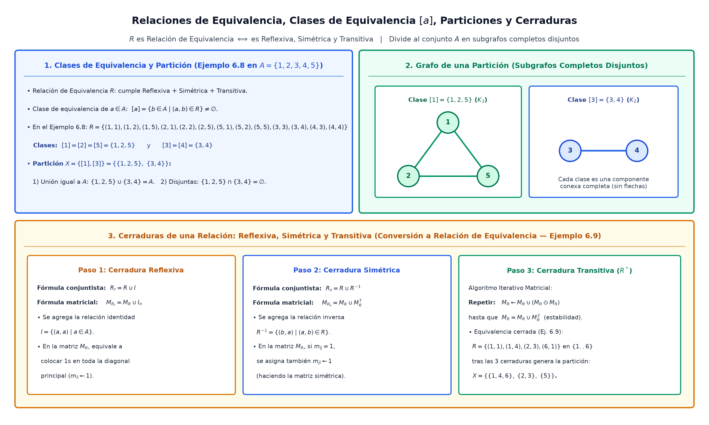

<!-- _class: portada -->
<!-- _paginate: false -->
<!-- _header: "" -->
<!-- _footer: "" -->

# 5.3 Relaciones de equivalencia
## Cerraduras, clases de equivalencia y particiones

- **Unidad:** 5. Relaciones | **Subtema:** 5.3
- **Objetivo:** Verificar relaciones de equivalencia, construir clases y particiones, y aplicar las cerraduras reflexiva, simétrica y transitiva.

---

## Introducción — Generalización de la igualdad

- La igualdad $a = b$ no es la única noción útil de equivalencia en matemáticas y computación:
  - Dos programas que producen la misma salida son funcionalmente equivalentes.
  - Dos enteros con igual residuo al dividirse entre $m$ son congruentes módulo $m$.
  - Dos computadoras que intercambian paquetes pertenecen a la misma subred conexa.
- Toda relación **reflexiva, simétrica y transitiva** divide al conjunto en bloques disjuntos (**clases de equivalencia** / **partición**).
- Si una relación aún no es de equivalencia, sus **cerraduras** añaden los pares mínimos requeridos.

---
<!-- _class: figura -->

## Relaciones de equivalencia, clases, particiones y cerraduras

Las clases forman subgrafos completos disjuntos; las cerraduras transforman cualquier relación en una de equivalencia.

---

## 1. Relación de Equivalencia

Una relación $R \subseteq A \times A$ ($A \neq \emptyset$) es **relación de equivalencia** si cumple para todo $a, b, c \in A$:

1. **Reflexiva:** $(a, a) \in R \quad$ *(diagonal de $M_R$ con unos: $I_n \subseteq M_R$)*.
   - *Red de computadoras:* toda máquina tiene comunicación consigo misma (*loopback* `127.0.0.1`).
2. **Simétrica:** $(a, b) \in R \implies (b, a) \in R \quad$ *($M_R = M_R^T = M_{R^{-1}}$)*.
   - *Red:* si $1$ envía a $2$, entonces $2$ también puede responder a $1$.
3. **Transitiva:** $(a, b) \in R \land (b, c) \in R \implies (a, c) \in R \quad$ *($M_R = M_R + M_R^2$)*.
   - *Red:* enlace $1 \to 2$ y $2 \to 5$ implica comunicación entre $1$ y $5$.

---

## 2. Clases de Equivalencia ($[a]$)

- Para cada $a \in A$, la **clase de equivalencia de $a$**, denotada $[a]$ (o $[a]_R$), reúne a todos los elementos relacionados con $a$:
  $$\boxed{[a] = \big\{b \in A \;\big|\; (a, b) \in R\big\} = \big\{b \in A \;\big|\; a R b\big\}}$$
  *(Cualquier $x \in [a]$ es un **representante** de la clase).*
- **Propiedades fundamentales (Lema de Equivalencia):**
  1. **No vacuidad:** Por reflexividad, siempre $a \in [a]$ y $[a] \neq \emptyset$.
  2. **Lectura en $M_R$:** $[a_i]$ consta de los elementos cuyas columnas tienen $1$ en la fila $a_i$.
  3. **Igualdad o disjunción:** $[a] = [b] \iff (a, b) \in R$, y $[a] \neq [b] \iff [a] \cap [b] = \emptyset$.

---

## 3. Particiones de un Conjunto

Una **partición** $X$ (o $\mathcal{P}$) de $A \neq \emptyset$ es una colección de subconjuntos $X = \{A_1, A_2, \dots, A_k\}$ tal que:

1. **No vacuidad de bloques:** $A_i \neq \emptyset$ para todo $i \in \{1, \dots, k\}$.
2. **Cobertura total (unión exhaustiva):**
   $$A_1 \cup A_2 \cup \dots \cup A_k = A$$
3. **Disjunción por pares:**
   $$A_i \cap A_j = \emptyset \qquad \text{para todo } A_i \neq A_j$$

En notación de clases (un representante por cada clase distinta):
$$X = \big\{[a] \;\big|\; a \in A,\;\text{eligiendo un solo representante por clase distinta}\big\}$$

---

## 3. Teorema Fundamental y Grafos de Partición

- **Teorema Fundamental de las Relaciones de Equivalencia:**
  1. Toda relación de equivalencia $R$ sobre $A$ induce de manera única una **partición** $X = A/R$ cuyos bloques son las clases distintas de $R$.
  2. Recíprocamente, toda partición $X = \{A_1, \dots, A_k\}$ define una única relación de equivalencia sobre $A$:
     $$R = (A_1 \times A_1) \cup (A_2 \times A_2) \cup \dots \cup (A_k \times A_k)$$
- **Representación gráfica:** El grafo se divide en **subgrafos completos aislados** (uno por clase); suprimiendo lazos y flechas, cada bloque es un grafo no dirigido completo $K_m$.

---

## 4. Cerraduras Reflexiva ($R_r$) y Simétrica ($R_s$)

Cuando $R$ no es de equivalencia, agregamos el **conjunto mínimo de pares** necesario:

- **4.1 Cerradura Reflexiva ($R_r$):** añade los pares faltantes de la identidad $I = \{(a, a) \mid a \in A\}$:
  $$\boxed{R_r = R \cup I \qquad\qquad M_{R_r} = M_R \cup I_n}$$
  *(En $M_R$, consiste en poner $1\text{s}$ en toda la diagonal principal).*
- **4.2 Cerradura Simétrica ($R_s$):** añade la relación inversa $R^{-1}$:
  $$\boxed{R_s = R \cup R^{-1} \qquad\qquad M_{R_s} = M_R \cup M_{R^{-1}} = M_R \cup M_R^T}$$
  *(Si $m_{ij} = 1$, se coloca también un $1$ en la entrada simétrica $(j, i)$).*

---

## 4.3 Cerradura Transitiva ($R^*$) — Algoritmo Iterativo

No siempre basta sumar $M_R^2$ una sola vez, pues al añadir pares surgen nuevos caminos de mayor longitud:

1. **Entrada:** Matriz booleana cuadrada $M_R$ de orden $n \times n$.
2. **Calcular cuadrado booleano:** $M_R^2 = M_R \odot M_R$.
3. **Prueba de parada:**
   - Si $M_R = M_R \cup M_R^2$ (ya no cambió): **terminar**, $M_R$ ya es transitiva.
   - Si $M_R \neq M_R \cup M_R^2$ (aparecieron nuevos unos): actualizar
     $$M_R \leftarrow M_R \cup M_R^2$$
     y **regresar al Paso 2**.

*(En $|A| = n$: $R^* = \bigcup_{k=1}^n R^k$; también puede calcularse en $n$ pasos con el **Algoritmo de Warshall**).*

---

## 4.4 Cerradura de Equivalencia

Para transformar cualquier relación arbitraria $R$ sobre $A$ en la **menor relación de equivalencia** que la contiene, se aplican en orden las tres cerraduras:

1. **Cerradura Reflexiva:**
   $$M_R \leftarrow M_R \cup I_n$$
2. **Cerradura Simétrica:**
   $$M_R \leftarrow M_R \cup M_R^T$$
3. **Cerradura Transitiva iterativa:**
   $$M_R \leftarrow M_R \cup M_R^2 \quad \text{(hasta que ya no cambie)}$$

---
<!-- _class: seccion -->
<!-- _header: "" -->
<!-- _footer: "" -->

## Ejemplos de Práctica

Verificación de equivalencia, cerraduras paso a paso, congruencia módulo $m$ y particiones.

---
<!-- _class: compacta -->

## Ejemplo 5.3.1: Verificación de equivalencia (1/3)

En $A = \{1, 2, 3, 4, 5\}$, sea la relación:
$$R = \{(1,1),(1,2),(1,5),(2,1),(2,2),(2,5),(3,3),(3,4),(4,3),(4,4),(5,1),(5,2),(5,5)\}$$

Su matriz booleana cuadrada $M_R$ es:
$$M_R = \begin{array}{c|ccccc}
& 1 & 2 & 3 & 4 & 5 \\ \hline
1 & \mathbf{1} & 1 & 0 & 0 & 1 \\
2 & 1 & \mathbf{1} & 0 & 0 & 1 \\
3 & 0 & 0 & \mathbf{1} & 1 & 0 \\
4 & 0 & 0 & 1 & \mathbf{1} & 0 \\
5 & 1 & 1 & 0 & 0 & \mathbf{1}
\end{array}$$

---

## Ejemplo 5.3.1: Comprobación de propiedades (2/3)

- **a) Verificación de las tres propiedades en $M_R$:**
  1. **Reflexiva:** **Sí**, toda la diagonal principal contiene unos ($m_{ii} = 1$ para $i = 1, 2, 3, 4, 5$).
  2. **Simétrica:** **Sí**, la matriz coincide con su transpuesta ($M_R = M_R^T$).
  3. **Transitiva:** **Sí**, al calcular el producto booleano $M_R^2 = M_R \odot M_R$ resulta $M_R^2 = M_R$, luego $M_R = M_R + M_R^2$.
- **Conclusión:** **$R$ es una relación de equivalencia.**

---

## Ejemplo 5.3.1: Clases, partición y grafo (3/3)

- **b) Clases de equivalencia** (leyendo los $1\text{s}$ de cada fila de $M_R$):
  $$\begin{aligned}
  [1] &= [2] = [5] = \{1, 2, 5\} \\
  [3] &= [4] = \{3, 4\}
  \end{aligned}$$
- **c) Partición $X$ inducida sobre $A$:**
  $$X = \big\{[1],\; [3]\big\} = \big\{\{1, 2, 5\},\; \{3, 4\}\big\}$$
  Cumple $\{1, 2, 5\} \cup \{3, 4\} = A$ y $\{1, 2, 5\} \cap \{3, 4\} = \emptyset$.
- **Grafo no dirigido:** Dos subgrafos completos desconectados: un triángulo $K_3$ ($\{1, 2, 5\}$) y una arista $K_2$ ($\{3, 4\}$).

---

## Ejemplo 5.3.2: Diagnóstico inicial (1/4)

En $A = \{1, 2, 3, 4, 5, 6\}$, sea la relación inicial:
$$R = \{(1, 1), (1, 4), (2, 3), (6, 1)\}$$

- **a) Diagnóstico:** $R$ no es de equivalencia porque falla en las tres propiedades:
  - **No es reflexiva:** faltan $(2,2), (3,3), (4,4), (5,5), (6,6)$.
  - **No es simétrica:** están $(2,3), (1,4), (6,1)$, pero faltan $(3,2), (4,1), (1,6)$.
  - **No es transitiva:** están $(6,1)$ y $(1,4)$, pero falta $(6,4)$.

---
<!-- _class: compacta -->

## Ejemplo 5.3.2: Cerraduras reflexiva y simétrica (2/4)

- **b.1) Cerradura Reflexiva ($M_{R_r} = M_R \cup I_6$):** se completan $1\text{s}$ en la diagonal.
- **b.2) Cerradura Simétrica ($M_{R_{rs}} = M_{R_r} \cup M_{R_r}^T$):** se agregan $(4, 1), (3, 2)$ y $(1, 6)$.

$$M_{R_r} = \begin{pmatrix} 1 & 0 & 0 & 1 & 0 & 0 \\ 0 & 1 & 1 & 0 & 0 & 0 \\ 0 & 0 & 1 & 0 & 0 & 0 \\ 0 & 0 & 0 & 1 & 0 & 0 \\ 0 & 0 & 0 & 0 & 1 & 0 \\ 1 & 0 & 0 & 0 & 0 & 1 \end{pmatrix} \implies M_{R_{rs}} = \begin{pmatrix} 1 & 0 & 0 & 1 & 0 & \mathbf{1} \\ 0 & 1 & 1 & 0 & 0 & 0 \\ 0 & \mathbf{1} & 1 & 0 & 0 & 0 \\ \mathbf{1} & 0 & 0 & 1 & 0 & 0 \\ 0 & 0 & 0 & 0 & 1 & 0 \\ 1 & 0 & 0 & 0 & 0 & 1 \end{pmatrix}$$

---
<!-- _class: compacta -->

## Ejemplo 5.3.2: Cerradura transitiva — Iteración 1 (3/4)

- **b.3) Cerradura Transitiva ($M_R \leftarrow M_R \cup M_R^2$):**
  Al multiplicar $M_{R_{rs}} \odot M_{R_{rs}}$, como $(4, 1) \land (1, 6)$ y $(6, 1) \land (1, 4)$, aparecen $(4, 6)$ y $(6, 4)$:

$$M_R^{(1)} = M_{R_{rs}} \cup M_{R_{rs}}^2 = \begin{pmatrix} 1 & 0 & 0 & 1 & 0 & 1 \\ 0 & 1 & 1 & 0 & 0 & 0 \\ 0 & 1 & 1 & 0 & 0 & 0 \\ 1 & 0 & 0 & 1 & 0 & \mathbf{1} \\ 0 & 0 & 0 & 0 & 1 & 0 \\ 1 & 0 & 0 & \mathbf{1} & 0 & 1 \end{pmatrix}$$

---

## Ejemplo 5.3.2: Parada, clases y partición (4/4)

- **Iteración 2 (prueba de parada):**
  Al calcular $(M_R^{(1)})^2$, resulta $(M_R^{(1)})^2 = M_R^{(1)}$, es decir, $M_R^{(1)} = M_R^{(1)} \cup (M_R^{(1)})^2$. El algoritmo termina.
- **c) Clases de equivalencia** (leyendo las filas de $M_R^{(1)}$):
  $$[1] = [4] = [6] = \{1, 4, 6\}, \qquad [2] = [3] = \{2, 3\}, \qquad [5] = \{5\}$$
- **Partición final de $A = \{1, 2, 3, 4, 5, 6\}$:**
  $$\boxed{X = \big\{[1],\; [2],\; [5]\big\} = \big\{\{1, 4, 6\},\; \{2, 3\},\; \{5\}\big\}}$$

---
<!-- _class: compacta -->

## Ejemplo 5.3.3: Congruencia módulo $m$ sobre $\mathbb{Z}$ (1/2)

Sea $m \ge 2$ entero positivo fijo y sobre $A = \mathbb{Z}$ defínase:
$$a R b \iff a \equiv b \pmod{m} \iff m \mid (a - b) \quad (a - b = k \cdot m,\; k \in \mathbb{Z})$$

- **a) Demostración de que es relación de equivalencia ($\forall a, b, c \in \mathbb{Z}$):**
  1. **Reflexiva:** $a - a = 0 = 0 \cdot m$, luego $m \mid (a - a)$ y $(a, a) \in R$.
  2. **Simétrica:** Si $(a, b) \in R$, $a - b = km \implies b - a = (-k)m$ con $-k \in \mathbb{Z}$, luego $(b, a) \in R$.
  3. **Transitiva:** Si $a - b = k_1 m$ y $b - c = k_2 m$, sumando:
     $$a - c = (a - b) + (b - c) = (k_1 + k_2)m \quad (k_1 + k_2 \in \mathbb{Z})$$
     Por tanto, $(a, c) \in R$ y es relación de equivalencia. $\blacksquare$

---

## Ejemplo 5.3.3: Clases residuales para $m = 3$ (2/2)

- **b) Clases de equivalencia y partición para $m = 3$:**
  Al dividir cualquier entero entre $3$, los únicos residuos posibles son $0, 1$ y $2$, dividiendo $\mathbb{Z}$ en **tres clases disjuntas**:
  $$\begin{aligned}
  [0] &= \{\dots, -6, -3, 0, 3, 6, 9, \dots\} = \{3k \mid k \in \mathbb{Z}\} \\
  [1] &= \{\dots, -5, -2, 1, 4, 7, 10, \dots\} = \{3k + 1 \mid k \in \mathbb{Z}\} \\
  [2] &= \{\dots, -4, -1, 2, 5, 8, 11, \dots\} = \{3k + 2 \mid k \in \mathbb{Z}\}
  \end{aligned}$$
- **Partición inducida de $\mathbb{Z}$:**
  $$X = \mathbb{Z}_3 = \{[0], [1], [2]\}$$

---
<!-- _class: compacta -->

## Ejemplo 5.3.4: Reconstrucción desde una partición (1/2)

Sea $A = \{1, 2, 3, 4, 5, 6\}$ y $X = \big\{\{1, 3, 5\},\; \{2, 6\},\; \{4\}\big\}$.

- **a) Verificación de partición:**
  1. Ningún bloque es vacío: $\{1, 3, 5\} \neq \emptyset$, $\{2, 6\} \neq \emptyset$, $\{4\} \neq \emptyset$.
  2. Unión igual a $A$: $\{1, 3, 5\} \cup \{2, 6\} \cup \{4\} = \{1, 2, 3, 4, 5, 6\} = A$.
  3. Disjuntos dos a dos: $\{1,3,5\} \cap \{2,6\} = \emptyset$, $\{1,3,5\} \cap \{4\} = \emptyset$, $\{2,6\} \cap \{4\} = \emptyset$.
- **b) Relación $R$ por extensión ($3^2 + 2^2 + 1^2 = 14$ pares):**
  $$\begin{aligned}
  R &= \{1, 3, 5\}^2 \cup \{2, 6\}^2 \cup \{4\}^2 \\
    &= \{(1,1),(1,3),(1,5),(3,1),(3,3),(3,5),(5,1),(5,3),(5,5)\} \\
    &\quad \cup \{(2,2),(2,6),(6,2),(6,6)\} \cup \{(4,4)\}
  \end{aligned}$$

---
<!-- _class: compacta -->

## Ejemplo 5.3.4: Matriz booleana de $R$ (2/2)

La matriz booleana $M_R$ ($6 \times 6$) de la relación $R$ inducida por $X = \{\{1, 3, 5\}, \{2, 6\}, \{4\}\}$ es:

$$M_R = \begin{pmatrix}
1 & 0 & 1 & 0 & 1 & 0 \\
0 & 1 & 0 & 0 & 0 & 1 \\
1 & 0 & 1 & 0 & 1 & 0 \\
0 & 0 & 0 & 1 & 0 & 0 \\
1 & 0 & 1 & 0 & 1 & 0 \\
0 & 1 & 0 & 0 & 0 & 1
\end{pmatrix}$$

*(Las filas y columnas de un mismo bloque son idénticas entre sí).*

---
<!-- _class: seccion -->
<!-- _header: "" -->
<!-- _footer: "" -->

## Ejercicios de Tarea (Práctica en Casa)

Muestre todas las operaciones matriciales booleanas paso a paso, las clases de equivalencia y la partición resultante.

---

## Tarea 1: Equivalencia, clases y particiones

*(Jiménez Murillo, Prob. 6.4a y 6.4c, p. 273)* Sea $A = \{1, 2, 3, 4, 5\}$. Para cada relación sobre $A$, determine si es de equivalencia; en caso afirmativo, obtenga todas sus clases de equivalencia, su partición $X$ y describa su grafo no dirigido:

- **a)** $R_1 = \{(1, 1), (1, 3), (1, 5), (2, 2), (2, 4), (3, 1), (3, 3), (3, 5), (4, 2), (4, 4), (5, 1), (5, 3), (5, 5)\}$
- **b)** $R_2 = \{(1, 1), (1, 2), (2, 1), (2, 2), (2, 3), (3, 2), (3, 3), (4, 4), (4, 5), (5, 4), (5, 5)\}$

---

## Tarea 2: Cerraduras para obtener equivalencia

*(Jiménez Murillo, Prob. 6.5a y 6.5b, p. 273)* Sea $A = \{1, 2, 3, 4, 5, 6\}$. Para cada una de las siguientes relaciones iniciales:  
*(i)* Aplique paso a paso las **cerraduras reflexiva, simétrica y transitiva** usando matrices booleanas hasta obtener una relación de equivalencia.  
*(ii)* Determine las clases de equivalencia y la partición $X$ de la relación cerrada.

- **a)** $R_a = \{(1, 2), (2, 6), (4, 5)\}$
- **b)** $R_b = \{(1, 5), (2, 4), (4, 3), (6, 6)\}$

---

## Tarea 3: Cerradura transitiva pura

Sea $A = \{1, 2, 3, 4\}$ y sea la relación dirigida:
$$R = \{(1, 2), (2, 3), (3, 4)\}$$

Calcule únicamente la **cerradura transitiva** $R^*$ aplicando el algoritmo matricial iterativo $M_R \leftarrow M_R \cup M_R^2$ (sin aplicar cerradura reflexiva ni simétrica) e indique cuántas iteraciones requiere.

---

## Tarea 4: Equivalencia sobre pares ordenados

Sea $A = \{1, 2, 3, 4\}$ y defínase sobre $S = A \times A$ la relación $R$ dada por:
$$(a, b) R (c, d) \iff a + d = b + c$$

- **a)** Demuestre que $R$ es una relación de equivalencia sobre $S$ *(sugerencia: reescriba la condición como $a - b = c - d$)*.
- **b)** Encuentre todas las clases de equivalencia en que se divide $S = A \times A$ e indique la cardinalidad de cada clase.
