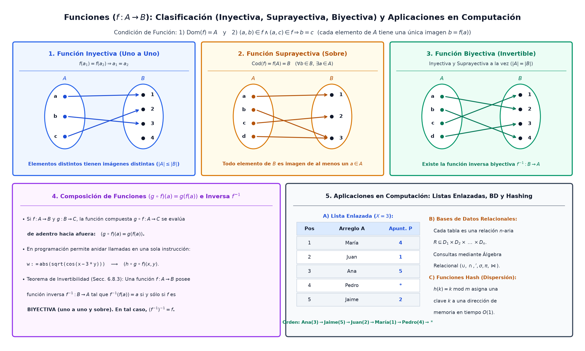

<!-- _class: portada -->
<!-- _paginate: false -->
<!-- _header: "" -->
<!-- _footer: "" -->

# 5.4 Funciones
## Inyectiva, suprayectiva, biyectiva, composición e invertibilidad

- **Unidad:** 5. Relaciones | **Subtema:** 5.4
- **Objetivo:** Distinguir las funciones entre las relaciones binarias, clasificarlas, evaluar su composición y determinar su función inversa.

---

## Introducción — De relaciones a funciones

- En una relación general un elemento puede vincularse con varios resultados o ninguno; en una **función**, cada entrada válida produce de manera determinista **un único resultado**.
- **Principio fundamental:** *Todas las funciones son relaciones, pero **no** todas las relaciones son funciones.*
- Tanto la matemática clásica como los lenguajes de programación (`C++`, `Java`, `Python`, `Pascal`) operan mediante funciones: reciben **argumentos** y devuelven **un único valor de retorno**.

---
<!-- _class: figura -->

## Clasificación, composición y aplicaciones de las funciones

Comparativa sagital de funciones inyectiva, suprayectiva y biyectiva junto con composición e invertibilidad.

---

## 1.1 Definición Formal de Función ($f: A \to B$)

Una **función** $f: A \to B$ ($A, B \neq \emptyset$) es una relación binaria $f \subseteq A \times B$ que asigna a **cada** $a \in A$ **un único** $b \in B$, cumpliendo dos condiciones:

1. **Existencia (Dominio total):**
   $$\operatorname{Dom}(f) = A$$
   *(Todos los elementos de $A$ participan; ninguno queda sin relacionar).*
2. **Unicidad (Valor único):**
   $$\big[(a, b) \in f \;\land\; (a, c) \in f\big] \implies b = c$$
   *(De ningún $a \in A$ salen dos flechas distintas).*

- **Matriz booleana $M_f$ ($|A| \times |B|$):** cada fila contiene **exactamente un $1$** y el resto $0\text{s}$.

---

## 1.2 Notación Funcional y 1.3 Recta Vertical

- Si $(a, b) \in f$, se escribe $\boxed{b = f(a)}$:
  - $a \in A$: **variable independiente**, **preimagen** o **argumento (parámetro)**.
  - $b = f(a) \in B$: **variable dependiente**, **valor** o **imagen de $a$**.
  - **Conjunto imagen:** $\operatorname{Cod}(f) = f(A) = \{f(a) \mid a \in A\} \subseteq B$.
- **Criterio de la recta vertical ($\mathbb{R} \to \mathbb{R}$):**
  - Toda recta vertical corta la gráfica en **a lo sumo $1$ punto** $\implies$ **es función** (p. ej. $y = x^2+3x-1$, $y = x^3+2$, $y = \cos x$).
  - Alguna recta vertical corta en **$2$ o más puntos** $\implies$ **sólo relación** (p. ej. $x^2+y^2 = r^2$, $y^2 = x$).

---

## 2.1 Función Inyectiva (Uno a Uno)

A elementos distintos de $A$ les corresponden siempre imágenes distintas en $B$:
$$\boxed{\forall a, a' \in A:\quad f(a) = f(a') \implies a = a' \qquad (a \neq a' \implies f(a) \neq f(a'))}$$

- **Diagrama de flechas:** a cada $b \in B$ le llega **cuando mucho una flecha** (una o ninguna).
- **Matriz booleana $M_f$:** cada fila tiene exactamente un $1$, y **cada columna tiene a lo sumo un $1$**.
- **Recta horizontal ($\mathbb{R} \to \mathbb{R}$):** corta la gráfica en a lo sumo un punto.
- **Cardinalidad (conjuntos finitos):** si $f: A \to B$ es inyectiva, $|A| \le |B|$ *(Principio del Palomar)*.

---

## 2.2 Función Suprayectiva (Sobre / Sobreyectiva)

Cada elemento de $B$ es imagen de **al menos un** elemento de $A$ (cubre todo $B$):
$$\boxed{\operatorname{Cod}(f) = f(A) = B \qquad \big(\forall b \in B,\; \exists a \in A \text{ tal que } f(a) = b\big)}$$

- **Diagrama de flechas:** a **todos** los elementos de $B$ les llega **por lo menos una flecha** (ninguno queda suelto).
- **Matriz booleana $M_f$:** cada fila tiene exactamente un $1$, y **cada columna tiene al menos un $1$** (sin columnas nulas).
- **Cardinalidad (conjuntos finitos):** si $f: A \to B$ es suprayectiva, $|A| \ge |B|$.

---

## 2.3 Función Biyectiva y Conteo Combinatorio

- **Función biyectiva (biunívoca):** es **inyectiva y suprayectiva** a la vez:
  $$\boxed{f \text{ es biyectiva} \iff f \text{ es inyectiva} \quad\land\quad f \text{ es suprayectiva}}$$
- **Diagrama y matriz:** emparejamiento exacto $1$ a $1$; $M_f$ es **matriz de permutación** cuadrada (un $1$ por fila y un $1$ por columna), con $|A| = |B|$.
- **Conteo en conjuntos finitos ($|A| = m$, $|B| = n$):**
  - Total de funciones $f: A \to B$: $n^m = |B|^{|A|}$.
  - Inyectivas ($m \le n$): $P(n, m) = \dfrac{n!}{(n - m)!} = n(n - 1)\cdots(n - m + 1)$.
  - Biyectivas ($m = n$): $n! = n(n - 1)\cdots 1$.

---

## 3.1 Composición de Funciones ($g \circ f$)

Dadas $f: A \to B$ y $g: B \to C$, la **función compuesta** $g \circ f: A \to C$ se define como:
$$\boxed{(g \circ f)(a) = g\big(f(a)\big) \qquad \forall a \in A}$$

- **Regla de evaluación (de adentro hacia afuera):** primero $b = f(a)$ y luego $c = g(b)$.
- **No conmutatividad:** en general, $g \circ f \neq f \circ g$.
- **Asociatividad:** para $f: A \to B$, $g: B \to C$ y $h: C \to D$:
  $$(h \circ g) \circ f = h \circ (g \circ f)$$

---

## 3.2 Funciones Invertibles ($f^{-1}$)

La relación inversa $f^{-1} = \{(b, a) \in B \times A \mid (a, b) \in f\}$ **no siempre es función**:
- Si $f$ no es suprayectiva $\implies \operatorname{Dom}(f^{-1}) \neq B$.
- Si $f$ no es inyectiva $\implies$ algún $b \in B$ tendría dos imágenes en $f^{-1}$.

- **Teorema de las Funciones Invertibles:**
  - $f: A \to B$ es **invertible** ($f^{-1}: B \to A$ es función) **si y sólo si $f$ es biyectiva**.
  - Si $f$ es biyectiva, $f^{-1}$ también es biyectiva, $(f^{-1})^{-1} = f$, y se cumple:
    $$b = f(a) \iff a = f^{-1}(b), \quad (f^{-1} \circ f) = I_A, \quad (f \circ f^{-1}) = I_B$$
- **En funciones reales:** en $b = f(a)$ se **despeja $a$ en función de $b$**.

---
<!-- _class: seccion -->
<!-- _header: "" -->
<!-- _footer: "" -->

## Ejemplos de Práctica

Identificación, clasificación, composición algebraica y cálculo de la función inversa.

---

## Ejemplo 5.4.1: Identificación de funciones

Sean $A = \{1, 2, 3, 4\}$ y $B = \{a, b, c\}$. Determine cuáles relaciones son **funciones** de $A$ en $B$:

- **a) $R_1 = \{(1, b), (2, c), (3, a), (4, b)\}$:** **Sí es función**, porque $\operatorname{Dom}(R_1) = A$ y cada elemento tiene imagen única.
- **b) $R_2 = \{(1, a), (2, c), (1, b), (3, a), (4, c)\}$:** **No es función**, viola unicidad pues $(1, a), (1, b) \in R_2$ con $a \neq b$.
- **c) $R_3 = \{(1, c), (2, c), (3, c), (4, c)\}$:** **Sí es función** *(constante)*, $\operatorname{Dom}(R_3) = A$ y cada entrada tiene una única salida ($c$).
- **d) $R_4 = \{(1, b), (2, c), (4, a)\}$:** **No es función**, viola existencia porque $\operatorname{Dom}(R_4) = \{1, 2, 4\} \neq A$ (falta el $3$).

---

## Ejemplo 5.4.2: Clasificación de funciones (1/2)

Determine si $f: A \to B$ es **inyectiva**, **suprayectiva** y/o **biyectiva**:

- **a)** $A = \{a, b, c, d\}$, $B = \{1, 2, 3\}$, $f = \{(a, 2), (b, 3), (c, 2), (d, 1)\}$:
  - *Inyectiva:* **No** ($f(a) = f(c) = 2$ con $a \neq c$).
  - *Suprayectiva:* **Sí** ($\operatorname{Cod}(f) = \{1, 2, 3\} = B$).
  - *Biyectiva:* **No** (no es inyectiva).
- **b)** $A = B = \{1, 2, 3, 4, 5\}$, $f = \{(1, 3), (2, 5), (4, 3), (3, 5), (5, 1)\}$:
  - *Inyectiva:* **No** ($f(1) = f(4) = 3$ y $f(2) = f(3) = 5$).
  - *Suprayectiva:* **No** ($\operatorname{Cod}(f) = \{1, 3, 5\} \neq B$, faltan $2$ y $4$).
  - *Biyectiva:* **No**.

---

## Ejemplo 5.4.2: Clasificación de funciones (2/2)

- **c)** $A = B = \mathbb{R}$, $f(a) = |a|$ (valor absoluto):
  - *Inyectiva:* **No** ($|-1.7| = |1.7| = 1.7$ con $-1.7 \neq 1.7$).
  - *Suprayectiva:* **No** ($\operatorname{Cod}(f) = [0, \infty) \neq \mathbb{R}$; ningún negativo es imagen).
  - *Biyectiva:* **No**.
- **d)** $A = B = \{1, 2, 3, 4, 5\}$, $f = \{(1, 2), (2, 5), (3, 1), (4, 4), (5, 3)\}$:
  - *Inyectiva:* **Sí** (las cinco imágenes $\{2, 5, 1, 4, 3\}$ son distintas).
  - *Suprayectiva:* **Sí** ($\operatorname{Cod}(f) = \{1, 2, 3, 4, 5\} = B$).
  - *Biyectiva:* **Sí**; es invertible con $f^{-1} = \{(2, 1), (5, 2), (1, 3), (4, 4), (3, 5)\}$.

---
## Ejemplo 5.4.3: Evaluación de composición (1/2)

Sean $f, g: \mathbb{R} \to \mathbb{R}$ dadas por $f(a) = a^2 - 1$ y $g(b) = b + 2$. Evaluando siempre de adentro hacia afuera:

- **a) $(g \circ f)(3)$:**
  $$(g \circ f)(3) = g\big(f(3)\big) = g(3^2 - 1) = g(8) = 8 + 2 = \mathbf{10}$$
- **b) $(f \circ g)(-1)$:**
  $$(f \circ g)(-1) = f\big(g(-1)\big) = f(-1 + 2) = f(1) = 1^2 - 1 = \mathbf{0}$$

---

## Ejemplo 5.4.3: Evaluación de composición (2/2)

- **c) Expresiones algebraicas para $(g \circ f)(x - 1)$ y $(f \circ g)(x - 1)$:**
  - $f(x - 1) = (x - 1)^2 - 1 = (x^2 - 2x + 1) - 1 = x^2 - 2x$:
    $$(g \circ f)(x - 1) = g(x^2 - 2x) = \mathbf{x^2 - 2x + 2}$$
  - $g(x - 1) = (x - 1) + 2 = x + 1$:
    $$(f \circ g)(x - 1) = f(x + 1) = (x + 1)^2 - 1 = \mathbf{x^2 + 2x}$$
    *(Confirma que $g \circ f \neq f \circ g$).*
- **d) $(g \circ g \circ f)(1)$:**
  $$(g \circ g \circ f)(1) = g\Big(g\big(f(1)\big)\Big) = g\big(g(0)\big) = g(2) = \mathbf{4}$$

---
<!-- _class: compacta -->

## Ejemplo 5.4.4: Biyectividad e inversa de $f(a) = a^3 + 2$

Para $f: \mathbb{R} \to \mathbb{R}$ definida por $f(a) = a^3 + 2$:

1. **Inyectividad:** Sean $a_1, a_2 \in \mathbb{R}$ con $f(a_1) = f(a_2)$:
   $$a_1^3 + 2 = a_2^3 + 2 \implies a_1^3 = a_2^3 \implies \sqrt[3]{a_1^3} = \sqrt[3]{a_2^3} \implies a_1 = a_2$$
   La raíz cúbica real es única $\implies$ $f$ es **inyectiva**.
2. **Suprayectividad y despeje:** Para todo $b \in \mathbb{R}$, despejando $a$ de $b = a^3 + 2$:
   $$a = \sqrt[3]{b - 2} = (b - 2)^{1/3} \in \mathbb{R}, \quad \text{con } f\big(\sqrt[3]{b - 2}\big) = b \implies \text{es }\textbf{suprayectiva}.$$
3. **Función inversa:** Al ser biyectiva, $\boxed{f^{-1}(b) = \sqrt[3]{b - 2} = (b - 2)^{1/3}}$ *(o $f^{-1}(x) = \sqrt[3]{x - 2}$)*.
4. **Comprobación:** $(f^{-1} \circ f)(a) = f^{-1}(a^3 + 2) = \sqrt[3]{(a^3 + 2) - 2} = \sqrt[3]{a^3} = a \;\blacksquare$.

---
<!-- _class: seccion -->
<!-- _header: "" -->
<!-- _footer: "" -->

## Ejercicios de Tarea (Práctica en Casa)

Argumente formalmente el cumplimiento o incumplimiento de función, inyectividad, suprayectividad, biyectividad e invertibilidad.

---

## Tarea 1: Identificación y clasificación de funciones

*(Jiménez Murillo, Prob. 6.13, p. 278)* Sean $A = \{1, 2, 3, 4, 5\}$ y $B = \{a, b, c, d, e\}$. Determine si cada relación es **función** de $A$ en $B$; en caso afirmativo, clasifíquela como **inyectiva, suprayectiva y/o biyectiva**, y si es biyectiva escriba $f^{-1}$:

- **a)** $R_1 = \{(1, d), (2, b), (3, e), (4, a), (5, c)\}$
- **b)** $R_2 = \{(1, a), (2, b), (3, c), (3, d), (4, e), (5, a)\}$
- **c)** $R_3 = \{(1, b), (2, d), (3, b), (4, e), (5, a)\}$
- **d)** $R_4 = \{(1, e), (2, c), (4, b), (5, d)\}$

---

## Tarea 2: Composición de tres funciones algebraicas

*(Jiménez Murillo, Prob. 6.14, p. 279)* Sean las funciones reales $f, g, h: \mathbb{R} \to \mathbb{R}$ definidas por:
$$f(x) = 2x - 3, \qquad g(x) = x^2 + 1, \qquad h(x) = 3x + 2$$

Determine:
- **a)** $(f \circ g)(-2)$ y $(g \circ f)(-2)$
- **b)** $(h \circ g \circ f)(3)$
- **c)** La expresión algebraica simplificada de $(g \circ h)(x)$ y de $(f \circ h \circ g)(x)$.

---

## Tarea 3: Biyectividad e inversa según dominio y codominio

Analice la función dada por la fórmula $f(x) = 3x + 1$ en los dos casos siguientes:

- **a)** Definida sobre los números enteros: $f_1: \mathbb{Z} \to \mathbb{Z}$. ¿Es inyectiva? ¿Es suprayectiva? ¿Es invertible en $\mathbb{Z}$?
- **b)** Definida sobre los números reales: $f_2: \mathbb{R} \to \mathbb{R}$. Demuestre que es biyectiva y encuentre su función inversa $f_2^{-1}(x)$.

---

## Tarea 4: Composición de inyectivas y suprayectivas

*(Lipschutz & Lipson, Prob. 3.18, p. 54; Epp, Secc. 7.3)* Sean $f: A \to B$ y $g: B \to C$ dos funciones. Demuestre formalmente que:

- **a)** Si $f$ y $g$ son **inyectivas**, entonces la función compuesta $g \circ f: A \to C$ también es **inyectiva**.
- **b)** Si $f$ y $g$ son **suprayectivas**, entonces la función compuesta $g \circ f: A \to C$ también es **suprayectiva**.
