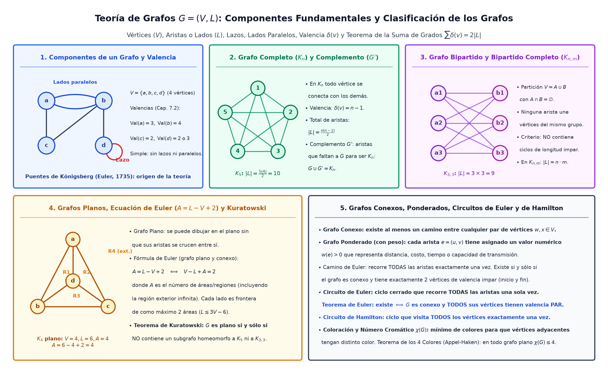

<!-- _class: portada -->
<!-- _paginate: false -->
<!-- _header: "" -->
<!-- _footer: "" -->

# 6.1 Elementos y características de los grafos

## Componentes fundamentales, tipos de grafos y teoremas clásicos

- **Unidad 6:** Teoría de Grafos · **Asignatura:** Matemáticas Discretas (`LISSI0211`)
- **Objetivos:** identificar los componentes y valencias de un grafo; clasificar grafos simples, completos, bipartidos, conexos, planos y ponderados; y aplicar los criterios de Euler, Fleury, Hamilton, Kuratowski y coloración.

---

## Introducción: Los Siete Puentes de Königsberg (1735)

- El reto consistía en cruzar los **$7$ puentes** del río Pregel conectando $4$ porciones de tierra firme, pasando por cada puente **exactamente una vez** y volviendo al inicio.
- **Leonhard Euler** modeló las $4$ tierras ($A, B, C, D$) como **vértices** y los $7$ puentes como **aristas**, creando el primer grafo de la historia.
- Al entrar y salir de un vértice por puentes distintos se consumen $2$ aristas: un recorrido cerrado requiere **valencia par** en todo vértice.
- Como las valencias eran impares ($5, 3, 3, 3$), demostró que el recorrido es **imposible**.

---

<!-- _class: figura -->

## Componentes Fundamentales y Clasificación de los Grafos

Síntesis visual de componentes, valencias, grafos completos, bipartidos, planos y circuitos de Euler y Hamilton.

---

<!-- _class: compacta -->

## 6.1.1 Componentes de un Grafo $G = (V, L)$

Un grafo $G = (V, L)$ (o $G = (V, E)$) consta de un conjunto no vacío de **vértices** $V$ y un conjunto de **lados o aristas** $L$:

| Componente | Símbolo | Definición y Propiedades |
| :--- | :---: | :--- |
| **Vértices (Nodos)** | $V$ | Puntos o círculos etiquetados ($V = \{a, b, c, d\}$) que representan entidades del sistema. |
| **Aristas (Lados)** | $L$ o $A$ | Líneas ($r_1, r_2, \dots$) que unen pares $(u, v)$; $u, v$ son **adyacentes** y la arista es **incidente** en ambos. |
| **Lados Paralelos** | $P$ | Dos o más aristas distintas entre el **mismo par** $(u, v)$ *(originan un **multigrafo**)*. |
| **Lazo (Bucle)** | $A$ / $L_z$ | Arista que sale de un vértice y regresa al **mismo vértice** $(v, v)$. |
| **Valencia (Grado)** | $\operatorname{Val}(v)$ / $\delta(v)$ | Número de lados que salen o entran en $v$ ($0$: **aislado**; $1$: **colgante u hoja**). |

---

## Conteo de Lazos y Teorema de la Suma de Grados

- **Convención de Jiménez Murillo:** en el cálculo de valencias (y matriz $M_i$), cada lazo se contabiliza **una sola vez** (ej. $2$ aristas normales + $1$ lazo $\implies \operatorname{Val}(d) = 3$).
- **Convención algebraica clásica (Euler / Lipschutz / Johnsonbaugh / Rosen):** cada lazo aporta **$2$ unidades** al grado $\delta(v)$ (por ambos extremos).
- **Teorema de la Suma de Grados (Lema del Apretón de Manos):**
  $$\sum_{v \in V} \delta(v) = 2|L|$$
- **Corolario:** en todo grafo, el número de vértices con grado impar es **siempre par**.

---

## 6.1.2 Grafo Simple y Grafo Completo ($K_n$)

- **Grafo Simple:** no posee **lazos** ni **lados paralelos** (máximo una arista entre cada par de vértices distintos).
- **Grafo Completo ($K_n$):** grafo **simple** de $n$ vértices donde cada vértice está conectado con todos los otros $n - 1$ vértices.
- **Valencia regular en $K_n$:** todo vértice tiene grado $\operatorname{Val}(v) = n - 1$.
- **Número total de lados de $K_n$:**
  $$|L(K_n)| = \frac{n(n - 1)}{2} = \binom{n}{2}$$
  Ejemplos: $|L(K_3)|=3$, $\;|L(K_4)|=6$, $\;|L(K_5)|=10$, $\;|L(K_6)|=15$.

---

## Complemento de un Grafo Simple ($G'$)

- Dado un grafo simple $G$ de $n$ vértices, su **complemento $G'$** conserva los mismos $n$ vértices y contiene exactamente las aristas que faltan a $G$ para completar $K_n$:
  $$L(G) \cap L(G') = \emptyset \qquad \text{y} \qquad L(G) \cup L(G') = L(K_n)$$
- **Número de aristas del complemento:**
  $$|L(G')| = \frac{n(n - 1)}{2} - |L(G)|$$
- *Nota:* si un grafo **no es simple** (tiene lazos o lados paralelos), no posee complemento simple $G'$.

---

## Grafo Bipartido y Bipartido Completo ($K_{n,m}$)

- **Grafo Bipartido:** sus vértices se particionan en dos conjuntos disjuntos $V = A \cup B$ ($A \cap B = \emptyset$) tales que toda arista une un vértice de $A$ con uno de $B$ (sin aristas internas en $A$ ni en $B$).
- **Teorema de König:** un grafo es bipartido **si y sólo si** no contiene ciclos de longitud impar (ni lazos).
- **Grafo Bipartido Completo ($K_{n,m}$):** con $|A|=n$ y $|B|=m$, cada vértice de $A$ se une con **todos** los de $B$ ($\operatorname{Val}(a)=m$, $\operatorname{Val}(b)=n$).
- **Total de lados de $K_{n,m}$:**
  $$|L(K_{n,m})| = n \cdot m \qquad (\text{ej. } |L(K_{3,3})| = 9,\; |L(K_{4,2})| = 8)$$

---

## Caminos, Circuitos y Grafos Conexos

- **Camino:** sucesión de lados contiguos $\{v_0, v_1, \dots, v_k\}$ de $v_0$ a $v_k$ (pueden repetirse vértices y lados); su **longitud** es $k$.
- **Camino simple de longitud $n$:** camino con $n$ aristas **todas distintas** entre sí.
- **Circuito (o Ciclo):** camino cerrado donde el vértice inicial coincide con el final ($v_0 = v_k = w$).
- **Circuito simple de longitud $n$:** camino cerrado sin repetir aristas que forma un único ciclo.
- **Grafo Conexo y Lado Puente:** es **conexo** si existe al menos un camino entre cualquier par $w, x \in V$ (si no, es **disconexo**). Un **lado puente** es una arista cuya eliminación desconecta al grafo.

---

## Caminos y Circuitos de Euler y de Hamilton

- **Camino de Euler:** recorre **todas las aristas** exactamente una vez.
  - *Existencia:* grafo conexo con **exactamente $2$ vértices de valencia impar** (inicia en uno y termina en el otro).
- **Circuito de Euler:** ciclo cerrado que pasa por **todas las aristas** una sola vez.
  - *Teorema de Euler:* existe **si y sólo si** el grafo es conexo y **todos sus vértices tienen valencia par**.
- **Circuito de Hamilton:** ciclo cerrado que visita **todos los vértices** exactamente una vez (sin requerir todas las aristas).
  - *Problema del Agente Viajero (TSP):* circuito de Hamilton de peso mínimo en un grafo ponderado.

---

## Algoritmo de Fleury (Construcción de un Circuito de Euler)

1. Verificar que el grafo sea **conexo** y todos sus vértices tengan **valencia par**.
2. Seleccionar cualquier vértice arbitrario para iniciar el recorrido.
3. En cada paso, elegir una arista incidente al vértice actual cuidando que **NO sea un lado puente** del subgrafo restante, salvo que no exista otra alternativa.
4. Registrar la arista en el recorrido y eliminarla del grafo (retirando vértices que queden aislados).
5. Repetir desde el paso 3 hasta agotar todas las aristas.

---

## Grafos Planos y Fórmula de Euler

- **Grafo Plano:** puede dibujarse en un plano sin que sus aristas se crucen entre sí (salvo en los vértices).
- **Áreas ($A$):** un dibujo plano conexo define $A$ regiones ($A - 1$ cerradas más **$1$ área exterior infinita**).
- **Fórmula de Euler (grafo plano y conexo):**
  $$A = L - V + 2 \qquad \Longleftrightarrow \qquad V - L + A = 2$$
- **Condiciones necesarias de planaridad:**
  - Sin hojas colgantes, cada lado es frontera de a lo sumo $2$ áreas.
  - Para grafo simple, plano y conexo ($V \ge 3$): $\; L \le 3V - 6$ (si no tiene triángulos o es bipartido: $\; L \le 2V - 4$).

---

## Grafos No Planos ($K_5$, $K_{3,3}$) y Teorema de Kuratowski

- **$K_4$ sí es plano:** $V = 4, L = 6, A = 4 \implies 4 = 6 - 4 + 2$.
- **$K_5$ no es plano:** $V = 5, L = 10 > 3(5) - 6 = 9$.
- **$K_{3,3}$ no es plano:** $V = 6, L = 9 > 2(6) - 4 = 8$.
- **Teorema de Kuratowski (1930):** un grafo $G$ es plano **si y sólo si** no contiene ningún subgrafo homeomorfo (reducible por eliminación de aristas y contracción de vértices de grado $2$) a **$K_5$** ni a **$K_{3,3}$**.
  - *Ejemplo:* el **Grafo de Petersen** ($V=10, L=15$) no es plano porque contiene un subgrafo $K_{3,3}$.

---

## Grafos Ponderados y Coloración Propia

- **Grafo Ponderado:** a cada arista $e = (u, v)$ se le asigna un peso real positivo $w(e)$ (distancia, costo, tiempo o capacidad).
- **Coloración Propia:** asignación $f: V \to C$ tal que ningún par de vértices adyacentes comparte color:
  $$(u, v) \in L \implies f(u) \neq f(v)$$
- **Número Cromático ($\chi(G)$ o $X(G)$):** cantidad **mínima de colores** necesarios para colorear válidamente todos los vértices de $G$.

---

## Propiedades del Número Cromático $\chi(G)$

1. Grafo con $n$ vértices aislados (sin aristas): **$\chi(G) = 1$**.
2. Grafo **bipartido** (con $\ge 1$ arista), **árbol** o ciclo simple de longitud **par**: **$\chi(G) = 2$**.
3. Ciclo simple $C_n$ de longitud **impar** ($n \ge 3$): **$\chi(G) = 3$**.
4. **Grafo completo $K_n$:** **$\chi(K_n) = n$** (si $G$ contiene un subgrafo $K_m$, entonces $\chi(G) \ge m$).
5. **Teorema de los Cuatro Colores (Appel y Haken, 1976):** todo grafo plano puede colorearse con a lo sumo $4$ colores ($\chi(G) \le 4$).

---

<!-- _class: seccion -->
<!-- _header: "" -->
<!-- _footer: "" -->

## Ejemplos de Práctica

Identificación de componentes, grafos bipartidos/complementos, planaridad y coloración

---

## Ejemplo 6.1.1: Componentes y Valencias (1/2)

**Problema:** Sea $G = (V, L)$ con $V = \{a, b, c, d, e\}$ y aristas: $r_1=(a,b)$, $r_2=(a,b)$ *(paralela)*, $r_3=(b,b)$ *(lazo)*, $r_4=(d,e)$, $r_5=(a,e)$, $r_6=(a,e)$ *(paralela)*, $r_7=(a,c)$, $r_8=(e,e)$ *(lazo)*.

**Solución — a) Conjuntos de componentes:**
- **Vértices:** $V = \{a, b, c, d, e\}$ ($5$ vértices).
- **Lados (Aristas):** $L = \{r_1, r_2, r_3, r_4, r_5, r_6, r_7, r_8\}$ ($8$ lados).
- **Lados paralelos:** $P = \{r_1, r_2, r_5, r_6\}$ ($r_1, r_2$ en $(a,b)$ y $r_5, r_6$ en $(a,e)$).
- **Lazos:** $A = \{r_3, r_8\}$ (en los vértices $b$ y $e$).

---

## Ejemplo 6.1.1: Valencias y Grafo Simple (2/2)

**b) Valencias de cada vértice:**
- $\operatorname{Val}(a) = 5$ (inciden $r_1, r_2, r_5, r_6, r_7$).
- $\operatorname{Val}(b) = 3$ en Jiménez Murillo ($r_1, r_2$ + lazo $r_3$; o $\delta(b) = 4$ contando lazo doble).
- $\operatorname{Val}(c) = 1$ (sólo incide $r_7$; vértice colgante).
- $\operatorname{Val}(d) = 1$ (sólo incide $r_4$; vértice colgante).
- $\operatorname{Val}(e) = 4$ en Jiménez Murillo ($r_4, r_5, r_6$ + lazo $r_8$; o $\delta(e) = 5$ contando lazo doble).

**¿Es grafo simple?** **No**, porque posee lazos ($r_3, r_8$) y lados paralelos ($r_1, r_2$ y $r_5, r_6$).

---

## Ejemplo 6.1.2: Grafo Bipartido y Complemento (1/2)

**Problema:** Sea $G$ simple con $V = \{1, 2, 3, 4, 5, 6\}$ y aristas:
$$L(G) = \{(1, 4), (1, 5), (1, 6), (2, 4), (2, 5), (2, 6), (3, 4), (3, 5), (3, 6)\}$$

**Solución — a) Clasificación bipartita:**
- Los vértices se dividen en dos conjuntos disjuntos: $A = \{1, 2, 3\}$ ($n = 3$) y $B = \{4, 5, 6\}$ ($m = 3$).
- Todo vértice de $A$ se conecta con **todos** los vértices de $B$ ($3 \times 3 = 9$ aristas), y no hay aristas internas en $A$ ni en $B$.
- Por lo tanto, $G$ es el **grafo bipartido completo $K_{3,3}$**.

---

## Ejemplo 6.1.2: Comparación con $K_6$ y $G'$ (2/2)

**b) Aristas de $K_6$ y obtención del complemento $G'$:**
- En $K_6$ ($n = 6$), cada vértice tiene valencia $6 - 1 = 5$ y el total de aristas es:
  $$|L(K_6)| = \frac{6(6 - 1)}{2} = \frac{30}{2} = 15\text{ aristas}$$
- Como $G$ tiene $9$ aristas, a su complemento $G'$ le faltan $15 - 9 = 6$ aristas (las internas de $A$ y de $B$):
  $$L(G') = \big\{(1, 2), (1, 3), (2, 3), (4, 5), (4, 6), (5, 6)\big\}$$
- Geométricamente, $G'$ consta de dos triángulos disjuntos ($K_3 \cup K_3$).

---

## Ejemplo 6.1.3: Ecuación de Euler, Recorridos y $\chi(G)$ (1/2)

**Problema:** Sea un grafo plano y conexo con $V = 6$ vértices $\{a, b, c, d, e, f\}$ y $L = 11$ aristas:
$$L = \{(a,b), (b,c), (c,d), (d,a), (a,f), (b,f), (b,e), (c,e), (d,e), (d,f), (e,f)\}$$

**Solución — a) Verificación de la Ecuación de Euler ($A = L - V + 2$):**
$$A = 11 - 6 + 2 = \mathbf{7\text{ áreas}}$$

- El dibujo plano delimita $6$ regiones triangulares internas cerradas más $1$ región exterior infinita.
- Cada una de las $11$ aristas es frontera de exactamente $2$ áreas.

---

<!-- _class: compacta -->

## Ejemplo 6.1.3: Euler, Hamilton y $\chi(G)$ (2/2)

**b) Análisis de Euler y Hamilton:**
Valencias: $\operatorname{Val}(a)=3,\; \operatorname{Val}(b)=4,\; \operatorname{Val}(c)=3,\; \operatorname{Val}(d)=4,\; \operatorname{Val}(e)=4,\; \operatorname{Val}(f)=4$.
- **Circuito de Euler:** **No**, porque existen vértices de valencia impar ($a$ y $c$ tienen valencia $3$).
- **Camino de Euler:** **Sí**, es conexo y tiene exactamente $2$ vértices impares ($a$ y $c$). Ejemplo: $\{a, b, c, d, a, f, b, e, d, f, e, c\}$.
- **Circuito de Hamilton:** **Sí**, por ejemplo $\{a, b, c, e, f, d, a\}$.

**c) Coloración y Número Cromático $\chi(G)$:**
- Contiene triángulos ($\{b, e, f\}$ y $\{d, e, f\}$) $\implies \chi(G) \ge 3$.
- Asignación voraz: **Color 1:** $\{f, c\}$; **Color 2:** $\{e, a\}$; **Color 3:** $\{b, d\}$.
- Ningún par adyacente comparte color $\implies \mathbf{\chi(G) = 3}$.

---

<!-- _class: seccion -->
<!-- _header: "" -->
<!-- _footer: "" -->

## Ejercicios de Tarea

Práctica en casa sobre componentes, teoremas de Euler, planaridad y clasificación

---

## Ejercicio 1: Análisis Integral de un Grafo

Considere el grafo $G = (V, L)$ con $V = \{a, b, c, d, e\}$ ($5$ vértices) y $8$ aristas:
$$L = \{(a, b), (a, c), (a, d), (b, c), (b, e), (c, d), (c, e), (d, e)\}$$

- **a)** ¿Es simple y conexo? Calcule la valencia de cada uno de sus $5$ vértices.
- **b)** ¿Tiene camino de Euler, circuito de Euler o circuito de Hamilton? Si existen, exhiba una secuencia explícita para cada uno.
- **c)** ¿Es plano? Si lo es, calcule el número de áreas $A$ mediante $A = L - V + 2$.
- **d)** Obtenga las aristas de $G'$ e indique qué valencia y cuántas aristas requeriría $G$ para ser el grafo completo $K_5$.

---

## Ejercicio 2: Grafos Bipartidos, Completos y No Planos

Para cada uno de los siguientes grafos, determine: **(i)** cuántas aristas tiene, **(ii)** si es bipartido, **(iii)** si es plano y **(iv)** su número cromático $\chi(G)$:

- **a)** El grafo completo $K_6$.
- **b)** El grafo bipartido completo $K_{4,3}$.
- **c)** El grafo rueda $W_5$ (formado por un ciclo exterior de $5$ vértices $\{1, 2, 3, 4, 5\}$ más un vértice central $6$ conectado a los $5$ vértices del ciclo).

---

## Ejercicio 3: Suma de Grados y Ecuación de Euler

- **a)** ¿Es posible construir un grafo simple de $7$ vértices en el que todos los vértices tengan valencia $3$? Justifique matemáticamente.
- **b)** Un grafo plano, conexo y simple tiene $V = 8$ vértices, todos de valencia $3$ (como el grafo de un cubo). ¿Cuántas aristas $L$ tiene el grafo y en cuántas áreas $A$ divide al plano?
