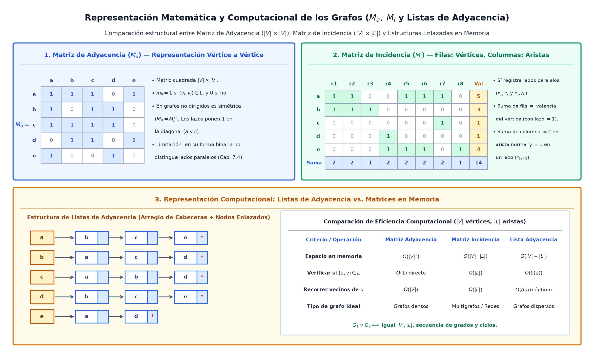

<!-- _class: portada -->
<!-- _paginate: false -->
<!-- _header: "" -->
<!-- _footer: "" -->

# 6.2 Representación de los grafos

## Representación matemática (matrices e isomorfismo) y computacional

- **Unidad 6:** Teoría de Grafos · **Asignatura:** Matemáticas Discretas (`LISSI0211`)
- **Objetivos:** construir las matrices de adyacencia ($M_a$) e incidencia ($M_i$); contar caminos mediante $M_a^k$; verificar isomorfismo ($G_1 \cong G_2$); y elegir estructuras computacionales eficientes en memoria.

---

## Panorama: Representación Matemática vs. Computacional

- Una computadora no «ve» diagramas geométricos: procesa la topología de un grafo mediante **matrices** o **estructuras dinámicas en memoria**.
- **6.2.1 Representación matemática:**
  - Conjuntos $G = (V, L)$, **Matriz de Adyacencia ($M_a$)** y **Matriz de Incidencia ($M_i$)**, conteo de caminos ($M_a^k$) e **isomorfismo**.
- **6.2.2 Representación computacional:**
  - **Listas de adyacencia**, **arreglos paralelos** y **lista de aristas**, eligiendo según la densidad del grafo.

---

<!-- _class: figura -->

## Representación Matemática y Computacional de los Grafos

Comparación visual entre Matriz de Adyacencia ($M_a$), Matriz de Incidencia ($M_i$), Listas de Adyacencia y eficiencia en memoria.

---

## 6.2.1 Matriz de Adyacencia ($M_a$): Definición

- Sea $G = (V, L)$ con $n = |V|$ vértices ordenados $v_1, v_2, \dots, v_n$.
- **$M_a$** es una **matriz cuadrada de orden $n \times n$** con los vértices en filas y columnas:

$$M_a = [a_{ij}]_{n \times n}, \qquad a_{ij} = \begin{cases} 1, & \text{si existe arista entre } v_i \text{ y } v_j, \\ 0, & \text{si no existe relación entre } v_i \text{ y } v_j. \end{cases}$$

- *Variantes:* en multigrafos se puede colocar el conteo de aristas paralelas y en grafos ponderados el peso $w_{ij}$; en la forma booleana estándar sólo se usan $1\text{s}$ y $0\text{s}$.

---

## Propiedades de la Matriz de Adyacencia ($M_a$)

1. **Simetría en grafos no dirigidos:** $a_{ij} = a_{ji}$, es decir, **$M_a = M_a^T$**.
2. **Representación de lazos:** un lazo en $v_i$ se coloca como un **$1$ en la diagonal principal** $(i, i)$.
3. **Limitación ante lados paralelos:** en su forma booleana ($0/1$), $M_a$ **no distingue** entre una arista simple y múltiples aristas paralelas.
4. **Potencias de $M_a$ ($M_a^k$):** al multiplicar $M_a$ aritméticamente $k$ veces, la entrada $(i, j)$ de $(M_a)^k$ indica el **número de caminos distintos de longitud $k$** de $v_i$ a $v_j$.

---

## Matriz de Incidencia ($M_i$): Definición y Propiedades

- Para $n = |V|$ vértices (filas) y $m = |L|$ aristas (columnas), **$M_i$** es de dimensión **$n \times m$**:

$$M_i = [b_{ik}]_{n \times m}, \qquad b_{ik} = \begin{cases} 1, & \text{si la arista } r_k \text{ incide en } v_i, \\ 0, & \text{si } r_k \text{ no incide en } v_i. \end{cases}$$

- **Registra el $100\%$ de la topología** (lazos y paralelos):
  - **Lados paralelos:** dos o más aristas son paralelas $\iff$ sus **columnas son idénticas**.
  - **Suma de columna:** vale **$2$** en una arista normal y **$1$** en un **lazo**.
  - **Suma de fila:** es igual a la **valencia** de $v_i$ (con lazo contado una vez).

---

## Isomorfismo de Grafos ($G_1 \cong G_2$) y Criterio Matricial

- Dos grafos con dibujos o etiquetas distintos son **isomorfos** ($G_1 \cong G_2$) cuando poseen exactamente la **misma estructura de conexiones**.
- **Verificación matricial exacta:**
  - $G_1 \cong G_2$ si y sólo si, mediante **intercambios de filas** (renombramiento de vértices) y/o **intercambios de columnas** (renombramiento de aristas) en $M_i(G_2)$, se logra que $M_i(G_2)$ coincida con $M_i(G_1)$.
- Como probar permutaciones requiere hasta $n! \cdot m!$ combinaciones, primero se descarta mediante **invariantes estructurales**.

---

## Invariantes Estructurales bajo Isomorfismo

Si dos grafos $G_1$ y $G_2$ difieren en cualquiera de estas propiedades, **NO son isomorfos**:

1. Mismo número de vértices ($|V_1| = |V_2|$).
2. Mismo número de lados o aristas ($|L_1| = |L_2|$).
3. Mismo multiconjunto de valencias (igual cantidad de vértices de cada grado).
4. Misma conectividad (igual número de componentes conexas).
5. Misma existencia de camino de Euler, circuito de Euler y circuito de Hamilton.
6. Mismo número de circuitos simples de longitud $k$ (triángulos, ciclos de longitud $4$, etc.).

---

## 6.2.2 Representación Computacional

En grafos **dispersos** ($|L| \ll |V|^2$), almacenar una matriz de $|V| \times |V|$ desperdicia memoria RAM. Se emplean tres estructuras:

1. **Listas de Adyacencia:** arreglo de $|V|$ cabeceras con listas enlazadas de vecinos ($\sum \delta(v) = 2|L|$ nodos en no dirigidos; $|L|$ en dirigidos; tupla `(vecino, peso, sig)` si es ponderado).
2. **Arreglos Paralelos (sin punteros dinámicos):** arreglo `INICIO[1..|V|]` más arreglos paralelos `VECINO[1..2|L|]` y `SIGUIENTE[1..2|L|]` (y `PESO`) terminados en `*`.
3. **Lista de Aristas:** arreglo de $|L|$ ternas `(origen, destino, peso)` ideal para algoritmos como **Kruskal**.

---

<!-- _class: compacta -->

## Complejidad Computacional Comparada ($|V|$ vértices, $|L|$ aristas)

| Característica / Operación | Matriz de Adyacencia ($M_a$) | Matriz de Incidencia ($M_i$) | Listas de Adyacencia |
| :--- | :---: | :---: | :---: |
| **Memoria (Espacio)** | $\Theta(|V|^2)$ | $\Theta(|V| \cdot |L|)$ | **$\Theta(|V| + |L|)$** *(Óptima)* |
| **Consultar si $(u,v) \in L$** | **$O(1)$** *(acceso directo)* | $O(|L|)$ | $O(\delta(u))$ |
| **Recorrer vecinos de $u$** | $O(|V|)$ *(toda la fila)* | $O(|L|)$ | **$O(\delta(u))$** *(sólo vecinos)* |
| **Recorrer grafo (BFS / DFS)** | $O(|V|^2)$ | $O(|V| \cdot |L|)$ | **$O(|V| + |L|)$** *(Lineal)* |
| **Insertar arista $(u, v)$** | **$O(1)$** | $O(|V|)$ *(nueva columna)* | **$O(1)$** *(inicio de lista)* |
| **Uso recomendado** | **Grafos densos** ($|L| \approx |V|^2$) | **Multigrafos** y análisis algebraico | **Grafos dispersos** ($|L| \ll |V|^2$) |

---

<!-- _class: seccion -->
<!-- _header: "" -->
<!-- _footer: "" -->

## Ejemplos de Práctica

Construcción de $M_a$ y $M_i$, potencias de $M_a$, listas de adyacencia e isomorfismo

---

<!-- _class: compacta -->

## Ejemplo 6.2.1: Matriz de Adyacencia $M_a$ (1/3)

**Problema:** Sea $G$ con $V = \{a, b, c, d, e\}$ y aristas $r_1=(a,a)$ *(lazo)*, $r_2=(a,b)$, $r_3=(a,c)$, $r_4=(a,e)$, $r_5=(b,c)$, $r_6=(b,d)$, $r_7=(b,d)$ *(paralela)*, $r_8=(c,c)$ *(lazo)*, $r_9=(c,d)$, $r_{10}=(d,e)$.

**a) Matriz de Adyacencia ($M_a$ de $5 \times 5$):**

$$M_a = \begin{array}{c|ccccc}
& a & b & c & d & e \\
\hline
a & \mathbf{1} & 1 & 1 & 0 & 1 \\
b & 1 & 0 & 1 & \mathbf{1} & 0 \\
c & 1 & 1 & \mathbf{1} & 1 & 0 \\
d & 0 & \mathbf{1} & 1 & 0 & 1 \\
e & 1 & 0 & 0 & 1 & 0
\end{array}$$

- *Observación:* los $1$ en $(a, a)$ y $(c, c)$ reflejan los lazos $r_1, r_8$, pero en $(b, d)$ y $(d, b)$ sólo aparece un $1$: **$M_a$ pierde la información de los lados paralelos $r_6$ y $r_7$**.

---

<!-- _class: compacta -->

## Ejemplo 6.2.1: Matriz de Incidencia $M_i$ (2/3)

**b) Matriz de Incidencia ($M_i$ de $5 \times 10$):**

$$M_i = \begin{array}{c|cccccccccc|c}
V \setminus L & r_1 & r_2 & r_3 & r_4 & r_5 & r_6 & r_7 & r_8 & r_9 & r_{10} & \textbf{Val.} \\
\hline
a & \mathbf{1} & 1 & 1 & 1 & 0 & 0 & 0 & 0 & 0 & 0 & \mathbf{4} \\
b & 0 & 1 & 0 & 0 & 1 & \mathbf{1} & \mathbf{1} & 0 & 0 & 0 & \mathbf{4} \\
c & 0 & 0 & 1 & 0 & 1 & 0 & 0 & \mathbf{1} & 1 & 0 & \mathbf{4} \\
d & 0 & 0 & 0 & 0 & 0 & \mathbf{1} & \mathbf{1} & 0 & 1 & 1 & \mathbf{4} \\
e & 0 & 0 & 0 & 1 & 0 & 0 & 0 & 0 & 0 & 1 & \mathbf{2} \\
\hline
\textbf{Suma col.} & \mathbf{1} & 2 & 2 & 2 & 2 & 2 & 2 & \mathbf{1} & 2 & 2 & 18
\end{array}$$

- *Verificación:* $r_1$ y $r_8$ suman **$1$** (**lazos**); las columnas $r_6$ y $r_7$ son **idénticas** (**lados paralelos** entre $b$ y $d$).

---

## Ejemplo 6.2.1: Listas de Adyacencia en Memoria (3/3)

**c) Representación mediante Listas de Adyacencia:**

- `a` $\longrightarrow [a] \to [b] \to [c] \to [e] \to *$
- `b` $\longrightarrow [a] \to [c] \to [d] \to [d] \to *$
- `c` $\longrightarrow [a] \to [b] \to [c] \to [d] \to *$
- `d` $\longrightarrow [b] \to [b] \to [c] \to [e] \to *$
- `e` $\longrightarrow [a] \to [d] \to *$

*(Nota: los lados paralelos $r_6, r_7$ aparecen reflejados con dos nodos $[d]$ en la lista de `b` y dos nodos $[b]$ en la lista de `d`).*

---

<!-- _class: compacta -->

## Ejemplo 6.2.2: Potencias de la Matriz de Adyacencia (1/2)

**Problema:** Sea el grafo simple $G$ con $V = \{1, 2, 3, 4\}$ y $L = \{(1, 2), (1, 3), (2, 3), (2, 4), (3, 4)\}$.

**a) Matriz de adyacencia $M_a$ y b) Producto aritmético $(M_a)^2 = M_a \cdot M_a$:**

$$M_a = \begin{pmatrix} 0 & 1 & 1 & 0 \\ 1 & 0 & 1 & 1 \\ 1 & 1 & 0 & 1 \\ 0 & 1 & 1 & 0 \end{pmatrix}$$

$$(M_a)^2 = \begin{pmatrix} 0 & 1 & 1 & 0 \\ 1 & 0 & 1 & 1 \\ 1 & 1 & 0 & 1 \\ 0 & 1 & 1 & 0 \end{pmatrix} \begin{pmatrix} 0 & 1 & 1 & 0 \\ 1 & 0 & 1 & 1 \\ 1 & 1 & 0 & 1 \\ 0 & 1 & 1 & 0 \end{pmatrix} = \begin{pmatrix} \mathbf{2} & 1 & 1 & \mathbf{2} \\ 1 & \mathbf{3} & 2 & 1 \\ 1 & 2 & \mathbf{3} & 1 \\ \mathbf{2} & 1 & 1 & \mathbf{2} \end{pmatrix}$$

---

## Ejemplo 6.2.2: Interpretación de $(M_a)^2$ (2/2)

- **Entrada $(1, 4)$ igual a $2$:**
  - Existen exactamente **$2$ caminos de longitud $2$** para ir del vértice $1$ al vértice $4$:
    $$\{1, 2, 4\} \qquad \text{y} \qquad \{1, 3, 4\}$$
- **Diagonal principal $(2, 3, 3, 2)$:**
  - En todo grafo simple, la entrada $(i, i)$ de $(M_a)^2$ es igual a la **valencia (grado) del vértice $i$**.
  - Cada arista incidente en $i$ permite ir a un vecino y volver en $2$ pasos:
    $$\operatorname{Val}(1)=2,\quad \operatorname{Val}(2)=3,\quad \operatorname{Val}(3)=3,\quad \operatorname{Val}(4)=2$$

---

<!-- _class: compacta -->

## Ejemplo 6.2.3: Prueba de Isomorfismo ($G_1 \cong G_2$)

**Problema:** Determine si son isomorfos:
- **$G_1$:** $V_1 = \{a, b, c, d, e\}$, pentágono ciclo $\{a, b, c, d, e, a\}$.
- **$G_2$:** $V_2 = \{1, 2, 3, 4, 5\}$, estrella $\{(1,3), (3,5), (5,2), (2,4), (4,1)\}$.

**Solución:**
1. **Invariantes estructurales:** $|V_1|=|V_2|=5$; $|L_1|=|L_2|=5$; todas las valencias valen $2$; ambos son conexos, tienen circuito de Euler y un único ciclo simple de longitud $5$.
2. **Biyección explícita $f: V_1 \to V_2$** (siguiendo el ciclo):
   $$f(a) = 1, \qquad f(b) = 3, \qquad f(c) = 5, \qquad f(d) = 2, \qquad f(e) = 4$$
   Al reordenar $M_a(G_2)$ como $(1, 3, 5, 2, 4)$ coincide exactamente con $M_a(G_1) \implies \mathbf{G_1 \cong G_2}$.

---

<!-- _class: seccion -->
<!-- _header: "" -->
<!-- _footer: "" -->

## Ejercicios de Tarea

Práctica con matrices de adyacencia e incidencia, isomorfismo y complejidad espacial

---

<!-- _class: compacta -->

## Ejercicio 1: Reconstrucción desde Matriz de Incidencia

Sea $G = (V, L)$ con $V = \{a, b, c, d\}$ y $L = \{r_1, r_2, r_3, r_4, r_5, r_6, r_7\}$ cuya matriz de incidencia es:

$$M_i = \begin{array}{c|ccccccc}
& r_1 & r_2 & r_3 & r_4 & r_5 & r_6 & r_7 \\
\hline
a & 1 & 1 & 0 & 0 & 1 & 0 & 0 \\
b & 1 & 1 & 1 & 1 & 0 & 0 & 0 \\
c & 0 & 0 & 1 & 0 & 1 & 1 & 0 \\
d & 0 & 0 & 0 & 1 & 0 & 1 & 1
\end{array}$$

- **a)** Identifique qué vértices une cada rama $r_1, \dots, r_7$, cuáles son **lados paralelos** y cuáles son **lazos**.
- **b)** Calcule la **valencia** de cada vértice directamente desde $M_i$.
- **c)** Construya la **Matriz de Adyacencia ($M_a$)** booleana y las **Listas de Adyacencia** de $G$.

---

## Ejercicio 2: Isomorfismo entre Pares de Grafos

Determine razonadamente (mediante invariantes estructurales: $|V|$, $|L|$, valencias y ciclos de longitud $3$ y $4$) si son **isomorfos** o **no**:

- **a) Par 1:** $G_1$ tiene $V_1 = \{a, b, c, d, e, f\}$ con aristas $\{(a,b), (b,c), (c,a), (d,e), (e,f), (f,d), (a,d), (b,e), (c,f)\}$ (prisma triangular), y $G_2$ es el grafo bipartido completo $K_{3,3}$ con partición $\{1, 2, 3\}$ y $\{4, 5, 6\}$.
- **b) Par 2:** $H_1$ tiene $V = \{a, b, c, d\}$ con aristas $\{(a,b), (b,c), (c,d), (d,a), (a,c)\}$, y $H_2$ tiene $V = \{1, 2, 3, 4\}$ con aristas $\{(1,2), (2,3), (3,4), (4,1), (2,4)\}$.

---

## Ejercicio 3: Representación Computacional y Memoria

Una red nacional tiene $|V| = 10\,000$ intersecciones (vértices) y $|L| = 18\,000$ tramos de carretera de doble sentido (aristas no dirigidas):

- **a)** ¿Cuántas entradas tendría su **Matriz de Adyacencia ($M_a$)** y qué porcentaje de la matriz estaría lleno de ceros?
- **b)** ¿Cuántas entradas tendría su **Matriz de Incidencia ($M_i$)**?
- **c)** ¿Cuántos nodos enlazados en total requeriría mediante **Listas de Adyacencia** y por qué es la estructura óptima para este sistema?
