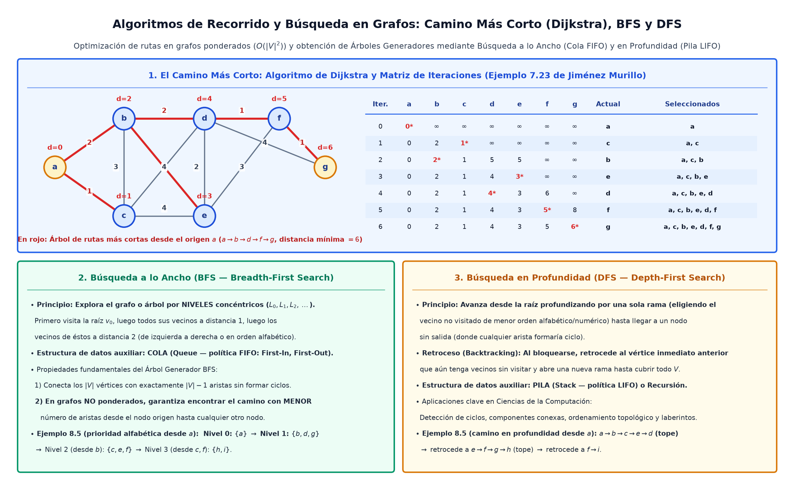

<!-- _class: portada -->
<!-- _paginate: false -->
<!-- _header: "" -->
<!-- _footer: "" -->

# 6.3 Algoritmos de recorrido y búsqueda

## Camino más corto (Dijkstra), búsqueda a lo ancho (BFS) y en profundidad (DFS)

- **Unidad 6:** Teoría de Grafos · **Asignatura:** Matemáticas Discretas (`LISSI0211`)
- **Objetivos:** hallar rutas mínimas en grafos ponderados mediante el algoritmo de Dijkstra; construir árboles generadores por niveles (BFS) y por ramas con retroceso (DFS); y comparar sus estructuras auxiliares y complejidades.

---

## Panorama de Recorrido y Búsqueda en Grafos

- Explorar todos los vértices de un grafo o encontrar rutas óptimas es un problema central en redes, inteligencia artificial y sistemas operativos:
  - **6.3.1 Camino más corto (Dijkstra):** halla trayectorias de costo o distancia mínima en grafos ponderados ($w(e) \ge 0$).
  - **6.3.2 A lo ancho (BFS):** recorre por niveles usando una **cola (`FIFO`)**.
  - **6.3.3 En profundidad (DFS):** avanza por ramas con retroceso (*backtracking*) usando una **pila (`LIFO`)**.

---

<!-- _class: figura -->

## Algoritmos de Recorrido y Búsqueda: Dijkstra, BFS y DFS

Ejemplo gráfico y matriz de iteraciones de Dijkstra, junto con las estrategias de BFS (cola FIFO) y DFS (pila LIFO).

---

## 6.3.1 El Camino Más Corto y Algoritmo de Dijkstra

- En un **grafo ponderado** $G = (V, L, w)$ con pesos no negativos $w(u, v) \ge 0$ (distancia, latencia, costo), se busca la trayectoria de menor suma total entre $v_0$ y $v_f$:
  $$d(v_0, v_f) = \min_{P \text{ de } v_0 \text{ a } v_f} \sum_{e \in P} w(e)$$
- **Edsger W. Dijkstra (1959):** algoritmo voraz (*greedy*) que calcula las distancias mínimas desde un origen hacia los demás nodos mediante una **tabla de iteraciones**.

---

## Procedimiento de Dijkstra: Inicialización y Relajación

1. **Inicialización:**
   - Conjunto de nodos definitivos: $S = \{\text{nodo inicial}\}$.
   - Asignar distancia $0$ al nodo inicial (primer `Actual`) e $\infty$ a los demás.
2. **Relajación de aristas (desde `Actual` $= u$):**
   - Para cada vecino $v \notin S$, calcular $d_{\text{tentativa}}(v) = d(u) + w(u, v)$.
   - Si $d_{\text{tentativa}}(v) < d(v)$, actualizar la celda escribiendo **$[d(u) + w(u, v)]_u$**; si no, conservar el valor anterior.

---

## Procedimiento de Dijkstra: Selección y Reconstrucción

3. **Selección del siguiente nodo `Actual`:**
   - Entre los nodos no pertenecientes a $S$, elegir el de **menor distancia acumulada** (en empate, criterio alfabético).
   - Se marca su distancia como fija ($*$), pasa a `Actual` y se añade a `Seleccionados` ($S$).
4. **Paro y reconstrucción:**
   - Termina cuando el destino entra en $S$ (o se visitan todos los nodos conexos).
   - La ruta óptima se recupera mediante rastreo inverso (*backtracking*) por los subíndices predecesores.

---

## 6.3.2 Búsqueda a lo Ancho (BFS)

- **En árboles:** explora **nivel por nivel** de izquierda a derecha (raíz nivel $0 \to$ nivel $1 \to$ nivel $2 \dots$).
- **En grafos (Árbol Generador BFS):**
  - Estructura auxiliar: **cola (`FIFO`)** y conjunto de visitados $V_T = \{r\}$.
  - Mientras $Q$ no esté vacía: desencolar $u$; para cada vecino $v \notin V_T$, marcarlo visitado, agregar $(u, v)$ a $L_T$ y encolar $v$.
- **Propiedad clave:** en grafos **no ponderados**, BFS garantiza el camino con el **menor número de aristas (saltos)** desde $r$.

---

## 6.3.3 Búsqueda en Profundidad (DFS)

- **En árboles:** desciende desde la raíz hacia el primer hijo no visitado hasta llegar a una hoja y retrocede (*backtracking*) al padre por ramas pendientes.
- **En grafos (Árbol Generador DFS):**
  - Estructura auxiliar: **pila (`LIFO`)** o recursión; inicia en $r$ con $V_T = \{r\}$.
  - Si el nodo activo $u$ tiene un vecino $v \notin V_T$, añade $(u, v)$ a $L_T$ y avanza a $v$.
  - Si $u$ no tiene vecinos sin visitar, retrocede hacia su padre en $T$ hasta cubrir todo $V$.

---

<!-- _class: compacta -->

## Comparación entre Dijkstra, BFS y DFS

| Característica | Algoritmo de Dijkstra | Búsqueda a lo Ancho (BFS) | Búsqueda en Profundidad (DFS) |
| :--- | :--- | :--- | :--- |
| **Tipo de grafo** | Ponderado ($w(e) \ge 0$) | No ponderado (o pesos iguales) | No ponderado / Estructural |
| **Estructura auxiliar** | Cola de prioridad / Tabla | Cola (**FIFO**) | Pila (**LIFO**) / Recursión |
| **Estrategia** | Voraz por menor distancia | Por niveles concéntricos | Por ramas con retroceso |
| **Complejidad** | $O(\|V\|^2)$ o $O((\|V\|+\|L\|)\log\|V\|)$ | $O(\|V\| + \|L\|)$ | $O(\|V\| + \|L\|)$ |
| **Aplicación típica** | Rutas GPS, protocolo OSPF | Menos saltos, redes P2P | Ciclos, laberintos, orden topológico |

---

<!-- _class: seccion -->
<!-- _header: "" -->
<!-- _footer: "" -->

## Ejemplos de Práctica

Ejecución paso a paso de Dijkstra, árboles generadores BFS/DFS y trazas con retroceso

---

## Ejemplo 1: Algoritmo de Dijkstra — Planteamiento (1/4)

**Problema:** En el grafo ponderado con $V = \{a, b, c, d, e, f, g, h\}$ y aristas:
- Desde $a$: $(a, b) = 3$, $(a, c) = 5$, $(a, d) = 2$
- Desde $b$: $(b, c) = 1$, $(b, e) = 4$, $(b, g) = 6$
- Desde $c$: $(c, d) = 4$, $(c, e) = 2$, $(c, f) = 1$
- Desde $d$: $(d, f) = 7$; $\qquad$ Desde $f$: $(f, h) = 5$
- Desde $e$: $(e, f) = 5$, $(e, g) = 2$, $(e, h) = 3$; $\qquad$ Desde $g$: $(g, h) = 1$

Halle el camino más corto y su distancia mínima de **$a$** a **$h$**.

---

<!-- _class: compacta -->

## Ejemplo 1: Dijkstra — Iteraciones 1 a 4 (2/4)

1. **Iteración 1 (`Actual` = $a$, $d = 0$):**
   - Vecinos de $a$: $b = 3_a$, $\;c = 5_a$, $\;d = 2_a$ (resto en $\infty$).
   - Mínimo no seleccionado: **$2_a^*$ ($d$)** $\implies S = \{a, d\}$.
2. **Iteración 2 (`Actual` = $d$, $d = 2$):**
   - $c: \min(5, 2 + 4) = 5_a$; $\quad f = 2 + 7 = 9_d$.
   - Mínimo no seleccionado: **$3_a^*$ ($b$)** $\implies S = \{a, d, b\}$.
3. **Iteración 3 (`Actual` = $b$, $d = 3$):**
   - $c: \min(5, 3 + 1) = \mathbf{4_b}$; $\quad e = 3 + 4 = \mathbf{7_b}$; $\quad g = 3 + 6 = \mathbf{9_b}$.
   - Mínimo no seleccionado: **$4_b^*$ ($c$)** $\implies S = \{a, d, b, c\}$.
4. **Iteración 4 (`Actual` = $c$, $d = 4$):**
   - $e: \min(7, 4 + 2) = \mathbf{6_c}$; $\quad f: \min(9, 4 + 1) = \mathbf{5_c}$.
   - Mínimo no seleccionado: **$5_c^*$ ($f$)** $\implies S = \{a, d, b, c, f\}$.

---

## Ejemplo 1: Dijkstra — Iteraciones 5 a 7 (3/4)

5. **Iteración 5 (`Actual` = $f$, $d = 5$):**
   - $e: \min(6, 5 + 5) = 6_c$ (se conserva); $\quad h = 5 + 5 = \mathbf{10_f}$.
   - Mínimo no seleccionado: **$6_c^*$ ($e$)** $\implies S = \{a, d, b, c, f, e\}$.
6. **Iteración 6 (`Actual` = $e$, $d = 6$):**
   - $g: \min(9, 6 + 2) = \mathbf{8_e}$; $\quad h: \min(10, 6 + 3) = \mathbf{9_e}$.
   - Mínimo no seleccionado: **$8_e^*$ ($g$)** $\implies S = \{a, d, b, c, f, e, g\}$.
7. **Iteración 7 (`Actual` = $g$, $d = 8$):**
   - $h: 8 + 1 = 9_g$ (empata con $9_e$). Se fija **$9_{e,g}^*$** en **$h$** y el algoritmo termina.

---

<!-- _class: tabla-ancha -->

## Ejemplo 1: Tabla Resumen y Rutas Óptimas (4/4)

| Iteración | Actual | Seleccionados | $a$ | $b$ | $c$ | $d$ | $e$ | $f$ | $g$ | $h$ |
| :---: | :---: | :--- | :---: | :---: | :---: | :---: | :---: | :---: | :---: | :---: |
| **1** | $a$ | $\{a\}$ | $0^*$ | $3_a$ | $5_a$ | **$2_a^*$** | $\infty$ | $\infty$ | $\infty$ | $\infty$ |
| **2** | $d$ | $\{a, d\}$ | $0^*$ | **$3_a^*$** | $5_a$ | $2_a^*$ | $\infty$ | $9_d$ | $\infty$ | $\infty$ |
| **3** | $b$ | $\{a, d, b\}$ | $0^*$ | $3_a^*$ | **$4_b^*$** | $2_a^*$ | $7_b$ | $9_d$ | $9_b$ | $\infty$ |
| **4** | $c$ | $\{a, d, b, c\}$ | $0^*$ | $3_a^*$ | $4_b^*$ | $2_a^*$ | $6_c$ | **$5_c^*$** | $9_b$ | $\infty$ |
| **5** | $f$ | $\{a, d, b, c, f\}$ | $0^*$ | $3_a^*$ | $4_b^*$ | $2_a^*$ | **$6_c^*$** | $5_c^*$ | $9_b$ | $10_f$ |
| **6** | $e$ | $\{a, d, b, c, f, e\}$ | $0^*$ | $3_a^*$ | $4_b^*$ | $2_a^*$ | $6_c^*$ | $5_c^*$ | **$8_e^*$** | $9_e$ |
| **7** | $g$ | $\{a, d, b, c, f, e, g, h\}$ | $0^*$ | $3_a^*$ | $4_b^*$ | $2_a^*$ | $6_c^*$ | $5_c^*$ | $8_e^*$ | **$9_{e,g}^*$** |

- **Ruta 1 (vía $e$):** $a \to b \to c \to e \to h$ ($3 + 1 + 2 + 3 = \mathbf{9}$).
- **Ruta 2 (vía $g$):** $a \to b \to c \to e \to g \to h$ ($3 + 1 + 2 + 2 + 1 = \mathbf{9}$).

---

## Ejemplo 2: Árboles Generadores BFS y DFS — Problema (1/3)

**Problema:** Dado $V = \{a, b, c, d, e, f, g, h\}$ con listas de adyacencia ordenadas alfabéticamente:
- $\text{Adj}(a) = \{b, d\}$, $\quad \text{Adj}(b) = \{a, c, d, e\}$, $\quad \text{Adj}(c) = \{b, e, f\}$, $\quad \text{Adj}(d) = \{a, b, e, g\}$
- $\text{Adj}(e) = \{b, c, d, f, g, h\}$, $\quad \text{Adj}(f) = \{c, e, h\}$, $\quad \text{Adj}(g) = \{d, e, h\}$, $\quad \text{Adj}(h) = \{e, f, g\}$

Tomando al nodo **$e$** como raíz y respetando el orden alfabético:
1. Construya el **árbol generador BFS** (orden de visita y aristas).
2. Construya el **árbol generador DFS** (traza y aristas).

---

## Ejemplo 2: Búsqueda a lo Ancho (BFS) desde $e$ (2/3)

- **Inicio:** raíz $e$ (Nivel $0$), $V_T = \{e\}$, Cola $Q = [e]$.
- **Desencolar $e$:** sus vecinos $\{b, c, d, f, g, h\}$ pasan al Nivel $1$ como hijos de $e$.
  - Aristas: $(e, b), (e, c), (e, d), (e, f), (e, g), (e, h)$; $\;Q = [b, c, d, f, g, h]$.
- **Desencolar $b$:** de sus vecinos $\{a, c, d, e\}$, sólo **$a$** no está visitado $\to$ Nivel $2$, arista $(b, a)$.
- Ya están los $8$ vértices en $V_T$: el algoritmo termina.
- **Orden de visita BFS:** $e, b, c, d, f, g, h, a$.
- **Aristas ($|L_T| = 7$):** $L_{\text{BFS}} = \{(e, b), (e, c), (e, d), (e, f), (e, g), (e, h), (b, a)\}$.

---

## Ejemplo 2: Búsqueda en Profundidad (DFS) desde $e$ (3/3)

- **Paso 1:** inicia en $e \to$ menor vecino **$b$** $(e, b)$.
- **Paso 2:** desde $b \to$ menor no visitado **$a$** $(b, a)$.
- **Paso 3:** desde $a \to$ único no visitado **$d$** $(a, d)$.
- **Paso 4:** desde $d$ ($\{a,b,e,g\}$) $\to$ no visitado **$g$** $(d, g)$.
- **Paso 5:** desde $g \to$ no visitado **$h$** $(g, h)$.
- **Paso 6–7:** desde $h \to$ **$f$** $(h, f)$, y desde $f \to$ **$c$** $(f, c)$.
- **Orden DFS:** $e \to b \to a \to d \to g \to h \to f \to c$ (camino hamiltoniano).
- **Aristas ($|L_T| = 7$):** $L_{\text{DFS}} = \{(e, b), (b, a), (a, d), (d, g), (g, h), (h, f), (f, c)\}$.

---

## Ejemplo 3: BFS y DFS con Retroceso — Planteamiento y BFS (1/2)

**Problema:** Grafo conexo con $V = \{1, 2, 3, 4, 5, 6, 7\}$ y aristas $(1,2),(1,3),(2,4),(2,5),(3,6),(4,7),(5,7),(6,7)$. Iniciar en **$1$** eligiendo el vecino de menor número.

**1. Traza BFS (evolución de la cola):**
- Inicio: visitar **$1$**. $Q = [1]$.
- Extraer $1 \to$ encolar $2, 3$ ($Q = [2, 3]$); aristas $(1,2), (1,3)$.
- Extraer $2 \to$ encolar $4, 5$ ($Q = [3, 4, 5]$); aristas $(2,4), (2,5)$.
- Extraer $3 \to$ encolar $6$ ($Q = [4, 5, 6]$); arista $(3,6)$.
- Extraer $4 \to$ encolar $7$ ($Q = [5, 6, 7]$); arista $(4,7)$. Extraer $5, 6, 7$.
- **Secuencia BFS:** **$1, 2, 3, 4, 5, 6, 7$**.

---

## Ejemplo 3: Traza DFS con Retroceso (*Backtracking*) (2/2)

**2. Traza de Búsqueda en Profundidad (DFS):**
- **Avance inicial:**
  $$1 \to 2 \text{ }(1,2) \to 4 \text{ }(2,4) \to 7 \text{ }(4,7) \to 5 \text{ }(7,5)$$
- **Retroceso (*backtrack*):** en **$5$**, sus vecinos $\{2, 7\}$ ya están visitados $\implies$ retrocede de **$5$** a **$7$**.
- **Rama restante:** desde **$7$**, su único vecino no visitado es **$6$** $(7, 6) \to$ desde **$6$** avanza a **$3$** $(6, 3)$.
- Todos los $7$ vértices han sido visitados.
- **Secuencia DFS:** **$1, 2, 4, 7, 5, 6, 3$**.

---

<!-- _class: seccion -->
<!-- _header: "" -->
<!-- _footer: "" -->

## Ejercicios de Tarea

Práctica con algoritmo de Dijkstra, recorridos BFS/DFS y comparación de criterios

---

## Ejercicio 1: Algoritmo de Dijkstra en una Red de Routers

Una red tiene $6$ routers $V = \{A, B, C, D, E, F\}$ con enlaces bidireccionales y retardos (en ms):
$$(A, B)=4,\; (A, C)=2,\; (B, C)=1,\; (B, D)=5,\; (C, D)=8,\; (C, E)=10,\; (D, E)=2,\; (D, F)=6,\; (E, F)=3$$

1. Construya la tabla completa de iteraciones del **Algoritmo de Dijkstra** desde el router origen **$A$** hasta el destino **$F$**.
2. Indique la ruta óptima de menor latencia entre $A$ y $F$ y su tiempo total en milisegundos.
3. Determine la ruta más corta y la latencia mínima desde $A$ hasta cada uno de los demás routers ($B, C, D, E$).

---

## Ejercicio 2: Árboles Generadores BFS y DFS

Sea el grafo conexo con $V = \{a, b, c, d, e, f, g, h, i\}$ y aristas:
$$(a, b), (a, c), (a, d), (b, c), (b, e), (c, e), (c, f), (d, f), (d, g), (e, h), (f, g), (f, h), (f, i), (g, i), (h, i)$$

Tomando el vértice **$a$** como raíz y desempatando siempre en **orden alfabético**:
1. Ejecute **BFS**, indique el orden de visita de los $9$ vértices, el nivel de cada uno y las $8$ aristas de $T_{\text{BFS}}$.
2. Ejecute **DFS**, indique el orden de visita de los $9$ vértices, las $8$ aristas de $T_{\text{DFS}}$ y en qué nodos ocurrió retroceso (*backtracking*).

---

## Ejercicio 3: Menos Aristas (BFS) vs. Menor Peso (Dijkstra)

En el grafo ponderado con $V = \{S, A, B, C, D, T\}$ y aristas no dirigidas:
$$(S, A) = 10,\; (A, T) = 10,\; (S, B) = 2,\; (B, C) = 2,\; (C, D) = 2,\; (D, T) = 3,\; (A, C) = 1$$

1. Si se ignora el peso y se ejecuta **BFS** de $S$ a $T$, ¿cuál es el camino encontrado, cuántas aristas tiene y cuál es su costo real?
2. Si se ejecuta **Dijkstra** de $S$ a $T$, ¿cuál es el camino más corto en peso, cuántas aristas tiene y cuál es su costo total?
3. Explique por qué los protocolos modernos (OSPF) usan Dijkstra en lugar de conteo de saltos (RIP).
