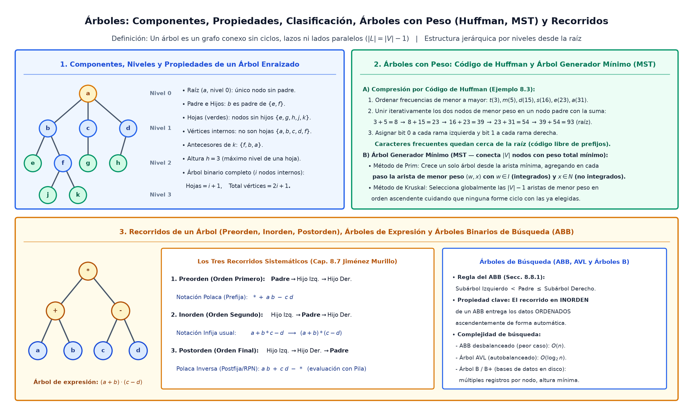

<!-- _class: portada -->
<!-- _paginate: false -->
<!-- _header: "" -->
<!-- _footer: "" -->

# 6.4 Árboles

## Componentes, propiedades, clasificación, árboles con peso y recorridos

- **Unidad 6:** Teoría de Grafos · **Asignatura:** Matemáticas Discretas (`LISSI0211`)
- **Objetivos:** identificar los componentes y propiedades de los árboles y bosques; clasificar árboles por grado y altura; construir códigos de Huffman y árboles generadores mínimos (Prim/Kruskal); y aplicar recorridos Preorden, Inorden y Postorden junto con ABB.

---

## Definición e Importancia en Computación

- Un **árbol** es un grafo simple, **conexo** y **acíclico** (sin ciclos ni lazos).
- Es la estructura de datos no lineal más importante en informática:
  - Jerarquías de **sistemas de archivos** y el **DOM** en páginas web.
  - **Árboles de sintaxis abstracta** en compiladores.
  - Compresión óptima (**Código de Huffman**) e índices logarítmicos en bases de datos (**ABB, AVL y Árboles B**).

---

<!-- _class: figura -->

## Árboles: Componentes, Huffman, MST y Recorridos

Anatomía de un árbol enraizado, compresión de Huffman, árboles generadores mínimos y recorridos de expresión.

---

## 6.4.1 Componentes de un Árbol con Raíz (1/2)

Un **árbol con raíz** distingue un vértice superior llamado **raíz**, estableciendo una jerarquía de parentesco:

1. **Raíz (*Root*):** único nodo sin padre (grado de entrada $0$), ubicado en el **nivel $0$**.
2. **Padre (*Parent*):** si hay rama dirigida $u \to v$ alejándose de la raíz, $u$ es padre de $v$ *(todo nodo salvo la raíz tiene un único padre)*.
3. **Hijo (*Child*):** $v$ es hijo de $u$; un nodo puede tener $0, 1, 2$ o más hijos.
4. **Hermanos (*Siblings*):** nodos que comparten el **mismo padre** (en el mismo nivel).
5. **Hoja (*Leaf*) vs. Vértice interno:** la **hoja** no tiene hijos; el **vértice interno** tiene al menos un hijo.

---

## 6.4.1 Componentes de un Árbol con Raíz (2/2)

6. **Ancestros (antecesores) de $v$:** todos los vértices situados en el único camino simple desde la raíz hasta el padre de $v$.
7. **Descendientes de $u$:** todos los vértices para los cuales $u$ es un ancestro (hijos, nietos, etc.).
8. **Subárbol (*Subtree*) con raíz en $u$:** el nodo $u$ junto con todos sus descendientes y sus ramas.
9. **Nivel de un nodo:** longitud (número de aristas) del único camino desde la raíz hasta el nodo (raíz $= 0$, hijos $= 1$, nietos $= 2 \dots$).

---

## 6.4.2 Propiedades Fundamentales de Todo Árbol

Sea $T = (V, L)$ un grafo simple. Las siguientes $5$ proposiciones son **equivalentes**:

1. **Conexidad y aciclicidad:** $T$ es conexo y no contiene ciclos.
2. **Relación exacta vértices–aristas:** $|L| = |V| - 1$.
3. **Unicidad del camino:** entre cualquier par de vértices distintos $u, v \in V$ existe **uno y sólo un camino simple**.
4. **Conexidad mínima (puentes):** toda arista es un *puente* (suprimir cualquiera divide a $T$ en $2$ componentes).
5. **Aciclicidad máxima:** agregar cualquier arista nueva entre vértices no adyacentes crea **exactamente un ciclo**.

---

## Bosques y Árboles Binarios Completos

- **Bosque (*Forest*):** grafo acíclico cuyas $k$ componentes conexas son **árboles disjuntos**. Cumple la relación generalizada:
  $$|L| = |V| - k$$
- **Árbol binario completo** (cada nodo interno tiene exactamente $2$ hijos), con $i$ **vértices internos**:
  - **Número de hojas:** $\quad \text{Hojas} = i + 1$
  - **Total de vértices:** $\quad |V| = 2i + 1$
  - **Total de aristas:** $\quad |L| = 2i$

---

## 6.4.3 Clasificación: Grado ($m$-ario), Altura y Balanceo

- **Árbol $m$-ario:** cada nodo interno tiene como máximo $m$ hijos ($m=2$ **binario**, $m=3$ **trinario**, $m=4$ **cuaternario**). Es **completo** si cada interno tiene exactamente $m$ hijos.
- **Altura ($h$):** nivel máximo que alcanzan sus hojas ($h + 1$ niveles, de $0$ a $h$).
- **Cota máxima de nodos:** en el nivel $k$ hay a lo sumo $m^k$ nodos; en un árbol binario de altura $h$:
  $$|V|_{\max} = 2^0 + 2^1 + \dots + 2^h = 2^{h+1} - 1$$
- **Balanceado vs. Desbalanceado:** está **balanceado** si todas sus hojas se hallan en el nivel $h$ o $h - 1$ ($|h_{\text{izq}} - h_{\text{der}}| \le 1$); de lo contrario, está **desbalanceado** (o degenerado).

---

## 6.4.4 Árboles con Peso: Código de Huffman (1952)

Construye un árbol binario óptimo a partir de frecuencias para asignar códigos cortos a símbolos frecuentes:

1. Ordenar los símbolos como hojas de **menor a mayor frecuencia**.
2. Tomar los **dos nodos de menor peso** y unirlos bajo un padre de peso $w_{\text{padre}} = w_1 + w_2$ (menor a la izquierda).
3. Reinsertar el nuevo nodo suma manteniendo el orden ascendente y repetir hasta obtener una única **raíz**.
4. Asignar bit **$0$** a cada rama izquierda y **$1$** a cada rama derecha.

> **Propiedad libre de prefijos:** al quedar todos los caracteres en las **hojas**, ningún código es prefijo de otro (decodificación sin ambigüedad).

---

## Árbol Generador Mínimo (MST): Métodos de Prim y Kruskal

Un **MST** conecta todos los $|V|$ vértices sin ciclos ($|L_T| = |V| - 1$) minimizando $W(T) = \sum_{e \in L_T} w(e)$:

- **A) Método de Prim (crecimiento desde un nodo):**
  1. Inicia con $I = \{v_0\}$ (incluidos) y $N = V \setminus \{v_0\}$.
  2. Elige la arista de **menor peso** $(u, v)$ con $u \in I$ y $v \in N$; mueve $v$ a $I$ hasta completar $|V| - 1$ aristas ($N = \emptyset$).
- **B) Método de Kruskal (selección global por peso):**
  1. Ordena todas las aristas de **menor a mayor peso**.
  2. Acepta cada arista más ligera si y sólo si **no forma un ciclo** con las elegidas, hasta juntar $|V| - 1$ aristas.

---

<!-- _class: compacta -->

## 6.4.5 Recorridos de un Árbol Binario y Expresiones

Visitar cada nodo sistemáticamente combinando **Raíz ($R$)**, **Subárbol Izquierdo ($I$)** y **Derecho ($D$)**:

| Recorrido | Nombre alternativo | Regla recursiva | Notación asociada |
| :--- | :--- | :---: | :--- |
| **Preorden** | Orden primero | $R \to I \to D$ | **Prefija** (Polaca: `+ a b`) |
| **Inorden** | Orden segundo (simétrico) | $I \to R \to D$ | **Infija** (`a + b`) |
| **Postorden** | Orden final | $I \to D \to R$ | **Postfija** (RPN: `a b +`) |

- **Árbol de expresión:** las **hojas** guardan **operandos** y los **nodos internos** guardan **operadores** (menor precedencia en la raíz).
- **Evaluación con pila (*Stack*):** en **Postorden** (izq. a der.), se apilan operandos y al leer $\circ$ se extraen $B$ (tope) y $A$ para apilar $A \circ B$; en **Preorden** se reduce de derecha a izquierda.

---

## Árboles Binarios de Búsqueda (ABB)

- **Propiedad de orden:** todo nodo del subárbol izquierdo de $u$ tiene clave $< \text{clave}(u)$, y del subárbol derecho $> \text{clave}(u)$.
- **Propiedad clave:** el recorrido en **Inorden ($I \to R \to D$)** entrega todos los elementos en **orden ascendente**.
- **Operaciones:**
  - *Búsqueda / Inserción:* compara con la raíz y desciende a izquierda ($<$) o derecha ($>$).
  - *Eliminación:* (1) Hoja $\to$ suprimir; (2) Un hijo $\to$ sube el hijo; (3) Dos hijos $\to$ prioridad al hijo izquierdo (sube el izquierdo y el derecho se cuelga del mayor nodo del subárbol izquierdo, o se usa predecesor/sucesor inorden).

---

<!-- _class: seccion -->
<!-- _header: "" -->
<!-- _footer: "" -->

## Ejemplos de Práctica

Propiedades binarias, Código de Huffman, Prim/Kruskal y árboles de expresión

---

## Ejemplo 1: Árbol Binario Completo ($i = 9$ internos)

**Problema:** Un árbol binario completo $T$ posee $i = 9$ vértices internos. Determine: (1) hojas, $|V|$ y $|L|$; (2) alturas mínima $h_{\min}$ y máxima $h_{\max}$.

**Solución:**
1. **Cálculo de hojas, vértices totales y aristas:**
   - $\text{Hojas} = i + 1 = 9 + 1 = \mathbf{10\text{ hojas}}$
   - $|V| = 2i + 1 = 2(9) + 1 = \mathbf{19\text{ vértices}}$; $\quad |L| = |V| - 1 = \mathbf{18\text{ aristas}}$.
2. **Alturas extremas:**
   - **$h_{\min}$:** $2^{h+1} - 1 \ge 19 \implies 2^{h+1} \ge 20 \implies h_{\min} = \mathbf{4}$ *(con $h=3$ caben máx. $15$ nodos)*.
   - **$h_{\max}$:** cadena sesgada con $1$ interno y $1$ hoja por nivel $\implies h_{\max} = i = \mathbf{9}$.

---

<!-- _class: compacta -->

## Ejemplo 2: Código de Huffman — Fusiones Paso a Paso (1/2)

**Problema:** Frecuencias: $\text{E}: 5,\; \text{I}: 15,\; \text{N}: 6,\; \text{R}: 9,\; \text{S}: 9,\; \text{T}: 18$. Construya el árbol, obtenga los códigos ($0$ izq., $1$ der.), codifique **`TRES`** y calcule el ahorro frente a ASCII ($8$ bits).

**1. Ordenamiento inicial y fusiones sucesivas:**
- **Lista inicial:** $\text{E}(5), \text{N}(6), \text{R}(9), \text{S}(9), \text{I}(15), \text{T}(18)$.
- **Fusión 1:** $\text{E}(5) + \text{N}(6) = N_1(11) \implies [\text{R}(9), \text{S}(9), N_1(11), \text{I}(15), \text{T}(18)]$.
- **Fusión 2:** $\text{R}(9) + \text{S}(9) = N_2(18) \implies [N_1(11), \text{I}(15), \text{T}(18), N_2(18)]$.
- **Fusión 3:** $N_1(11) + \text{I}(15) = N_3(26) \implies [\text{T}(18), N_2(18), N_3(26)]$.
- **Fusión 4:** $\text{T}(18) + N_2(18) = N_4(36) \implies [N_3(26), N_4(36)]$.
- **Fusión 5 (Raíz):** $N_3(26) + N_4(36) = \mathbf{R(62)}$.

---

<!-- _class: compacta -->

## Ejemplo 2: Tabla de Códigos Huffman y Ahorro (2/2)

| Carácter | Frec. ($f_i$) | Ruta desde $R(62)$ | Código | Long. ($l_i$) | Bits ($f_i \cdot l_i$) |
| :---: | :---: | :--- | :---: | :---: | :---: |
| **E** | $5$ | $R \xrightarrow{0} N_3 \xrightarrow{0} N_1 \xrightarrow{0} \text{E}$ | **`000`** | $3$ | $15$ |
| **N** | $6$ | $R \xrightarrow{0} N_3 \xrightarrow{0} N_1 \xrightarrow{1} \text{N}$ | **`001`** | $3$ | $18$ |
| **I** | $15$ | $R \xrightarrow{0} N_3 \xrightarrow{1} \text{I}$ | **`01`** | $2$ | $30$ |
| **T** | $18$ | $R \xrightarrow{1} N_4 \xrightarrow{0} \text{T}$ | **`10`** | $2$ | $36$ |
| **R** | $9$ | $R \xrightarrow{1} N_4 \xrightarrow{1} N_2 \xrightarrow{0} \text{R}$ | **`110`** | $3$ | $27$ |
| **S** | $9$ | $R \xrightarrow{1} N_4 \xrightarrow{1} N_2 \xrightarrow{1} \text{S}$ | **`111`** | $3$ | $27$ |
| **Total** | **$62$** | — | — | $\bar{L}=2.47$ | **$153$ bits** |

- **`TRES`:** $\text{T}(\mathtt{10})\text{R}(\mathtt{110})\text{E}(\mathtt{000})\text{S}(\mathtt{111}) = \mathbf{\mathtt{10110000111}}$ ($11$ bits vs. $32$ bits ASCII).
- **Ahorro global:** $153$ bits vs. $62 \times 8 = 496$ bits ASCII $\implies$ **$69.15\%$ de ahorro**.

---

## Ejemplo 3: MST — Problema y Método de Prim (1/2)

**Problema:** Grafo ponderado con $V = \{a, b, c, d, e, f\}$ y $10$ aristas:
$$(a,b)=6,\; (a,c)=1,\; (a,d)=5,\; (b,c)=5,\; (b,e)=3,\; (c,d)=5,\; (c,e)=6,\; (c,f)=4,\; (d,f)=2,\; (e,f)=6$$

**1. Método de Prim (iniciando en $I = \{a\}$, $N = \{b, c, d, e, f\}$):**
1. Desde $\{a\}$: menor es **$(a, c) = 1$** $\implies I = \{a, c\}$.
2. Desde $\{a, c\}$: menor es **$(c, f) = 4$** $\implies I = \{a, c, f\}$.
3. Desde $\{a, c, f\}$: menor es **$(f, d) = 2$** $\implies I = \{a, c, f, d\}$.
4. Desde $\{a, c, f, d\}$: menor es **$(c, b) = 5$** $\implies I = \{a, c, f, d, b\}$.
5. Desde $\{a, c, f, d, b\}$: menor es **$(b, e) = 3$** $\implies I = V$, $N = \emptyset$.

---

## Ejemplo 3: Método de Kruskal y Peso Total (2/2)

**2. Método de Kruskal (ordenando aristas de menor a mayor peso):**
- $(a, c) = 1 \to$ **Acepta** (1.ª arista).
- $(d, f) = 2 \to$ **Acepta** (2.ª arista).
- $(b, e) = 3 \to$ **Acepta** (3.ª arista).
- $(c, f) = 4 \to$ **Acepta** (4.ª arista; une $\{a, c\}$ con $\{d, f\}$).
- $(a, d) = 5$ y $(c, d) = 5 \to$ **Rechazan** (formarían ciclos $a-c-f-d-a$ y $c-f-d-c$).
- $(b, c) = 5 \to$ **Acepta** (5.ª arista; completa $|V|-1 = 5$ aristas).

**3. Peso total del Árbol Generador Mínimo (idéntico en ambos métodos):**
$$W(\text{MST}) = 1 + 4 + 2 + 5 + 3 = \mathbf{15}$$

---

## Ejemplo 4: Árbol de Expresión y Recorridos (1/2)

**Problema:** Dada la expresión infija: $((7 - 3) * (2 + 4)) / (5 + 1)$

1. **Estructura del árbol binario de expresión:**
   - **Raíz (nivel $0$):** operador principal **`/`**.
   - **Hijo izquierdo de `/`:** operador **`*`** con subárbol izq. **`-`** (hojas $7, 3$) y der. **`+`** (hojas $2, 4$).
   - **Hijo derecho de `/`:** operador **`+`** con hojas $5$ y $1$.
2. **Recorridos sistemáticos:**
   - **Preorden ($R \to I \to D$):** `/ * - 7 3 + 2 4 + 5 1`
   - **Inorden ($I \to R \to D$):** `7 - 3 * 2 + 4 / 5 + 1`
   - **Postorden ($I \to D \to R$):** `7 3 - 2 4 + * 5 1 + /`

---

<!-- _class: compacta -->

## Ejemplo 4: Evaluación en Postorden con Pila (2/2)

**3. Evaluación paso a paso de `7 3 - 2 4 + * 5 1 + /`:**

- Leer `7, 3` (operandos) $\to$ Pila: `[7, 3]`
- Leer `-` $\to$ extrae $3, 7$, calcula $7 - 3 = 4 \to$ Pila: `[4]`
- Leer `2, 4` (operandos) $\to$ Pila: `[4, 2, 4]`
- Leer `+` $\to$ extrae $4, 2$, calcula $2 + 4 = 6 \to$ Pila: `[4, 6]`
- Leer `*` $\to$ extrae $6, 4$, calcula $4 * 6 = 24 \to$ Pila: `[24]`
- Leer `5, 1` (operandos) $\to$ Pila: `[24, 5, 1]`
- Leer `+` $\to$ extrae $1, 5$, calcula $5 + 1 = 6 \to$ Pila: `[24, 6]`
- Leer `/` $\to$ extrae $6, 24$, calcula $24 / 6 = \mathbf{4} \to$ Pila final: **`[4]`**

---

<!-- _class: seccion -->
<!-- _header: "" -->
<!-- _footer: "" -->

## Ejercicios de Tarea

Práctica con propiedades de árboles y bosques, Código de Huffman y ABB

---

## Ejercicio 1: Propiedades de Árboles y Bosques

1. Un bosque $B$ está compuesto por $k = 4$ árboles disjuntos y cuenta en total con $|V| = 27$ vértices. ¿Cuántas aristas $|L|$ tiene el bosque $B$?
2. Un árbol cuaternario completo ($m = 4$, cada nodo interno tiene $4$ hijos) posee $i = 8$ nodos internos. Calcule el número total de vértices $|V|$, aristas $|L|$ y hojas $h_0$.
3. Demuestre o verifique si puede existir un árbol con $12$ vértices cuya secuencia de grados sea $(4, 3, 3, 2, 2, 1, 1, 1, 1, 1, 1, 1)$.

---

## Ejercicio 2: Compresión mediante Código de Huffman

Considere la palabra **`MATEMATICAS_DISCRETAS`** (o un archivo cuyos símbolos tienen la distribución de frecuencias):
$$\text{A}: 12,\quad \text{B}: 4,\quad \text{C}: 7,\quad \text{D}: 3,\quad \text{E}: 10,\quad \text{F}: 14$$

1. Construya el árbol binario de Huffman ordenando de menor a mayor frecuencia.
2. Obtenga el código binario de cada símbolo ($0$ a la izquierda, $1$ a la derecha).
3. Decodifique la trama binaria recibida **`100001100111`** e indique qué palabra representa.

---

## Ejercicio 3: Árboles Binarios de Búsqueda (ABB)

Se desea almacenar la siguiente secuencia en un **Árbol Binario de Búsqueda (ABB)** insertando las claves exactamente en el orden dado:
$$50, \; 30, \; 70, \; 20, \; 40, \; 60, \; 80, \; 35, \; 45$$

1. Construya el ABB e indique su altura $h$ y si se encuentra balanceado.
2. Escriba los recorridos en **Preorden**, **Inorden** y **Postorden** del árbol construido.
3. Si se elimina el nodo **`30`** dando prioridad al hijo izquierdo, indique qué nodo ocupa su lugar y cómo quedan conectados los hijos de la rama izquierda de $50$.
