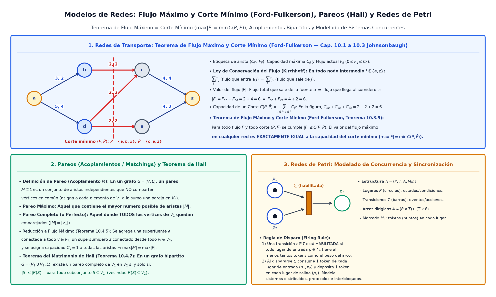

<!-- _class: portada -->
<!-- _paginate: false -->
<!-- _header: "" -->
<!-- _footer: "" -->

# 6.5 Redes

## Flujo máximo, corte mínimo, flujo mínimo, pareos y redes de Petri

- **Unidad 6:** Teoría de Grafos · **Asignatura:** Matemáticas Discretas (`LISSI0211`)
- **Objetivos:** modelar redes de transporte con capacidades y cotas inferiores; aplicar el algoritmo de Ford-Fulkerson y los teoremas de flujo máximo/corte mínimo y flujo mínimo; resolver pareos bipartitos (Teorema de Hall); y simular Redes de Petri.

---

## 1. Redes de Transporte: Definición

Una **red de transporte** es una gráfica dirigida, simple y ponderada $G = (V, L, C)$ con tres propiedades:

1. **Fuente (*Source*, $a$):** único vértice sin aristas entrantes ($\text{grado}_{\text{entrada}}(a) = 0$).
2. **Sumidero (*Sink*, $z$):** único vértice sin aristas salientes ($\text{grado}_{\text{salida}}(z) = 0$).
3. **Capacidad ($C_{ij}$):** cada arista $(i, j) \in L$ tiene $C_{ij} \ge 0$, flujo máximo admisible de $i$ a $j$ por unidad de tiempo.

- *Nota:* múltiples fuentes o sumideros se reducen añadiendo una **superfuente** $a$ y un **supersumidero** $z$ con aristas de capacidad $\infty$.

---

<!-- _class: figura -->

## Modelos de Redes: Flujo Máximo, Corte Mínimo, Pareos y Redes de Petri

Diagrama de red de transporte con corte mínimo, acoplamiento bipartito y regla de disparo en una Red de Petri.

---

## Flujo Válido, Conservación y Valor del Flujo ($|F|$)

Un **flujo** $F$ asigna a cada arista $(i, j) \in L$ un valor $F_{ij}$ sujeto a dos restricciones:

1. **Restricción de capacidad:** $\quad 0 \le F_{ij} \le C_{ij} \quad \forall (i, j) \in L$.
2. **Conservación del flujo (Ley de Kirchhoff):** para todo vértice intermedio $j \in V \setminus \{a, z\}$:
   $$\sum_{i} F_{ij} = \sum_{k} F_{jk}$$
- **Valor del flujo ($|F|$):** $\; |F| = \sum_{j} F_{aj} = \sum_{i} F_{iz}$ *(en los diagramas cada arista se etiqueta con `Capacidad, Flujo`: $C_{ij}, F_{ij}$)*.

---

## 2. Algoritmo de Flujo Máximo (Ford-Fulkerson, 1956)

Partiendo de flujo nulo ($F_{ij} = 0$), busca iterativamente **trayectorias de aumento** $P$ de $a$ a $z$:

- **Orientación apropiada ($i \to j$):** capacidad disponible $\Delta_{ij}^+ = C_{ij} - F_{ij} > 0$.
- **Orientación inapropiada ($i \leftarrow j$):** permite cancelar o redirigir flujo si $\Delta_{ij}^- = F_{ji} > 0$.
- **Cuello de botella:** $\Delta(P) = \min_{e \in P} \Delta_e > 0$; actualiza:
  - $F_{ij} \leftarrow F_{ij} + \Delta(P)$ *(en aristas hacia adelante)*
  - $F_{ji} \leftarrow F_{ji} - \Delta(P)$ *(en aristas en sentido opuesto)*
- Cuando no existe trayectoria de aumento de $a$ a $z$, el flujo alcanzado es **máximo**.

---

<!-- _class: compacta -->

## Cortes y Teorema de Flujo Máximo / Corte Mínimo

- **Corte $(P, \bar{P})$:** partición de $V$ en conjuntos disjuntos con $a \in P$ y $z \in \bar{P} = V \setminus P$.
- **Capacidad del corte:** suma de capacidades de las aristas que salen de $P$ hacia $\bar{P}$:
  $$C(P, \bar{P}) = \sum_{i \in P,\, j \in \bar{P}} C_{ij}$$
- **Lema de dualidad débil:** para todo flujo $F$ y todo corte $(P, \bar{P})$, $\;|F| \le C(P, \bar{P})$.
- **Teorema de Flujo Máximo y Corte Mínimo:**
  $$\max_{F} |F| = \min_{(P, \bar{P})} C(P, \bar{P})$$
  *(Al finalizar Ford-Fulkerson, $P$ es el conjunto alcanzable desde $a$ con $\Delta > 0$).*

---

## 3. Teorema de Flujo Mínimo (Cotas Inferiores y Superiores)

- Cada arista $(i, j)$ posee una **cota mínima** $m_{ij} \ge 0$ y una **capacidad máxima** $C_{ij}$:
  $$0 \le m_{ij} \le F_{ij} \le C_{ij} \quad \forall (i, j) \in L$$
- Todo flujo factible satisface $|F| \ge m(P, \bar{P}) - C(\bar{P}, P)$.
- **Teorema de Flujo Mínimo:** si existe un flujo factible,
  $$\min_{F} |F| = \max_{(P, \bar{P})} \left( \sum_{i \in P,\, j \in \bar{P}} m_{ij} - \sum_{i \in \bar{P},\, j \in P} C_{ij} \right)$$
- Para reducir $|F|$ iterativamente se buscan trayectorias de $a$ a $z$ con $F_{ij} > m_{ij}$ (adelante) y $F_{ji} < C_{ji}$ (atrás).

---

## 4. Pareos (Acoplamientos) y Reducción a Flujo Máximo

En un grafo bipartito $G = (V_1, V_2, L)$:

- **Pareo ($M \subseteq L$):** conjunto de aristas que **no comparten vértices** entre sí.
- **Pareo máximo:** mayor cardinalidad $|M|$ posible; **pareo completo:** $|M| = |V_1|$.
- **Modelado como red de flujo máximo:**
  1. Conectar fuente $a$ hacia cada $u \in V_1$ con capacidad $1$.
  2. Orientar aristas de $V_1$ hacia $V_2$ con capacidad $1$.
  3. Conectar cada $v \in V_2$ hacia sumidero $z$ con capacidad $1$.
- **Correspondencia:** un flujo entero máximo produce un **pareo máximo** con $|M| = |F|$.

---

## Teorema del Matrimonio de Hall (Philip Hall, 1935)

- Para todo subconjunto $S \subseteq V_1$, su conjunto de vecinos en $V_2$ es:
  $$R(S) = \{v \in V_2 \mid \exists u \in S \text{ con } (u, v) \in L\}$$
- **Teorema de Hall:** existe un **pareo completo** de $V_1$ en $V_2$ ($|M| = |V_1|$) **si y sólo si** se cumple la condición de Hall:
  $$|S| \le |R(S)| \quad \forall S \subseteq V_1$$
- Es decir, cualquier grupo de $k$ elementos de $V_1$ debe ser compatible colectivamente con al menos $k$ elementos distintos de $V_2$.

---

## 5. Redes de Petri (Carl Adam Petri, 1962): Estructura

Modelo gráfico basado en grafos bipartitos dirigidos para sistemas concurrentes y paralelos: $N = (P, T, A, M_0)$.

1. **Lugares ($P = \{p_1, \dots, p_n\}$):** círculos ($\bigcirc$) que modelan condiciones, estados o *buffers*.
2. **Transiciones ($T = \{t_1, \dots, t_m\}$):** barras o rectángulos (▯) que modelan eventos o acciones ($P \cap T = \emptyset$).
3. **Arcos dirigidos ($A \subseteq (P \times T) \cup (T \times P)$):** flechas con peso entero $w \ge 1$ (no unen lugar con lugar ni transición con transición).
4. **Marcado inicial ($M_0 : P \to \mathbb{N}_0$):** número de **marcas o *tokens*** ($\bullet$) en cada lugar; define el estado global $M$.

---

## Redes de Petri: Regla de Disparo y Propiedades

- **Condición de habilitación:** $t \in T$ está **habilitada** en el marcado $M$ si todo lugar de entrada $p \in {^\bullet t}$ satisface $M(p) \ge w(p, t)$.
- **Regla de disparo (*Firing*):** al disparar $t$, retira $w(p, t)$ *tokens* de cada entrada y añade $w(t, q)$ a cada salida:
  $$M'(p) = M(p) - w(p, t) + w(t, p)$$
- **Propiedades verificables:**
  - **Alcanzabilidad** de un estado $M_k$ desde $M_0$.
  - **Acotamiento** ($k$-acotada; **segura** si $k = 1$ en todo lugar).
  - **Vivacidad** y ausencia de bloqueo mutuo (**deadlock-free**).

---

<!-- _class: seccion -->
<!-- _header: "" -->
<!-- _footer: "" -->

## Ejemplos de Práctica

Algoritmo de Ford-Fulkerson, corte mínimo, Teorema de Hall y Redes de Petri

---

<!-- _class: compacta -->

## Ejemplo 1: Flujo Máximo — Planteamiento y $|F_0|$ (1/3)

**Problema:** Red con fuente $a$, sumidero $z$, nodos $\{b, c, d, e\}$ y aristas `(Capacidad, Flujo)`:
$(a, b) = 6, 5$; $\;(a, d) = 5, 3$; $\;(b, c) = 6, 3$; $\;(b, e) = 3, 2$; $\;(d, b) = 4, 0$; $\;(d, e) = 3, 3$; $\;(e, c) = 2, 0$; $\;(e, z) = 5, 5$; $\;(c, z) = 8, 3$.

**1. Verificación del flujo inicial $|F_0|$:**
- Se cumple $0 \le F_{ij} \le C_{ij}$ en todas las aristas.
- Conservación en los nodos intermedios:
  - Nodo $b$: entra $5+0=5$; sale $3+2=5$. $\quad$ Nodo $d$: entra $3$; sale $0+3=3$.
  - Nodo $e$: entra $2+3=5$; sale $0+5=5$. $\quad$ Nodo $c$: entra $3+0=3$; sale $3$.
- Valor del flujo inicial: $|F_0| = F_{ab} + F_{ad} = 5 + 3 = \mathbf{8}$.

---

<!-- _class: compacta -->

## Ejemplo 1: Trayectorias de Aumento (2/3)

**2. Búsqueda de trayectorias de aumento (Ford-Fulkerson):**
- **Trayectoria 1:** $P_1 = (a \to b \to c \to z)$:
  - $\Delta_{ab} = 6 - 5 = 1$, $\;\Delta_{bc} = 6 - 3 = 3$, $\;\Delta_{cz} = 8 - 3 = 5$.
  - Cuello de botella: $\Delta(P_1) = \min\{1, 3, 5\} = \mathbf{1}$.
  - Actualiza $(a, b)=6, 6$; $(b, c)=6, 4$; $(c, z)=8, 4 \implies |F_1| = 8 + 1 = \mathbf{9}$.
- **Trayectoria 2:** $P_2 = (a \to d \to b \to c \to z)$:
  - $\Delta_{ad} = 5 - 3 = 2$, $\;\Delta_{db} = 4 - 0 = 4$, $\;\Delta_{bc} = 6 - 4 = 2$, $\;\Delta_{cz} = 8 - 4 = 4$.
  - Cuello de botella: $\Delta(P_2) = \min\{2, 4, 2, 4\} = \mathbf{2}$.
  - Actualiza $(a, d)=5, 5$; $(d, b)=4, 2$; $(b, c)=6, 6$; $(c, z)=8, 6 \implies |F_{\max}| = 9 + 2 = \mathbf{11}$.

---

## Ejemplo 1: Paro y Verificación del Corte Mínimo (3/3)

- **Condición de paro:** las dos aristas que salen de $a$, $(a, b) = 6, 6$ y $(a, d) = 5, 5$, están **saturadas**. No es posible alcanzar ningún vértice desde $a \implies \mathbf{|F_{\max}| = 11}$.
- **3. Corte mínimo $(P, \bar{P})$:**
  - Vértices alcanzables desde $a$: $P = \{a\}$; complemento $\bar{P} = \{b, c, d, e, z\}$.
  - Capacidad del corte:
    $$C(P, \bar{P}) = C_{ab} + C_{ad} = 6 + 5 = \mathbf{11}$$
  - Se verifica exactamente: $\max |F| = \min C(P, \bar{P}) = \mathbf{11}$.

---

## Ejemplo 2: Pareo Máximo y Teorema de Hall

**Problema:** $4$ tareas $V_1 = \{T_1, T_2, T_3, T_4\}$ y $4$ procesadores $V_2 = \{P_1, P_2, P_3, P_4\}$ con compatibilidades:
$T_1: \{P_1, P_2\}$, $\;T_2: \{P_2\}$, $\;T_3: \{P_1, P_2\}$, $\;T_4: \{P_2, P_3, P_4\}$.

1. **Verificación del Teorema de Hall:**
   - Sea $S = \{T_1, T_2, T_3\} \subseteq V_1$ ($|S| = 3$).
   - Su vecindad es $R(S) = \{P_1, P_2\} \cup \{P_2\} \cup \{P_1, P_2\} = \{P_1, P_2\}$ ($|R(S)| = 2$).
   - Como $|S| = 3 > |R(S)| = 2$, se viola la condición de Hall $\implies$ **NO existe pareo completo** de tamaño $4$.
2. **Pareo máximo ($|M| = \mathbf{3}$):**
   $$M = \{(T_1, P_1),\; (T_2, P_2),\; (T_4, P_3)\}$$

---

## Ejemplo 3: Simulación de una Red de Petri (1/2)

**Problema:** Red de Petri con $P = \{p_1, p_2, p_3, p_4\}$ y $T = \{t_1, t_2, t_3\}$ (arcos de peso $1$):
- $t_1$: entrada $\{p_1\}$; salidas $\{p_2, p_3\}$ *(fork)*.
- $t_2$: entrada $\{p_2\}$; salida $\{p_4\}$.
- $t_3$: entradas $\{p_3, p_4\}$; salida $\{p_1\}$ *(join)*.

Marcado inicial: **$M_0 = [1, 0, 0, 0]$**.

**1. Primer disparo desde $M_0$:**
- Única transición habilitada: **$t_1$** ($M_0(p_1) = 1 \ge 1$).
- Consume $1$ token de $p_1$ y produce $1$ en $p_2$ y $1$ en $p_3 \implies \mathbf{M_1 = [0, 1, 1, 0]}$.

---

## Ejemplo 3: Evolución de Disparos y Propiedades (2/2)

**2. Disparos subsiguientes hasta regresar a $M_0$:**
- **En $M_1 = [0, 1, 1, 0]$:**
  - $t_1$ y $t_3$ no están habilitadas ($M_1(p_1) = 0$ y $M_1(p_4) = 0$).
  - **$t_2$ sí está habilitada** ($M_1(p_2) = 1 \ge 1$). Al dispararse: $\mathbf{M_2 = [0, 0, 1, 1]}$.
- **En $M_2 = [0, 0, 1, 1]$:**
  - Ambas entradas de **$t_3$** ($p_3, p_4$) tienen $1$ token $\implies$ **$t_3$ queda habilitada**.
  - Al dispararse $t_3$, consume de $p_3, p_4$ y produce $1$ en $p_1 \implies \mathbf{M_3 = [1, 0, 0, 0] = M_0}$.
- **Conclusión:** la red es cíclica, **viva** (libre de *deadlocks*) y **segura** ($1$-acotada).

---

<!-- _class: seccion -->
<!-- _header: "" -->
<!-- _footer: "" -->

## Ejercicios de Tarea

Práctica con flujo máximo, flujo mínimo, pareos y Redes de Petri

---

## Ejercicio 1: Flujo Máximo y Corte Mínimo

En una red de datos con fuente $a$, sumidero $z$, nodos $\{b, c, d\}$ y capacidades (en Gbps):
$$C_{ab} = 8,\; C_{ac} = 6,\; C_{bc} = 3,\; C_{bd} = 5,\; C_{cd} = 4,\; C_{bz} = 2,\; C_{dz} = 10$$

1. Partiendo de $F_{ij} = 0$, aplique **Ford-Fulkerson** enumerando cada trayectoria de aumento y su cuello de botella $\Delta$ hasta obtener $|F_{\max}|$.
2. Indique el flujo final $F_{ij}$ en las $7$ aristas y compruebe la conservación del flujo en $b, c$ y $d$.
3. Halle el **corte mínimo** $(P, \bar{P})$ y verifique que $C(P, \bar{P}) = |F_{\max}|$.

---

## Ejercicio 2: Teorema de Flujo Mínimo

Una red de agua tiene fuente $a$, sumidero $z$, nodos $\{b, c\}$ y aristas con intervalos $[m_{ij}, C_{ij}]$ (en $\text{m}^3/\text{s}$):
$$(a, b): [2, 6],\quad (a, c): [3, 7],\quad (b, c): [0, 2],\quad (b, z): [4, 8],\quad (c, z): [2, 5]$$

1. Evalúe $m(P, \bar{P}) - C(\bar{P}, P)$ para los cuatro cortes posibles: $P_1 = \{a\}$, $P_2 = \{a, b\}$, $P_3 = \{a, c\}$ y $P_4 = \{a, b, c\}$.
2. Mediante el **Teorema de Flujo Mínimo**, halle el caudal mínimo $|F_{\min}|$ que debe suministrar $a$ y proponga una asignación válida de flujos $F_{ij}$.

---

## Ejercicio 3: Pareos y Redes de Petri

1. Cinco candidatos $V_1 = \{C_1, C_2, C_3, C_4, C_5\}$ postulan a cinco vacantes $V_2 = \{V_a, V_b, V_c, V_d, V_e\}$ con aptitudes:
   $$C_1: \{V_a, V_b\},\; C_2: \{V_b, V_c\},\; C_3: \{V_c, V_d\},\; C_4: \{V_d, V_e\},\; C_5: \{V_e, V_a\}$$
   Verifique el **Teorema de Hall** y halle dos **pareos completos** distintos.
2. En una **Red de Petri** con $P = \{p_1, p_2, p_3\}$ y $T = \{t_1, t_2\}$: $t_1$ tiene entrada $p_1$ (peso $2$) y salida $p_2$ (peso $1$); $t_2$ tiene entradas $p_1$ (peso $1$), $p_2$ (peso $1$) y salida $p_3$ (peso $2$). Si $M_0 = [3, 0, 0]$, calcule el marcado final tras disparar $(t_1, t_2)$.
