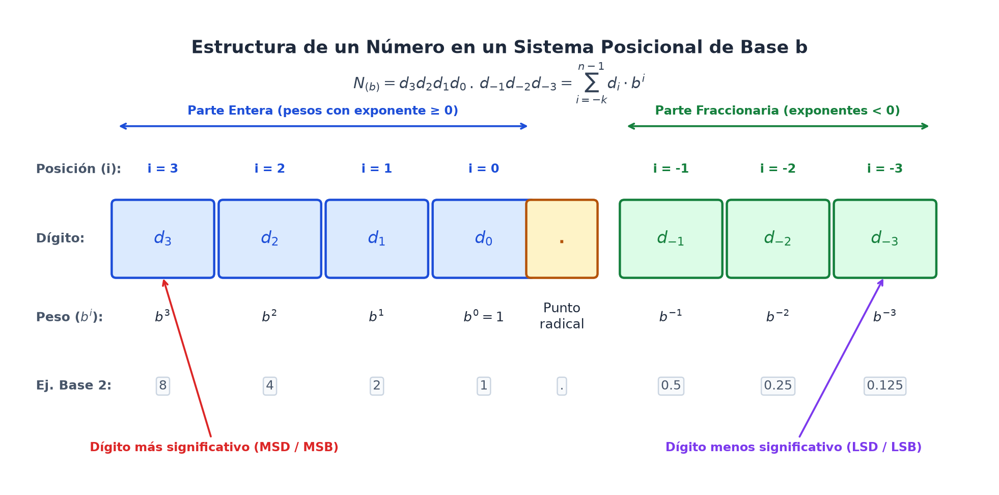

# 1.1 Sistemas numéricos (Binario, Octal, Decimal, Hexadecimal)

## Introducción: Sistemas Aditivos y Sistemas Posicionales

Un **sistema numérico** (o sistema de numeración) es un conjunto de símbolos y reglas que permiten representar cantidades de forma consistente. A lo largo de la historia se han desarrollado dos grandes familias de sistemas numéricos:

1. **Sistemas aditivos (no posicionales):** Cada símbolo posee un valor fijo sin importar el lugar que ocupe dentro de la cifra, y la cantidad total se obtiene sumando (o restando bajo reglas específicas) los valores de los símbolos empleados.
   - *Ejemplos históricos:* El **sistema egipcio** ($\mid = 1$, $\cap = 10$, $\varrho = 100$) y el **sistema romano** ($\text{I} = 1$, $\text{V} = 5$, $\text{X} = 10$, $\text{L} = 50$, $\text{C} = 100$, $\text{D} = 500$, $\text{M} = 1000$). Por ejemplo, en el número romano $\text{MDLXXIII} = 1573$, cada símbolo $\text{X}$ vale siempre $10$ e $\text{I}$ vale siempre $1$. Su principal desventaja es que resultan imprácticos para representar cantidades muy grandes o fraccionarias y dificultan las operaciones aritméticas.
2. **Sistemas posicionales (ponderados):** El valor que aporta cada dígito depende tanto de su **valor facial** (el símbolo en sí mismo) como de su **valor posicional** (la potencia de la base correspondiente al lugar que ocupa).
   - *Ejemplos históricos:* El **sistema babilónico** de base $60$ (sexagesimal, aún conservado en la medición de horas, minutos, segundos y ángulos) y el **sistema maya** de base $20$ (vigesimal), el cual introdujo formalmente un símbolo para el **cero** ($\emptyset$), indispensable para indicar la ausencia de unidades en una posición determinada.

---

## Teorema Fundamental de los Sistemas Posicionales

En un sistema de numeración posicional de **base** (o *raíz*) $b$, donde $b \in \mathbb{Z}$ y $b > 1$, se utilizan exactamente $b$ símbolos distintos llamados **dígitos**, cuyos valores enteros van desde $0$ hasta $b - 1$:

$$D_b = \{0, 1, 2, \dots, b - 1\}$$

Cuando $b > 10$, se acostumbra emplear las letras mayúsculas del alfabeto latino para representar los valores mayores que $9$:

$$\text{A} = 10,\quad \text{B} = 11,\quad \text{C} = 12,\quad \text{D} = 13,\quad \text{E} = 14,\quad \text{F} = 15,\quad \text{G} = 16,\quad \dots$$

Cualquier número real positivo $N$ expresado en base $b$ con $n$ dígitos en su parte entera y $k$ dígitos en su parte fraccionaria se escribe como:

$$N_{(b)} = d_{n-1}d_{n-2}\dots d_2d_1d_0\,.\,d_{-1}d_{-2}\dots d_{-k}$$

Su **representación exponencial** (también llamada **forma expandida** o **polinomial**) está dada por:

$$N_{(b)} = d_{n-1}b^{n-1} + d_{n-2}b^{n-2} + \dots + d_1b^1 + d_0b^0 + d_{-1}b^{-1} + d_{-2}b^{-2} + \dots + d_{-k}b^{-k} = \sum_{i=-k}^{n-1} d_i \cdot b^i$$

donde:
- $b$ es la **base** del sistema numérico ($b > 1$).
- $d_i \in \{0, 1, \dots, b-1\}$ es el dígito ubicado en la posición $i$.
- El punto $(\,.\,)$ se denomina **punto radical** (punto decimal en base $10$, punto binario en base $2$, punto octal en base $8$, punto hexadecimal en base $16$).
- Los exponentes de la **parte entera** crecen de derecha a izquierda a partir del punto radical ($i = 0, 1, 2, \dots, n-1$).
- Los exponentes de la **parte fraccionaria** decrecen de izquierda a derecha a partir del punto radical ($i = -1, -2, \dots, -k$).
- El dígito más a la izquierda ($d_{n-1}$) tiene el mayor peso y se llama **dígito más significativo (MSD)** o **bit más significativo (MSB)** en binario.
- El dígito más a la derecha ($d_{-k}$ o $d_0$ si es entero) tiene el menor peso y se llama **dígito menos significativo (LSD)** o **bit menos significativo (LSB)** en binario.

> **Convención de notación:** Para evitar ambigüedades cuando un número contiene símbolos comunes a varios sistemas (como $1011$), la base se indica mediante un subíndice entre paréntesis o directo al final de la cifra: $1011_{(2)}$ o $1011_2$.

---

## Decimal

El **sistema decimal** es el sistema de uso cotidiano a nivel mundial; su origen antropológico proviene del conteo con los diez dedos de las manos.

- **Base:** $b = 10$.
- **Conjunto de dígitos válidos:** $\{0, 1, 2, 3, 4, 5, 6, 7, 8, 9\}$. El dígito menor es $0$ y el mayor es $b - 1 = 9$.
- **Pesos posicionales:** Potencias de $10$:
  $$\dots,\; 10^3 = 1000,\; 10^2 = 100,\; 10^1 = 10,\; 10^0 = 1\;.\; 10^{-1} = 0.1,\; 10^{-2} = 0.01,\; 10^{-3} = 0.001,\; \dots$$

Por ejemplo, en la cantidad $836.74_{(10)}$:
- El dígito $8$ tiene valor facial $8$ y valor posicional $10^2 = 100$ (aporta $800$).
- El dígito $3$ tiene valor facial $3$ y valor posicional $10^1 = 10$ (aporta $30$).
- El dígito $6$ tiene valor facial $6$ y valor posicional $10^0 = 1$ (aporta $6$).
- El dígito $7$ tiene valor facial $7$ y valor posicional $10^{-1} = \frac{1}{10} = 0.1$ (aporta $0.7$).
- El dígito $4$ tiene valor facial $4$ y valor posicional $10^{-2} = \frac{1}{100} = 0.01$ (aporta $0.04$).

Su forma expandida es:

$$836.74_{(10)} = 8 \times 10^2 + 3 \times 10^1 + 6 \times 10^0 + 7 \times 10^{-1} + 4 \times 10^{-2} = 800 + 30 + 6 + 0.7 + 0.04$$

---

## Binario

El **sistema binario** fue descrito en la antigüedad por el matemático indio Pingala (siglo III a. C.) y formalizado en el siglo XVII por **Gottfried Wilhelm von Leibniz** en su obra *Explication de l'Arithmétique Binaire*. Es el sistema fundamental de las computadoras modernas porque los dispositivos electrónicos son de naturaleza **biestable** (encendido/apagado, nivel alto/nivel bajo de tensión).

- **Base:** $b = 2$.
- **Conjunto de dígitos válidos:** $\{0, 1\}$. Cada dígito binario se denomina **bit** (contracción en inglés de *binary digit*).
- **Agrupaciones comunes de bits:**
  - **Nibble (semibyte):** Grupo de $4$ bits (p. ej., $1011_2$).
  - **Byte (octeto):** Grupo de $8$ bits (p. ej., $11001010_2$).
  - **Palabra (*word*):** Conjunto de bits que el procesador maneja como unidad nativa ($16$, $32$ o $64$ bits).
- **Pesos posicionales:** Potencias de $2$:

| Potencia $2^i$ | $2^{10}$ | $2^9$ | $2^8$ | $2^7$ | $2^6$ | $2^5$ | $2^4$ | $2^3$ | $2^2$ | $2^1$ | $2^0$ | $2^{-1}$ | $2^{-2}$ | $2^{-3}$ | $2^{-4}$ |
| :--- | :---: | :---: | :---: | :---: | :---: | :---: | :---: | :---: | :---: | :---: | :---: | :---: | :---: | :---: | :---: |
| **Valor decimal** | $1024$ | $512$ | $256$ | $128$ | $64$ | $32$ | $16$ | $8$ | $4$ | $2$ | $1$ | $0.5$ | $0.25$ | $0.125$ | $0.0625$ |

En un número binario, dado que los dígitos sólo pueden ser $0$ o $1$, su equivalente decimal es simplemente la suma de las potencias de $2$ en las posiciones donde aparece un bit igual a $1$. Por ejemplo:

$$101.1101_{(2)} = 1 \times 2^2 + 0 \times 2^1 + 1 \times 2^0 + 1 \times 2^{-1} + 1 \times 2^{-2} + 0 \times 2^{-3} + 1 \times 2^{-4}$$

$$101.1101_{(2)} = 4 + 0 + 1 + 0.5 + 0.25 + 0 + 0.0625 = 5.8125_{(10)}$$

---

## Octal

Las cadenas binarias extensas como $110101101110_2$ resultan difíciles de leer y propensas a errores de transcripción para el ser humano. El **sistema octal** resuelve este problema agrupando bits de tres en tres, ya que su base es potencia exacta de dos ($8 = 2^3$). Se utiliza ampliamente en sistemas operativos tipo UNIX/Linux para definir permisos de archivos (comando `chmod`, donde cada grupo `rwx` de $3$ bits se representa con un dígito octal del $0$ al $7$).

- **Base:** $b = 8$.
- **Conjunto de dígitos válidos:** $\{0, 1, 2, 3, 4, 5, 6, 7\}$. (Los símbolos $8$ y $9$ **no existen** en el sistema octal).
- **Pesos posicionales:** Potencias de $8$:

| Potencia $8^i$ | $8^4$ | $8^3$ | $8^2$ | $8^1$ | $8^0$ | $8^{-1}$ | $8^{-2}$ | $8^{-3}$ |
| :--- | :---: | :---: | :---: | :---: | :---: | :---: | :---: | :---: |
| **Valor decimal** | $4096$ | $512$ | $64$ | $8$ | $1$ | $\frac{1}{8} = 0.125$ | $\frac{1}{64} = 0.015625$ | $\frac{1}{512} \approx 0.001953$ |

Por ejemplo, el número octal $631.54_{(8)}$ en notación expandida es:

$$631.54_{(8)} = 6 \times 8^2 + 3 \times 8^1 + 1 \times 8^0 + 5 \times 8^{-1} + 4 \times 8^{-2} = 384 + 24 + 1 + 0.625 + 0.0625 = 409.6875_{(10)}$$

---

## Hexadecimal

El **sistema hexadecimal** está estrechamente ligado a la arquitectura de computadoras debido a que la unidad básica de memoria direccionable es el **byte** ($8$ bits). Como $16 = 2^4$, cada dígito hexadecimal representa exactamente $4$ bits (un *nibble*), y **un byte completo se expresa de forma exacta con dos dígitos hexadecimales** (desde $00_{(16)}$ hasta $\text{FF}_{(16)}$).

- **Base:** $b = 16$.
- **Conjunto de dígitos válidos:** $\{0, 1, 2, 3, 4, 5, 6, 7, 8, 9, \text{A}, \text{B}, \text{C}, \text{D}, \text{E}, \text{F}\}$, donde:
  $$\text{A} = 10,\quad \text{B} = 11,\quad \text{C} = 12,\quad \text{D} = 13,\quad \text{E} = 14,\quad \text{F} = 15$$
- **Notaciones en lenguajes de programación:** En C, C++, Java, Python y ensamblador se suele anteponer el prefijo `0x` (por ejemplo, `0x3FA0`), o bien el sufijo `h` (`3FA0h`), y en diseño web CSS se usa `#RRGGBB`.
- **Pesos posicionales:** Potencias de $16$:

| Potencia $16^i$ | $16^4$ | $16^3$ | $16^2$ | $16^1$ | $16^0$ | $16^{-1}$ | $16^{-2}$ | $16^{-3}$ |
| :--- | :---: | :---: | :---: | :---: | :---: | :---: | :---: | :---: |
| **Valor decimal** | $65\,536$ | $4096$ | $256$ | $16$ | $1$ | $\frac{1}{16} = 0.0625$ | $\frac{1}{256} = 0.00390625$ | $\frac{1}{4096} \approx 0.000244$ |

Por ejemplo, el número hexadecimal $3\text{D}5.\text{C}_{(16)}$ en notación expandida es:

$$3\text{D}5.\text{C}_{(16)} = 3 \times 16^2 + 13 \times 16^1 + 5 \times 16^0 + 12 \times 16^{-1} = 768 + 208 + 5 + 0.75 = 981.75_{(10)}$$

---

## Tabla Comparativa de Equivalencias ($0$ al $20$)

| Decimal ($b=10$) | Binario ($b=2$) | Octal ($b=8$) | Hexadecimal ($b=16$) | Base $5$ ($b=5$) |
| :---: | :---: | :---: | :---: | :---: |
| $0$ | $0000$ | $0$ | $0$ | $0$ |
| $1$ | $0001$ | $1$ | $1$ | $1$ |
| $2$ | $0010$ | $2$ | $2$ | $2$ |
| $3$ | $0011$ | $3$ | $3$ | $3$ |
| $4$ | $0100$ | $4$ | $4$ | $4$ |
| $5$ | $0101$ | $5$ | $5$ | $10$ |
| $6$ | $0110$ | $6$ | $6$ | $11$ |
| $7$ | $0111$ | $7$ | $7$ | $12$ |
| $8$ | $1000$ | $10$ | $8$ | $13$ |
| $9$ | $1001$ | $11$ | $9$ | $14$ |
| $10$ | $1010$ | $12$ | $\text{A}$ | $20$ |
| $11$ | $1011$ | $13$ | $\text{B}$ | $21$ |
| $12$ | $1100$ | $14$ | $\text{C}$ | $22$ |
| $13$ | $1101$ | $15$ | $\text{D}$ | $23$ |
| $14$ | $1110$ | $16$ | $\text{E}$ | $24$ |
| $15$ | $1111$ | $17$ | $\text{F}$ | $30$ |
| $16$ | $10000$ | $20$ | $10$ | $31$ |
| $17$ | $10001$ | $21$ | $11$ | $32$ |
| $18$ | $10010$ | $22$ | $12$ | $33$ |
| $19$ | $10011$ | $23$ | $13$ | $34$ |
| $20$ | $10100$ | $24$ | $14$ | $40$ |

> **Propiedad importante de capacidad:** Con $n$ dígitos en un sistema de base $b$, se pueden representar exactamente $b^n$ combinaciones distintas, abarcando los enteros sin signo desde $0$ hasta $b^n - 1$. En binario ($b=2$), con $n$ bits el entero positivo máximo representable es $2^n - 1$ (por ejemplo, con $8$ bits: $2^8 - 1 = 255$).

---

## Ejemplos de Práctica (Resueltos Paso a Paso)

### Ejemplo 1.1: Validez de representaciones en distintas bases
Determine si cada una de las siguientes cadenas numéricas está correctamente escrita en la base indicada y enumere los dígitos válidos de su sistema:

a) $3102_{(4)}$  
b) $5713_{(6)}$  
c) $7\text{G}5\text{A}.4\text{B}_{(18)}$

**Solución:**
- **a) $3102_{(4)}$:** En base $b = 4$, los dígitos válidos van de $0$ a $b - 1 = 3$, es decir, $\{0, 1, 2, 3\}$. Todos los símbolos de $3102_{(4)}$ pertenecen a ese conjunto, por lo que **sí es válido**.
- **b) $5713_{(6)}$:** En base $b = 6$, los dígitos válidos son $\{0, 1, 2, 3, 4, 5\}$. Como la cifra contiene el símbolo $7$ (y $7 \ge 6$), el número **no es válido** en base $6$.
- **c) $7\text{G}5\text{A}.4\text{B}_{(18)}$:** En base $b = 18$, los valores válidos van de $0$ a $17$. Usando letras para valores mayores que $9$: $\text{A}=10, \text{B}=11, \text{C}=12, \text{D}=13, \text{E}=14, \text{F}=15, \text{G}=16, \text{H}=17$. Como $\text{G}=16 < 18$, $\text{A}=10 < 18$ y $\text{B}=11 < 18$, el número **sí es válido** en base $18$.

---

### Ejemplo 1.2: Valor facial y valor posicional
Determine el valor facial, el valor posicional y la aportación neta (en decimal) del dígito subrayado en cada uno de los siguientes números:

a) $7\underline{4}25.3_{(10)}$  
b) $1\underline{0}110.\underline{1}01_{(2)}$  
c) $4\underline{5}0.2_{(8)}$  
d) $2\underline{\text{B}}4.\text{A}_{(16)}$

**Solución:**
- **a) En $7\underline{4}25.3_{(10)}$:**
  - El dígito subrayado es $4$ y se ubica en la posición $i = 2$ (centenas).
  - **Valor facial:** $4$.
  - **Valor posicional:** $10^2 = 100$.
  - **Aportación:** $4 \times 100 = 400_{(10)}$.
- **b) En $1\underline{0}110.\underline{1}01_{(2)}$:**
  - Primer bit subrayado ($0$): ocupa la posición $i = 3$. Su valor facial es $0$, su valor posicional es $2^3 = 8$ y su aportación es $0 \times 8 = 0$.
  - Segundo bit subrayado ($1$): ocupa la posición $i = -1$. Su valor facial es $1$, su valor posicional es $2^{-1} = \frac{1}{2} = 0.5$ y su aportación es $1 \times 0.5 = 0.5_{(10)}$.
- **c) En $4\underline{5}0.2_{(8)}$:**
  - El dígito $5$ ocupa la posición $i = 1$.
  - **Valor facial:** $5$.
  - **Valor posicional:** $8^1 = 8$.
  - **Aportación:** $5 \times 8 = 40_{(10)}$.
- **d) En $2\underline{\text{B}}4.\text{A}_{(16)}$:**
  - El dígito $\text{B}$ ocupa la posición $i = 1$.
  - **Valor facial:** $\text{B} = 11$.
  - **Valor posicional:** $16^1 = 16$.
  - **Aportación:** $11 \times 16 = 176_{(10)}$.

---

### Ejemplo 1.3: Desarrollo en notación expandida (exponencial) y evaluación
Escriba en notación exponencial y calcule el valor decimal equivalente de:
a) $11011.011_{(2)}$  
b) $507.6_{(8)}$  
c) $1\text{A}7.48_{(16)}$

**Solución:**
- **a) Para $11011.011_{(2)}$:**
  $$11011.011_{(2)} = 1\times 2^4 + 1\times 2^3 + 0\times 2^2 + 1\times 2^1 + 1\times 2^0 + 0\times 2^{-1} + 1\times 2^{-2} + 1\times 2^{-3}$$
  $$= 16 + 8 + 0 + 2 + 1 + 0 + 0.25 + 0.125 = 27.375_{(10)}$$

- **b) Para $507.6_{(8)}$:**
  $$507.6_{(8)} = 5\times 8^2 + 0\times 8^1 + 7\times 8^0 + 6\times 8^{-1}$$
  $$= 5(64) + 0 + 7(1) + 6(0.125) = 320 + 7 + 0.75 = 327.75_{(10)}$$

- **c) Para $1\text{A}7.48_{(16)}$:** Recordando que $\text{A} = 10$:
  $$1\text{A}7.48_{(16)} = 1\times 16^2 + 10\times 16^1 + 7\times 16^0 + 4\times 16^{-1} + 8\times 16^{-2}$$
  $$= 1(256) + 10(16) + 7(1) + \frac{4}{16} + \frac{8}{256} = 256 + 160 + 7 + 0.25 + 0.03125 = 423.28125_{(10)}$$

---

### Ejemplo 1.4: Conteo y sucesor en distintas bases
Escriba los siguientes tres números enteros consecutivos después de:
a) $10111_{(2)}$  
b) $276_{(8)}$  
c) $9\text{F}8_{(16)}$

**Solución:**
- **a) En binario después de $10111_{(2)}$:**
  Al sumar $1$ al último bit se produce acarreo en los tres unos finales ($0111_2 + 1_2 = 1000_2$), por lo que los tres siguientes son:
  $$11000_{(2)},\quad 11001_{(2)},\quad 11010_{(2)}$$
- **b) En octal después de $276_{(8)}$:**
  El dígito máximo en octal es $7$. Después de $276_{(8)}$ sigue $277_{(8)}$; al incrementar en $1$ más, $77_{(8)}$ pasa a $100_{(8)}$, dando $300_{(8)}$:
  $$277_{(8)},\quad 300_{(8)},\quad 301_{(8)}$$
- **c) En hexadecimal después de $9\text{F}8_{(16)}$:**
  En hexadecimal, después del $9$ siguen $\text{A}, \text{B}, \dots, \text{F}$:
  $$9\text{F}9_{(16)},\quad 9\text{FA}_{(16)},\quad 9\text{FB}_{(16)}$$

---

## Ejercicios de Tarea (Práctica en Casa)

> **Instrucciones:** Resuelva cada uno de los siguientes ejercicios justificando su procedimiento paso a paso.

1. **Identificación de bases y dígitos válidos:**  
   Para cada uno de los siguientes sistemas posicionales: (i) base $b = 7$, (ii) base $b = 12$, (iii) base $b = 22$, indique cuál es el conjunto completo de dígitos válidos y cuál es el símbolo que representa al dígito de mayor valor. Posteriormente, explique si la cantidad $4\text{C}9.\text{B}_{(12)}$ es válida o no en base $12$.
   <!--
   Solución del Ejercicio 1:
   - (i) Base b = 7: Tiene 7 dígitos válidos: {0, 1, 2, 3, 4, 5, 6}. El dígito mayor es 6 (b - 1 = 6).
   - (ii) Base b = 12: Tiene 12 dígitos válidos: {0, 1, 2, 3, 4, 5, 6, 7, 8, 9, A, B}, donde A = 10 y B = 11. El dígito mayor es B (11).
   - (iii) Base b = 22: Tiene 22 dígitos válidos: del 0 al 9 y las letras A=10, B=11, C=12, D=13, E=14, F=15, G=16, H=17, I=18, J=19, K=20, L=21. El dígito mayor es L (21).
   - Validez de 4C9.B_(12): NO es válida en base 12, porque incluye la letra C = 12, y en base 12 el dígito máximo permitido es b - 1 = 11 (B).
   -->

2. **Análisis de valor posicional:**  
   Determine el valor facial, el peso (valor posicional expresado como potencia y como número decimal) y el valor total que aporta el dígito subrayado en cada caso:  
   a) $9\underline{3}045.12_{(10)}$  
   b) $110\underline{1}01.0\underline{1}_{(2)}$  
   c) $7\underline{6}2.\underline{4}_{(8)}$  
   d) $\underline{\text{E}}0\text{A}.\underline{8}_{(16)}$
   <!--
   Solución del Ejercicio 2:
   - a) En 93045.12_(10), el dígito 3 está en la posición i = 3:
     Valor facial = 3; Valor posicional = 10^3 = 1000; Aportación = 3 × 1000 = 3000_(10).
   - b) En 110101.01_(2):
     Primer 1 subrayado (parte entera, posición i = 2): Valor facial = 1; Valor posicional = 2^2 = 4; Aportación = 4_(10).
     Segundo 1 subrayado (parte fraccionaria, posición i = -2): Valor facial = 1; Valor posicional = 2^(-2) = 1/4 = 0.25; Aportación = 0.25_(10).
   - c) En 762.4_(8):
     Dígito 6 (posición i = 1): Valor facial = 6; Valor posicional = 8^1 = 8; Aportación = 6 × 8 = 48_(10).
     Dígito 4 (posición i = -1): Valor facial = 4; Valor posicional = 8^(-1) = 1/8 = 0.125; Aportación = 4 × 0.125 = 0.5_(10).
   - d) En E0A.8_(16):
     Dígito E (posición i = 2): Valor facial = E = 14; Valor posicional = 16^2 = 256; Aportación = 14 × 256 = 3584_(10).
     Dígito 8 (posición i = -1): Valor facial = 8; Valor posicional = 16^(-1) = 1/16 = 0.0625; Aportación = 8 × 0.0625 = 0.5_(10).
   -->

3. **Notación exponencial (forma expandida):**  
   Exprese cada uno de los siguientes números en su representación exponencial $\sum d_i b^i$ y obtenga su equivalente en el sistema decimal:  
   a) $101101.101_{(2)}$  
   b) $740.24_{(8)}$  
   c) $2\text{F}9.\text{A}4_{(16)}$  
   d) $4302.13_{(5)}$
   <!--
   Solución del Ejercicio 3:
   - a) 101101.101_(2) = 1×2^5 + 0×2^4 + 1×2^3 + 1×2^2 + 0×2^1 + 1×2^0 + 1×2^(-1) + 0×2^(-2) + 1×2^(-3)
        = 32 + 0 + 8 + 4 + 0 + 1 + 0.5 + 0 + 0.125 = 45.625_(10).
   - b) 740.24_(8) = 7×8^2 + 4×8^1 + 0×8^0 + 2×8^(-1) + 4×8^(-2)
        = 7(64) + 4(8) + 0 + 2/8 + 4/64 = 448 + 32 + 0.25 + 0.0625 = 480.3125_(10).
   - c) 2F9.A4_(16) = 2×16^2 + 15×16^1 + 9×16^0 + 10×16^(-1) + 4×16^(-2)
        = 2(256) + 15(16) + 9(1) + 10/16 + 4/256 = 512 + 240 + 9 + 0.625 + 0.015625 = 761.640625_(10).
   - d) 4302.13_(5) = 4×5^3 + 3×5^2 + 0×5^1 + 2×5^0 + 1×5^(-1) + 3×5^(-2)
        = 4(125) + 3(25) + 0 + 2(1) + 1/5 + 3/25 = 500 + 75 + 2 + 0.2 + 0.12 = 577.32_(10).
   -->

4. **Sucesiones numéricas y capacidad de representación:**  
   a) Escriba los cuatro números consecutivos que siguen a $76_{(8)}$ en el sistema octal.  
   b) Escriba los cuatro números consecutivos que siguen a $1\text{F}9\text{D}_{(16)}$ en el sistema hexadecimal.  
   c) ¿Cuál es la cantidad entera positiva más grande (en decimal y en la propia base) que puede representarse con $12$ bits en binario y con $4$ dígitos en hexadecimal?
   <!--
   Solución del Ejercicio 4:
   - a) Después de 76_(8) en octal siguen: 77_(8), 100_(8), 101_(8), 102_(8).
   - b) Después de 1F9D_(16) en hexadecimal siguen: 1F9E_(16), 1F9F_(16), 1FA0_(16), 1FA1_(16).
   - c) Con n = 12 bits en binario: el máximo entero sin signo es 2^12 - 1 = 4096 - 1 = 4095_(10), que en binario es 111111111111_(2).
        Con 4 dígitos en hexadecimal (b = 16, n = 4): el máximo es 16^4 - 1 = 65536 - 1 = 65535_(10), que en hexadecimal es FFFF_(16).
   -->

El **sistema hexadecimal** está estrechamente ligado a la arquitectura de computadoras debido a que la unidad básica de memoria direccionable es el **byte** ($8$ bits). Como $16 = 2^4$, cada dígito hexadecimal representa exactamente $4$ bits (un *nibble*), y **un byte completo se expresa de forma exacta con dos dígitos hexadecimales** (desde $00_{(16)}$ hasta $\text{FF}_{(16)}$).

- **Base:** $b = 16$.
- **Conjunto de dígitos válidos:** $\{0, 1, 2, 3, 4, 5, 6, 7, 8, 9, \text{A}, \text{B}, \text{C}, \text{D}, \text{E}, \text{F}\}$, donde:
  $$\text{A} = 10,\quad \text{B} = 11,\quad \text{C} = 12,\quad \text{D} = 13,\quad \text{E} = 14,\quad \text{F} = 15$$
- **Notaciones en lenguajes de programación:** En C, C++, Java, Python y ensamblador se suele anteponer el prefijo `0x` (por ejemplo, `0x3FA0`), o bien el sufijo `h` (`3FA0h`), y en diseño web CSS se usa `#RRGGBB`.
- **Pesos posicionales:** Potencias de $16$:

| Potencia $16^i$ | $16^4$ | $16^3$ | $16^2$ | $16^1$ | $16^0$ | $16^{-1}$ | $16^{-2}$ | $16^{-3}$ |
| :--- | :---: | :---: | :---: | :---: | :---: | :---: | :---: | :---: |
| **Valor decimal** | $65\,536$ | $4096$ | $256$ | $16$ | $1$ | $\frac{1}{16} = 0.0625$ | $\frac{1}{256} = 0.00390625$ | $\frac{1}{4096} \approx 0.000244$ |

Por ejemplo, el número hexadecimal $3\text{D}5.\text{C}_{(16)}$ en notación expandida es:

$$3\text{D}5.\text{C}_{(16)} = 3 \times 16^2 + 13 \times 16^1 + 5 \times 16^0 + 12 \times 16^{-1} = 768 + 208 + 5 + 0.75 = 981.75_{(10)}$$

---

## Tabla Comparativa de Equivalencias ($0$ al $20$)

| Decimal ($b=10$) | Binario ($b=2$) | Octal ($b=8$) | Hexadecimal ($b=16$) | Base $5$ ($b=5$) |
| :---: | :---: | :---: | :---: | :---: |
| $0$ | $0000$ | $0$ | $0$ | $0$ |
| $1$ | $0001$ | $1$ | $1$ | $1$ |
| $2$ | $0010$ | $2$ | $2$ | $2$ |
| $3$ | $0011$ | $3$ | $3$ | $3$ |
| $4$ | $0100$ | $4$ | $4$ | $4$ |
| $5$ | $0101$ | $5$ | $5$ | $10$ |
| $6$ | $0110$ | $6$ | $6$ | $11$ |
| $7$ | $0111$ | $7$ | $7$ | $12$ |
| $8$ | $1000$ | $10$ | $8$ | $13$ |
| $9$ | $1001$ | $11$ | $9$ | $14$ |
| $10$ | $1010$ | $12$ | $\text{A}$ | $20$ |
| $11$ | $1011$ | $13$ | $\text{B}$ | $21$ |
| $12$ | $1100$ | $14$ | $\text{C}$ | $22$ |
| $13$ | $1101$ | $15$ | $\text{D}$ | $23$ |
| $14$ | $1110$ | $16$ | $\text{E}$ | $24$ |
| $15$ | $1111$ | $17$ | $\text{F}$ | $30$ |
| $16$ | $10000$ | $20$ | $10$ | $31$ |
| $17$ | $10001$ | $21$ | $11$ | $32$ |
| $18$ | $10010$ | $22$ | $12$ | $33$ |
| $19$ | $10011$ | $23$ | $13$ | $34$ |
| $20$ | $10100$ | $24$ | $14$ | $40$ |

> **Propiedad importante de capacidad:** Con $n$ dígitos en un sistema de base $b$, se pueden representar exactamente $b^n$ combinaciones distintas, abarcando los enteros sin signo desde $0$ hasta $b^n - 1$. En binario ($b=2$), con $n$ bits el entero positivo máximo representable es $2^n - 1$ (por ejemplo, con $8$ bits: $2^8 - 1 = 255$).

---

## Ejemplos de Práctica (Resueltos Paso a Paso)

### Ejemplo 1.1: Validez de representaciones en distintas bases
Determine si cada una de las siguientes cadenas numéricas está correctamente escrita en la base indicada y enumere los dígitos válidos de su sistema:
a) $3102_{(4)}$  
b) $5713_{(6)}$  
c) $7\text{G}5\text{A}.4\text{B}_{(18)}$

**Solución:**
- **a) $3102_{(4)}$:** En base $b = 4$, los dígitos válidos van de $0$ a $b - 1 = 3$, es decir, $\{0, 1, 2, 3\}$. Todos los símbolos de $3102_{(4)}$ pertenecen a ese conjunto, por lo que **sí es válido**.
- **b) $5713_{(6)}$:** En base $b = 6$, los dígitos válidos son $\{0, 1, 2, 3, 4, 5\}$. Como la cifra contiene el símbolo $7$ (y $7 \ge 6$), el número **no es válido** en base $6$.
- **c) $7\text{G}5\text{A}.4\text{B}_{(18)}$:** En base $b = 18$, los valores válidos van de $0$ a $17$. Usando letras para valores mayores que $9$: $\text{A}=10, \text{B}=11, \text{C}=12, \text{D}=13, \text{E}=14, \text{F}=15, \text{G}=16, \text{H}=17$. Como $\text{G}=16 < 18$, $\text{A}=10 < 18$ y $\text{B}=11 < 18$, el número **sí es válido** en base $18$.

---

### Ejemplo 1.2: Valor facial y valor posicional
Determine el valor facial, el valor posicional y la aportación neta (en decimal) del dígito subrayado en cada uno de los siguientes números:
a) $7\underline{4}25.3_{(10)}$  
b) $1\underline{0}110.\underline{1}01_{(2)}$  
c) $4\underline{5}0.2_{(8)}$  
d) $2\underline{\text{B}}4.\text{A}_{(16)}$

**Solución:**
- **a) En $7\underline{4}25.3_{(10)}$:**
  - El dígito subrayado es $4$ y se ubica en la posición $i = 2$ (centenas).
  - **Valor facial:** $4$.
  - **Valor posicional:** $10^2 = 100$.
  - **Aportación:** $4 \times 100 = 400_{(10)}$.
- **b) En $1\underline{0}110.\underline{1}01_{(2)}$:**
  - Primer bit subrayado ($0$): ocupa la posición $i = 3$. Su valor facial es $0$, su valor posicional es $2^3 = 8$ y su aportación es $0 \times 8 = 0$.
  - Segundo bit subrayado ($1$): ocupa la posición $i = -1$. Su valor facial es $1$, su valor posicional es $2^{-1} = \frac{1}{2} = 0.5$ y su aportación es $1 \times 0.5 = 0.5_{(10)}$.
- **c) En $4\underline{5}0.2_{(8)}$:**
  - El dígito $5$ ocupa la posición $i = 1$.
  - **Valor facial:** $5$.
  - **Valor posicional:** $8^1 = 8$.
  - **Aportación:** $5 \times 8 = 40_{(10)}$.
- **d) En $2\underline{\text{B}}4.\text{A}_{(16)}$:**
  - El dígito $\text{B}$ ocupa la posición $i = 1$.
  - **Valor facial:** $\text{B} = 11$.
  - **Valor posicional:** $16^1 = 16$.
  - **Aportación:** $11 \times 16 = 176_{(10)}$.

---

### Ejemplo 1.3: Desarrollo en notación expandida (exponencial) y evaluación
Escriba en notación exponencial y calcule el valor decimal equivalente de:
a) $11011.011_{(2)}$  
b) $507.6_{(8)}$  
c) $1\text{A}7.48_{(16)}$

**Solución:**
- **a) Para $11011.011_{(2)}$:**
  $$11011.011_{(2)} = 1\times 2^4 + 1\times 2^3 + 0\times 2^2 + 1\times 2^1 + 1\times 2^0 + 0\times 2^{-1} + 1\times 2^{-2} + 1\times 2^{-3}$$
  $$= 16 + 8 + 0 + 2 + 1 + 0 + 0.25 + 0.125 = 27.375_{(10)}$$

- **b) Para $507.6_{(8)}$:**
  $$507.6_{(8)} = 5\times 8^2 + 0\times 8^1 + 7\times 8^0 + 6\times 8^{-1}$$
  $$= 5(64) + 0 + 7(1) + 6(0.125) = 320 + 7 + 0.75 = 327.75_{(10)}$$

- **c) Para $1\text{A}7.48_{(16)}$:** Recordando que $\text{A} = 10$:
  $$1\text{A}7.48_{(16)} = 1\times 16^2 + 10\times 16^1 + 7\times 16^0 + 4\times 16^{-1} + 8\times 16^{-2}$$
  $$= 1(256) + 10(16) + 7(1) + \frac{4}{16} + \frac{8}{256} = 256 + 160 + 7 + 0.25 + 0.03125 = 423.28125_{(10)}$$

---

### Ejemplo 1.4: Conteo y sucesor en distintas bases
Escriba los siguientes tres números enteros consecutivos después de:
a) $10111_{(2)}$  
b) $276_{(8)}$  
c) $9\text{F}8_{(16)}$

**Solución:**
- **a) En binario después de $10111_{(2)}$:**
  Al sumar $1$ al último bit se produce acarreo en los tres unos finales ($0111_2 + 1_2 = 1000_2$), por lo que los tres siguientes son:
  $$11000_{(2)},\quad 11001_{(2)},\quad 11010_{(2)}$$
- **b) En octal después de $276_{(8)}$:**
  El dígito máximo en octal es $7$. Después de $276_{(8)}$ sigue $277_{(8)}$; al incrementar en $1$ más, $77_{(8)}$ pasa a $100_{(8)}$, dando $300_{(8)}$:
  $$277_{(8)},\quad 300_{(8)},\quad 301_{(8)}$$
- **c) En hexadecimal después de $9\text{F}8_{(16)}$:**
  En hexadecimal, después del $9$ siguen $\text{A}, \text{B}, \dots, \text{F}$:
  $$9\text{F}9_{(16)},\quad 9\text{FA}_{(16)},\quad 9\text{FB}_{(16)}$$

---

## Ejercicios de Tarea (Práctica en Casa)

> **Instrucciones:** Resuelva cada uno de los siguientes ejercicios justificando su procedimiento paso a paso.

1. **Identificación de bases y dígitos válidos:**  
   Para cada uno de los siguientes sistemas posicionales: (i) base $b = 7$, (ii) base $b = 12$, (iii) base $b = 22$, indique cuál es el conjunto completo de dígitos válidos y cuál es el símbolo que representa al dígito de mayor valor. Posteriormente, explique si la cantidad $4\text{C}9.\text{B}_{(12)}$ es válida o no en base $12$.
   <!--
   Solución del Ejercicio 1:
   - (i) Base b = 7: Tiene 7 dígitos válidos: {0, 1, 2, 3, 4, 5, 6}. El dígito mayor es 6 (b - 1 = 6).
   - (ii) Base b = 12: Tiene 12 dígitos válidos: {0, 1, 2, 3, 4, 5, 6, 7, 8, 9, A, B}, donde A = 10 y B = 11. El dígito mayor es B (11).
   - (iii) Base b = 22: Tiene 22 dígitos válidos: del 0 al 9 y las letras A=10, B=11, C=12, D=13, E=14, F=15, G=16, H=17, I=18, J=19, K=20, L=21. El dígito mayor es L (21).
   - Validez de 4C9.B_(12): NO es válida en base 12, porque incluye la letra C = 12, y en base 12 el dígito máximo permitido es b - 1 = 11 (B).
   -->

2. **Análisis de valor posicional:**  
   Determine el valor facial, el peso (valor posicional expresado como potencia y como número decimal) y el valor total que aporta el dígito subrayado en cada caso:  
   a) $9\underline{3}045.12_{(10)}$  
   b) $110\underline{1}01.0\underline{1}_{(2)}$  
   c) $7\underline{6}2.\underline{4}_{(8)}$  
   d) $\underline{\text{E}}0\text{A}.\underline{8}_{(16)}$
   <!--
   Solución del Ejercicio 2:
   - a) En 93045.12_(10), el dígito 3 está en la posición i = 3:
     Valor facial = 3; Valor posicional = 10^3 = 1000; Aportación = 3 × 1000 = 3000_(10).
   - b) En 110101.01_(2):
     Primer 1 subrayado (parte entera, posición i = 2): Valor facial = 1; Valor posicional = 2^2 = 4; Aportación = 4_(10).
     Segundo 1 subrayado (parte fraccionaria, posición i = -2): Valor facial = 1; Valor posicional = 2^(-2) = 1/4 = 0.25; Aportación = 0.25_(10).
   - c) En 762.4_(8):
     Dígito 6 (posición i = 1): Valor facial = 6; Valor posicional = 8^1 = 8; Aportación = 6 × 8 = 48_(10).
     Dígito 4 (posición i = -1): Valor facial = 4; Valor posicional = 8^(-1) = 1/8 = 0.125; Aportación = 4 × 0.125 = 0.5_(10).
   - d) En E0A.8_(16):
     Dígito E (posición i = 2): Valor facial = E = 14; Valor posicional = 16^2 = 256; Aportación = 14 × 256 = 3584_(10).
     Dígito 8 (posición i = -1): Valor facial = 8; Valor posicional = 16^(-1) = 1/16 = 0.0625; Aportación = 8 × 0.0625 = 0.5_(10).
   -->

3. **Notación exponencial (forma expandida):**  
   Exprese cada uno de los siguientes números en su representación exponencial $\sum d_i b^i$ y obtenga su equivalente en el sistema decimal:  
   a) $101101.101_{(2)}$  
   b) $740.24_{(8)}$  
   c) $2\text{F}9.\text{A}4_{(16)}$  
   d) $4302.13_{(5)}$
   <!--
   Solución del Ejercicio 3:
   - a) 101101.101_(2) = 1×2^5 + 0×2^4 + 1×2^3 + 1×2^2 + 0×2^1 + 1×2^0 + 1×2^(-1) + 0×2^(-2) + 1×2^(-3)
        = 32 + 0 + 8 + 4 + 0 + 1 + 0.5 + 0 + 0.125 = 45.625_(10).
   - b) 740.24_(8) = 7×8^2 + 4×8^1 + 0×8^0 + 2×8^(-1) + 4×8^(-2)
        = 7(64) + 4(8) + 0 + 2/8 + 4/64 = 448 + 32 + 0.25 + 0.0625 = 480.3125_(10).
   - c) 2F9.A4_(16) = 2×16^2 + 15×16^1 + 9×16^0 + 10×16^(-1) + 4×16^(-2)
        = 2(256) + 15(16) + 9(1) + 10/16 + 4/256 = 512 + 240 + 9 + 0.625 + 0.015625 = 761.640625_(10).
   - d) 4302.13_(5) = 4×5^3 + 3×5^2 + 0×5^1 + 2×5^0 + 1×5^(-1) + 3×5^(-2)
        = 4(125) + 3(25) + 0 + 2(1) + 1/5 + 3/25 = 500 + 75 + 2 + 0.2 + 0.12 = 577.32_(10).
   -->

4. **Sucesiones numéricas y capacidad de representación:**  
   a) Escriba los cuatro números consecutivos que siguen a $76_{(8)}$ en el sistema octal.  
   b) Escriba los cuatro números consecutivos que siguen a $1\text{F}9\text{D}_{(16)}$ en el sistema hexadecimal.  
   c) ¿Cuál es la cantidad entera positiva más grande (en decimal y en la propia base) que puede representarse con $12$ bits en binario y con $4$ dígitos en hexadecimal?
   <!--
   Solución del Ejercicio 4:
   - a) Después de 76_(8) en octal siguen: 77_(8), 100_(8), 101_(8), 102_(8).
   - b) Después de 1F9D_(16) en hexadecimal siguen: 1F9E_(16), 1F9F_(16), 1FA0_(16), 1FA1_(16).
   - c) Con n = 12 bits en binario: el máximo entero sin signo es 2^12 - 1 = 4096 - 1 = 4095_(10), que en binario es 111111111111_(2).
        Con 4 dígitos en hexadecimal (b = 16, n = 4): el máximo es 16^4 - 1 = 65536 - 1 = 65535_(10), que en hexadecimal es FFFF_(16).
   -->