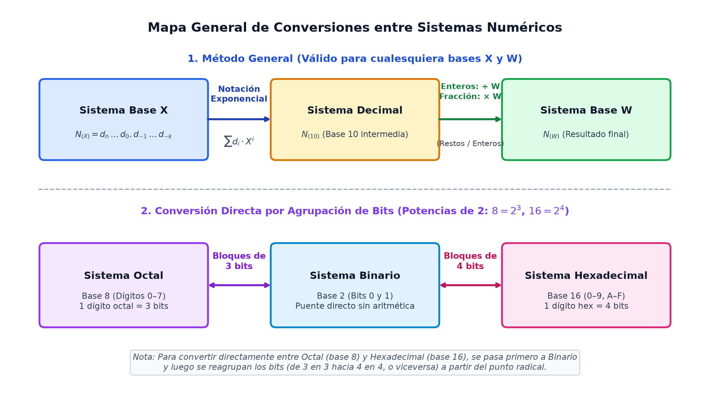
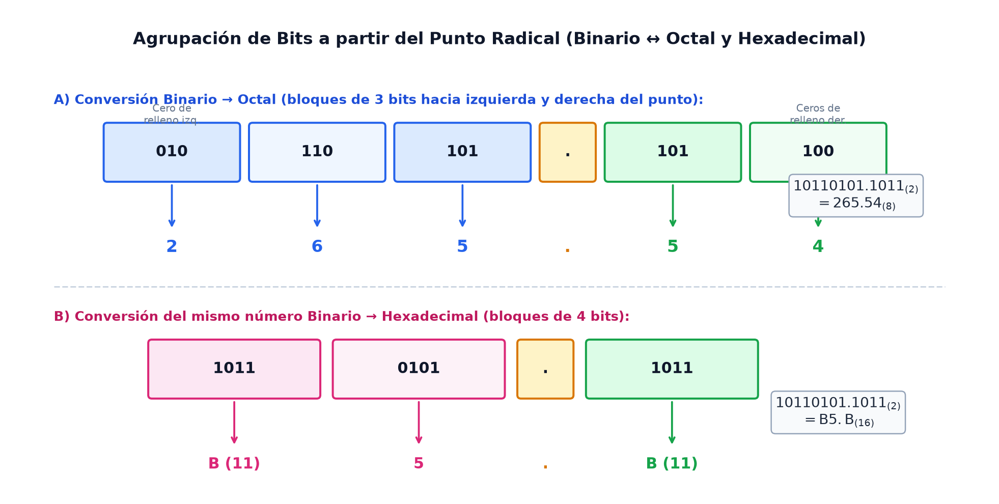

# 1.2 Conversiones entre sistemas numéricos

## Panorama General de las Conversiones

La conversión entre sistemas numéricos posicionales permite traducir una misma magnitud expresada en una **base de origen $X$** a su representación equivalente en una **base de destino $W$**. Existen dos estrategias fundamentales (Jiménez Murillo, 2012; Lipschutz, 1992):

1. **Método general (aplicable a cualesquiera bases $X$ y $W$):** Utiliza al sistema decimal ($b = 10$) como sistema intermedio:
   $$\text{Base } X \xrightarrow{\text{Notación Exponencial}} \text{Base } 10 \xrightarrow{\substack{\text{Enteros: Divisiones entre } W \\ \text{Fracciones: Multiplicaciones por } W}} \text{Base } W$$
2. **Método directo por tablas de equivalencia / agrupación de bits:** Aplicable cuando ambas bases son potencias de una base común, particularmente entre los sistemas **binario ($b = 2$)**, **octal ($b = 8 = 2^3$)** y **hexadecimal ($b = 16 = 2^4$)**, donde la traducción se realiza sustituyendo bloques de $3$ o $4$ bits sin necesidad de operaciones aritméticas intermedias.

---

## 1. Conversión de una Base Cualquiera $b$ al Sistema Decimal ($b \to 10$)

### 1.1 Método de la representación exponencial (forma expandida)

Para convertir cualquier número $N_{(b)} = d_{n-1}\dots d_1d_0\,.\,d_{-1}\dots d_{-k}$ al sistema decimal, se expresa el número en su **notación exponencial** y se efectúan las multiplicaciones y sumas en aritmética decimal:

$$N_{(10)} = \sum_{i=-k}^{n-1} d_i \cdot b^i = d_{n-1}b^{n-1} + \dots + d_1b^1 + d_0b^0 + d_{-1}b^{-1} + \dots + d_{-k}b^{-k}$$

### 1.2 Método de Horner (doblar o multiplicar las sumas)

Para convertir la **parte entera** $d_{n-1}d_{n-2}\dots d_1d_0$ de base $b$ a decimal sin calcular potencias elevadas, se factoriza el polinomio de forma anidada (**esquema de Horner**):

$$N_I = \left(\left(\left(d_{n-1}\cdot b + d_{n-2}\right)\cdot b + d_{n-3}\right)\cdot b + \dots + d_1\right)\cdot b + d_0$$

**Algoritmo:**
1. Se toma el dígito más a la izquierda ($d_{n-1}$), se multiplica por la base $b$ y se le suma el siguiente dígito a la derecha ($d_{n-2}$).
2. El resultado acumulado se vuelve a multiplicar por $b$ y se le suma el siguiente dígito.
3. El proceso se repite hasta haber sumado el último dígito de las unidades ($d_0$).

---

## 2. Conversión del Sistema Decimal a una Base Cualquiera $b$ ($10 \to b$)

Cuando un número decimal $N_{(10)} = N_I + N_F$ posee una **parte entera** ($N_I$) y una **parte fraccionaria** ($N_F$), ambas partes deben convertirse **por separado** y después unirse mediante el punto radical.

### 2.1 Conversión de la parte entera ($N_I$): Divisiones sucesivas

1. Se divide la parte entera $N_I$ entre la base de destino $b$, obteniendo un cociente entero $q_1$ y un residuo entero $r_0 \in \{0, 1, \dots, b-1\}$.
2. Se divide el nuevo cociente $q_1$ entre $b$, anotando el residuo $r_1$.
3. Se repite el procedimiento sucesivamente hasta que el cociente sea igual a **$0$**.
4. Los residuos obtenidos, leídos **en orden inverso** (del último residuo al primero, de abajo hacia arriba $\uparrow$), forman la parte entera en base $b$:
   $$N_{I(b)} = (r_{m}\dots r_2 r_1 r_0)_{(b)}$$

> **Nota práctica para residuos con calculadora:** Si al dividir $A / b$ en una calculadora se obtiene un cociente con decimales (por ejemplo, $108\,605 / 8 = 13\,575.625$), el cociente entero es $13\,575$ y el residuo exacto se obtiene multiplicando la parte fraccionaria por la base: $0.625 \times 8 = 5$.

### 2.2 Conversión de la parte fraccionaria ($N_F$): Multiplicaciones sucesivas

1. Se multiplica la parte fraccionaria $N_F$ por la base de destino $b$.
2. La **parte entera** del producto resultante se separa como el primer dígito fraccionario $d_{-1}$, y únicamente la nueva **parte fraccionaria** se vuelve a multiplicar por $b$.
3. Se repite el proceso hasta que la parte fraccionaria sea exactamente $0$, se detecte un periodo repetitivo, o se alcance la cantidad de cifras fraccionarias deseadas (usualmente de $4$ a $6$ cifras).
4. Los enteros obtenidos, leídos **en el mismo orden en que aparecieron** (de arriba hacia abajo $\downarrow$), conforman la parte fraccionaria en base $b$:
   $$N_{F(b)} = 0.d_{-1}d_{-2}d_{-3}\dots_{(b)}$$

> **Advertencia sobre fracciones periódicas:** Una fracción que es exacta en el sistema decimal no siempre termina en otra base. Por ejemplo, $0.6_{(10)} = 0.100110011001\dots_{(2)} = 0.\overline{1001}_{(2)}$ es periódica infinita en binario, lo cual explica los pequeños errores de redondeo al convertir entre bases mediante el método general.

---

## 3. Conversiones Directas entre Binario, Octal y Hexadecimal

Dado que $8 = 2^3$ y $16 = 2^4$, existe una correspondencia exacta entre cada dígito octal y un bloque de **$3$ bits**, así como entre cada dígito hexadecimal y un bloque de **$4$ bits**:

| Octal | Binario ($3$ bits) | | Hexadecimal | Decimal | Binario ($4$ bits) | Hexadecimal | Decimal | Binario ($4$ bits) |
| :---: | :---: | :--- | :---: | :---: | :---: | :---: | :---: | :---: |
| $0$ | $000$ | | $0$ | $0$ | $0000$ | $8$ | $8$ | $1000$ |
| $1$ | $001$ | | $1$ | $1$ | $0001$ | $9$ | $9$ | $1001$ |
| $2$ | $010$ | | $2$ | $2$ | $0010$ | $\text{A}$ | $10$ | $1010$ |
| $3$ | $011$ | | $3$ | $3$ | $0011$ | $\text{B}$ | $11$ | $1011$ |
| $4$ | $100$ | | $4$ | $4$ | $0100$ | $\text{C}$ | $12$ | $1100$ |
| $5$ | $101$ | | $5$ | $5$ | $0101$ | $\text{D}$ | $13$ | $1101$ |
| $6$ | $110$ | | $6$ | $6$ | $0110$ | $\text{E}$ | $14$ | $1110$ |
| $7$ | $111$ | | $7$ | $7$ | $0111$ | $\text{F}$ | $15$ | $1111$ |

### Reglas de agrupación a partir del punto radical

- **De Binario a Octal ($2 \to 8$) o a Hexadecimal ($2 \to 16$):**
  1. En la **parte entera**, los bits se agrupan de $3$ en $3$ (para octal) o de $4$ en $4$ (para hexadecimal) **del punto radical hacia la izquierda** ($\leftarrow$). Si el último bloque del extremo izquierdo queda incompleto, se rellena con **ceros a la izquierda**.
  2. En la **parte fraccionaria**, los bits se agrupan de $3$ en $3$ (o de $4$ en $4$) **del punto radical hacia la derecha** ($\rightarrow$). Si el último bloque del extremo derecho queda incompleto, se rellena con **ceros a la derecha**.
  3. Se sustituye cada bloque por su dígito octal o hexadecimal correspondiente.
- **De Octal o Hexadecimal a Binario ($8 \to 2$ o $16 \to 2$):**
  - Se reemplaza directamente cada dígito octal por sus $3$ bits equivalentes (o cada dígito hexadecimal por sus $4$ bits equivalentes).
- **De Octal a Hexadecimal ($8 \leftrightarrow 16$):**
  - Se convierte primero a **binario** como puente y, acto seguido, se reagrupan los bits en bloques de $4$ (si se va a hexadecimal) o de $3$ (si se va a octal).

---

## Ejemplos de Práctica (Resueltos Paso a Paso)

### Ejemplo 1.1: Conversión de Decimal a Binario ($10 \to 2$) con parte fraccionaria
Convierta el número $28.37_{(10)}$ a binario con $4$ cifras después del punto binario.

**Solución:**
1. **Parte entera ($N_I = 28$):** Dividimos sucesivamente entre $2$:

   | División | Cociente entero | Residuo | Orden de lectura |
   | :--- | :---: | :---: | :---: |
   | $28 \div 2$ | $14$ | $0$ | LSB $\uparrow$ |
   | $14 \div 2$ | $7$ | $0$ | $\uparrow$ |
   | $7 \div 2$ | $3$ | $1$ | $\uparrow$ |
   | $3 \div 2$ | $1$ | $1$ | $\uparrow$ |
   | $1 \div 2$ | $0$ | $1$ | MSB $\uparrow$ |

   Leyendo los residuos de abajo hacia arriba: $28_{(10)} = 11100_{(2)}$.

2. **Parte fraccionaria ($N_F = 0.37$):** Multiplicamos sucesivamente por $2$:

   | Multiplicación | Producto | Parte entera extraída | Nueva fracción | Orden de lectura |
   | :--- | :---: | :---: | :---: | :---: |
   | $0.37 \times 2$ | $0.74$ | $0$ | $0.74$ | $\downarrow$ 1.º |
   | $0.74 \times 2$ | $1.48$ | $1$ | $0.48$ | $\downarrow$ 2.º |
   | $0.48 \times 2$ | $0.96$ | $0$ | $0.96$ | $\downarrow$ 3.º |
   | $0.96 \times 2$ | $1.92$ | $1$ | $0.92$ | $\downarrow$ 4.º |

   Leyendo los enteros de arriba hacia abajo: $0.37_{(10)} \approx 0.0101_{(2)}$.

3. **Resultado final:**
   $$28.37_{(10)} \approx 11100.0101_{(2)}$$

---

### Ejemplo 1.2: Conversión de Hexadecimal a Octal por ambos métodos ($16 \to 8$)
Convierta $\text{E}8\text{A}7.3\text{D}_{(16)}$ a octal: (a) usando tablas de equivalencia vía binario y (b) usando el método general vía decimal.

**Solución:**

#### a) Mediante tablas de equivalencia (vía binario)
1. Sustituimos cada dígito hexadecimal por su bloque de $4$ bits ($\text{E}=14=1110_2$, $8=1000_2$, $\text{A}=10=1010_2$, $7=0111_2$, $3=0011_2$, $\text{D}=13=1101_2$):
   $$\text{E}8\text{A}7.3\text{D}_{(16)} = \underbrace{1110}_{\text{E}}\;\underbrace{1000}_{8}\;\underbrace{1010}_{\text{A}}\;\underbrace{0111}_{7}\,.\,\underbrace{0011}_{3}\;\underbrace{1101}_{\text{D}\,(2)}$$
2. Reagrupamos en bloques de **$3$ bits** a partir del punto binario (agregando dos ceros a la izquierda en la parte entera y un cero a la derecha en la parte fraccionaria):
   $$\underbrace{001}_{1}\;\underbrace{110}_{6}\;\underbrace{100}_{4}\;\underbrace{010}_{2}\;\underbrace{100}_{4}\;\underbrace{111}_{7}\,.\,\underbrace{001}_{1}\;\underbrace{111}_{7}\;\underbrace{010}_{2\,(2)} = 164247.172_{(8)}$$

#### b) Mediante el método general (vía decimal)
1. Convertimos $\text{E}8\text{A}7.3\text{D}_{(16)}$ a decimal:
   $$14\times 16^3 + 8\times 16^2 + 10\times 16^1 + 7\times 16^0 + 3\times 16^{-1} + 13\times 16^{-2}$$
   $$= 57\,344 + 2048 + 160 + 7 + 0.1875 + 0.05078125 = 59\,559.23828125_{(10)}$$
2. Convertimos la parte entera ($59\,559$) y la fraccionaria ($0.23828125$) a base $8$:
   - **Parte entera:**
     - $59\,559 \div 8 = 7444$, residuo **$7$**
     - $7444 \div 8 = 930$, residuo **$4$**
     - $930 \div 8 = 116$, residuo **$2$**
     - $116 \div 8 = 14$, residuo **$4$**
     - $14 \div 8 = 1$, residuo **$6$**
     - $1 \div 8 = 0$, residuo **$1$** $\implies 164247_{(8)}$.
   - **Parte fraccionaria:**
     - $0.23828125 \times 8 = 1.90625 \implies$ entero **$1$**
     - $0.90625 \times 8 = 7.25 \implies$ entero **$7$**
     - $0.25 \times 8 = 2.00 \implies$ entero **$2$** $\implies 0.172_{(8)}$.
3. **Resultado:** $\text{E}8\text{A}7.3\text{D}_{(16)} = 164247.172_{(8)}$, coincidiendo exactamente con el método por tablas.

---

### Ejemplo 1.3: Conversión entre dos bases arbitrarias ($15 \to 20$)
Convierta $\text{CD}057.\text{EC}_{(15)}$ a base $20$ (con $4$ cifras fraccionarias).

**Solución:**
Como $15$ y $20$ no son potencias de $2$, aplicamos el **método general**:
1. **Paso 1 (Base $15 \to$ Base $10$):** Recordando que $\text{C}=12, \text{D}=13, \text{E}=14$:
   $$\text{CD}057.\text{EC}_{(15)} = 12\times 15^4 + 13\times 15^3 + 0\times 15^2 + 5\times 15^1 + 7\times 15^0 + 14\times 15^{-1} + 12\times 15^{-2}$$
   $$= 12(50\,625) + 13(3375) + 75 + 7 + \frac{14}{15} + \frac{12}{225} = 607\,500 + 43\,875 + 82 + 0.9333 + 0.0533 = 651\,457.9866_{(10)}$$
2. **Paso 2 (Base $10 \to$ Base $20$):** En base $20$, las letras equivalen a $\text{A}=10, \dots, \text{C}=12, \text{E}=14, \text{G}=16, \text{H}=17, \text{I}=18, \text{J}=19$.
   - **Parte entera ($651\,457 \div 20$):**
     - $651\,457 \div 20 = 32\,572$, residuo $17 = \text{H}$
     - $32\,572 \div 20 = 1628$, residuo $12 = \text{C}$
     - $1628 \div 20 = 81$, residuo $8$
     - $81 \div 20 = 4$, residuo $1$
     - $4 \div 20 = 0$, residuo $4 \implies 418\text{CH}_{(20)}$.
   - **Parte fraccionaria ($0.9866 \times 20$):**
     - $0.9866 \times 20 = 19.732 \implies 19 = \text{J}$
     - $0.732 \times 20 = 14.64 \implies 14 = \text{E}$
     - $0.64 \times 20 = 12.8 \implies 12 = \text{C}$
     - $0.8 \times 20 = 16.0 \implies 16 = \text{G} \implies 0.\text{JECG}_{(20)}$.
3. **Resultado final:**
   $$\text{CD}057.\text{EC}_{(15)} = 418\text{CH}.\text{JECG}_{(20)}$$

---

### Ejemplo 1.4: Conversión rápida a Decimal mediante el Método de Horner
Convierta el entero octal $25146_{(8)}$ a decimal empleando el esquema de Horner.

**Solución:**
Multiplicamos acumulativamente por $b = 8$ y sumamos el siguiente dígito de izquierda a derecha:
1. Primer dígito: $2$
2. $2 \times 8 + 5 = 16 + 5 = 21$
3. $21 \times 8 + 1 = 168 + 1 = 169$
4. $169 \times 8 + 4 = 1352 + 4 = 1356$
5. $1356 \times 8 + 6 = 10\,848 + 6 = 10\,854_{(10)}$

Por lo tanto, $25146_{(8)} = 10\,854_{(10)}$.

---

## Ejercicios de Tarea (Práctica en Casa)

> **Instrucciones:** Resuelva los siguientes problemas detallando las divisiones, multiplicaciones o agrupaciones de bits empleadas.

1. **Conversiones directas por tablas de equivalencia ($2 \leftrightarrow 8 \leftrightarrow 16$):**  
   Realice las siguientes conversiones utilizando exclusivamente la agrupación de bits (sin pasar por decimal):  
   a) $1001000111010100100010.0101_{(2)}$ a octal y a hexadecimal.  
   b) $4\text{EC}7.\text{B}5_{(16)}$ a binario y a octal.  
   c) $475320.47_{(8)}$ a binario y a hexadecimal.
   <!--
   Solución del Ejercicio 1:
   - a) Número binario: 1001000111010100100010.0101_(2)
     * A octal (bloques de 3 bits desde el punto):
       001 001 000 111 010 100 100 010 . 010 100_(2) = 11072442.24_(8).
     * A hexadecimal (bloques de 4 bits desde el punto):
       0010 0100 0111 0101 0010 0010 . 0101_(2) = 247522.5_(16).
   - b) 4EC7.B5_(16):
     * A binario (4 bits por símbolo):
       0100 1110 1100 0111 . 1011 0101_(2) = 100111011000111.10110101_(2).
     * A octal (agrupando de 3 en 3 bits):
       100 111 011 000 111 . 101 101 010_(2) = 47307.552_(8).
   - c) 475320.47_(8):
     * A binario (3 bits por símbolo):
       100 111 101 011 010 000 . 100 111_(2).
     * A hexadecimal (agrupando de 4 en 4 bits):
       0010 0111 1010 1101 0000 . 1001 1100_(2) = 27AD0.9C_(16).
   -->

2. **Conversiones entre Decimal y Binario / Octal / Hexadecimal:**  
   Convierta el número decimal $437.40625_{(10)}$ a:  
   a) Binario ($b = 2$).  
   b) Octal ($b = 8$).  
   c) Hexadecimal ($b = 16$).  
   Verifique que sus tres resultados son consistentes entre sí mediante agrupación de bits.
   <!--
   Solución del Ejercicio 2:
   - Parte entera 437:
     437 ÷ 2 = 218 r 1
     218 ÷ 2 = 109 r 0
     109 ÷ 2 = 54  r 1
     54 ÷ 2  = 27  r 0
     27 ÷ 2  = 13  r 1
     13 ÷ 2  = 6   r 1
     6 ÷ 2   = 3   r 0
     3 ÷ 2   = 1   r 1
     1 ÷ 2   = 0   r 1  --> 437_(10) = 110110101_(2).
   - Parte fraccionaria 0.40625:
     0.40625 × 2 = 0.8125 --> 0
     0.8125 × 2  = 1.625  --> 1
     0.625 × 2   = 1.25   --> 1
     0.25 × 2    = 0.5    --> 0
     0.5 × 2     = 1.0    --> 1  --> 0.40625_(10) = 0.01101_(2).
   - a) En binario: 110110101.01101_(2).
   - b) En octal (bloques de 3 bits: 110 110 101 . 011 010): 665.32_(8).
        (Comprobación: 6×64 + 6×8 + 5 + 3/8 + 2/64 = 384 + 48 + 5 + 0.375 + 0.03125 = 437.40625).
   - c) En hexadecimal (bloques de 4 bits: 0001 1011 0101 . 0110 1000): 1B5.68_(16).
        (Comprobación: 1×256 + 11×16 + 5 + 6/16 + 8/256 = 256 + 176 + 5 + 0.375 + 0.03125 = 437.40625).
   -->

3. **Conversiones por el método general entre bases cualesquiera (Jiménez Murillo, Prob. 1.3):**  
   Realice las siguientes conversiones empleando el sistema decimal como paso intermedio (calcule $4$ dígitos en la parte fraccionaria):  
   a) $730568.23_{(9)}$ a base $14$.  
   b) $4\text{A}7\text{E}8.52_{(18)}$ a base $15$.  
   c) $93\text{AF}5.36_{(17)}$ a base $13$.
   <!--
   Solución del Ejercicio 3:
   - a) 730568.23_(9) a base 14:
     1) A decimal:
        Parte entera: 7×9^5 + 3×9^4 + 0×9^3 + 5×9^2 + 6×9^1 + 8×9^0
        = 7(59049) + 3(6561) + 0 + 5(81) + 6(9) + 8 = 413343 + 19683 + 405 + 54 + 8 = 433493_(10).
        Parte fraccionaria: 2×9^(-1) + 3×9^(-2) = 2/9 + 3/81 = 21/81 = 7/27 ≈ 0.259259_(10).
        Total decimal: 433493.2593_(10).
     2) De decimal a base 14:
        Entera:
        433493 ÷ 14 = 30963 r 11 (B)
        30963 ÷ 14  = 2211  r 9
        2211 ÷ 14   = 157   r 13 (D)
        157 ÷ 14    = 11    r 3
        11 ÷ 14     = 0     r 11 (B)  --> B3D9B_(14).
        Fraccionaria:
        0.259259 × 14 = 3.6296 --> 3
        0.6296 × 14   = 8.8148 --> 8
        0.8148 × 14   = 11.407 --> 11 (B)
        0.4074 × 14   = 5.7037 --> 5  --> 0.38B5_(14).
        Resultado a): B3D9B.38B5_(14).

   - b) 4A7E8.52_(18) a base 15:
     1) A decimal:
        Entera: 4×18^4 + 10×18^3 + 7×18^2 + 14×18^1 + 8×18^0
        = 4(104976) + 10(5832) + 7(324) + 14(18) + 8 = 419904 + 58320 + 2268 + 252 + 8 = 480752_(10).
        Fraccionaria: 5/18 + 2/324 = 92/324 ≈ 0.28395_(10).
     2) De decimal a base 15:
        Entera:
        480752 ÷ 15 = 32050 r 2
        32050 ÷ 15  = 2136  r 10 (A)
        2136 ÷ 15   = 142   r 6
        142 ÷ 15    = 9     r 7
        9 ÷ 15      = 0     r 9  --> 976A2_(15).
        Fraccionaria:
        0.28395 × 15 = 4.25925 --> 4
        0.25925 × 15 = 3.8888  --> 3
        0.8888 × 15  = 13.333  --> 13 (D)
        0.3333 × 15  = 5.0     --> 5  --> 0.43D5_(15).
        Resultado b): 976A2.43D5_(15).

   - c) 93AF5.36_(17) a base 13:
     1) A decimal:
        Entera: 9×17^4 + 3×17^3 + 10×17^2 + 15×17^1 + 5×17^0
        = 9(83521) + 3(4913) + 10(289) + 15(17) + 5 = 751689 + 14739 + 2890 + 255 + 5 = 769578_(10).
        Fraccionaria: 3/17 + 6/289 = 57/289 ≈ 0.19723_(10).
     2) De decimal a base 13:
        Entera:
        769578 ÷ 13 = 59198 r 4
        59198 ÷ 13  = 4553  r 9
        4553 ÷ 13   = 350   r 3
        350 ÷ 13    = 26    r 12 (C)
        26 ÷ 13     = 2     r 0
        2 ÷ 13      = 0     r 2  --> 20C394_(13).
        Fraccionaria:
        0.19723 × 13 = 2.5640 --> 2
        0.5640 × 13  = 7.3321 --> 7
        0.3321 × 13  = 4.3183 --> 4
        0.3183 × 13  = 4.1384 --> 4  --> 0.2744_(13).
        Resultado c): 20C394.2744_(13).
   -->

4. **Fracciones periódicas en binario y demostración con series geométricas (Lipschutz, Prob. 1.15):**  
   a) Convierta la fracción decimal exacta $0.6_{(10)}$ a binario y muestre que se obtiene la fracción periódica $0.100110011001\dots_{(2)} = 0.\overline{1001}_{(2)}$.  
   b) Usando la suma de una serie geométrica infinita $\sum_{k=0}^{\infty} r^k = \frac{1}{1 - r}$ (para $|r| < 1$), demuestre analíticamente que $0.\overline{1001}_{(2)} = \frac{3}{5} = 0.6_{(10)}$.
   <!--
   Solución del Ejercicio 4:
   - a) Multiplicaciones sucesivas de 0.6 por 2:
        0.6 × 2 = 1.2 --> entero 1 (fracción 0.2)
        0.2 × 2 = 0.4 --> entero 0 (fracción 0.4)
        0.4 × 2 = 0.8 --> entero 0 (fracción 0.8)
        0.8 × 2 = 1.6 --> entero 1 (fracción 0.6, que se repite indefinidamente).
        Por tanto, 0.6_(10) = 0.100110011001..._(2).
   - b) Expresando el periodo en potencias negativas de 2:
        0.10011001..._(2) = (2^(-1) + 2^(-4)) + (2^(-5) + 2^(-8)) + (2^(-9) + 2^(-12)) + ...
        Factorizando el primer bloque (2^(-1) + 2^(-4)) = 1/2 + 1/16 = 9/16:
        = (9/16) × [1 + 2^(-4) + 2^(-8) + 2^(-12) + ...]
        La serie entre corchetes es geométrica con razón r = 2^(-4) = 1/16:
        Suma = (9/16) × [ 1 / (1 - 1/16) ] = (9/16) × (16/15) = 9/15 = 3/5 = 0.6_(10). L.Q.Q.D.
   -->
