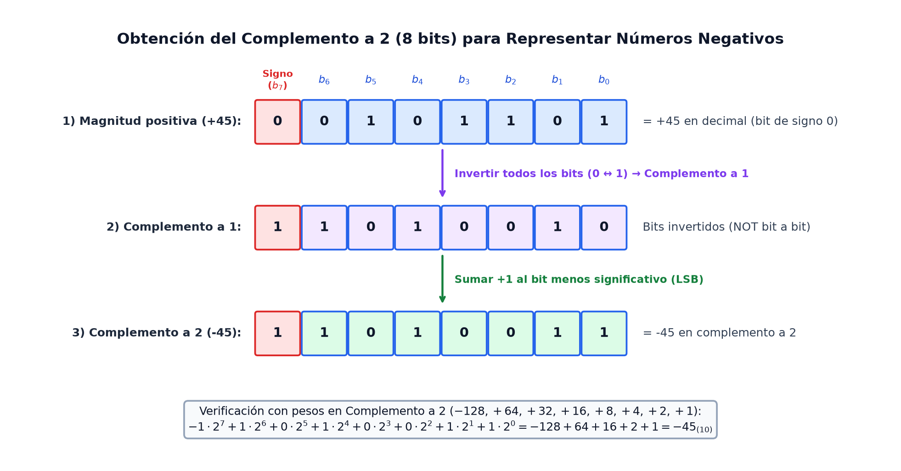

# 1.3 Operaciones básicas (Suma, Resta, Multiplicación, División)

## Principio General de la Aritmética en Base $b$

Las operaciones aritméticas fundamentales (**suma**, **resta**, **multiplicación** y **división**) obedecen exactamente a las mismas reglas posicionales en cualquier sistema numérico de base $b$ (Jiménez Murillo, 2012; Lipschutz, 1992). La única condición indispensable es que **ambos operandos estén expresados en la misma base $b$** antes de operar (si están en bases distintas, primero debe realizarse la conversión).

---

## 1.3.1 Suma

### Regla general de la suma en base $b$

1. Se alinean verticalmente las cantidades respecto a su **punto radical**, completando con ceros los extremos vacíos si es necesario.
2. Se suman los dígitos columna por columna de **derecha a izquierda**, comenzando por la posición menos significativa.
3. Si la suma $S$ de una columna es **menor que la base** ($S < b$), $S$ es un dígito válido en dicho sistema: se anota directamente debajo de la línea y el acarreo a la siguiente columna es $0$.
4. Si la suma $S$ **iguala o sobrepasa la base** ($S \ge b$), se divide $S$ entre la base $b$:
   $$S = q \cdot b + r \qquad (0 \le r < b)$$
   - El **residuo** $r$ se escribe como resultado debajo de la columna actual.
   - El **cociente** $q$ se lleva como **acarreo** (*carry*) y se suma a la columna inmediata a la izquierda.

### Tabla de adición binaria ($b = 2$)

| Operación | Resultado en base $10$ | División entre $2$ | Suma ($r$) | Acarreo ($q$) |
| :---: | :---: | :---: | :---: | :---: |
| $0 + 0$ | $0$ | $0 \div 2 = 0,\; r = 0$ | $0$ | $0$ |
| $0 + 1$ | $1$ | $1 \div 2 = 0,\; r = 1$ | $1$ | $0$ |
| $1 + 0$ | $1$ | $1 \div 2 = 0,\; r = 1$ | $1$ | $0$ |
| $1 + 1$ | $2$ | $2 \div 2 = 1,\; r = 0$ | $0$ | $1$ (lleva $1$, es decir $10_{(2)}$) |
| $1 + 1 + 1$ | $3$ | $3 \div 2 = 1,\; r = 1$ | $1$ | $1$ (lleva $1$, es decir $11_{(2)}$) |

---

## 1.3.2 Resta

En la operación de resta ($M - S = D$), el número superior se llama **minuendo** ($M$), el inferior **sustraendo** ($S$) y el resultado **diferencia** ($D$). Existen dos métodos equivalentes para realizar la resta directa en cualquier base $b$:

### Método A: Suma de la base al minuendo e incremento al sustraendo (Jiménez Murillo, 2012)

Se opera columna por columna de derecha a izquierda:
1. En la primera columna (extremo derecho), si $\text{sustraendo} \le \text{minuendo}$, se resta normalmente. Si $\text{sustraendo} > \text{minuendo}$, se **suma la base $b$ al minuendo** y luego se efectúa la resta: $(\text{minuendo} + b) - \text{sustraendo}$.
2. A partir de la segunda columna hacia la izquierda:
   - Si en la columna anterior fue necesario sumarle la base $b$ al minuendo, primero **se le suma $1$ al sustraendo** de la columna actual: $\text{sustraendo}' = \text{sustraendo} + 1$.
   - Luego se compara: si $\text{sustraendo}' > \text{minuendo}$, se suma la base $b$ al minuendo antes de restar: $(\text{minuendo} + b) - \text{sustraendo}'$.

### Método B: Préstamo de la columna izquierda (Lipschutz, 1992)

- Si en una columna el dígito del minuendo es menor que el del sustraendo, se toma prestado $1$ de la siguiente columna hacia la izquierda (el cual disminuye en $1$), y ese préstamo vale exactamente **$b$ unidades** en la columna actual. Si la columna izquierda inmediata es un $0$, el préstamo se propaga hasta el primer dígito no nulo a la izquierda, convirtiendo los ceros intermedios en $b - 1$ (en binario se vuelven $1$, en octal $7$, en hexadecimal $\text{F}$).

### Tabla básica de sustracción binaria ($b = 2$)

| Operación | Diferencia | Préstamo requerido |
| :---: | :---: | :--- |
| $0 - 0$ | $0$ | Ninguno |
| $1 - 0$ | $1$ | Ninguno |
| $1 - 1$ | $0$ | Ninguno |
| $0 - 1$ | $1$ | Se requiere sumar la base $2$ al minuendo ($(0+2)-1 = 1$) y llevar/prestar $1$ a la siguiente columna |

---

## 1.3.3 Multiplicación

El algoritmo de multiplicación posicional en base $b$ sigue los mismos pasos que en decimal:

1. Se multiplica cada dígito del **multiplicador** (de derecha a izquierda) por todo el **multiplicando**, generando un **producto parcial** por cada dígito del multiplicador, desplazado un lugar hacia la izquierda respecto al anterior.
2. En cada producto individual $p = d_i \times d_j + \text{acarreo previo}$:
   - Si $p < b$, se escribe directamente.
   - Si $p \ge b$, se divide $p \div b$: el **residuo** se anota en la fila del producto parcial y el **cociente** se lleva como acarreo a la siguiente multiplicación hacia la izquierda.
3. Se suman todos los productos parciales aplicando las reglas de la **suma en base $b$**.
4. El **punto radical** se coloca en el producto final contando la suma total de posiciones fraccionarias que tenían el multiplicando y el multiplicador juntos.

> **Ventaja en binario ($b = 2$):** Como los únicos dígitos del multiplicador son $0$ y $1$, cada producto parcial es simplemente una copia del multiplicando (si el bit es $1$) o una fila de ceros (si el bit es $0$).

---

## 1.3.4 División

La división ($D \div d = c$ con residuo $r$) combina multiplicación y resta, por lo que se recomienda realizarla mediante **división desarrollada** (escribiendo explícitamente cada producto y efectuando la resta paso a paso):

1. **Eliminación del punto radical en el divisor:** Si el divisor tiene cifras fraccionarias, se recorre su punto radical hasta el extremo derecho para convertirlo en un entero en base $b$, y se recorre el punto radical del dividendo **exactamente el mismo número de posiciones** hacia la derecha (agregando ceros si hace falta).
2. Se toman de izquierda a derecha tantas cifras del dividendo como sean necesarias para que formen una cantidad mayor o igual que el divisor.
3. Se estima cuántas veces ($c_i \in \{0, 1, \dots, b-1\}$) cabe el divisor en el dividendo parcial, se multiplica $c_i \times \text{divisor}$ en base $b$ y se resta dicho producto del dividendo parcial en base $b$.
4. Se baja la siguiente cifra del dividendo y se repite el proceso hasta obtener las cifras fraccionarias requeridas.
5. **Comprobación de la división en base $b$:** Toda división debe satisfacer la identidad fundamental en la misma base $b$:
   $$\text{Dividendo} = (\text{Divisor} \times \text{Cociente}) + \text{Residuo}$$

---

## 1.3.5 Representación de Números con Signo y Suma en Complemento a 2

Internamente, la Unidad Aritmético-Lógica (ALU) de una computadora opera sobre palabras de longitud fija ($n$ bits) y realiza las restas transformándolas en **sumas mediante complementos**. Para distinguir números positivos y negativos existen tres esquemas:

1. **Magnitud verdadera (Signo y Magnitud):** El bit más a la izquierda (MSB) es el **bit de signo** ($0 = \text{positivo}$, $1 = \text{negativo}$) y los $n-1$ bits restantes representan la magnitud absoluta en binario.
2. **Complemento a 1 ($C_1$):** Para un número negativo, se conserva el bit de signo en $1$ (o se parte de la representación positiva de $n$ bits) y **se invierten todos los bits de magnitud** (cambiando cada $0$ por $1$ y cada $1$ por $0$).
3. **Complemento a 2 ($C_2$):** Se obtiene **sumando $1$ al bit menos significativo (LSB)** del complemento a 1:
   $$C_2(N) = C_1(N) + 1$$

### Reglas para sumar dos cantidades en Complemento a 2 (Jiménez Murillo, 2012)

- **Cantidades positivas:** Se expresan directamente en binario con su bit de signo $0$ a la izquierda.
- **Cantidades negativas:** Antes de sumar, **toda cantidad negativa debe convertirse a su complemento a 2**.
- **Efectuar la suma binaria** de ambas cantidades (incluyendo el bit de signo):
  - Si se genera un **acarreo final** fuera del bit de signo, dicho acarreo **se descarta**.
  - Si el bit de signo del resultado es **$0$**, el resultado es **positivo** y ya se encuentra en su magnitud verdadera.
  - Si el bit de signo del resultado es **$1$**, el resultado es **negativo** y se encuentra en complemento a 2; para conocer su magnitud verdadera se le aplica nuevamente el **complemento a 2** al resultado.
- **Desbordamiento (*overflow*):** Ocurre únicamente cuando se suman dos cantidades del **mismo signo** y la magnitud resultante excede la capacidad de los bits disponibles (lo que provoca que el bit de signo cambie erróneamente: dos positivos dan signo $1$, o dos negativos dan signo $0$). Nunca hay desbordamiento al sumar dos cantidades de signos opuestos. Para evitarlo, se amplía el tamaño de palabra (por ejemplo, de $8$ bits a $16$ bits).

---

## Ejemplos de Práctica (Resueltos Paso a Paso)

### Ejemplo 1.1: Suma en Binario, Octal y Hexadecimal
Realice las siguientes sumas detallando el cálculo columna por columna:
a) $11011.01_{(2)} + 101.1101_{(2)}$  
b) $7346_{(8)} + 5263_{(8)}$  
c) $\text{A}6\text{FC}9.7\text{B}2_{(16)} + 4\text{E}7\text{D}0.73\text{E}_{(16)}$

**Solución:**

#### a) Suma en binario ($b = 2$):
Alineamos el punto binario y completamos con ceros:
$$\begin{array}{r@{\quad}l}
  11011.0100_{(2)} & \\
+\; 00101.1101_{(2)} & \\
\hline
 100001.0001_{(2)} &
\end{array}$$
- Columna $-4$: $0 + 1 = 1$.
- Columna $-3$: $0 + 0 = 0$.
- Columna $-2$: $1 + 1 = 2 \implies 2 \div 2 = 1$ con residuo **$0$** (lleva $1$).
- Columna $-1$: $1 + 0 + 1 = 2 \implies$ residuo **$0$** (lleva $1$).
- Columna $0$: $1 + 1 + 1 = 3 \implies 3 \div 2 = 1$ con residuo **$1$** (lleva $1$).
- Columna $1$: $1 + 1 + 0 = 2 \implies$ residuo **$0$** (lleva $1$).
- Columna $2$: $1 + 0 + 1 = 2 \implies$ residuo **$0$** (lleva $1$).
- Columna $3$: $1 + 1 + 0 = 2 \implies$ residuo **$0$** (lleva $1$).
- Columna $4$: $1 + 1 + 0 = 2 \implies$ residuo **$0$** y acarreo final **$1$** $\implies 100001.0001_{(2)}$.

#### b) Suma en octal ($b = 8$):
- Columna $0$: $6 + 3 = 9 \implies 9 \div 8 = 1$, residuo **$1$** (lleva $1$).
- Columna $1$: $1 + 4 + 6 = 11 \implies 11 \div 8 = 1$, residuo **$3$** (lleva $1$).
- Columna $2$: $1 + 3 + 2 = 6 < 8 \implies$ se anota **$6$** (lleva $0$).
- Columna $3$: $7 + 5 = 12 \implies 12 \div 8 = 1$, residuo **$4$** y acarreo **$1$** $\implies 14631_{(8)}$.

#### c) Suma en hexadecimal ($b = 16$):
$$\begin{array}{r}
  \text{A}6\text{FC}9.7\text{B}2_{(16)} \\
+\; 4\text{E}7\text{D}0.73\text{E}_{(16)} \\
\hline
  \text{F}5799.\text{EF}0_{(16)}
\end{array}$$
- Columna $-3$: $2 + \text{E}(14) = 16 \implies 16 \div 16 = 1$, residuo **$0$** (lleva $1$).
- Columna $-2$: $1 + \text{B}(11) + 3 = 15 = \mathbf{F}$ (lleva $0$).
- Columna $-1$: $7 + 7 = 14 = \mathbf{E}$ (lleva $0$).
- Columna $0$: $9 + 0 = \mathbf{9}$.
- Columna $1$: $\text{C}(12) + \text{D}(13) = 25 \implies 25 \div 16 = 1$, residuo **$9$** (lleva $1$).
- Columna $2$: $1 + \text{F}(15) + 7 = 23 \implies 23 \div 16 = 1$, residuo **$7$** (lleva $1$).
- Columna $3$: $1 + 6 + \text{E}(14) = 21 \implies 21 \div 16 = 1$, residuo **$5$** (lleva $1$).
- Columna $4$: $1 + \text{A}(10) + 4 = 15 = \mathbf{F}$. Resultado: $\text{F}5799.\text{EF}0_{(16)}$.

---

### Ejemplo 1.2: Resta en Binario y en Octal
Efectúe las siguientes restas explicando cada columna:
a) $1101.101_{(2)} - 11.10111_{(2)}$  
b) $41072.14_{(8)} - 36043.713_{(8)}$

**Solución:**

#### a) Resta en binario ($b = 2$):
Completamos con ceros para igualar posiciones fraccionarias:
$$\begin{array}{r}
  1101.10100_{(2)} \\
-\; 0011.10111_{(2)} \\
\hline
  1001.11101_{(2)}
\end{array}$$
- Columna $-5$: $(0 + 2) - 1 = \mathbf{1}$ (se sumó la base $2$ al minuendo).
- Columna $-4$: $(0 + 2) - (1 + 1) = \mathbf{0}$ (sustraendo aumentó a $2$, se sumó base $2$ al minuendo).
- Columna $-3$: $1 - (1 + 1) \implies (1 + 2) - 2 = \mathbf{1}$ (se sumó base $2$ al minuendo).
- Columna $-2$: $(0 + 2) - (0 + 1) = \mathbf{1}$ (se sumó base $2$ al minuendo).
- Columna $-1$: $1 - (1 + 1) \implies (1 + 2) - 2 = \mathbf{1}$ (se sumó base $2$ al minuendo).
- Columna $0$: $1 - (1 + 1) \implies (1 + 2) - 2 = \mathbf{1}$ (se sumó base $2$ al minuendo).
- Columna $1$: $(0 + 2) - (1 + 1) = \mathbf{0}$ (se sumó base $2$ al minuendo).
- Columna $2$: $1 - (0 + 1) = \mathbf{0}$.
- Columna $3$: $1 - 0 = \mathbf{1}$. Resultado: $1001.11101_{(2)}$.

#### b) Resta en octal ($b = 8$):
$$\begin{array}{r}
  41072.140_{(8)} \\
-\; 36043.713_{(8)} \\
\hline
  03026.225_{(8)}
\end{array}$$
- Columna $-3$: $(0 + 8) - 3 = \mathbf{5}$ (se sumó la base $8$).
- Columna $-2$: $4 - (1 + 1) = \mathbf{2}$.
- Columna $-1$: $(1 + 8) - 7 = \mathbf{2}$ (se sumó la base $8$).
- Columna $0$: $(2 + 8) - (3 + 1) = 10 - 4 = \mathbf{6}$ (se sumó la base $8$).
- Columna $1$: $7 - (4 + 1) = \mathbf{2}$.
- Columna $2$: $0 - 0 = \mathbf{0}$.
- Columna $3$: $(1 + 8) - 6 = \mathbf{3}$ (se sumó la base $8$).
- Columna $4$: $4 - (3 + 1) = \mathbf{0}$. Resultado: $3026.225_{(8)}$.

---

### Ejemplo 1.3: Multiplicación y División Desarrollada
a) Multiplique $10011.01_{(2)} \times 1.101_{(2)}$.  
b) Divida $1\text{AF}578.2\text{B}_{(16)} \div \text{A}.7\text{E}2_{(16)}$ hasta obtener una cifra fraccionaria y compruebe el resultado.

**Solución:**

#### a) Multiplicación binaria:
$$\begin{array}{r}
        10011.01_{(2)} \\
\times \quad 1.101_{(2)} \\
\hline
        1001101\phantom{000} \\
       0000000\phantom{00} \\
      1001101\phantom{0} \\
+\;  1001101 \\
\hline
    11111.01001_{(2)}
\end{array}$$
Como los factores tienen $2$ y $3$ posiciones binarias fraccionarias respectivamente, el producto tiene $2 + 3 = 5$ cifras después del punto: $11111.01001_{(2)}$ (en decimal: $19.25 \times 1.625 = 31.28125$).

#### b) División hexadecimal ($b = 16$):
Recorremos el punto hexadecimal $3$ lugares a la derecha tanto en el divisor ($\text{A}7\text{E}2_{(16)}$) como en el dividendo ($1\text{AF}5782\text{B}0_{(16)}$):
- $1\text{AF}57_{(16)} \div \text{A}7\text{E}2_{(16)} = \mathbf{2}$, pues $2 \times \text{A}7\text{E}2_{(16)} = 14\text{FC}4_{(16)}$. Restando: $1\text{AF}57 - 14\text{FC}4 = 05\text{F}93_{(16)}$.
- Bajamos el $8 \to 5\text{F}938_{(16)} \div \text{A}7\text{E}2_{(16)} = \mathbf{9}$, pues $9 \times \text{A}7\text{E}2_{(16)} = 5\text{E}6\text{F}2_{(16)}$. Restando: $5\text{F}938 - 5\text{E}6\text{F}2 = 1246_{(16)}$.
- Bajamos el $2 \to 12462_{(16)} \div \text{A}7\text{E}2_{(16)} = \mathbf{1}$. Restando: $12462 - \text{A}7\text{E}2 = 7\text{C}80_{(16)}$.
- Bajamos el $\text{B} \to 7\text{C}80\text{B}_{(16)} \div \text{A}7\text{E}2_{(16)} = \mathbf{B}(11)$, pues $\text{B} \times \text{A}7\text{E}2_{(16)} = 736\text{B}6_{(16)}$. Restando: $7\text{C}80\text{B} - 736\text{B}6 = 9155_{(16)}$.
- Bajamos el $0 \to 91550_{(16)} \div \text{A}7\text{E}2_{(16)} = \mathbf{D}(13)$, pues $\text{D} \times \text{A}7\text{E}2_{(16)} = 8867\text{A}_{(16)}$. Restando: $91550 - 8867\text{A} = 8\text{ED}6_{(16)}$.
- Para obtener un dígito después del punto, agregamos un $0 \to 8\text{ED}60_{(16)} \div \text{A}7\text{E}2_{(16)} = \mathbf{D}(13)$. Restando: $8\text{ED}60 - 8867\text{A} = 66\text{E}6_{(16)}$.
- **Resultado:** Cociente $= 291\text{BD}.\text{D}_{(16)}$ y residuo $= 66\text{E}.6_{(16)}$ (respecto al dividendo desplazado).
- **Comprobación:** $291\text{BD}.\text{D}_{(16)} \times \text{A}7\text{E}2_{(16)} + 66\text{E}.6_{(16)} = 1\text{AF}577\text{C}41.\text{A}_{(16)} + 66\text{E}.6_{(16)} = 1\text{AF}5782\text{B}0.0_{(16)}$.

---

### Ejemplo 1.4: Suma algebraica en Complemento a 2
Usando registros de $1$ byte ($8$ bits, o $16$ bits si ocurre desbordamiento), efectúe en complemento a 2:
a) $A = -225_{(10)}$ más $B = +76_{(10)}$ (con $9$ bits: $1$ bit de signo y $8$ de magnitud).  
b) $A = -225_{(10)}$ más $B = -76_{(10)}$ evitando el desbordamiento.

**Solución:**

#### a) $(-225) + (+76) = -149$:
1. En magnitud verdadera:
   - $-225_{(10)} = 1\;11100001_{(2)}$
   - $+76_{(10)} = 0\;01001100_{(2)}$
2. Obtenemos el complemento a 2 de la cantidad negativa ($-225$):
   - Complemento a 1 (conservando el bit de signo $1$): $1\;00011110_{(2)}$
   - Sumamos $+1$: $1\;00011111_{(2)}$ (Complemento a 2 de $-225$).
3. Sumamos ambas cantidades:
   $$\begin{array}{r@{\quad}l}
     1\;00011111_{(2)} & (-225 \text{ en } C_2) \\
   +\; 0\;01001100_{(2)} & (+76) \\
   \hline
     1\;01101011_{(2)} & (\text{Bit de signo } 1 \implies \text{Resultado negativo en } C_2)
   \end{array}$$
4. Como el resultado es negativo (bit de signo $= 1$), lo complementamos a 2 para conocer su magnitud verdadera:
   - Complemento a 1: $1\;10010100_{(2)}$
   - Más $1$: $1\;10010101_{(2)} = -(128 + 16 + 4 + 1) = -149_{(10)}$.

#### b) $(-225) + (-76) = -301$:
Como $|-225 + (-76)| = 301 > 255$, en $8$ bits de magnitud ocurriría **desbordamiento**, por lo que ampliamos a $2$ bytes ($16$ bits: $1$ de signo y $15$ de magnitud):
- $-225$ en $C_2$ ($16$ bits): $1\;111111100011111_{(2)}$
- $-76$ en $C_2$ ($16$ bits): $1\;111111110110100_{(2)}$
- Suma: $(1)\;1\;111111011010011_{(2)}$ (se descarta el acarreo externo y, al ser negativo, se complementa a 2):
- Magnitud verdadera del resultado: $1\;000000100101101_{(2)} = -(256 + 32 + 8 + 4 + 1) = -301_{(10)}$.

---

## Ejercicios de Tarea (Práctica en Casa)

> **Instrucciones:** Resuelva cada operación mostrando los acarreos, préstamos, productos parciales y comprobaciones correspondientes.

1. **Suma en diferentes sistemas numéricos (Jiménez Murillo, Prob. 1.5):**  
   Efectúe las siguientes sumas directamente en la base indicada:  
   a) $11001110.0111_{(2)} + 1101011.1101_{(2)}$  
   b) $3\text{A}567\text{B}.12_{(13)} + 9\text{C}0172.34_{(13)}$  
   c) $42061231.325_{(7)} + 5014232.03_{(7)}$  
   d) $82\text{C}5.9\text{D}_{(16)} + 9\text{D}86.\text{E}8_{(16)}$
   <!--
   Solución del Ejercicio 1:
   - a) En base 2:
        11001110.0111_(2) + 01101011.1101_(2) = 100111010.0100_(2).
        (Verificación decimal: 206.4375 + 107.8125 = 314.25 = 256+32+16+8+2 + 0.25).
   - b) En base 13 (dígitos 0..9, A=10, B=11, C=12):
        Parte fraccionaria: .12 + .34 = .46_(13).
        Parte entera:
        Col 0: B(11) + 2 = 13 --> 13÷13 = 1 r 0 (lleva 1)
        Col 1: 1 + 7 + 7 = 15 --> 15÷13 = 1 r 2 (lleva 1)
        Col 2: 1 + 6 + 1 = 8
        Col 3: 5 + 0 = 5
        Col 4: A(10) + C(12) = 22 --> 22÷13 = 1 r 9 (lleva 1)
        Col 5: 1 + 3 + 9 = 13 --> 13÷13 = 1 r 0 (lleva 1)
        Resultado b): 1095820.46_(13).
   - c) En base 7:
        Parte fraccionaria: .325 + .030 = .355_(7).
        Parte entera:
        1+2 = 3; 3+3 = 6; 2+2 = 4; 1+4 = 5; 6+1 = 7 --> 0 (lleva 1); 1+0+0 = 1; 2+5 = 7 --> 0 (lleva 1); 1+4 = 5.
        Resultado c): 50105463.355_(7).
   - d) En base 16:
        Parte fraccionaria: D(13)+8 = 21 = 16+5 --> 5 (lleva 1); 1+9+E(14) = 24 = 16+8 --> 8 (lleva 1).
        Parte entera: 1+5+6 = 12(C); C(12)+8 = 20 = 16+4 --> 4 (lleva 1); 1+2+D(13) = 16 --> 0 (lleva 1); 1+8+9 = 18 = 16+2 --> 12.
        Resultado d): 1204C.85_(16).
   -->

2. **Resta en diferentes sistemas numéricos (Jiménez Murillo, Prob. 1.7 y 1.8):**  
   Realice las siguientes restas directamente en su base y compruebe su resultado sumando la diferencia más el sustraendo:  
   a) $1000110.001_{(2)} - 110011.101_{(2)}$  
   b) $\text{A}7501\text{B}3.\text{E}_{(16)} - 91\text{D}35\text{CB}.8\text{C}_{(16)}$  
   c) $5347012.12_{(9)} - 3725408.67_{(9)}$
   <!--
   Solución del Ejercicio 2:
   - a) En base 2:
        1000110.001_(2) - 0110011.101_(2) = 0010010.100_(2) = 10010.1_(2).
        (Verificación decimal: 70.125 - 51.625 = 18.5 = 10010.1_(2)).
   - b) En base 16:
        A7501B3.E0_(16) - 91D35CB.8C_(16):
        Fracción: (0+16)-C(12) = 4; E(14)-(8+1) = 5 --> .54_(16).
        Enteros:
        (3+16)-B(11) = 8;
        (B(11)+16)-(C(12)+1) = 27-13 = 14 (E);
        (1+16)-(5+1) = 11 (B);
        (0+16)-(3+1) = 12 (C);
        (5+16)-(D(13)+1) = 7;
        7-(1+1) = 5;
        A(10)-9 = 1.
        Resultado b): 157CBE8.54_(16).
   - c) En base 9:
        5347012.12_(9) - 3725408.67_(9):
        Fracción: (2+9)-7 = 4; (1+9)-(6+1) = 3 --> .34_(9).
        Enteros:
        (2+9)-(8+1) = 2;
        1-(0+1) = 0;
        (0+9)-4 = 5;
        7-(5+1) = 1;
        4-2 = 2;
        (3+9)-7 = 5;
        5-(3+1) = 1.
        Resultado c): 1521502.34_(9).
   -->

3. **Multiplicación y División en distintas bases:**  
   a) Multiplique en binario: $111001_{(2)} \times 1011_{(2)}$ y $11.101_{(2)} \times 11.01_{(2)}$.  
   b) Multiplique en octal: $670143.2_{(8)} \times 53.24_{(8)}$.  
   c) Divida en binario hasta dos posiciones fraccionarias: $111001_{(2)} \div 1001_{(2)}$.
   <!--
   Solución del Ejercicio 3:
   - a) 111001_(2) × 1011_(2):
        57 × 11 = 627_(10) = 1001110011_(2).
        11.101_(2) × 11.01_(2):
        (3.625 × 3.25 = 11.78125_(10)) = 1011.11001_(2).
   - b) 670143.2_(8) × 53.24_(8):
        Productos parciales en base 8:
        × 4: 33406150
        × 2: 15603064
        × 3: 24504516
        × 5: 42307572
        Suma octal (con 3 posiciones fraccionarias): 45172264.610_(8).
   - c) 111001.00_(2) ÷ 1001_(2) (57 ÷ 9 en decimal = 6.25, con residuo):
        111001 ÷ 1001:
        11100 - 1001 = 1001;
        bajando 1: 10011 - 1001 = 1010;
        cociente entero = 110_(2) (6), residuo entero = 11_(2) (3).
        Agregando .00:
        110 - no cabe (0);
        1100 - 1001 = 11 (1).
        Cociente hasta 2 decimales binarios: 110.01_(2) con residuo 0.0011_(2).
   -->

4. **Aritmética en Complemento a 2 (Jiménez Murillo, Prob. 1.14):**  
   Considere dos variables enteras que ocupan inicialmente $1$ byte en memoria ($1$ bit de signo y $7$ bits de magnitud, o amplíe a $2$ bytes si detecta desbordamiento). Realice las siguientes operaciones mediante suma en complemento a 2:  
   a) $+195_{(10)} + 76_{(10)}$  
   b) $-195_{(10)} + 76_{(10)}$  
   c) $+195_{(10)} - 76_{(10)}$  
   d) $-195_{(10)} - 76_{(10)}$
   <!--
   Solución del Ejercicio 4:
   Nota: Como 195_(10) = 11000011_(2) requiere 8 bits tan sólo para su magnitud (más 1 bit de signo = 9 bits), un solo byte de 8 bits (1 signo + 7 magnitud, máx 127) es insuficiente; por tanto, se amplía a 2 bytes (16 bits: 1 bit de signo + 15 bits de magnitud).
   Representaciones en 16 bits:
   +195 = 0 000000011000011_(2);  -195 en C2 = 1 111111100111101_(2).
   +76  = 0 000000001001100_(2);  -76  en C2 = 1 111111110110100_(2).
   - a) (+195) + (+76):
        0 000000011000011 + 0 000000001001100 = 0 000000100001111_(2) = +271_(10).
   - b) (-195) + (+76):
        1 111111100111101 + 0 000000001001100 = 1 111111110001001_(2) (negativo en C2).
        Complementando a 2 el resultado: 1 000000001110111_(2) = -119_(10).
   - c) (+195) + (-76):
        0 000000011000011 + 1 111111110110100 = (1) 0 000000001110111_(2).
        Descartando acarreo externo, signo 0 (positivo): +119_(10).
   - d) (-195) + (-76):
        1 111111100111101 + 1 111111110110100 = (1) 1 111111011110001_(2) (negativo en C2).
        Complementando a 2 el resultado: 1 000000100001111_(2) = -271_(10).
   -->
