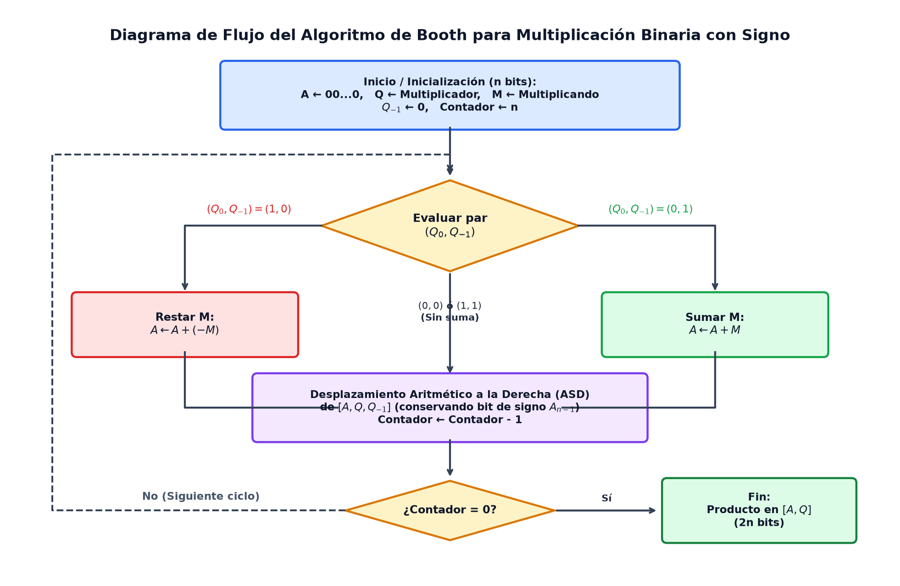
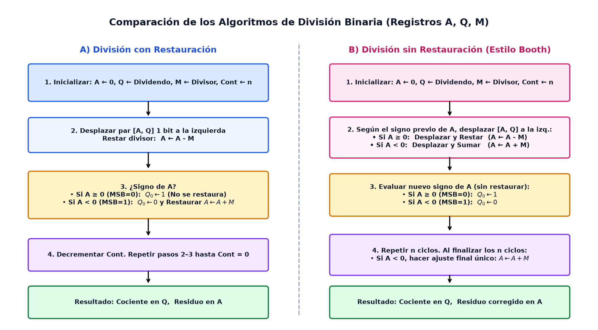

# 1.4 Algoritmos de Booth para la multiplicación y división en binario

## Introducción: Aritmética Binaria a Nivel de Registros (ALU)

En el diseño de procesadores digitales, las operaciones de **multiplicación** y **división** de enteros binarios se implementan en hardware utilizando **registros de desplazamiento** y un **sumador/restador en complemento a 2**.

En 1950, **Andrew Donald Booth** propuso un algoritmo uniforme y eficiente que permite multiplicar directamente dos números binarios **con signo en complemento a 2** sin necesidad de convertirlos primero a magnitud positiva ni calcular por separado el signo del resultado. Asimismo, en la unidad aritmético-lógica (ALU) la división binaria se ejecuta mediante desplazamientos y sumas/restas sucesivas a través de los algoritmos **con restauración** y **sin restauración** (este último análogo al principio de Booth al sustituir cadenas de restas y restauraciones por sumas y restas alternadas según el signo del residuo parcial).

---

## Multiplicación: Algoritmo de Booth

### Fundamento matemático de la recodificación de Booth

Supongamos que el multiplicador $Q$ contiene una cadena continua de bits iguales a $1$ desde la posición $i$ hasta la posición $j$ (con $j > i$). Por ejemplo, en $Q = 00111100_{(2)}$ hay unos desde $i = 2$ hasta $j = 5$:

$$2^5 + 2^4 + 2^3 + 2^2 = 32 + 16 + 8 + 4 = 60$$

Por propiedad de las potencias de $2$, toda cadena de unos consecutivos desde $2^i$ hasta $2^j$ puede reescribirse como **una sola suma y una sola resta**:

$$\sum_{k=i}^{j} 2^k = 2^{j+1} - 2^i \qquad \text{(en el ejemplo: } 2^6 - 2^2 = 64 - 4 = 60\text{)}$$

De este modo, al recorrer los bits del multiplicador de derecha a izquierda inspeccionando el bit actual $Q_0$ y el bit inmediatamente anterior $Q_{-1}$:
- Cuando aparece la transición **$1 \leftarrow 0$** ($(Q_0, Q_{-1}) = (1, 0)$, inicio de una cadena de unos), se **resta** el multiplicando ($A \leftarrow A - M$).
- Mientras se permanece dentro de una cadena de unos **$(1, 1)$** o de ceros **$(0, 0)$**, **no se realiza ninguna operación aritmética**, sólo se desplaza.
- Cuando aparece la transición **$0 \leftarrow 1$** ($(Q_0, Q_{-1}) = (0, 1)$, fin de la cadena de unos), se **suma** el multiplicando ($A \leftarrow A + M$).

---

### Arquitectura de Registros del Algoritmo de Booth

Para multiplicar dos enteros con signo de $n$ bits expresados en **complemento a 2** (cuidando que $n$ sea al menos $1$ bit mayor que los bits requeridos por la magnitud del operando de mayor valor absoluto):

1. **$M$ (Multiplicando):** Registro de $n$ bits que almacena el multiplicando en complemento a 2. También se calcula de antemano **$-M$** (el complemento a 2 de $M$) para efectuar las restas como sumas $A + (-M)$.
2. **$A$ (Acumulador):** Registro de $n$ bits, inicializado en ceros (`00...0`).
3. **$Q$ (Multiplicador):** Registro de $n$ bits, inicializado con el multiplicador en complemento a 2. Su bit menos significativo (más a la derecha) se denota como **$Q_0$**.
4. **$Q_{-1}$ (Bit auxiliar):** Registro de $1$ solo bit colocado a la derecha de $Q_0$, inicializado siempre en **`0`**.
5. **Contador ($n$):** Inicializado con el número de bits $n$ de los registros; indica el número exacto de ciclos a ejecutar.

### Tabla de Decisiones de Booth y Desplazamiento Aritmético (ASD)

En cada uno de los $n$ ciclos se inspecciona el par de bits **$(Q_0, Q_{-1})$**:

| Bit $Q_0$ | Bit $Q_{-1}$ | Interpretación en la cadena de bits | Acción en el ciclo (antes de desplazar) | Paso posterior obligatorio |
| :---: | :---: | :--- | :--- | :--- |
| **$0$** | **$0$** | En medio de una cadena de $0\text{s}$ | **Ninguna operación** aritmética | Desplazamiento aritmético a la derecha (**ASD**) |
| **$0$** | **$1$** | Fin de una cadena de $1\text{s}$ | **Sumar** el multiplicando: $A \leftarrow A + M$ | Desplazamiento aritmético a la derecha (**ASD**) |
| **$1$** | **$0$** | Inicio de una cadena de $1\text{s}$ | **Restar** el multiplicando: $A \leftarrow A + (-M)$ | Desplazamiento aritmético a la derecha (**ASD**) |
| **$1$** | **$1$** | En medio de una cadena de $1\text{s}$ | **Ninguna operación** aritmética | Desplazamiento aritmético a la derecha (**ASD**) |

> **¿Cómo funciona el Desplazamiento Aritmético a la Derecha (ASD)?**  
> Los registros concatenados $[A,\; Q,\; Q_{-1}]$ ($2n + 1$ bits en total) se desplazan **una posición hacia la derecha**:
> - El bit de signo de $A$ ($A_{n-1}$, extremo izquierdo) **se conserva y se duplica** en la nueva posición $A_{n-1}$ (extensión de signo).
> - El bit menos significativo de $A$ ($A_0$) pasa a ser el bit más significativo de $Q$ ($Q_{n-1}$).
> - El bit $Q_0$ pasa a ocupar el registro $Q_{-1}$ (y el valor anterior de $Q_{-1}$ se descarta).
> - Al concluir los $n$ ciclos, el producto final de $2n$ bits en complemento a 2 se lee directamente concatenando **$[A,\; Q]$** (ignorando $Q_{-1}$).

---

## División: Algoritmos con Restauración y sin Restauración

Para dividir un **dividendo** de $n$ bits entre un **divisor** de $n$ bits en binario ($\text{Dividendo} \div \text{Divisor}$), la ALU utiliza tres registros:
- **$M$ (Divisor):** Registro de $n+1$ bits (con un bit de signo $0$ a la izquierda) que contiene al divisor; se calcula también **$-M$** en complemento a 2.
- **$A$ (Acumulador / Residuo parcial):** Registro de $n+1$ bits, inicializado en **`00...0`**.
- **$Q$ (Dividendo / Cociente):** Registro de $n$ bits, inicializado con el **dividendo**. Conforme avanza el algoritmo, sus bits se desplazan a la izquierda y por la derecha ($Q_0$) se van insertando los bits del **cociente**.
- **Contador ($n$):** Igual al número de bits $n$ del registro $Q$.

### 1. Algoritmo de División Binaria con Restauración

En cada uno de los $n$ ciclos:
1. **Desplazamiento lógico a la izquierda (SL):** Se desplaza un bit hacia la izquierda la dupla concatenada $[A,\; Q]$ (el bit más significativo de $Q$ entra por la derecha de $A$, dejando vacante el bit $Q_0$).
2. **Resta de prueba:** Se resta el divisor del acumulador:
   $$A \leftarrow A - M = A + (-M)$$
3. **Verificación del signo de $A$ (bit más a la izquierda de $A$):**
   - **Si $A \ge 0$ (bit de signo de $A = 0$):** El divisor sí cabe. Se fija **$Q_0 \leftarrow 1$** y se conserva el valor actual de $A$.
   - **Si $A < 0$ (bit de signo de $A = 1$):** El divisor no cabe (la resta se excedió). Se fija **$Q_0 \leftarrow 0$** y **se restaura** el valor previo del acumulador sumándole $M$:
     $$A \leftarrow A + M$$
4. Al terminar los $n$ ciclos: el **cociente** queda en **$Q$** y el **residuo** en **$A$**.

### 2. Algoritmo de División Binaria sin Restauración (No Restauradora)

Observemos que si en el ciclo $k$ la resta dejó a $A$ negativo ($A_{\text{restaurado}} = A + M$) y en el ciclo $k+1$ desplazamos a la izquierda (lo que multiplica por $2$) y volvemos a restar $M$, estaríamos calculando:

$$2(A + M) - M = 2A + 2M - M = 2A + M$$

Por lo tanto, **no es necesario restaurar $A$ cuando da negativo**: basta con desplazar $[A,\; Q]$ a la izquierda en el siguiente ciclo y **sumar $M$** en lugar de restarlo.

**Pasos por cada uno de los $n$ ciclos:**
1. Se revisa el signo que tiene $A$ al iniciar el ciclo y se desplaza $[A,\; Q]$ un bit a la izquierda:
   - **Si $A \ge 0$ (signo $0$):** después de desplazar, se **resta** $M$: $A \leftarrow A - M$.
   - **Si $A < 0$ (signo $1$):** después de desplazar, se **suma** $M$: $A \leftarrow A + M$.
2. Según el **nuevo** signo resultante en $A$:
   - Si $A \ge 0$ (signo $0$) $\implies$ se asigna **$Q_0 \leftarrow 1$**.
   - Si $A < 0$ (signo $1$) $\implies$ se asigna **$Q_0 \leftarrow 0$**.
3. **Ajuste final único (tras completar los $n$ ciclos):** Si al terminar el último ciclo el registro $A$ quedó negativo ($A < 0$), se efectúa una única restauración final del residuo:
   $$A \leftarrow A + M$$
   Finalmente, **$Q$** contiene el **cociente** y **$A$** contiene el **residuo**.

> **División con operandos con signo:** Cuando el dividendo y el divisor tienen signos arbitrarios, se aplica la división sobre sus magnitudes positivas y al final se asigna el signo del cociente mediante la regla de los signos ($\text{signo}(Q) = \text{signo}(D) \oplus \text{signo}(d)$, es decir, negativo si los signos difieren, tomando su complemento a 2) y al residuo se le asigna el mismo signo del dividendo de modo que $D = d \cdot Q + R$.

---

## Ejemplos de Práctica (Resueltos Paso a Paso)

### Ejemplo 1.1: Multiplicación con el Algoritmo de Booth ($+7 \times (-3)$ en $n = 4$ bits)
Multiplique $M = +7_{(10)}$ por $Q = -3_{(10)}$ utilizando el algoritmo de Booth con registros de $n = 4$ bits.

**Solución:**
1. **Codificación de los operandos en $4$ bits (complemento a 2):**
   - Multiplicando: $M = +7_{(10)} = 0111_{(2)}$.
   - Complemento a 2 de $M$: $-M = -7_{(10)} = 1000 + 1 = 1001_{(2)}$.
   - Multiplicador: $Q = -3_{(10)}$. Como $+3 = 0011_{(2)}$, su complemento a 2 es $Q = 1101_{(2)}$.
   - Inicialización: $A = 0000$, $Q = 1101$, $Q_{-1} = 0$, $\text{Contador} = 4$.

2. **Tabla de ejecución ciclo por ciclo:**

| Ciclo | Par $(Q_0, Q_{-1})$ | Operación ejecutada | Registro $A$ | Registro $Q$ | Bit $Q_{-1}$ | Comentario |
| :---: | :---: | :--- | :---: | :---: | :---: | :--- |
| **Inicio** | — | Valores iniciales | `0000` | `1101` | `0` | $M = 0111,\; -M = 1001$ |
| **1** | $(1, 0)$ | $A \leftarrow A + (-M) = 0000 + 1001$ Desplazamiento ASD | `1001` **`1100`** | `1101` **`1110`** | `0` **`1`** | Resta $M$ Se duplica $A_3 = 1$ |
| **2** | $(0, 1)$ | $A \leftarrow A + M = 1100 + 0111$ Desplazamiento ASD | `0011` **`0001`** | `1110` **`1111`** | `1` **`0`** | Suma $M$ (se ignora acarreo) Se duplica $A_3 = 0$ |
| **3** | $(1, 0)$ | $A \leftarrow A + (-M) = 0001 + 1001$ Desplazamiento ASD | `1010` **`1101`** | `1111` **`0111`** | `0` **`1`** | Resta $M$ Se duplica $A_3 = 1$ |
| **4** | $(1, 1)$ | Sin operación aritmética Desplazamiento ASD | `1101` **`1110`** | `0111` **`1011`** | `1` **`1`** | Fin de los $4$ ciclos |

3. **Interpretación del resultado $[A,\; Q]$:**
   - El producto en $8$ bits es $[A,\; Q] = 11101011_{(2)}$.
   - Como el bit más significativo es $1$, el resultado es **negativo** en complemento a 2. Obtenemos su magnitud aplicando complemento a 2:
     $$\text{Complemento a 1 de } 11101011_{(2)} = 00010100_{(2)} \xrightarrow{+1} 00010101_{(2)} = 16 + 4 + 1 = 21_{(10)}$$
   - Por lo tanto, $[A,\; Q] = \mathbf{-21_{(10)}}$, lo cual comprueba exactamente que $(+7) \times (-3) = -21$.

---

### Ejemplo 1.2: Multiplicación de dos negativos con el Algoritmo de Booth ($(-5) \times (-6)$ en $n = 4$ bits)
Multiplique $M = -5_{(10)}$ por $Q = -6_{(10)}$ empleando el algoritmo de Booth con registros de $n = 4$ bits.

**Solución:**
1. **Preparación de registros ($n = 4$):**
   - $+5 = 0101_{(2)} \implies M = -5 = 1011_{(2)}$, y por tanto $-M = +5 = 0101_{(2)}$.
   - $+6 = 0110_{(2)} \implies Q = -6 = 1010_{(2)}$.
   - Estado inicial: $A = 0000$, $Q = 1010$, $Q_{-1} = 0$, $\text{Contador} = 4$.

2. **Tabla de ejecución paso a paso:**

| Ciclo | Par $(Q_0, Q_{-1})$ | Operación ejecutada | Registro $A$ | Registro $Q$ | Bit $Q_{-1}$ |
| :---: | :---: | :--- | :---: | :---: | :---: |
| **Inicio** | — | Inicialización | `0000` | `1010` | `0` |
| **1** | $(0, 0)$ | Sólo ASD | **`0000`** | **`0101`** | **`0`** |
| **2** | $(1, 0)$ | $A \leftarrow A + (-M) = 0000 + 0101$ ASD | `0101` **`0010`** | `0101` **`1010`** | `0` **`1`** |
| **3** | $(0, 1)$ | $A \leftarrow A + M = 0010 + 1011$ ASD | `1101` **`1110`** | `1010` **`1101`** | `1` **`0`** |
| **4** | $(1, 0)$ | $A \leftarrow A + (-M) = 1110 + 0101$ ASD | `0011` **`0001`** | `1101` **`1110`** | `0` **`1`** |

3. **Resultado final:**
   $$[A,\; Q] = 00011110_{(2)} = +(16 + 8 + 4 + 2) = \mathbf{+30_{(10)}}$$
   Se verifica que $(-5) \times (-6) = +30$.

---

### Ejemplo 1.3: División Binaria con Restauración ($11_{(10)} \div 3_{(10)}$)
Divida $11_{(10)} = 1011_{(2)}$ entre $3_{(10)} = 0011_{(2)}$ usando el algoritmo de división **con restauración** ($n = 4$ bits para $Q$ y $5$ bits para $A$ y $M$).

**Solución:**
1. **Inicialización:**
   - Dividendo: $Q = 1011_{(2)}$ ($4$ bits, $\text{Contador} = 4$).
   - Divisor ($5$ bits): $M = 00011_{(2)} \implies -M = 11101_{(2)}$ (en complemento a 2 de $5$ bits).
   - Acumulador ($5$ bits): $A = 00000_{(2)}$.

2. **Ejecución de los $4$ ciclos:**

| Ciclo | Paso / Acción | Registro $A$ ($5$ bits) | Registro $Q$ ($4$ bits) | Explicación |
| :---: | :--- | :---: | :---: | :--- |
| **Inicio** |Valores iniciales | `00000` | `1011` | $M = 00011,\; -M = 11101$ |
| **1** | Desplazar izq. $[A, Q]$ Restar $M$: $A \leftarrow A + (-M)$ $A < 0 \implies Q_0 \leftarrow 0$ y Restaurar $A + M$ | `00001` `11110` **`00001`** | `011_` `011_` **`0110`** | Entra $1$ a $A$ Signo de $A$ es $1$ (negativo) Se fija $Q_0=0$ y se restaura $A$ |
| **2** | Desplazar izq. $[A, Q]$ Restar $M$: $A \leftarrow A + (-M)$ $A < 0 \implies Q_0 \leftarrow 0$ y Restaurar $A + M$ | `00010` `11111` **`00010`** | `110_` `110_` **`1100`** | Entra $0$ a $A$ Signo de $A$ es $1$ (negativo) Se fija $Q_0=0$ y se restaura $A$ |
| **3** | Desplazar izq. $[A, Q]$ Restar $M$: $A \leftarrow A + (-M)$ $A \ge 0 \implies Q_0 \leftarrow 1$ (No se restaura) | `00101` **`00010`** | `100_` **`1001`** | Entra $1$ a $A$ ($A=5$) $5 - 3 = 2 \ge 0$ (signo $0$) Se fija $Q_0=1$ |
| **4** | Desplazar izq. $[A, Q]$ Restar $M$: $A \leftarrow A + (-M)$ $A \ge 0 \implies Q_0 \leftarrow 1$ (No se restaura) | `00101` **`00010`** | `001_` **`0011`** | Entra $1$ a $A$ ($A=5$) $5 - 3 = 2 \ge 0$ (signo $0$) Se fija $Q_0=1$ |

3. **Resultado:**
   - **Cociente ($Q$):** $0011_{(2)} = 3_{(10)}$.
   - **Residuo ($A$):** $00010_{(2)} = 2_{(10)}$.
   - Comprobación: $11 = 3 \times 3 + 2$.

---

### Ejemplo 1.4: División Binaria sin Restauración ($11_{(10)} \div 3_{(10)}$)
Resuelva la misma división $11_{(10)} \div 3_{(10)}$ aplicando ahora el algoritmo de división **sin restauración**.

**Solución:**
Con $A = 00000$, $Q = 1011$, $M = 00011$, $-M = 11101$:

| Ciclo | Signo previo de $A$ | Acción realizada | Registro $A$ | Registro $Q$ | Asignación de $Q_0$ |
| :---: | :---: | :--- | :---: | :---: | :--- |
| **Inicio** | $A \ge 0$ (`0`) | Estado inicial | `00000` | `1011` | — |
| **1** | $A \ge 0$ | Desplazar izq. $[A, Q]$ Restar $M$: $00001 + 11101$ | `00001` **`11110`** | `011_` **`0110`** | Como $A < 0 \implies Q_0 \leftarrow 0$ *(No se restaura)* |
| **2** | $A < 0$ | Desplazar izq. $[A, Q]$ Sumar $M$: $11100 + 00011$ | `11100` **`11111`** | `110_` **`1100`** | Como $A < 0 \implies Q_0 \leftarrow 0$ *(No se restaura)* |
| **3** | $A < 0$ | Desplazar izq. $[A, Q]$ Sumar $M$: $11111 + 00011$ | `11111` **`00010`** | `100_` **`1001`** | Como $A \ge 0 \implies Q_0 \leftarrow 1$ |
| **4** | $A \ge 0$ | Desplazar izq. $[A, Q]$ Restar $M$: $00101 + 11101$ | `00101` **`00010`** | `001_` **`0011`** | Como $A \ge 0 \implies Q_0 \leftarrow 1$ |

Como al terminar el ciclo 4 el registro $A = 00010_{(2)} \ge 0$, no se requiere ajuste final:
- **Cociente ($Q$):** $0011_{(2)} = 3_{(10)}$.
- **Residuo ($A$):** $00010_{(2)} = 2_{(10)}$.

---

## Ejercicios de Tarea (Práctica en Casa)

> **Instrucciones:** Construya la tabla completa de registros ciclo por ciclo para cada uno de los siguientes ejercicios.

1. **Multiplicación de Booth (positivo por negativo):**  
   Utilizando el algoritmo de Booth con registros de $n = 4$ bits, multiplique $M = +6_{(10)}$ por $Q = -4_{(10)}$. Muestre la tabla de estados de $A$, $Q$ y $Q_{-1}$ en los $4$ ciclos y compruebe el producto final en complemento a 2.
   <!--
   Solución del Ejercicio 1:
   - M = +6 = 0110_(2);  -M = -6 = 1010_(2).
   - Q = -4 = 1100_(2);  A = 0000;  Q_-1 = 0;  Contador = 4.
   - Ciclo 1: Par (Q_0, Q_-1) = (0, 0) --> Sólo ASD:
     A = 0000, Q = 0110, Q_-1 = 0.
   - Ciclo 2: Par (0, 0) --> Sólo ASD:
     A = 0000, Q = 0011, Q_-1 = 0.
   - Ciclo 3: Par (1, 0) --> A = A + (-M) = 0000 + 1010 = 1010; luego ASD:
     A = 1101, Q = 0001, Q_-1 = 1.
   - Ciclo 4: Par (1, 1) --> Sólo ASD:
     A = 1110, Q = 1000, Q_-1 = 1.
   - Resultado [A, Q] = 11101000_(2).
     Como empieza en 1 es negativo; su complemento a 2 es 00010111 + 1 = 00011000_(2) = 16 + 8 = 24.
     Producto = -24_(10), que coincide con (+6) × (-4) = -24.
   -->

2. **Multiplicación de Booth con operandos de $5$ bits:**  
   Utilice el algoritmo de Booth con registros de $n = 5$ bits para calcular $M = -9_{(10)}$ por $Q = +5_{(10)}$.
   <!--
   Solución del Ejercicio 2:
   - En 5 bits: +9 = 01001_(2) ==> M = -9 = 10111_(2) y -M = +9 = 01001_(2).
   - Q = +5 = 00101_(2);  A = 00000;  Q_-1 = 0;  Contador = 5.
   - Ciclo 1: Par (1, 0) --> A = A - M = 00000 + 01001 = 01001; ASD:
     A = 00100, Q = 10010, Q_-1 = 1.
   - Ciclo 2: Par (0, 1) --> A = A + M = 00100 + 10111 = 11011; ASD:
     A = 11101, Q = 11001, Q_-1 = 0.
   - Ciclo 3: Par (1, 0) --> A = A - M = 11101 + 01001 = 00110; ASD:
     A = 00011, Q = 01100, Q_-1 = 1.
   - Ciclo 4: Par (0, 1) --> A = A + M = 00011 + 10111 = 11010; ASD:
     A = 11101, Q = 00110, Q_-1 = 0.
   - Ciclo 5: Par (0, 0) --> Sólo ASD:
     A = 11110, Q = 10011, Q_-1 = 0.
   - Resultado [A, Q] (10 bits) = 1111010011_(2).
     Su complemento a 2 es 0000101100 + 1 = 0000101101_(2) = 32 + 8 + 4 + 1 = 45.
     Por tanto, el resultado es -45_(10), comprobando (-9) × (+5) = -45.
   -->

3. **División binaria con restauración:**  
   Divida $13_{(10)} = 1101_{(2)}$ entre $4_{(10)} = 0100_{(2)}$ utilizando el algoritmo de división **con restauración** ($n = 4$ bits en $Q$ y $5$ bits en $A$ y $M$).
   <!--
   Solución del Ejercicio 3:
   - Inicialización: A = 00000, Q = 1101, M = 00100, -M = 11100, Contador = 4.
   - Ciclo 1:
     Shift izq [A, Q]: A = 00001, Q = 101_
     A = A - M = 00001 + 11100 = 11101 (A < 0) --> Q_0 = 0 y restaurar A = 00001, Q = 1010.
   - Ciclo 2:
     Shift izq [A, Q]: A = 00011, Q = 010_
     A = A - M = 00011 + 11100 = 11111 (A < 0) --> Q_0 = 0 y restaurar A = 00011, Q = 0100.
   - Ciclo 3:
     Shift izq [A, Q]: A = 00110, Q = 100_
     A = A - M = 00110 + 11100 = 00010 (A >= 0) --> Q_0 = 1, A = 00010, Q = 1001.
   - Ciclo 4:
     Shift izq [A, Q]: A = 00101, Q = 001_
     A = A - M = 00101 + 11100 = 00001 (A >= 0) --> Q_0 = 1, A = 00001, Q = 0011.
   - Resultado: Cociente Q = 0011_(2) = 3_(10), Residuo A = 00001_(2) = 1_(10). (13 = 4×3 + 1).
   -->

4. **División binaria sin restauración (con ajuste final del residuo):**  
   Divida $14_{(10)} = 1110_{(2)}$ entre $3_{(10)} = 0011_{(2)}$ aplicando el algoritmo de división **sin restauración** ($n = 4$ bits en $Q$ y $5$ bits en $A$ y $M$). Verifique si al concluir el cuarto ciclo es necesario aplicar el ajuste final $A \leftarrow A + M$.
   <!--
   Solución del Ejercicio 4:
   - Inicialización: A = 00000, Q = 1110, M = 00011, -M = 11101.
   - Ciclo 1 (A >= 0):
     Shift izq [A, Q]: A = 00001, Q = 110_
     Restar M: A = 00001 + 11101 = 11110 (A < 0) --> Q_0 = 0 (Q = 1100).
   - Ciclo 2 (A < 0):
     Shift izq [A, Q]: A = 11101, Q = 100_
     Sumar M: A = 11101 + 00011 = 00000 (A >= 0) --> Q_0 = 1 (Q = 1001).
   - Ciclo 3 (A >= 0):
     Shift izq [A, Q]: A = 00001, Q = 001_
     Restar M: A = 00001 + 11101 = 11110 (A < 0) --> Q_0 = 0 (Q = 0010).
   - Ciclo 4 (A < 0):
     Shift izq [A, Q]: A = 11100, Q = 010_
     Sumar M: A = 11100 + 00011 = 11111 (A < 0) --> Q_0 = 0 (Q = 0100).
   - Ajuste final del residuo: Como tras el ciclo 4 el acumulador quedó negativo (A = 11111 = -1), se suma M una última vez:
     A = 11111 + 00011 = 00010_(2) = 2_(10).
   - Resultado final: Cociente Q = 0100_(2) = 4_(10), Residuo A = 00010_(2) = 2_(10). (Comprobación: 14 = 3×4 + 2).
   -->
