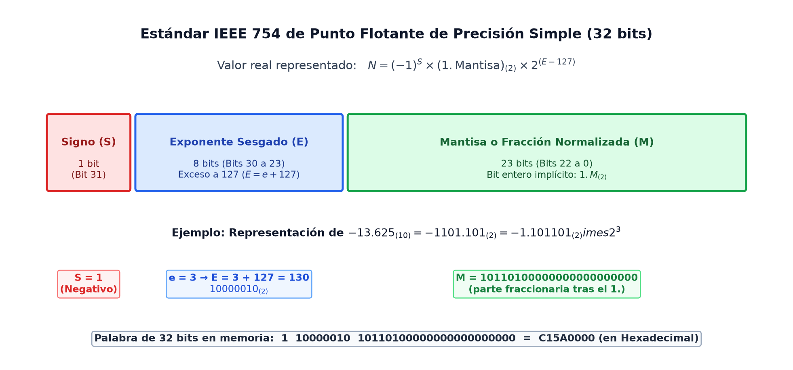

# 1.5 Aplicación de los sistemas numéricos en la computación

## 1. El Lenguaje Máquina y las Unidades de Información Digital

Como señala Jiménez Murillo (2012), cualquier interacción cotidiana con un sistema computacional —como retirar efectivo en un cajero automático, procesar texto o transmitir paquetes por internet— requiere traducir los datos comprensibles por el ser humano a cadenas de **ceros y unos**, ya que la memoria principal, los registros del procesador (CPU) y los buses de comunicación operan exclusivamente en el **sistema binario** ($b = 2$).

### Jerarquía de unidades de almacenamiento y direccionamiento

En las ciencias de la computación, las capacidades de memoria principal (RAM), cachés y direccionamiento físico se basan en **potencias de $2$**:

| Unidad | Equivalencia en Bytes / Bits | Potencia de $2$ (IEC) | Valor exacto en Bytes |
| :--- | :---: | :---: | :---: |
| **Bit (b)** | Unidad mínima ($0$ o $1$) | — | $\frac{1}{8}\text{ B}$ |
| **Nibble** | $4\text{ bits}$ ($1$ dígito hexadecimal) | — | $\frac{1}{2}\text{ B}$ |
| **Byte (B) / Octeto** | $8\text{ bits}$ ($2$ dígitos hexadecimales) | $2^0\text{ B}$ | $1\text{ B}$ ($256$ estados: $0$ a $255$) |
| **Kilobyte / Kibibyte (KiB)** | $1024\text{ B}$ | $2^{10}\text{ B}$ | $1\,024\text{ B}$ |
| **Megabyte / Mebibyte (MiB)** | $1024\text{ KiB}$ | $2^{20}\text{ B}$ | $1\,048\,576\text{ B}$ |
| **Gigabyte / Gibibyte (GiB)** | $1024\text{ MiB}$ | $2^{30}\text{ B}$ | $1\,073\,741\,824\text{ B}$ |
| **Terabyte / Tebibyte (TiB)** | $1024\text{ GiB}$ | $2^{40}\text{ B}$ | $1\,099\,511\,627\,776\text{ B}$ |

### Direccionamiento de memoria y compactación en Hexadecimal

Si un procesador posee un **bus de direcciones de $k$ bits**, puede direccionar exactamente $2^k$ celdas distintas de memoria (desde la dirección $0$ hasta la dirección $2^k - 1$). Para evitar escribir largas secuencias de $32$ o $64$ bits, las direcciones de memoria y los volcados de depuración (*memory dumps*) se expresan en **hexadecimal**:
- Un bus de $16$ bits direcciona $2^{16} = 65\,536\text{ B} = 64\text{ KiB}$, desde `0x0000` hasta `0xFFFF`.
- Un bus de $32$ bits direcciona $2^{32}\text{ B} = 4\text{ GiB}$, desde `0x00000000` hasta `0xFFFFFFFF`.

---

## 2. Representación Interna de Números Enteros y de Punto Flotante

### 2.1 Enteros en punto fijo (Sin signo y Complemento a 2)

En una localización de memoria de $n$ bits (por ejemplo, variables de tipo `int8`, `int16`, `int32` o `int64`), el rango de valores enteros representables depende de si la variable es sin signo (*unsigned*) o con signo en **complemento a 2** (Lipschutz, 1992):

| Tamaño ($n$ bits) | Rango sin signo ($0$ a $2^n - 1$) | Rango con signo en Complemento a 2 ($-2^{n-1}$ a $+2^{n-1} - 1$) |
| :---: | :---: | :---: |
| **$8$ bits ($1\text{ B}$)** | $0$ a $255$ | $-128$ a $+127$ |
| **$16$ bits ($2\text{ B}$)** | $0$ a $65\,535$ | $-32\,768$ a $+32\,767$ |
| **$32$ bits ($4\text{ B}$)** | $0$ a $4\,294\,967\,295$ | $-2\,147\,483\,648$ a $+2\,147\,483\,647$ |

### 2.2 Números reales en Punto Flotante (Estándar IEEE 754)

Para almacenar números reales con parte fraccionaria o magnitudes muy grandes o muy pequeñas (tipos `float` y `double`), las computadoras emplean la **notación exponencial binaria normalizada**:

$$N = (-1)^S \times (1.M)_{(2)} \times 2^e$$

En el estándar **IEEE 754 de precisión simple ($32$ bits)**, la palabra de $32$ bits se divide en tres campos:
1. **Bit de signo ($S$, $1$ bit, bit 31):** $0$ para positivo, $1$ para negativo.
2. **Exponente sesgado o característica ($E$, $8$ bits, bits 30 a 23):** Almacena el exponente real $e$ sumándole un sesgo (*bias*) de $127$ (**exceso a $127$**):
   $$E = e + 127 \qquad \Longleftrightarrow \qquad e = E - 127$$
3. **Mantisa o fracción ($M$, $23$ bits, bits 22 a 0):** Como todo número binario normalizado no nulo comienza por `$1.$` (por ejemplo, $1.1011_{(2)} \times 2^3$), ese primer `$1$` entero (llamado *bit implícito* o *hidden bit*) no se guarda en memoria, almacenándose únicamente los $23$ bits fraccionarios a la derecha del punto binario.

*(En **doble precisión de $64$ bits**, se usa $1$ bit de signo, $11$ bits de exponente con exceso a $1023$ y $52$ bits de mantisa).*

---

## 3. Codificaciones Binarias y Alfanuméricas

### 3.1 Códigos Decimales Codificados en Binario (BCD)

En aplicaciones financieras, relojes digitales y calculadoras electrónicas, donde debe evitarse el error de conversión de fracciones como $0.1_{(10)}$ a binario puro, se codifica **cada dígito decimal ($0$ al $9$) por separado en un bloque de $4$ bits** (Lipschutz, 1992):

- **BCD Ponderado $8\text{-}4\text{-}2\text{-}1$:** Cada dígito decimal se reemplaza por su equivalente binario natural de $4$ bits (pesos $8, 4, 2, 1$). Las $6$ combinaciones de $1010_2$ ($10$) a $1111_2$ ($15$) son inválidas.
- **Código Exceso-Tres (XS-3):** Código no ponderado y **autocomplementario** (al invertir sus bits se obtiene el complemento a $9$ del dígito decimal, facilitando la resta en hardware). Se obtiene sumando $3_{(10)} = 0011_{(2)}$ al código BCD $8\text{-}4\text{-}2\text{-}1$ de cada dígito.
- **Código de Gray (Binario Reflejado):** Código cíclico no ponderado en el que **dos números consecutivos difieren en un único bit**. Se utiliza en codificadores ópticos rotatorios (*encoders*) y en **Mapas de Karnaugh** (Unidad 4) para evitar estados espurios durante las transiciones físicas.

| Dígito Decimal | BCD $8\text{-}4\text{-}2\text{-}1$ | BCD Exceso-$3$ (XS-3) | Código de Gray ($4$ bits) |
| :---: | :---: | :---: | :---: |
| $0$ | `0000` | `0011` | `0000` |
| $1$ | `0001` | `0100` | `0001` |
| $2$ | `0010` | `0101` | `0011` |
| $3$ | `0011` | `0110` | `0010` |
| $4$ | `0100` | `0111` | `0110` |
| $5$ | `0101` | `1000` | `0111` |
| $6$ | `0110` | `1001` | `0101` |
| $7$ | `0111` | `1010` | `0100` |
| $8$ | `1000` | `1011` | `1100` |
| $9$ | `1001` | `1100` | `1101` |

### 3.2 Códigos Alfanuméricos (ASCII y Unicode) y Bit de Paridad

Para representar texto (letras mayúsculas, minúsculas, dígitos y signos de puntuación), se asigna un número entero único a cada carácter:
- **ASCII (*American Standard Code for Information Interchange*):** Utiliza $7$ bits ($2^7 = 128$ caracteres, o $8$ bits en ASCII extendido). Ejemplos clave:
  - Dígitos `'0'` a `'9'`: del $48_{(10)} = 30_{(16)} = 00110000_{(2)}$ al $57_{(10)} = 39_{(16)}$.
  - Letras mayúsculas `'A'` a `'Z'`: del $65_{(10)} = 41_{(16)} = 01000001_{(2)}$ al $90_{(10)} = 5\text{A}_{(16)}$.
  - Letras minúsculas `'a'` a `'z'`: del $97_{(10)} = 61_{(16)} = 01100001_{(2)}$ al $122_{(10)} = 7\text{A}_{(16)}$. *(Nótese que una mayúscula y su minúscula difieren únicamente en el bit de peso $32 = 2^5$).*
  - Espacio en blanco `' '`: $32_{(10)} = 20_{(16)}$.
- **Unicode / UTF-8:** Extiende ASCII empleando de $1$ a $4$ bytes por carácter, representándose habitualmente mediante puntos de código hexadecimales `U+XXXX` (por ejemplo, `'ñ'` es `U+00F1`).
- **Bit de paridad para detección de errores:** Al transmitir un código de $7$ bits se suele añadir un octavo **bit de verificación**:
  - En **paridad par**, el bit de paridad se elige ($0$ o $1$) de modo que el número total de unos en el byte sea **par**.
  - En **paridad impar**, se elige de modo que el número total de unos sea **impar**.

---

## 4. Aplicaciones Prácticas en Redes, Gráficos y Sistemas Operativos

1. **Direcciones IPv4, IPv6 y MAC en redes de computadoras:**
   - **IPv4 ($32$ bits):** Se divide en **cuatro octetos ($4$ bytes)** escritos en decimal separados por puntos (notación decimal punteada). Por ejemplo, `192.168.1.1` equivale a:
     $$11000000.10101000.00000001.00000001_{(2)} = \text{C0.A8.01.01}_{(16)}$$
   - **IPv6 ($128$ bits)** y **direcciones físicas MAC ($48$ bits):** Se escriben directamente en **hexadecimal** (por ejemplo, una dirección MAC de $6$ bytes: `00:1A:2B:3C:4D:5E`).
2. **Representación digital del color (RGB de $24$ bits):**
   - Cada píxel en pantalla combina tres canales de $8$ bits ($0$ a $255_{(10)}$, es decir, $00_{(16)}$ a $\text{FF}_{(16)}$): **Rojo (R)**, **Verde (G)** y **Azul (B)**, dando $2^{24} = 16\,777\,216$ colores posibles.
   - Por ejemplo, el color `#1E90FF` tiene $R = 1\text{E}_{(16)} = 30_{(10)}$, $G = 90_{(16)} = 144_{(10)}$ y $B = \text{FF}_{(16)} = 255_{(10)}$.
3. **Permisos de archivos en UNIX / Linux (Sistema Octal):**
   - Los permisos se dividen en tres grupos de $3$ bits (Propietario, Grupo, Otros) con banderas de lectura ($r = 4 = 100_2$), escritura ($w = 2 = 010_2$) y ejecución ($x = 1 = 001_2$). Así, el permiso `rwxr-xr--` ($111\;101\;100_{(2)}$) se compacta en octal como **`754`**.

---

## 5. Errores Numéricos en la Aritmética del Computador

Dado que los registros tienen un número finito de bits, en los cálculos científicos se presentan (Lipschutz, 1992):
- **Error de truncamiento y redondeo:** Al cortar o aproximar una mantisa infinita (como $1/3$ o $0.1_{(10)}$ en binario) a $P$ bits significativos.
- **Error absoluto y error relativo:** Si $A$ es el valor exacto y $\tilde{A}$ es el valor aproximado almacenado:
  $$e = A - \tilde{A} \quad (\text{Error absoluto}), \qquad r = \frac{A - \tilde{A}}{A} \quad (\text{Error relativo})$$
- **Cancelación sustractiva:** Pérdida severa de cifras significativas cuando se restan dos números casi iguales que ya contienen errores de redondeo.

---

## Ejemplos de Práctica (Resueltos Paso a Paso)

### Ejemplo 1.1: Codificación en Punto Flotante IEEE 754 (32 bits)
Obtenga la representación interna en el estándar IEEE 754 de precisión simple ($32$ bits) y su equivalente hexadecimal para el número real $A = -419.8125_{(10)}$.

**Solución:**
1. **Signo ($S$):** Como el número es negativo, **$S = 1$**.
2. **Conversión de la magnitud a binario:**
   - Parte entera: $419_{(10)} = 256 + 128 + 32 + 2 + 1 = 110100011_{(2)}$.
   - Parte fraccionaria: $0.8125_{(10)} = 0.5 + 0.25 + 0.0625 = 0.1101_{(2)}$.
   - Por tanto, $419.8125_{(10)} = 110100011.1101_{(2)}$.
3. **Normalización exponencial binaria ($1.M \times 2^e$):**
   Recorremos el punto binario $8$ posiciones hacia la izquierda:
   $$110100011.1101_{(2)} = 1.\underbrace{101000111101}_{M\text{ (12 bits)}} \times 2^8 \implies e = 8$$
4. **Exponente sesgado ($E = e + 127$):**
   $$E = 8 + 127 = 135_{(10)} = 10000111_{(2)}$$
5. **Mantisa ($M$, $23$ bits):** Completamos con $11$ ceros a la derecha:
   $$M = \texttt{10100011110100000000000}$$
6. **Palabra completa de $32$ bits y compactación en hexadecimal:**
   $$\underbrace{1}_{S}\;\underbrace{10000111}_{E}\;\underbrace{10100011110100000000000}_{M}$$
   Agrupando de $4$ en $4$ bits:
   $$\texttt{1100 0011 1101 0001 1110 1000 0000 0000}_{(2)} = \mathbf{\text{C3D1E800}_{(16)}}$$

---

### Ejemplo 1.2: Codificación y Decodificación BCD $8\text{-}4\text{-}2\text{-}1$ y Exceso-$3$ (XS-3)
a) Codifique el número decimal $N = 469_{(10)}$ en BCD $8\text{-}4\text{-}2\text{-}1$, en BCD Exceso-$3$ (XS-3) y en binario puro, comparando el número de bits empleados.  
b) Decodifique la cadena expresada en XS-3: `1010 0101 1100 0100`.

**Solución:**
- **a) Para $N = 469_{(10)}$:**
  - **En BCD $8\text{-}4\text{-}2\text{-}1$** ($4$ bits por dígito decimal: $4 \to 0100$, $6 \to 0110$, $9 \to 1001$):
    $$\texttt{0100 0110 1001}_{\text{(BCD)}} \quad (12\text{ bits})$$
  - **En BCD Exceso-$3$ (XS-3)** (sumando $3$ a cada dígito: $4+3=7 \to 0111$, $6+3=9 \to 1001$, $9+3=12 \to 1100$):
    $$\texttt{0111 1001 1100}_{\text{(XS-3)}} \quad (12\text{ bits})$$
  - **En binario puro directo:** $469_{(10)} = 256 + 128 + 64 + 16 + 4 + 1 = \texttt{111010101}_{(2)}$ ($9$ bits, ahorra $3$ bits respecto a BCD).
- **b) Decodificación de `1010 0101 1100 0100` desde XS-3:**
  Convertimos cada grupo de $4$ bits a decimal y le restamos $3$:
  - `1010` $= 10 \implies 10 - 3 = 7$
  - `0101` $= 5 \implies 5 - 3 = 2$
  - `1100` $= 12 \implies 12 - 3 = 9$
  - `0100` $= 4 \implies 4 - 3 = 1$
  - El número decimal codificado es **$7291_{(10)}$**.

---

### Ejemplo 1.3: Codificación ASCII, Hexadecimal y Bit de Paridad
Codifique la palabra `"MD2"` en código ASCII de $7$ bits, exprese cada carácter en hexadecimal y agregue a la izquierda un octavo bit de verificación para **paridad impar**.

**Solución:**
1. `'M'`: Como `'A'` es $65_{(10)}$ y `'M'` es la decimotercera letra ($65 + 12 = 77_{(10)}$):
   - En $7$ bits: $77_{(10)} = 1001101_{(2)}$ ($4\text{D}_{(16)}$).
   - Contiene cuatro unos (par). Para lograr **paridad impar**, el bit de paridad debe ser **`1`** $\implies \texttt{11001101}_{(2)}$.
2. `'D'`: $65 + 3 = 68_{(10)}$:
   - En $7$ bits: $68_{(10)} = 1000100_{(2)}$ ($44_{(16)}$).
   - Contiene dos unos (par). Bit de paridad impar: **`1`** $\implies \texttt{11000100}_{(2)}$.
3. `'2'`: Como `'0'` es $48_{(10)}$, `'2'` es $50_{(10)}$:
   - En $7$ bits: $50_{(10)} = 0110010_{(2)}$ ($32_{(16)}$).
   - Contiene tres unos (ya es impar). Bit de paridad impar: **`0`** $\implies \texttt{00110010}_{(2)}$.

---

### Ejemplo 1.4: Direcciones IPv4, Colores RGB y Permisos en Linux
a) Convierta la dirección IPv4 `172.16.254.1` a binario ($32$ bits) y a hexadecimal.  
b) Determine cuántos niveles de intensidad tiene cada canal en el color web `#FF5733` y expréselos en decimal.

**Solución:**
- **a) Dirección IPv4 `172.16.254.1`:**
  - $172_{(10)} = 10101100_{(2)} = \text{AC}_{(16)}$
  - $16_{(10)} = 00010000_{(2)} = 10_{(16)}$
  - $254_{(10)} = 11111110_{(2)} = \text{FE}_{(16)}$
  - $1_{(10)} = 00000001_{(2)} = 01_{(16)}$
  - En binario: `10101100.00010000.11111110.00000001` (`0xAC10FE01`).
- **b) Color `#FF5733`:**
  - Canal Rojo ($R$): $\text{FF}_{(16)} = 15\times 16 + 15 = 255_{(10)}$ (intensidad máxima).
  - Canal Verde ($G$): $57_{(16)} = 5\times 16 + 7 = 87_{(10)}$.
  - Canal Azul ($B$): $33_{(16)} = 3\times 16 + 3 = 51_{(10)}$.

---

## Ejercicios de Tarea (Práctica en Casa)

> **Instrucciones:** Resuelva los siguientes ejercicios aplicando los conceptos de representación interna, codificación y aplicaciones computacionales.

1. **Capacidad de memoria y direccionamiento:**  
   a) Un microcontrolador cuenta con un bus de direcciones de $24$ bits y cada celda direccionable almacena $1$ byte. ¿Cuántos Megabytes (MiB) de memoria puede direccionar como máximo, y cuál es su última dirección expresada en hexadecimal?  
   b) ¿Cuántos bits se requieren en el bus de direcciones para poder direccionar exactamente $16\text{ GiB}$ de memoria RAM?
   <!--
   Solución del Ejercicio 1:
   - a) Con 24 bits se direccionan 2^24 bytes = 2^4 × 2^20 B = 16 MiB (16,777,216 bytes).
        Las direcciones van desde 0x000000 hasta 0xFFFFFF (seis dígitos hexadecimales).
   - b) Como 16 GiB = 2^4 × 2^30 B = 2^34 bytes, se requieren exactamente 34 bits en el bus de direcciones.
   -->

2. **Punto Flotante IEEE 754 de 32 bits (Lipschutz, Prob. 3.13 y 3.35):**  
   a) Encuentre la representación binaria de $32$ bits (signo $S$, exponente sesgado $E$ con exceso a $127$, y mantisa $M$ de $23$ bits) y su equivalente hexadecimal para el número $A = +93.625_{(10)}$ y para $B = -50.375_{(10)}$.  
   b) Decodifique a decimal la palabra IEEE 754 de $32$ bits escrita en hexadecimal como `0x41C40000`.
   <!--
   Solución del Ejercicio 2:
   - a) Para A = +93.625_(10):
        Signo S = 0.
        93_(10) = 1011101_(2);  0.625_(10) = 0.101_(2) ==> 93.625 = 1011101.101_(2) = 1.011101101 × 2^6.
        Exponente sesgado E = 6 + 127 = 133_(10) = 10000101_(2).
        Mantisa M = 01110110100000000000000.
        Palabra de 32 bits: 0 10000101 01110110100000000000000 = 0100 0010 1011 1011 0100 0000 0000 0000_(2) = 42BB4000_(16).

        Para B = -50.375_(10):
        Signo S = 1.
        50_(10) = 110010_(2);  0.375_(10) = 0.011_(2) ==> 50.375 = 110010.011_(2) = 1.10010011 × 2^5.
        Exponente sesgado E = 5 + 127 = 132_(10) = 10000100_(2).
        Mantisa M = 10010011000000000000000.
        Palabra de 32 bits: 1 10000100 10010011000000000000000 = 1100 0010 0100 1001 1000 0000 0000 0000_(2) = C2498000_(16).

   - b) Decodificación de 0x41C40000:
        En binario: 0100 0001 1100 0100 0000 0000 0000 0000_(2).
        S = 0 (positivo);
        E = 10000011_(2) = 131_(10) ==> e = 131 - 127 = 4;
        M = 10001000000000000000000 ==> 1.M = 1.10001_(2).
        Valor = +1.10001_(2) × 2^4 = 11000.1_(2) = 16 + 8 + 0.5 = +24.5_(10).
   -->

3. **Códigos BCD $8\text{-}4\text{-}2\text{-}1$ y Exceso-$3$ (Lipschutz, Prob. 2.31, 2.32 y 2.34):**  
   a) Codifique el número decimal $37\,926_{(10)}$ tanto en BCD ponderado $8\text{-}4\text{-}2\text{-}1$ como en código Exceso-$3$ (XS-3).  
   b) Decodifique el siguiente número expresado en BCD $8\text{-}4\text{-}2\text{-}1$: `0111 0011 0000 1001`.  
   c) Explique por qué la cadena `0100 1010 0110` contiene un error si pretende estar codificada en BCD $8\text{-}4\text{-}2\text{-}1$.
   <!--
   Solución del Ejercicio 3:
   - a) Para 37,926_(10):
        BCD 8-4-2-1: 3=0011, 7=0111, 9=1001, 2=0010, 6=0110 --> 0011 0111 1001 0010 0110.
        BCD XS-3 (+3 a cada dígito: 6, 10, 12, 5, 9): 0110 1010 1100 0101 1001.
   - b) 0111 0011 0000 1001 en BCD 8-4-2-1 equivale a: 7, 3, 0, 9 --> 7309_(10).
   - c) El grupo central 1010 equivale a 10 en decimal, el cual NO es un dígito decimal válido (en BCD 8-4-2-1 sólo son válidos los grupos de 0000 a 1001).
   -->

4. **Aplicaciones en ASCII, Redes, Color y Permisos UNIX:**  
   a) Escriba la codificación en ASCII de $7$ bits y en hexadecimal del texto `"SOL"`, agregando un bit inicial (octavo bit a la izquierda) para **paridad par**.  
   b) Un administrador de sistemas en Linux ejecuta el comando `chmod 640 reporte.txt`. Exprese `640` en binario ($9$ bits) e indique qué permisos (`r`, `w`, `x`) tienen el propietario, el grupo y los otros usuarios.  
   c) Una tarjeta de red tiene configurada la dirección IPv4 `192.168.10.200` con máscara de subred `255.255.255.0`. Exprese ambas en binario y en hexadecimal.
   <!--
   Solución del Ejercicio 4:
   - a) Texto "SOL" (A = 65_(10)):
        'S' = 83_(10) = 53_(16) = 1010011_(2) (tiene 4 unos, par --> bit paridad par = 0 --> 01010011_(2)).
        'O' = 79_(10) = 4F_(16) = 1001111_(2) (tiene 5 unos, impar --> bit paridad par = 1 --> 11001111_(2)).
        'L' = 76_(10) = 4C_(16) = 1001100_(2) (tiene 3 unos, impar --> bit paridad par = 1 --> 11001100_(2)).
   - b) Permiso octal 640_(8) = 110 100 000_(2) (rw-r-----):
        Propietario (6 = 110_2): lectura y escritura (rw-).
        Grupo (4 = 100_2): sólo lectura (r--).
        Otros (0 = 000_2): ningún permiso (---).
   - c) IPv4 192.168.10.200:
        En binario: 11000000.10101000.00001010.11001000_(2)
        En hexadecimal: C0.A8.0A.C8_(16) (0xC0A80AC8).
        Máscara 255.255.255.0:
        En binario: 11111111.11111111.11111111.00000000_(2)
        En hexadecimal: FF.FF.FF.00_(16) (0xFFFFFF00).
   -->
