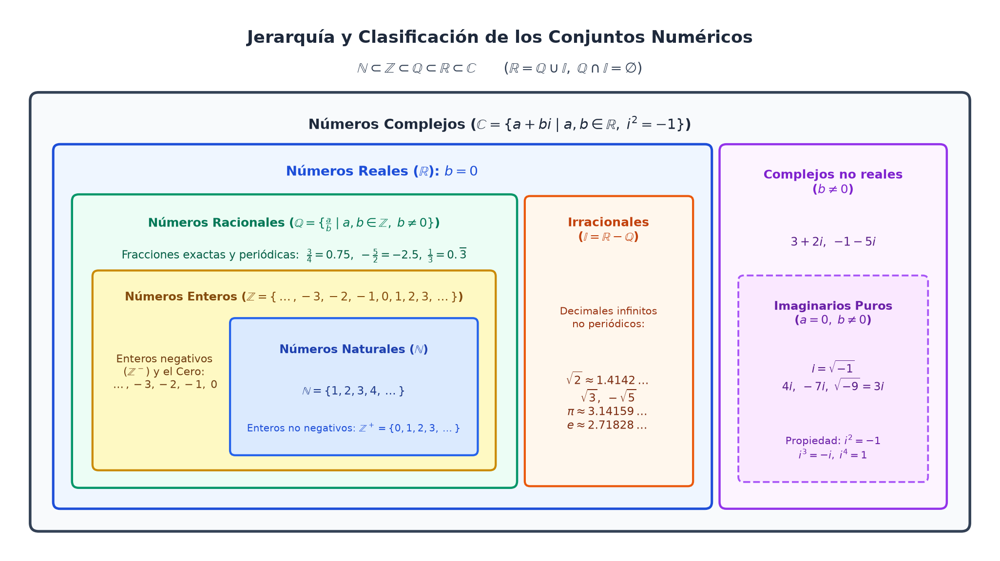
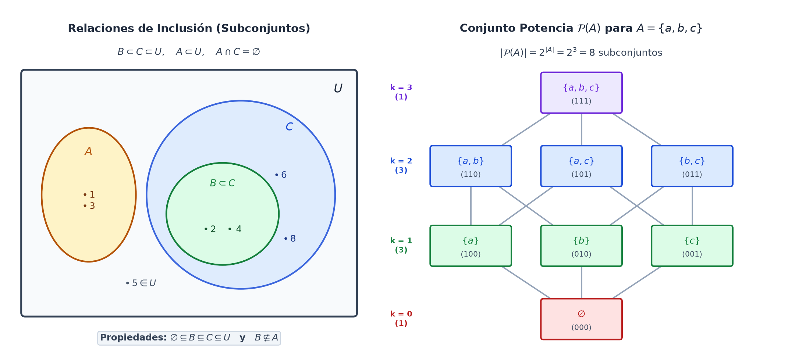

# 2.1 Características de los conjuntos

## Introducción: Concepto de Conjunto, Elementos y Notación

En matemáticas discretas y ciencias de la computación, un **conjunto** se define como una **colección bien definida de objetos reales o abstractos**, denominados **elementos** o **miembros** del conjunto (Cantor, 1895; Jiménez Murillo, 2012).

La expresión **«bien definida»** es esencial: significa que debe existir un criterio objetivo e inequívoco que permita determinar, sin ambigüedad ni subjetividad, si un objeto dado pertenece o no a la colección:
- *Colecciones bien definidas (sí son conjuntos):* «Los dígitos válidos del sistema hexadecimal», «Los procesos activos en memoria RAM cuyo identificador `PID` es menor que $1000$», «Los números enteros primos menores que $50$».
- *Colecciones ambiguas (no son conjuntos):* «Los mejores profesores de ingeniería en sistemas», «Los lenguajes de programación más fáciles», «Los números grandes», ya que los calificativos *mejor*, *más fácil* o *grande* dependen de criterios subjetivos.

### Convenciones de notación y relación de pertenencia

1. **Nombres de conjuntos y elementos:** Los conjuntos se denotan habitualmente con letras mayúsculas ($A, B, C, \dots, X, Y, Z$) y sus elementos con letras minúsculas ($a, b, c, \dots, x, y, z$), números o símbolos encerrados entre llaves $\{\;\}$ y separados por comas.
2. **Pertenencia ($\in$ y $\notin$):**
   - Si un objeto $x$ forma parte de un conjunto $A$, se escribe:
     $$x \in A \qquad (\text{se lee: «}x\text{ pertenece al conjunto }A\text{» o «}x\text{ es elemento de }A\text{»})$$
   - Si el objeto $x$ no forma parte de $A$, se escribe:
     $$x \notin A \qquad (\text{se lee: «}x\text{ no pertenece al conjunto }A\text{»})$$
   Por ejemplo, si $A = \{1, 3, 5, 7, 9\}$, entonces $3 \in A$ y $6 \notin A$.

### Propiedades estructurales de un conjunto: orden y multiplicidad

En un conjunto estándar:
- **El orden en que se listan los elementos es irrelevante:** $\{a, e, i, o, u\} = \{u, i, a, e, o\}$.
- **No se toman en cuenta elementos repetidos:** Si al formar un conjunto a partir de una lista o palabra aparecen duplicados, éstos se eliminan conservando una sola aparición de cada elemento distinto. Por ejemplo, el conjunto $B$ de las letras de la palabra `"mandarina"` es (Jiménez Murillo, 2012):
  $$B = \{m, a, n, d, a, r, i, n, a\} = \{m, a, n, d, r, i\}$$

### Formas de especificar un conjunto

Existen dos métodos principales para describir un conjunto (Lipschutz & Lipson, 2009; Epp, 2012):

| Forma de especificación | Descripción | Ejemplo |
| :--- | :--- | :--- |
| **1. Por extensión (enumeración o forma tabular)** | Se listan explícitamente todos los elementos del conjunto dentro de llaves, separados por comas (o usando puntos suspensivos `...` cuando el patrón es evidente). | $A = \{0, 2, 4, 6, 8\}$ $D = \{0, 1, 2, 3, 4, 5, 6, 7\}$ |
| **2. Por comprensión (notación abstracta, descriptiva o constructiva)** | Se indica una variable muda $x$ seguida de una barra vertical `|` (o dos puntos `:`, que se leen *«tal que»*) y la propiedad o condiciones $P(x)$ que caracterizan exactamente a los elementos del conjunto: $$A = \{x \mid P(x)\} \quad \text{o} \quad A = \{x \in S \mid P(x)\}$$ | $A = \{x \mid x \in \mathbb{Z}^+;\; x \text{ es par};\; x < 10\}$ $D = \{x \mid x \text{ es un dígito octal}\}$ |

> **Nota sobre condiciones múltiples:** Siguiendo la convención de Jiménez Murillo (2012), cuando un elemento debe cumplir simultáneamente varias condiciones en la notación por comprensión, éstas suelen separarse mediante punto y coma (`;`) o mediante una coma (`,`), lo cual equivale al conectivo lógico **«y» ($\land$)**. Por ejemplo, $C = \{x \mid x \in \mathbb{R};\; 2 < x < 3\}$ exige tanto $x \in \mathbb{R}$ como $2 < x < 3$.

### Cardinalidad, conjuntos finitos e infinitos

La **cardinalidad** de un conjunto $A$, denotada por $|A|$, $n(A)$ o $\#(A)$, es el número de elementos **distintos** que pertenecen a $A$:
- **Conjunto finito:** Posee un número entero no negativo $m \in \mathbb{Z}^+$ de elementos ($|A| = m$). Por ejemplo, si $A = \{\text{rojo}, \text{verde}, \text{azul}\}$, entonces $|A| = 3$.
- **Conjunto infinito:** No es posible terminar de contar sus elementos mediante un entero natural:
  - *Infinito numerable (o contable):* Sus elementos pueden ponerse en correspondencia biunívoca con los números naturales $\mathbb{N}$ (se pueden listar como $a_1, a_2, a_3, \dots$), como ocurre con $\mathbb{N}$, $\mathbb{Z}$ y $\mathbb{Q}$.
  - *Infinito no numerable:* Posee tantos elementos que no pueden listarse en sucesión discreta, como el conjunto de los números reales $\mathbb{R}$ o cualquier intervalo continuo $[a, b]$ con $a < b$ (demostrado por el argumento diagonal de Cantor).

---

## 2.1.1 Conjunto universo, vacío

En cualquier aplicación matemática o computacional, los conjuntos que se analizan no existen de manera aislada, sino dentro de un marco de referencia común (Lipschutz & Lipson, 2009):

1. **Conjunto Universo o Universal ($U$):**
   Es el conjunto referencial que contiene a **todos los elementos** bajo estudio en un contexto o problema determinado.
   - En un análisis de matrículas escolares, $U$ puede ser el conjunto de todos los alumnos de la universidad.
   - En aritmética modular de $8$ bits sin signo, $U = \{0, 1, 2, \dots, 255\}$.
   - En los **diagramas de Venn** (introducidos en $1880$ por el matemático y lógico británico **John Venn**), el conjunto universo $U$ se representa gráficamente mediante el interior de un **rectángulo**, dentro del cual se trazan círculos u óvalos para representar los conjuntos particulares.

2. **Conjunto Vacío o Nulo ($\emptyset$ o $\{\;\}$):**
   Es el único conjunto que **carece de elementos**. Su cardinalidad es cero:
   $$\emptyset = \{\;\} \qquad \text{con} \qquad |\emptyset| = 0$$
   Se define a menudo mediante cualquier condición imposible o contradictoria en el universo dado, por ejemplo:
   $$\emptyset = \{x \in \mathbb{R} \mid x^2 + 1 = 0\} \qquad \text{o} \qquad \emptyset = \{x \in \mathbb{N} \mid x + 4 = 3\}$$

3. **Conjunto Unitario (*Singleton*):**
   Es todo conjunto que posee **exactamente un elemento** ($|A| = 1$), como $S = \{5\}$ o $T = \{0\}$.

> **Advertencia pedagógica fundamental ($\emptyset$ frente a $\{\emptyset\}$ y $\{0\}$):**
> - $\emptyset = \{\;\}$ es una «caja vacía» y tiene cardinalidad $|\emptyset| = 0$.
> - $\{0\}$ no es vacío: es un conjunto unitario cuyo único elemento es el número cero ($|\{0\}| = 1$).
> - $\{\emptyset\}$ **tampoco es vacío**: es un conjunto unitario cuyo único elemento es el conjunto vacío (una caja que contiene dentro otra caja vacía), por lo que $|\{\emptyset\}| = 1$ y $\emptyset \in \{\emptyset\}$.

---

## 2.1.2 Números naturales, enteros, racionales, reales e imaginarios

Para expresar conjuntos de forma compacta y rigurosa, las matemáticas discretas emplean una familia estandarizada de **conjuntos numéricos**, cuyas propiedades determinan qué tipo de datos (`uint`, `int`, `float`, `complex`) debe elegirse al programar un algoritmo (Jiménez Murillo, 2012; Epp, 2012):

1. **Números Naturales ($\mathbb{N}$):**
   Son los números empleados originalmente para contar objetos discretos:
   $$\mathbb{N} = \{1, 2, 3, 4, 5, \dots\}$$
   - **Enteros no negativos ($\mathbb{Z}^+$ o $\mathbb{N}_0$):** Siguiendo la notación de Jiménez Murillo (2012), cuando se incluye el cero junto con los naturales se denota como:
     $$\mathbb{Z}^+ = \{0, 1, 2, 3, 4, \dots\}$$
     *(Nota: En otros textos como Epp o Rosen se usa $\mathbb{Z}^+$ para los enteros positivos $\{1, 2, 3, \dots\}$ y $\mathbb{Z}^{\ge 0}$ o $\mathbb{N}$ para incluir al $0$; en este curso respetaremos el contexto explícito de cada problema).*

2. **Números Enteros ($\mathbb{Z}$, del alemán *Zahlen*):**
   Abarcan a los enteros negativos ($\mathbb{Z}^-$), el cero y los enteros positivos:
   $$\mathbb{Z} = \{\dots, -3, -2, -1, 0, 1, 2, 3, \dots\}$$
   El conjunto $\mathbb{Z}$ es cerrado bajo la suma, la resta y la multiplicación, pero no bajo la división ($3 \div 2 \notin \mathbb{Z}$).

3. **Números Racionales ($\mathbb{Q}$, de *Quotient*):**
   Son todos los números que pueden expresarse como el cociente (fracción) de dos números enteros con denominador distinto de cero:
   $$\mathbb{Q} = \left\{\frac{a}{b} \;\middle|\; a, b \in \mathbb{Z};\;\; b \neq 0\right\}$$
   - Todo número entero $n \in \mathbb{Z}$ es racional porque puede escribirse como $n = \frac{n}{1} \in \mathbb{Q}$.
   - En representación posicional decimal (o en cualquier base $b$), un número real es racional **si y sólo si** su parte fraccionaria es **finita (exacta)** (p. ej., $\frac{3}{8} = 0.375$) o **infinita periódica** (p. ej., $\frac{1}{3} = 0.333\dots = 0.\overline{3}$, o $\frac{15}{11} = 1.\overline{36}$).

4. **Números Irracionales ($\mathbb{I}$ o $\mathbb{Q}'$ respecto a $\mathbb{R}$):**
   Son los números reales que **no pueden expresarse como razón de dos enteros**, por lo que su expansión decimal es **infinita no periódica**:
   $$\mathbb{I} = \{x \in \mathbb{R} \mid x \notin \mathbb{Q}\}$$
   Ejemplos clásicos son las raíces no exactas ($\sqrt{2} \approx 1.41421356\dots$, $\sqrt{3}$, $-\sqrt{5}$), la razón áurea $\varphi = \frac{1+\sqrt{5}}{2}$, y constantes trascendentes como $\pi \approx 3.14159265\dots$ y la base de los logaritmos naturales $e \approx 2.71828182\dots$.

5. **Números Reales ($\mathbb{R}$):**
   Es la unión disjunta de los números racionales y los irracionales ($\mathbb{R} = \mathbb{Q} \cup \mathbb{I}$, con $\mathbb{Q} \cap \mathbb{I} = \emptyset$). Geométricamente, $\mathbb{R}$ está en correspondencia biunívoca con todos los puntos de una **recta continua (la recta real)**.
   - **Intervalos reales:** Para cualesquiera $a, b \in \mathbb{R}$ con $a < b$, los subconjuntos continuos de $\mathbb{R}$ se denotan como:
     - Intervalo abierto: $(a, b) = \{x \in \mathbb{R} \mid a < x < b\}$
     - Intervalo cerrado: $[a, b] = \{x \in \mathbb{R} \mid a \le x \le b\}$
     - Intervalos semiabiertos: $[a, b) = \{x \in \mathbb{R} \mid a \le x < b\}$ y $(a, b] = \{x \in \mathbb{R} \mid a < x \le b\}$

6. **Números Imaginarios y Complejos ($\mathbb{C}$):**
   La ecuación algebraica $x^2 + 1 = 0$ (es decir, $x^2 = -1$) carece de solución en $\mathbb{R}$ porque el cuadrado de cualquier número real es no negativo ($x^2 \ge 0$). Para resolver este tipo de ecuaciones se define la **unidad imaginaria $i$**:
   $$i = \sqrt{-1} \qquad \Longleftrightarrow \qquad i^2 = -1$$
   - **Potencias cíclicas de $i$ (módulo $4$):**
     $$i^0 = 1,\qquad i^1 = i,\qquad i^2 = -1,\qquad i^3 = i^2 \cdot i = -i,\qquad i^4 = (i^2)^2 = 1,\qquad \dots,\qquad i^n = i^{n \bmod 4}$$
   - **Números imaginarios puros:** Son los números de la forma $bi$ con $b \in \mathbb{R}$ y $b \neq 0$ (por ejemplo, $3i$, $-5i$, $\sqrt{-16} = \sqrt{16}\sqrt{-1} = 4i$). Su cuadrado es siempre un número real negativo: $(bi)^2 = b^2 i^2 = -b^2 < 0$.
   - **Números Complejos ($\mathbb{C}$):** Es el conjunto de todos los números de la forma binómica $z = a + bi$, donde $a \in \mathbb{R}$ es la **parte real** ($\operatorname{Re}(z) = a$) y $b \in \mathbb{R}$ es la **parte imaginaria** ($\operatorname{Im}(z) = b$):
     $$\mathbb{C} = \{a + bi \mid a, b \in \mathbb{R};\; i^2 = -1\}$$
     Si $b = 0$, el número complejo $a + 0i = a$ es un número real; si $a = 0$ y $b \neq 0$, es un número imaginario puro.

---

## 2.1.3 Subconjuntos

Dados dos conjuntos $A$ y $B$, se dice que **$A$ es un subconjunto de $B$** (o que $A$ está contenido o incluido en $B$) si **todo elemento de $A$ es también elemento de $B$** (Jiménez Murillo, 2012; Lipschutz & Lipson, 2009):

$$A \subseteq B \qquad \Longleftrightarrow \qquad \forall x\;(x \in A \implies x \in B)$$

*(Nota de notación: En textos como Jiménez Murillo se emplea indistintamente el símbolo $A \subset B$ para indicar subconjunto general, mientras que en Lipschutz, Epp y Rosen se distingue entre $\subseteq$ para inclusión general y $\subset$ para inclusión estricta o propia).*

### Subconjunto propio, no inclusión e igualdad de conjuntos

1. **Subconjunto propio ($A \subset B$):**
   $A$ es un subconjunto propio de $B$ si todos los elementos de $A$ pertenecen a $B$, pero $B$ posee al menos un elemento que no está en $A$ ($A \subseteq B$ y $A \neq B$). Por ejemplo, $\{1, 2\} \subset \{1, 2, 3\}$.
2. **No inclusión ($A \nsubseteq B$):**
   $A$ **no es subconjunto** de $B$ si existe por lo menos un elemento $x \in A$ tal que $x \notin B$:
   $$A \nsubseteq B \qquad \Longleftrightarrow \qquad \exists x\;(x \in A \;\land\; x \notin B)$$
3. **Igualdad de conjuntos ($A = B$):**
   Dos conjuntos $A$ y $B$ son iguales si y sólo si contienen exactamente los mismos elementos, lo cual equivale a la **doble inclusión**:
   $$A = B \qquad \Longleftrightarrow \qquad (A \subseteq B \;\;\land\;\; B \subseteq A)$$
4. **Conjuntos comparables y no comparables:**
   Dos conjuntos $A$ y $B$ son *comparables* si $A \subseteq B$ o $B \subseteq A$; en caso contrario, si $A \nsubseteq B$ y $B \nsubseteq A$, son *incomparables*.
5. **Conjuntos disjuntos (o ajenos):**
   Dos conjuntos $A$ y $B$ son disjuntos si no tienen ningún elemento en común.

### Teoremas fundamentales de los subconjuntos

Para cualquier conjunto $A$ dentro de un universo $U$, se cumplen las siguientes propiedades universales:
1. **Reflexividad (todo conjunto es subconjunto de sí mismo):**
   $$A \subseteq A$$
2. **El conjunto vacío es subconjunto de cualquier conjunto:**
   $$\emptyset \subseteq A,\qquad \emptyset \subseteq U,\qquad \emptyset \subseteq \emptyset$$
   *(Justificación lógica: La implicación $x \in \emptyset \implies x \in A$ es **vacuamente verdadera** porque el antecedente $x \in \emptyset$ es siempre falso; no existe ningún elemento en $\emptyset$ que pueda violar la condición de estar en $A$).*
3. **Todo conjunto es subconjunto del conjunto universo:**
   $$A \subseteq U$$
4. **Transitividad de la inclusión:**
   $$\text{Si } A \subseteq B \text{ y } B \subseteq C, \text{ entonces } A \subseteq C$$

---

## 2.1.4 Conjunto potencia

Dado un conjunto $A$, se denomina **conjunto potencia de $A$** (o *conjunto de las partes de $A$*), denotado por $\mathcal{P}(A)$ o $2^A$, al **conjunto cuyos elementos son todos los subconjuntos posibles de $A$** (incluyendo siempre al conjunto vacío $\emptyset$ y al propio conjunto $A$):

$$\mathcal{P}(A) = \{S \mid S \subseteq A\}$$

Por consiguiente, para cualquier conjunto $X$:
$$X \in \mathcal{P}(A) \qquad \Longleftrightarrow \qquad X \subseteq A$$

### Teorema de la cardinalidad del conjunto potencia

Si $A$ es un conjunto finito con $n$ elementos ($|A| = n$), entonces el conjunto potencia $\mathcal{P}(A)$ posee exactamente $2^n$ elementos (subconjuntos):

$$|\mathcal{P}(A)| = 2^{|A|} = 2^n$$

- **Número de subconjuntos propios de $A$:** Como el único subconjunto impropio de $A$ es el mismo conjunto $A$, el número de subconjuntos propios es $2^n - 1$.
- **Número de subconjuntos no vacíos de $A$:** Excluyendo a $\emptyset$, es $2^n - 1$.
- **Desglose por tamaño $k$ y relación con el sistema binario:**
  Para formar un subconjunto $S \subseteq A$ a partir de $A = \{a_1, a_2, \dots, a_n\}$, para cada elemento $a_i$ existen exactamente **dos decisiones binarias**: incluirlo en $S$ (bit $1$) o no incluirlo en $S$ (bit $0$). Por el principio multiplicativo, hay $\underbrace{2 \times 2 \times \dots \times 2}_{n\text{ veces}} = 2^n$ combinaciones binarias posibles (desde `00...0` para $\emptyset$ hasta `11...1` para $A$). Además, la cantidad de subconjuntos que tienen exactamente $k$ elementos ($0 \le k \le n$) está dada por el coeficiente binomial $\binom{n}{k} = \frac{n!}{k!(n-k)!}$, verificándose que:
  $$\sum_{k=0}^{n} \binom{n}{k} = \binom{n}{0} + \binom{n}{1} + \binom{n}{2} + \dots + \binom{n}{n} = 2^n$$

### Clases de conjuntos y particiones

Cuando los elementos de un conjunto son a su vez otros conjuntos, se suele hablar de una **clase de conjuntos** o **familia de conjuntos**, denotándola con letras caligráficas o encerrando la colección entre corchetes $[\;]$ para mayor claridad visual (Lipschutz & Lipson, 2009).

Una aplicación fundamental de las familias de subconjuntos es el concepto de **partición**:
Dado un conjunto no vacío $S$, una colección de subconjuntos $\mathcal{A} = \{A_1, A_2, \dots, A_m\}$ de $S$ se denomina una **partición de $S$** si satisface tres condiciones simultáneas:
1. **Ninguna celda o bloque es vacío:** $A_i \neq \emptyset$ para todo $i = 1, 2, \dots, m$.
2. **Son mutuamente disjuntos (ajenos por pares):** Si $i \neq j$, entonces $A_i$ y $A_j$ no tienen elementos en común.
3. **Cubren todo el conjunto $S$ (exhaustividad):** Todo elemento de $S$ pertenece a alguno de los subconjuntos $A_i$ ($A_1 \cup A_2 \cup \dots \cup A_m = S$).

---

## Ejemplos de Práctica (Resueltos Paso a Paso)

### Ejemplo 2.1.1: Conversión entre notación por comprensión y por extensión
Determine explícitamente (por extensión) los elementos de cada uno de los siguientes conjuntos e indique su cardinalidad (adaptado de Jiménez Murillo, 2012, Prob. 3.1 y 3.2):
a) $A = \{x \mid x \text{ es un dígito del número } 103836\}$  
b) $B = \{x \mid x \in \mathbb{Z}^+;\; x - 4 < 3\}$  
c) $C = \{x \mid x \in \mathbb{Z};\; x \text{ es divisible entre } 3;\; -4 < x < 17\}$  
d) $D = \{x \mid x \in \mathbb{Z}^+;\; x \text{ es primo};\; x \text{ es par}\}$  
e) $E = \{x \mid x \in \mathbb{R};\; x^2 + 9 = 0\}$

**Solución:**
- **a) Conjunto $A$:** Los dígitos que aparecen en $103836$ son $1, 0, 3, 8, 3, 6$. Eliminando el $3$ repetido y ordenando:
  $$A = \{0, 1, 3, 6, 8\}, \qquad |A| = 5$$
- **b) Conjunto $B$:** La desigualdad $x - 4 < 3$ equivale a $x < 7$. Como $x \in \mathbb{Z}^+ = \{0, 1, 2, 3, \dots\}$, los valores que cumplen ambas condiciones son:
  $$B = \{0, 1, 2, 3, 4, 5, 6\}, \qquad |B| = 7$$
- **c) Conjunto $C$:** Buscamos múltiplos enteros de $3$ estrictamente mayores que $-4$ y estrictamente menores que $17$ (recordando que $0 = 3 \times 0$ es divisible entre $3$):
  $$C = \{-3, 0, 3, 6, 9, 12, 15\}, \qquad |C| = 7$$
- **d) Conjunto $D$:** El único número entero positivo que es simultáneamente primo y par es el $2$:
  $$D = \{2\}, \qquad |D| = 1 \quad (\text{conjunto unitario})$$
- **e) Conjunto $E$:** Despejando $x^2 = -9$, las soluciones son $x = \pm 3i \in \mathbb{C}$, las cuales son números imaginarios puros y no pertenecen a $\mathbb{R}$. Por tanto:
  $$E = \emptyset, \qquad |E| = 0 \quad (\text{conjunto vacío})$$

---

### Ejemplo 2.1.2: Expresión de conjuntos en notación abstracta (por comprensión)
Escriba cada uno de los siguientes conjuntos en la forma constructiva $\{x \mid P(x)\}$ especificando el conjunto numérico al que pertenece $x$:
a) $F = \{3, 6, 9, 12, 15, 18\}$  
b) $G = \{1, 4, 9, 16, 25, 36\}$  
c) $H = \{1, 2, 4, 8, 16, 32, 64\}$

**Solución:**
- **a) Para $F = \{3, 6, 9, 12, 15, 18\}$:** Son los múltiplos positivos de $3$ menores o iguales que $18$:
  $$F = \{x \mid x \in \mathbb{N};\; x \text{ es múltiplo de } 3;\; x \le 18\} \quad \text{o bien} \quad F = \{3k \mid k \in \mathbb{N};\; 1 \le k \le 6\}$$
- **b) Para $G = \{1, 4, 9, 16, 25, 36\}$:** Son los cuadrados perfectos de los primeros seis números naturales ($1^2, 2^2, 3^2, 4^2, 5^2, 6^2$):
  $$G = \{x^2 \mid x \in \mathbb{N};\; 1 \le x \le 6\} \quad \text{o bien} \quad G = \{x \mid x = k^2;\; k \in \mathbb{N};\; k \le 6\}$$
- **c) Para $H = \{1, 2, 4, 8, 16, 32, 64\}$:** Son las potencias de $2$ desde $2^0 = 1$ hasta $2^6 = 64$:
  $$H = \{2^k \mid k \in \mathbb{Z}^+;\; 0 \le k \le 6\}$$

---

### Ejemplo 2.1.3: Clasificación en los conjuntos numéricos ($\mathbb{N}, \mathbb{Z}, \mathbb{Q}, \mathbb{I}, \mathbb{R}, \mathbb{C}$)
Clasifique cada uno de los siguientes números indicando a cuáles de los conjuntos $\mathbb{N}$, $\mathbb{Z}^+$, $\mathbb{Z}$, $\mathbb{Q}$, $\mathbb{I}$ (irracionales), $\mathbb{R}$, Imaginarios puros y $\mathbb{C}$ pertenece:
a) $-12$  
b) $\frac{7}{8}$  
c) $\sqrt{5}$  
d) $\sqrt{-25}$  
e) $0$

**Solución:**
Resumimos el análisis en la siguiente tabla de pertenencia ($\in$ / $\notin$):

| Número | Simplificación | $\mathbb{N}$ | $\mathbb{Z}^+$ | $\mathbb{Z}$ | $\mathbb{Q}$ | $\mathbb{I}$ | $\mathbb{R}$ | Imaginario puro | $\mathbb{C}$ |
| :---: | :---: | :---: | :---: | :---: | :---: | :---: | :---: | :---: | :---: |
| **a) $-12$** | $-\frac{12}{1} + 0i$ | $\notin$ | $\notin$ | $\in$ | $\in$ | $\notin$ | $\in$ | $\notin$ | $\in$ |
| **b) $\frac{7}{8}$** | $0.875 + 0i$ | $\notin$ | $\notin$ | $\notin$ | $\in$ | $\notin$ | $\in$ | $\notin$ | $\in$ |
| **c) $\sqrt{5}$** | $2.236067\dots$ | $\notin$ | $\notin$ | $\notin$ | $\notin$ | $\in$ | $\in$ | $\notin$ | $\in$ |
| **d) $\sqrt{-25}$** | $0 + 5i$ | $\notin$ | $\notin$ | $\notin$ | $\notin$ | $\notin$ | $\notin$ | $\in$ | $\in$ |
| **e) $0$** | $\frac{0}{1} + 0i$ | $\notin$ | $\in$ | $\in$ | $\in$ | $\notin$ | $\in$ | $\notin$ | $\in$ |

---

### Ejemplo 2.1.4: Análisis de subconjuntos, pertenencia y lectura de diagramas
Sean los conjuntos $A = \{x \mid x \in \mathbb{Z};\; 10 \le x \le 100\}$, $B = \{2, 3, 5, 11, 12, 15, 21, 30, 45, 82\}$ y $C = \{12, 15, 45\}$ (Jiménez Murillo, 2012, Ej. 3.5). Determine el valor de verdad (Verdadero o Falso) de cada proposición justificando su respuesta:
a) $C \subseteq B$  
b) $C \subseteq A$  
c) $B \subseteq A$  
d) $\{12\} \in C$  
e) $\emptyset \subseteq C$  
f) $\emptyset \in C$

**Solución:**
- **a) $C \subseteq B$: Verdadero.** Los tres elementos de $C$ ($12, 15$ y $45$) se encuentran dentro del conjunto $B$. Además, como $B$ tiene otros elementos (p. ej., $2 \in B$ y $2 \notin C$), $C$ es subconjunto propio de $B$ ($C \subset B$).
- **b) $C \subseteq A$: Verdadero.** Los elementos $12, 15$ y $45$ son todos números enteros comprendidos entre $10$ y $100$.
- **c) $B \subseteq A$: Falso ($B \nsubseteq A$).** Los elementos $2, 3, 5 \in B$ son menores que $10$, por lo que no pertenecen a $A$. Basta que un solo elemento de $B$ no esté en $A$ para refutar la inclusión.
- **d) $\{12\} \in C$: Falso.** El número $12$ es un elemento de $C$ ($12 \in C$), pero el conjunto unitario $\{12\}$ es un **subconjunto** de $C$ ($\{12\} \subseteq C$), no un elemento de $C$.
- **e) $\emptyset \subseteq C$: Verdadero.** Por teorema general, el conjunto vacío es subconjunto de todo conjunto.
- **f) $\emptyset \in C$: Falso.** Los únicos elementos de $C$ son los números $12$, $15$ y $45$; el símbolo $\emptyset$ no figura como elemento dentro de $C$.

---

### Ejemplo 2.1.5: Construcción del conjunto potencia $\mathcal{P}(A)$ y verificación de particiones
a) Si $A = \{\text{manzana}, \text{pera}, \text{fresa}, \text{sandía}\}$, calcule cuántos elementos tiene su conjunto potencia $\mathcal{P}(A)$, cuántos subconjuntos propios tiene $A$ y liste todos los elementos de $\mathcal{P}(A)$ clasificados según su cardinalidad $k$.  
b) Dado el conjunto $S = \{1, 2, 3, 4, 5, 6, 7, 8, 9\}$, determine cuál de las siguientes colecciones es una partición de $S$ (Lipschutz & Lipson, 2009, Ej. 1.11):
   - $\mathcal{A}_1 = [\{1, 3, 5\}, \{2, 6\}, \{4, 8, 9\}]$
   - $\mathcal{A}_2 = [\{1, 3, 5\}, \{2, 4, 6, 8\}, \{5, 7, 9\}]$
   - $\mathcal{A}_3 = [\{1, 3, 5\}, \{2, 4, 6, 8\}, \{7, 9\}]$

**Solución:**
- **a) Conjunto potencia de $A = \{m, p, f, s\}$ (abreviando por su inicial):**
  Como $|A| = 4$, la cardinalidad del conjunto potencia es:
  $$|\mathcal{P}(A)| = 2^4 = 16 \text{ subconjuntos}$$
  Y el número de subconjuntos propios es $2^4 - 1 = 15$. Desglosando los $16$ elementos de $\mathcal{P}(A)$ por tamaño $k$:
  - **De $k = 0$ elementos ($\binom{4}{0} = 1$):** $\emptyset$.
  - **De $k = 1$ elemento ($\binom{4}{1} = 4$):** $\{m\}, \{p\}, \{f\}, \{s\}$.
  - **De $k = 2$ elementos ($\binom{4}{2} = 6$):** $\{m, p\}, \{m, f\}, \{m, s\}, \{p, f\}, \{p, s\}, \{f, s\}$.
  - **De $k = 3$ elementos ($\binom{4}{3} = 4$):** $\{m, p, f\}, \{m, p, s\}, \{m, f, s\}, \{p, f, s\}$.
  - **De $k = 4$ elementos ($\binom{4}{4} = 1$):** $\{m, p, f, s\} = A$.
  Reuniendo todos en llaves se obtiene $\mathcal{P}(A)$ con $1 + 4 + 6 + 4 + 1 = 16$ elementos.

- **b) Análisis de particiones de $S = \{1, 2, 3, 4, 5, 6, 7, 8, 9\}$:**
  - $\mathcal{A}_1$ **no es una partición de $S$**, porque el elemento $7 \in S$ no aparece en ninguno de los subconjuntos (no cubre a $S$).
  - $\mathcal{A}_2$ **no es una partición de $S$**, porque los bloques $\{1, 3, 5\}$ y $\{5, 7, 9\}$ no son disjuntos (comparten el elemento $5$).
  - $\mathcal{A}_3$ **sí es una partición de $S$**, ya que ningún bloque es vacío, son mutuamente disjuntos dos a dos y su unión reproduce exactamente a $S$.

---

## Ejercicios de Tarea (Práctica en Casa)

> **Instrucciones:** Resuelva cada uno de los siguientes ejercicios de forma clara, ordenada y justificando cada paso.

1. **Especificación por extensión y cardinalidad (Jiménez Murillo, Prob. 3.1 y 3.2):**  
   Determine cuáles son los elementos de los siguientes conjuntos escritos por comprensión e indique la cardinalidad de cada uno:  
   a) $A = \{x \mid x \text{ es una letra de la palabra }\text{``america''}\text{ diferente de vocal}\}$  
   b) $B = \{x \mid x \text{ es un dígito válido en el sistema hexadecimal}\}$  
   c) $C = \{x \mid x \in \mathbb{Z}^+;\; 5 > x - 2\}$  
   d) $D = \{x \mid x \in \mathbb{Z}^+;\; x \text{ es múltiplo de } 7;\; x < 100;\; x \text{ es impar}\}$  
   e) $E = \{x \mid x \in \mathbb{Z};\; 0 < x^3 < 100\}$
   <!--
   Solución del Ejercicio 1:
   - a) Las letras de "america" son {a, m, e, r, i, c}. Quitando las vocales (a, e, i), queda:
        A = {m, r, c}, con |A| = 3.
   - b) En el sistema hexadecimal (base 16), los dígitos válidos son:
        B = {0, 1, 2, 3, 4, 5, 6, 7, 8, 9, A, B, C, D, E, F}, con |B| = 16.
   - c) La desigualdad 5 > x - 2 equivale a x < 7. En Z+ = {0, 1, 2, ...}:
        C = {0, 1, 2, 3, 4, 5, 6}, con |C| = 7.
        (Nota: si se considera Z+ como enteros positivos sin el 0, C = {1, 2, 3, 4, 5, 6} con |C| = 6).
   - d) Los múltiplos positivos de 7 menores que 100 son 7, 14, 21, 28, 35, 42, 49, 56, 63, 70, 77, 84, 91, 98. Seleccionando únicamente los impares:
        D = {7, 21, 35, 49, 63, 77, 91}, con |D| = 7.
   - e) Buscamos enteros x cuyos cubos cumplan 0 < x^3 < 100:
        Para x <= 0, x^3 <= 0 (no cumple).
        Para x = 1 -> 1^3 = 1; x = 2 -> 2^3 = 8; x = 3 -> 3^3 = 27; x = 4 -> 4^3 = 64; x = 5 -> 5^3 = 125 (se pasa).
        Por tanto: E = {1, 2, 3, 4}, con |E| = 4.
   -->

2. **Notación por comprensión (Jiménez Murillo, Prob. 3.3 y 3.4):**  
   Exprese cada uno de los siguientes conjuntos en la forma abstracta $\{x \mid P(x)\}$:  
   a) $A = \{\text{suma}, \text{resta}, \text{multiplicación}, \text{división}\}$  
   b) $B = \{1, 4, 7, 10, 13, 16, 19\}$  
   c) $C = \{6, 12, 18, 24, 30\}$  
   d) $D = \{-2, -1, 0, 1, 2, 3, 4\}$
   <!--
   Solución del Ejercicio 2:
   - a) A = {x | x es una de las cuatro operaciones aritméticas elementales}.
   - b) Es una progresión aritmética con diferencia 3 que inicia en 1:
        B = {3k + 1 | k in Z+; 0 <= k <= 6}  o bien  B = {3k - 2 | k in N; 1 <= k <= 7}.
   - c) Son los primeros cinco múltiplos positivos de 6:
        C = {x | x in N; x es múltiplo de 6; x <= 30}  o bien  C = {6k | k in N; 1 <= k <= 5}.
   - d) D = {x | x in Z; -2 <= x <= 4}.
   -->

3. **Conjuntos numéricos y ecuaciones (Lipschutz & Lipson, Cap. 1):**  
   Considere las siguientes ecuaciones algebraicas:  
   (i) $2x + 6 = 0$, $\quad$ (ii) $3x - 7 = 0$, $\quad$ (iii) $x^2 - 2 = 0$, $\quad$ (iv) $x^2 + 16 = 0$.  
   Para cada ecuación, determine el conjunto solución según el universo numérico en que se busque la incógnita $x$: (a) en $\mathbb{N}$, (b) en $\mathbb{Z}$, (c) en $\mathbb{Q}$, (d) en $\mathbb{R}$, y (e) en $\mathbb{C}$.
   <!--
   Solución del Ejercicio 3:
   - (i) 2x + 6 = 0 ==> x = -3:
         En N: vacío;  En Z: {-3};  En Q: {-3};  En R: {-3};  En C: {-3}.
   - (ii) 3x - 7 = 0 ==> x = 7/3:
         En N: vacío;  En Z: vacío;  En Q: {7/3};  En R: {7/3};  En C: {7/3}.
   - (iii) x^2 - 2 = 0 ==> x = +-sqrt(2) (irracionales):
         En N: vacío;  En Z: vacío;  En Q: vacío;  En R: {-sqrt(2), sqrt(2)};  En C: {-sqrt(2), sqrt(2)}.
   - (iv) x^2 + 16 = 0 ==> x = +-sqrt(-16) = +-4i (imaginarios puros):
         En N, Z, Q y R: vacío;  En C: {-4i, 4i}.
   -->

4. **Subconjuntos, igualdad y conjuntos de conjuntos (Epp, Cap. 6.1):**  
   Sea $A = \{1, 2, \{3\}, \{4, 5\}\}$. Indique la cardinalidad $|A|$ y determine si cada una de las siguientes diez afirmaciones es **Verdadera (V)** o **Falsa (F)**, corrigiendo las que sean falsas:  
   a) $1 \in A$  
   b) $\{1, 2\} \subseteq A$  
   c) $\{1, 2\} \in A$  
   d) $3 \in A$  
   e) $\{3\} \in A$  
   f) $\{3\} \subseteq A$  
   g) $\{\{3\}\} \subseteq A$  
   h) $\{4, 5\} \subseteq A$  
   i) $\{\{4, 5\}\} \subseteq A$  
   j) $\emptyset \subseteq A$
   <!--
   Solución del Ejercicio 4:
   Los elementos de A son exactamente cuatro objetos: el número 1, el número 2, el conjunto {3} y el conjunto {4, 5}. Por tanto, |A| = 4.
   - a) 1 in A: Verdadero (1 es el primer elemento de A).
   - b) {1, 2} subseteq A: Verdadero (tanto 1 como 2 son elementos de A).
   - c) {1, 2} in A: Falso ({1, 2} es subconjunto de A, pero no figura como un elemento único dentro de A).
   - d) 3 in A: Falso (el elemento de A es el conjunto {3}, no el número 3 suelto).
   - e) {3} in A: Verdadero ({3} es el tercer elemento de A).
   - f) {3} subseteq A: Falso (para que {3} fuera subconjunto de A, el número 3 tendría que pertenecer a A, pero 3 notin A).
   - g) {{3}} subseteq A: Verdadero (el conjunto unitario cuyo elemento es {3} sí es subconjunto de A porque {3} in A).
   - h) {4, 5} subseteq A: Falso (4 notin A y 5 notin A; {4, 5} es un elemento de A: {4, 5} in A).
   - i) {{4, 5}} subseteq A: Verdadero (ya que {4, 5} in A).
   - j) vacío subseteq A: Verdadero (el conjunto vacío es subconjunto de cualquier conjunto).
   -->

5. **Conjunto potencia $\mathcal{P}(A)$ (Jiménez Murillo, Prob. 3.6):**  
   Sea $A = \{x \mid x \text{ es una letra vocal del alfabeto español}\}$.  
   a) ¿Cuántos elementos pertenecen al conjunto potencia $\mathcal{P}(A)$ y cuántos subconjuntos propios tiene $A$?  
   b) ¿Cuántos subconjuntos de $A$ contienen exactamente $3$ vocales? Lístelos todos explícitamente.  
   c) Si otro conjunto $B$ cumple que $|\mathcal{P}(\mathcal{P}(B))| = 256$, ¿cuántos elementos tiene el conjunto $B$?
   <!--
   Solución del Ejercicio 5:
   - a) A = {a, e, i, o, u}, por lo que |A| = 5.
        El conjunto potencia P(A) tiene |P(A)| = 2^5 = 32 elementos.
        El número de subconjuntos propios es 2^5 - 1 = 31.
   - b) El número de subconjuntos de tamaño k = 3 es C(5, 3) = 5! / (3! 2!) = 10 subconjuntos:
        {a, e, i}, {a, e, o}, {a, e, u}, {a, i, o}, {a, i, u}, {a, o, u}, {e, i, o}, {e, i, u}, {e, o, u}, {i, o, u}.
   - c) Sabemos que |P(P(B))| = 2^(|P(B)|) = 256 = 2^8.
        Por tanto, |P(B)| = 8 = 2^3, de donde se concluye que |B| = 3 elementos.
   -->
