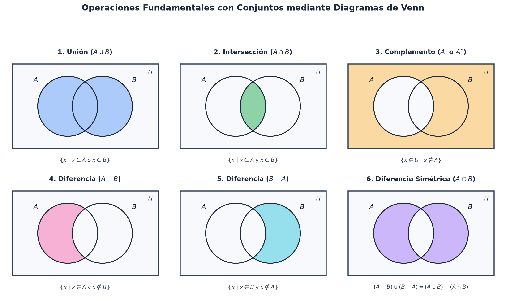

# 2.2 Operaciones con conjuntos (Unión, Intersección, Complemento, Diferencia y diferencia simétrica)

## Introducción: El Álgebra de las Operaciones entre Conjuntos

Así como en la aritmética elemental operamos con números mediante la suma, la resta y la multiplicación para obtener nuevos números, en la teoría de conjuntos existen **operaciones conjuntistas** que permiten combinar dos o más conjuntos dentro de un mismo universo referencial $U$ para construir nuevos conjuntos (Jiménez Murillo, 2012; Lipschutz & Lipson, 2009).

En las ciencias de la computación, estas cinco operaciones fundamentales —**unión**, **intersección**, **complemento**, **diferencia** y **diferencia simétrica**— constituyen la base directa de las consultas en bases de datos relacionales (`UNION`, `INTERSECT`, `EXCEPT`), los operadores lógicos y bit a bit en los lenguajes de programación (`||`, `&&`, `!`, `|`, `&`, `~`, `^`) y el filtrado de estructuras de datos.

---

## Unión

La **unión** de dos conjuntos $A$ y $B$, denotada por $A \cup B$ (se lee *«$A$ unión $B$»*), es el conjunto formado por todos los elementos que pertenecen a $A$, o pertenecen a $B$, o pertenecen a **ambos** conjuntos (Jiménez Murillo, 2012):

$$A \cup B = \{x \in U \mid x \in A \;\lor\; x \in B\}$$

donde el símbolo lógico $\lor$ representa la **disyunción inclusiva** (*«o»* inclusivo: basta con que el elemento pertenezca a por lo menos uno de los dos conjuntos).

### Propiedades inmediatas de la unión

Para cualesquiera conjuntos $A, B \subseteq U$:
1. **Inclusión de los sumandos:** Todo elemento de $A$ y todo elemento de $B$ está en su unión:
   $$A \subseteq (A \cup B) \qquad \text{y} \qquad B \subseteq (A \cup B)$$
2. **Conmutatividad e idempotencia:**
   $$A \cup B = B \cup A \qquad \text{y} \qquad A \cup A = A$$
3. **Elementos neutro y absorbente:**
   $$A \cup \emptyset = A \qquad \text{y} \qquad A \cup U = U$$
4. **Caracterización de subconjunto mediante la unión:**
   $$A \subseteq B \qquad \Longleftrightarrow \qquad A \cup B = B$$

**Ejemplo rápido:** Si $A = \{1, 2, 3, 6, 7, 8\}$ y $B = \{2, 4, 6, 8, 10, 12\}$, al reunir todos los elementos sin repetir duplicados se obtiene:
$$A \cup B = \{1, 2, 3, 4, 6, 7, 8, 10, 12\}$$

---

## Intersección

La **intersección** de dos conjuntos $A$ y $B$, denotada por $A \cap B$ (se lee *«$A$ intersección $B$»*), es el conjunto que contiene únicamente a los elementos que son **comunes** simultáneamente a $A$ y a $B$ (Jiménez Murillo, 2012):

$$A \cap B = \{x \in U \mid x \in A \;\land\; x \in B\} = \{x \mid x \in A;\; x \in B\}$$

donde el símbolo lógico $\land$ (o el punto y coma `;`) representa la **conjunción lógica** (*«y»*: el elemento debe pertenecer obligatoriamente a ambos conjuntos al mismo tiempo).

### Conjuntos disjuntos (o ajenos) y propiedades inmediatas

1. **Conjuntos disjuntos o ajenos:** Si dos conjuntos $A$ y $B$ no tienen ningún elemento en común, su intersección es el conjunto vacío:
   $$A \cap B = \emptyset$$
   En tal caso, si $S = A \cup B$ y $A \cap B = \emptyset$, se dice que $S$ es la **unión disjunta** de $A$ y $B$ (Lipschutz & Lipson, 2009).
2. **Contención en los factores:** La intersección está contenida en cada uno de los conjuntos que la forman:
   $$(A \cap B) \subseteq A \qquad \text{y} \qquad (A \cap B) \subseteq B$$
   En consecuencia, para cualesquiera conjuntos $A$ y $B$ se cumple siempre la cadena de inclusión (Teorema 1.3 de Lipschutz):
   $$(A \cap B) \subseteq A \subseteq (A \cup B) \qquad \text{y} \qquad (A \cap B) \subseteq B \subseteq (A \cup B)$$
3. **Conmutatividad, idempotencia, identidad y dominación:**
   $$A \cap B = B \cap A,\qquad A \cap A = A,\qquad A \cap U = A,\qquad A \cap \emptyset = \emptyset$$
4. **Caracterización de subconjunto mediante la intersección:**
   $$A \subseteq B \qquad \Longleftrightarrow \qquad A \cap B = A$$

**Ejemplo rápido:** Para los mismos conjuntos $A = \{1, 2, 3, 6, 7, 8\}$ y $B = \{2, 4, 6, 8, 10, 12\}$, los únicos elementos que figuran en ambos son:
$$A \cap B = \{2, 6, 8\}$$

---

## Complemento

El **complemento absoluto** (o simplemente **complemento**) de un conjunto $A$ con respecto al conjunto universo $U$, denotado por $A'$, $A^c$ o $\overline{A}$ (se lee *«complemento de $A$»* o *«$A$ prima»*), es el conjunto formado por todos los elementos del universo $U$ que **no pertenecen** a $A$ (Jiménez Murillo, 2012; Lipschutz & Lipson, 2009):

$$A' = A^c = \{x \in U \mid x \notin A\} = U - A$$

El complemento corresponde en lógica proposicional al operador de **negación ($\neg$)**. Es indispensable conocer cuál es el conjunto universo $U$ antes de calcular cualquier complemento, pues $A'$ depende directamente de $U$.

### Propiedades inmediatas del complemento

Para todo conjunto $A \subseteq U$:
1. **Involución (doble negación o doble complemento):** El complemento del complemento de $A$ es el propio conjunto $A$:
   $$(A')' = A$$
2. **Leyes de complementación (tercero excluido y no contradicción):** Un conjunto y su complemento forman una partición del universo $U$:
   $$A \cup A' = U \qquad \text{y} \qquad A \cap A' = \emptyset$$
3. **Complementos del universo y del vacío:**
   $$U' = \emptyset \qquad \text{y} \qquad \emptyset' = U$$
4. **Inversión del orden de inclusión (contraposición):**
   $$A \subseteq B \qquad \Longleftrightarrow \qquad B' \subseteq A'$$

**Ejemplo rápido:**
- Si el universo es finito, digamos $U = \{1, 2, 3, 4, 5, 6, 7, 8, 9, 10\}$ y $A = \{1, 3, 6, 7, 9, 10\}$, entonces $A' = \{2, 4, 5, 8\}$.
- Si el universo es infinito, por ejemplo $U = \mathbb{Z}$ y $A = \{1, 3, 5, 8\}$, como no es posible listar todos los enteros restantes uno por uno, el complemento se expresa por comprensión excluyendo el conjunto finito $A$ (Jiménez Murillo, 2012, Ej. 3.9):
  $$A' = \{x \mid x \in \mathbb{Z};\; x \notin \{1, 3, 5, 8\}\}$$

---

## Diferencia

La **diferencia** entre dos conjuntos $A$ y $B$ (en ese orden), denotada por $A - B$ o $A \setminus B$ (se lee *«$A$ menos $B$»*), también llamada **complemento relativo de $B$ con respecto a $A$**, es el conjunto de todos los elementos que **pertenecen a $A$ pero no pertenecen a $B$** (Jiménez Murillo, 2012; Epp, 2012):

$$A - B = A \setminus B = \{x \in U \mid x \in A \;\land\; x \notin B\}$$

De manera recíproca, la diferencia $B - A$ contiene a todos los elementos que pertenecen a $B$ pero no pertenecen a $A$:
$$B - A = B \setminus A = \{x \in U \mid x \in B \;\land\; x \notin A\}$$

### Identidad fundamental y propiedades de la diferencia

1. **Identidad de reducción de la diferencia a intersección con complemento:**
   Decir que $x \in A$ y $x \notin B$ equivale a decir que $x \in A$ y $x \in B'$. Por tanto, para cualesquiera conjuntos $A$ y $B$:
   $$A - B = A \cap B' = A - (A \cap B)$$
   Esta identidad es sumamente útil para simplificar expresiones algebraicas que contienen restas de conjuntos.
2. **La diferencia NO es conmutativa ni asociativa:** En general, cuando $A \neq B$:
   $$A - B \neq B - A$$
3. **Casos particulares:**
   $$A - \emptyset = A,\qquad \emptyset - A = \emptyset,\qquad A - A = \emptyset,\qquad A - U = \emptyset,\qquad U - A = A'$$
4. **Descomposición disjunta de un conjunto:** Todo conjunto $A$ es la unión disjunta de $A - B$ y $A \cap B$:
   $$A = (A - B) \cup (A \cap B) \qquad \text{con} \qquad (A - B) \cap (A \cap B) = \emptyset$$

**Ejemplo rápido:** Sean $A = \{1, 2, 3, 4, 7, 9, 10\}$ y $B = \{3, 4, 5, 6, 7, 8\}$ (Jiménez Murillo, 2012, Ej. 3.11). Quitando de $A$ los elementos comunes $A \cap B = \{3, 4, 7\}$, y viceversa:
$$A - B = \{1, 2, 9, 10\} \qquad \text{mientras que} \qquad B - A = \{5, 6, 8\}$$

---

## Diferencia simétrica

La **diferencia simétrica** (o *suma booleana*) de dos conjuntos $A$ y $B$, denotada por $A \oplus B$ (o $A \triangle B$), es el conjunto formado por todos los elementos que pertenecen a $A$ o a $B$, **pero no a ambos simultáneamente** (Jiménez Murillo, 2012; Lipschutz & Lipson, 2009):

$$A \oplus B = \{x \in U \mid (x \in A \;\land\; x \notin B) \;\lor\; (x \in B \;\land\; x \notin A)\}$$

En lógica matemática y arquitectura de computadoras, la diferencia simétrica corresponde exactamente a la operación **OR exclusivo (`XOR`)**.

### Fórmulas equivalentes y propiedades de la diferencia simétrica

Existen dos maneras equivalentes y muy prácticas de calcular $A \oplus B$:
1. **Como la unión de ambas diferencias relativas:**
   $$A \oplus B = (A - B) \cup (B - A) = (A \cap B') \cup (A' \cap B)$$
2. **Como la unión menos la intersección:**
   $$A \oplus B = (A \cup B) - (A \cap B) = (A \cup B) \cap (A \cap B)'$$

Sus propiedades algebraicas principales son:
- **Es conmutativa y asociativa:**
  $$A \oplus B = B \oplus A \qquad \text{y} \qquad (A \oplus B) \oplus C = A \oplus (B \oplus C)$$
- **Elemento neutro y nilpotencia (inverso aditivo):**
  $$A \oplus \emptyset = A,\qquad A \oplus A = \emptyset,\qquad A \oplus U = A',\qquad A \oplus A' = U$$

**Ejemplo rápido:** Con $A = \{1, 2, 3, 4, 7, 9, 10\}$ y $B = \{3, 4, 5, 6, 7, 8\}$, como $A - B = \{1, 2, 9, 10\}$ y $B - A = \{5, 6, 8\}$, al unirlos obtenemos (Jiménez Murillo, 2012, Ej. 3.12):
$$A \oplus B = (A - B) \cup (B - A) = \{1, 2, 5, 6, 8, 9, 10\}$$

---

## Operaciones Generalizadas en Colecciones de Conjuntos

Las operaciones de unión e intersección se extienden de manera natural a cualquier colección finita de conjuntos $A_1, A_2, \dots, A_m$ (Lipschutz & Lipson, 2009; Epp, 2012):

1. **Unión generalizada:** Consta de los elementos que pertenecen a **por lo menos uno** de los conjuntos $A_i$:
   $$\bigcup_{i=1}^{m} A_i = A_1 \cup A_2 \cup \dots \cup A_m = \{x \mid \exists i \in \{1, \dots, m\}\text{ tal que } x \in A_i\}$$
2. **Intersección generalizada:** Consta de los elementos que pertenecen a **todos y cada uno** de los conjuntos $A_i$:
   $$\bigcap_{i=1}^{m} A_i = A_1 \cap A_2 \cap \dots \cap A_m = \{x \mid \forall i \in \{1, \dots, m\},\; x \in A_i\}$$

---

## Ejemplos de Práctica (Resueltos Paso a Paso)

### Ejemplo 2.2.1: Operaciones combinadas en un universo finito
Considere el conjunto universo $U = \{a, b, c, d, e, f, g, h, i, j\}$ y los subconjuntos (Jiménez Murillo, 2012, Prob. 3.11-I):
$$A = \{f, g, i, j\},\qquad B = \{a, c, d, f, h, i\},\qquad C = \{c, d, e, f, g, h\},\qquad D = \{a, b, c\}$$
Calcule paso a paso:
a) $(A \cup B) \cap (C \cup D)$  
b) $[(A \cap D) \cup B] - C$  
c) $(A \cap C \cap D)' \cup B$  
d) $(D \oplus B) \cap A'$  
e) $[(A - B) \cap (D \oplus B)] - (C \oplus D')$

**Solución:**
- **a) Cálculo de $(A \cup B) \cap (C \cup D)$:**
  - Primero hallamos cada unión dentro de los paréntesis:
    $$A \cup B = \{a, c, d, f, g, h, i, j\}$$
    $$C \cup D = \{a, b, c, d, e, f, g, h\}$$
  - Ahora intersectamos ambos resultados (elementos comunes):
    $$(A \cup B) \cap (C \cup D) = \{a, c, d, f, g, h\}$$

- **b) Cálculo de $[(A \cap D) \cup B] - C$:**
  - Como $A = \{f, g, i, j\}$ y $D = \{a, b, c\}$ son disjuntos, $A \cap D = \emptyset$.
  - Al unir con $B$: $(A \cap D) \cup B = \emptyset \cup B = B = \{a, c, d, f, h, i\}$.
  - Restamos los elementos que estén en $C = \{c, d, e, f, g, h\}$:
    $$[(A \cap D) \cup B] - C = B - C = \{a, i\}$$

- **c) Cálculo de $(A \cap C \cap D)' \cup B$:**
  - Como $A \cap D = \emptyset$, la triple intersección es $A \cap C \cap D = \emptyset$.
  - Su complemento respecto a $U$ es $\emptyset' = U$.
  - Finalmente, $U \cup B = U = \{a, b, c, d, e, f, g, h, i, j\}$.

- **d) Cálculo de $(D \oplus B) \cap A'$:**
  - Diferencia simétrica entre $D = \{a, b, c\}$ y $B = \{a, c, d, f, h, i\}$ (elementos no comunes, es decir, excluimos $a$ y $c$):
    $$D \oplus B = \{b, d, f, h, i\}$$
  - Complemento de $A = \{f, g, i, j\}$ en $U$:
    $$A' = \{a, b, c, d, e, h\}$$
  - Intersectamos ambos conjuntos:
    $$(D \oplus B) \cap A' = \{b, d, h\}$$

- **e) Cálculo de $[(A - B) \cap (D \oplus B)] - (C \oplus D')$:**
  - Calculamos $A - B = \{f, g, i, j\} - \{a, c, d, f, h, i\} = \{g, j\}$.
  - Sabemos por el inciso anterior que $D \oplus B = \{b, d, f, h, i\}$.
  - Al intersectar $(A - B)$ con $(D \oplus B)$: $\{g, j\} \cap \{b, d, f, h, i\} = \emptyset$.
  - Como el conjunto vacío menos cualquier conjunto sigue siendo vacío ($\emptyset - X = \emptyset$), sin importar cuánto valga $C \oplus D'$, el resultado final es:
    $$[(A - B) \cap (D \oplus B)] - (C \oplus D') = \emptyset$$

---

### Ejemplo 2.2.2: Operaciones con conjuntos sobre un universo infinito ($U = \mathbb{Z}$)
Sean el conjunto universo $U = \{x \mid x \in \mathbb{Z}\}$ y los conjuntos (Jiménez Murillo, 2012, Ej. 3.13):
$$A = \{1, 2, 5, 7, 10, 12\},\quad B = \{x \mid x \in \mathbb{Z};\; 3 < x < 15;\; x \text{ es primo}\},\quad C = \{3, 5, 9, 10, 12, 13, 14\},\quad D = \{2, 4, 8, 10, 11\}$$
Obtenga:
a) $(A \cap B)'$  
b) $(C \cup D') \oplus B'$  
c) $C' - (D \oplus A)$  
d) $[(A \cup B') - C] \oplus D'$

**Solución:**
Primero expresamos $B$ por extensión: los primos estrictamente entre $3$ y $15$ son $B = \{5, 7, 11, 13\}$.

- **a) $(A \cap B)'$:**
  - Intersectamos $A$ y $B$: $A \cap B = \{5, 7\}$.
  - Su complemento en $U = \mathbb{Z}$ son todos los enteros excepto el $5$ y el $7$:
    $$(A \cap B)' = \{x \mid x \in \mathbb{Z};\; x \notin \{5, 7\}\}$$

- **b) $(C \cup D') \oplus B'$:**
  - El complemento de $D$ es $D' = \mathbb{Z} - \{2, 4, 8, 10, 11\}$.
  - Al unir $D'$ con $C = \{3, 5, 9, 10, 12, 13, 14\}$, el elemento $10 \in C$ se reincorpora al conjunto, por lo que los únicos enteros que siguen faltando en $C \cup D'$ son $\{2, 4, 8, 11\}$:
    $$C \cup D' = \{x \mid x \in \mathbb{Z};\; x \notin \{2, 4, 8, 11\}\}$$
  - Por su parte, $B' = \{x \mid x \in \mathbb{Z};\; x \notin \{5, 7, 11, 13\}\}$.
  - La diferencia simétrica $(C \cup D') \oplus B'$ contiene a los enteros que están en uno solo de estos dos conjuntos. Como ambos contienen a casi todos los enteros salvo sus respectivas listas de excluidos, un entero está en exactamente uno de ellos si y sólo si está excluido de uno pero no del otro (diferencia simétrica de las listas de excluidos $\{2, 4, 8, 11\} \oplus \{5, 7, 11, 13\}$, donde el $11$ está excluido de ambos):
    $$(C \cup D') \oplus B' = \{2, 4, 5, 7, 8, 13\}$$

- **c) $C' - (D \oplus A)$:**
  - $C' = \{x \mid x \in \mathbb{Z};\; x \notin \{3, 5, 9, 10, 12, 13, 14\}\}$.
  - La diferencia simétrica entre $D = \{2, 4, 8, 10, 11\}$ y $A = \{1, 2, 5, 7, 10, 12\}$ (excluyendo los comunes $2$ y $10$) es:
    $$D \oplus A = \{1, 4, 5, 7, 8, 11, 12\}$$
  - Al restarle a $C'$ los elementos de $D \oplus A$, debemos excluir de $\mathbb{Z}$ tanto los elementos de $C$ como los de $D \oplus A$, es decir, excluimos $C \cup (D \oplus A) = \{1, 3, 4, 5, 7, 8, 9, 10, 11, 12, 13, 14\}$:
    $$C' - (D \oplus A) = \{x \mid x \in \mathbb{Z};\; x \notin \{1, 3, 4, 5, 7, 8, 9, 10, 11, 12, 13, 14\}\}$$

- **d) $[(A \cup B') - C] \oplus D'$:**
  - En $B' = \mathbb{Z} - \{5, 7, 11, 13\}$, al unir con $A = \{1, 2, 5, 7, 10, 12\}$ se recuperan el $5$ y el $7$, quedando excluidos únicamente el $11$ y el $13$:
    $$A \cup B' = \{x \mid x \in \mathbb{Z};\; x \notin \{11, 13\}\}$$
  - Al restar $C = \{3, 5, 9, 10, 12, 13, 14\}$, quedan excluidos $\{3, 5, 9, 10, 11, 12, 13, 14\}$:
    $$(A \cup B') - C = \{x \mid x \in \mathbb{Z};\; x \notin \{3, 5, 9, 10, 11, 12, 13, 14\}\}$$
  - Finalmente, al hacer la diferencia simétrica con $D' = \{x \mid x \in \mathbb{Z};\; x \notin \{2, 4, 8, 10, 11\}\}$, tomamos la diferencia simétrica de ambos conjuntos de excluidos (eliminando los comunes $10$ y $11$):
    $$[(A \cup B') - C] \oplus D' = \{2, 3, 4, 5, 8, 9, 12, 13, 14\}$$

---

### Ejemplo 2.2.3: Operaciones con intervalos sobre la recta real ($U = \mathbb{R}$)
Sea el conjunto universo $U = \mathbb{R}$ y considérense los intervalos $A = [-2, 4)$ y $B = (1, 6]$. Determine y exprese en notación de intervalos:
a) $A \cup B$  
b) $A \cap B$  
c) $A - B$  
d) $B - A$  
e) $A \oplus B$  
f) $A'$

**Solución:**
- **a) Unión $A \cup B$:** Abarca todos los números reales desde $-2$ (incluido) hasta $6$ (incluido):
  $$A \cup B = [-2, 6]$$
- **b) Intersección $A \cap B$:** Son los números reales que cumplen $-2 \le x < 4$ y simultáneamente $1 < x \le 6$. El traslape va desde $1$ (sin incluir, pues $1 \notin B$) hasta $4$ (sin incluir, pues $4 \notin A$):
  $$A \cap B = (1, 4)$$
- **c) Diferencia $A - B$:** A los elementos de $A = [-2, 4)$ les quitamos los que están en $B = (1, 6]$. Como el número $1 \in A$ y $1 \notin B$, el extremo $1$ **sí se conserva** en $A - B$:
  $$A - B = [-2, 1]$$
- **d) Diferencia $B - A$:** A los elementos de $B = (1, 6]$ les quitamos los de $A = [-2, 4)$. Como el número $4 \in B$ y $4 \notin A$, el extremo $4$ **sí se conserva** en $B - A$:
  $$B - A = [4, 6]$$
- **e) Diferencia simétrica $A \oplus B$:** Es la unión de $A - B$ y $B - A$:
  $$A \oplus B = [-2, 1] \cup [4, 6]$$
- **f) Complemento $A'$:** Son todos los reales menores estrictamente que $-2$ o mayores o iguales que $4$:
  $$A' = (-\infty, -2) \cup [4, +\infty)$$

---

### Ejemplo 2.2.4: Operaciones generalizadas en una familia indexada de conjuntos
Para cada entero positivo $i \in \{1, 2, 3, 4\}$, defínase el conjunto $A_i = \{x \in \mathbb{N} \mid x \text{ es múltiplo de } i \text{ y } x \le 12\}$. Encuentre:
a) $\bigcup_{i=2}^{4} A_i$  
b) $\bigcap_{i=2}^{4} A_i$

**Solución:**
Listamos primero los conjuntos para $i = 2, 3, 4$:
- $A_2 = \{2, 4, 6, 8, 10, 12\}$
- $A_3 = \{3, 6, 9, 12\}$
- $A_4 = \{4, 8, 12\}$

Por consiguiente:
- **a) Unión $\bigcup_{i=2}^{4} A_i = A_2 \cup A_3 \cup A_4$:**
  $$\bigcup_{i=2}^{4} A_i = \{2, 3, 4, 6, 8, 9, 10, 12\}$$
- **b) Intersección $\bigcap_{i=2}^{4} A_i = A_2 \cap A_3 \cap A_4$:** Es el conjunto de múltiplos comunes de $2, 3$ y $4$ menores o iguales a $12$. Como $\operatorname{mcm}(2, 3, 4) = 12$:
  $$\bigcap_{i=2}^{4} A_i = \{12\}$$

---

## Ejercicios de Tarea (Práctica en Casa)

> **Instrucciones:** Resuelva cada uno de los siguientes ejercicios mostrando todas las operaciones intermedias de forma ordenada.

1. **Operaciones entre subconjuntos de un universo finito (Lipschutz & Lipson, Prob. 1.4 y 1.5):**  
   Sea $U = \{1, 2, 3, 4, 5, 6, 7, 8, 9\}$ el conjunto universo, y sean:
   $$A = \{1, 2, 3, 4, 5\},\quad B = \{4, 5, 6, 7\},\quad C = \{5, 6, 7, 8, 9\},\quad D = \{1, 3, 5, 7, 9\},\quad E = \{2, 4, 6, 8\},\quad F = \{1, 5, 9\}$$
   Encuentre:  
   a) $A \cup B$, $A \cap B$, $D \cup F$ y $D \cap F$.  
   b) $A'$, $B'$, $D'$ y $E'$.  
   c) $A - B$, $B - A$, $D - E$ y $F - D$.  
   d) $A \oplus B$, $C \oplus D$ y $E \oplus F$.
   <!--
   Solución del Ejercicio 1:
   - a) A U B = {1, 2, 3, 4, 5, 6, 7};   A n B = {4, 5};
        Como F subseteq D, D U F = D = {1, 3, 5, 7, 9}  y  D n F = F = {1, 5, 9}.
   - b) A' = {6, 7, 8, 9};   B' = {1, 2, 3, 8, 9};
        D' = {2, 4, 6, 8} = E;   E' = {1, 3, 5, 7, 9} = D.
   - c) A - B = {1, 2, 3};   B - A = {6, 7};
        Como D y E son disjuntos (impares vs pares), D - E = D = {1, 3, 5, 7, 9};
        Como F subseteq D, F - D = vacío.
   - d) A (+) B = {1, 2, 3, 6, 7};
        C (+) D = {1, 3, 6, 8} (ya que C - D = {6, 8} y D - C = {1, 3});
        E (+) F = E U F = {1, 2, 4, 5, 6, 8, 9} (pues E y F son disjuntos).
   -->

2. **Operaciones combinadas en universo acotado (Jiménez Murillo, Prob. 3.12-I):**  
   Sean los conjuntos:
   $$U = \{x \mid x \in \mathbb{Z};\; 0 < x \le 20\}$$
   $$A = \{x \mid x \in \mathbb{Z}^+;\; x \text{ es par};\; x \le 10\}$$
   $$B = \{1, 2, 4, 5, 6, 7\}$$
   $$C = \{x \mid x \in \mathbb{Z}^+;\; x \text{ es divisible entre } 3;\; x < 16\}$$
   Determine por extensión los elementos de:  
   a) $(A \cap B)' - C$  
   b) $(A \cup C) \cap B'$  
   c) $(B \oplus C) - A$  
   d) $[(A - B) \cup (C - B)]'$
   <!--
   Solución del Ejercicio 2:
   Primero listamos los conjuntos dentro de U = {1, 2, 3, ..., 20}:
   A = {2, 4, 6, 8, 10} (nota: 0 no pertenece a U porque 0 < x <= 20)
   B = {1, 2, 4, 5, 6, 7}
   C = {3, 6, 9, 12, 15}
   - a) A n B = {2, 4, 6}.
        (A n B)' = U - {2, 4, 6} = {1, 3, 5, 7, 8, 9, 10, 11, 12, 13, 14, 15, 16, 17, 18, 19, 20}.
        Restando C = {3, 6, 9, 12, 15}:
        (A n B)' - C = {1, 5, 7, 8, 10, 11, 13, 14, 16, 17, 18, 19, 20}.
   - b) A U C = {2, 3, 4, 6, 8, 9, 10, 12, 15}.
        Intersectando con B' (es decir, quitando los elementos que estén en B = {1, 2, 4, 5, 6, 7}):
        (A U C) n B' = (A U C) - B = {3, 8, 9, 10, 12, 15}.
   - c) B (+) C = (B U C) - (B n C) = {1, 2, 3, 4, 5, 6, 7, 9, 12, 15} - {6} = {1, 2, 3, 4, 5, 7, 9, 12, 15}.
        Restando A = {2, 4, 6, 8, 10}:
        (B (+) C) - A = {1, 3, 5, 7, 9, 12, 15}.
   - d) A - B = {8, 10};  C - B = {3, 9, 12, 15}.
        Su unión es (A - B) U (C - B) = {3, 8, 9, 10, 12, 15}.
        Tomando el complemento respecto a U = {1, ..., 20}:
        [(A - B) U (C - B)]' = {1, 2, 4, 5, 6, 7, 11, 13, 14, 16, 17, 18, 19, 20}.
   -->

3. **Operaciones con conjuntos definidos mediante ecuaciones reales (Jiménez Murillo, Prob. 3.11-II):**  
   Sean el conjunto universo $U = \{x \mid x \in \mathbb{R}\}$ y los conjuntos:
   $$A = \{x \mid x \in \mathbb{R};\; x^2 - 1 = 0\},\qquad B = \{-1, 2, 4\}$$
   Calcule:  
   a) $(A \cup B)'$  
   b) $(A \cap B)'$  
   c) $B - A'$  
   d) $(A - B) \oplus B'$  
   e) $[B \oplus (B - A)'] \cap A$
   <!--
   Solución del Ejercicio 3:
   Resolviendo x^2 - 1 = 0 se obtiene x = +-1, por lo que A = {-1, 1} y B = {-1, 2, 4}.
   - a) A U B = {-1, 1, 2, 4} ==> (A U B)' = {x in R | x notin {-1, 1, 2, 4}}.
   - b) A n B = {-1} ==> (A n B)' = {x in R | x != -1}.
   - c) Sabemos que B - A' = B n (A')' = B n A = {-1}.
   - d) A - B = {1}. Por su parte, B' = R - {-1, 2, 4}.
        Como 1 in B', al hacer la diferencia simétrica {1} (+) B', el número 1 (que es común a ambos) se elimina de B':
        (A - B) (+) B' = {x in R | x notin {-1, 1, 2, 4}}.
   - e) B - A = {2, 4}, por lo que (B - A)' = R - {2, 4}.
        Al hacer B (+) (B - A)' entre B = {-1, 2, 4} y R - {2, 4}:
        Los números 2 y 4 están en B pero no en (B - A)', así que permanecen; el -1 está en ambos, así que se cancela; y el resto de reales sigue estando en (B - A)'. Por tanto, B (+) (B - A)' = R - {-1}.
        Al intersectar con A = {-1, 1}:
        (R - {-1}) n {-1, 1} = {1}.
   -->

4. **Construcción de diagramas de Venn bajo restricciones de inclusión (Jiménez Murillo, Prob. 3.7a):**  
   Sean $A, B, C, D$ y $E$ conjuntos no vacíos dentro de un universo $U$. Describa cómo deben ubicarse geométricamente las regiones en un diagrama de Venn (y proponga un ejemplo numérico concreto con elementos para cada conjunto) de modo que se cumplan simultáneamente todas las condiciones siguientes:
   $$A \subset (C \cap D),\qquad E \subset D,\qquad C \cap D \neq \emptyset,\qquad B \subset E,\qquad E \nsubseteq (C \cap D)$$
   <!--
   Solución del Ejercicio 4:
   - Descripción geométrica del diagrama de Venn:
     1) Se dibujan los círculos C y D traslapados (pues C n D != vacío).
     2) Dentro de la lenteja de intersección C n D se dibuja íntegramente el círculo A (pues A subset C n D).
     3) Dentro del círculo D se dibuja el círculo E de manera que al menos una parte de E quede fuera de C (es decir, en la región D - C), garantizando así que E subset D pero E nsubseteq (C n D).
     4) Dentro del círculo E se dibuja íntegramente el círculo B (pues B subset E).
   - Ejemplo numérico concreto que satisface todas las condiciones:
     Sea U = {1, 2, 3, 4, 5, 6}:
     A = {1}
     C = {1, 2, 3}
     D = {1, 2, 4, 5}   --> C n D = {1, 2} != vacío, y A = {1} subset (C n D).
     E = {4, 5}         --> E subset D, pero E nsubseteq {1, 2}.
     B = {4}            --> B subset E.
   -->

5. **Operaciones con intervalos reales:**  
   Considerando $U = \mathbb{R}$ y los intervalos $P = (-3, 2]$, $Q = [0, 5)$ y $R = (2, 7]$, determine y exprese como intervalos o unión de intervalos:  
   a) $(P \cup Q) \cap R$  
   b) $(P \cap Q)'$  
   c) $(P \cup R) - Q$  
   d) $P \oplus Q$
   <!--
   Solución del Ejercicio 5:
   - a) P U Q = (-3, 5). Intersectando con R = (2, 7]:
        (P U Q) n R = (2, 5).
   - b) P n Q = [0, 2]. Su complemento en R es:
        (P n Q)' = (-inf, 0) U (2, +inf).
   - c) Como P = (-3, 2] incluye al 2 y R = (2, 7] inicia justo después del 2, P U R = (-3, 7].
        Al restar Q = [0, 5), quitamos desde 0 (incluido) hasta 5 (sin incluir, por lo que el 5 sí se queda en la diferencia):
        (P U R) - Q = (-3, 0) U [5, 7].
   - d) P - Q = (-3, 0)  y  Q - P = (2, 5).
        Por tanto: P (+) Q = (-3, 0) U (2, 5).
   -->
