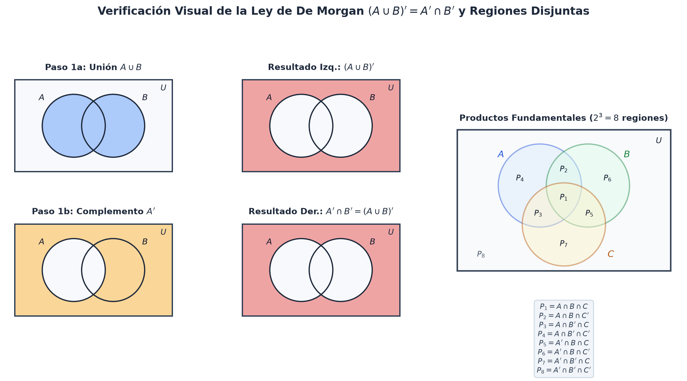

# 2.3 Propiedades de los conjuntos

## 1. Leyes del Álgebra de Conjuntos

Los subconjuntos de un conjunto universo $U$, dotados de las operaciones de unión ($\cup$), intersección ($\cap$) y complementación ($'$), satisfacen un sistema de identidades universales conocido como **Álgebra de Conjuntos** (Jiménez Murillo, 2012; Lipschutz & Lipson, 2009; Epp, 2012). Estas leyes permiten **simplificar expresiones conjuntistas complejas** (y sus equivalentes en consultas de bases de datos o condiciones de programación) sin necesidad de listar los elementos de cada conjunto.

A continuación se presenta la tabla completa de leyes fundamentales (integrando la numeración de la Tabla 3.1 de Jiménez Murillo, 2012, y la Tabla 1-1 de Lipschutz & Lipson, 2009):

| N.º | Nombre de la Ley / Propiedad | Forma con Unión ($\cup$) | Forma Dual con Intersección ($\cap$) |
| :---: | :--- | :---: | :---: |
| **1** | **Doble negación (Involución)** | $(A')' = A$ | — |
| **2** | **Ley conmutativa** | $A \cup B = B \cup A$ | $A \cap B = B \cap A$ |
| **3** | **Ley asociativa** | $A \cup (B \cup C) = (A \cup B) \cup C$ | $A \cap (B \cap C) = (A \cap B) \cap C$ |
| **4** | **Ley distributiva** | $A \cup (B \cap C) = (A \cup B) \cap (A \cup C)$ | $A \cap (B \cup C) = (A \cap B) \cup (A \cap C)$ |
| **5** | **Ley de idempotencia** | $A \cup A = A$ $U \cup U = U,\quad \emptyset \cup \emptyset = \emptyset$ | $A \cap A = A$ $U \cap U = U,\quad \emptyset \cap \emptyset = \emptyset$ |
| **6** | **Leyes de De Morgan** ($2$ conjuntos) *(y generalización a $3$ conjuntos)* | $(A \cup B)' = A' \cap B'$ $(A \cup B \cup C)' = A' \cap B' \cap C'$ | $(A \cap B)' = A' \cup B'$ $(A \cap B \cap C)' = A' \cup B' \cup C'$ |
| **7** | **Ley de equivalencia** *(absorción parcial)* | $A \cup (A' \cap B) = A \cup B$ | $A \cap (A' \cup B) = A \cap B$ |
| **8** | **Ley de contradicción** *(no contradicción)* | — | $A \cap A' = \emptyset$ |
| **9** | **Propiedades del complemento** *(tercero excluido y extremos)* | $A \cup A' = U$ $\emptyset' = U$ | $U' = \emptyset$ |
| **10** | **Leyes de identidad y dominación** **Leyes de absorción total** | $A \cup \emptyset = A$ *(identidad)* $A \cup U = U$ *(dominación)* $A \cup (A \cap B) = A$ *(absorción)* | $A \cap U = A$ *(identidad)* $A \cap \emptyset = \emptyset$ *(dominación)* $A \cap (A \cup B) = A$ *(absorción)* |
| **11** | **Ley de la diferencia** | — | $A - B = A \cap B'$ |

> **Convención de precedencia de operadores:** Al igual que en la aritmética ordinaria la multiplicación tiene mayor prioridad que la suma, en expresiones de conjuntos sin paréntesis se evalúa primero el **complemento ($'$)**, luego la **intersección ($\cap$)** y finalmente la **unión ($\cup$)**. Así, la expresión $A \cup A' \cap B$ significa $A \cup (A' \cap B)$ (Jiménez Murillo, 2012).

---

## 2. Principio de Dualidad y Productos Fundamentales

### 2.1 El Principio de Dualidad

Observe en la tabla anterior que casi todas las leyes aparecen en **pares simétricos**. Sea $E$ cualquier identidad del álgebra de conjuntos que involucre únicamente las operaciones $\cup$, $\cap$, el complemento $'$ y los conjuntos constantes $U$ y $\emptyset$. El **dual** de $E$, denotado por $E^*$, es la ecuación que se obtiene al realizar simultáneamente los siguientes intercambios en toda la expresión (Lipschutz & Lipson, 2009):

$$\cup \;\longleftrightarrow\; \cap \qquad \text{y} \qquad U \;\longleftrightarrow\; \emptyset$$

- **Principio de Dualidad (Teorema):** *Si una ecuación $E$ es una identidad válida en el álgebra de conjuntos, entonces su ecuación dual $E^*$ también es automáticamente una identidad válida.*
- *Ejemplo:* A partir de la ley de absorción $A \cup (A \cap B) = A$ y de la identidad $(U \cap A) \cup (B \cap A) = A$, al intercambiar $\cup \leftrightarrow \cap$ y $U \leftrightarrow \emptyset$ se obtienen sus duales válidas:
  $$A \cap (A \cup B) = A \qquad \text{y} \qquad (\emptyset \cup A) \cap (B \cup A) = A$$

### 2.2 Productos Fundamentales (Regiones Disjuntas de Venn)

Dados $n$ conjuntos arbitrarios $A_1, A_2, \dots, A_n$ dentro de un universo $U$, un **producto fundamental** (llamado **minitérmino** en álgebra booleana) es una intersección de la forma:

$$P_k = A_1^* \cap A_2^* \cap \dots \cap A_n^*$$

donde cada factor $A_i^*$ puede ser o bien el conjunto $A_i$ sin complementar, o bien su complemento $A_i'$ (Lipschutz & Lipson, 2009).
- Existen exactamente $m = 2^n$ productos fundamentales posibles.
- **Cualesquiera dos productos fundamentales distintos son disjuntos:** $P_i \cap P_j = \emptyset$ para $i \neq j$.
- **Forman una partición geométrica del universo $U$:** La unión de los $2^n$ productos fundamentales es exactamente todo el universo $U$. En particular, para tres conjuntos $A, B, C$ existen $2^3 = 8$ regiones elementales disjuntas ($P_1$ a $P_8$).

---

## 3. Métodos de Verificación, Demostración y Simplificación

En matemáticas discretas existen cuatro métodos estándar para verificar o demostrar que dos expresiones conjuntistas $X$ y $Y$ son iguales ($X = Y$), así como el método del contraejemplo para refutar igualdades falsas (Epp, 2012; Jiménez Murillo, 2012):

### Método 1: Diagramas de Venn (Ilustración geométrica)
Consiste en sombrear la región correspondiente al miembro izquierdo y la región correspondiente al miembro derecho en diagramas de Venn separados y comprobar que ambas regiones coinciden exactamente (como se mostró en la figura anterior para la ley de De Morgan $(A \cup B)' = A' \cap B'$).

### Método 2: Tablas de Pertenencia (Método exhaustivo por regiones)
De manera análoga a las tablas de verdad de la lógica proposicional, se construye una tabla con $2^n$ filas correspondientes a todas las combinaciones posibles de pertenencia de un elemento arbitrario $x \in U$ respecto a los conjuntos base ($1$ si $x$ pertenece al conjunto, $0$ si $x$ no pertenece). Dos expresiones conjuntistas son idénticas **si y sólo si sus columnas finales coinciden fila por fila**.

Por ejemplo, la verificación por tabla de pertenencia de la **Ley de De Morgan $(A \cap B)' = A' \cup B'$** y de la **Ley de Equivalencia $A \cup (A' \cap B) = A \cup B$** es:

| $A$ | $B$ | $A'$ | $B'$ | $A \cap B$ | **$(A \cap B)'$** | **$A' \cup B'$** | $A' \cap B$ | **$A \cup (A' \cap B)$** | **$A \cup B$** |
| :---: | :---: | :---: | :---: | :---: | :---: | :---: | :---: | :---: | :---: |
| $0$ | $0$ | $1$ | $1$ | $0$ | **$1$** | **$1$** | $0$ | **$0$** | **$0$** |
| $0$ | $1$ | $1$ | $0$ | $0$ | **$1$** | **$1$** | $1$ | **$1$** | **$1$** |
| $1$ | $0$ | $0$ | $1$ | $0$ | **$1$** | **$1$** | $0$ | **$1$** | **$1$** |
| $1$ | $1$ | $0$ | $0$ | $1$ | **$0$** | **$0$** | $0$ | **$1$** | **$1$** |

Como las columnas de $(A \cap B)'$ y $A' \cup B'$ son idénticas ($1, 1, 1, 0$), y las de $A \cup (A' \cap B)$ y $A \cup B$ también son idénticas ($0, 1, 1, 1$), ambas leyes quedan formalmente verificadas.

### Método 3: Método del Elemento (Doble inclusión lógica)
Para demostrar que $X = Y$, se prueba que $X \subseteq Y$ (tomando un $x \in X$ arbitrario y deduciendo que $x \in Y$) y que $Y \subseteq X$, o bien mediante una cadena de equivalencias lógicas ($\iff$). Por ejemplo, para demostrar la **Ley de De Morgan $(A \cup B)' = A' \cap B'$**:
$$x \in (A \cup B)' \iff x \notin (A \cup B) \iff \neg(x \in A \;\lor\; x \in B) \iff (x \notin A \;\land\; x \notin B) \iff (x \in A' \;\land\; x \in B') \iff x \in A' \cap B'$$

### Método 4: Simplificación Algebraica mediante Leyes de Conjuntos
Es el método más potente y sistemático (Jiménez Murillo, 2012, Cap. 3.6): consiste en transformar un lado de la igualdad paso a paso citando explícitamente la ley aplicada en cada renglón.
- **Estrategia clave de factorización:** Cuando aparecen dos o más términos unidos por $\cup$ que comparten conjuntos comunes intersectados, se **factoriza la parte común** aplicando la ley distributiva $X \cap Y \cup X \cap Z = X \cap (Y \cup Z)$ con el objetivo de que dentro del paréntesis quede una expresión del tipo $B \cup B' = U$, la cual se reduce mediante la ley de identidad $X \cap U = X$.

### Refutación de una propiedad falsa mediante Contraejemplo
Para demostrar que una supuesta igualdad entre conjuntos es **falsa**, basta exhibir un **contraejemplo concreto** (asignando conjuntos numéricos pequeños a $A, B, C$) donde el lado izquierdo y el lado derecho produzcan conjuntos distintos (Epp, 2012, Cap. 6.3).

---

## 4. Relación entre Teoría de Conjuntos, Lógica Matemática y Álgebra Booleana

Como destaca Jiménez Murillo (2012, Tabla 3.2), las leyes de la teoría de conjuntos, la lógica proposicional (Unidad 3) y el álgebra booleana (Unidad 4) son **estructuralmente idénticas**, cambiando únicamente la notación empleada en cada disciplina:

| Concepto / Ley | Teoría de Conjuntos | Lógica Matemática (Proposicional) | Álgebra Booleana (Circuitos Digitales) |
| :--- | :---: | :---: | :---: |
| **Igualdad / Equivalencia** | $A = B$ | $p \leftrightarrow q \quad (\text{o } p \equiv q)$ | $A = B$ |
| **Unión / Disyunción / Suma OR** | $A \cup B$ | $p \lor q$ | $A + B$ |
| **Intersección / Conjunción / Producto AND** | $A \cap B$ | $p \land q$ | $A \cdot B \quad (\text{o } AB)$ |
| **Complemento / Negación / Inversor NOT** | $A'$ | $\neg p \quad (\text{o } p')$ | $A' \quad (\text{o } \overline{A})$ |
| **Diferencia** | $A - B = A \cap B'$ | $p \land \neg q$ | $AB'$ |
| **Universo / Tautología / Uno lógico** | $U$ | $V \quad (\text{o } 1)$ | $1$ |
| **Vacío / Contradicción / Cero lógico** | $\emptyset$ | $F \quad (\text{o } 0)$ | $0$ |
| **Leyes de De Morgan** | $(A \cup B)' = A' \cap B'$ $(A \cap B)' = A' \cup B'$ | $\neg(p \lor q) \equiv \neg p \land \neg q$ $\neg(p \land q) \equiv \neg p \lor \neg q$ | $(A + B)' = A'B'$ $(AB)' = A' + B'$ |
| **Leyes Distributivas** | $A \cap (B \cup C) = (A \cap B) \cup (A \cap C)$ $A \cup (B \cap C) = (A \cup B) \cap (A \cup C)$ | $p \land (q \lor r) \equiv (p \land q) \lor (p \land r)$ $p \lor (q \land r) \equiv (p \lor q) \land (p \lor r)$ | $A(B + C) = AB + AC$ $A + BC = (A + B)(A + C)$ |
| **Ley de Equivalencia** | $A \cup (A' \cap B) = A \cup B$ | $p \lor (\neg p \land q) \equiv p \lor q$ | $A + A'B = A + B$ |

---

## Ejemplos de Práctica (Resueltos Paso a Paso)

### Ejemplo 2.3.1: Simplificación algebraica por factorización sucesiva
Utilizando las leyes del álgebra de conjuntos, demuestre paso a paso la siguiente identidad (Jiménez Murillo, 2012, Ej. 3.15):
$$(A' \cap B' \cap C) \cup (A' \cap B \cap C) \cup (A \cap B' \cap C) \cup (A \cap B \cap C) \cup (A \cap B \cap C') = C \cup (A \cap B)$$

**Solución:**
Partimos del miembro izquierdo y justificamos cada transformación con la ley correspondiente:

1. **Agrupamos los dos primeros términos (que tienen en común $A' \cap C$) y el tercer y cuarto términos (que tienen en común $A \cap C$), aplicando la Ley distributiva (4b):**
   $$[(A' \cap C) \cap (B' \cup B)] \cup [(A \cap C) \cap (B' \cup B)] \cup (A \cap B \cap C')$$
2. **Aplicamos la Propiedad del complemento (9a: $B' \cup B = U$):**
   $$[(A' \cap C) \cap U] \cup [(A \cap C) \cap U] \cup (A \cap B \cap C')$$
3. **Aplicamos la Ley de identidad (10b: $X \cap U = X$):**
   $$(A' \cap C) \cup (A \cap C) \cup (A \cap B \cap C')$$
4. **Factorizamos $C$ en los dos primeros términos mediante la Ley distributiva (4b):**
   $$[C \cap (A' \cup A)] \cup (A \cap B \cap C')$$
5. **Aplicamos la Propiedad del complemento (9a: $A' \cup A = U$):**
   $$(C \cap U) \cup (A \cap B \cap C')$$
6. **Aplicamos la Ley de identidad (10b: $C \cap U = C$):**
   $$C \cup (A \cap B \cap C')$$
7. **Reordenamos los factores del segundo término por la Ley conmutativa (2b):**
   $$C \cup [C' \cap (A \cap B)]$$
8. **Aplicamos la Ley de equivalencia (7a: $X \cup (X' \cap Y) = X \cup Y$, tomando $X = C$ y $Y = A \cap B$):**
   $$C \cup (A \cap B)$$

Como hemos obtenido exactamente el miembro derecho, la identidad queda demostrada:
$$C \cup (A \cap B) = C \cup (A \cap B) \qquad \blacksquare$$

---

### Ejemplo 2.3.2: Demostración algebraica con Leyes de De Morgan y Dominación
Demuestre mediante las leyes de conjuntos que la siguiente expresión se simplifica al conjunto universo $U$ (Jiménez Murillo, 2012, Ej. 3.16):
$$(A' \cap B) \cup (A \cap B \cap C)' \cup [C \cap (B' \cup A)] = U$$

**Solución:**
Desarrollamos el miembro izquierdo paso a paso:

1. **Aplicamos la Ley de De Morgan (6b) al término $(A \cap B \cap C)' = A' \cup B' \cup C'$:**
   $$(A' \cap B) \cup A' \cup B' \cup C' \cup [C \cap (B' \cup A)]$$
2. **Distribuimos $C \cap (B' \cup A) = (C \cap B') \cup (C \cap A)$ por la Ley distributiva (4b):**
   $$(A' \cap B) \cup A' \cup B' \cup C' \cup (C \cap B') \cup (C \cap A)$$
3. **Agrupamos $(A' \cap B) \cup A'$ y $B' \cup (C \cap B')$ factorizando $A'$ y $B'$ con la Ley distributiva (4b) (o directamente por absorción):**
   $$[A' \cap (B \cup U)] \cup [B' \cap (U \cup C)] \cup C' \cup (C \cap A)$$
4. **Por la Ley de dominación / identidad (10a: $B \cup U = U$ y $U \cup C = U$):**
   $$(A' \cap U) \cup (B' \cap U) \cup C' \cup (C \cap A)$$
5. **Por la Ley de identidad (10b: $X \cap U = X$):**
   $$A' \cup B' \cup C' \cup (C \cap A)$$
6. **Aplicamos la Ley de equivalencia (7a) a $C' \cup (C \cap A) = C' \cup A$:**
   $$A' \cup B' \cup C' \cup A$$
7. **Reordenamos por la Ley conmutativa (2a) para juntar $A' \cup A$:**
   $$(A' \cup A) \cup B' \cup C'$$
8. **Por la Propiedad del complemento (9a: $A' \cup A = U$):**
   $$U \cup B' \cup C'$$
9. **Aplicando dos veces la Ley de dominación (10a: $U \cup X = U$):**
   $$U \cup C' = U \qquad \blacksquare$$

---

### Ejemplo 2.3.3: Simplificación de expresiones que involucran Diferencia ($-$)
Simplifique al máximo la expresión $[(A - B)' \cap A]$ utilizando leyes de conjuntos y compruebe el resultado con una tabla de pertenencia.

**Solución:**
- **Simplificación algebraica:**
  1. Sustituimos la diferencia por su equivalente $A - B = A \cap B'$ (Ley 11):
     $$(A - B)' \cap A = (A \cap B')' \cap A$$
  2. Aplicamos la Ley de De Morgan (6b) y la Doble negación (1) para obtener $(A \cap B')' = A' \cup (B')' = A' \cup B$:
     $$= (A' \cup B) \cap A$$
  3. Aplicamos la Ley conmutativa (2b) y la Ley distributiva (4b):
     $$= A \cap (A' \cup B) = (A \cap A') \cup (A \cap B)$$
  4. Por la Ley de contradicción (8: $A \cap A' = \emptyset$) y la Ley de identidad (10a: $\emptyset \cup X = X$):
     $$= \emptyset \cup (A \cap B) = \mathbf{A \cap B}$$

- **Comprobación con tabla de pertenencia:**

| $A$ | $B$ | $A - B$ | $(A - B)'$ | **$(A - B)' \cap A$** | **$A \cap B$** |
| :---: | :---: | :---: | :---: | :---: | :---: |
| $0$ | $0$ | $0$ | $1$ | **$0$** | **$0$** |
| $0$ | $1$ | $0$ | $1$ | **$0$** | **$0$** |
| $1$ | $0$ | $1$ | $0$ | **$0$** | **$0$** |
| $1$ | $1$ | $0$ | $1$ | **$1$** | **$1$** |

Las dos últimas columnas son idénticas ($0, 0, 0, 1$).

---

### Ejemplo 2.3.4: Refutación de una proposición falsa sobre conjuntos mediante contraejemplo
Un estudiante afirma que para cualesquiera tres conjuntos $A, B$ y $C$, *«si $A \cap B = A \cap C$ y $A \neq \emptyset$, entonces necesariamente $B = C$»*. Determine si esta afirmación es verdadera o falsa; si es falsa, proporcione un contraejemplo concreto (Epp, 2012, Cap. 6.3).

**Solución:**
La afirmación es **FALSA** (la intersección de conjuntos no cumple la ley de cancelación de los números reales).
- **Construcción del contraejemplo:** Basta elegir $B$ y $C$ de manera que coincidan dentro de $A$, pero difieran en algún elemento situado fuera de $A$:
  Sean:
  $$A = \{1, 2\},\qquad B = \{1, 3\},\qquad C = \{1, 4\}$$
- **Verificación de las hipótesis:**
  - $A = \{1, 2\} \neq \emptyset$.
  - $A \cap B = \{1, 2\} \cap \{1, 3\} = \{1\}$.
  - $A \cap C = \{1, 2\} \cap \{1, 4\} = \{1\}$.
  Por tanto, se cumple la hipótesis $A \cap B = A \cap C = \{1\}$.
- **Fallo de la conclusión:** Sin embargo, $B = \{1, 3\} \neq \{1, 4\} = C$. Esto refuta la proposición.

---

## Ejercicios de Tarea (Práctica en Casa)

> **Instrucciones:** En las demostraciones algebraicas, indique en cada paso el nombre de la ley de conjuntos aplicada.

1. **Demostración mediante leyes de conjuntos (Jiménez Murillo, Prob. 3.13a y 3.13b):**  
   Usando las leyes de conjuntos de la Tabla 3.1, demuestre paso a paso que:  
   a) $(A \cap B) \cup (A \cap B') = A$  
   b) $A \cup B = (A \cap B') \cup (A' \cap B) \cup (A \cap B)$
   <!--
   Solución del Ejercicio 1:
   - a) Demostración de (A n B) U (A n B') = A:
        1. (A n B) U (A n B') = A n (B U B')    [Ley distributiva 4b]
        2.                    = A n U           [Propiedad del complemento 9a: B U B' = U]
        3.                    = A               [Ley de identidad 10b: A n U = A]  (L.Q.Q.D.)

   - b) Demostración de (A n B') U (A' n B) U (A n B) = A U B (partiendo del lado izquierdo):
        1. Reordenamos términos: [(A n B') U (A n B)] U (A' n B)   [Ley conmutativa 2a y asociativa 3a]
        2. Factorizamos A:       [A n (B' U B)] U (A' n B)         [Ley distributiva 4b]
        3. Complemento:          (A n U) U (A' n B)                [Propiedad del complemento 9a]
        4. Identidad:            A U (A' n B)                      [Ley de identidad 10b]
        5. Equivalencia:         A U B                             [Ley de equivalencia 7a]  (L.Q.Q.D.)
   -->

2. **Simplificación de expresiones de tres conjuntos (Jiménez Murillo, Prob. 3.13d y 3.14a):**  
   Demuestre algebraicamente usando las leyes de conjuntos las siguientes igualdades:  
   a) $[A \cup (B \cap C')] \cap (B' \cup C) = A \cap (B' \cup C)$  
   b) $(A' \cap B' \cap C') \cup (A' \cap B \cap C') \cup (A \cap B' \cap C') \cup (A \cap B \cap C') = C'$
   <!--
   Solución del Ejercicio 2:
   - a) Partimos del lado izquierdo [A U (B n C')] n (B' U C):
        1. Notamos por la Ley de De Morgan (6b) y doble negación (1) que (B n C')' = B' U (C')' = B' U C.
           Sea X = B' U C, entonces B n C' = X'.
        2. La expresión toma la forma (A U X') n X = X n (A U X')  [Ley conmutativa 2b]
        3. Aplicando la ley distributiva (4b): (X n A) U (X n X')
        4. Por contradicción (8: X n X' = vacío) e identidad (10a): X n A = A n (B' U C). (L.Q.Q.D.)

   - b) Partimos del lado izquierdo:
        1. Agrupamos los dos primeros términos y los dos últimos aplicando la Ley distributiva (4b):
           [(A' n C') n (B' U B)] U [(A n C') n (B' U B)]
        2. Por la Propiedad del complemento (9a: B' U B = U):
           [(A' n C') n U] U [(A n C') n U]
        3. Por la Ley de identidad (10b):
           (A' n C') U (A n C')
        4. Factorizamos C' por la Ley distributiva (4b):
           C' n (A' U A)
        5. Por la Propiedad del complemento (9a: A' U A = U) y la Ley de identidad (10b: C' n U = C'):
           C' n U = C'.  (L.Q.Q.D.)
   -->

3. **Principio de Dualidad (Lipschutz & Lipson, Prob. 1.11 y 1.50):**  
   Escriba la ecuación dual $E^*$ para cada una de las siguientes identidades de conjuntos:  
   a) $(U \cap A) \cup (B \cap A) = A$  
   b) $(A \cap U) \cap (\emptyset \cup A') = \emptyset$  
   c) $[A \cup (B \cap C)]' = (A' \cap B') \cup (A' \cap C')$
   <!--
   Solución del Ejercicio 3:
   Intercambiando U <-> vacío y U (unión) <-> n (intersección) en cada ecuación:
   - a) (vacío U A) n (B U A) = A
   - b) (A U vacío) U (U n A') = U
   - c) [A n (B U C)]' = (A' U B') n (A' U C')
   -->

4. **Verificación mediante Tablas de Pertenencia y Método del Elemento:**  
   Considere la identidad distributiva $A \cup (B \cap C) = (A \cup B) \cap (A \cup C)$ y la identidad de diferencia $A - (B \cup C) = (A - B) \cap (A - C)$:  
   a) Construya la tabla de pertenencia de $8$ filas ($2^3 = 8$) para verificar que $A - (B \cup C) = (A - B) \cap (A - C)$.  
   b) Demuestre $A - (B \cup C) = (A - B) \cap (A - C)$ algebraicamente usando la ley de la diferencia ($X - Y = X \cap Y'$) y las Leyes de De Morgan.
   <!--
   Solución del Ejercicio 4:
   - a) Tabla de pertenencia (8 filas para A, B, C en {0, 1}):
        A B C | B U C | A - (B U C) | A - B | A - C | (A - B) n (A - C)
        0 0 0 |   0   |      0      |   0   |   0   |         0
        0 0 1 |   1   |      0      |   0   |   0   |         0
        0 1 0 |   1   |      0      |   0   |   0   |         0
        0 1 1 |   1   |      0      |   0   |   0   |         0
        1 0 0 |   0   |      1      |   1   |   1   |         1
        1 0 1 |   1   |      0      |   1   |   0   |         0
        1 1 0 |   1   |      0      |   0   |   1   |         0
        1 1 1 |   1   |      0      |   0   |   0   |         0
        Las columnas de A - (B U C) y (A - B) n (A - C) son idénticas (sólo valen 1 en la fila 1,0,0).
   - b) Demostración algebraica:
        1. A - (B U C) = A n (B U C)'            [Ley de la diferencia]
        2.             = A n (B' n C')           [Ley de De Morgan 6a]
        3.             = (A n A) n (B' n C')     [Ley de idempotencia 5b: A = A n A]
        4.             = (A n B') n (A n C')     [Leyes asociativa 3b y conmutativa 2b]
        5.             = (A - B) n (A - C)       [Ley de la diferencia]
   -->

5. **Análisis de validez o refutación por contraejemplo (Epp, Cap. 6.3):**  
   Determine si cada una de las siguientes afirmaciones es **Verdadera** para cualesquiera conjuntos $A, B, C$ (en cuyo caso demuéstrela algebraicamente) o **Falsa** (en cuyo caso exhiba un contraejemplo numérico explícito):  
   a) $(A - B) - C = A - (B - C)$  
   b) $(A - B) \cup (B - A) = (A \cup B) - (A \cap B)$
   <!--
   Solución del Ejercicio 5:
   - a) FALSA. Contraejemplo: Sean A = {1, 2}, B = {2, 3} y C = {2}.
        Lado izquierdo: A - B = {1} ==> (A - B) - C = {1} - {2} = {1}.
        Lado derecho: B - C = {2, 3} - {2} = {3} ==> A - (B - C) = {1, 2} - {3} = {1, 2}.
        Como {1} != {1, 2}, la igualdad es falsa (la diferencia de conjuntos no es asociativa).
   - b) VERDADERA (ambas expresiones definen la diferencia simétrica A (+) B).
        Demostración algebraica partiendo del lado derecho:
        1. (A U B) - (A n B) = (A U B) n (A n B)'                [Ley de la diferencia]
        2.                   = (A U B) n (A' U B')               [Ley de De Morgan 6b]
        3.                   = [A n (A' U B')] U [B n (A' U B')] [Ley distributiva 4b]
        4.                   = (A n A') U (A n B') U (B n A') U (B n B')  [Ley distributiva 4b]
        5.                   = vacío U (A n B') U (B n A') U vacío        [Ley de contradicción 8]
        6.                   = (A n B') U (B n A')               [Ley de identidad 10a]
        7.                   = (A - B) U (B - A)                 [Ley de la diferencia]
   -->
