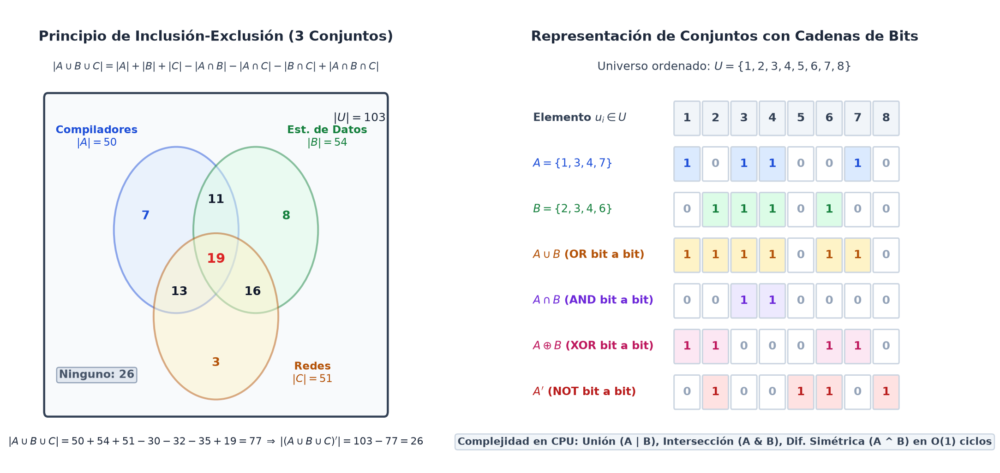

# 2.4 Aplicaciones de conjuntos

## 1. Conteo en Conjuntos Finitos y el Principio de Inclusión-Exclusión

En las ciencias de la computación —por ejemplo, al auditar bitácoras de errores de software, analizar tráfico de paquetes en redes o procesar estadísticas en bases de datos— con frecuencia no necesitamos listar cada uno de los elementos de un conjunto, sino determinar **cuántos elementos** cumplen cierta combinación de propiedades (Jiménez Murillo, 2012, Cap. 3.8; Lipschutz & Lipson, 2009, Cap. 1.6).

### 1.1 Reglas básicas de cardinalidad para conjuntos disjuntos, complemento y diferencia

Sean $A$ y $B$ conjuntos finitos dentro de un universo finito $U$:
1. **Principio de la suma para conjuntos disjuntos (Lema de adición):** Si $A$ y $B$ no tienen elementos en común ($A \cap B = \emptyset$), entonces:
   $$|A \cup B| = |A| + |B|$$
2. **Cardinalidad de la diferencia ($A - B$):** Como todo conjunto $A$ es la unión disjunta de $A - B$ y $A \cap B$, al despejar se obtiene:
   $$|A - B| = |A| - |A \cap B|$$
3. **Cardinalidad del complemento ($A'$):** Como $U$ es la unión disjunta de $A$ y $A'$:
   $$|A'| = |U| - |A|$$
4. **Cardinalidad de la diferencia simétrica ($A \oplus B$):**
   $$|A \oplus B| = |A - B| + |B - A| = |A| + |B| - 2|A \cap B|$$

### 1.2 El Principio de Inclusión-Exclusión ($2$, $3$ y $n$ conjuntos)

Cuando dos conjuntos $A$ y $B$ **no son disjuntos** ($A \cap B \neq \emptyset$), al sumar $|A| + |B|$ los elementos que pertenecen a la intersección $A \cap B$ se cuentan **dos veces** (una vez dentro de $|A|$ y otra dentro de $|B|$). Para corregir este doble conteo se resta una vez $|A \cap B|$, obteniéndose el **Principio de Inclusión-Exclusión**:

- **Para dos conjuntos finitos ($A$ y $B$):**
  $$|A \cup B| = |A| + |B| - |A \cap B|$$

- **Para tres conjuntos finitos ($A$, $B$ y $C$):**
  Al sumar $|A| + |B| + |C|$ y restar las tres intersecciones dobles $|A \cap B|$, $|A \cap C|$ y $|B \cap C|$, los elementos que pertenecen a los tres conjuntos simultáneamente ($A \cap B \cap C$) fueron sumados $3$ veces y luego restados $3$ veces, por lo que deben volver a sumarse una vez:
  $$|A \cup B \cup C| = |A| + |B| + |C| - |A \cap B| - |A \cap C| - |B \cap C| + |A \cap B \cap C|$$

- **Generalización para $n$ conjuntos finitos ($A_1, A_2, \dots, A_n$):**
  Cuando intervienen $n \ge 4$ conjuntos, ya no es práctico dibujar círculos traslapados. El principio general de inclusión-exclusión establece que la cardinalidad de la unión se obtiene **sumando las cardinalidades de las intersecciones de un número impar (*non*) de conjuntos y restando las que involucran un número par de conjuntos** (Jiménez Murillo, 2012, p. 101). El número total de términos que se suman o restan en la fórmula es exactamente **$2^n - 1$**.
  Por ejemplo, para **cuatro conjuntos ($n = 4$, con $2^4 - 1 = 15$ términos)**:
  $$\begin{aligned}
  |A \cup B \cup C \cup D| &= |A| + |B| + |C| + |D| \\
  &\quad - |A \cap B| - |A \cap C| - |A \cap D| - |B \cap C| - |B \cap D| - |C \cap D| \\
  &\quad + |A \cap B \cap C| + |A \cap B \cap D| + |A \cap C \cap D| + |B \cap C \cap D| \\
  &\quad - |A \cap B \cap C \cap D|
  \end{aligned}$$

### 1.3 Método práctico de resolución en Diagramas de Venn: «De adentro hacia afuera»

Para resolver problemas de conteo de $2$ o $3$ conjuntos mediante diagramas de Venn sin cometer errores, se recomienda rellenar las regiones disjuntas **de adentro hacia afuera** (Jiménez Murillo, 2012):
1. **Paso 1 (Centro):** Colocar primero el valor de la intersección triple $|A \cap B \cap C|$ en la región central.
2. **Paso 2 (Pétalos dobles):** En cada intersección de dos conjuntos, restar el valor central:
   - Sólo en $A$ y $B$ (pero no en $C$): $|(A \cap B) - C| = |A \cap B| - |A \cap B \cap C|$.
   - Sólo en $A$ y $C$ (pero no en $B$): $|(A \cap C) - B| = |A \cap C| - |A \cap B \cap C|$.
   - Sólo en $B$ y $C$ (pero no en $A$): $|(B \cap C) - A| = |B \cap C| - |A \cap B \cap C|$.
3. **Paso 3 (Regiones exclusivas de un solo conjunto):** A la cardinalidad total de cada conjunto restarle las tres regiones adyacentes ya colocadas dentro de su círculo.
4. **Paso 4 (Exterior):** Restar del universo $|U|$ la suma de las $7$ regiones interiores para hallar cuántos elementos no pertenecen a ninguno de los tres conjuntos: $|(A \cup B \cup C)'| = |U| - |A \cup B \cup C|$.

---

## 2. Representación Computacional de Conjuntos mediante Cadenas de Bits (*Bitmasks*)

En la memoria de una computadora, almacenar un conjunto como una lista enlazada o un arreglo de objetos puede consumir mucho espacio y requerir búsquedas secuenciales. Cuando el conjunto universo $U$ es finito y no demasiado grande, el método más veloz y compacto consiste en representar cada subconjunto como un **vector o cadena de bits** (*bit array*, *bitset* o *bitmask*) (Rosen, 2004, Cap. 1.7):

1. **Ordenamiento fijo del universo:** Se fija un orden arbitrario para los $n$ elementos del universo:
   $$U = \{u_1, u_2, u_3, \dots, u_n\}$$
2. **Codificación binaria de un subconjunto $A \subseteq U$:** Se asocia a $A$ una cadena de longitud $n$, $B(A) = b_1 b_2 b_3 \dots b_n$, definida mediante la **función característica** de $A$:
   $$b_i = \begin{cases} 1, & \text{si } u_i \in A \\ 0, & \text{si } u_i \notin A \end{cases} \qquad (i = 1, 2, \dots, n)$$

### Traducción de operaciones de conjuntos a instrucciones bit a bit de la CPU

Con esta representación, todas las operaciones de la teoría de conjuntos se ejecutan directamente en la Unidad Aritmética Lógica (ALU) del procesador mediante **operaciones lógicas bit a bit (*bitwise*)** en un solo ciclo de reloj por palabra de $64$ bits ($O(1)$):

| Operación de Conjuntos | Operación Lógica Bit a Bit (en cada posición $i$) | Operador en C / C++ / Java / Python |
| :--- | :---: | :---: |
| **Unión ($A \cup B$)** | $\text{OR}$ bit a bit ($b_i(A) \lor b_i(B)$) | `A \| B` |
| **Intersección ($A \cap B$)** | $\text{AND}$ bit a bit ($b_i(A) \land b_i(B)$) | `A & B` |
| **Complemento ($A'$)** | $\text{NOT}$ bit a bit ($\neg b_i(A)$) | `~A` *(con máscara de $n$ bits)* |
| **Diferencia ($A - B = A \cap B'$)** | $\text{AND NOT}$ bit a bit ($b_i(A) \land \neg b_i(B)$) | `A & (~B)` |
| **Diferencia simétrica ($A \oplus B$)** | $\text{XOR}$ bit a bit ($b_i(A) \oplus b_i(B)$) | `A ^ B` |
| **Prueba de subconjunto ($A \subseteq B$)** | Verificar si $A - B = \emptyset$ (o $A \cap B = A$) | `(A & (~B)) == 0` |
| **Cardinalidad ($|A|$)** | Contar el número de bits en `1` (*peso de Hamming*) | `__builtin_popcount(A)` / `A.bit_count()` |

---

## 3. Aplicaciones en Áreas Fundamentales de la Computación

Como expone Jiménez Murillo (2012, Cap. 3.9), la teoría de conjuntos sustenta de manera directa las siguientes ramas de la ingeniería en sistemas computacionales:

### 3.1 Bases de Datos Relacionales y Álgebra Relacional (SQL)
El **modelo relacional de bases de datos** (propuesto por Edgar F. Codd en $1970$) se fundamenta íntegramente en la teoría de conjuntos: cada **tabla (relación)** es formalmente un conjunto de filas o registros (**tuplas**), donde no deben existir filas duplicadas y el orden de las filas es irrelevante. El **Álgebra Relacional** y el lenguaje estándar **SQL (*Structured Query Language*)** implementan directamente las operaciones de conjuntos:

| Operación en Teoría de Conjuntos | Operador en Álgebra Relacional | Consulta equivalente en SQL |
| :--- | :---: | :--- |
| **Selección por comprensión** $\{x \in A \mid P(x)\}$ | $\sigma_{P}(A)$ | `SELECT * FROM A WHERE condicion;` |
| **Unión ($A \cup B$)** | $A \cup B$ | `SELECT * FROM A UNION SELECT * FROM B;` |
| **Intersección ($A \cap B$)** | $A \cap B$ | `SELECT * FROM A INTERSECT SELECT * FROM B;` *(o mediante `A INNER JOIN B USING (id)`)* |
| **Diferencia ($A - B$)** | $A - B$ | `SELECT * FROM A EXCEPT SELECT * FROM B;` *(o `LEFT JOIN B ... WHERE B.id IS NULL`)* |
| **Diferencia simétrica ($A \oplus B$)** | $(A - B) \cup (B - A)$ | `FULL OUTER JOIN B ... WHERE A.id IS NULL OR B.id IS NULL` |

### 3.2 Lenguajes Formales, Expresiones Regulares y Compiladores
En el diseño de compiladores e intérpretes, un lenguaje de programación se define formalmente como un **conjunto de conjuntos** (Jiménez Murillo, 2012, p. 102):
- Un **alfabeto ($\Sigma$)** es un conjunto finito no vacío de símbolos (por ejemplo, el conjunto de caracteres ASCII o el alfabeto binario $\Sigma = \{0, 1\}$).
- Un **lenguaje formal ($L$)** sobre $\Sigma$ es cualquier subconjunto de cadenas formadas con símbolos de $\Sigma$ ($L \subseteq \Sigma^*$).
- Una **gramática formal** $G = (V_N, V_T, P, S)$ se compone del conjunto de símbolos no terminales ($V_N$), el conjunto disjunto de símbolos terminales ($V_T$, con $V_N \cap V_T = \emptyset$), el conjunto de reglas de producción ($P$) y el símbolo inicial ($S \in V_N$).

### 3.3 Redes y Teoría de Grafos
Las redes de computadoras, redes eléctricas, telecomunicaciones y mapas viales se modelan matemáticamente como **grafos** $G = (V, E)$, los cuales están constituidos por un conjunto finito de **vértices o nodos ($V$)** y un conjunto de **aristas o enlaces ($E$)** (Unidad 6). Operaciones como fusionar dos subredes ($G_1 \cup G_2$), hallar los enlaces o routers compartidos ($G_1 \cap G_2$) o aislar nodos fallidos ($V - V_{\text{falla}}$) son operaciones directas de conjuntos.

### 3.4 Verificación de Argumentos Lógicos mediante Diagramas de Venn
Muchas declaraciones verbales del lenguaje natural expresan relaciones de inclusión o exclusión entre conjuntos (Lipschutz & Lipson, 2009, Cap. 1.3):
- *«Todos los elementos de $A$ son $B$»* se traduce como **$A \subseteq B$**.
- *«Ningún elemento de $A$ es $B$»* se traduce como **$A \cap B = \emptyset$** ($A$ y $B$ son disjuntos).
- *«Algunos elementos de $A$ son $B$»* se traduce como **$A \cap B \neq \emptyset$**.

Representando las **hipótesis (premisas)** en un diagrama de Venn, un argumento deductivo es **válido** si la **conclusión** queda forzosamente satisfecha en el diagrama sin necesidad de añadir suposiciones adicionales.

---

## Ejemplos de Práctica (Resueltos Paso a Paso)

### Ejemplo 2.4.1: Auditoría de programas en C++ (Inclusión-Exclusión para $2$ conjuntos)
De $34$ programas revisados en la asignatura de programación en C++, $23$ marcaron error en la compilación, $12$ tuvieron fallas en la lógica y $5$ presentaron simultáneamente errores de compilación y de lógica (Jiménez Murillo, 2012, Ej. 3.17). Determine:
a) ¿Cuántos programas tuvieron **al menos un** tipo de error?  
b) ¿Cuántos programas tuvieron **únicamente** error de compilación?  
c) ¿Cuántos programas tuvieron **exactamente un** tipo de error?  
d) ¿Cuántos programas funcionaron correctamente (sin ningún error)?

**Solución:**
Definimos el conjunto universo $U$ de programas revisados ($|U| = 34$), el conjunto $A$ de programas con error de compilación ($|A| = 23$) y el conjunto $B$ de programas con falla de lógica ($|B| = 12$), siendo $|A \cap B| = 5$.

- **a) Programas con al menos un error ($|A \cup B|$):**
  Aplicando el principio de inclusión-exclusión:
  $$|A \cup B| = |A| + |B| - |A \cap B| = 23 + 12 - 5 = \mathbf{30\text{ programas}}$$
- **b) Programas únicamente con error de compilación ($|A - B|$):**
  $$|A - B| = |A| - |A \cap B| = 23 - 5 = \mathbf{18\text{ programas}}$$
  *(Análogamente, los que tuvieron sólo falla de lógica son $|B - A| = 12 - 5 = 7$ programas).*
- **c) Programas con exactamente un tipo de error ($|A \oplus B|$):**
  $$|A \oplus B| = |A - B| + |B - A| = 18 + 7 = \mathbf{25\text{ programas}}$$
- **d) Programas sin ningún error ($|(A \cup B)'|$):**
  $$|(A \cup B)'| = |U| - |A \cup B| = 34 - 30 = \mathbf{4\text{ programas}}$$

---

### Ejemplo 2.4.2: Clasificación de acervo bibliográfico (Inclusión-Exclusión para $3$ conjuntos)
En la biblioteca existen $103$ libros de ciencias de la computación que tratan en cierta medida los temas de **Compiladores ($A$)**, **Estructuras de datos ($B$)** y **Redes ($C$)**. Del total, $50$ libros tienen información sobre compiladores, $54$ sobre estructuras de datos, $51$ sobre redes, $30$ sobre compiladores y estructuras de datos, $32$ sobre compiladores y redes, $35$ sobre estructuras de datos y redes, y $19$ tratan sobre los tres temas (Jiménez Murillo, 2012, Ej. 3.18). Determine:
a) ¿Cuántos libros contienen material **exclusivamente** sobre uno de los tres temas?  
b) ¿Cuántos libros **no** tienen material de redes?  
c) ¿Cuántos libros **no** tienen material sobre ninguno de los tres temas?  
d) ¿Cuántos libros contienen material de compiladores y redes, pero **no** de estructuras de datos?

**Solución:**
Datos: $|U| = 103$, $|A| = 50$, $|B| = 54$, $|C| = 51$, $|A \cap B| = 30$, $|A \cap C| = 32$, $|B \cap C| = 35$ y $|A \cap B \cap C| = 19$.
Calculamos las $8$ regiones disjuntas del diagrama de Venn **de adentro hacia afuera** (véase la figura de la sección 1):
1. **Región central (los $3$ temas):** $|A \cap B \cap C| = 19$.
2. **Regiones de exactamente $2$ temas:**
   - Compiladores y Estructuras de datos, pero no Redes: $|(A \cap B) - C| = 30 - 19 = 11$.
   - Compiladores y Redes, pero no Estructuras de datos: $|(A \cap C) - B| = 32 - 19 = 13$.
   - Estructuras de datos y Redes, pero no Compiladores: $|(B \cap C) - A| = 35 - 19 = 16$.
3. **Regiones de exactamente $1$ tema:**
   - Sólo Compiladores: $|A - (B \cup C)| = 50 - (11 + 19 + 13) = 50 - 43 = 7$.
   - Sólo Estructuras de datos: $|B - (A \cup C)| = 54 - (11 + 19 + 16) = 54 - 46 = 8$.
   - Sólo Redes: $|C - (A \cup B)| = 51 - (13 + 19 + 16) = 51 - 48 = 3$.
4. **Unión total y región exterior:**
   Por inclusión-exclusión (o sumando las $7$ regiones interiores: $7 + 8 + 3 + 11 + 13 + 16 + 19 = 77$):
   $$|A \cup B \cup C| = 50 + 54 + 51 - 30 - 32 - 35 + 19 = 77$$
   Libros sobre **ninguno** de los tres temas: $|(A \cup B \cup C)'| = 103 - 77 = 26$.

Respondemos ahora cada inciso directamente:
- **a) Material exclusivamente de uno de los tres temas:** $7 + 8 + 3 = \mathbf{18\text{ libros}}$.
- **b) No tienen material de redes ($|C'|$):** $|U| - |C| = 103 - 51 = \mathbf{52\text{ libros}}$ *(o sumando las regiones fuera de $C$: $26 + 7 + 11 + 8 = 52$)*.
- **c) No tienen material de ninguno de los tres temas:** $\mathbf{26\text{ libros}}$.
- **d) Tienen material de compiladores y redes, pero no de estructuras de datos ($|(A \cap C) - B|$):** $\mathbf{13\text{ libros}}$.

---

### Ejemplo 2.4.3: Representación y operaciones de conjuntos mediante Cadenas de Bits
Sea el conjunto universo ordenado $U = \{1, 2, 3, 4, 5, 6, 7, 8, 9, 10\}$ y considérense los subconjuntos $A = \{1, 3, 5, 7, 9\}$, $B = \{1, 2, 3, 8, 10\}$ y $C = \{2, 4, 6, 8, 10\}$.
a) Represente $A$, $B$ y $C$ como cadenas de $10$ bits.  
b) Utilizando exclusivamente operaciones lógicas bit a bit, obtenga la cadena de bits y los elementos del conjunto $X = (A \cup B) \cap C'$ y del conjunto $Y = A \oplus B$.

**Solución:**
- **a) Cadenas de $10$ bits (posiciones $1$ a $10$ de izquierda a derecha):**
  - $B(A) = \texttt{1010101010}$
  - $B(B) = \texttt{1110000101}$
  - $B(C) = \texttt{0101010101}$

- **b) Evaluación bit a bit:**
  - **Para $X = (A \cup B) \cap C'$:**
    1. Unión $A \cup B$ (`B(A) OR B(B)`):
       $$\texttt{1010101010} \;\lor\; \texttt{1110000101} = \texttt{1110101111}$$
    2. Complemento $C'$ (`NOT B(C)`):
       $$\neg(\texttt{0101010101}) = \texttt{1010101010}$$
    3. Intersección $(A \cup B) \cap C'$ (`AND` bit a bit):
       $$\texttt{1110101111} \;\land\; \texttt{1010101010} = \texttt{1010101010}$$
    Traduzcamos las posiciones con bit `1` ($1, 3, 5, 7, 9$): $X = \{1, 3, 5, 7, 9\} = A$.
  - **Para $Y = A \oplus B$ (`B(A) XOR B(B)`):**
    Colocamos `1` donde los bits de $A$ y $B$ son diferentes y `0` donde son iguales:
    $$\texttt{1010101010} \;\oplus\; \texttt{1110000101} = \texttt{0100101111}$$
    Las posiciones con bit `1` son $2, 5, 7, 8, 9, 10$, por lo que $A \oplus B = \{2, 5, 7, 8, 9, 10\}$.

---

### Ejemplo 2.4.4: Validez de un argumento deductivo mediante Diagramas de Venn
Demuestre si el siguiente argumento clásico (adaptado de Lewis Carroll en Lipschutz & Lipson, 2009, Ej. 1.3) es lógicamente válido:
- **Hipótesis $S_1$:** Todos mis objetos de estaño son cazos.
- **Hipótesis $S_2$:** Encuentro muy útiles todos tus regalos.
- **Hipótesis $S_3$:** Ninguno de mis cazos es útil.
- **Conclusión $S$:** $\therefore$ Tus regalos no son de estaño.

**Solución:**
Definimos los cuatro conjuntos involucrados dentro del universo $U$ de objetos:
- $E =$ conjunto de mis objetos de estaño.
- $C =$ conjunto de mis cazos.
- $ U_{\text{til}} =$ conjunto de los objetos útiles.
- $R =$ conjunto de tus regalos.

Traducimos las tres premisas a relaciones conjuntistas:
1. Por $S_1$ (*«Todos mis objetos de estaño son cazos»*): **$E \subseteq C$** (el círculo $E$ está completamente dentro del círculo $C$).
2. Por $S_2$ (*«Todos tus regalos son útiles»*): **$R \subseteq U_{\text{til}}$** (el círculo $R$ está completamente dentro del círculo $U_{\text{til}}$).
3. Por $S_3$ (*«Ninguno de mis cazos es útil»*): **$C \cap U_{\text{til}} = \emptyset$** (los círculos $C$ y $U_{\text{til}}$ son totalmente disjuntos/separados).

- **Deducción:** Como $E \subseteq C$, $R \subseteq U_{\text{til}}$ y los conjuntos mayores $C$ y $U_{\text{til}}$ no tienen ningún elemento en común ($C \cap U_{\text{til}} = \emptyset$), es imposible que $R$ y $E$ compartan algún elemento; por tanto, forzosamente **$R \cap E = \emptyset$**, lo que significa que *ninguno de tus regalos es de estaño*. El argumento es **VÁLIDO**.

---

## Ejercicios de Tarea (Práctica en Casa)

> **Instrucciones:** Resuelva cada problema planteando formalmente los conjuntos, aplicando el principio de inclusión-exclusión y apoyándose en el desglose de regiones de Venn o vectores de bits según corresponda.

1. **Encuesta sobre lectura de publicaciones (Lipschutz & Lipson, Prob. 1.15):**  
   En una encuesta aplicada a $120$ profesionales de tecnologías de la información sobre la lectura de tres revistas especializadas ($N$, $T$ y $F$) se encontró que: $65$ leen la revista $N$, $45$ leen la revista $T$, $42$ leen la revista $F$, $20$ leen tanto $N$ como $T$, $25$ leen tanto $N$ como $F$, $15$ leen tanto $T$ como $F$, y $8$ leen las tres publicaciones.  
   a) Encuentre el número de personas que leen **por lo menos una** de las tres publicaciones.  
   b) Determine cuántas personas corresponden a cada una de las $8$ regiones disjuntas del diagrama de Venn.  
   c) ¿Cuántas personas leen **exactamente una** publicación, y cuántas no leen **ninguna**?
   <!--
   Solución del Ejercicio 1:
   Datos: |U| = 120, |N| = 65, |T| = 45, |F| = 42, |N n T| = 20, |N n F| = 25, |T n F| = 15, |N n T n F| = 8.
   - a) Por el principio de inclusión-exclusión:
        |N U T U F| = 65 + 45 + 42 - 20 - 25 - 15 + 8 = 100 personas leen al menos una publicación.
   - b) Desglose de las 8 regiones de adentro hacia afuera:
        1. Las tres revistas |N n T n F| = 8.
        2. N y T pero no F: 20 - 8 = 12.
        3. N y F pero no T: 25 - 8 = 17.
        4. T y F pero no N: 15 - 8 = 7.
        5. Sólo N: 65 - (12 + 8 + 17) = 28.
        6. Sólo T: 45 - (12 + 8 + 7) = 18.
        7. Sólo F: 42 - (17 + 8 + 7) = 10.
        8. Ninguna revista |(N U T U F)'| = 120 - 100 = 20.
   - c) Leen exactamente una publicación: 28 + 18 + 10 = 56 personas.
        No leen ninguna publicación: 20 personas.
   -->

2. **Análisis de causas de accidentes automovilísticos (Jiménez Murillo, Prob. 3.17):**  
   La Dirección de Policía y Tránsito del Estado informó que de $93$ accidentes automovilísticos ocurridos durante el fin de semana, las causas principales fueron: exceso de velocidad ($A$), uso de bebidas alcohólicas ($B$) y fallas mecánicas ($C$). En específico: $45$ accidentes ocurrieron por exceso de velocidad, $43$ por uso de bebidas alcohólicas, $32$ por fallas mecánicas, $20$ por exceso de velocidad y bebidas alcohólicas, $15$ por exceso de velocidad y fallas mecánicas, $13$ por bebidas alcohólicas y fallas mecánicas, y $8$ tuvieron simultáneamente las tres causas. Determine:  
   a) ¿Cuántos accidentes ocurrieron **solamente** por el consumo de bebidas alcohólicas?  
   b) ¿Cuántos ocurrieron por exceso de velocidad y fallas mecánicas, pero **no** por bebidas alcohólicas?  
   c) ¿Cuántos ocurrieron por **otras causas distintas** a las tres mencionadas?  
   d) ¿Cuántos tuvieron como causa **cuando mucho uno** de los tres motivos mencionados?
   <!--
   Solución del Ejercicio 2:
   Datos: |U| = 93, |A| = 45, |B| = 43, |C| = 32, |A n B| = 20, |A n C| = 15, |B n C| = 13, |A n B n C| = 8.
   Desglose de regiones de adentro hacia afuera:
   - Los tres motivos: 8.
   - A y B pero no C: 20 - 8 = 12.
   - A y C pero no B: 15 - 8 = 7.
   - B y C pero no A: 13 - 8 = 5.
   - Sólo A (velocidad): 45 - (12 + 8 + 7) = 18.
   - Sólo B (alcohol): 43 - (12 + 8 + 5) = 18.
   - Sólo C (fallas mecánicas): 32 - (7 + 8 + 5) = 12.
   - Unión |A U B U C| = 45 + 43 + 32 - 20 - 15 - 13 + 8 = 80.
   - Exterior (otras causas): 93 - 80 = 13.

   Respuestas a los incisos:
   - a) Solamente por bebidas alcohólicas (Sólo B): 18 accidentes.
   - b) Por velocidad y fallas mecánicas pero no alcohol |(A n C) - B|: 7 accidentes.
   - c) Por otras causas distintas |(A U B U C)'|: 13 accidentes.
   - d) "Cuando mucho uno" incluye los que tuvieron exactamente 1 motivo (18 + 18 + 12 = 48) más los que tuvieron 0 de estos motivos (13): 48 + 13 = 61 accidentes.
   -->

3. **Principio de Inclusión-Exclusión para $4$ conjuntos (Jiménez Murillo, Prob. 3.20):**  
   En una auditoría de servicios de red sobre $200$ servidores corporativos se analizaron cuatro protocolos activos: $A$ (HTTP), $B$ (SSH), $C$ (FTP) y $D$ (SMTP). Se obtuvo que:  
   $|A| = 80$, $|B| = 75$, $|C| = 70$, $|D| = 65$;  
   $|A \cap B| = 35$, $|A \cap C| = 30$, $|A \cap D| = 25$, $|B \cap C| = 30$, $|B \cap D| = 25$, $|C \cap D| = 20$;  
   $|A \cap B \cap C| = 15$, $|A \cap B \cap D| = 12$, $|A \cap C \cap D| = 10$, $|B \cap C \cap D| = 8$;  
   y $|A \cap B \cap C \cap D| = 5$.  
   Calcule cuántos servidores tienen activo **por lo menos uno** de los cuatro protocolos ($|A \cup B \cup C \cup D|$) y cuántos servidores no tienen activo **ninguno** de los cuatro.
   <!--
   Solución del Ejercicio 3:
   Aplicamos la fórmula de inclusión-exclusión para 4 conjuntos (15 términos):
   - Suma de cardinalidades individuales (impar, 1 conjunto):
     80 + 75 + 70 + 65 = 290.
   - Resta de intersecciones dobles (par, 2 conjuntos):
     -(35 + 30 + 25 + 30 + 25 + 20) = -165.
   - Suma de intersecciones triples (impar, 3 conjuntos):
     +(15 + 12 + 10 + 8) = +45.
   - Resta de la intersección cuádruple (par, 4 conjuntos):
     -5.
   Por tanto:
   |A U B U C U D| = 290 - 165 + 45 - 5 = 165 servidores tienen al menos un protocolo activo.
   Servidores sin ninguno de los cuatro protocolos: 200 - 165 = 35 servidores.
   -->

4. **Representación de conjuntos en computadora mediante Cadenas de Bits:**  
   Dado el universo ordenado de un byte $U = \{0, 1, 2, 3, 4, 5, 6, 7\}$ (en ese orden de izquierda a derecha), sean dos subconjuntos representados en memoria por los bytes en hexadecimal `B(A) = 0xD6` y `B(B) = 0x5B`.  
   a) Convierta `0xD6` y `0x5B` a binario de $8$ bits y liste por extensión los elementos de los conjuntos $A$ y $B$.  
   b) Calcule en binario y en hexadecimal las máscaras correspondientes a $A \cup B$, $A \cap B$, $A - B$ y $A \oplus B$, indicando los elementos del conjunto resultante en cada caso.
   <!--
   Solución del Ejercicio 4:
   - a) B(A) = 0xD6 = 1101 0110_(2). Como las posiciones corresponden a {0, 1, 2, 3, 4, 5, 6, 7}:
        A = {0, 1, 3, 5, 6}.
        B(B) = 0x5B = 0101 1011_(2).
        B = {1, 3, 4, 6, 7}.
   - b) Operaciones bit a bit:
        - Unión B(A U B) = 11010110 OR 01011011 = 1101 1111_(2) = 0xDF ==> A U B = {0, 1, 3, 4, 5, 6, 7}.
        - Intersección B(A n B) = 11010110 AND 01011011 = 0101 0010_(2) = 0x52 ==> A n B = {1, 3, 6}.
        - Diferencia B(A - B) = B(A) AND (NOT B(B)) = 11010110 AND 10100100 = 1000 0100_(2) = 0x84 ==> A - B = {0, 5}.
        - Diferencia simétrica B(A (+) B) = 11010110 XOR 01011011 = 1000 1101_(2) = 0x8D ==> A (+) B = {0, 4, 5, 7}.
   -->

5. **Traducción entre Álgebra de Conjuntos y Consultas en Bases de Datos (SQL):**  
   En una plataforma educativa existen tres tablas (conjuntos de identificadores `id_alumno`): `Inscritos_Python` ($P$), `Inscritos_Java` ($J$) y `Becados` ($B$).  
   a) Escriba la expresión en notación de conjuntos y la consulta equivalente en SQL (usando `UNION`, `INTERSECT` y `EXCEPT`) para obtener los alumnos que están inscritos en **Python o Java, pero que no están becados**.  
   b) Si un programador escribe la consulta correspondiente a $(P - B) \cup (J - B)$, demuestre mediante leyes de conjuntos que obtiene exactamente el mismo conjunto de alumnos que en el inciso (a).
   <!--
   Solución del Ejercicio 5:
   - a) Expresión conjuntista: (P U J) - B  (o bien (P U J) n B').
        Consulta SQL equivalente:
        (SELECT id_alumno FROM Inscritos_Python
         UNION
         SELECT id_alumno FROM Inscritos_Java)
        EXCEPT
        SELECT id_alumno FROM Becados;
   - b) Demostración de que (P - B) U (J - B) = (P U J) - B:
        1. (P - B) U (J - B) = (P n B') U (J n B')   [Ley de la diferencia]
        2.                   = (P U J) n B'          [Ley distributiva 4b factorizando B']
        3.                   = (P U J) - B           [Ley de la diferencia]
        Ambas consultas producen exactamente el mismo conjunto de registros.
   -->
