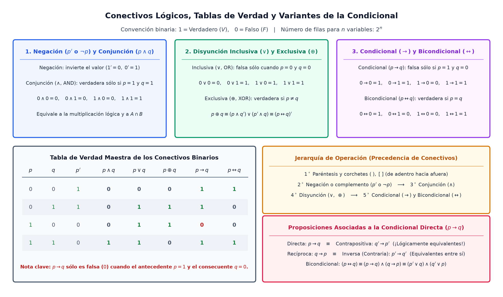
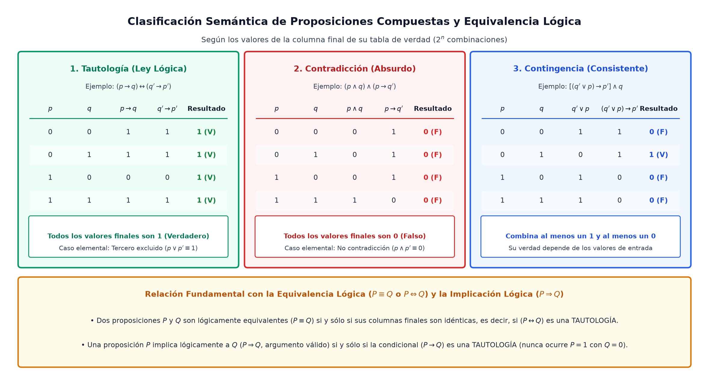
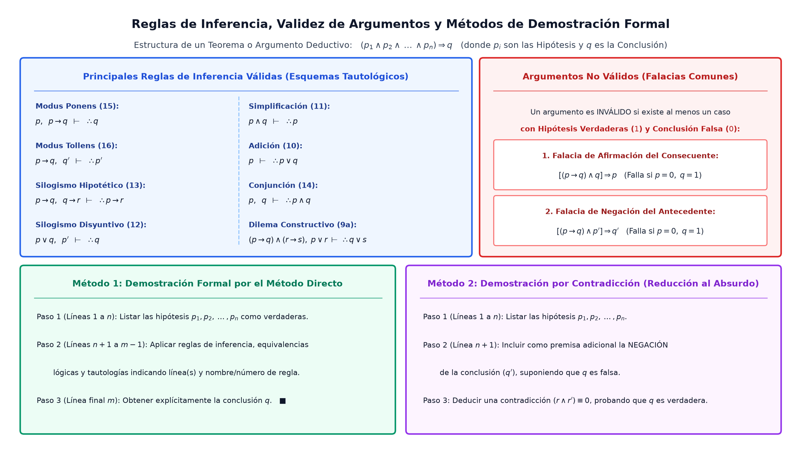

# 3.1 Lógica proposicional

## 3.1.1 Concepto de proposición

En matemáticas discretas y ciencias de la computación, una **proposición** (también llamada *enunciado* o *declaración*) es toda oración declarativa, frase o expresión matemática a la cual se le puede asignar, sin ambigüedad, uno y sólo uno de dos valores de verdad posibles: **Verdadero** o **Falso**, pero nunca ambos a la vez (Jiménez Murillo, 2012; Lipschutz & Lipson, 2009; Rosen, 2004).

### Principios fundamentales de la lógica clásica bivalente

La lógica proposicional descansa sobre dos axiomas filosóficos y formales establecidos desde Aristóteles:
1. **Principio del tercero excluido (*tertium non datur*):** Toda proposición es o bien verdadera, o bien falsa; no existe una tercera posibilidad intermedia.
2. **Principio de no contradicción:** Ninguna proposición puede ser simultáneamente verdadera y falsa en el mismo contexto y momento.

### Notación de variables proposicionales y valores de verdad

- **Variables proposicionales:** Las proposiciones simples (o *atómicas*, aquellas que no contienen conectivos lógicos que permitan descomponerlas en subproposiciones más elementales) se representan con letras minúsculas de la segunda mitad del alfabeto: $p, q, r, s, t, u, w, \dots$, seguidas de dos puntos (`:`) y el enunciado declarativo correspondiente.
- **Valores de verdad:**
  - En los textos orientados a la ingeniería en computación y sistemas digitales (Jiménez Murillo, 2012), se emplea la **notación binaria**:
    $$1 = \text{Verdadero}, \qquad 0 = \text{Falso}$$
  - En los textos de matemáticas discretas generales (Lipschutz & Lipson, 2009; Epp, 2012; Rosen, 2004), se emplean las iniciales:
    $$V \text{ (o } T\text{, de } \textit{True}\text{)} = \text{Verdadero}, \qquad F \text{ (de } \textit{False}\text{)} = \text{Falso}$$
  Ambas convenciones son completamente equivalentes; en este curso utilizaremos preferentemente $1$ y $0$ (indicando también $V$ y $F$ cuando aporte claridad) por su conexión directa con el sistema binario (Unidad 1) y el álgebra booleana (Unidad 4).

### Clasificación de oraciones: ¿Cuáles son proposiciones y cuáles no?

| Tipo de expresión | ¿Es proposición? | Justificación y ejemplos (adaptados de Jiménez Murillo, 2012, Ej. 4.1, y Lipschutz, 2009) |
| :--- | :---: | :--- |
| **1. Afirmaciones declarativas fácticas o científicas** | **Sí** | Afirman un hecho verificable como verdadero o falso: • $p$: «Estados Unidos es el país territorialmente más extenso del continente americano» ($\text{Falso} = 0$, ya que es Canadá). • $s$: «El hielo flota en el agua» ($\text{Verdadero} = 1$). • $w$: «Carlos Salinas de Gortari fue presidente de España» ($\text{Falso} = 0$). |
| **2. Igualdades y desigualdades matemáticas cerradas** | **Sí** | Expresan relaciones numéricas cuyo valor de verdad está bien determinado: • $q$: «$-19 + 50 = 31$» ($\text{Verdadero} = 1$). • $m$: «$2 + 2 = 5$» ($\text{Falso} = 0$). |
| **3. Oraciones interrogativas (preguntas)** | **No** | Solicitan información, pero no afirman ni niegan nada: • $u$: «¿Cómo estás?» o «¿A dónde vas?» (No puede ser verdadera ni falsa). |
| **4. Oraciones imperativas (órdenes, mandatos o súplicas)** | **No** | Expresan una instrucción o comando, no un juicio de verdad: • $v$: «Formatea el disco antes de usarlo» o «Haz tu tarea». |
| **5. Oraciones exclamativas o deseos** | **No** | Expresan emociones o estados de ánimo: • «¡Qué excelente algoritmo!» o «Ojalá no falle el servidor». |
| **6. Paradojas autorreferenciales** | **No** | Violan el principio de no contradicción: • «Esta oración es falsa» (*paradoja del mentiroso*: si fuera verdadera sería falsa, y si fuera falsa sería verdadera). |
| **7. Expresiones con variables libres (*funciones proposicionales* o *proposiciones abiertas*)** | **Depende de la asignación** | Expresiones como $r$: «$x > (y - 13)^7$» o «$x + 2 = 7$» no tienen un valor fijo mientras no se asigne un valor concreto a sus variables (o se les anteponga un cuantificador en Lógica de Predicados, subtema `3.2`). Una vez asignados los valores (p. ej., $x = 5, y = 13 \implies 5 > 0$), se convierten inmediatamente en proposiciones con valor $1$ o $0$ (Jiménez Murillo, 2012). |

---

## 3.1.2 Proposiciones compuestas (Disyunción, Conjunción, Negación, Condicional, Bicondicional)

Una **proposición compuesta** (o *molecular*) es aquella que se construye combinando una o más proposiciones simples mediante **conectivos u operadores lógicos** (Jiménez Murillo, 2012; Epp, 2012). La propiedad fundamental de toda proposición compuesta es que **su valor de verdad queda unívocamente determinado por los valores de verdad de las proposiciones simples que la integran y por la definición de los conectivos que las unen**.

A continuación se definen formalmente los operadores lógicos fundamentales:

### 1. Conjunción ($\land$, operador `AND` / multiplicación lógica)

Dadas dos proposiciones $p$ y $q$, su **conjunción** se denota por $p \land q$ (también escrita en otros contextos como $p \cdot q$ o $p\text{ \& }q$) y se lee **«$p$ y $q$»**.
- **Regla semántica:** La conjunción $p \land q$ es **verdadera ($1$) única y exclusivamente cuando tanto $p$ como $q$ son verdaderas simultáneamente**; basta que una sola de ellas sea falsa ($0$) para que toda la conjunción sea falsa ($0$).
- **Interpretación como multiplicación lógica:** Se le conoce como multiplicación lógica porque coincide con el producto aritmético en $\{0, 1\}$ (Jiménez Murillo, 2012):
  $$0 \land 0 = 0, \qquad 0 \land 1 = 0, \qquad 1 \land 0 = 0, \qquad 1 \land 1 = 1$$
- **Expresiones equivalentes en español y puntuación:** Además de la conjunción «y» (o «e»), en el lenguaje natural la conjunción suele expresarse mediante palabras como *«pero»*, *«sin embargo»*, *«además»*, *«aunque»*, *«no obstante»*, *«a la vez que»*, o bien mediante un **punto y seguido (`.`)** que separa distintas hipótesis de un mismo enunciado (Jiménez Murillo, 2012, p. 124).

| $p$ | $q$ | $p \land q$ |
| :---: | :---: | :---: |
| $0$ | $0$ | **$0$** |
| $0$ | $1$ | **$0$** |
| $1$ | $0$ | **$0$** |
| $1$ | $1$ | **$1$** |

---

### 2. Disyunción inclusiva ($\lor$, operador `OR` / suma lógica) y Disyunción exclusiva ($\oplus$, `XOR`)

#### a) Disyunción inclusiva ($p \lor q$)
Dadas dos proposiciones $p$ y $q$, su **disyunción inclusiva** (o simplemente **disyunción**) se denota por $p \lor q$ (también simbolizada como $p + q$ en álgebra booleana) y se lee **«$p$ o $q$»** (en el sentido de *«$p$ o $q$, o ambas»*).
- **Regla semántica:** La disyunción $p \lor q$ es **verdadera ($1$) cuando al menos una de las proposiciones que la forman es verdadera**, y es **falsa ($0$) únicamente cuando ambas proposiciones son falsas ($p = 0$ y $q = 0$)**.
- **Interpretación como suma lógica:** Se le llama suma lógica porque:
  $$0 \lor 0 = 0, \qquad 0 \lor 1 = 1, \qquad 1 \lor 0 = 1, \qquad 1 \lor 1 = 1$$
  *(Observación: en lógica matemática y álgebra booleana, $1 \lor 1 = 1$, pues basta con que se cumpla uno de los sumandos —o ambos— para que la condición sea verdadera; p. ej., «Una persona entra al cine si compra su boleto ($q=1$) o le regalan un pase ($r=1$)»: si ocurren ambas cosas, sigue pudiendo entrar al cine).*

#### b) Disyunción exclusiva ($p \oplus q$, operador `XOR`)
Cuando en el lenguaje cotidiano la palabra «o» se emplea en el sentido excluyente de **«o bien $p$ o bien $q$, pero no ambas a la vez»** (por ejemplo: *«El paquete viajará hoy por avión o por barco»*), se utiliza el operador **OR exclusivo (`XOR`)**, denotado por $p \oplus q$ (o $p \veebar q$).
- **Regla semántica:** $p \oplus q$ es **verdadera ($1$) si y sólo si exactamente una de las dos proposiciones es verdadera** ($p \neq q$), y es **falsa ($0$) cuando ambas tienen el mismo valor de verdad** ($p = q$):
  $$p \oplus q \;\equiv\; (p' \land q) \lor (p \land q') \;\equiv\; (p \leftrightarrow q)'$$

| $p$ | $q$ | Disyunción inclusiva ($p \lor q$) | Disyunción exclusiva ($p \oplus q$) |
| :---: | :---: | :---: | :---: |
| $0$ | $0$ | **$0$** | **$0$** |
| $0$ | $1$ | **$1$** | **$1$** |
| $1$ | $0$ | **$1$** | **$1$** |
| $1$ | $1$ | **$1$** | **$0$** |

> **Convención estándar:** A menos que se especifique explícitamente lo contrario («o bien... pero no ambos»), la conjunción «o» en matemáticas y programación se traduce siempre mediante la **disyunción inclusiva ($\lor$)** (Lipschutz & Lipson, 2009).

---

### 3. Negación ($p'$ o $\neg p$, operador `NOT` / complemento lógico)

Dada una proposición $p$, su **negación** o **complemento** se denota por $p'$ (notación de Jiménez Murillo, 2012, coherente con teoría de conjuntos y álgebra booleana), o bien por $\neg p$, $\sim p$ o $\overline{p}$, y se lee **«no $p$»**, **«no es cierto que $p$»** o **«es falso que $p$»**.
- **Regla semántica:** Invierte el valor de verdad de la proposición original: si $p = 1$, entonces $p' = 0$; y si $p = 0$, entonces $p' = 1$.
- **Propiedad de paridad de negaciones (Jiménez Murillo, 2012, p. 120):**
  - Un número **par** de negaciones sucesivas equivale a afirmar la proposición original: $(p')' = p'' \equiv p$, y $p'''' \equiv p$.
  - Un número **impar** de negaciones sucesivas equivale a una sola negación: $p''' \equiv p'$.

| $p$ | $p'$ ($\neg p$) | $p''$ ($\neg\neg p$) |
| :---: | :---: | :---: |
| $0$ | **$1$** | $0$ |
| $1$ | **$0$** | $1$ |

---

### 4. Proposición Condicional o Implicación Material ($p \to q$)

Dadas dos proposiciones $p$ y $q$, la **proposición condicional** se denota por:
$$p \to q$$
y se lee **«si $p$, entonces $q$»** (o *«$p$ implica $q$»*). En esta estructura:
- La proposición $p$ situada antes de la flecha se denomina **antecedente**, **hipótesis**, **premisa** o **condición suficiente**.
- La proposición $q$ situada después de la flecha se denomina **consecuente**, **conclusión** o **condición necesaria**.

#### Regla semántica e interpretación intuitiva del condicional (el «contrato o promesa»)
La condicional $p \to q$ es **falsa ($0$) en un único caso: cuando el antecedente $p$ es verdadero ($1$) y el consecuente $q$ es falso ($0$)**; en los otros tres casos es **verdadera ($1$)**:

| $p$ (Antecedente) | $q$ (Consecuente) | $p \to q$ | Interpretación mediante la promesa electoral (Jiménez Murillo, 2012, Ej. 4.5): *«Si salgo electo presidente ($p$), entonces el crecimiento anual será del $7\%$ ($q$)»* |
| :---: | :---: | :---: | :--- |
| $0$ | $0$ | **$1$** | No salió electo ($p=0$) y el crecimiento no fue del $7\%$ ($q=0$): el candidato **no rompió su promesa** (**Verdadero por vacuidad**). |
| $0$ | $1$ | **$1$** | No salió electo ($p=0$), pero aun así hubo crecimiento del $7\%$ ($q=1$) por causas ajenas: el candidato **tampoco mintió** (**Verdadero por vacuidad**). |
| $1$ | $0$ | **$0$** | Sí salió electo ($p=1$), pero el crecimiento **no** fue del $7\%$ ($q=0$): el candidato **incumplió su promesa / mintió** (**Único caso Falso**). |
| $1$ | $1$ | **$1$** | Sí salió electo ($p=1$) y el crecimiento fue del $7\%$ ($q=1$): el candidato **cumplió su promesa** (**Verdadero**). |

#### Formas equivalentes de expresar $p \to q$ en español (Rosen, 2004; Epp, 2012)
En el análisis de especificaciones de software y enunciados matemáticos, todas las frases siguientes se traducen exactamente como $p \to q$:
- «Si $p$, entonces $q$» / «Si $p$, $q$».
- «$q$ si $p$» / «$q$ cuando $p$» / «$q$ siempre que $p$» *(¡Cuidado! Aquí el antecedente $p$ va escrito al final de la oración)*.
- «$p$ sólo si $q$» / «$p$ solamente si $q$» *(Significa que si no ocurre $q$, no puede ocurrir $p$: $q' \to p' \equiv p \to q$)*.
- «$p$ es condición suficiente para $q$».
- «$q$ es condición necesaria para $p$».

#### Condicionales asociadas: Recíproca, Inversa y Contrapositiva
A partir de cualquier condicional directa $p \to q$, existen tres proposiciones condicionales derivadas de gran importancia en demostraciones matemáticas (Lipschutz & Lipson, 2009, Prob. 4.7; Rosen, 2004):

| Nombre | Expresión simbólica | Lectura | ¿Es equivalente a la directa $p \to q$? |
| :--- | :---: | :--- | :--- |
| **1. Condicional directa** | $p \to q$ | «Si $p$, entonces $q$» | — |
| **2. Contrapositiva (o contrarrecíproca)** | $q' \to p'$ ($\neg q \to \neg p$) | «Si no $q$, entonces no $p$» | **SÍ:** $(p \to q) \equiv (q' \to p')$ |
| **3. Recíproca (o conversa)** | $q \to p$ | «Si $q$, entonces $p$» | **NO** (pero es equivalente a la inversa) |
| **4. Inversa (o contraria)** | $p' \to q'$ ($\neg p \to \neg q$) | «Si no $p$, entonces no $q$» | **NO** (es equivalente a la recíproca: $(q \to p) \equiv (p' \to q')$) |

---

### 5. Proposición Bicondicional o Doble Implicación ($p \leftrightarrow q$)

Dadas dos proposiciones $p$ y $q$, la **proposición bicondicional** se denota por:
$$p \leftrightarrow q$$
y se lee **«$p$ si y sólo si $q$»** (abreviado a menudo como *«$p$ ssi $q$»*, o bien *«$p$ es condición necesaria y suficiente para $q$»*).
- **Regla semántica:** La bicondicional $p \leftrightarrow q$ es **verdadera ($1$) cuando $p$ y $q$ tienen exactamente el mismo valor de verdad** (ambas son verdaderas: $1 \leftrightarrow 1 = 1$, o ambas son falsas: $0 \leftrightarrow 0 = 1$), y es **falsa ($0$) cuando una es verdadera y la otra es falsa** (Jiménez Murillo, 2012, Ej. 4.6).
- **Relación con la condicional y con `XOR`:**
  $$p \leftrightarrow q \;\equiv\; (p \to q) \land (q \to p) \;\equiv\; (p \land q) \lor (p' \land q') \;\equiv\; (p \oplus q)'$$
  En sistemas digitales (Unidad 4), el bicondicional corresponde a la compuerta de coincidencia **`XNOR`**.

| $p$ | $q$ | $p \leftrightarrow q$ |
| :---: | :---: | :---: |
| $0$ | $0$ | **$1$** |
| $0$ | $1$ | **$0$** |
| $1$ | $0$ | **$0$** |
| $1$ | $1$ | **$1$** |

---

## 3.1.3 Tablas de verdad

Una **tabla de verdad** —desarrollada por **Charles Sanders Peirce** hacia $1880$ y popularizada en su formato tabular actual por **Ludwig Wittgenstein** y **Bertrand Russell** en $1918$ (Jiménez Murillo, 2012)— es un arreglo exhaustivo de filas y columnas que muestra el valor de verdad de una proposición compuesta para **todas y cada una de las combinaciones posibles de valores de verdad de sus variables proposicionales simples**.

### Regla del número de filas y ordenamiento binario estándar

Si una proposición compuesta $F(p_1, p_2, \dots, p_n)$ contiene exactamente $n$ **proposiciones simples distintas** (sin contar como variable extra a una proposición negada como $q'$, pues su valor depende de $q$), entonces su tabla de verdad consta de:

$$\text{Número de filas} = 2^n$$

- Para $n = 1$ variable ($p$): $2^1 = 2$ filas.
- Para $n = 2$ variables ($p, q$): $2^2 = 4$ filas.
- Para $n = 3$ variables ($p, q, r$): $2^3 = 8$ filas.
- Para $n = 4$ variables ($p, q, r, s$): $2^4 = 16$ filas.

**Ordenamiento recomendado (Jiménez Murillo, 2012, p. 126):**
1. Colocar en las primeras columnas las variables simples ordenadas **alfabéticamente** ($p, q, r, \dots$).
2. Asignar las combinaciones de verdad en **orden binario ascendente** desde $00\dots 0_2$ hasta $11\dots 1_2$:
   - En la $1.\text{ª}$ variable ($p$): alternar bloques de $2^{n-1}$ ceros y $2^{n-1}$ unos.
   - En la $2.\text{ª}$ variable ($q$): alternar bloques de $2^{n-2}$ ceros y $2^{n-2}$ unos.
   - En la última variable: alternar de uno en uno ($0, 1, 0, 1, \dots$).
3. A continuación colocar las columnas de las negaciones simples requeridas ($p', q', r'$) y luego las subexpresiones intermedias hasta llegar a la expresión completa en la última columna.

### Jerarquía de operación (Precedencia de los conectivos lógicos)

Cuando una expresión lógica no incluye todos los paréntesis explícitos, la evaluación debe respetar estrictamente la siguiente **jerarquía de operación** de mayor a menor prioridad (Jiménez Murillo, 2012, p. 126):

| Nivel de prioridad | Operador / Símbolo | Regla de desempate (asociatividad) |
| :---: | :---: | :--- |
| **$1.^\circ$ (Máxima)** | Paréntesis y corchetes: $(\;),\; [\;],\; \{\;\}$ | Se evalúan de **adentro hacia afuera**; si hay dos paréntesis independientes al mismo nivel, de **izquierda a derecha**. |
| **$2.^\circ$** | Negación (Complemento): $'$ o $\neg$ | Afecta únicamente a la variable o al paréntesis inmediatamente contiguo. |
| **$3.^\circ$** | Conjunción (Intersección lógica): $\land$ | De izquierda a derecha.Tiene mayor prioridad que la disyunción $\lor$ (igual que $\times$ sobre $+$ en álgebra). |
| **$4.^\circ$** | Disyunción (Unión lógica): $\lor,\; \oplus$ | De izquierda a derecha. |
| **$5.^\circ$ (Mínima)** | Condicional y Bicondicional: $\to,\; \leftrightarrow$ | Siguiendo a Jiménez Murillo (2012, p. 127), $\to$ y $\leftrightarrow$ comparten el nivel $5.^\circ$ y, cuando aparecen varios en el mismo nivel sin paréntesis, se evalúan **de izquierda a derecha**. |

> **Ejemplo de aplicación de la jerarquía (Jiménez Murillo, 2012, Ej. 4.9):**  
> En la expresión sin paréntesis exteriores $F = p' \to (r' \lor q \land p) \leftrightarrow r \lor q' \to p$:
> 1. Dentro del paréntesis $(r' \lor q \land p)$, se evalúa primero la negación $r'$, luego la conjunción $q \land p$ ($3.^\circ$) y después la disyunción $r' \lor (q \land p)$ ($4.^\circ$).
> 2. Fuera del paréntesis, se evalúan las negaciones $p'$ y $q'$ ($2.^\circ$), y a continuación la disyunción $r \lor q'$ ($4.^\circ$).
> 3. Finalmente quedan tres operadores de nivel $5.^\circ$: $p' \to A \leftrightarrow B \to p$, los cuales se evalúan de izquierda a derecha: primero $[p' \to (r' \lor q \land p)]$, luego el resultado con $\leftrightarrow (r \lor q')$, y por último el resultado con $\to p$.

---

## 3.1.4 Tautologías, contradicción y contingencia

Al finalizar la construcción de la tabla de verdad de una proposición compuesta, el análisis de la **última columna** permite clasificarla en una de tres categorías mutuamente excluyentes (Jiménez Murillo, 2012, Cap. 4.3.1–4.3.3; Lipschutz & Lipson, 2009, Cap. 4.5):

1. **Tautología (Ley lógica o verdad lógica):**
   Es toda proposición compuesta cuyo resultado es **siempre verdadero ($1$ o $V$) para todas las $2^n$ combinaciones posibles** de valores de verdad de sus variables.
   - *Ejemplo elemental:* El principio del tercero excluido $p \lor p' \equiv 1$.
   - *Importancia:* Como su verdad depende exclusivamente de su estructura formal y no del significado particular de sus variables, las tautologías constituyen las **leyes universales** que sustentan las reglas de inferencia y la demostración de teoremas.

2. **Contradicción (Absurdo o falsedad lógica):**
   Es toda proposición compuesta cuyo resultado es **siempre falso ($0$ o $F$) para todas las $2^n$ combinaciones posibles** de sus variables.
   - *Ejemplo elemental:* El principio de no contradicción $p \land p' \equiv 0$.
   - *Relación dual:* La negación de cualquier tautología es una contradicción ($1' = 0$), y la negación de cualquier contradicción es una tautología ($0' = 1$).

3. **Contingencia (Proposición contingente o indeterminada):**
   Es toda proposición compuesta cuya columna final contiene **al menos un valor verdadero ($1$) y al menos un valor falso ($0$)**. Su veracidad o falsedad depende de los valores particulares que tomen sus variables.

### Tautologías de implicación comunes ($P \Rightarrow Q$)

Cuando una proposición condicional $P \to Q$ (donde $P$ y $Q$ son proposiciones compuestas) resulta ser una **tautología**, se dice que **$P$ implica lógicamente a $Q$** y se escribe con flecha doble:

$$P \Rightarrow Q$$

Para verificar mediante una tabla de verdad que $P \Rightarrow Q$ es una tautología, se reemplaza el símbolo $\Rightarrow$ por el condicional ordinario $\to$ y se comprueba que en todas las filas de la tabla el resultado final es $1$. A continuación se presenta la **Tabla 4.1 de Tautologías Comunes** (Jiménez Murillo, 2012, p. 128):

| N.º | Nombre de la Tautología | Expresión simbólica ($P \Rightarrow Q$) |
| :---: | :--- | :--- |
| **1a** | **Adición** | $p \Rightarrow (p \lor q)$ |
| **2a** | **Simplificación** | $(p \land q) \Rightarrow p$ |
| **3a** | **Absurdo (Reducción al absurdo)** | $(p \to 0) \Rightarrow p'$ |
| **4a** | **Modus ponens** | $[p \land (p \to q)] \Rightarrow q$ |
| **5a** | **Modus tollens** | $[(p \to q) \land q'] \Rightarrow p'$ |
| **6a** | **Transitividad de la bicondicional** | $[(p \leftrightarrow q) \land (q \leftrightarrow r)] \Rightarrow (p \leftrightarrow r)$ |
| **7a** | **Transitividad de la condicional (Silogismo hipotético)** | $[(p \to q) \land (q \to r)] \Rightarrow (p \to r)$ |
| **8a** **8b** **8c** | **Extensión de la condicional** | a) $(p \to q) \Rightarrow [(p \lor r) \to (q \lor r)]$ b) $(p \to q) \Rightarrow [(p \land r) \to (q \land r)]$ c) $(p \to q) \Rightarrow [(q \to r) \to (p \to r)]$ |
| **9a** **9b** | **Dilemas constructivos** | a) $[(p \to q) \land (r \to s)] \Rightarrow [(p \lor r) \to (q \lor s)]$ b) $[(p \to q) \land (r \to s)] \Rightarrow [(p \land r) \to (q \land s)]$ |

---

## 3.1.5 Equivalencias Lógicas

Se dice que dos proposiciones $P$ y $Q$ son **lógicamente equivalentes**, denotado por:

$$P \equiv Q \qquad \text{o bien} \qquad P \Leftrightarrow Q$$

si y sólo si **producen exactamente los mismos resultados para los mismos valores de verdad en todas las filas de su tabla de verdad**, lo cual equivale a decir que la proposición bicondicional $P \leftrightarrow Q$ es una **tautología** (Jiménez Murillo, 2012, Cap. 4.5; Lipschutz & Lipson, 2009, Cap. 4.6).

### Catálogo de Proposiciones Equivalentes (Leyes del Álgebra Proposicional)

La siguiente tabla reúne todas las leyes de equivalencia lógica utilizadas para simplificar proposiciones y realizar demostraciones formales, respetando la numeración oficial de la **Tabla 4.3 / Tabla 4.4 de Jiménez Murillo (2012, pp. 133–136)** e integrando las leyes complementarias de **Lipschutz & Lipson (2009)** y **Rosen (2004)**:

| Código (JM) | Nombre de la Ley / Equivalencia | Expresiones Equivalentes ($P \equiv Q$) |
| :---: | :--- | :--- |
| **17a** | **Doble negación (Involución)** | $p'' \equiv p \qquad (\neg\neg p \equiv p)$ |
| **18a** **18b** **18c** | **Leyes conmutativas** | a) $(p \lor q) \equiv (q \lor p)$ b) $(p \land q) \equiv (q \land p)$ c) $(p \leftrightarrow q) \equiv (q \leftrightarrow p)$ |
| **19a** **19b** | **Leyes asociativas** | a) $[(p \lor q) \lor r] \equiv [p \lor (q \lor r)]$ b) $[(p \land q) \land r] \equiv [p \land (q \land r)]$ |
| **20a** **20b** | **Leyes distributivas** | a) $[p \lor (q \land r)] \equiv [(p \lor q) \land (p \lor r)]$ b) $[p \land (q \lor r)] \equiv [(p \land q) \lor (p \land r)]$ |
| **21a** **21b** | **Leyes de idempotencia** | a) $(p \lor p) \equiv p$ b) $(p \land p) \equiv p$ |
| **22a** **22b** | **Leyes de De Morgan** | a) $(p \lor q)' \equiv (p' \land q') \qquad [\neg(p \lor q) \equiv \neg p \land \neg q]$ b) $(p \land q)' \equiv (p' \lor q') \qquad [\neg(p \land q) \equiv \neg p \lor \neg q]$ |
| **23a** | **Contrapositiva (Contrarrecíproca)** | a) $(p \to q) \equiv (q' \to p')$ |
| **24a** **24b** **24c** **24d** **24e** **24f** | **Variantes de la condicional** *(incluye Ley de implicación material, Negación del condicional y Exportación)* | a) $(p \to q) \equiv (p' \lor q)$ *(Implicación material)* b) $(p \to q) \equiv (p \land q')'$ *(o bien $(p \to q)' \equiv p \land q'$)* c) $(p \lor q) \equiv (p' \to q)$ d) $(p \land q) \equiv (p \to q')'$ e) $[(p \to r) \land (q \to r)] \equiv [(p \lor q) \to r]$ *(Prueba por casos; en JM también se cita la variante con $\land$)* f) $[(p \to q) \land (p \to r)] \equiv [p \to (q \land r)]$ *(Adicional — Ley de exportación: $[(p \land q) \to r] \equiv [p \to (q \to r)]$)* |
| **25a** **25b** **25c** | **Variantes de la bicondicional** | a) $(p \leftrightarrow q) \equiv [(p \to q) \land (q \to p)]$ b) $(p \leftrightarrow q) \equiv [(p' \lor q) \land (q' \lor p)]$ c) $(p \leftrightarrow q) \equiv [(p \land q) \lor (p' \land q')]$ |
| **26a** | **Contradicción (No contradicción)** | a) $(p \land p') \equiv 0$ |
| **27a** **27b** **27c** **27d** **27e** **27f** | **Leyes de identidad, dominación, tercero excluido y absorción** | a) $(p \lor 0) \equiv p$ *(Identidad de $\lor$)* b) $(p \lor 1) \equiv 1$ *(Dominación de $\lor$)* c) $(p \land 0) \equiv 0$ *(Dominación de $\land$)* d) $(p \lor p') \equiv 1$ *(Tercero excluido)* e) $(p \land 1) \equiv p$ *(Identidad de $\land$)* f) $(p \land q) \lor q \equiv q \quad \text{y} \quad p \land (p \lor q) \equiv p$ *(Absorción)* *(Adicional — Equivalencia / Absorción parcial: $p \lor (p' \land q) \equiv p \lor q$)* |
| **28a** | **Disyunción exclusiva (`XOR`)** | a) $(p \oplus q) \equiv (p \leftrightarrow q)' \equiv (p \land q') \lor (p' \land q)$ |

> **Observación crucial sobre la negación de una condicional (Regla 24b):**  
> Un error muy frecuente consiste en negar «Si $p$, entonces $q$» diciendo «Si no $p$, entonces no $q$». Aplicando la equivalencia $24\text{a}$ y la ley de De Morgan $22\text{a}$:
> $$(p \to q)' \;\equiv\; (p' \lor q)' \;\equiv\; p'' \land q' \;\equiv\; p \land q'$$
> Es decir, **la negación de una condicional NO es otra condicional, sino la conjunción del antecedente verdadero con el consecuente falso** ($p \land q'$). Por ejemplo, la negación de *«Si ella trabaja, ganará dinero»* es *«Ella trabaja y no ganará dinero»* (Lipschutz & Lipson, 2009, Prob. 4.9).

---

## 3.1.6 Reglas de inferencia

Las **reglas de inferencia** son esquemas deductivos basados en tautologías que permiten, a partir de un conjunto de proposiciones conocidas y aceptadas como verdaderas (llamadas **premisas** o **hipótesis**), deducir rigurosamente una nueva proposición verdadera (llamada **conclusión**) (Jiménez Murillo, 2012, Cap. 4.4; Rosen, 2004, Cap. 1.5).

Una regla de inferencia se escribe habitualmente en formato vertical separando las premisas de la conclusión mediante una línea horizontal y el símbolo $\therefore$ (*«por lo tanto»*), o bien en formato horizontal mediante el símbolo de deducción $\vdash$ o de implicación tautológica $\Rightarrow$:

$$\begin{array}{l} P_1 \\ P_2 \\ \hline \therefore Q \end{array} \qquad \Longleftrightarrow \qquad P_1, P_2 \vdash Q \qquad \Longleftrightarrow \qquad (P_1 \land P_2) \Rightarrow Q$$

### Tabla de Reglas de Inferencia Fundamentales (Tabla 4.2 de Jiménez Murillo, 2012, y Rosen, 2004)

| Código (JM) | Nombre de la Regla de Inferencia | Formato Vertical (Premisas / Conclusión) | Tautología Asociada | Ejemplo en Lenguaje Natural |
| :---: | :--- | :---: | :--- | :--- |
| **10** | **Adición** | $$\begin{array}{l} p \\ \hline \therefore p \lor q \end{array}$$ | $p \Rightarrow (p \lor q)$ | «Programo en Python. Por lo tanto, programo en Python o en Rust.» |
| **11** | **Simplificación** | $$\begin{array}{l} p \land q \\ \hline \therefore p \quad (\text{o } \therefore q) \end{array}$$ | $(p \land q) \Rightarrow p$ | «El servidor tiene red y tiene energía. Por lo tanto, el servidor tiene red.» |
| **12** | **Silogismo disyuntivo** *(Modus tollendo ponens)* | $$\begin{array}{l} p \lor q \\ p' \\ \hline \therefore q \end{array}$$ | $[(p \lor q) \land p'] \Rightarrow q$ | «El error está en el hardware o en el software. No está en el hardware. $\therefore$ Está en el software.» |
| **13** | **Silogismo hipotético** *(Ley del silogismo / Transitividad)* | $$\begin{array}{l} p \to q \\ q \to r \\ \hline \therefore p \to r \end{array}$$ | $[(p \to q) \land (q \to r)] \Rightarrow (p \to r)$ | «Si es un gato, come carne. Si come carne, es felino. $\therefore$ Si es un gato, entonces es felino.» |
| **14** | **Conjunción** | $$\begin{array}{l} p \\ q \\ \hline \therefore p \land q \end{array}$$ | $(p \text{ y } q) \Rightarrow (p \land q)$ | «El archivo existe. El usuario tiene permisos. $\therefore$ El archivo existe y el usuario tiene permisos.» |
| **15** | **Modus ponens** *(Modus ponendo ponens / Ley de separación)* | $$\begin{array}{l} p \\ p \to q \\ \hline \therefore q \end{array}$$ | $[p \land (p \to q)] \Rightarrow q$ | «Bajan los impuestos. Si bajan los impuestos, el ingreso se eleva. $\therefore$ El ingreso se eleva.» |
| **16** | **Modus tollens** *(Modus tollendo tollens)* | $$\begin{array}{l} p \to q \\ q' \\ \hline \therefore p' \end{array}$$ | $[(p \to q) \land q'] \Rightarrow p'$ | «Si el programa compila, genera el ejecutable. No generó el ejecutable. $\therefore$ El programa no compiló.» |
| **9a / 9b** | **Dilema constructivo** | $$\begin{array}{l} (p \to q) \land (r \to s) \\ p \lor r \\ \hline \therefore q \lor s \end{array}$$ | $[(p \to q) \land (r \to s) \land (p \lor r)] \Rightarrow (q \lor s)$ | «Si llueve uso paraguas y si hace sol uso gorra. Llueve o hace sol. $\therefore$ Uso paraguas o gorra.» |
| **Extra** | **Resolución lógica** *(Base de IA y Prolog; Rosen, 2004)* | $$\begin{array}{l} p \lor q \\ p' \lor r \\ \hline \therefore q \lor r \end{array}$$ | $[(p \lor q) \land (p' \lor r)] \Rightarrow (q \lor r)$ | Regla única utilizada por demostradores automáticos de teoremas sobre cláusulas disyuntivas. |

> **Principio de sustitución en reglas de inferencia (Jiménez Murillo, 2012, Ej. 4.12):**  
> Las reglas de inferencia se aplican **por su forma estructural**, sin importar cuán complejas sean las subexpresiones que ocupen el lugar de $p, q$ o $r$. Por ejemplo, en el argumento:
> $$\begin{array}{l} [(p \leftrightarrow s') \lor q] \to (q' \land s) \\ (q' \land s) \to (s' \lor p) \\ \hline \therefore [(p \leftrightarrow s') \lor q] \to (s' \lor p) \end{array}$$
> se aplica directamente el **Silogismo hipotético (13)** tomando $P = (p \leftrightarrow s') \lor q$, $Q = q' \land s$ y $R = s' \lor p$.

---

## 3.1.7 Argumentos válidos y no válidos

Un **argumento** (o **teorema**) consiste en una colección finita de proposiciones iniciales $p_1, p_2, \dots, p_n$ llamadas **hipótesis** (o *premisas*), conectadas mediante el operador de conjunción $\land$, seguidas de una proposición $q$ denominada **conclusión** (Jiménez Murillo, 2012, Cap. 4.6; Lipschutz & Lipson, 2009, Cap. 4.9):

$$(p_1 \land p_2 \land \dots \land p_n) \Rightarrow q$$

- En un enunciado en lenguaje natural, cada oración declarativa separada por un **punto y seguido (`.`)** antes de expresiones conclusivas como *«Por lo tanto»*, *«Por consiguiente»*, *«En conclusión»* o *«De tal manera que»* representa una hipótesis $p_i$, y todo lo que sigue a dicha frase constituye la conclusión $q$.

### Criterio de Validez frente a Verdad Empírica

Para evaluar si un argumento $(p_1 \land p_2 \land \dots \land p_n) \Rightarrow q$ es **válido** o **no válido (inválido / falacia)**, la base formal es la proposición condicional $(p_1 \land p_2 \land \dots \land p_n) \to q$:

1. **Cuando se conocen los valores de verdad concretos de $p_1, \dots, p_n$ y $q$ (Jiménez Murillo, 2012, Ej. 4.15–4.18):**
   - Si el antecedente conjunto $P = p_1 \land p_2 \land \dots \land p_n = 1$ (todas las hipótesis son verdaderas) y la conclusión es $q = 1$, entonces $1 \to 1 = 1$ (**Argumento válido**).
   - Si alguna hipótesis es falsa ($P = 0$) y la conclusión es $q = 1$ o $q = 0$, en lógica material la condicional $0 \to 1 = 1$ y $0 \to 0 = 1$ resulta verdadera (**Válido por vacuidad de las premisas**).
   - **Caso único de invalidez:** Si **todas las hipótesis son verdaderas ($P = 1$) y la conclusión es falsa ($q = 0$)**, entonces $1 \to 0 = 0$ y el argumento es **NO VÁLIDO (inválido)**.

2. **Cuando las proposiciones son simbólicas y no tienen un valor fijo asignado (Teorema 4.3 de Lipschutz & Lipson, 2009; Jiménez Murillo, 2012, Ej. 4.19–4.20):**
   Un argumento simbólico $(p_1 \land p_2 \land \dots \land p_n) \Rightarrow q$ es **universalmente válido** si y sólo si **nunca puede ocurrir que todas las hipótesis sean verdaderas ($1$) y la conclusión sea falsa ($0$)**; es decir:
   $$\text{El argumento } (p_1 \land p_2 \land \dots \land p_n) \Rightarrow q \text{ es VÁLIDO} \quad \Longleftrightarrow \quad [(p_1 \land p_2 \land \dots \land p_n) \to q] \text{ es una TAUTOLOGÍA.}$$
   Si en la tabla de verdad existe **al menos un renglón (contraejemplo o renglón crítico)** donde $p_1 = 1, p_2 = 1, \dots, p_n = 1$ pero $q = 0$, el argumento **no es una tautología** y por tanto es **NO VÁLIDO (una falacia)**.

### Las dos falacias formales clásicas (Epp, 2012; Lipschutz & Lipson, 2009)

| Nombre de la Falacia | Esquema Inválido | ¿Por qué es una falacia? (Contraejemplo) | Ejemplo engañoso |
| :--- | :---: | :--- | :--- |
| **1. Falacia de la afirmación del consecuente** *(Confundir $p \to q$ con su recíproca $q \to p$)* | $$\begin{array}{l} p \to q \\ q \\ \hline \therefore p \end{array}$$ | Si $p = 0$ y $q = 1$, las premisas $0 \to 1 = 1$ y $q = 1$ son **ambas verdaderas**, pero la conclusión $p = 0$ es **falsa**. | «Si el programa tiene un error de sintaxis ($p$), no ejecuta ($q$). El programa no ejecuta ($q$). $\therefore$ Tiene un error de sintaxis ($p$).» *(Inválido: pudo no ejecutar por falta de memoria, con $p=0, q=1$).* |
| **2. Falacia de la negación del antecedente** *(Confundir $p \to q$ con su inversa $p' \to q'$)* | $$\begin{array}{l} p \to q \\ p' \\ \hline \therefore q' \end{array}$$ | Si $p = 0$ y $q = 1$, las premisas $0 \to 1 = 1$ y $p' = 1$ son **ambas verdaderas**, pero la conclusión $q' = 0$ es **falsa**. | «Si llueve ($p$), la calle se moja ($q$). No llovió ($p'$). $\therefore$ La calle no está mojada ($q'$).» *(Inválido: pudieron regar la calle con manguera, $p=0, q=1$).* |

### Tipos de argumentos: Deductivos frente a Inductivos (Jiménez Murillo, 2012, Cap. 4.6.1)

- **Argumento deductivo:** Va **de lo general a lo particular**. Parte de un conjunto de hipótesis generales y, mediante leyes formales (reglas de inferencia, tautologías y equivalencias), garantiza con absoluta certeza la verdad de la conclusión siempre que las hipótesis sean ciertas.
- **Argumento inductivo:** Va **de lo particular a lo general**. Parte de un conjunto de observaciones o casos particulares que muestran una tendencia o patrón para formular una ley general. En matemáticas discretas, la generalización de propiedades sobre los números naturales se formaliza rigurosamente mediante el **Principio de Inducción Matemática** (que estudiaremos en el subtema `3.2`).

---

## 3.1.8 Demostración formal (Directa, Por contradicción)

Cuando un argumento válido $(p_1 \land p_2 \land \dots \land p_n) \Rightarrow q$ involucra $4$, $5$ o más variables proposicionales ($16, 32, 64\dots$ filas), verificarlo mediante una tabla de verdad se vuelve impráctico. En su lugar, se emplea la **demostración formal**, que consiste en una secuencia finita y numerada de pasos lógicos que transforman las hipótesis hasta llegar a la conclusión citando explícitamente la regla aplicada en cada línea (Jiménez Murillo, 2012, Cap. 4.7).

> **Diferencia operativa entre Equivalencias Lógicas y Reglas de Inferencia en una demostración (Jiménez Murillo, 2012, p. 146):**
> - Las **equivalencias lógicas** (reglas `17` a `28`, como De Morgan, Doble negación, Contrapositiva o Conmutativa) pueden aplicarse tanto a una **línea completa** como a una **subexpresión o parte de una línea** (principio de sustitución).
> - Las **reglas de inferencia** (reglas `10` a `16` y `9`, como Modus Ponens, Modus Tollens o Silogismo Hipotético) sólo pueden aplicarse a **líneas completas** que coincidan exactamente con la forma estructural de la regla.
> - Las **tautologías** (reglas `1` a `9`) pueden aplicarse a una línea existente o bien insertarse directamente como una línea nueva de la demostración cambiando $\Rightarrow$ por $\to$.

---

### 1. Demostración por el Método Directo

Para demostrar formalmente el teorema $(p_1 \land p_2 \land \dots \land p_n) \Rightarrow q$ mediante el **método directo**:
1. **Líneas $1$ a $n$:** Se colocan al inicio todas las hipótesis $p_1, p_2, \dots, p_n$ con la justificación `Hipótesis`.
2. **Líneas $(n+1)$ a $(m-1)$:** Se deducen nuevas proposiciones verdaderas aplicando reglas de inferencia, equivalencias lógicas o tautologías a las líneas previas, anotando a la derecha el número de línea(s) utilizada(s) y el nombre/código de la regla.
3. **Línea final $m$:** Se obtiene de manera exacta la conclusión $q$, con lo cual concluye la demostración ($\blacksquare$).

---

### 2. Demostración por Contradicción (Reducción al Absurdo)

El **método de demostración por contradicción** (o *reductio ad absurdum*) se fundamenta en la equivalencia lógica:
$$[(p_1 \land p_2 \land \dots \land p_n) \to q] \;\equiv\; [(p_1 \land p_2 \land \dots \land p_n \land q') \to 0]$$
Es decir: si suponemos que todas las hipótesis son verdaderas y, al mismo tiempo, **suponemos que la conclusión $q$ es falsa** (agregando su negación $q'$ como una premisa adicional), y a partir de ello deducimos una **contradicción lógica** de la forma $r \land r' \equiv 0$, entonces nuestra suposición $q'$ es insostenible (falsa), por lo que la conclusión original $q$ tiene que ser necesariamente **verdadera** (Jiménez Murillo, 2012, Cap. 4.7.2).

**Procedimiento paso a paso del método por contradicción:**
1. **Líneas $1$ a $n$:** Se listan las hipótesis $p_1, p_2, \dots, p_n$ (`Hipótesis`).
2. **Línea $(n+1)$:** Se incorpora la **negación de la conclusión ($q'$)** con la justificación `Negación de la conclusión`.
3. **Líneas siguientes:** Se descompone $q'$ (por ejemplo, si la conclusión era una condicional $a \to b$, su negación $(a \to b)' \equiv a \land b'$ aporta de inmediato dos datos simples por simplificación: $a$ y $b'$) y se combina con las hipótesis mediante reglas de inferencia y equivalencias.
4. **Cierre:** Se llega a una línea de la forma $r \land r'$ (para alguna proposición $r$) y en la última línea se escribe $0$ justificando `Contradicción; 26a`.

---

## Ejemplos de Práctica (Resueltos Paso a Paso)

### Ejemplo 3.1.1: Identificación de proposiciones y traducción al lenguaje simbólico
a) Clasifique cuáles de los siguientes enunciados son proposiciones y determine su valor de verdad si es posible:
   - $p_1$: «El número $101101_2$ equivale a $45_{10}$.»
   - $p_2$: «¡Reinicia el enrutador inmediatamente!»
   - $p_3$: «Todo número entero primo es impar.»
   - $p_4$: «$3x - 9 = 12$.»

b) Represente con notación lógica los siguientes enunciados compuestos e identifique sus proposiciones simples (Jiménez Murillo, 2012, Ej. 4.7):
   - **Enunciado I:** *«Si no estudio matemáticas para computación y no hago la tarea de fundamentos de programación, entonces reprobaré el semestre o no podré ir de vacaciones a Cancún.»*
   - **Enunciado II:** *«Si no pago el teléfono, entonces me cortarán el servicio telefónico. Si pago el teléfono, entonces me quedaré sin dinero o pediré prestado. Si me quedo sin dinero y pido prestado, entonces no podré pagar la tarjeta de crédito, si y sólo si soy una persona desorganizada.»*

**Solución:**
- **Parte (a):**
  - $p_1$: **Sí es proposición.** Como $101101_2 = 32 + 8 + 4 + 1 = 45_{10}$, su valor de verdad es **Verdadero ($1$)**.
  - $p_2$: **No es proposición.** Es una oración imperativa (orden); carece de valor de verdad.
  - $p_3$: **Sí es proposición.** Su valor de verdad es **Falso ($0$)**, pues el número $2$ es primo y es par.
  - $p_4$: **Es una proposición abierta (función proposicional).** Su valor de verdad depende del valor asignado a la variable libre $x$ (es verdadera si $x = 7$ y falsa para cualquier otro valor).

- **Parte (b) — Enunciado I:**
  Definimos las proposiciones simples en forma afirmativa:
  - $p$: Estudio matemáticas para computación.
  - $q$: Hago la tarea de fundamentos de programación.
  - $r$: Reprobaré el semestre.
  - $s$: Podré ir de vacaciones a Cancún.
  El antecedente antes de *«entonces»* es «no $p$ y no $q$» ($p' \land q'$) y el consecuente es «$r$ o no $s$» ($r \lor s'$). Agrupando con paréntesis:
  $$(p' \land q') \to (r \lor s')$$

- **Parte (b) — Enunciado II:**
  Definimos las proposiciones simples:
  - $p$: Pago el teléfono.
  - $q$: Me cortarán el servicio telefónico.
  - $r$: Me quedaré sin dinero.
  - $s$: Pediré prestado.
  - $t$: Podré pagar la tarjeta de crédito.
  - $w$: Soy una persona desorganizada.
  Cada oración separada por punto y seguido se une mediante el operador $\land$:
  $$(p' \to q) \;\land\; [p \to (r \lor s)] \;\land\; \{[(r \land s) \to t'] \leftrightarrow w\}$$

---

### Ejemplo 3.1.2: Construcción de tabla de verdad y clasificación semántica
Construya paso a paso la tabla de verdad de la siguiente proposición compuesta y determine si es una tautología, contradicción o contingencia (Jiménez Murillo, 2012, Ej. 4.8):
$$F = [(p \to q) \lor (q' \land r)] \leftrightarrow (r \to q)$$

**Solución:**
1. **Número de filas:** Intervienen $n = 3$ proposiciones simples distintas ($p, q, r$), por lo que la tabla tiene $2^3 = 8$ filas numeradas desde $000_2$ hasta $111_2$.
2. **Orden de evaluación por jerarquía:**
   - Negación: $q'$
   - Paréntesis internos: $(p \to q)$, $(q' \land r)$ y $(r \to q)$
   - Corchete izquierdo: $A = (p \to q) \lor (q' \land r)$
   - Bicondicional final: $F = A \leftrightarrow (r \to q)$

| Fila | $p$ | $q$ | $r$ | $q'$ | $p \to q$ | $q' \land r$ | $A = (p \to q) \lor (q' \land r)$ | $r \to q$ | **$F = A \leftrightarrow (r \to q)$** |
| :---: | :---: | :---: | :---: | :---: | :---: | :---: | :---: | :---: | :---: |
| **1** | $0$ | $0$ | $0$ | $1$ | $1$ | $0$ | $1$ | $1$ | **$1$** |
| **2** | $0$ | $0$ | $1$ | $1$ | $1$ | $1$ | $1$ | $0$ | **$0$** |
| **3** | $0$ | $1$ | $0$ | $0$ | $1$ | $0$ | $1$ | $1$ | **$1$** |
| **4** | $0$ | $1$ | $1$ | $0$ | $1$ | $0$ | $1$ | $1$ | **$1$** |
| **5** | $1$ | $0$ | $0$ | $1$ | $0$ | $0$ | $0$ | $1$ | **$0$** |
| **6** | $1$ | $0$ | $1$ | $1$ | $0$ | $1$ | $1$ | $0$ | **$0$** |
| **7** | $1$ | $1$ | $0$ | $0$ | $1$ | $0$ | $1$ | $1$ | **$1$** |
| **8** | $1$ | $1$ | $1$ | $0$ | $1$ | $0$ | $1$ | $1$ | **$1$** |

**Conclusión:** Como la columna final contiene tanto unos ($5$ veces) como ceros ($3$ veces), la proposición compuesta $F$ es una **contingencia**.

---

### Ejemplo 3.1.3: Demostración algebraica de equivalencias lógicas
Sin utilizar tablas de verdad, demuestre paso a paso mediante las leyes de equivalencia lógica (Tabla 4.3) que se cumplen las siguientes identidades:
a) $[(p \to r) \land (q \to r)] \equiv [(p \lor q) \to r]$  
b) $\neg(p \lor q) \lor (\neg p \land q) \equiv \neg p$ (Lipschutz & Lipson, 2009, Prob. 4.5, expresado también con notación prima como $(p \lor q)' \lor (p' \land q) \equiv p'$)

**Solución:**
- **Inciso (a):** Transformamos el miembro izquierdo hasta llegar al miembro derecho:
  $$\begin{aligned}
  [(p \to r) \land (q \to r)] &\equiv [(p' \lor r) \land (q' \lor r)] && \text{(Variante de la condicional; 24a)} \\
  &\equiv [(r \lor p') \land (r \lor q')] && \text{(Ley conmutativa; 18a)} \\
  &\equiv [r \lor (p' \land q')] && \text{(Ley distributiva factorizando } r\text{; 20a)} \\
  &\equiv [(p' \land q') \lor r] && \text{(Ley conmutativa; 18a)} \\
  &\equiv [(p \lor q)' \lor r] && \text{(Ley de De Morgan; 22a)} \\
  &\equiv [(p \lor q) \to r] && \text{(Variante de la condicional; 24a)} \quad \blacksquare
  \end{aligned}$$

- **Inciso (b):** Partiendo del miembro izquierdo $(p \lor q)' \lor (p' \land q)$:
  $$\begin{aligned}
  (p \lor q)' \lor (p' \land q) &\equiv (p' \land q') \lor (p' \land q) && \text{(Ley de De Morgan; 22a)} \\
  &\equiv p' \land (q' \lor q) && \text{(Ley distributiva; 20b)} \\
  &\equiv p' \land (q \lor q') && \text{(Ley conmutativa; 18a)} \\
  &\equiv p' \land 1 && \text{(Ley del tercero excluido; 27d)} \\
  &\equiv p' && \text{(Ley de identidad; 27e)} \quad \blacksquare
  \end{aligned}$$

---

### Ejemplo 3.1.4: Análisis de validez de argumentos mediante tabla de verdad y contraejemplo
Determine si cada uno de los siguientes argumentos es **válido** o **no válido (falacia)** (Jiménez Murillo, 2012, Ej. 4.19 y 4.20):
a) $[(q \land p') \land (r \to q')] \Rightarrow r'$  
b) $[(p \to r') \land (q \lor r)] \Rightarrow (q \to p')$

**Solución:**
- **Inciso (a): Análisis de $[(q \land p') \land (r \to q')] \Rightarrow r'$**
  Un argumento es válido si y sólo si nunca ocurre que todas las hipótesis sean verdaderas ($1$) y la conclusión sea falsa ($0$):
  - Para que la primera hipótesis $(q \land p')$ sea verdadera ($1$), necesariamente debe cumplirse que $q = 1$ y $p' = 1$ (es decir, $p = 0$).
  - Como $q = 1$, entonces $q' = 0$.
  - Para que la segunda hipótesis $(r \to q') = (r \to 0)$ también sea verdadera ($1$), necesariamente $r$ debe valer $0$ (pues si $r = 1$, $1 \to 0 = 0$).
  - Pero si $r = 0$, entonces la conclusión $r' = 0' = 1$ es obligatoriamente **verdadera ($1$)**.
  - Verificando mediante la tabla de verdad completa de $H \to r'$ donde $H = (q \land p') \land (r \to q')$:

| $p$ | $q$ | $r$ | $p'$ | $q'$ | $r'$ | $q \land p'$ | $r \to q'$ | Hipótesis $H$ | **$H \to r'$** |
| :---: | :---: | :---: | :---: | :---: | :---: | :---: | :---: | :---: | :---: |
| $0$ | $0$ | $0$ | $1$ | $1$ | $1$ | $0$ | $1$ | $0$ | **$1$** |
| $0$ | $0$ | $1$ | $1$ | $1$ | $0$ | $0$ | $1$ | $0$ | **$1$** |
| **$0$** | **$1$** | **$0$** | **$1$** | **$0$** | **$1$** | **$1$** | **$1$** | **$1$** | **$1$** |
| $0$ | $1$ | $1$ | $1$ | $0$ | $0$ | $1$ | $0$ | $0$ | **$1$** |
| $1$ | $0$ | $0$ | $0$ | $1$ | $1$ | $0$ | $1$ | $0$ | **$1$** |
| $1$ | $0$ | $1$ | $0$ | $1$ | $0$ | $0$ | $1$ | $0$ | **$1$** |
| $1$ | $1$ | $0$ | $0$ | $0$ | $1$ | $0$ | $1$ | $0$ | **$1$** |
| $1$ | $1$ | $1$ | $0$ | $0$ | $0$ | $0$ | $0$ | $0$ | **$1$** |

  Como la última columna es una **tautología** (todos son $1$), el argumento (a) es **VÁLIDO**.

- **Inciso (b): Análisis de $[(p \to r') \land (q \lor r)] \Rightarrow (q \to p')$**
  Buscamos si existe algún caso donde las hipótesis sean verdaderas ($1$) y la conclusión $(q \to p')$ sea falsa ($0$):
  - Para que la conclusión $(q \to p')$ sea falsa ($0$), debe ocurrir $q = 1$ y $p' = 0$ (es decir, $p = 1$).
  - Si tomamos además $r = 0$ (es decir, la combinación **$p = 1,\; q = 1,\; r = 0$**), evaluamos las hipótesis:
    - Primera hipótesis: $p \to r' = 1 \to 0' = 1 \to 1 = 1$ (Verdadera).
    - Segunda hipótesis: $q \lor r = 1 \lor 0 = 1$ (Verdadera).
    - Conclusión: $q \to p' = 1 \to 0 = 0$ (Falsa).
  - En esta fila se obtiene $(1 \land 1) \to 0 \equiv 1 \to 0 = 0$. Por consiguiente, no es una tautología y el argumento (b) es **NO VÁLIDO (inválido)**.

---

### Ejemplo 3.1.5: Demostración formal completa por el Método Directo y por Contradicción
Considere el siguiente razonamiento (Jiménez Murillo, 2012, Ej. 4.23):
> *«Si no le acelero al automóvil, entonces el automóvil no correrá. Si no le freno al automóvil, entonces el automóvil no se detendrá. Si el automóvil no corre o no se detiene, entonces el automóvil está fallando. De tal manera que si el automóvil no está fallando, entonces puedo acelerar y frenar el automóvil.»*

a) Defina las proposiciones simples y represente el enunciado en forma de teorema $(p_1 \land p_2 \land p_3) \Rightarrow C$.  
b) Realice la demostración formal aplicando el **método directo**.  
c) Realice la demostración formal aplicando el **método por contradicción**.

**Solución:**

#### a) Simbolización del teorema
Definimos las proposiciones simples:
- $p$: Le acelero al automóvil.
- $q$: El automóvil corre.
- $r$: Le freno al automóvil.
- $s$: El automóvil se detiene.
- $t$: El automóvil está fallando.

Las hipótesis y la conclusión son:
- **Hipótesis 1:** $p' \to q'$
- **Hipótesis 2:** $r' \to s'$
- **Hipótesis 3:** $(q' \lor s') \to t$
- **Conclusión:** $t' \to (p \land r)$

Por tanto, el teorema por demostrar es:
$$(p' \to q') \;\land\; (r' \to s') \;\land\; [(q' \lor s') \to t] \;\Rightarrow\; [t' \to (p \land r)]$$

---

#### b) Demostración formal por el Método Directo

| Línea | Proposición | Justificación (Líneas; Regla; Código JM) |
| :---: | :--- | :--- |
| **1.** | $p' \to q'$ | Hipótesis |
| **2.** | $r' \to s'$ | Hipótesis |
| **3.** | $(q' \lor s') \to t$ | Hipótesis |
| **4.** | $(p' \to q') \land (r' \to s')$ | $1, 2$; Conjunción; $14$ |
| **5.** | $(p' \lor r') \to (q' \lor s')$ | $4$; Dilema constructivo; $9\text{a}$ |
| **6.** | $(p' \lor r') \to t$ | $5, 3$; Silogismo hipotético; $13$ |
| **7.** | $t' \to (p' \lor r')'$ | $6$; Contrapositiva; $23\text{a}$ |
| **8.** | $t' \to (p'' \land r'')$ | $7$; Ley de De Morgan; $22\text{a}$ |
| **9.** | $t' \to (p \land r)$ | $8$; Doble negación; $17\text{a}$ $\quad \blacksquare$ |

---

#### c) Demostración formal por el Método de Contradicción

Agregamos en la línea $4$ la negación de la conclusión, $[t' \to (p \land r)]'$, y buscamos deducir una contradicción:

| Línea | Proposición | Justificación (Líneas; Regla; Código JM) |
| :---: | :--- | :--- |
| **1.** | $p' \to q'$ | Hipótesis |
| **2.** | $r' \to s'$ | Hipótesis |
| **3.** | $(q' \lor s') \to t$ | Hipótesis |
| **4.** | $[t' \to (p \land r)]'$ | **Negación de la conclusión** |
| **5.** | $[t'' \lor (p \land r)]'$ | $4$; Variante de la condicional; $24\text{a}$ |
| **6.** | $[t \lor (p \land r)]'$ | $5$; Doble negación; $17\text{a}$ |
| **7.** | $t' \land (p \land r)'$ | $6$; Ley de De Morgan; $22\text{a}$ |
| **8.** | $t'$ | $7$; Simplificación; $11$ |
| **9.** | $(p \land r)'$ | $7$; Simplificación; $11$ |
| **10.** | $(p' \to q') \land (r' \to s')$ | $1, 2$; Conjunción; $14$ |
| **11.** | $(p' \lor r') \to (q' \lor s')$ | $10$; Dilema constructivo; $9\text{a}$ |
| **12.** | $(p \land r)' \to (q' \lor s')$ | $11$; Ley de De Morgan; $22\text{b}$ |
| **13.** | $(p \land r)' \to t$ | $12, 3$; Silogismo hipotético; $13$ |
| **14.** | $t$ | $9, 13$; Modus ponens; $15$ |
| **15.** | $t' \land t$ | $8, 14$; Conjunción; $14$ |
| **16.** | $0$ | $15$; Contradicción; $26\text{a}$ $\quad \blacksquare$ |

Al haber llegado al absurdo $t' \land t \equiv 0$, queda demostrado formalmente que el teorema es verdadero.

---

## Ejercicios de Tarea (Práctica en Casa)

> **Instrucciones:** Resuelva cada uno de los siguientes ejercicios de manera completa, ordenada y justificando cada paso o regla utilizada.

1. **Representación de enunciados en forma de teorema (Jiménez Murillo, Prob. 4.1 y 4.2):**  
   Defina claramente las proposiciones simples y represente en forma de teorema $(p_1 \land p_2 \land \dots \land p_n) \Rightarrow Q$ cada uno de los siguientes enunciados:  
   a) *«Si se realiza un buen diseño de la base de datos y se hace una buena programación, entonces se accederá rápidamente a la información. Si no se hace una buena programación, entonces toma mucho tiempo corregir el programa. Por lo tanto, si no se accede rápidamente a la información y toma mucho tiempo corregir el programa, entonces no se ha realizado un buen diseño de la base de datos.»*  
   b) *«El programa corre si y sólo si no tiene errores de compilación. Si no tiene errores de lógica y no tiene errores de compilación, entonces el programa está bien y los resultados son satisfactorios. Por lo tanto, si tiene errores de compilación o tiene errores de lógica, entonces el programa no corre y los resultados no son satisfactorios.»*  
   c) *«Si tengo conocimientos de computación y domino el inglés, entonces no tendré problemas para encontrar trabajo. Si tengo problemas para encontrar trabajo, entonces tengo más de 40 años o no me preparé lo suficiente. Por lo tanto, si me preparo lo suficiente y no tengo más de 40 años y domino el inglés, entonces no tendré problemas para encontrar trabajo.»*
   <!--
   Solución del Ejercicio 1:
   - Inciso (a):
     Sean las proposiciones simples:
     p: Se realiza un buen diseño de la base de datos.
     q: Se hace una buena programación.
     r: Se accede rápidamente a la información.
     s: Toma mucho tiempo corregir el programa.
     Representación en forma de teorema:
     [(p ^ q) -> r] ^ (q' -> s) => [(r' ^ s) -> p']

   - Inciso (b):
     Sean las proposiciones simples:
     p: El programa corre.
     q: Tiene errores de compilación.
     r: Tiene errores de lógica.
     s: El programa está bien.
     t: Los resultados son satisfactorios.
     Representación en forma de teorema:
     (p <-> q') ^ [(r' ^ q') -> (s ^ t)] => [(q v r) -> (p' ^ t')]

   - Inciso (c):
     Sean las proposiciones simples:
     p: Tengo conocimientos de computación.
     q: Domino el inglés.
     r: Tendré problemas para encontrar trabajo.
     s: Tengo más de 40 años.
     t: Me preparé lo suficiente.
     Representación en forma de teorema:
     [(p ^ q) -> r'] ^ [r -> (s v t')] => [(t ^ s' ^ q) -> r']
   -->

2. **Tablas de verdad, jerarquía de operadores y clasificación semántica (Jiménez Murillo, Prob. 4.3, 4.7 y 4.8):**  
   Elabore la tabla de verdad completa ($8$ filas en orden binario $000$ a $111$) para cada una de las siguientes proposiciones compuestas e indique si se trata de una **tautología**, **contradicción** o **contingencia**:  
   a) $F_1 = [(p \to q)' \to r] \to (p' \lor r' \land q)$  
   b) $F_2 = [(p \to q) \land (q \to r)] \to (p \to r)$ *(Verificación de la Regla 7a: Silogismo hipotético)*  
   c) $F_3 = (p \to q) \to [(q \to r) \to (p \to r)]$ *(Verificación de la Regla 8c: Extensión de la condicional)*
   <!--
   Solución del Ejercicio 2:
   - Inciso (a): F1 = [(p -> q)' -> r] -> (p' v (r' ^ q))
     Respetando la jerarquía, r' ^ q se evalúa antes que la unión con p'.
     Simplificación/análisis por filas (p, q, r):
     Nota: (p -> q)' equivale a (p ^ q').
     Fila 1 (0,0,0): (p->q)'=0; 0->0=1 | p'=1, r'^q=0 -> der=1 | 1 -> 1 = 1
     Fila 2 (0,0,1): (p->q)'=0; 0->1=1 | p'=1, r'^q=0 -> der=1 | 1 -> 1 = 1
     Fila 3 (0,1,0): (p->q)'=0; 0->0=1 | p'=1, r'^q=1 -> der=1 | 1 -> 1 = 1
     Fila 4 (0,1,1): (p->q)'=0; 0->1=1 | p'=1, r'^q=0 -> der=1 | 1 -> 1 = 1
     Fila 5 (1,0,0): (p->q)'=1; 1->0=0 | p'=0, r'^q=0 -> der=0 | 0 -> 0 = 1
     Fila 6 (1,0,1): (p->q)'=1; 1->1=1 | p'=0, r'^q=0 -> der=0 | 1 -> 0 = 0
     Fila 7 (1,1,0): (p->q)'=0; 0->0=1 | p'=0, r'^q=1 -> der=1 | 1 -> 1 = 1
     Fila 8 (1,1,1): (p->q)'=0; 0->1=1 | p'=0, r'^q=0 -> der=0 | 1 -> 0 = 0
     Columna final de F1: [1, 1, 1, 1, 1, 0, 1, 0]^T.
     Clasificación: CONTINGENCIA (es falsa en las filas 101 y 111, y verdadera en las demás).

   - Inciso (b): F2 = [(p -> q) ^ (q -> r)] -> (p -> r)
     Fila 1 (0,0,0): (1 ^ 1) -> 1 = 1 -> 1 = 1
     Fila 2 (0,0,1): (1 ^ 1) -> 1 = 1 -> 1 = 1
     Fila 3 (0,1,0): (1 ^ 0) -> 1 = 0 -> 1 = 1
     Fila 4 (0,1,1): (1 ^ 1) -> 1 = 1 -> 1 = 1
     Fila 5 (1,0,0): (0 ^ 1) -> 0 = 0 -> 0 = 1
     Fila 6 (1,0,1): (0 ^ 1) -> 1 = 0 -> 1 = 1
     Fila 7 (1,1,0): (1 ^ 0) -> 0 = 0 -> 0 = 1
     Fila 8 (1,1,1): (1 ^ 1) -> 1 = 1 -> 1 = 1
     Columna final de F2: [1, 1, 1, 1, 1, 1, 1, 1]^T.
     Clasificación: TAUTOLOGÍA (queda demostrada la regla 7a).

   - Inciso (c): F3 = (p -> q) -> [(q -> r) -> (p -> r)]
     En todas las 8 filas (000 a 111), el resultado de la columna final es 1:
     (1->(1->1)=1, 1->(1->1)=1, 1->(0->1)=1, 1->(1->1)=1, 0->(1->0)=1, 0->(1->1)=1, 1->(0->0)=1, 1->(1->1)=1).
     Columna final de F3: [1, 1, 1, 1, 1, 1, 1, 1]^T.
     Clasificación: TAUTOLOGÍA (queda demostrada la regla 8c).
   -->

3. **Demostración algebraica de equivalencias lógicas y negación de condicionales (Jiménez Murillo, Prob. 4.5 y 4.6; Lipschutz, Prob. 4.9):**  
   I) Utilizando exclusivamente las equivalencias lógicas de la Tabla 4.3, demuestre paso a paso:  
   a) $[(p \to q) \land (p \to r)] \equiv [p \to (q \land r)]$  
   b) $[p \land (s \lor r')] \equiv [p \to (s \lor r')']'$  
   c) $[p \lor (q \land r)] \equiv [(p \land p) \lor (p \land r) \lor (p \land q) \lor (q \land r)]$  
   II) Escriba la **contrapositiva** y la **negación simplificada** (sin usar «no es cierto que») del enunciado: *«Si el procesador se sobrecalienta, entonces el sistema se apaga o reduce su frecuencia»*.
   <!--
   Solución del Ejercicio 3:
   - Parte I, inciso (a):
     1. [(p -> q) ^ (p -> r)]
     2. === [(p' v q) ^ (p' v r)]           (Variante de la condicional; 24a en ambos paréntesis)
     3. === [p' v (q ^ r)]                  (Ley distributiva factorizando p'; 20a)
     4. === [p -> (q ^ r)]                  (Variante de la condicional; 24a) L.Q.Q.D.

   - Parte I, inciso (b):
     Partiendo del lado derecho [p -> (s v r')']':
     1. [p -> (s v r')']'
     2. === [p' v (s v r')']'               (Variante de la condicional; 24a)
     3. === p'' ^ (s v r')''                (Ley de De Morgan; 22a)
     4. === p ^ (s v r')                    (Doble negación; 17a) L.Q.Q.D.

   - Parte I, inciso (c):
     Partiendo del lado izquierdo [p v (q ^ r)]:
     1. [p v (q ^ r)]
     2. === (p v q) ^ (p v r)               (Ley distributiva; 20a)
     3. === [(p v q) ^ p] v [(p v q) ^ r]   (Ley distributiva; 20b)
     4. === (p ^ p) v (q ^ p) v (p ^ r) v (q ^ r)  (Ley distributiva; 20b)
     5. === (p ^ p) v (p ^ r) v (p ^ q) v (q ^ r)  (Leyes conmutativas 18a y 18b) L.Q.Q.D.

   - Parte II:
     Sean p: "El procesador se sobrecalienta", q: "El sistema se apaga", r: "El sistema reduce su frecuencia".
     El enunciado original es: p -> (q v r).
     - Contrapositiva: (q v r)' -> p' === (q' ^ r') -> p'
       En palabras: "Si el sistema no se apaga y no reduce su frecuencia, entonces el procesador no se sobrecalienta."
     - Negación simplificada: [p -> (q v r)]' === p ^ (q v r)' === p ^ q' ^ r'
       En palabras: "El procesador se sobrecalienta, pero el sistema no se apaga ni reduce su frecuencia."
   -->

4. **Evaluación de validez de argumentos (Jiménez Murillo, Prob. 4.9 y 4.10):**  
   Determine si cada uno de los siguientes argumentos es **válido** o **no válido**, explicando y justificando su respuesta (mediante tabla de verdad o exhibiendo el contraejemplo que hace verdaderas las hipótesis y falsa la conclusión):  
   a) $(q' \lor p') \land (r \land q) \Rightarrow (p \leftrightarrow r')$  
   b) $(r \to p') \land (q' \lor r') \Rightarrow (p' \to q)$  
   c) $[(p' \lor r) \to q] \land q' \Rightarrow (p' \lor r)'$
   <!--
   Solución del Ejercicio 4:
   - Inciso (a): (q' v p') ^ (r ^ q) => (p <-> r')
     Es VÁLIDO (Tautología).
     Justificación: Para que las hipótesis sean verdaderas (1):
     - De (r ^ q) = 1 se deduce obligatoriamente que r = 1 y q = 1 (por lo que q' = 0 y r' = 0).
     - Sustituyendo q' = 0 en la primera hipótesis (q' v p') = (0 v p') = 1, se deduce obligatoriamente que p' = 1, es decir, p = 0.
     - Así, el único renglón donde las hipótesis son verdaderas es (p=0, q=1, r=1).
     - Evaluando la conclusión en ese renglón: (p <-> r') = (0 <-> 0) = 1 (Verdadera).
     Como siempre que las hipótesis valen 1 la conclusión vale 1, el argumento es VÁLIDO.

   - Inciso (b): (r -> p') ^ (q' v r') => (p' -> q)
     Es NO VÁLIDO (Falacia).
     Justificación por contraejemplo: Buscamos que la conclusión (p' -> q) sea falsa (0), lo cual ocurre cuando p' = 1 (es decir, p = 0) y q = 0 (por lo que q' = 1).
     Tomemos p = 0, q = 0, r = 0 (o también p = 0, q = 0, r = 1):
     - Con p = 0, q = 0, r = 0:
       Hipótesis 1: r -> p' = 0 -> 1 = 1 (Verdadera).
       Hipótesis 2: q' v r' = 1 v 1 = 1 (Verdadera).
       Conclusión: p' -> q = 1 -> 0 = 0 (Falsa).
     Como (1 ^ 1) -> 0 = 0, el argumento es INVÁLIDO.

   - Inciso (c): [(p' v r) -> q] ^ q' => (p' v r)'
     Es VÁLIDO (Tautología).
     Justificación: Tiene exactamente la estructura de la regla de inferencia Modus Tollens (16):
     Sea A = (p' v r). El argumento es [(A -> q) ^ q'] => A', el cual es una tautología para cualesquiera proposiciones p, q, r.
   -->

5. **Demostración formal por el Método Directo y por Contradicción (Jiménez Murillo, Prob. 4.12 y 4.14a,b):**  
   I) Represente en forma de teorema el siguiente enunciado y demuéstrelo tanto por el **método directo** como por el **método de contradicción**:  
   *«Si estudio electrónica, entonces realizaré investigación en sistemas digitales. Si estudio informática, entonces manejaré la información de una empresa. Si realizo investigaciones en sistemas digitales o manejo la información de una empresa, entonces estaré feliz. Por lo tanto, si no estoy feliz, entonces no estudié electrónica y no estudié informática.»*  
   II) Demuestre formalmente (por el método directo y por contradicción) los siguientes teoremas:  
   a) $[p \to (q \land r)] \land [(q \lor s) \to t] \land (p \lor s) \Rightarrow (r \lor t)$  
   b) $[(p \land q) \to r] \land (q' \to s') \Rightarrow [(r' \land s) \to p']$
   <!--
   Solución del Ejercicio 5:
   === PARTE I ===
   Proposiciones simples:
   p: Estudio electrónica.
   q: Realizaré investigación en sistemas digitales.
   r: Estudio informática.
   s: Manejaré la información de una empresa.
   t: Estaré feliz.
   Teorema por demostrar:
   (p -> q) ^ (r -> s) ^ [(q v s) -> t] => [t' -> (p' ^ r')]

   - Demostración por el Método Directo:
     1. p -> q                        Hipótesis
     2. r -> s                        Hipótesis
     3. (q v s) -> t                  Hipótesis
     4. (p -> q) ^ (r -> s)           1, 2; Conjunción; 14
     5. (p v r) -> (q v s)            4; Dilema constructivo; 9a
     6. (p v r) -> t                  5, 3; Silogismo hipotético; 13
     7. t' -> (p v r)'                6; Contrapositiva; 23a
     8. t' -> (p' ^ r')               7; Ley de De Morgan; 22a  (Fin de demostración)

   - Demostración por Contradicción:
     1. p -> q                        Hipótesis
     2. r -> s                        Hipótesis
     3. (q v s) -> t                  Hipótesis
     4. [t' -> (p' ^ r')]'            Negación de la conclusión
     5. [t'' v (p' ^ r')]'            4; Variante de la condicional; 24a
     6. [t v (p' ^ r')]'              5; Doble negación; 17a
     7. t' ^ (p' ^ r')'               6; Ley de De Morgan; 22a
     8. t'                            7; Simplificación; 11
     9. (p' ^ r')'                    7; Simplificación; 11
     10. p v r                        9; Ley de De Morgan y Doble negación; 22b, 17a
     11. (p -> q) ^ (r -> s)          1, 2; Conjunción; 14
     12. (p v r) -> (q v s)           11; Dilema constructivo; 9a
     13. (p v r) -> t                 12, 3; Silogismo hipotético; 13
     14. t                            10, 13; Modus ponens; 15
     15. t' ^ t                       8, 14; Conjunción; 14
     16. 0                            15; Contradicción; 26a  (Fin de demostración)

   === PARTE II, Inciso (a): [p -> (q ^ r)] ^ [(q v s) -> t] ^ (p v s) => (r v t) ===
   - Método Directo:
     1. p -> (q ^ r)                  Hipótesis
     2. (q v s) -> t                  Hipótesis
     3. p v s                         Hipótesis
     4. (q ^ r) -> r                  Simplificación (Tautología 2a)
     5. p -> r                        1, 4; Silogismo hipotético; 13
     6. s -> (s v q)                  Adición (Tautología 1a)
     7. s -> (q v s)                  6; Ley conmutativa; 18a
     8. s -> t                        7, 2; Silogismo hipotético; 13
     9. (p -> r) ^ (s -> t)           5, 8; Conjunción; 14
     10. (p v s) -> (r v t)           9; Dilema constructivo; 9a
     11. r v t                        3, 10; Modus ponens; 15  (Fin de demostración)

   - Método por Contradicción:
     1. p -> (q ^ r)                  Hipótesis
     2. (q v s) -> t                  Hipótesis
     3. p v s                         Hipótesis
     4. (r v t)'                      Negación de la conclusión
     5. r' ^ t'                       4; Ley de De Morgan; 22a
     6. r'                            5; Simplificación; 11
     7. t'                            5; Simplificación; 11
     8. (q v s)'                      2, 7; Modus tollens; 16
     9. q' ^ s'                       8; Ley de De Morgan; 22a
     10. q'                           9; Simplificación; 11
     11. s'                           9; Simplificación; 11
     12. p                            3, 11; Silogismo disyuntivo; 12
     13. q ^ r                        1, 12; Modus ponens; 15
     14. r                            13; Simplificación; 11
     15. r' ^ r                       6, 14; Conjunción; 14
     16. 0                            15; Contradicción; 26a  (Fin de demostración)

   === PARTE II, Inciso (b): [(p ^ q) -> r] ^ (q' -> s') => [(r' ^ s) -> p'] ===
   - Método Directo:
     1. (p ^ q) -> r                  Hipótesis
     2. q' -> s'                      Hipótesis
     3. r' -> (p ^ q)'                1; Contrapositiva; 23a
     4. s -> q                        2; Contrapositiva; 23a y Doble negación; 17a
     5. [r' -> (p ^ q)'] ^ (s -> q)   3, 4; Conjunción; 14
     6. (r' ^ s) -> [(p ^ q)' ^ q]    5; Dilema constructivo en conjunción; 9b
     7. (r' ^ s) -> [(p' v q') ^ q]   6; Ley de De Morgan; 22b
     8. (r' ^ s) -> [(p' ^ q) v (q' ^ q)]  7; Ley distributiva; 20b
     9. (r' ^ s) -> [(p' ^ q) v 0]    8; Contradicción; 26a
     10. (r' ^ s) -> (p' ^ q)         9; Ley de identidad; 27a
     11. (p' ^ q) -> p'               Simplificación (Tautología 2a)
     12. (r' ^ s) -> p'               10, 11; Silogismo hipotético; 13  (Fin de demostración)

   - Método por Contradicción:
     1. (p ^ q) -> r                  Hipótesis
     2. q' -> s'                      Hipótesis
     3. [(r' ^ s) -> p']'             Negación de la conclusión
     4. (r' ^ s) ^ p                  3; Variante de la condicional 24b y Doble negación 17a
     5. r' ^ s                        4; Simplificación; 11
     6. p                             4; Simplificación; 11
     7. r'                            5; Simplificación; 11
     8. s                             5; Simplificación; 11
     9. (p ^ q)'                      1, 7; Modus tollens; 16
     10. p' v q'                      9; Ley de De Morgan; 22b
     11. q'                           10, 6; Silogismo disyuntivo; 12
     12. s'                           2, 11; Modus ponens; 15
     13. s ^ s'                       8, 12; Conjunción; 14
     14. 0                            13; Contradicción; 26a  (Fin de demostración)
   -->
