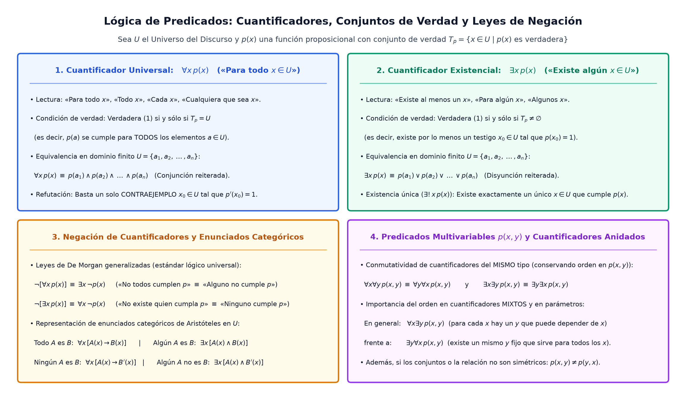
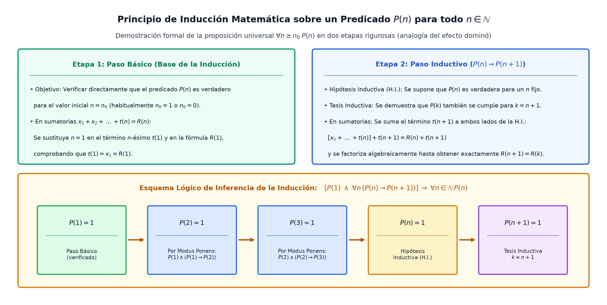

# 3.2 Lógica de predicados

## Introducción: De la Lógica Proposicional a la Lógica de Predicados (Primer Orden)

La **lógica proposicional** (subtema `3.1`) estudia las relaciones entre proposiciones consideradas como bloques indivisibles que son totalmente verdaderos ($1$) o totalmente falsos ($0$). Sin embargo, como señala Jiménez Murillo (2012, Cap. 4.8), la lógica proposicional por sí sola no puede analizar la estructura interna de afirmaciones que dependen de los elementos de un conjunto, ni razonamientos tan elementales como:

$$\text{«Todos los seres humanos son mortales. Sócrates es un ser humano. Por lo tanto, Sócrates es mortal.»}$$

Si en lógica proposicional asignáramos letras distintas $p$, $q$ y $r$ a cada oración, la estructura $(p \land q) \to r$ sería una contingencia y no permitiría deducir la conclusión. Tampoco podemos asignar un valor de verdad único a expresiones con variables como $x + 2 > 7$ o *«$x$ habla francés»* cuando dentro de un grupo de elementos algunos cumplen la propiedad y otros no.

Para superar esta limitación, la **lógica de predicados** (también llamada **lógica de primer orden** o **lógica de conjuntos**) extiende la lógica proposicional incorporando tres herramientas fundamentales (Jiménez Murillo, 2012; Lipschutz & Lipson, 2009; Rosen, 2004):
1. **Funciones proposicionales o predicados ($p(x), q(x, y), \dots$):** Propiedades o relaciones que dependen de una o más variables.
2. **Universo del discurso o dominio ($U$):** El conjunto referencial de objetos que pueden sustituir a dichas variables.
3. **Cuantificadores ($\forall$ y $\exists$):** Símbolos que especifican **cuántos** elementos del dominio satisfacen el predicado (*todos* o *alguno*).



---

## 3.2.1 Cuantificadores

### 1. Función proposicional (Predicado), Dominio y Conjunto de Verdad

Sea $U$ (o $A$) un conjunto no vacío dado. Una **función proposicional** (también llamada **predicado** u **oración abierta**) definida sobre $U$ es una expresión $p(x)$ que contiene una variable $x$ tal que, al sustituir $x$ por cualquier elemento concreto $a \in U$, la expresión $p(a)$ se convierte en una **proposición con un valor de verdad bien definido ($1$ o $0$)** (Lipschutz & Lipson, 2009, Cap. 4.10):

- **Universo del discurso o Dominio ($U$):** Es el conjunto de todos los elementos posibles a los cuales se somete el predicado ($x \in U$).
  - *Advertencia (Lipschutz & Lipson, 2009, Prob. 4.18):* El dominio debe hacer que $p(a)$ tenga sentido. Por ejemplo, $p(x): x + 2 > 5$ es una función proposicional válida sobre $\mathbb{N}$, $\mathbb{Z}$ o $\mathbb{R}$, pero **no** sobre los números complejos $\mathbb{C}$ porque la relación de orden $>$ no está definida en $\mathbb{C}$ ($2i + 2 > 5$ carece de sentido matemático).
- **Conjunto de verdad ($T_p$):** Es el subconjunto de elementos de $U$ para los cuales el predicado $p(x)$ resulta **verdadero ($1$)**:
  $$T_p = \{x \in U \mid p(x) \text{ es verdadera}\} = \{x \in U \mid p(x) = 1\}$$

**Ejemplo rápido (Lipschutz & Lipson, 2009, Ej. 4.7):** Sobre el universo de los números naturales $U = \mathbb{N} = \{1, 2, 3, 4, \dots\}$:
- Si $p(x): x + 2 > 7$, entonces $T_p = \{6, 7, 8, \dots\}$ (algunos elementos de $\mathbb{N}$ lo cumplen y otros no).
- Si $q(x): x + 5 < 3$, entonces $T_q = \emptyset$ (ningún natural lo cumple).
- Si $r(x): x + 5 > 1$, entonces $T_r = \mathbb{N} = U$ (todos los naturales lo cumplen).

---

### 2. Cuantificador Universal ($\forall$)

Sea $p(x)$ un predicado sobre un universo del discurso $U$. El **cuantificador universal**, denotado por el símbolo $\forall$ (una letra `A` invertida, inicial del alemán *Alle* o del inglés *All*, introducido por Gerhard Gentzen en $1935$ siguiendo los estudios de Aristóteles y Frege), forma la proposición cuantificada:

$$\forall x\, p(x) \qquad \text{o explícitamente} \qquad (\forall x \in U)\, p(x)$$

- **Lecturas equivalentes en español:** *«Para todo $x$»*, *«Para cada $x$»*, *«Para cualquier $x$»*, *«Todos los elementos $x$ cumplen $p(x)$»*.
- **Regla de evaluación (Valor de verdad):**
  $$\forall x\, p(x) = \begin{cases} 1 \text{ (Verdadero)}, & \text{si } p(a) \text{ es verdadera para TODOS y cada uno de los elementos } a \in U \;\; (T_p = U), \\ 0 \text{ (Falso)}, & \text{si existe AL MENOS UN elemento } x_0 \in U \text{ para el cual } p(x_0) \text{ es falsa} \;\; (T_p \neq U). \end{cases}$$
- **Contraejemplo:** Cualquier elemento $x_0 \in U$ tal que $p(x_0) = 0$ (es decir, $p'(x_0) = 1$) se denomina un **contraejemplo** de la afirmación universal $\forall x\, p(x)$. Basta encontrar **un solo contraejemplo** para demostrar que $\forall x\, p(x)$ es falsa (Lipschutz & Lipson, 2009, Cap. 4.11).
- **Expansión en un dominio finito:** Si el universo del discurso es finito, $U = \{a_1, a_2, \dots, a_n\}$, el cuantificador universal equivale exactamente a una **conjunción lógica reiterada** (Rosen, 2004):
  $$(\forall x \in U)\, p(x) \;\equiv\; p(a_1) \land p(a_2) \land \dots \land p(a_n)$$

> **Nota sobre la convención de cuantificación universal implícita (Jiménez Murillo, 2012, p. 152):**  
> En matemáticas y en textos como Jiménez Murillo (2012), cuando se escribe un predicado $p(x)$ afirmándolo como ley sin anteponerle un cuantificador explícito, se sobreentiende que está afectado por el cuantificador universal:
> $$\forall x\, p(x) \;\equiv\; p(x) \qquad (x \in U)$$
> Por ejemplo, escribir la identidad trigonométrica $\operatorname{sen}^2(x) + \cos^2(x) = 1$ para $x \in \mathbb{R}$ equivale a $\forall x \in \mathbb{R}\,[\operatorname{sen}^2(x) + \cos^2(x) = 1]$. No obstante, para evitar cualquier ambigüedad entre una función proposicional abierta y una proposición cerrada, es buena práctica escribir siempre el símbolo $\forall x$.

---

### 3. Cuantificador Existencial ($\exists$) y de Existencia Única ($\exists!$)

Sea $p(x)$ un predicado sobre un universo del discurso $U$. El **cuantificador existencial**, denotado por el símbolo $\exists$ (una letra `E` invertida, introducida por Giuseppe Peano en $1897$), forma la proposición cuantificada:

$$\exists x\, p(x) \qquad \text{o explícitamente} \qquad (\exists x \in U)\, p(x)$$

- **Lecturas equivalentes en español:** *«Existe algún $x$»*, *«Existe por lo menos un $x$»*, *«Para algún $x$»*, *«Algunos $x$ cumplen $p(x)$»*, *«Hay al menos un $x$ tal que $p(x)$»*.
- **Regla de evaluación (Valor de verdad):**
  $$\exists x\, p(x) = \begin{cases} 1 \text{ (Verdadero)}, & \text{si existe POR LO MENOS UN elemento } x_0 \in U \text{ tal que } p(x_0) \text{ es verdadera} \;\; (T_p \neq \emptyset), \\ 0 \text{ (Falso)}, & \text{si } p(a) \text{ es falsa para TODOS los elementos } a \in U \;\; (T_p = \emptyset). \end{cases}$$
  *(Un elemento concreto $x_0 \in U$ que hace verdadera a $p(x_0)$ se denomina un **testigo** o **ejemplar** de la proposición existencial).*
- **Expansión en un dominio finito:** Si $U = \{a_1, a_2, \dots, a_n\}$, el cuantificador existencial equivale exactamente a una **disyunción lógica reiterada** (Rosen, 2004):
  $$(\exists x \in U)\, p(x) \;\equiv\; p(a_1) \lor p(a_2) \lor \dots \lor p(a_n)$$
- **Cuantificador de existencia única ($\exists!$):**
  El símbolo $\exists! x\, p(x)$ se lee *«Existe un único $x \in U$ tal que $p(x)$»* (o *«Existe exactamente un $x$»*) y es verdadero si y sólo si $|T_p| = 1$. Formalmente se define como:
  $$\exists! x\, p(x) \;\equiv\; \exists x\,\big[p(x) \;\land\; \forall y\,\big(p(y) \to y = x\big)\big]$$

---

## 3.2.2 Representación y evaluación de predicados

### 1. Operaciones Lógicas sobre Predicados y Relación con Conjuntos de Verdad

Todos los operadores de la lógica proposicional ($\land, \lor, ', \oplus, \to, \leftrightarrow$) se aplican directamente a las funciones proposicionales $p(x)$ y $q(x)$ definidas sobre un mismo universo $U$, estableciendo una correspondencia exacta con las operaciones de la teoría de conjuntos (Lipschutz & Lipson, 2009, p. 80):

| Expresión con predicados | Significado para cada $a \in U$ | Conjunto de verdad en $U$ |
| :---: | :--- | :---: |
| **$p'(x)$** (o $\neg p(x)$) | Es verdadera cuando $p(a)$ es falsa, y viceversa. | $(T_p)' = U - T_p$ *(Complemento)* |
| **$p(x) \land q(x)$** | Es verdadera cuando $p(a)$ y $q(a)$ son ambas verdaderas. | $T_{p \land q} = T_p \cap T_q$ *(Intersección)* |
| **$p(x) \lor q(x)$** | Es verdadera cuando $p(a)$ o $q(a)$ es verdadera. | $T_{p \lor q} = T_p \cup T_q$ *(Unión)* |
| **$p(x) \to q(x)$** | Es falsa sólo cuando $p(a) = 1$ y $q(a) = 0$. | $T_{p \to q} = (T_p)' \cup T_q$ |
| **$\forall x\,[p(x) \to q(x)]$** | Todo elemento que cumple $p$ también cumple $q$. | $T_p \subseteq T_q$ *(Inclusión de conjuntos)* |
| **$\forall x\,[p(x) \leftrightarrow q(x)]$** | Los mismos elementos cumplen $p$ y $q$. | $T_p = T_q$ *(Igualdad de conjuntos)* |

---

### 2. Representación Simbólica de Enunciados Categóricos y Compuestos

En lógica de predicados existen dos estilos complementarios para representar enunciados sobre clases de objetos dentro de un universo general $U$ (por ejemplo, $U = \{z \mid z \text{ es un animal}\}$ o $U = \{z \mid z \text{ es una persona}\}$):

#### Estilo A: Restringiendo el dominio de cada variable a un subconjunto $A \subseteq U$ (Jiménez Murillo, 2012, Ej. 4.24)
Si definimos subconjuntos específicos del universo, como $A = \{x \mid x \text{ es un artista}\} \subseteq U$ y $B = \{y \mid y \text{ es un político}\} \subseteq U$, y los predicados $p$: *«es rico»* y $q$: *«es corrupto»*, entonces la variable $x \in A$ ya representa a un artista y $y \in B$ a un político:
- *«Todos los artistas son ricos»:* $\forall x\, p(x)$ con $x \in A$.
- *«Algunos políticos son corruptos»:* $\exists y\, q(y)$ con $y \in B$.
- *«Ningún artista es rico»:* $\forall x\, p'(x)$ (o $[\exists x\, p(x)]'$) con $x \in A$.
- *«Algunos artistas no son ricos»:* $\exists x\, p'(x)$ (o $[\forall x\, p(x)]'$) con $x \in A$.

#### Estilo B: Usando un único universo general $U$ y predicados clasificadores (Rosen, 2004; Epp, 2012; Jiménez Murillo, Prob. 4.25–4.26)
Cuando todas las variables recorren un mismo universo general $U = \{x \mid x \text{ es un animal}\}$ y se definen predicados para las categorías, por ejemplo $g(x)$: *«$x$ es un gato»* y $c(x)$: *«$x$ es carnívoro»*, los **cuatro enunciados categóricos de Aristóteles** se traducen como:

| Tipo (Aristóteles) | Enunciado en lenguaje natural | Representación en un universo general $U$ | Regla clave de traducción |
| :---: | :--- | :---: | :--- |
| **Universal Afirmativo (A)** | *«Todos los gatos son carnívoros»*<br>(«Si es gato, entonces es carnívoro») | $\forall x\,\big[g(x) \to c(x)\big]$ | El cuantificador universal $\forall x$ se asocia con la **condicional ($\to$)**, nunca con $\land$ (pues $\forall x\,[g(x) \land c(x)]$ diría que *todos los animales del universo son gatos y además carnívoros*). |
| **Universal Negativo (E)** | *«Ningún gato canta»*<br>(«Si es gato, entonces no canta») | $\forall x\,\big[g(x) \to m'(x)\big]$<br>*(donde $m(x)$: «$x$ canta»)* | Equivale a $\neg \exists x\,\big[g(x) \land m(x)\big]$ («No existe un animal que sea gato y cante»). |
| **Particular Afirmativo (I)** | *«Algunos animales tienen alas y vuelan»* | $\exists x\,\big[a(x) \land v(x)\big]$ | El cuantificador existencial $\exists x$ se asocia con la **conjunción ($\land$)**, nunca con $\to$ (pues $\exists x\,[a(x) \to v(x)]$ sería verdadero con sólo hallar un animal sin alas). |
| **Particular Negativo (O)** | *«Algunas gallinas no ponen huevos»* | $\exists x\,\big[k(x) \land h'(x)\big]$ | Afirma la existencia de al menos un individuo en $U$ que es gallina ($k(x)$) y no pone huevos ($h'(x)$). |

---

### 3. Leyes de De Morgan para Cuantificadores (Negación de Proposiciones Cuantificadas)

Uno de los procedimientos más importantes en matemáticas y ciencias de la computación (por ejemplo, al negar la condición de parada de un ciclo `while` o de una búsqueda en un arreglo) es negar correctamente una proposición cuantificada:

- **Negar que «TODOS cumplen $p(x)$»** («No es cierto que todos los elementos de $U$ cumplan $p(x)$») equivale exactamente a afirmar que **«EXISTE AL MENOS UNO que NO cumple $p(x)$»**.
- **Negar que «EXISTE ALGUNO que cumple $p(x)$»** («No existe ningún elemento en $U$ que cumpla $p(x)$», es decir, **«Ninguno cumple $p(x)$»**) equivale exactamente a afirmar que **«TODOS los elementos de $U$ NO cumplen $p(x)$»**.

Esto se expresa mediante las **Leyes de De Morgan Generalizadas para Cuantificadores** (Teoremas 4.4 y 4.5 de Lipschutz & Lipson, 2009, p. 79; Rosen, 2004; Epp, 2012):

$$\boxed{\neg\big[\forall x\, p(x)\big] \;\equiv\; \exists x\, \neg p(x) \qquad \text{o con prima:} \qquad \big[\forall x\, p(x)\big]' \;\equiv\; \exists x\, p'(x)}$$

$$\boxed{\neg\big[\exists x\, p(x)\big] \;\equiv\; \forall x\, \neg p(x) \qquad \text{o con prima:} \qquad \big[\exists x\, p(x)\big]' \;\equiv\; \forall x\, p'(x)}$$

| Proposición original | Negación lógica equivalente | Lectura en español de la negación | Conjunto de verdad de la negación |
| :---: | :---: | :--- | :---: |
| $\forall x\, p(x)$ | $\exists x\, p'(x)$ | «No todos cumplen $p$» $\equiv$ **«Alguno no cumple $p$»** | $T_p \neq U \iff (T_p)' \neq \emptyset$ |
| $\exists x\, p(x)$ | $\forall x\, p'(x)$ | «No existe alguno que cumpla $p$» $\equiv$ **«Ninguno cumple $p$»** / **«Todos incumplen $p$»** | $T_p = \emptyset \iff (T_p)' = U$ |
| $\forall x\, p'(x)$ | $\exists x\, p(x)$ | «No es cierto que ninguno cumpla $p$» $\equiv$ **«Alguno cumple $p$»** | $(T_p)' \neq U \iff T_p \neq \emptyset$ |
| $\exists x\, p'(x)$ | $\forall x\, p(x)$ | «No hay ninguno que falle $p$» $\equiv$ **«Todos cumplen $p$»** | $(T_p)' = \emptyset \iff T_p = U$ |

> **Nota aclaratoria sobre la notación en Jiménez Murillo (2012, pp. 153 y 159):**  
> En las páginas $153$ y $159$ de Jiménez Murillo (2012), el autor utiliza la expresión $[\forall x\, p(x)]' = \forall x\, p'(x)$ para referirse al *contrario lingüístico* («Todos son ricos» frente a «Ninguno es rico», que en realidad es $\forall x\, p'(x) \equiv [\exists x\, p(x)]'$), y escribe $[\exists x\, p(x)]' = \exists x\, p'(x)$ para referirse al complemento conjuntista parcial («Algunos son ricos» frente a «Algunos no son ricos», que en realidad es $\exists x\, p'(x) \equiv [\forall x\, p(x)]'$). Sin embargo, en la propia página $155$ (Ejemplo $4.25$) el autor evalúa correctamente *«No es cierto que todas las elecciones sean dudosas»* invirtiendo el valor de verdad de $\forall x\, q(x)$ ($0' = 1$). En la lógica matemática estándar internacional (Lipschutz, Rosen, Epp, Johnsonbaugh), al pasar la negación $'$ (o $\neg$) hacia adentro de un cuantificador **siempre se intercambia $\forall \leftrightarrow \exists$** según las Leyes de De Morgan.

---

### 4. Evaluación de Proposiciones Cuantificadas Compuestas

Para determinar el valor de verdad ($1$ o $0$) de una proposición compuesta que combina varios predicados cuantificados mediante conectivos lógicos ($\land, \lor, \to, \leftrightarrow$):
1. Se determina individualmente el valor de verdad ($1$ o $0$) de cada subproposición cuantificada $\forall x\, p(x)$ o $\exists x\, q(x)$ en el universo del discurso $U$.
2. Se sustituyen dichos valores binarios ($1$ y $0$) en la expresión compuesta y se evalúan los conectivos aplicando exactamente las mismas tablas de verdad y jerarquía de operación de la lógica proposicional (Jiménez Murillo, 2012, Ej. 4.24 y 4.25).

---

### 5. Predicados Multivariables $p(x, y)$, Cuantificadores Anidados y Variables Libres/Ligadas

Cuando un predicado relaciona dos o más variables, como $p(x, y)$: *«$x$ asaltó a $y$»* o *«$x - y = 1$»*, para convertirlo en una proposición cerrada es necesario anteponer un cuantificador por cada variable (Lipschutz & Lipson, 2009, Cap. 4.11; Jiménez Murillo, 2012, Ej. 4.26–4.27):

#### a) Reglas de significado y orden en cuantificadores anidados ($2$ variables sobre un dominio $U$)

| Expresión cuantificada | Lectura formal y significado | Condición para que sea Verdadera ($1$) |
| :---: | :--- | :--- |
| **1. $\forall x \forall y\, p(x, y)$**<br>$\equiv \forall y \forall x\, p(x, y)$ | «Para todo $x$ y para todo $y$, se cumple $p(x, y)$.» | $p(a, b) = 1$ para **todas las parejas posibles** $(a, b) \in U \times U$. Basta una pareja que falle para que sea falsa ($0$). |
| **2. $\forall x \exists y\, p(x, y)$** | «Para todo $x$, existe al menos un $y$ tal que se cumple $p(x, y)$.» | Para cada $x$ elegido primero, es posible hallar algún $y$ (**que puede depender de $x$**, $y = f(x)$) que haga verdadera a $p(x, y)$. |
| **3. $\exists x \forall y\, p(x, y)$** | «Existe al menos un $x$ tal que, para todo $y$, se cumple $p(x, y)$.» | Existe **un mismo valor fijo $x_0$** que funciona simultáneamente para absolutamente todos los valores posibles de $y \in U$. |
| **4. $\exists x \exists y\, p(x, y)$**<br>$\equiv \exists y \exists x\, p(x, y)$ | «Existe algún $x$ y existe algún $y$ tales que se cumple $p(x, y)$.» | Basta encontrar **una sola pareja** $(x_0, y_0) \in U \times U$ que cumpla $p(x_0, y_0) = 1$. |

> **Dos advertencias esenciales sobre el orden (Jiménez Murillo, 2012, p. 156; Lipschutz & Lipson, 2009, p. 80):**
> 1. **Posición de los parámetros dentro del paréntesis:** Si el predicado $p(x, y)$ no es simétrico o $x \in A$ y $y \in B$ pertenecen a conjuntos distintos, **invertir el orden de los argumentos dentro del paréntesis cambia por completo el significado**:
>    $$p(x, y) \neq p(y, x)$$
>    Por ejemplo, si $A = \{\text{ladrones}\}$ y $B = \{\text{víctimas}\}$ y $p$: *«asaltaron a»*, entonces $\forall x \forall y\, p(x, y)$ significa *«Todos los ladrones asaltaron a todas las víctimas»*, mientras que $\forall y \forall x\, p(y, x)$ significa *«Todas las víctimas asaltaron a todos los ladrones»* (Jiménez Murillo, 2012, Ej. 4.26).
> 2. **Orden de cuantificadores mixtos ($\forall x \exists y$ frente a $\exists y \forall x$):**
>    - Cuando los cuantificadores son **del mismo tipo**, siempre conmutan (manteniendo fijo el orden dentro de $p(x, y)$): $\forall x \forall y\, p(x, y) \equiv \forall y \forall x\, p(x, y)$ y $\exists x \exists y\, p(x, y) \equiv \exists y \exists x\, p(x, y)$.
>    - Cuando son **mixtos**, en la notación matemática estándar el cuantificador escrito a la izquierda tiene mayor alcance que el de la derecha: $\exists y \forall x\, p(x, y)$ exige que **una misma $y$ fija** sirva para todas las $x$, lo cual es mucho más estricto que $\forall x \exists y\, p(x, y)$ (donde cada $x$ puede elegir su propia $y$). De hecho, siempre se cumple la implicación unidireccional:
>      $$\exists y \forall x\, p(x, y) \;\Rightarrow\; \forall x \exists y\, p(x, y)$$
>      pero el recíproco es falso en general (por ejemplo, en $\mathbb{R}$, para $p(x, y): x + y = 0$, es verdad que $\forall x \exists y\,(x + y = 0)$ tomando $y = -x$, pero es falso que exista un único número fijo $y$ que sumado a cualquier real $x$ dé siempre $0$).
>    - *(Nota de lectura en Jiménez Murillo, 2012, Ej. 4.27:* En dicho libro el autor traduce las expresiones mixtas leyendo los cuantificadores en el orden en que aparecen las variables dentro del paréntesis $p(x, y)$; en los ejemplos y soluciones de estas notas indicaremos explícitamente tanto el análisis estándar internacional como la lectura de Jiménez Murillo para total claridad).*

#### b) Negación de proposiciones con múltiples cuantificadores
Aplicando sucesivamente las Leyes de De Morgan de izquierda a derecha, se cambia cada $\forall$ por $\exists$, cada $\exists$ por $\forall$, y se niega el predicado final (Lipschutz & Lipson, 2009, p. 80):
- $\neg\big[\forall x \forall y\, p(x, y)\big] \;\equiv\; \exists x \exists y\, p'(x, y)$
- $\neg\big[\forall x \exists y\, p(x, y)\big] \;\equiv\; \exists x \forall y\, p'(x, y)$
- $\neg\big[\exists x \forall y\, p(x, y)\big] \;\equiv\; \forall x \exists y\, p'(x, y)$
- $\neg\big[\exists x \exists y\, p(x, y)\big] \;\equiv\; \forall x \forall y\, p'(x, y)$

#### c) Variables libres y variables ligadas (Jiménez Murillo, 2012, p. 159)
En una expresión con predicados:
- Una **variable ligada (o acotada)** es aquella que está asociada a un cuantificador $\forall$ o $\exists$ dentro de su alcance (actúa como una variable *local* a ese cuantificador).
- Una **variable libre** es aquella que no está afectada por ningún cuantificador.
- *Ejemplo (Jiménez Murillo, 2012, p. 159):* En la expresión:
  $$\forall x\, p(x) \;\lor\; \exists z\,\big[q(y) \land r(z) \land s(w)\big]$$
  las variables **$x$ y $z$ son variables ligadas** (cuantificadas por $\forall x$ y $\exists z$, respectivamente), mientras que **$y$ y $w$ son variables libres**.

---

## 3.2.3 El Principio de Inducción Matemática sobre Predicados $P(n)$

En las ciencias de la computación es sumamente frecuente necesitar demostrar que una función proposicional o predicado $P(n)$ —como la fórmula cerrada de una sumatoria, la cota de complejidad temporal de un algoritmo de ordenamiento o el invariante de un ciclo iterativo— es verdadera **para todos los números enteros positivos** ($\forall n \in \mathbb{N}\, P(n)$) (Jiménez Murillo, 2012, Cap. 4.9; Rosen, 2004, Cap. 3.3).

Como el dominio $\mathbb{N} = \{1, 2, 3, \dots\}$ es infinito, no es posible verificar $P(1), P(2), P(3), \dots$ uno por uno en una tabla de verdad. Para ello se utiliza el **Principio de Inducción Matemática**.



### Enunciado Formal del Principio de Inducción Matemática

Sea $P(n)$ una proposición abierta (predicado) definida en función de un número entero $n \ge n_0$ (donde habitualmente $n_0 = 1$). En el caso de una sumatoria o serie algorítmica, $P(n)$ tiene la estructura general (Jiménez Murillo, 2012, p. 159):

$$\underbrace{x_1}_{\text{Inicio }(n=1)} + x_2 + x_3 + \dots + \underbrace{t(n)}_{\text{Término }n\text{-ésimo}} = \underbrace{R(n)}_{\text{Resultado generalizado}}$$

La proposición universal $\forall n \ge n_0\; P(n)$ es **verdadera** si se cumplen las dos etapas siguientes:

1. **Paso Básico (Base de la inducción, $k = 1$ o $k = n_0$):**
   Se demuestra que $P(1)$ es verdadera sustituyendo $n = 1$ tanto en el término $n$-ésimo $t(n)$ como en la expresión del resultado $R(n)$, comprobando que coinciden con el valor inicial $x_1$:
   $$t(1) = x_1 = R(1)$$
2. **Paso Inductivo ($k = n + 1$):**
   - **Hipótesis Inductiva (H.I.):** Se supone que el predicado $P(n)$ es verdadero para un entero arbitrario $n \ge 1$.
   - **Tesis Inductiva:** Se demuestra que bajo esa hipótesis, el predicado también es verdadero para el siguiente entero $k = n + 1$, es decir, $P(n) \to P(n + 1)$.
   - *Procedimiento algebraico en sumatorias (Jiménez Murillo, 2012, p. 160):* Se sustituye $(n + 1)$ en lugar de $n$ dentro del término $n$-ésimo para obtener el nuevo término $t(n + 1)$, se **suma $t(n + 1)$ a ambos miembros** de la igualdad de la hipótesis inductiva:
     $$x_1 + x_2 + \dots + t(n) + t(n + 1) = R(n) + t(n + 1)$$
     y se desarrolla y factoriza el miembro derecho hasta expresarlo exactamente con la misma estructura algebraica de $R(n)$, pero en función de $k = n + 1$, es decir, $R(k) = R(n + 1)$.

---

## Ejemplos de Práctica (Resueltos Paso a Paso)

### Ejemplo 3.2.1: Conjunto de verdad, evaluación de cuantificadores y contraejemplos
a) Sea el conjunto $A = \{1, 2, 3, 4, 5\}$. Determine el valor de verdad ($1$ o $0$) de cada una de las siguientes proposiciones cuantificadas y escriba su negación simplificada (Lipschutz & Lipson, 2009, Prob. 4.15 y 4.27):
   - (i) $(\exists x \in A)(x + 3 = 10)$
   - (ii) $(\forall x \in A)(x + 3 < 10)$
   - (iii) $(\exists x \in A)(x + 3 < 5)$
   - (iv) $(\forall x \in A)(x + 3 \le 7)$

b) Encuentre un **contraejemplo** para refutar cada una de las siguientes afirmaciones universales sobre el dominio indicado (Lipschutz & Lipson, 2009, Ej. 4.11 y Prob. 4.28):
   - (v) $\forall x \in \mathbb{R},\; x^2 \ge x$
   - (vi) $\forall x \in U,\; x \text{ es primo}$, donde $U = \{3, 5, 7, 9\}$.

**Solución:**
- **Parte (a) sobre $A = \{1, 2, 3, 4, 5\}$:**
  - **(i) $(\exists x \in A)(x + 3 = 10)$:** La ecuación $x + 3 = 10$ requiere $x = 7$, pero $7 \notin A$ ($T_p = \emptyset$). Por tanto, es **Falsa ($0$)**.
    *Negación:* $\neg(\exists x \in A)(x + 3 = 10) \equiv (\forall x \in A)(x + 3 \neq 10)$.
  - **(ii) $(\forall x \in A)(x + 3 < 10)$:** Evaluando en todos los elementos de $A$, el mayor es $x = 5$, para el cual $5 + 3 = 8 < 10$ ($T_p = \{1, 2, 3, 4, 5\} = A$). Por tanto, es **Verdadera ($1$)**.
    *Negación:* $\neg(\forall x \in A)(x + 3 < 10) \equiv (\exists x \in A)(x + 3 \ge 10)$.
  - **(iii) $(\exists x \in A)(x + 3 < 5)$:** Para $x_0 = 1 \in A$, se cumple $1 + 3 = 4 < 5$ ($T_p = \{1\} \neq \emptyset$). Por tanto, es **Verdadera ($1$)**.
    *Negación:* $\neg(\exists x \in A)(x + 3 < 5) \equiv (\forall x \in A)(x + 3 \ge 5)$.
  - **(iv) $(\forall x \in A)(x + 3 \le 7)$:** Para $x_0 = 5 \in A$, se tiene $5 + 3 = 8 \not\le 7$ ($T_p = \{1, 2, 3, 4\} \neq A$). Como falla para $x_0 = 5$, es **Falsa ($0$)**.
    *Negación:* $\neg(\forall x \in A)(x + 3 \le 7) \equiv (\exists x \in A)(x + 3 > 7)$.

- **Parte (b) — Contraejemplos:**
  - **(v) $\forall x \in \mathbb{R},\; x^2 \ge x$:** Es **Falsa ($0$)**. Cualquier número real estrictamente comprendido entre $0$ y $1$ sirve como contraejemplo; por ejemplo, tomando $x_0 = \frac{1}{2} \in \mathbb{R}$, se obtiene $\left(\frac{1}{2}\right)^2 = \frac{1}{4} < \frac{1}{2}$. *(Observación: si el dominio fuera $\mathbb{N}$ o $\mathbb{Z}$, la proposición sería verdadera).*
  - **(vi) $\forall x \in \{3, 5, 7, 9\},\; x \text{ es primo}$:** Es **Falsa ($0$)**. El único contraejemplo en $U$ es $x_0 = 9$, ya que $9 = 3 \times 3$ es un número compuesto.

---

### Ejemplo 3.2.2: Representación y evaluación de un enunciado compuesto en lógica de predicados
Considere el siguiente enunciado (Jiménez Murillo, 2012, Ej. 4.25):
> *«Algunas elecciones son limpias y no es cierto que todas las elecciones sean dudosas o en algunas de ellas no se cuenta con información.»*

Defina el universo del discurso $U$, los predicados simples, represente el enunciado con notación lógica de predicados y evalúe su valor de verdad.

**Solución:**
1. **Definición del universo del discurso y predicados:**
   - $U = \{x \mid x \text{ es una elección}\}$
   - $p(x)$: $x$ es una elección limpia.
   - $q(x)$: $x$ es una elección dudosa.
   - $r(x)$: En la elección $x$ se cuenta con la información.

2. **Simbolización de cada componente:**
   - *«Algunas elecciones son limpias»:* $\exists x\, p(x)$
   - *«No es cierto que todas las elecciones sean dudosas»:* $[\forall x\, q(x)]' \equiv \exists x\, q'(x)$ *(en la notación de Jiménez Murillo se escribe también $\forall x\, q'(x)$ o $[\forall x\, q(x)]'$ evaluando la negación del universal)*
   - *«En algunas de ellas no se cuenta con información»:* $\exists x\, r'(x)$

   Uniendo con los conectivos «y» ($\land$) y «o» ($\lor$), la expresión completa para $x \in U$ es:
   $$\exists x\, p(x) \;\land\; \big[\forall x\, q(x)\big]' \;\lor\; \exists x\, r'(x)$$

3. **Evaluación del valor de verdad empírico:**
   - $\exists x\, p(x)$ («Algunas elecciones son limpias») $= 1$ (Verdadero).
   - $\forall x\, q(x)$ («Todas las elecciones son dudosas») $= 0$ (Falso), por lo que su negación $[\forall x\, q(x)]' = 0' = 1$ (Verdadero).
   - $\exists x\, r'(x)$ («De algunas elecciones no se tiene información») $= 1$ (Verdadero).
   Sustituyendo los valores de verdad y respetando la jerarquía ($\land$ antes que $\lor$):
   $$1 \land 0' \lor 1 \;=\; (1 \land 1) \lor 1 \;=\; 1 \lor 1 \;=\; 1 \quad (\text{Verdadero})$$

---

### Ejemplo 3.2.3: Simbolización de enunciados sobre un universo general con conectivos condicionales
Sea el universo del discurso $U = \{x \mid x \text{ es un animal}\}$. Defina los predicados necesarios, represente con notación lógica cada una de las siguientes frases e indique su valor de verdad (adaptado de Jiménez Murillo, 2012, Prob. 4.25):
a) *«Todos los animales tienen alas.»*  
b) *«Algunos animales tienen alas y no vuelan.»*  
c) *«Si es ave, entonces tiene alas.»*  
d) *«Si es ave, pone huevos y cacaraquea, entonces es gallina.»*

**Solución:**
Definimos sobre $U = \{x \mid x \text{ es un animal}\}$ los predicados:
- $a(x)$: $x$ tiene alas.
- $v(x)$: $x$ vuela.
- $b(x)$: $x$ es un ave.
- $h(x)$: $x$ pone huevos.
- $c(x)$: $x$ cacaraquea.
- $g(x)$: $x$ es una gallina.

- **a) «Todos los animales tienen alas»:**
  $$\forall x\, a(x) \qquad (x \in U)$$
  **Valor de verdad:** **Falso ($0$)**, pues existen animales como el perro o el caballo que no tienen alas.

- **b) «Algunos animales tienen alas y no vuelan»:**
  $$\exists x\,\big[a(x) \land v'(x)\big] \qquad (x \in U)$$
  **Valor de verdad:** **Verdadero ($1$)**, pues existen aves como el avestruz o el pingüino que tienen alas y no vuelan.

- **c) «Si es ave, entonces tiene alas»:**
  $$\forall x\,\big[b(x) \to a(x)\big] \qquad (x \in U)$$
  **Valor de verdad:** **Verdadero ($1$)**, ya que biológicamente toda ave posee alas.

- **d) «Si es ave, pone huevos y cacaraquea, entonces es gallina»:**
  $$\forall x\,\big[\big(b(x) \land h(x) \land c(x)\big) \to g(x)\big] \qquad (x \in U)$$
  **Valor de verdad:** **Verdadero ($1$)**.

---

### Ejemplo 3.2.4: Análisis de predicados de dos variables y cuantificadores anidados
Sea el universo del discurso $U = \{x, y \mid x \in \mathbb{Z}^+,\; y \in \mathbb{Z}^+\}$ (donde consideramos los enteros positivos $\{1, 2, 3, \dots\}$) y sea el predicado binario (Jiménez Murillo, 2012, Ej. 4.27):
$$p(x, y): \quad (x - 1) < y$$
Explique el significado en palabras y determine el valor de verdad de cada uno de los siguientes incisos:
a) $\forall x \forall y\, p(x, y)$  
b) $\forall x \exists y\, p(x, y)$  
c) $\exists x \forall y\, p(x, y)$  
d) $\exists x \exists y\, p(x, y)$

**Solución:**
- **a) $\forall x \forall y\, [(x - 1) < y]$:**
  - *Significado:* «Para todo entero positivo $x$ y para todo entero positivo $y$, se cumple que $(x - 1) < y$.»
  - *Evaluación:* **Falso ($0$)**. Contraejemplo: tomando $x = 5$ y $y = 2$, se tiene $(5 - 1) = 4 \not< 2$.

- **b) $\forall x \exists y\, [(x - 1) < y]$:**
  - *Significado:* «Para todo entero positivo $x$, existe cuando menos un entero positivo $y$ tal que $(x - 1) < y$.»
  - *Evaluación:* **Verdadero ($1$)**. Dado cualquier entero positivo $x$ (por grande que sea), siempre podemos elegir $y = x \in \mathbb{Z}^+$, con lo cual $(x - 1) < x$ se cumple siempre.

- **c) $\exists x \forall y\, [(x - 1) < y]$:**
  - *Significado:* «Existe al menos un entero positivo $x$ fijo tal que, para todo entero positivo $y$, se cumple que $(x - 1) < y$.»
  - *Evaluación:* **Verdadero ($1$)**. Si elegimos $x_0 = 1$ (o $x_0 = 2$ si $y \ge 2$), para $x_0 = 1$ la desigualdad queda $(1 - 1) = 0 < y$, la cual es verdadera para absolutamente todos los enteros positivos $y \in \{1, 2, 3, \dots\}$.

- **d) $\exists x \exists y\, [(x - 1) < y]$:**
  - *Significado:* «Existe algún entero positivo $x$ y algún entero positivo $y$ tales que $(x - 1) < y$.»
  - *Evaluación:* **Verdadero ($1$)** (basta tomar, por ejemplo, $x = 1, y = 1$, donde $0 < 1$).

---

### Ejemplo 3.2.5: Demostración por Inducción Matemática de una sumatoria
Demuestre mediante el principio de inducción matemática que la siguiente proposición $P(n)$ es verdadera para todo entero positivo $n \in \mathbb{N}$ (Jiménez Murillo, 2012, Ej. 4.30):
$$P(n): \qquad 2 + 5 + 8 + \dots + (3n - 1) = \frac{n(3n + 1)}{2}$$

**Solución:**
Identificamos los elementos de la sumatoria:
- Primer elemento (inicio): $x_1 = 2$
- Término $n$-ésimo: $t(n) = 3n - 1$
- Resultado generalizado: $R(n) = \frac{n(3n + 1)}{2}$

1. **Paso básico ($k = n = 1$):**
   Sustituimos $n = 1$ en el término $n$-ésimo y en la fórmula del resultado:
   $$t(1) = 3(1) - 1 = 2 \qquad \text{y} \qquad R(1) = \frac{1\big(3(1) + 1\big)}{2} = \frac{4}{2} = 2$$
   Como el resultado coincide exactamente con el primer término de la sumatoria ($x_1 = 2$), **se cumple el paso básico**.

2. **Paso inductivo ($k = n + 1$):**
   - *Hipótesis inductiva:* Suponemos verdadera la igualdad para $n$:
     $$2 + 5 + 8 + \dots + (3n - 1) = \frac{n(3n + 1)}{2}$$
   - *Tesis inductiva:* Sustituimos $(n + 1)$ en el término $n$-ésimo, obteniendo $t(n + 1) = 3(n + 1) - 1$, y lo sumamos a ambos miembros de la igualdad:
     $$2 + 5 + 8 + \dots + (3n - 1) + \big[3(n + 1) - 1\big] = \frac{n(3n + 1)}{2} + \big[3(n + 1) - 1\big]$$
   - Desarrollamos algebraicamente el miembro derecho:
     $$\begin{aligned}
     \text{Miembro derecho} &= \frac{n(3n + 1) + 2\big[3(n + 1) - 1\big]}{2} \\
     &= \frac{3n^2 + n + 2(3n + 2)}{2} \\
     &= \frac{3n^2 + n + 6n + 4}{2} \\
     &= \frac{3n^2 + 7n + 4}{2}
     \end{aligned}$$
   - Factorizamos el trinomio del numerador $3n^2 + 7n + 4 = (n + 1)(3n + 4)$:
     $$\text{Miembro derecho} = \frac{(n + 1)(3n + 4)}{2} = \frac{(n + 1)\big[3(n + 1) + 1\big]}{2}$$
   - Sustituyendo $k = n + 1$, obtenemos:
     $$R(k) = \frac{k(3k + 1)}{2}$$
   Como la expresión obtenida en función de $k$ tiene exactamente la misma forma algebraica que $R(n) = \frac{n(3n + 1)}{2}$, **se cumple el paso inductivo**. Por lo tanto, la proposición $P(n)$ es verdadera para todo $n \in \mathbb{N}$. $\blacksquare$

---

### Ejemplo 3.2.6: Aplicación de la Inducción Matemática a la verificación de un algoritmo iterativo
Considere el siguiente algoritmo escrito en seudocódigo (Jiménez Murillo, 2012, Prob. 4.20):

```text
x = 1;
s = 0;
Mientras (x <= n) hacer
Inicio
    e = 2 * x + 1;
    s = s + e;
    Imprimir (e);
    x = x + 1;
Fin
Imprimir (s).
```

a) Ejecute una traza para $n = 1, 2, 3, 4$, represente el algoritmo en forma de sumatoria identificando el término $n$-ésimo $t(n)$ y deduzca la expresión matemática cerrada del resultado final $s = R(n)$.  
b) Demuestre mediante **inducción matemática** que el algoritmo calcula correctamente dicho resultado para todo $n \in \mathbb{N}$.

**Solución:**
- **a) Modelado matemático del algoritmo:**
  - En la iteración $x = 1$: $e = 2(1) + 1 = 3$, $\quad s = 3$.
  - En la iteración $x = 2$: $e = 2(2) + 1 = 5$, $\quad s = 3 + 5 = 8$.
  - En la iteración $x = 3$: $e = 2(3) + 1 = 7$, $\quad s = 3 + 5 + 7 = 15$.
  - En la iteración $x = 4$: $e = 2(4) + 1 = 9$, $\quad s = 3 + 5 + 7 + 9 = 24$.
  Observamos que en la $n$-ésima iteración el término sumado es $t(n) = 2n + 1$, y las sumas acumuladas $3, 8, 15, 24, \dots$ corresponden a $2^2 - 1, 3^2 - 1, 4^2 - 1, 5^2 - 1$, es decir:
  $$R(n) = (n + 1)^2 - 1 = n^2 + 2n = n(n + 2)$$
  Por tanto, la proposición $P(n)$ que representa al algoritmo es:
  $$P(n): \qquad 3 + 5 + 7 + \dots + (2n + 1) = n(n + 2)$$

- **b) Demostración por Inducción Matemática:**
  1. **Paso básico ($k = n = 1$):**
     $$t(1) = 2(1) + 1 = 3 \qquad \text{y} \qquad R(1) = 1(1 + 2) = 3$$
     Coincide con el primer término $x_1 = 3$; se cumple el paso básico.
  2. **Paso inductivo ($k = n + 1$):**
     Sumando $t(n + 1) = 2(n + 1) + 1$ a ambos miembros de la hipótesis inductiva:
     $$\begin{aligned}
     3 + 5 + 7 + \dots + (2n + 1) + \big[2(n + 1) + 1\big] &= n(n + 2) + \big[2(n + 1) + 1\big] \\
     &= n^2 + 2n + 2n + 2 + 1 \\
     &= n^2 + 4n + 3 \\
     &= (n + 1)(n + 3) \\
     &= (n + 1)\big[(n + 1) + 2\big] \\
     &= k(k + 2) \qquad (\text{con } k = n + 1)
     \end{aligned}$$
     Se cumple el paso inductivo, quedando formalmente verificado el algoritmo para todo $n \in \mathbb{N}$. $\blacksquare$

---

## Ejercicios de Tarea (Práctica en Casa)

> **Instrucciones:** Resuelva cada uno de los siguientes ejercicios de forma completa y ordenada, definiendo explícitamente el universo del discurso y los predicados cuando corresponda.

1. **Representación y evaluación de enunciados sobre un dominio animal (Jiménez Murillo, Prob. 4.26):**  
   Sea el universo del discurso $U = \{x \mid x \text{ es un animal}\}$. Defina los predicados simples necesarios, represente cada una de las siguientes frases usando notación de lógica de predicados e indique si el enunciado es **Verdadero ($1$)** o **Falso ($0$)** justificando brevemente:  
   a) *«Todos los gatos son carnívoros.»*  
   b) *«Si es carnívoro y no es perro, entonces es un gato.»*  
   c) *«Es carnívoro si y sólo si es perro o gato.»*  
   d) *«Ningún gato canta.»*  
   e) *«Si canta, entonces no es perro ni gato.»*  
   f) *«Es carnívoro. No canta. No es perro ni gato. En conclusión, es un león.»*
   <!--
   Solución del Ejercicio 1:
   Definimos sobre U = {x | x es un animal} los predicados:
   g(x): x es un gato.
   p(x): x es un perro.
   c(x): x es carnívoro.
   m(x): x canta.
   l(x): x es un león.

   - a) "Todos los gatos son carnívoros":
        Notación estándar: Vx [g(x) -> c(x)]  (o si se restringe el dominio a G = {gatos}: Vx c(x)).
        Valor de verdad: Verdadero (1), ya que todos los felinos domésticos son carnívoros.
   - b) "Si es carnívoro y no es perro, entonces es un gato":
        Notación: Vx [(c(x) ^ p'(x)) -> g(x)].
        Valor de verdad: Falso (0). Contraejemplo: un león, un tiburón o un águila es carnívoro y no es perro, pero tampoco es un gato.
   - c) "Es carnívoro si y sólo si es perro o gato":
        Notación: Vx [c(x) <-> (p(x) v g(x))].
        Valor de verdad: Falso (0), porque existen muchos otros animales carnívoros además de los perros y los gatos.
   - d) "Ningún gato canta":
        Notación: Vx [g(x) -> m'(x)]  (o bien ~Ex [g(x) ^ m(x)], o sobre el conjunto de gatos: Vx m'(x)).
        Valor de verdad: Verdadero (1), los gatos maúllan, no cantan.
   - e) "Si canta, entonces no es perro ni gato":
        Notación: Vx [m(x) -> (p'(x) ^ g'(x))].
        Valor de verdad: Verdadero (1), pues si un animal canta (p. ej., un canario o ruiseñor), efectivamente no es perro ni gato.
   - f) "Es carnívoro. No canta. No es perro ni gato. En conclusión, es un león":
        Notación: Vx [(c(x) ^ m'(x) ^ p'(x) ^ g'(x)) -> l(x)].
        Valor de verdad: Falso (0) (argumento inválido empíricamente en U), ya que un tigre, un lobo o un cocodrilo cumple todas las hipótesis (es carnívoro, no canta y no es perro ni gato), pero la conclusión de que sea un león es falsa.
   -->

2. **Funciones proposicionales, conjuntos de verdad y negación de cuantificadores (Lipschutz & Lipson, Prob. 4.25 y 4.26):**  
   I) Sea $A = \{1, 2, 3, 4, 5, 6, 7, 8, 9, 10\}$. Para cada una de las siguientes expresiones, indique si es una **proposición cerrada** (en cuyo caso determine su valor de verdad) o si es una **función proposicional con variable libre** (en cuyo caso determine su conjunto de verdad en $A$):  
   a) $(\forall x \in A)(\exists y \in A)(x + y < 14)$  
   b) $(\forall y \in A)(x + y < 14)$  
   c) $(\forall x \in A)(\forall y \in A)(x + y < 14)$  
   d) $(\exists y \in A)(x + y < 14)$  
   II) Escriba la negación lógica simplificada (aplicando Leyes de De Morgan de cuantificadores y conectivos) de:  
   e) *«Si el profesor está ausente, entonces algunos estudiantes no terminan su tarea.»*  
   f) *«Todos los estudiantes terminaron su tarea y el profesor está presente.»*
   <!--
   Solución del Ejercicio 2:
   === PARTE I ===
   - a) (Vx in A)(Ey in A)(x + y < 14):
        Ambas variables (x, y) están ligadas a cuantificadores, por lo que SÍ es una proposición cerrada.
        Además, es VERDADERA (1), porque para cualquier x in {1, ..., 10}, basta elegir y = 1 in A para que x + 1 <= 11 < 14.
   - b) (Vy in A)(x + y < 14):
        La variable y está ligada, pero la variable x está LIBRE; por tanto, es una FUNCIÓN PROPOSICIONAL en x.
        Para que x + y < 14 se cumpla para TODOS los valores de y in {1, ..., 10} (incluyendo el peor caso y = 10), se requiere x + 10 < 14, es decir, x < 4.
        Su conjunto de verdad en A es: T = {1, 2, 3}.
   - c) (Vx in A)(Vy in A)(x + y < 14):
        Es una proposición cerrada y es FALSA (0). Contraejemplo: tomando x = 8 e y = 9, se tiene 8 + 9 = 17, que no es menor que 14.
   - d) (Ey in A)(x + y < 14):
        La variable x está LIBRE, por lo que es una FUNCIÓN PROPOSICIONAL en x.
        Como para cualquier x in {1, ..., 10} podemos elegir y = 1 in A cumpliéndose x + 1 <= 11 < 14, la condición se cumple para todos los elementos de A.
        Su conjunto de verdad es todo el conjunto: T = A = {1, 2, 3, 4, 5, 6, 7, 8, 9, 10}.

   === PARTE II ===
   Sea p: "El profesor está presente" (por lo que p': "El profesor está ausente") y sea t(x): "El estudiante x terminó su tarea".
   - e) Enunciado original: p' -> Ex t'(x).
        Negación: [p' -> Ex t'(x)]' === p' ^ [Ex t'(x)]' === p' ^ Vx t(x).
        En palabras: "El profesor está ausente y, sin embargo, todos los estudiantes terminaron su tarea."
   - f) Enunciado original: [Vx t(x)] ^ p.
        Negación: ([Vx t(x)] ^ p)' === [Vx t(x)]' v p' === Ex t'(x) v p'.
        En palabras: "Algunos estudiantes no terminaron su tarea o el profesor está ausente."
   -->

3. **Interpretación y evaluación de cuantificadores anidados en $\mathbb{R}$ (Jiménez Murillo, Prob. 4.27 y 4.28):**  
   Sea el universo del discurso $U = \{x, y \mid x, y \in \mathbb{R}\}$.  
   I) Considere el predicado $p(x, y): x^2 - 1 = y$. Exprese con palabras el significado de cada inciso y determine su valor de verdad ($1$ o $0$):  
   a) $\forall x \exists y\, p(x, y)$  
   b) $\exists x \forall y\, p(x, y)$  
   c) $\forall y \exists x\, p(x, y)$  
   d) $\forall x \forall y\, p(x, y)$  
   e) $\exists x \exists y\, p(x, y)$  
   II) Repita el análisis para el predicado $q(x, y): x - y = 1$ en los incisos $\forall x \exists y\, q(x, y)$ y $\forall y \exists x\, q(x, y)$.
   <!--
   Solución del Ejercicio 3:
   === PARTE I: p(x, y): x^2 - 1 = y sobre R ===
   - a) Vx Ey (x^2 - 1 = y):
        Significado: "Para todo número real x, existe al menos un número real y tal que x^2 - 1 = y."
        Valor de verdad: VERDADERO (1), porque para cualquier real x, el número y = x^2 - 1 es un número real bien definido.
   - b) Ex Vy (x^2 - 1 = y):
        Significado: "Existe un número real x tal que para todo número real y se cumple x^2 - 1 = y."
        Valor de verdad: FALSO (0), porque un valor fijo de x produce un único valor de x^2 - 1, el cual no puede ser igual a todos los números reales y simultáneamente.
   - c) Vy Ex (x^2 - 1 = y):
        Significado (lectura matemática estándar): "Para todo número real y, existe algún número real x tal que x^2 - 1 = y."
        Valor de verdad (estándar): FALSO (0), porque despejando x^2 = y + 1, si tomamos y = -5 in R, queda x^2 = -4, que no tiene solución en R (sólo se cumple para y >= -1).
        (Nota: bajo la convención de lectura de Jiménez Murillo donde Vy Ex p(x,y) se lee empezando por el primer parámetro x: "Para algún real x se cumple x^2 - 1 = y para todo real y", también es FALSO (0)).
   - d) Vx Vy (x^2 - 1 = y):
        Significado: "Para todo número real x y para todo número real y se cumple x^2 - 1 = y."
        Valor de verdad: FALSO (0) (por ejemplo, para x = 1, y = 5, 1^2 - 1 = 0 != 5).
   - e) Ex Ey (x^2 - 1 = y):
        Significado: "Existe algún número real x y algún número real y tales que x^2 - 1 = y."
        Valor de verdad: VERDADERO (1) (por ejemplo, x = 2, y = 3 cumple 2^2 - 1 = 3).

   === PARTE II: q(x, y): x - y = 1 sobre R ===
   - Vx Ey (x - y = 1):
     Significado: "Para todo número real x, existe algún número real y tal que x - y = 1."
     Valor de verdad: VERDADERO (1), pues basta tomar y = x - 1 in R para cualquier x dado.
   - Vy Ex (x - y = 1):
     Significado: "Para todo número real y, existe algún número real x tal que x - y = 1."
     Valor de verdad: VERDADERO (1), pues dado cualquier y in R, basta elegir x = y + 1 in R.
   -->

4. **Traducción a notación simbólica de predicados con relaciones algebraicas (Jiménez Murillo, Prob. 4.29 y 4.30):**  
   Sea $U = \{x, y \mid x, y \in \mathbb{R}\}$ y sean los predicados:
   $$p(x, y): \;\; y = 2x - 1, \qquad q(x, y): \;\; x > y, \qquad r(x, y): \;\; y = \frac{1}{x}$$
   Represente con notación lógica de predicados cada uno de los siguientes enunciados:  
   a) *«Existen algunas $y$ que para toda $x$ cumplen que si $y = 2x - 1$ y $x > y$, entonces $y = \frac{1}{x}$.»*  
   b) *«Para toda $y$ existe alguna $x$ tal que si $y \neq 2x - 1$ o $y = \frac{1}{x}$, entonces $x \le y$.»*  
   c) *«Para alguna $x$ existe alguna $y$ tal que $y = \frac{1}{x}$, o para toda $x$ se cumple $x > y$ y existe alguna $y$ tal que $y \neq 2x - 1$.»*
   <!--
   Solución del Ejercicio 4:
   Teniendo en cuenta que p'(x, y): "y != 2x - 1" y que en R la negación de q(x, y): "x > y" es q'(x, y): "x <= y":
   - a) Ey Vx [(p(x, y) ^ q(x, y)) -> r(x, y)]    (con x, y in U).
   - b) Vy Ex [(p'(x, y) v r(x, y)) -> q'(x, y)]  (con x, y in U).
   - c) Ex Ey r(x, y) v [Vx q(x, y) ^ Ey p'(x, y)]  (con x, y in U).
   -->

5. **Demostración de igualdades y desigualdades mediante Inducción Matemática (Jiménez Murillo, Prob. 4.18 y 4.19):**  
   Demuestre formalmente usando el Principio de Inducción Matemática (indicando claramente el **Paso básico** y el **Paso inductivo**) que las siguientes proposiciones $P(n)$ son verdaderas:  
   a) $5 + 15 + 25 + 35 + \dots + (10n - 5) = 5n^2 \qquad (\forall n \in \mathbb{N})$  
   b) $\frac{3}{1 \cdot 3} + \frac{3}{3 \cdot 5} + \frac{3}{5 \cdot 7} + \dots + \frac{3}{(2n - 1)(2n + 1)} = \frac{3n}{2n + 1} \qquad (\forall n \in \mathbb{N})$  
   c) $0 + 3 + 8 + \dots + (n^2 - 1) = \frac{n(2n + 5)(n - 1)}{6} \qquad (\forall n \in \mathbb{N})$  
   d) $2^n > n^2 \qquad (\forall n \in \mathbb{Z}^+ \text{ con } n \ge 5)$
   <!--
   Solución del Ejercicio 5:
   === Inciso (a): 5 + 15 + 25 + ... + (10n - 5) = 5n^2 ===
   1. Paso básico (k = n = 1):
      Sustituyendo n = 1 en el término n-ésimo: 10(1) - 5 = 5, que coincide con el primer término (5) y con el lado derecho 5(1)^2 = 5. Se cumple el paso básico.
   2. Paso inductivo (k = n + 1):
      Sumamos el término para (n + 1), que es [10(n + 1) - 5] = 10n + 5, a ambos lados de la hipótesis inductiva:
      5 + 15 + ... + (10n - 5) + [10(n + 1) - 5] = 5n^2 + 10n + 5
                                                 = 5(n^2 + 2n + 1)
                                                 = 5(n + 1)^2
                                                 = 5k^2   (con k = n + 1).
      Se cumple el paso inductivo; por tanto, P(n) es verdadera para todo n in N.

   === Inciso (b): 3/(1*3) + 3/(3*5) + ... + 3/[(2n-1)(2n+1)] = 3n / (2n + 1) ===
   1. Paso básico (k = n = 1):
      Término n-ésimo en n = 1: 3 / [(2(1)-1)(2(1)+1)] = 3 / (1 * 3) = 1.
      Resultado en n = 1: 3(1) / (2(1) + 1) = 3 / 3 = 1. Se cumple el paso básico.
   2. Paso inductivo (k = n + 1):
      El término para (n + 1) es: 3 / [(2(n+1)-1)(2(n+1)+1)] = 3 / [(2n + 1)(2n + 3)].
      Sumándolo a ambos lados de la hipótesis inductiva:
      Lado derecho = 3n / (2n + 1) + 3 / [(2n + 1)(2n + 3)]
                   = [3n(2n + 3) + 3] / [(2n + 1)(2n + 3)]
                   = (6n^2 + 9n + 3) / [(2n + 1)(2n + 3)]
                   = 3(2n^2 + 3n + 1) / [(2n + 1)(2n + 3)]
                   = 3(2n + 1)(n + 1) / [(2n + 1)(2n + 3)]
                   = 3(n + 1) / (2n + 3)
                   = 3(n + 1) / [2(n + 1) + 1]
                   = 3k / (2k + 1)   (con k = n + 1).
      Se cumple el paso inductivo; por tanto, P(n) es verdadera para todo n in N.

   === Inciso (c): 0 + 3 + 8 + ... + (n^2 - 1) = n(2n + 5)(n - 1) / 6 ===
   1. Paso básico (k = n = 1):
      En n = 1: (1^2 - 1) = 0, y en el lado derecho: 1(7)(0) / 6 = 0. Coincide con el primer término (0). Se cumple el paso básico.
   2. Paso inductivo (k = n + 1):
      Sumamos [(n + 1)^2 - 1] = n(n + 2) a ambos lados:
      Lado derecho = n(2n + 5)(n - 1) / 6 + [(n + 1)^2 - 1]
                   = [n(2n^2 + 3n - 5) + 6(n^2 + 2n)] / 6
                   = (2n^3 + 3n^2 - 5n + 6n^2 + 12n) / 6
                   = (2n^3 + 9n^2 + 7n) / 6
                   = n(2n^2 + 9n + 7) / 6
                   = n(n + 1)(2n + 7) / 6
                   = (n + 1)[2(n + 1) + 5][(n + 1) - 1] / 6
                   = k(2k + 5)(k - 1) / 6   (con k = n + 1).
      Se cumple el paso inductivo; queda demostrado.

   === Inciso (d): 2^n > n^2 para todo entero n >= 5 ===
   1. Paso básico (n_0 = 5):
      Para n = 5: 2^5 = 32 y 5^2 = 25. Como 32 > 25, se cumple el paso básico.
   2. Paso inductivo (k = n + 1 con n >= 5):
      Hipótesis inductiva: 2^n > n^2 (con n >= 5).
      Multiplicando por 2 ambos lados:
      2^(n + 1) = 2 * 2^n > 2n^2 = n^2 + n^2.
      Como n >= 5, se cumple que n^2 >= 5n = 2n + 3n > 2n + 1.
      Por transitividad:
      2^(n + 1) > n^2 + n^2 > n^2 + 2n + 1 = (n + 1)^2 = k^2.
      Se cumple el paso inductivo; por tanto, 2^n > n^2 para todo n >= 5.
   -->

6. **Verificación de algoritmos de cómputo y ordenamiento mediante Inducción Matemática (Jiménez Murillo, Prob. 4.21 y 4.23):**  
   a) Represente el siguiente algoritmo en forma de sumatoria, determine la fórmula del término $n$-ésimo y del resultado acumulado $s$, y demuestre su validez mediante inducción matemática:
   ```text
   x = 1;
   s = 0;
   Mientras (x <= n) hacer
   Inicio
       e = 3 * x - 1;
       s = s + e;
       Imprimir (e);
       x = x + 1;
   Fin
   Imprimir (s);
   ```
   b) Demuestre por inducción matemática que el algoritmo de **ordenamiento de la burbuja (*bubble sort*)** sobre una lista de $n$ elementos realiza en el peor de los casos $(n - 1) + (n - 2) + \dots + 2 + 1 = \frac{n(n - 1)}{2}$ comparaciones para todo $n \ge 1$.
   <!--
   Solución del Ejercicio 6:
   - Inciso (a):
     Evaluando las iteraciones:
     Para x = 1: e = 3(1) - 1 = 2
     Para x = 2: e = 3(2) - 1 = 5
     Para x = 3: e = 3(3) - 1 = 8
     ...
     Para x = n: e = 3n - 1 (término n-ésimo).
     La sumatoria generada por el ciclo es:
     s = 2 + 5 + 8 + ... + (3n - 1).
     Como es una progresión aritmética de n términos con primer término 2 y último 3n - 1, la suma cerrada es:
     R(n) = n(2 + 3n - 1) / 2 = n(3n + 1) / 2.
     Demostración por inducción matemática de 2 + 5 + 8 + ... + (3n - 1) = n(3n + 1) / 2:
     - Paso básico (n = 1): 3(1) - 1 = 2 y 1(3(1) + 1) / 2 = 2. Cumple.
     - Paso inductivo (k = n + 1):
       Sumando [3(n + 1) - 1] = 3n + 2 a ambos miembros:
       n(3n + 1)/2 + (3n + 2) = (3n^2 + n + 6n + 4)/2 = (3n^2 + 7n + 4)/2 = (n + 1)(3n + 4)/2 = k(3k + 1)/2.
       Cumple el paso inductivo.

   - Inciso (b):
     En el ordenamiento de la burbuja sobre n elementos, la primera pasada compara elementos adyacentes (n - 1) veces, la segunda (n - 2) veces, ..., hasta la última pasada que realiza 1 comparación (o 0 si n = 1).
     Escrita en orden ascendente, la proposición es:
     P(n): 0 + 1 + 2 + ... + (n - 1) = n(n - 1) / 2   (para n >= 1, o iniciando en 1 para n >= 2).
     - Paso básico (n = 1): El término n-ésimo es (1 - 1) = 0 comparaciones, y la fórmula da 1(1 - 1) / 2 = 0. (Para n = 2: 1 comparación y 2(1)/2 = 1). Cumple.
     - Paso inductivo (k = n + 1):
       Al pasar de n a k = n + 1 elementos, se agrega una pasada de [(n + 1) - 1] = n comparaciones. Sumando n a ambos miembros de la hipótesis inductiva:
       0 + 1 + 2 + ... + (n - 1) + n = n(n - 1) / 2 + n
                                     = [n(n - 1) + 2n] / 2
                                     = [n(n - 1 + 2)] / 2
                                     = n(n + 1) / 2
                                     = (n + 1)[(n + 1) - 1] / 2
                                     = k(k - 1) / 2.
       Cumple el paso inductivo; por tanto, bubble sort realiza n(n - 1)/2 comparaciones en el peor de los casos.
   -->
