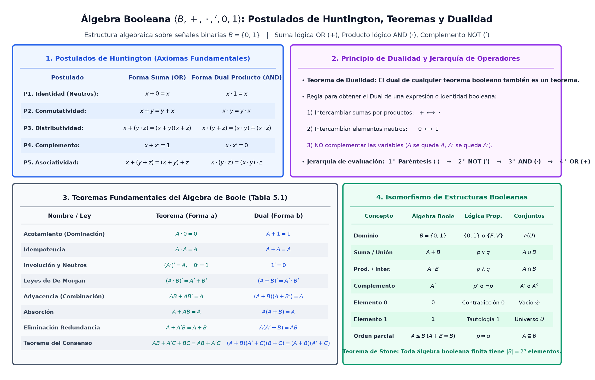

# 4.1 Teoremas y postulados

## Introducción: De las Señales Binarias a la Estructura Algebraica de Boole

En la ingeniería de sistemas digitales y la computación, la información se transmite, procesa y almacena mediante **señales físicas**. Como explica Jiménez Murillo (2012, Cap. 5.1, p. 178), una **señal** es la representación de información a través de los valores de una magnitud física (corriente eléctrica, tensión o voltaje, presión neumática, intensidad luminosa, etc.), y se clasifica en dos grandes categorías:

1. **Señal analógica:** Aquella cuya magnitud varía de forma **continua** en el tiempo a lo largo de un intervalo infinito de valores (por ejemplo, la presión de un gas, la temperatura ambiente o una onda sonora).
2. **Señal digital y señal binaria:** En una señal digital los valores posibles de tensión están discretizados en intervalos definidos. El caso más importante es la **señal binaria** (o *biestable*), que admite únicamente **dos estados posibles** mutuamente excluyentes:
   $$\text{Conectado / Desconectado}, \qquad \text{Verdadero / Falso}, \qquad \text{Alto voltaje (ej. }+5\text{ V) / Bajo voltaje (}0\text{ V)}, \qquad \mathbf{1} \text{ / } \mathbf{0}$$

En $1854$, el matemático británico **George Boole** ($1815\text{–}1864$) publicó *An Investigation of the Laws of Thought*, donde demostró que las proposiciones lógicas y las clases de objetos pueden manipularse mediante un álgebra simbólica sencilla. En $1904$, el matemático estadounidense **Edward V. Huntington** formuló el sistema de axiomas (o **postulados**) que define rigurosamente cualquier **álgebra booleana** abstracta. Finalmente, en $1938$, **Claude E. Shannon** ($1916\text{–}2001$) aplicó el álgebra de Boole en los Laboratorios Bell y el MIT para crear el **álgebra de conmutación**, demostrando que las propiedades de los interruptores y relevadores eléctricos en serie y en paralelo corresponden exactamente a los postulados y teoremas booleanos (Jiménez Murillo, 2012, pp. 178–179; Johnsonbaugh, 2005, p. 470).

---

## 1. Definición Axiomática y Postulados del Álgebra Booleana (Postulados de Huntington)

Formalmente, un **álgebra booleana** es un sistema algebraico denotado por la séxtupla:

$$\langle B,\; +,\; \cdot,\; ',\; 0,\; 1 \rangle$$

que consta de un conjunto no vacío $B$ que contiene al menos **dos elementos distintos** denominados **elemento cero ($0$)** y **elemento unidad ($1$)** ($0 \neq 1$), dos **operaciones binarias cerradas** en $B$ llamadas **suma lógica u operación OR ($+$)** y **producto lógico u operación AND ($\cdot$ o $*$)**, y una **operación unaria** llamada **complemento o inversión NOT ($'$)**, tales que para cualesquiera elementos arbitrarios $x, y, z \in B$ se satisfacen los siguientes axiomas o **postulados** (Jiménez Murillo, 2012, p. 180; Lipschutz & Lipson, 2009, Cap. 15.2, p. 368; Johnsonbaugh, 2005, Def. 11.3.1, p. 482):

### Los Postulados Fundamentales (Huntington, 1904)

| Postulado | Nombre del Postulado | Forma para la Suma Lógica ($+$) | Forma Dual para el Producto Lógico ($\cdot$) |
| :---: | :--- | :---: | :---: |
| **P0** | **Cerradura** | $x + y \in B$ | $x \cdot y \in B$ |
| **P1 (`B3`)** | **Existencia de elementos neutros (Identidad)** | $x + 0 = x$ *(el $0$ es el neutro aditivo)* | $x \cdot 1 = x$ *(el $1$ es el neutro multiplicativo)* |
| **P2 (`B1`)** | **Conmutatividad** | $x + y = y + x$ | $x \cdot y = y \cdot x$ |
| **P3** | **Asociatividad** | $x + (y + z) = (x + y) + z$ | $x \cdot (y \cdot z) = (x \cdot y) \cdot z$ |
| **P4 (`B2`)** | **Distributividad mutua** | $x + (y \cdot z) = (x + y) \cdot (x + z)$ | $x \cdot (y + z) = (x \cdot y) + (x \cdot z)$ |
| **P5 (`B4`)** | **Existencia de complementos** | $x + x' = 1$ | $x \cdot x' = 0$ |

> **Observaciones matemáticas fundamentales sobre los postulados (Lipschutz & Lipson, 2009, p. 368; Johnsonbaugh, 2005, p. 482):**
> 1. **Independencia del postulado asociativo:** Edward V. Huntington demostró en $1904$ que los cuatro axiomas **`[B1]` Conmutatividad**, **`[B2]` Distributividad**, **`[B3]` Identidad** y **`[B4]` Complemento** bastan por sí solos para definir un álgebra booleana, ya que las **leyes asociativas (`P3`) se pueden deducir como teorema** a partir de ellos (como veremos en la Sección 5 y en el Problema 15.5 de Lipschutz). Sin embargo, autores como Jiménez Murillo (2012, p. 180) y Johnsonbaugh (2005, p. 482) incluyen explícitamente la asociatividad dentro de la lista inicial de 5 propiedades básicas por comodidad operativa.
> 2. **La distributividad de la suma respecto al producto:** En el álgebra elemental de los números reales ($\mathbb{R}$), la multiplicación se distribuye sobre la suma ($x(y + z) = xy + xz$), pero la suma **no** se distribuye sobre el producto. En cambio, en un **álgebra booleana ambas operaciones son mutuamente distributivas**: también se cumple siempre que:
>    $$x + yz = (x + y)(x + z)$$
> 3. **Notación de producto y complemento:** El producto booleano $x \cdot y$ (o $x * y$) suele escribirse por simple **yuxtaposición** como $xy$ o con paréntesis $(x)(y)$ (Jiménez Murillo, 2012, p. 181). El complemento de $x$ se denota con un apóstrofo o prima **$x'$** (Jiménez Murillo; Lipschutz; Johnsonbaugh) o con una barra superior **$\bar{x}$**.

---

## 2. El Álgebra Booleana Bivalente ($B = \{0, 1\}$) y Propiedades de las Expresiones Booleanas

El modelo más importante para la ingeniería en computación es el **álgebra booleana de dos elementos** (o *álgebra de conmutación*), definida sobre el conjunto binario $B = \mathbb{Z}_2 = \{0, 1\}$.

### 2.1 Tablas de Operación de los Operadores Básicos (`AND`, `OR`, `NOT`)

De acuerdo con Jiménez Murillo (2012, Cap. 5.3, p. 181) y Lipschutz & Lipson (2009, Fig. 15-1, p. 369), las tres operaciones elementales sobre $B = \{0, 1\}$ se definen mediante las siguientes tablas:

| Multiplicación Lógica `AND` ($\cdot$) | Suma Lógica `OR` ($+$) | Complemento `NOT` ($'$) |
| :---: | :---: | :---: |
| $\begin{array}{cc|c} A & B & A \cdot B = AB \\ \hline 0 & 0 & \mathbf{0} \\ 0 & 1 & \mathbf{0} \\ 1 & 0 & \mathbf{0} \\ 1 & 1 & \mathbf{1} \end{array}$ | $\begin{array}{cc|c} A & B & A + B \\ \hline 0 & 0 & \mathbf{0} \\ 0 & 1 & \mathbf{1} \\ 1 & 0 & \mathbf{1} \\ 1 & 1 & \mathbf{1} \end{array}$ | $\begin{array}{c|c} A & A' \\ \hline 0 & \mathbf{1} \\ 1 & \mathbf{0} \end{array}$ |

> **Regla aritmética clave en el Álgebra de Boole (Jiménez Murillo, 2012, p. 181):**  
> Dado que el valor máximo de una señal binaria en $B = \{0, 1\}$ es $1$, en la suma lógica (`OR`) no existe acarreo numérico, sino saturación lógica ($\operatorname{máx}(A, B)$), mientras que el producto lógico (`AND`) equivale a $\operatorname{mín}(A, B)$:
> $$1 + 1 = 1, \qquad 1 + 1 + 1 = 1, \qquad 0 + 1 = 1, \qquad 0 + 0 = 0$$

### 2.2 Definición y Propiedades de las Expresiones y Funciones Booleanas

Una **expresión booleana** $E(x_1, x_2, \dots, x_n)$ en las variables $x_1, x_2, \dots, x_n$ se define recursivamente como (Johnsonbaugh, 2005, Def. 11.1.9; Jiménez Murillo, 2012, pp. 180–181):
1. Las constantes $0$ y $1$, y cada variable $x_1, x_2, \dots, x_n$ son expresiones booleanas.
2. Si $X_1$ y $X_2$ son expresiones booleanas, entonces $(X_1)$, $X_1'$, $X_1 + X_2$ y $X_1 \cdot X_2$ también son expresiones booleanas.

Toda expresión booleana cumple las siguientes propiedades fundamentales (Jiménez Murillo, 2012, pp. 180–181; Lipschutz & Lipson, 2009, p. 372):
- **Literal:** Es una variable sola o complementada, tal como $A, A', B, B', x, x'$. Cada variable suele representar la señal de entrada de un **sensor** o interruptor.
- **Dominio y rango binario:** Tanto las variables de entrada como la función de salida $F$ sólo pueden tomar los valores $0$ (falso / apagado) o $1$ (verdadero / encendido). Formalmente, una función booleana de $n$ variables es una transformación $F: B^n \to B$, cuya tabla de verdad consta de exactamente **$2^n$ filas**.
- **Número total de funciones booleanas posibles de $n$ variables:** Como la tabla de verdad tiene $2^n$ renglones y para cada renglón la salida puede ser $0$ o $1$, existen exactamente **$2^{(2^n)}$ funciones booleanas distintas** de $n$ variables (por ejemplo, para $n = 2$ hay $2^4 = 16$ funciones; para $n = 3$ hay $2^8 = 256$ funciones; para $n = 4$ hay $2^{16} = 65\,536$ funciones) (Johnsonbaugh, 2005, Ejerc. 11.4.21).
- **Jerarquía de precedencia de operadores (Lipschutz & Lipson, 2009, p. 368):** A menos que existan paréntesis explícitos:
  $$1^\circ\text{ Paréntesis } (\;) \quad\longrightarrow\quad 2^\circ\text{ Complemento } (') \quad\longrightarrow\quad 3^\circ\text{ Producto } (\cdot) \quad\longrightarrow\quad 4^\circ\text{ Suma } (+)$$
  Por ejemplo:
  - $A + B \cdot C$ significa $A + (B \cdot C)$ y **nunca** $(A + B) \cdot C$.
  - $A \cdot B'$ significa $A \cdot (B')$ y **nunca** $(A \cdot B)'$.

---

## 3. Ejemplos de Álgebras Booleanas e Isomorfismo Estructural

El poder de definir el álgebra booleana mediante los postulados de Huntington radica en que cualquier teorema demostrado a partir de los axiomas es válido automáticamente en **todos los sistemas matemáticos que cumplan dichos axiomas** (Lipschutz & Lipson, 2009, Ej. 15.1 y Secc. 15.6):

1. **Álgebra de bits $B = \{0, 1\}$ y Álgebra de cadenas de $n$ bits $B^n$:**
   Sea $B^n = B \times B \times \dots \times B$ el conjunto de todas las secuencias de $n$ bits, donde $+$, $\cdot$ y $'$ operan **bit a bit** (por componentes). Entonces $B^n$ es un álgebra booleana de $2^n$ elementos donde el elemento cero es $\mathbf{0} = 00\dots 0$ y el elemento unidad es $\mathbf{1} = 11\dots 1$ (Lipschutz & Lipson, 2009, Ej. 15.1b; Jiménez Murillo, 2012, p. 207).
2. **Álgebra de Conjuntos $\langle \mathcal{P}(U), \cup, \cap, ', \emptyset, U \rangle$ (Unidad 2):**
   La colección $\mathcal{P}(U)$ de todos los subconjuntos de un conjunto universo $U$, con la unión ($\cup$) como suma, la intersección ($\cap$) como producto, el complemento de conjuntos ($'$) como negación, el conjunto vacío $\emptyset$ como elemento $0$ y el universo $U$ como elemento $1$, constituye un álgebra booleana.
3. **Álgebra de Proposiciones Lógicas (Unidad 3):**
   El conjunto de clases de equivalencia de proposiciones lógicas con la disyunción ($\lor$), la conjunción ($\land$), la negación ($'$), la contradicción ($0$) y la tautología ($1$) es un álgebra booleana.
4. **Álgebra de Divisores $D_m$ de un entero libre de cuadrados (Lipschutz & Lipson, 2009, Ej. 15.1c y Prob. 15.2):**
   Sea $m$ un entero positivo **libre de cuadrados** (es decir, producto de números primos distintos, como $m = 6 = 2 \cdot 3$, $m = 30 = 2 \cdot 3 \cdot 5$, $m = 70 = 2 \cdot 5 \cdot 7$ o $m = 210 = 2 \cdot 3 \cdot 5 \cdot 7$), y sea $D_m$ el conjunto de todos los divisores positivos de $m$. Si definimos:
   $$a + b = \operatorname{mcm}(a, b), \qquad a \cdot b = \operatorname{mcd}(a, b), \qquad a' = \frac{m}{a}$$
   entonces $\langle D_m, +, \cdot, ', 1, m \rangle$ **es un álgebra booleana**, donde el número $1$ actúa como el **elemento cero** ($\operatorname{mcm}(a, 1) = a$) y el propio número $m$ actúa como el **elemento unidad** ($\operatorname{mcd}(a, m) = a$).
   - *Advertencia (Johnsonbaugh, 2005, Ejerc. 11.3.3):* Si $m$ **no** es libre de cuadrados (por ejemplo, si es divisible por $p^2$, como $m = 8, 12, 18$ o $20$), entonces $D_m$ **NO es un álgebra booleana**, porque falla el postulado del complemento para los divisores intermedios: por ejemplo, en $D_8 = \{1, 2, 4, 8\}$ con $x' = 8/x$, para $x = 2$ se tiene $2' = 8/2 = 4$, pero $\operatorname{mcm}(2, 4) = 4 \neq 8$ y $\operatorname{mcd}(2, 4) = 2 \neq 1$.
5. **Teorema de Representación de Stone (Teorema 15.6 y Corolario 15.7 de Lipschutz & Lipson, 2009, p. 371):**
   Toda álgebra booleana finita $B$ es **isomorfa** al álgebra booleana de conjuntos $\mathcal{P}(A)$ formada por los subconjuntos del conjunto $A$ de sus *átomos* (los elementos que suceden inmediatamente a $0$; en $D_m$, los átomos son exactamente los divisores primos de $m$). En consecuencia:
   $$\boxed{\text{Toda álgebra booleana finita } B \text{ tiene exactamente } |B| = 2^n \text{ elementos para algún entero } n \ge 1.}$$

---

## 4. El Principio de Dualidad

Una de las propiedades más elegantes y potentes de los postulados del álgebra booleana es su perfecta simetría entre la suma ($+$) y el producto ($\cdot$), y entre los elementos neutros $0$ y $1$.

### Definición de Expresión o Ecuación Dual

El **dual** de cualquier proposición, expresión o identidad en un álgebra booleana se obtiene aplicando simultáneamente las dos sustituciones siguientes (Jiménez Murillo, 2012, pp. 182–183; Lipschutz & Lipson, 2009, Secc. 15.3; Johnsonbaugh, 2005, Def. 11.3.8):
1. Se intercambia cada signo de **suma lógica ($+$)** por un **producto lógico ($\cdot$)**, y cada **producto ($\cdot$)** por una **suma ($+$)** (respetando la agrupación original con paréntesis cuando sea necesario).
2. Se intercambia cada constante **$0$** por **$1$**, y cada **$1$** por **$0$**.
3. **Las variables o literales NO se complementan** (si aparece $A$, queda como $A$; si aparece $A'$, queda como $A'$).

> **¡Cuidado! No confundir el Dual con el Complemento (Jiménez Murillo, 2012, p. 183):**  
> - Para obtener el **dual** de una expresión, sólo se intercambian $+ \leftrightarrow \cdot$ y $0 \leftrightarrow 1$, dejando intactas las literales. Por ejemplo, el dual de $A + B'C = (A + B')(A + C)$ es $A(B' + C) = AB' + AC$.
> - En cambio, si además de intercambiar $+ \leftrightarrow \cdot$ y $0 \leftrightarrow 1$ se complementan todas las literales ($A \leftrightarrow A'$), lo que se obtiene por las Leyes de De Morgan es el **complemento ($F'$)** de la función, no su dual.

### Teorema 15.1 (Principio de Dualidad)

> **Principio de Dualidad (Lipschutz & Lipson, 2009, p. 369; Johnsonbaugh, 2005, Teorema 11.3.10, p. 485):**  
> *El dual de cualquier teorema en un álgebra booleana también es un teorema.*

**Justificación:** Como cada postulado de Huntington viene acompañado de su propio postulado dual, si una identidad $T$ se demuestra en $k$ pasos a partir de los postulados, basta sustituir cada paso de la demostración por su enunciado dual para obtener automáticamente una demostración válida del teorema dual $T^{\text{dual}}$. ¡Esto reduce a la mitad el trabajo de demostración de todos los teoremas del álgebra booleana!

---

## 5. Teoremas del Álgebra de Boole

A partir de los postulados de Huntington se deducen los **teoremas del álgebra booleana**, los cuales constituyen las reglas fundamentales para transformar y simplificar expresiones lógicas. A continuación se presenta la **Tabla 5.1 de Jiménez Murillo (2012, p. 182)**, enriquecida con los teoremas de unicidad, involución y orden parcial de Lipschutz & Lipson (2009, Cap. 15.4–15.5) y Johnsonbaugh (2005, Cap. 11.3).

*(En la tabla siguiente, las letras $A, B, C$ representan no sólo una variable individual, sino también cualquier término, factor o subexpresión booleana compleja).*

### Tabla Maestra de Teoremas del Álgebra de Boole y sus Duales

| Número (Tabla 5.1) | Nombre del Teorema o Propiedad | Teorema (Forma `a`) | Teorema Dual (Forma `b`) |
| :---: | :--- | :---: | :---: |
| **1a / 1b** | **Acotamiento (Dominación o Identidad de $0$ y $1$)** | $0 \cdot A = 0$ | $1 + A = 1$ |
| **2a / 2b** | **Existencia de Neutros (Identidad)** | $1 \cdot A = A$ | $0 + A = A$ |
| **3a / 3b** | **Idempotencia** | $A \cdot A = A$ | $A + A = A$ |
| **4a / 4b** | **Complementación** | $A \cdot A' = 0$ | $A + A' = 1$ |
| **—** | **Complemento de los neutros $0$ y $1$** | $0' = 1$ | $1' = 0$ |
| **—** | **Involución (Doble complemento)** | $(A')' = A$ | $(A')' = A$ |
| **—** | **Unicidad del complemento** | $\text{Si } A + X = 1 \text{ y } A \cdot X = 0 \implies X = A'$ | *(Autodual)* |
| **5a / 5b** | **Conmutatividad** | $AB = BA$ | $A + B = B + A$ |
| **6a / 6b** | **Asociatividad** | $ABC = A(BC) = (AB)C$ | $A + B + C = A + (B + C) = (A + B) + C$ |
| **7a / 7b** | **Leyes de De Morgan (para $2$ o más variables)** | $(AB \dots Z)' = A' + B' + \dots + Z'$ | $(A + B + \dots + Z)' = A'B' \dots Z'$ |
| **8a / 8b** | **Distributividad (Factorización)** | $AB + AC = A(B + C)$ | $(A + B)(A + C) = A + BC$ |
| **9a / 9b** | **Adyacencia Lógica (Combinación)** | $AB + AB' = A$ | $(A + B)(A + B') = A$ |
| **10a / 10b** | **Absorción** | $A + AB = A$ | $A(A + B) = A$ |
| **11a / 11b** | **Eliminación de redundancia (Absorción condicional)** | $A + A'B = A + B$ | $A(A' + B) = AB$ |
| **12a / 12b** | **Eliminación de redundancia con factor común $C$** | $CA + CA'B = CA + CB$ | $(C + A)(C + A' + B) = (C + A)(C + B)$ |
| **13a / 13b** | **Teorema del Consenso** | $AB + A'C + BC = AB + A'C$ | $(A + B)(A' + C)(B + C) = (A + B)(A' + C)$ |

### Teorema de Equivalencias de Orden Parcial en un Álgebra Booleana (Teorema 15.5 de Lipschutz, p. 370)

En cualquier álgebra booleana $B$, la relación $A \le B$ (en conjuntos $A \subseteq B$, en lógica $p \Rightarrow q$, en divisores $a \mid b$) se caracteriza porque las cuatro igualdades siguientes son **mutuamente equivalentes**:

$$(1)\;\; A + B = B \qquad\iff\qquad (2)\;\; A \cdot B = A \qquad\iff\qquad (3)\;\; A' + B = 1 \qquad\iff\qquad (4)\;\; A \cdot B' = 0$$

---

## 6. Demostraciones Formales de los Teoremas a partir de los Postulados

En matemáticas discretas existen dos métodos rigurosos para demostrar una identidad booleana:
1. **Demostración deductiva (algebraica):** Aplicando paso a paso los postulados de Huntington y los teoremas previamente demostrados (válida para *cualquier* álgebra booleana abstracta $B$).
2. **Inducción perfecta (Tabla de verdad):** En el álgebra booleana bivalente $B = \{0, 1\}$, evaluando ambos miembros de la igualdad para las $2^n$ combinaciones posibles de bits y verificando que las columnas resultantes son idénticas (Johnsonbaugh, 2005, Def. 11.2.3).

A continuación presentamos las demostraciones deductivas clásicas (Lipschutz & Lipson, 2009, Probs. 15.5–15.7, pp. 390–391; Johnsonbaugh, 2005, Teoremas 11.3.4 y 11.3.6, pp. 483–484):

### 1) Demostración de la Ley de Idempotencia (`3a` y `3b`): $A + A = A$ y $A \cdot A = A$
$$\begin{aligned}
A &= A + 0 && \text{(Postulado de identidad P1: } x + 0 = x\text{)} \\
  &= A + (A \cdot A') && \text{(Postulado del complemento P5: } A \cdot A' = 0\text{)} \\
  &= (A + A) \cdot (A + A') && \text{(Postulado distributivo P4: } x + yz = (x+y)(x+z)\text{)} \\
  &= (A + A) \cdot 1 && \text{(Postulado del complemento P5: } A + A' = 1\text{)} \\
  &= A + A && \text{(Postulado de identidad P1: } x \cdot 1 = x\text{)} \quad \blacksquare
\end{aligned}$$
Por el **Principio de Dualidad**, intercambiando $+\leftrightarrow \cdot$ y $0 \leftrightarrow 1$ en cada paso, queda demostrada su dual $A \cdot A = A$.

### 2) Demostración de la Ley de Acotamiento (`1a` y `1b`): $A + 1 = 1$ y $A \cdot 0 = 0$
$$\begin{aligned}
A + 1 &= (A + 1) \cdot 1 && \text{(Postulado de identidad P1: } x \cdot 1 = x\text{)} \\
      &= (A + 1) \cdot (A + A') && \text{(Postulado del complemento P5: } A + A' = 1\text{)} \\
      &= A + (1 \cdot A') && \text{(Postulado distributivo P4 a la inversa)} \\
      &= A + (A' \cdot 1) && \text{(Postulado conmutativo P2)} \\
      &= A + A' && \text{(Postulado de identidad P1: } A' \cdot 1 = A'\text{)} \\
      &= 1 && \text{(Postulado del complemento P5)} \quad \blacksquare
\end{aligned}$$
Por el **Principio de Dualidad**, se concluye inmediatamente que $A \cdot 0 = 0$.

### 3) Demostración de la Ley de Absorción (`10a` y `10b`): $A + AB = A$ y $A(A + B) = A$
$$\begin{aligned}
A + A \cdot B &= (A \cdot 1) + (A \cdot B) && \text{(Postulado de identidad P1: } A = A \cdot 1\text{)} \\
              &= A \cdot (1 + B) && \text{(Postulado distributivo P4)} \\
              &= A \cdot (B + 1) && \text{(Postulado conmutativo P2)} \\
              &= A \cdot 1 && \text{(Teorema de acotamiento 1b: } B + 1 = 1\text{)} \\
              &= A && \text{(Postulado de identidad P1)} \quad \blacksquare
\end{aligned}$$
Por dualidad (o aplicando distributividad $A(A+B) = (A+0)(A+B) = A + 0\cdot B = A + 0 = A$), se cumple $A(A + B) = A$.

### 4) Demostración de la Unicidad del Complemento, Involución y Complemento de Neutros
- **Unicidad del complemento (Teorema 11.3.4 de Johnsonbaugh):** Supóngase que para un elemento $A \in B$ existe algún elemento $X \in B$ tal que $A + X = 1$ y $A \cdot X = 0$. Entonces:
  $$\begin{aligned}
  X &= X \cdot 1 = X \cdot (A + A') = X \cdot A + X \cdot A' = A \cdot X + X \cdot A' \\
    &= 0 + X \cdot A' = (A \cdot A') + (X \cdot A') = (A' \cdot A) + (A' \cdot X) \\
    &= A' \cdot (A + X) = A' \cdot 1 = A' \quad \blacksquare
  \end{aligned}$$
  Por lo tanto, el complemento de cualquier elemento en un álgebra booleana es **único**.
- **Ley de Involución $(A')' = A$:** Como $A + A' = 1$ y $A \cdot A' = 0$, por conmutatividad se tiene $A' + A = 1$ y $A' \cdot A = 0$. Esto significa que $A$ cumple las dos ecuaciones que definen al complemento de $A'$. Por unicidad del complemento, $(A')' = A$. $\blacksquare$
- **Complemento de $0$ y $1$ ($0' = 1,\; 1' = 0$):** Sabemos que $0 + 1 = 1$ y $0 \cdot 1 = 0$. Por unicidad del complemento, $0' = 1$ y $1' = 0$. $\blacksquare$

### 5) Demostración de las Leyes de De Morgan (`7a` y `7b`): $(A + B)' = A'B'$ y $(AB)' = A' + B'$
Por el teorema de unicidad del complemento, para demostrar que el complemento de $(A + B)$ es $A'B'$, basta comprobar que $(A + B) + (A'B') = 1$ y $(A + B) \cdot (A'B') = 0$ (Lipschutz & Lipson, 2009, Prob. 15.7; Johnsonbaugh, 2005, p. 484):
- **Primera condición (suma igual a $1$):**
  $$\begin{aligned}
  (A + B) + A'B' &= B + A + A'B' && \text{(Conmutatividad y asociatividad)} \\
                 &= B + (A + A')(A + B') && \text{(Distributividad: } A + A'B' = (A+A')(A+B')\text{)} \\
                 &= B + 1 \cdot (A + B') && \text{(Complemento: } A + A' = 1\text{)} \\
                 &= B + A + B' = A + (B + B') && \text{(Identidad y conmutatividad)} \\
                 &= A + 1 = 1 && \text{(Complemento y acotamiento)}
  \end{aligned}$$
- **Segunda condición (producto igual a $0$):**
  $$\begin{aligned}
  (A + B) \cdot (A'B') &= A(A'B') + B(A'B') && \text{(Distributividad)} \\
                       &= (AA')B' + A'(BB') && \text{(Conmutatividad y asociatividad)} \\
                       &= 0 \cdot B' + A' \cdot 0 = 0 + 0 = 0 && \text{(Complemento y acotamiento)}
  \end{aligned}$$
Por unicidad del complemento, $(A + B)' = A'B'$. Y por el **Principio de Dualidad**, se tiene $(AB)' = A' + B'$. $\blacksquare$

### 6) Demostración de Eliminación de Redundancia (`11a`) y Teorema del Consenso (`13a`)
- **Teorema `11a` ($A + A'B = A + B$):** Aplicando el postulado distributivo P4 (`8b` a la inversa):
  $$A + A'B = (A + A')(A + B) = 1 \cdot (A + B) = A + B \quad \blacksquare$$
  *(Multiplicando ambos miembros por $C$ se obtiene inmediatamente el Teorema `12a`: $CA + CA'B = C(A + A'B) = C(A + B) = CA + CB$).*
- **Teorema del Consenso `13a` ($AB + A'C + BC = AB + A'C$):** Expandiendo el tercer término $BC$ mediante el elemento neutro $1 = A + A'$:
  $$\begin{aligned}
  AB + A'C + BC &= AB + A'C + 1 \cdot BC && \text{(Identidad } 2\text{a)} \\
                &= AB + A'C + (A + A')BC && \text{(Complemento } 4\text{b: } 1 = A + A'\text{)} \\
                &= AB + A'C + ABC + A'BC && \text{(Distributividad } 8\text{a)} \\
                &= (AB + ABC) + (A'C + A'BC) && \text{(Conmutatividad y asociatividad)} \\
                &= AB(1 + C) + A'C(1 + B) && \text{(Distributividad } 8\text{a)} \\
                &= AB(1) + A'C(1) = AB + A'C && \text{(Acotamiento } 1\text{b e Identidad } 2\text{a)} \quad \blacksquare
  \end{aligned}$$

---

## Ejemplos de Práctica (Resueltos Paso a Paso)

### Ejemplo 4.1.1: Evaluación de expresiones booleanas y construcción de tablas de verdad
Sea la expresión booleana de tres variables (adaptado de Johnsonbaugh, 2005, Ej. 11.1.11–11.1.13 y Jiménez Murillo, 2012, Cap. 5.3):
$$F(A, B, C) = \big(A \cdot (B' + C)\big) + B' \cdot (A + C)'$$
a) Evalúe paso a paso el valor de $F(1, 0, 0)$ respetando la jerarquía de operadores.  
b) Construya la tabla de verdad completa de las $2^3 = 8$ combinaciones para obtener el vector de salida de $F$.

**Solución:**
- **a) Evaluación puntual para $A = 1,\; B = 0,\; C = 0$:**
  Sustituimos los valores binarios en la expresión:
  $$\begin{aligned}
  F(1, 0, 0) &= \big(1 \cdot (0' + 0)\big) + 0' \cdot (1 + 0)' \\
             &= \big(1 \cdot (1 + 0)\big) + 1 \cdot (1)' && \text{(Evaluando } 0' = 1 \text{ y paréntesis } 1+0 = 1\text{)} \\
             &= (1 \cdot 1) + (1 \cdot 0) && \text{(Evaluando } 1+0=1 \text{ y } 1'=0\text{)} \\
             &= 1 + 0 = \mathbf{1}
  \end{aligned}$$

- **b) Tabla de verdad completa ($8$ filas):**

| Fila | $A$ | $B$ | $C$ | $B'$ | $B' + C$ | $A(B' + C)$ | $A + C$ | $(A + C)'$ | $B'(A + C)'$ | $F = A(B'+C) + B'(A+C)'$ |
| :---: | :---: | :---: | :---: | :---: | :---: | :---: | :---: | :---: | :---: | :---: |
| **0** | $0$ | $0$ | $0$ | $1$ | $1$ | $0$ | $0$ | $1$ | $1$ | **$1$** |
| **1** | $0$ | $0$ | $1$ | $1$ | $1$ | $0$ | $1$ | $0$ | $0$ | **$0$** |
| **2** | $0$ | $1$ | $0$ | $0$ | $0$ | $0$ | $0$ | $1$ | $0$ | **$0$** |
| **3** | $0$ | $1$ | $1$ | $0$ | $1$ | $0$ | $1$ | $0$ | $0$ | **$0$** |
| **4** | $1$ | $0$ | $0$ | $1$ | $1$ | $1$ | $1$ | $0$ | $0$ | **$1$** |
| **5** | $1$ | $0$ | $1$ | $1$ | $1$ | $1$ | $1$ | $0$ | $0$ | **$1$** |
| **6** | $1$ | $1$ | $0$ | $0$ | $0$ | $0$ | $1$ | $0$ | $0$ | **$0$** |
| **7** | $1$ | $1$ | $1$ | $0$ | $1$ | $1$ | $1$ | $0$ | $0$ | **$1$** |

*(Observación algebraica: aplicando De Morgan y distributividad, $F = AB' + AC + B'A'C' = B'(A + A'C') + AC = B'(A + C') + AC = AB' + B'C' + AC$, que por el teorema del consenso `13a` se reduce a **$F = B'C' + AC$**, la cual vale $1$ únicamente cuando $B=0, C=0$ [filas 0 y 4] o cuando $A=1, C=1$ [filas 5 y 7], coincidiendo exactamente con la tabla).*

---

### Ejemplo 4.1.2: Cálculo del Dual frente al Complemento de ecuaciones y expresiones booleanas
Determine el **dual** de cada una de las siguientes igualdades booleanas (Lipschutz & Lipson, 2009, Prob. 15.1; Johnsonbaugh, 2005, Ejerc. 11.3.8–11.3.14), y para la expresión $E = A'B + C(D' + 0)$ obtenga tanto su **expresión dual** $E^{\text{dual}}$ como su **complemento** $E'$:
a) $(a \cdot 1) \cdot (0 + a') = 0$  
b) $a + a'b = a + b$  
c) $(x + y)(x + 1) = x + xy + y$  
d) Expresión $E = A'B + C(D' + 0)$

**Solución:**
- **a) Dual de $(a \cdot 1) \cdot (0 + a') = 0$:**
  Intercambiando $\cdot \leftrightarrow +$ y $0 \leftrightarrow 1$ (sin alterar $a$ ni $a'$):
  $$(a + 0) + (1 \cdot a') = 1$$
- **b) Dual de $a + a'b = a + b$:**
  Primero hacemos explícito el producto y la jerarquía: $a + (a' \cdot b) = a + b$. Intercambiando $+ \leftrightarrow \cdot$:
  $$a \cdot (a' + b) = a \cdot b \qquad \text{es decir,} \qquad a(a' + b) = ab$$
- **c) Dual de $(x + y)(x + 1) = x + xy + y$:**
  Escrita explícitamente como $(x + y) \cdot (x + 1) = x + (x \cdot y) + y$, su dual es:
  $$(x \cdot y) + (x \cdot 0) = x \cdot (x + y) \cdot y$$
- **d) Comparación entre el Dual $E^{\text{dual}}$ y el Complemento $E'$ de $E = (A' \cdot B) + \big[C \cdot (D' + 0)\big]$:**
  - **Expresión Dual ($E^{\text{dual}}$):** Intercambiamos $+ \leftrightarrow \cdot$ y $0 \leftrightarrow 1$, conservando cada literal con su estado de complementación original:
    $$E^{\text{dual}} = (A' + B) \cdot \big[C + (D' \cdot 1)\big]$$
  - **Complemento ($E'$):** Aplicamos las Leyes de De Morgan (`7a` y `7b`) e involución a toda la expresión (lo que equivale a intercambiar $+ \leftrightarrow \cdot$, $0 \leftrightarrow 1$ **y además complementar cada variable**):
    $$E' = \Big[(A' \cdot B) + \big[C \cdot (D' + 0)\big]\Big]' = (A + B') \cdot \big[C' + (D \cdot 1)\big]$$

---

### Ejemplo 4.1.3:Aplicación de las Leyes de De Morgan generalizadas a expresiones multinivel
Aplique las Leyes de De Morgan y la ley de involución para desarrollar y llevar el operador complemento ($'$) únicamente al nivel de las variables individuales en las siguientes expresiones (Lipschutz & Lipson, 2009, Algoritmo 15.1, Paso 1):
a) $F_1 = \big(A'B + CD'\big)'$  
b) $F_2 = \Big[\big((XY)' \cdot Z\big)' \cdot \big((X' + Z)(Y' + Z')\big)'\Big]$

**Solución:**
- **a) Para $F_1 = (A'B + CD')'$:**
  $$\begin{aligned}
  F_1 &= (A'B)' \cdot (CD')' && \text{(Teorema 7b: De Morgan para la suma } (U + V)' = U'V'\text{)} \\
      &= \big[(A')' + B'\big] \cdot \big[C' + (D')'\big] && \text{(Teorema 7a: De Morgan para el producto } (UV)' = U' + V'\text{)} \\
      &= (A + B')(C' + D) && \text{(Ley de involución: } (A')' = A \text{ y } (D')' = D\text{)}
  \end{aligned}$$

- **b) Para $F_2 = \big((XY)'Z\big)' \cdot \big((X' + Z)(Y' + Z')\big)'$ (Lipschutz & Lipson, 2009, Ej. 15.5):**
  Aplicando De Morgan al primer factor $\big((XY)'Z\big)' = \big((XY)'\big)' + Z' = XY + Z'$, y al segundo factor $\big((X' + Z)(Y' + Z')\big)' = (X' + Z)' + (Y' + Z')' = (X''Z') + (Y''Z'') = XZ' + YZ$:
  $$F_2 = (XY + Z')(XZ' + YZ)$$
  *(Ahora todos los signos de complemento afectan únicamente a variables individuales).*

---

### Ejemplo 4.1.4: Demostración paso a paso de identidades booleanas mediante teoremas y postulados
Demuestre algebraicamente las siguientes identidades indicando en cada línea el teorema de la Tabla 5.1 empleado:
a) $A'B + (ABC)' + C(B' + A) = 1$ (Jiménez Murillo, 2012, Ej. 5.2, p. 183).  
b) $(A + B)(A' + C)(B + C) = (A + B)(A' + C)$ *(Dual del Teorema del Consenso `13b`)*.

**Solución:**
- **a) Demostración de que $F = A'B + (ABC)' + C(B' + A) = 1$:**
  $$\begin{aligned}
  F &= A'B + (ABC)' + C(B' + A) && \text{(Expresión original)} \\
    &= A'B + A' + B' + C' + C(B' + A) && \text{(Por 7a: Ley de De Morgan en } (ABC)'\text{)} \\
    &= A'B + A' + B' + C' + CB' + CA && \text{(Por 8a a la inversa: Distributividad en } C(B' + A)\text{)} \\
    &= (A'B + A') + (B' + CB') + (C' + CA) && \text{(Por 5b y 6b: Conmutatividad y asociatividad)} \\
    &= A'(B + 1) + B'(1 + C) + (C' + CA) && \text{(Por 8a: Factorización de } A' \text{ y } B'\text{)} \\
    &= A'(1) + B'(1) + (C' + CA) && \text{(Por 1b: Acotamiento } B+1=1 \text{ y } 1+C=1\text{)} \\
    &= A' + B' + C' + CA && \text{(Por 2a: Identidad } X \cdot 1 = X\text{)} \\
    &= A' + B' + C' + A && \text{(Por 11a: Eliminación de redundancia } C' + CA = C' + A\text{)} \\
    &= (A + A') + B' + C' && \text{(Por 5b y 6b: Agrupando } A + A'\text{)} \\
    &= 1 + B' + C' && \text{(Por 4b: Complemento } A + A' = 1\text{)} \\
    &= 1 + C' = \mathbf{1} && \text{(Por 1b: Acotamiento } 1 + X = 1\text{)} \quad \blacksquare
  \end{aligned}$$
  *(Como el resultado se reduce a la constante $1$, la expresión booleana es una **tautología**: vale $1$ para todas las combinaciones posibles de $A, B, C$).*

- **b) Demostración algebraica de $(A + B)(A' + C)(B + C) = (A + B)(A' + C)$ (`13b`):**
  $$\begin{aligned}
  (A + B)(A' + C)(B + C) &= (A + B)(A' + C)(0 + B + C) && \text{(Por 2b: Neutro aditivo } 0\text{)} \\
                         &= (A + B)(A' + C)(AA' + B + C) && \text{(Por 4a: } 0 = AA'\text{)} \\
                         &= (A + B)(A' + C)(A + B + C)(A' + B + C) && \text{(Por 8b: Distributividad de } + \text{ sobre } \cdot\text{)} \\
                         &= \big[(A + B)(A + B + C)\big] \cdot \big[(A' + C)(A' + B + C)\big] && \text{(Por 5a y 6a: Reordenando factores)} \\
                         &= (A + B)(A' + C) && \text{(Por 10b: Absorción } X(X + Y) = X\text{)} \quad \blacksquare
  \end{aligned}$$

---

### Ejemplo 4.1.5: Álgebra booleana de divisores $D_{70}$ y verificación de teoremas
Sea $D_{70} = \{1, 2, 5, 7, 10, 14, 35, 70\}$ el conjunto de divisores positivos de $70$, con las operaciones booleanas (Lipschutz & Lipson, 2009, Ej. 15.1c, 15.2b y 15.3):
$$a + b = \operatorname{mcm}(a, b), \qquad a \cdot b = \operatorname{mcd}(a, b), \qquad a' = \frac{70}{a}$$
a) Identifique el elemento cero ($\mathbf{0}$), el elemento unidad ($\mathbf{1}$) y el conjunto $A$ de átomos de $D_{70}$.  
b) Calcule el valor de la expresión $(10' + 14) \cdot 35'$ en $D_{70}$.  
c) Verifique la Ley de De Morgan $(a + b)' = a' \cdot b'$ para $a = 2$ y $b = 5$.

**Solución:**
- **a) Elementos neutros y átomos:**
  Como $70 = 2 \cdot 5 \cdot 7$ es producto de tres primos distintos (libre de cuadrados), $D_{70}$ es un álgebra booleana de $2^3 = 8$ elementos donde:
  - El **elemento cero** es $\mathbf{0}_{D_{70}} = 1$ (ya que $\operatorname{mcm}(a, 1) = a$ y $\operatorname{mcd}(a, 1) = 1$).
  - El **elemento unidad** es $\mathbf{1}_{D_{70}} = 70$ (ya que $\operatorname{mcd}(a, 70) = a$ y $\operatorname{mcm}(a, 70) = 70$).
  - El **conjunto de átomos** (divisores primos de $70$) es $A = \{2, 5, 7\}$.
- **b) Evaluación de $(10' + 14) \cdot 35'$:**
  - $10' = \frac{70}{10} = 7$ y $35' = \frac{70}{35} = 2$.
  - Suma booleana: $10' + 14 = \operatorname{mcm}(7, 14) = 14$.
  - Producto booleano: $(10' + 14) \cdot 35' = \operatorname{mcd}(14, 2) = \mathbf{2}$.
- **c) Verificación de la Ley de De Morgan para $a = 2,\; b = 5$:**
  - **Miembro izquierdo:** $(2 + 5)' = \big(\operatorname{mcm}(2, 5)\big)' = 10' = \frac{70}{10} = \mathbf{7}$.
  - **Miembro derecho:** $2' \cdot 5' = \left(\frac{70}{2}\right) \cdot \left(\frac{70}{5}\right) = 35 \cdot 14 = \operatorname{mcd}(35, 14) = \mathbf{7}$.
  Ambos miembros coinciden exactamente en $7$.

---

### Ejemplo 4.1.6: Operaciones booleanas a nivel de bits (*bitwise*) en el álgebra $B^6$
En el microprocesador de una computadora, las microoperaciones lógicas se ejecutan sobre registros binarios de longitud fija $n$ aplicando el álgebra booleana $B^n$ bit a bit. Si se tienen las cadenas de $6$ bits $A = 110010$ y $B = 011011$ (Jiménez Murillo, 2012, Cap. 5.6, p. 207):
a) Calcule $A \cdot B$ (`AND`), $A + B$ (`OR`), $A'$ (`NOT`) y $B'$ (`NOT`).  
b) Compruebe bit a bit que se cumple la primera Ley de De Morgan $(A \cdot B)' = A' + B'$.

**Solución:**
- **a) Operaciones bit a bit:**
  $$\begin{aligned}
  A \cdot B &= 110010 \;\land\; 011011 = \mathbf{010010} \\
  A + B     &= 110010 \;\lor\; 011011  = \mathbf{111011} \\
  A'        &= (110010)'               = \mathbf{001101} \\
  B'        &= (011011)'               = \mathbf{100100}
  \end{aligned}$$
- **b) Verificación de $(A \cdot B)' = A' + B'$:**
  - Complementando el producto obtenido en (a):
    $$(A \cdot B)' = (010010)' = \mathbf{101101}$$
  - Sumando lógicamente (`OR` bit a bit) los complementos $A'$ y $B'$:
    $$A' + B' = 001101 + 100100 = \mathbf{101101}$$
  Ambas secuencias son idénticas ($101101$), verificándose la Ley de De Morgan en el álgebra booleana $B^6$.

---

## Ejercicios de Tarea (Práctica en Casa)

> **Instrucciones:** Resuelva cada uno de los siguientes ejercicios justificando claramente los teoremas y postulados aplicados en cada paso.

1. **Tablas de verdad de expresiones booleanas (Jiménez Murillo, Prob. 5.2b y 5.2c, p. 210):**  
   Construya la tabla de verdad completa (u obtenga primero una forma algebraica equivalente aplicando Leyes de De Morgan y teoremas para evaluarla y comprobarla en la tabla) para cada una de las siguientes expresiones booleanas:  
   a) $F(A, B, C, D) = (A + BD')(C'DB + AB' + DA)'$  
   b) $F(A, B, C, D) = \big[A'(BC + D')' + B'A\big]$
   <!--
   Solución del Ejercicio 1:
   - Inciso a): F = (A + BD')(C'DB + AB' + DA)'
     Aplicamos primero las Leyes de De Morgan al segundo factor:
     (B C' D + A B' + A D)' = (B C' D)' (A B')' (A D)' = (B' + C + D')(A' + B)(A' + D')
     Observamos que (A' + B)(A' + D') = A' + B D' (por el teorema distributivo 8b: (X + Y)(X + Z) = X + YZ).
     Sustituyendo en F:
     F = (A + B D') [ (A' + B D') (B' + C + D') ]
     Pero por distributividad (8b), (A + B D')(A' + B D') = A A' + B D' = 0 + B D' = B D'.
     Por lo tanto:
     F = B D' (B' + C + D') = B B' D' + B C D' + B D' D' = 0 + B C D' + B D' = B D' (C + 1) = B D'.
     ¡La expresión completa se reduce exactamente a F = B D'!
     En la tabla de verdad de 16 filas (ABCD de 0000 a 1111), F vale 1 únicamente cuando B = 1 y D = 0, es decir, en las 4 combinaciones:
     - 0100 (fila 4): F = 1
     - 0110 (fila 6): F = 1
     - 1100 (fila 12): F = 1
     - 1110 (fila 14): F = 1
     Y en las 12 filas restantes F = 0. Vector de salida T(F) = [0, 0, 0, 0, 1, 0, 1, 0, 0, 0, 0, 0, 1, 0, 1, 0].

   - Inciso b): F = A'(BC + D')' + A B'
     Aplicando Leyes de De Morgan a (BC + D')':
     (BC + D')' = (BC)' (D')' = (B' + C') D = B'D + C'D.
     Sustituyendo en F:
     F = A'(B'D + C'D) + A B' = A'B'D + A'C'D + A B'.
     Por lo tanto, F = 1 en las filas donde (A=1 y B=0: filas 8, 9, 10, 11) o donde (A=0, D=1 y (B=0 o C=0): filas 1 [0001], 3 [0011] y 5 [0101]).
     En las 16 filas (0000 a 1111):
     - Filas con F = 1: 1 (0001), 3 (0011), 5 (0101), 8 (1000), 9 (1001), 10 (1010), 11 (1011).
     - Filas con F = 0: 0, 2, 4, 6, 7, 12, 13, 14, 15.
     Vector de salida T(F) = [0, 1, 0, 1, 0, 1, 0, 0, 1, 1, 1, 1, 0, 0, 0, 0].
   -->

2. **Obtención del Dual y del Complemento (Lipschutz & Lipson, Prob. 15.39; Johnsonbaugh, Ejerc. 11.3.8–11.3.14):**  
   Para cada una de las siguientes ecuaciones o expresiones booleanas, escriba su **ecuación/expresión dual** (y para el inciso (d) encuentre además su **complemento simplificado $E'$**):  
   a) $(x' + y')' = xy$  
   b) $x + x(y + 1) = x$  
   c) $(a + 0) \cdot (b + 1) \cdot (a' + b') = ab'$  
   d) Expresión: $E(A, B, C, D) = A(B' + C) + D'(A' + B \cdot 1)$
   <!--
   Solución del Ejercicio 2:
   - a) Dual de (x' + y')' = x * y:
        Intercambiando + <-> * (sin complementar las variables):
        (x' * y')' = x + y.
   - b) Dual de x + [x * (y + 1)] = x:
        Intercambiando + <-> * y 1 <-> 0:
        x * [x + (y * 0)] = x.
   - c) Dual de (a + 0) * (b + 1) * (a' + b') = a * b':
        (a * 1) + (b * 0) + (a' * b') = a + b'.
   - d) Para E = [A * (B' + C)] + [D' * (A' + (B * 1))]:
        - Dual E^dual (intercambiando + <-> * y 1 <-> 0, sin cambiar primas):
          E^dual = [A + (B' * C)] * [D' + (A' * (B + 0))].
        - Complemento E' (aplicando Leyes de De Morgan):
          E' = [A * (B' + C)]' * [D' * (A' + B)]'
             = (A' + (B' + C)') * (D + (A' + B)')
             = (A' + B C') * (D + A B').
   -->

3. **Demostración deductiva a partir de los Postulados de Huntington (Johnsonbaugh, Ejerc. 11.3.10–11.3.15, p. 486):**  
   Sean $x, y, z$ elementos de un álgebra booleana arbitraria $\langle B, +, \cdot, ', 0, 1 \rangle$. Demuestre formalmente, utilizando únicamente los postulados y teoremas básicos (sin usar tablas de verdad):  
   a) **Ley de cancelación conjunta:** Si $x + y = x + z$ y además $x' + y = x' + z$, entonces $y = z$. *(Explique por qué una sola de las dos condiciones no basta en el álgebra booleana para cancelar $x$, dando un contraejemplo en $B = \{0, 1\}$).*  
   b) $x + y = 0$ si y sólo si $x = 0$ y $y = 0$.  
   c) Escriba y justifique por el principio de dualidad la proposición dual del inciso (b).
   <!--
   Solución del Ejercicio 3:
   - a) Demostración de que (x + y = x + z) y (x' + y = x' + z) implican y = z:
        y = 0 + y                              (Postulado de identidad P1)
          = (x * x') + y                       (Postulado del complemento P5)
          = (x + y) * (x' + y)                 (Postulado distributivo P4: y + xx' = (y+x)(y+x'))
          = (x + z) * (x' + z)                 (Sustituyendo las hipótesis x + y = x + z y x' + y = x' + z)
          = (x * x') + z                       (Postulado distributivo P4 a la inversa)
          = 0 + z                              (Postulado del complemento P5)
          = z.                                 (Postulado de identidad P1) Q.E.D.
        - Contraejemplo cuando sólo se tiene x + y = x + z:
          En B = {0, 1}, tomando x = 1, y = 1, z = 0, se cumple que x + y = 1 + 1 = 1 y x + z = 1 + 0 = 1, pero y = 1 != 0 = z (en álgebra booleana no existe ley de cancelación simple para la suma ni para el producto).
   - b) Demostración de que x + y = 0 <=> (x = 0 y y = 0):
        - (<=) Si x = 0 y y = 0, entonces x + y = 0 + 0 = 0 (por idempotencia o identidad).
        - (=>) Supongamos que x + y = 0. Entonces, empleando absorción (10b):
          x = x * (x + y) = x * 0 = 0.
          Análogamente, por conmutatividad y absorción:
          y = y * (y + x) = y * (x + y) = y * 0 = 0. Q.E.D.
   - c) Proposición dual del inciso (b):
        Intercambiando + <-> * y 0 <-> 1:
        "x * y = 1 si y sólo si x = 1 y y = 1."
        Queda demostrada automáticamente por el Principio de Dualidad (Teorema 15.1).
   -->

4. **Demostración de equivalencias booleanas mediante teoremas (Tabla 5.1 de Jiménez Murillo):**  
   Utilizando los teoremas del álgebra de Boole (indicando en cada paso el teorema aplicado), demuestre las siguientes identidades:  
   a) $(A + B)(A' + C) = AC + A'B$  
   b) $AB + A'B' + BC = AB + A'B' + A'C$  
   c) $\big[(A + B)' + C' + D'\big]\big[(AC)' + \big(A + (BC)'\big)' + D\big] = (A'B' + C' + D')(A' + C' + D)$ *(cf. Jiménez Murillo, Prob. 5.3e)*
   <!--
   Solución del Ejercicio 4:
   - a) Demostración de (A + B)(A' + C) = AC + A'B:
        (A + B)(A' + C) = AA' + AC + A'B + BC       (Por 8a: Distributividad)
                        = 0 + AC + A'B + BC         (Por 4a: Complemento AA' = 0)
                        = AC + A'B + BC             (Por 2b: Identidad 0 + X = X)
                        = AC + A'B                  (Por 13a: Teorema del Consenso con A' y A intercambiados, ya que BC es el consenso de A'B y AC). Q.E.D.
   - b) Demostración de AB + A'B' + BC = AB + A'B' + A'C:
        Partiendo del miembro izquierdo y usando el Teorema del Consenso (13a):
        - El consenso de AB y A'B' no existe, pero en AB + A'B' + BC, podemos expandir BC = (A + A')BC = ABC + A'BC:
          AB + A'B' + BC = AB + ABC + A'B' + A'BC     (Por 4b y 8a)
                         = AB(1 + C) + A'(B' + BC)    (Por 8a: Factorizando AB y A')
                         = AB(1) + A'(B' + C)         (Por 1b: 1+C=1, y por 11a: B' + BC = B' + C)
                         = AB + A'B' + A'C.           (Por 2a y 8a) Q.E.D.
   - c) Demostración del inciso (c):
        En el primer corchete, por Ley de De Morgan (7b), (A + B)' = A'B', quedando (A'B' + C' + D').
        En el segundo corchete, analizamos el término central (A + (BC)')':
        Por De Morgan (7b) e involución: (A + (BC)')' = A' * ((BC)')' = A'BC.
        Y como (AC)' = A' + C' (por 7a), el segundo corchete se convierte en:
        (A' + C') + A'BC + D = (A' + A'BC) + C' + D = A' + C' + D (por absorción 10a: A' + A'BC = A').
        Por lo tanto, el producto equivale a (A'B' + C' + D')(A' + C' + D). Q.E.D.
   -->

5. **Estructura de álgebra booleana de divisores $D_{210}$ y subálgebras (Lipschutz & Lipson, Probs. 15.3 y 15.4, pp. 389–390):**  
   Considere el conjunto $D_{210}$ de todos los divisores positivos de $210$, con $a + b = \operatorname{mcm}(a, b)$, $a \cdot b = \operatorname{mcd}(a, b)$ y $a' = 210 / a$.  
   a) Explique por qué $D_{210}$ es un álgebra booleana, determine su cardinalidad $|D_{210}|$, su elemento cero, su elemento unidad y su conjunto $A$ de átomos.  
   b) Calcule en $D_{210}$ el valor de $(6' \cdot 15) + (10 \cdot 21)'$.  
   c) Determine razonadamente si los subconjuntos $X = \{1, 2, 6, 210\}$, $Y = \{1, 2, 3, 6\}$ y $Z = \{1, 2, 3, 6, 35, 70, 105, 210\}$ son **subálgebras booleanas** de $D_{210}$.
   <!--
   Solución del Ejercicio 5:
   - a) Factorizando en primos: 210 = 2 * 3 * 5 * 7. Como es producto de 4 números primos distintos (libre de cuadrados), D_210 es un álgebra booleana.
        - Conjunto de átomos (divisores primos): A = {2, 3, 5, 7} (4 átomos).
        - Cardinalidad: |D_210| = 2^4 = 16 elementos: {1, 2, 3, 5, 6, 7, 10, 14, 15, 21, 30, 35, 42, 70, 105, 210}.
        - Elemento cero: 1. Elemento unidad: 210.
   - b) Evaluación de (6' * 15) + (10 * 21)' en D_210:
        - 6' = 210 / 6 = 35.
        - 6' * 15 = mcd(35, 15) = 5.
        - 10 * 21 = mcd(10, 21) = 1.
        - (10 * 21)' = 1' = 210 / 1 = 210.
        - Suma final: 5 + 210 = mcm(5, 210) = 210.
   - c) Análisis de subálgebras (un subconjunto S de D_210 es subálgebra si y sólo si es cerrado bajo +, * y ' de D_210, lo que exige contener a 1, a 210 y al complemento 210/x de cada elemento x en S):
        - X = {1, 2, 6, 210}: NO es subálgebra porque el complemento de 2 es 2' = 210/2 = 105, y 105 no pertenece a X (tampoco 6' = 35 pertenece a X).
        - Y = {1, 2, 3, 6}: NO es subálgebra de D_210 porque no contiene al elemento unidad 210 ni es cerrado bajo el complemento de D_210 (por ejemplo, 2' = 105 no está en Y). (Nota: Y por sí solo con 1'=6 sí es el álgebra D_6, pero no es subálgebra de D_210).
        - Z = {1, 2, 3, 6, 35, 70, 105, 210}: SÍ es una subálgebra booleana de 8 elementos, ya que contiene a {1, 210}, está generada por los 3 átomos {2, 3, 35=5*7} y es cerrada bajo mcm, mcd y complemento 210/x (1<->210, 2<->105, 3<->70, 6<->35).
   -->

6. **Criterio compacto de subálgebra booleana (Johnsonbaugh, Rincón de solución de problemas 11.3, pp. 486–487):**  
   Sea $\langle S, +, \cdot, ', 0, 1 \rangle$ un álgebra booleana y sea $A$ un subconjunto de $S$. Demuestre que $\langle A, +, \cdot, ', 0, 1 \rangle$ es una subálgebra booleana si y sólo si se cumplen simultáneamente las dos condiciones siguientes:
   $$\text{(i)}\;\; 1 \in A \qquad\text{y}\qquad \text{(ii)}\;\; \forall x, y \in A,\;\; x \cdot y' \in A$$
   <!--
   Solución del Ejercicio 6:
   - Dirección (=>): Si A es una subálgebra booleana, por definición contiene al elemento unidad 1 (por tanto 1 in A). Además, si x, y in A, por cerradura del operador unario ' se tiene y' in A, y por cerradura del operador binario producto se tiene x * y' in A.
   - Dirección (<=): Supongamos que 1 in A y que para cualesquiera x, y in A se cumple x * y' in A. Debemos probar que 0 in A y que A es cerrado bajo ', * y +:
     1) El elemento 0 pertenece a A: Tomando x = 1 y y = 1 (lo cual es válido pues 1 in A), la condición (ii) garantiza que 1 * 1' in A. Pero 1 * 1' = 1 * 0 = 0, luego 0 in A.
     2) Cerradura bajo el complemento (si y in A => y' in A): Sea y in A. Como 1 in A, aplicando la condición (ii) con x = 1 y y = y obtenemos 1 * y' in A. Por el postulado de identidad, 1 * y' = y', luego y' in A.
     3) Cerradura bajo el producto (si x, y in A => x * y in A): Sean x, y in A. Por el paso (2), como y in A, su complemento w = y' pertenece a A. Aplicando la condición (ii) al par x y w = y', obtenemos x * (y')' in A. Por la ley de involución (y')' = y, de modo que x * y in A.
     4) Cerradura bajo la suma (si x, y in A => x + y in A): Sean x, y in A. Por el paso (2), x' in A y y' in A. Por el paso (3), el producto x' * y' pertenece a A. Nuevamente por el paso (2), el complemento (x' * y')' pertenece a A. Pero por la Ley de De Morgan e involución, (x' * y')' = x'' + y'' = x + y, por lo que x + y in A.
     Como las leyes conmutativa, asociativa, distributiva, de identidad y de complemento ya se cumplen en S, se heredan automáticamente en A. Por tanto, A es una subálgebra booleana. Q.E.D.
   -->
