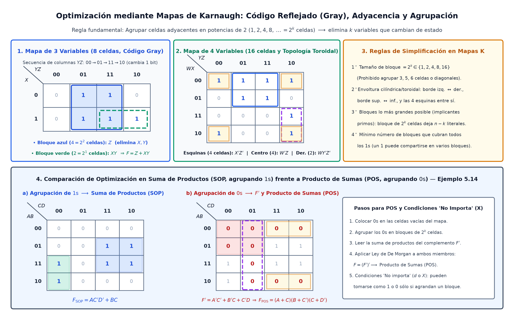

# 4.2 Optimización de expresiones booleanas

## Introducción: ¿Por qué optimizar una expresión booleana?

Cuando se modela un problema práctico de automatización o diseño digital —por ejemplo, el circuito de control de una banda transportadora con sensores de calidad, un sistema de alarma o una unidad aritmética—, la expresión booleana obtenida inicialmente a partir de la tabla de verdad suele contener numerosos términos y variables redundantes (Jiménez Murillo, 2012, Cap. 5.4, p. 182).

Aunque tanto la expresión original como su versión simplificada son **lógicamente equivalentes** (producen exactamente la misma salida para todas las combinaciones posibles de entrada), **optimizar (o minimizar)** la expresión booleana antes de construir el circuito físico tiene ventajas decisivas en ingeniería (Jiménez Murillo, 2012, pp. 182, 185, 209; Johnsonbaugh, 2005, p. 495):
1. **Menor costo económico y de hardware:** Requiere un menor número de compuertas lógicas e integrados electrónicos (menor área de silicio en chips VLSI/FPGA).
2. **Menor número de interconexiones (entradas a compuertas):** Cada literal eliminada es un cable o pin de entrada menos que conectar.
3. **Mayor velocidad de operación:** Al reducir los niveles y compuertas del circuito, disminuye el *retardo de propagación* de los pulsos eléctricos.
4. **Menor consumo de energía y mayor confiabilidad:** Menos componentes disipan menos calor y presentan menor probabilidad de falla física.

Para optimizar expresiones booleanas estudiaremos dos métodos fundamentales y complementarios:
- **Método 1 (Algebraico):** Simplificación mediante los **teoremas y postulados del álgebra de Boole** (y el método algorítmico del consenso de Quine).
- **Método 2 (Gráfico/Tabular):** Simplificación mediante **Mapas de Karnaugh (K-Mapas)** para obtener tanto la **Suma de Productos (SOP)** mínima como el **Producto de Sumas (POS)** mínimo.

---

## 1. Criterios Formales de Simplicidad, Implicantes Primos y Formas Minimales

Antes de aplicar los métodos de simplificación, conviene precisar matemáticamente cuándo una expresión en **Suma de Productos (SOP)** es óptima (Lipschutz & Lipson, 2009, Cap. 15.8–15.9, pp. 372–375):

### 1.1 Productos Fundamentales y Expresiones en Suma de Productos (SOP)
- **Producto fundamental:** Es una sola literal o un producto de dos o más literales donde **ningún par de literales involucra a la misma variable** (por ejemplo, $XZ'$, $XY'Z$, $A'B'CD$ son productos fundamentales, mientras que $XYX'Z = 0$ y $XYZY = XYZ$ deben reducirse primero).
- **Contención entre productos fundamentales:** Un producto fundamental $P_1$ está contenido (incluido) en otro producto fundamental $P_2$ si todas las literales de $P_1$ aparecen en $P_2$. Por la ley de absorción (`10a`), $P_1 + P_2 = P_1$ (por ejemplo, $X'Z + X'YZ = X'Z(1 + Y) = X'Z$).
- **Métricas de costo ($E_L$ y $E_S$) y expresión minimal (Lipschutz & Lipson, 2009, p. 375):**
  Dada una expresión booleana $E$ escrita como suma de productos:
  - Sea **$E_L$** el **número total de literales** en $E$ (contadas con su multiplicidad; mide el número total de entradas a las compuertas `AND`).
  - Sea **$E_S$** el **número de sumandos (términos producto)** en $E$ (mide el número de compuertas `AND` necesarias).
  - Por ejemplo, en $E = XYZ' + X'Y'T + XY'Z'T + X'YZT$, se tiene $E_L = 3 + 3 + 4 + 4 = 14$ literales y $E_S = 4$ sumandos.
  - Dadas dos sumas de productos equivalentes $E$ y $F$, se dice que **$E$ es más simple que $F$** si tiene menos literales y no más sumandos ($E_L < F_L$ y $E_S \le F_S$), o menos sumandos y no más literales ($E_L \le F_L$ y $E_S < F_S$). Una expresión $E$ es **minimal** si no existe ninguna suma de productos equivalente que sea más simple que $E$.

### 1.2 Implicantes Primos
Un producto fundamental $P$ se denomina un **implicante** de una función booleana $E$ si $P + E = E$ (es decir, siempre que $P = 1$, entonces $E = 1$). Se dice que $P$ es un **implicante primo** de $E$ si $P + E = E$, pero ningún producto fundamental más corto (obtenido al eliminar alguna literal de $P$) cumple esa propiedad (Lipschutz & Lipson, 2009, Teorema 15.9, p. 375):

$$\boxed{\text{Teorema 15.9: Toda forma de Suma de Productos minimal de } E \text{ es una suma de implicantes primos de } E.}$$

---

## 2. Simplificación de Expresiones Booleanas mediante Teoremas del Álgebra de Boole

El primer método de optimización consiste en aplicar sucesivamente los teoremas de la **Tabla 5.1** (subtema `4.1`) para reducir el número de variables y términos hasta que ya no sea posible simplificar más (Jiménez Murillo, 2012, Cap. 5.4.1, pp. 182–185).

### 2.1 Estrategias Algebraicas Clave de Simplificación

| Técnica Algebraica | Teorema(s) Asociado(s) | Transformación e Intuición |
| :--- | :---: | :--- |
| **1. Eliminación de paréntesis negados** | **De Morgan (`7a`, `7b`) e Involución** | $(AB)' \to A' + B'$, $\quad (A + B)' \to A'B'$, $\quad (A')' \to A$. |
| **2. Combinación de términos adyacentes** | **Adyacencia (`9a`)** | $AB + AB' = A(B + B') = A(1) = A$. *(Si dos términos sólo difieren en que una variable aparece normal en uno y negada en el otro, esa variable se elimina).* |
| **3. Duplicación idempotente** | **Idempotencia (`3b`)** | Como $X = X + X$, un mismo término puede **duplicarse** para factorizarse simultáneamente con dos grupos distintos: $XYZ + XY'Z + X'YZ = (XYZ + XY'Z) + (XYZ + X'YZ) = XZ + YZ$. |
| **4. Absorción directa** | **Absorción (`10a`, `10b`)** | $A + AB = A$ y $A(A + B) = A$. *(El término pequeño absorbe por completo al término grande que lo contiene).* |
| **5. Absorción condicional (Eliminación de literal redundante)** | **Teoremas `11a`, `11b`, `12a`** | $A + A'B = A + B$ y $CA + CA'B = CA + CB$. *(Cuando se suma un término $A$ con otro que contiene su complemento $A'B$, el factor $A'$ es redundante y se borra).* |
| **6. Eliminación por consenso** | **Teorema del Consenso (`13a`)** | $AB + A'C + BC = AB + A'C$. *(Si aparecen $A$ con $B$ y $A'$ con $C$, el producto cruzado $BC$ es redundante y se elimina).* |

### 2.2 El Método Algebraico del Consenso de Quine (Algoritmos 15.3 y 15.4 de Lipschutz)

Cuando una expresión en suma de productos no presenta factorizaciones evidentes a simple vista, el **Método del Consenso** (Lipschutz & Lipson, 2009, pp. 375–377) permite encontrar de manera sistemática y puramente algebraica todos sus implicantes primos y su forma minimal:

1. **Definición de consenso ($Q$):** Dados dos productos fundamentales $P_1$ y $P_2$ tales que **exactamente una variable** $x_k$ aparece sin complementar en uno y complementada ($x_k'$) en el otro, el **consenso** $Q$ de $P_1$ y $P_2$ es el producto (sin repetir literales) de las literales restantes tras suprimir $x_k$ y $x_k'$. *(Si dos o más variables aparecen opuestas, el consenso es $0$ y no existe).*
2. **Algoritmo 15.3 (Obtención de todos los implicantes primos):**
   - *Paso 1:* Eliminar cualquier término $P_i$ que contenga a otro término más corto $P_j$ (por absorción $P_j + P_i = P_j$).
   - *Paso 2:* Agregar a la suma el consenso $Q$ de cualquier pareja $P_i, P_j$ (por el Lema 15.10: $P_i + P_j + Q = P_i + P_j$), siempre que $Q$ no contenga a ningún término ya presente.
   - *Paso 3:* Repetir los pasos 1 y 2 hasta que no se pueda agregar ningún consenso nuevo ni absorber ningún término. El resultado final es la suma de **todos los implicantes primos** de $E$ (Teorema 15.11).
3. **Algoritmo 15.4 (Eliminación de implicantes primos superfluos):** Se expande cada implicante primo en sus minitérminos y se eliminan aquellos implicantes cuyos minitérminos ya estén totalmente cubiertos por los demás implicantes primos.

---

## 3. Simplificación mediante Mapas de Karnaugh (K-Mapas)

El método del **Mapa de Karnaugh** (también llamado *diagrama de Veitch-Karnaugh*, abreviado **K-Mapa** o **mapa KV**) fue propuesto por **Edward W. Veitch** ($1952$) y perfeccionado por **Maurice Karnaugh** ($1953$) en los Laboratorios Bell (Jiménez Murillo, 2012, Cap. 5.4.2, p. 185).

Un mapa de Karnaugh es una representación gráfica bidimensional de la tabla de verdad de una función booleana de $n$ variables mediante una cuadrícula de:

$$\boxed{\text{Número de casillas (celdas)} = 2^n}$$

donde cada celda representa exactamente un **minitérmino** (o renglón de la tabla de verdad) y contiene el valor de salida de la función ($1$, $0$, o $X$ si es indiferente).

### 3.1 El Código Reflejado (Código Gray) y la Adyacencia Lógica

Dos minitérminos o productos fundamentales son **lógicamente adyacentes** si difieren en el estado de **exactamente una variable** (una aparece sin complementar en uno y complementada en el otro), ya que al sumarlos esa única variable que cambia se elimina: $P \cdot X + P \cdot X' = P(X + X') = P$.

Para lograr que dos minitérminos lógicamente adyacentes queden también en **casillas físicamente contiguas** (horizontal o verticalmente), las filas y columnas de un mapa de Karnaugh de $3$ o más variables **NO se numeran en orden binario ascendente (`00, 01, 10, 11`)**, sino utilizando el **código reflejado o Código Gray**:

$$\mathbf{00 \quad\longrightarrow\quad 01 \quad\longrightarrow\quad 11 \quad\longrightarrow\quad 10}$$

Observe que al pasar de una columna (o fila) a la siguiente —incluyendo el salto del extremo final `10` de vuelta al extremo inicial `00`— **cambia únicamente un bit a la vez**:

| Número de variables ($n$) | Total de celdas ($2^n$) | Distribución estándar de variables (Jiménez Murillo, 2012, pp. 186–192) |
| :---: | :---: | :--- |
| **$n = 2$** ($X, Y$) | $2^2 = 4$ celdas ($2 \times 2$) | Filas: $X \in \{0, 1\}$. Columnas: $Y \in \{0, 1\}$. |
| **$n = 3$** ($X, Y, Z$) | $2^3 = 8$ celdas ($2 \times 4$) | Filas: $X \in \{0, 1\}$. Columnas: $YZ \in \{00, 01, 11, 10\}$. *(Cuando $n$ es impar, se colocan menos filas que columnas y se ordenan las variables alfabéticamente).* |
| **$n = 4$** ($W, X, Y, Z$ o $A, B, C, D$) | $2^4 = 16$ celdas ($4 \times 4$) | Filas: $AB \in \{00, 01, 11, 10\}$. Columnas: $CD \in \{00, 01, 11, 10\}$. |
| **$n = 5$** ($A, B, C, D, E$) | $2^5 = 32$ celdas ($4 \times 8$) | Equivale a **dos mapas de $4$ variables** contiguos separados por una frontera central que actúa como **espejo**: Filas $AB \in \{00, 01, 11, 10\}$ y Columnas $CDE \in \{000, 001, 011, 010 \;\mid\; 110, 111, 101, 100\}$. Cada celda tiene **$5$ celdas adyacentes** (4 en su submapa + 1 celda simétrica respecto al eje central). |
| **$n = 6$** ($A, B, C, D, E, F$) | $2^6 = 64$ celdas ($8 \times 8$) | Se divide en **$4$ submapas de cuatro variables** ($2 \times 2$ submapas) con ejes de simetría (espejo) horizontal y vertical. Cada celda tiene **$6$ celdas adyacentes**. |

### 3.2 Topología Cilíndrica / Toroidal (Celdas Adyacentes en los Extremos y Esquinas)

Como el código reflejado `00, 01, 11, 10` es cíclico (`10` y `00` sólo difieren en el primer bit), los bordes opuestos del mapa de Karnaugh están conectados (Jiménez Murillo, 2012, p. 188; Lipschutz & Lipson, 2009, p. 387):
- **Adyacencia horizontal (cilindro):** La primera columna (`00`) es adyacente a la última columna (`10`).
- **Adyacencia vertical (cilindro):** En mapas de $4$ variables, la primera fila (`00`) es adyacente a la última fila (`10`).
- **Adyacencia de las cuatro esquinas (toro / dona):** Al unir tanto los bordes horizontales como los verticales, la superficie forma un *toro* geométrico, por lo que **las $4$ celdas de las esquinas del mapa de $4$ variables (`0000`, `0010`, `1000`, `1010`) son mutuamente adyacentes y pueden formar un bloque cuadrado de $4$ celdas** (correspondiente al término $B'D'$ o $X'Z'$, como en el Ejemplo 5.6 de Jiménez Murillo).

### 3.3 Reglas de Agrupación y Lectura en Mapas de Karnaugh

Para obtener la expresión booleana óptima a partir de un mapa de Karnaugh de $n$ variables, se siguen estas reglas estrictas (Jiménez Murillo, 2012, pp. 186–191; Lipschutz & Lipson, 2009, pp. 386–388):

1. **Completar términos con variables faltantes antes de vaciar al mapa:**
   Si la expresión original contiene términos a los que les faltan variables (por ejemplo, $W'X'$ o $CD$ en una función de $4$ variables), dicho término representa la unión de todas las celdas donde las variables presentes conservan su valor y las variables faltantes toman todas sus combinaciones posibles (por ejemplo, $A'B'C = A'B'CD' + A'B'CD$ ocupa $2$ celdas; $CD$ ocupa $4$ celdas) (Jiménez Murillo, 2012, Ej. 5.6 y 5.8).
2. **Tamaño de los bloques (potencias de $2$):**
   Sólo se pueden agrupar celdas adyacentes en bloques rectangulares o cuadrados cuya cantidad de celdas sea una **potencia de dos**:
   $$2^k \in \{1,\; 2,\; 4,\; 8,\; 16,\; 32, \dots\}$$
   *(Nunca se pueden formar bloques de $3, 5, 6$ o $7$ celdas, ni agrupar en diagonal ni en forma de «L»).*
3. **Relación entre el tamaño del bloque y el número de variables eliminadas:**
   En un mapa de $n$ variables, un bloque válido de **$2^k$ celdas adyacentes elimina exactamente $k$ variables** (aquellas cuyo valor cambia de $0$ a $1$ dentro del bloque) y **produce un término con $n - k$ literales** (aquellas cuyo valor permanece constante en todas las celdas del bloque):

   | Tamaño del bloque ($2^k$ celdas) | Variables eliminadas ($k$) | Literales restantes en mapa de $3$ variables ($n=3$) | Literales restantes en mapa de $4$ variables ($n=4$) |
   | :---: | :---: | :---: | :---: |
   | **$1 = 2^0$ celda** (aislada) | $0$ variables | $3$ literales (minitérmino) | $4$ literales (minitérmino) |
   | **$2 = 2^1$ celdas** (par) | $1$ variable | $2$ literales | $3$ literales |
   | **$4 = 2^2$ celdas** (cuádruplo $1\times 4$ o $2\times 2$) | $2$ variables | $1$ literal | $2$ literales |
   | **$8 = 2^3$ celdas** (octeto $2\times 4$ o $4\times 2$) | $3$ variables | $0$ literales ($F = 1$) | $1$ literal |
   | **$16 = 2^4$ celdas** (mapa completo) | $4$ variables | — | $0$ literales ($F = 1$) |

4. **Maximizar el tamaño de cada bloque (Implicantes primos):**
   Cada bloque debe hacerse **lo más grande posible** ($2^k$ máximo). Un $1$ ya agrupado puede volver a utilizarse (traslaparse) en otros bloques si eso permite formar bloques más grandes.
5. **Minimizar el número de bloques (Evitar bloques redundantes):**
   Se debe cubrir la totalidad de los $1\text{s}$ del mapa con el **menor número posible de bloques**. Todo bloque elegido en la solución final debe contener **al menos un $1$ exclusivo** que no esté cubierto por ningún otro bloque seleccionado (si todos los $1\text{s}$ de un bloque ya están cubiertos por otros bloques, ese bloque es redundante y no debe incluirse) (Jiménez Murillo, 2012, p. 188).

---

## 4. Obtención de Suma de Productos (SOP), Producto de Sumas (POS) y Condiciones «No Importa»

A partir de un mismo mapa de Karnaugh es posible extraer las dos formas estándar optimizadas (Jiménez Murillo, 2012, Ej. 5.8–5.10 y 5.14, pp. 190–196, 203–204):

### 4.1 Simplificación en Suma de Productos (SOP) — Agrupando los Unos ($1$)
1. Se colocan los **$1\text{s}$** en las celdas correspondientes a la función $F$ y se agrupan en bloques maximales de $2^k$ celdas.
2. En cada bloque se identifican las variables que **no cambian de valor**:
   - Si la variable conserva el valor **$1$**, se escribe **sin complementar** ($A$).
   - Si la variable conserva el valor **$0$**, se escribe **complementada** ($A'$).
3. Se suman lógicamente (`+`) los productos obtenidos de cada bloque para formar $F_{\text{SOP}}$.

### 4.2 Simplificación en Producto de Sumas (POS) — Agrupando los Ceros ($0$)
Como explica Jiménez Murillo (2012, pp. 191, 203–204):
1. En el mismo mapa de Karnaugh, se colocan **$0\text{s}$ en todas las celdas vacías** (aquellas donde la función vale $0$).
2. Se agrupan los **$0\text{s}$** en bloques rectangulares o cuadrados maximales de $2^k$ celdas siguiendo exactamente las mismas reglas de adyacencia que para los unos.
3. Se lee cada bloque de ceros como un producto normal ($1 \to A,\; 0 \to A'$) para obtener la **expresión de la función complemento $F'$** en suma de productos:
   $$F' = P_1 + P_2 + \dots + P_m$$
4. Se complementan ambos miembros de la igualdad y se aplica el **Teorema de De Morgan (`7a` y `7b`)** e involución para obtener directamente $F$ en **Producto de Sumas (POS)**:
   $$F = (F')' = \big(P_1 + P_2 + \dots + P_m\big)' = P_1' \cdot P_2' \cdots P_m'$$
   *(Obsérvese que al aplicar De Morgan a cada bloque de ceros, las variables que en el bloque de ceros valían $0$ quedan sin complementar $A$, y las que valían $1$ quedan complementadas $A'$ dentro de cada factor suma).*

### 4.3 Condiciones de Indiferencia («No importa» / *Don't Care*, $X$ o $d$)
En muchos circuitos digitales prácticos, ciertas combinaciones de entrada **nunca pueden ocurrir físicamente** (por ejemplo, en el código BCD de $4$ bits que representa los dígitos decimales del $0$ al $9$, las combinaciones binarias $1010_2 = 10$ a $1111_2 = 15$ jamás se presentan) o bien su salida no afecta al sistema.
- Estas combinaciones se llaman **condiciones de indiferencia (*don't care*)** y se marcan en el mapa de Karnaugh con una **$X$** (o $d$).
- **Regla de uso:** Al agrupar en el mapa de Karnaugh, cada celda $X$ funciona como un **comodín**: puede tomarse como **$1$** (en SOP) o como **$0$** (en POS) **únicamente si ayuda a formar un bloque más grande ($2^k$)**; las celdas $X$ que no ayuden a agrandar ningún bloque simplemente se ignoran y no es obligatorio cubrirlas.

---

## Ejemplos de Práctica (Resueltos Paso a Paso)

### Ejemplo 4.2.1: Simplificación algebraica paso a paso de una expresión de 4 variables
Simplifique al máximo la siguiente expresión booleana utilizando los teoremas de la Tabla 5.1 e indicando el teorema empleado en cada paso (Jiménez Murillo, 2012, Ej. 5.3, p. 184):
$$F(W, X, Y, Z) = Z'X + XY'Z + X'Z'W$$

**Solución:**
$$\begin{aligned}
F &= Z'X + XY'Z + X'Z'W && \text{(Expresión original: } E_L = 8 \text{ literales, } E_S = 3 \text{ sumandos)} \\
  &= (Z'X + X'Z'W) + XY'Z && \text{(Por 5b y 6b: Conmutatividad y asociatividad)} \\
  &= Z'(X + X'W) + XY'Z && \text{(Por 8a: Factorizando } Z' \text{ en los dos primeros términos)} \\
  &= Z'(X + W) + XY'Z && \text{(Por 11a: Eliminación de redundancia } X + X'W = X + W\text{)} \\
  &= Z'X + Z'W + XY'Z && \text{(Por 8a a la inversa: Propiedad distributiva)} \\
  &= (Z'X + XY'Z) + Z'W && \text{(Por 5b y 6b: Agrupando los términos que contienen a } X\text{)} \\
  &= X(Z' + ZY') + Z'W && \text{(Por 8a: Factorizando } X\text{)} \\
  &= X(Z' + Y') + Z'W && \text{(Por 11a: Eliminación de redundancia } Z' + ZY' = Z' + Y'\text{)} \\
  &= \mathbf{XZ' + XY' + Z'W} && \text{(Por 8a a la inversa: Forma SOP minimal, } E_L = 6,\; E_S = 3\text{)}
\end{aligned}$$
*(Nota: Si se desea minimizar el número total de literales en forma factorizada multinivel, la penúltima línea $F = X(Y' + Z') + WZ'$ tiene sólo $5$ literales).*

---

### Ejemplo 4.2.2: Optimización algebraica y por Mapa de Karnaugh del problema de control de calidad en una embotelladora
Al inicio del Capítulo 5 de Jiménez Murillo (2012, Ej. 5.1, pp. 179–180, 184–185 y Ej. 5.7, p. 189), una industria refresquera utiliza cuatro sensores de calidad ($A, B, C, D$) en su banda transportadora. El actuador $F$ debe retirar automáticamente el envase ($F = 1$) cuando los sensores emiten cualquiera de las cinco combinaciones siguientes:
$$A=0, B=0, C=0, D=1; \quad A=0, B=0, C=1, D=1; \quad A=1, B=0, C=0, D=1; \quad A=1, B=0, C=1, D=1; \quad A=1, B=0, C=1, D=0$$
cuya función booleana original es:
$$F = A'B'C'D + A'B'CD + AB'C'D + AB'CD + AB'CD'$$
a) Simplifique $F$ mediante los **teoremas del álgebra booleana**.  
b) Verifique la simplificación utilizando un **Mapa de Karnaugh de 4 variables** y compare la complejidad antes y después de optimizar.

**Solución:**
- **a) Simplificación algebraica mediante teoremas:**
  $$\begin{aligned}
  F &= (A'B'C'D + A'B'CD) + (AB'C'D + AB'CD) + AB'CD' \\
    &= A'B'D(C' + C) + AB'D(C' + C) + AB'CD' && \text{(Por 8a: Factorizando } A'B'D \text{ y } AB'D\text{)} \\
    &= A'B'D(1) + AB'D(1) + AB'CD' && \text{(Por 4b: } C' + C = 1\text{)} \\
    &= A'B'D + AB'D + AB'CD' && \text{(Por 2a: Identidad } X \cdot 1 = X\text{)} \\
    &= B'D(A' + A) + AB'CD' && \text{(Por 8a: Factorizando } B'D\text{)} \\
    &= B'D + AB'CD' && \text{(Por 4b y 2a: } A' + A = 1\text{)} \\
    &= B'(D + D'AC) && \text{(Por 8a: Factorizando } B'\text{)} \\
    &= B'(D + AC) && \text{(Por 11a: } D + D'(AC) = D + AC\text{)} \\
    &= \mathbf{B'D + AB'C} && \text{(Por 8a a la inversa)}
  \end{aligned}$$

- **b) Simplificación mediante Mapa de Karnaugh de 4 variables:**
  Vaciamos los cinco minitérminos ($0001, 0011, 1001, 1011, 1010$) en el mapa de Karnaugh con filas $AB$ y columnas $CD$ en Código Gray:

  | $AB \setminus CD$ | `00` | `01` | `11` | `10` |
  | :---: | :---: | :---: | :---: | :---: |
  | **`00`** | $0$ | $\mathbf{1}$ | $\mathbf{1}$ | $0$ |
  | **`01`** | $0$ | $0$ | $0$ | $0$ |
  | **`11`** | $0$ | $0$ | $0$ | $0$ |
  | **`10`** | $0$ | $\mathbf{1}$ | $\mathbf{1}$ | $\mathbf{1}$ |

  - **Bloque 1 ($4$ celdas en las esquinas internas de las filas `00` y `10` con las columnas `01` y `11`):** Agrupa las celdas `(00,01), (00,11), (10,01), (10,11)`. En estas $4$ celdas cambian $A$ (de $0$ a $1$) y $C$ (de $0$ a $1$), mientras que permanecen constantes $B = 0$ ($B'$) y $D = 1$ ($D$). Aporta el término **$B'D$**.
  - **Bloque 2 ($2$ celdas en la fila `10`, columnas `11` y `10`):** Agrupa las celdas `(10,11)` y `(10,10)`. Cambia $D$ (de $1$ a $0$) y permanecen constantes $A = 1, B = 0, C = 1$. Aporta el término **$AB'C$**.
  - **Resultado óptimo:**
    $$F = B'D + AB'C \quad (\text{o factorizado: } F = B'(D + AC))$$
  - **Comparación de eficiencia:** La expresión original tenía **$5$ términos de $4$ literales ($20$ literales en total)**; la expresión optimizada tiene únicamente **$2$ términos y $5$ literales** (¡una reducción del $75\%$ en literales!), observándose además que el sensor $B$ siempre debe estar en $0$ ($B'$) para activar la extracción.

---

### Ejemplo 4.2.3: Mapas de Karnaugh de 3 variables e identificación de soluciones mínimas múltiples
Utilice mapas de Karnaugh de $3$ variables para encontrar todos los implicantes primos y la(s) expresión(es) mínima(s) en Suma de Productos de las siguientes funciones (Jiménez Murillo, 2012, Ej. 5.4, p. 186; Lipschutz & Lipson, 2009, Ej. 15.16c, p. 386):
a) $F_1(X, Y, Z) = XY'Z' + XY'Z + XYZ' + X'YZ'$  
b) $F_2(X, Y, Z) = XYZ + XYZ' + X'YZ' + X'Y'Z' + X'Y'Z$

**Solución:**
- **a) Para $F_1 = XY'Z' + XY'Z + XYZ' + X'YZ'$ (celdas `100`, `101`, `110`, `010`):**

  | $X \setminus YZ$ | `00` | `01` | `11` | `10` |
  | :---: | :---: | :---: | :---: | :---: |
  | **`0`** | $0$ | $0$ | $0$ | $\mathbf{1}$ |
  | **`1`** | $\mathbf{1}$ | $\mathbf{1}$ | $0$ | $\mathbf{1}$ |

  - **Bloque 1 (horizontal de $2$ celdas en fila $X=1$, columnas `00` y `01`):** Elimina $Z$ y deja **$XY'$**.
  - **Bloque 2 (vertical de $2$ celdas en columna $YZ=10$, filas $X=0$ y $X=1$):** Elimina $X$ y deja **$YZ'$**.
  - *(Nota: las celdas `(1,00)` y `(1,10)` también son adyacentes por los extremos formando el implicante primo $XZ'$, pero sus dos unos ya quedan cubiertos por los bloques esenciales $XY'$ y $YZ'$).*
  - **Solución mínima única:**
    $$F_1 = XY' + YZ'$$

- **b) Para $F_2 = XYZ + XYZ' + X'YZ' + X'Y'Z' + X'Y'Z$ (celdas `111`, `110`, `010`, `000`, `001`):**

  | $X \setminus YZ$ | `00` | `01` | `11` | `10` |
  | :---: | :---: | :---: | :---: | :---: |
  | **`0`** | $\mathbf{1}$ | $\mathbf{1}$ | $0$ | $\mathbf{1}$ |
  | **`1`** | $0$ | $0$ | $\mathbf{1}$ | $\mathbf{1}$ |

  - **Implicantes primos (bloques de $2$ celdas):**
    1. En fila $X=0$, columnas `00` y `01`: **$X'Y'$** *(esencial, único que cubre la celda `001`)*.
    2. En fila $X=1$, columnas `11` y `10`: **$XY$** *(esencial, único que cubre la celda `111`)*.
    3. Queda por cubrir el $1$ de la celda `(0, 10)` ($X'YZ'$), el cual puede agruparse de **dos maneras igualmente óptimas**:
       - En vertical con `(1, 10)` formando el bloque **$YZ'$**, o bien
       - En horizontal por los extremos con `(0, 00)` formando el bloque **$X'Z'$**.
  - **Dos soluciones mínimas equivalentes:**
    $$F_2 = X'Y' + XY + YZ' \qquad \text{o bien} \qquad F_2 = X'Y' + XY + X'Z'$$

---

### Ejemplo 4.2.4: Mapa de Karnaugh de 4 variables con términos incompletos y agrupación de las 4 esquinas
Simplifique mediante mapa de Karnaugh la siguiente expresión booleana de $4$ variables (Jiménez Murillo, 2012, Ej. 5.6, pp. 188–189):
$$F(W, X, Y, Z) = W'X' + W'XY'Z + W'XYZ + WXY'Z' + WX'Y'Z' + WX'YZ'$$

**Solución:**
1. **Expansión del término incompleto $W'X'$:**
   Al término $W'X'$ le faltan las variables $Y$ y $Z$, por lo que ocupa las $4$ celdas de toda la fila $WX = 00$:
   $$W'X' = W'X'Y'Z' + W'X'Y'Z + W'X'YZ + W'X'YZ'$$
2. **Construcción del Mapa de Karnaugh ($4 \times 4$):**

   | $WX \setminus YZ$ | `00` | `01` | `11` | `10` |
   | :---: | :---: | :---: | :---: | :---: |
   | **`00`** | $\mathbf{1}$ | $\mathbf{1}$ | $\mathbf{1}$ | $\mathbf{1}$ |
   | **`01`** | $0$ | $\mathbf{1}$ | $\mathbf{1}$ | $0$ |
   | **`11`** | $\mathbf{1}$ | $0$ | $0$ | $0$ |
   | **`10`** | $\mathbf{1}$ | $0$ | $0$ | $\mathbf{1}$ |

3. **Agrupación óptima de bloques:**
   - **Bloque 1 (Las $4$ esquinas del mapa: `(00,00)`, `(00,10)`, `(10,00)`, `(10,10)`):** Es el único bloque de $4$ celdas que cubre el $1$ de `(10,10)`. En las cuatro esquinas cambian $W$ y $Y$, y se mantienen constantes $X = 0$ ($X'$) y $Z = 0$ ($Z'$). Aporta el término **$X'Z'$**.
   - **Bloque 2 (Cuadrado central de $4$ celdas: filas `00` y `01` con columnas `01` y `11`):** Cubre los unos de `(01,01)` y `(01,11)`. Cambian $X$ y $Y$, y se mantienen constantes $W = 0$ ($W'$) y $Z = 1$ ($Z$). Aporta el término **$W'Z$**.
   - **Bloque 3 (Par vertical de $2$ celdas: filas `11` y `10` en la columna `00`):** Cubre el $1$ exclusivo de `(11,00)`. Cambia $X$ y se mantienen constantes $W = 1, Y = 0, Z = 0$. Aporta el término **$WY'Z'$**.
4. **Expresión booleana simplificada:**
   $$F = X'Z' + W'Z + WY'Z'$$
   *(Observación importante: La fila superior `00` completa valía $W'X'$, pero no necesitamos agregar el bloque $W'X'$ porque sus cuatro unos ya quedaron completamente cubiertos por el bloque de las esquinas $X'Z'$ y el cuadrado $W'Z$).*

---

### Ejemplo 4.2.5: Obtención simultánea de Suma de Productos (SOP) y Producto de Sumas (POS) en un Mapa de Karnaugh
Dada la función booleana de $4$ variables con términos incompletos (Jiménez Murillo, 2012, Ej. 5.8, pp. 190–191):
$$F(A, B, C, D) = A'B'C'D + A'B'C + CD + AB'CD + AB'CD'$$
a) Obtenga la expresión booleana simplificada en **Suma de Productos (SOP)** agrupando los $1\text{s}$.  
b) Obtenga la expresión booleana simplificada en **Producto de Sumas (POS)** agrupando los $0\text{s}$ y aplicando Leyes de De Morgan.

**Solución:**
1. **Expansión de los términos con variables faltantes para poblar el mapa:**
   - $A'B'C = A'B'CD' + A'B'CD$ (fila $AB = 00$, columnas $CD = 10$ y $11$).
   - $CD = A'B'CD + A'BCD + ABCD + AB'CD$ (toda la columna $CD = 11$).
   Con esto, el mapa de Karnaugh de $F$ tiene $1\text{s}$ en `0001`, `0011`, `0010`, `0111`, `1111`, `1011`, `1010` y $0\text{s}$ en las $9$ celdas restantes:

   | $AB \setminus CD$ | `00` | `01` | `11` | `10` |
   | :---: | :---: | :---: | :---: | :---: |
   | **`00`** | $0$ | $\mathbf{1}$ | $\mathbf{1}$ | $\mathbf{1}$ |
   | **`01`** | $0$ | $0$ | $\mathbf{1}$ | $0$ |
   | **`11`** | $0$ | $0$ | $\mathbf{1}$ | $0$ |
   | **`10`** | $0$ | $0$ | $\mathbf{1}$ | $\mathbf{1}$ |

- **a) Simplificación en Suma de Productos (SOP — agrupando los $1\text{s}$):**
  - **Bloque 1 ($4$ celdas en la columna `11` completa):** Elimina $A$ y $B$, aporta **$CD$**.
  - **Bloque 2 ($4$ celdas en las filas extremas `00` y `10` con las columnas `11` y `10`):** Elimina $A$ y $D$, aporta **$B'C$**.
  - **Bloque 3 ($2$ celdas en la fila `00`, columnas `01` y `11`):** Cubre el $1$ de `(00,01)`, elimina $C$ y aporta **$A'B'D$**.
  $$\boxed{F_{\text{SOP}} = B'C + CD + A'B'D}$$

- **b) Simplificación en Producto de Sumas (POS — agrupando los $0\text{s}$):**
  Agrupamos las $9$ celdas con **$0$** en cuatro bloques de $4$ celdas cada uno:
  - **Bloque $a$ ($4$ celdas en toda la columna `00`):** Lee **$C'D'$**.
  - **Bloque $b$ ($4$ celdas en las filas `01` y `11` con las columnas `00` y `10`):** Lee **$BD'$**.
  - **Bloque $c$ ($4$ celdas en las filas `01` y `11` con las columnas `00` y `01`):** Lee **$BC'$**.
  - **Bloque $d$ ($4$ celdas en las filas `11` y `10` con las columnas `00` y `01`):** Lee **$AC'$**.
  Sumando los cuatro bloques de ceros obtenemos la función complemento $F'$:
  $$F' = C'D' + BD' + BC' + AC'$$
  Complementando ambos miembros y aplicando las Leyes de De Morgan (`7a` y `7b`):
  $$(F')' = \big(C'D' + BD' + BC' + AC'\big)'$$
  $$\boxed{F_{\text{POS}} = (C + D)(B' + D)(B' + C)(A' + C)}$$

---

### Ejemplo 4.2.6: Aplicación del Método del Consenso de Quine (Algoritmos 15.3 y 15.4)
Utilice el **Método del Consenso** (Lipschutz & Lipson, 2009, Ej. 15.8 y 15.9, pp. 376–377) para hallar algebraicamente todos los implicantes primos y la suma de productos minimal de la expresión:
$$E(x, y, z) = xyz + x'z' + xyz' + x'y'z + x'yz'$$

**Solución:**
1. **Aplicación del Algoritmo 15.3 (Obtención de implicantes primos por consenso y absorción):**
   - *Absorción inicial:* El término $x'yz'$ contiene al término más corto $x'z'$, por lo que se absorbe ($x'z' + x'yz' = x'z'$):
     $$E = xyz + x'z' + xyz' + x'y'z$$
   - *Consenso de $xyz$ y $xyz'$ (difieren sólo en $z / z'$):* Su consenso es **$xy$**. Al sumarlo, $xy$ absorbe tanto a $xyz$ como a $xyz'$:
     $$E = x'z' + x'y'z + xy$$
   - *Consenso de $x'z'$ y $x'y'z$ (difieren sólo en $z' / z$):* Su consenso es **$x'y'$**. Al sumarlo, $x'y'$ absorbe a $x'y'z$:
     $$E = x'z' + xy + x'y'$$
   - *Consenso de $x'z'$ y $xy$ (difieren sólo en $x' / x$):* Su consenso es **$yz'$**. Lo sumamos a la expresión:
     $$E = x'z' + xy + x'y' + yz'$$
   - *(El consenso de $x'y'$ y $yz'$ es $x'z'$, que ya está presente; y el de $xy$ con $yz'$ no existe).* Por tanto, los **cuatro implicantes primos** de $E$ son: **$x'z'$, $xy$, $x'y'$ y $yz'$**.

2. **Aplicación del Algoritmo 15.4 (Eliminación de implicantes primos superfluos):**
   Expandimos cada implicante primo en sus minitérminos de $3$ variables:
   - $x'z' = x'z'(y + y') = x'yz' + x'y'z'$
   - $xy = xy(z + z') = xyz + xyz'$
   - $x'y' = x'y'(z + z') = x'y'z + x'y'z'$
   - $yz' = yz'(x + x') = xyz' + x'yz'$
   Observamos que los dos minitérminos de $x'z'$ ($x'yz'$ y $x'y'z'$) ya aparecen cubiertos por $yz'$ y $x'y'$, respectivamente. Por lo tanto, el implicante primo $x'z'$ es **superfluo (redundante)** y se elimina, obteniéndose la **suma de productos minimal**:
   $$\boxed{E = xy + x'y' + yz'}$$

---

## Ejercicios de Tarea (Práctica en Casa)

> **Instrucciones:** En cada ejercicio muestre tanto el desarrollo algebraico o el mapa de Karnaugh completo con sus agrupaciones claramente identificadas.

1. **Simplificación mediante teoremas y verificación con Mapa de Karnaugh (Jiménez Murillo, Prob. 5.3a y 5.3b, p. 210):**  
   Simplifique cada una de las siguientes expresiones booleanas aplicando paso a paso los teoremas del álgebra booleana y compruebe el resultado mediante un mapa de Karnaugh de $4$ variables:  
   a) $F_1(A, B, C, D) = A'B'D' + A'BD' + A'BD + ABD$  
   b) $F_2(A, B, C, D) = A'CD + ACD + A'B'D + A'B'C + AB'D + AB'CD'$
   <!--
   Solución del Ejercicio 1:
   - Inciso a): F1 = A'B'D' + A'BD' + A'BD + ABD
     1) Por teoremas:
        Duplicando el término A'BD (por idempotencia 3b: X = X + X):
        F1 = (A'B'D' + A'BD') + (A'BD + ABD)
           = A'D'(B' + B) + BD(A' + A)          (Por 8a: Distributividad)
           = A'D'(1) + BD(1)                    (Por 4b: Complemento)
           = A'D' + BD.                         (Por 2a: Identidad)
        (O bien sin duplicar: F1 = A'D'(B'+B) + BD(A'+A) directamente agrupando los dos primeros y los dos últimos términos).
     2) Por Mapa de Karnaugh (la variable C no aparece, por lo que cada término ocupa 2 celdas con C=0 y C=1):
        - Celdas con 1: fila 00 cols 00, 10 (A'B'D'); fila 01 cols 00, 10 (A'BD'), cols 01, 11 (A'BD); fila 11 cols 01, 11 (ABD).
        - Bloque 1 (4 celdas en filas 00 y 01, columnas 00 y 10): A'D'.
        - Bloque 2 (4 celdas en filas 01 y 11, columnas 01 y 11): BD.
        Resultado verificado: F1 = A'D' + BD.

   - Inciso b): F2 = A'CD + ACD + A'B'D + A'B'C + AB'D + AB'CD'
     1) Por teoremas:
        Agrupamos por parejas:
        - A'CD + ACD = CD(A' + A) = CD(1) = CD.
        - A'B'D + AB'D = B'D(A' + A) = B'D(1) = B'D.
        Sustituyendo en F2:
        F2 = CD + B'D + A'B'C + AB'CD'
        En los dos términos centrales y el último, factorizamos B' en (B'D + AB'CD'):
        B'D + AB'CD' = B'(D + D'AC) = B'(D + AC) = B'D + AB'C (por teorema 11a: D + D'X = D + X).
        Ahora sustituimos esto en F2:
        F2 = CD + B'D + A'B'C + AB'C
           = CD + B'D + B'C(A' + A)
           = CD + B'D + B'C.
        Finalmente, por el Teorema del Consenso (13a), en B'C + CD + B'D no hay variable complementada opuesta, ¡los tres términos son implicantes primos esenciales!
        Resultado óptimo: F2 = CD + B'D + B'C.
     2) Verificación por Mapa de Karnaugh:
        - Celdas con 1: col 11 completa (CD: 0011, 0111, 1111, 1011); filas 00 y 10 con cols 01 y 11 (B'D: 0001, 0011, 1001, 1011); filas 00 y 10 con cols 11 y 10 (B'C: 0011, 0010, 1011, 1010).
        - Se forman exactamente 3 bloques de 4 celdas cada uno: CD, B'D y B'C.
        Resultado: F2 = B'C + B'D + CD.
   -->

2. **Simplificación de expresiones de 4 variables en suma de minitérminos (Jiménez Murillo, Prob. 5.3c y 5.3f, pp. 210–211):**  
   Simplifique usando teoremas del álgebra booleana y verifique con mapas de Karnaugh:  
   a) $F_a = A'B'C'D' + A'B'CD' + A'BC'D + A'BCD + ABC'D' + ABCD' + AB'C'D' + AB'CD'$  
   b) $F_b = A'B'C'D + A'B'CD + A'B'CD' + A'BCD + ABCD' + AB'C'D + AB'CD + AB'CD'$
   <!--
   Solución del Ejercicio 2:
   - Inciso a):
     Agrupando de dos en dos los términos que sólo difieren en C / C':
     Fa = A'B'D'(C' + C) + A'BD(C' + C) + ABD'(C' + C) + AB'D'(C' + C)
        = A'B'D' + A'BD + ABD' + AB'D'
     Agrupando el primero con el cuarto y factorizando B'D':
     A'B'D' + AB'D' = B'D'(A' + A) = B'D'.
     Ahora agrupamos B'D' con ABD':
     B'D' + ABD' = D'(B' + AB) = D'(B' + A) = B'D' + AD' (por teorema 11a).
     Por tanto:
     Fa = A'BD + B'D' + AD'.
     En el Mapa de Karnaugh:
     - Celdas con 1: (00,00), (00,10), (01,01), (01,11), (11,00), (11,10), (10,00), (10,10).
     - Bloque de las 4 esquinas `(00,00), (00,10), (10,00), (10,10)`: B'D'.
     - Bloque de 4 celdas en filas `11` y `10`, cols `00` y `10`: AD'.
     - Bloque de 2 celdas en fila `01`, cols `01` y `11`: A'BD.
     Resultado: Fa = B'D' + AD' + A'BD.

   - Inciso b):
     Agrupando en el mapa de Karnaugh los 8 minitérminos:
     - Fila 00: 0001, 0011, 0010 (cols 01, 11, 10).
     - Fila 01: 0111 (col 11).
     - Fila 11: 1110 (col 10).
     - Fila 10: 1001, 1011, 1010 (cols 01, 11, 10).
     Agrupaciones en el Mapa de Karnaugh:
     1) Bloque de 4 celdas en filas `00` y `10` con cols `01` y `11`: B'D.
     2) Bloque de 4 celdas en filas `00` y `10` con cols `11` y `10`: B'C.
     3) Bloque de 2 celdas en filas `00` y `01` con col `11`: A'CD (cubre 0111).
     4) Bloque de 2 celdas en filas `11` y `10` con col `10`: ACD' (cubre 1110).
     Verificación algebraica:
     Fb = (A'B'C'D + A'B'CD + AB'C'D + AB'CD) + (A'B'CD + A'B'CD' + AB'CD + AB'CD') + (A'B'CD + A'BCD) + (ABCD' + AB'CD')
        = B'D + B'C + A'CD + ACD'.
   -->

3. **Obtención de Suma de Productos (SOP) y Producto de Sumas (POS) en un mapa de 4 variables (Jiménez Murillo, Prob. 5.4c y 5.4d, p. 211):**  
   Dada la función booleana:
   $$F(A, B, C, D) = A'B'C'D' + A'B'CD' + A'BC'D' + A'BCD' + ABC'D' + ABCD + ABCD' + AB'CD + AB'CD'$$
   a) Construya el mapa de Karnaugh de $4$ variables y obtenga la expresión mínima en **Suma de Productos (SOP)**.  
   b) En el mismo mapa agrupe los ceros ($0\text{s}$), determine $F'$ y aplique las Leyes de De Morgan para hallar la expresión mínima en **Producto de Sumas (POS)**.
   <!--
   Solución del Ejercicio 3:
   Vaciamos los 9 minitérminos en el mapa de Karnaugh:
   - Columna 00 (C'D'): tiene 1 en filas 00, 01, 11 (0000, 0100, 1100) y 0 en fila 10 (1000).
   - Columna 01 (C'D): tiene 0 en todas las filas (0001, 0101, 1101, 1001).
   - Columna 11 (CD): tiene 0 en filas 00, 01 (0011, 0111) y 1 en filas 11, 10 (1111, 1011).
   - Columna 10 (CD'): tiene 1 en todas las filas (0010, 0110, 1110, 1010).

   - Inciso a) Suma de Productos (SOP — agrupando los 9 unos):
     1) Toda la columna `10` (4 celdas): CD'.
     2) En filas `00` y `01`, columnas `00` y `10` (4 celdas envolviendo bordes): A'D'.
     3) En filas `01` y `11`, columnas `00` y `10` (4 celdas envolviendo bordes): BD'.
     4) En filas `11` y `10`, columnas `11` y `10` (4 celdas): AC.
     Expresión mínima SOP:
     F_SOP = CD' + A'D' + BD' + AC.

   - Inciso b) Producto de Sumas (POS — agrupando los 7 ceros):
     Las celdas con 0 son: `1000`, y en col `01`: `0001, 0101, 1101, 1001`, y en col `11`: `0011, 0111`.
     Agrupando los ceros:
     1) Toda la columna `01` (4 celdas): C'D.
     2) En filas `00` y `01`, columnas `01` y `11` (4 celdas): A'D.
     3) En fila `10`, columnas `00` y `01` (2 celdas: `1000` y `1001`): AB'C'.
     Por lo tanto, la función complemento es:
     F' = C'D + A'D + AB'C'.
     Aplicando Leyes de De Morgan a ambos miembros:
     F_POS = (F')' = (C + D')(A + D')(A' + B + C).
   -->

4. **Mapa de Karnaugh de 5 variables en SOP y POS (Jiménez Murillo, Prob. 5.5a, p. 211):**  
   Considere el siguiente mapa de Karnaugh de $5$ variables ($A, B, C, D, E$), donde los $1\text{s}$ se encuentran ubicados en las celdas:
   - Fila `AB = 00`: columnas `CDE = 000, 100`
   - Fila `AB = 01`: columnas `CDE = 000, 011, 010, 110, 100`
   - Fila `AB = 11`: columnas `CDE = 000, 011, 010, 110, 100`
   - Fila `AB = 10`: columnas `CDE = 000, 100`
   a) Obtenga la expresión booleana simplificada en **Suma de Productos (SOP)**.  
   b) Obtenga la expresión booleana simplificada en **Producto de Sumas (POS)**.
   <!--
   Solución del Ejercicio 4:
   - Inciso a) Agrupación de 1s (SOP):
     Observemos las posiciones con 1 en ambos submapas (C=0 a la izquierda y C=1 a la derecha):
     1) En las columnas `000` (submapa izq.) y `100` (submapa der.), las 4 filas `00, 01, 11, 10` tienen 1. Eso forma un bloque de 8 celdas (las 4 celdas de la columna `000` reflejadas en espejo con las 4 celdas de la columna `100`). En estas 8 celdas cambian A, B y C, y permanecen constantes D = 0 y E = 0: aporta el término D'E'.
     2) En las filas centrales `AB = 01` y `11` (donde B = 1), tienen 1 las columnas `010` y `110` (4 celdas reflejadas en espejo que junto con `000` y `100` forman un bloque de 8 celdas donde B = 1 y E = 0: aporta BE'), y además en el submapa izquierdo (C = 0) las celdas `011` y `010` en filas `01` y `11` forman un bloque de 4 celdas donde B = 1, C = 0 y D = 1: aporta BC'D.
     Por lo tanto, la expresión mínima en Suma de Productos es:
     F_SOP = D'E' + BE' + BC'D  (o equivalente: D'E' + B D E' + B C' D).

   - Inciso b) Agrupación de 0s (POS):
     Las celdas con 0 son:
     - En todas las filas (00, 01, 11, 10), las columnas `001`, `111` y `101` están completamente llenas de ceros:
       * Las columnas `001` y `101` en las 4 filas forman un bloque de 8 ceros: D'E.
       * Las columnas `111` y `101` en las 4 filas forman un bloque de 8 ceros: CE.
     - Además, en las filas `AB = 00` y `10` (donde B = 0), las columnas `011, 010, 110, 111` están llenas de ceros, formando un bloque de 8 ceros donde B = 0 y D = 1: B'D.
     Por lo tanto, el complemento es:
     F' = D'E + CE + B'D.
     Complementando y aplicando Leyes de De Morgan:
     F_POS = (F')' = (D + E')(C' + E')(B + D').
   -->

5. **Implicantes primos y suma minimal mediante el Método del Consenso (Lipschutz & Lipson, Prob. 15.20 y 15.21, p. 395):**  
   Aplique los Algoritmos 15.3 y 15.4 (Método del Consenso) para encontrar todos los implicantes primos y la suma de productos minimal de cada expresión:  
   a) $E_1(x, y, z) = xy' + xyz' + x'yz'$  
   b) $E_2(x, y, z, t) = xy + y't + x'yz' + xy'zt'$
   <!--
   Solución del Ejercicio 5:
   - Inciso a): E1 = xy' + xyz' + x'yz'
     1) Consenso de xy' y xyz' (difieren en y'/y): es xz'. Al sumarlo, xz' absorbe a xyz':
        E1 = xy' + x'yz' + xz'
     2) Consenso de x'yz' y xz' (difieren en x'/x): es yz'. Al sumarlo, yz' absorbe a x'yz':
        E1 = xy' + xz' + yz'
     Ya no se pueden formar más consensos nuevos (el consenso de xy' y yz' es xz', que ya está).
     - Implicantes primos de E1: {xy', xz', yz'}.
     - Eliminación de superfluos (Algoritmo 15.4):
       * xy' = xy'z + xy'z'
       * xz' = xyz' + xy'z'
       * yz' = xyz' + x'yz'
       Los dos minitérminos de xz' (xyz' y xy'z') ya aparecen en yz' y xy', por lo que xz' es superfluo.
     - Suma minimal: E1 = xy' + yz'.

   - Inciso b): E2 = xy + y't + x'yz' + xy'zt'
     1) Consenso de xy y xy'zt' (difieren en y/y'): es xzt', que absorbe a xy'zt':
        E2 = xy + y't + x'yz' + xzt'
     2) Consenso de xy y x'yz' (difieren en x/x'): es yz', que absorbe a x'yz':
        E2 = xy + y't + xzt' + yz'
     3) Consenso de xy y y't (difieren en y/y'): es xt:
        E2 = xy + y't + xzt' + yz' + xt
     4) Consenso de xzt' y xt (difieren en t'/t): es xz, que absorbe a xzt':
        E2 = xy + y't + yz' + xt + xz
     5) Consenso de y't y yz' (difieren en y'/y): es z't:
        E2 = xy + y't + yz' + xt + xz + z't
     - Los 6 implicantes primos de E2 son: {xy, y't, yz', xt, xz, z't}.
     - Al expandir en minitérminos (o verificar en el K-mapa de 4 variables), los implicantes esenciales que cubren todos los minitérminos de E2 son únicamente y't, xz y yz' (ya que xy, xt y z't quedan cubiertos por ellos).
     - Suma minimal: E2 = y't + xz + yz'.
   -->

6. **Optimización con condiciones «No importa» (*Don't Care*) en un sistema detector BCD:**  
   Se desea diseñar un circuito detector para un dígito decimal codificado en binario de $4$ bits ($A, B, C, D$, donde $A$ es el bit más significativo y el código BCD sólo toma valores del $0 = 0000_2$ al $9 = 1001_2$). La salida $F$ debe ser $1$ cuando el dígito decimal sea **mayor o igual a $5$** ($5, 6, 7, 8, 9$), debe ser $0$ para los dígitos del $0$ al $4$, y las combinaciones binarias del $10$ ($1010_2$) al $15$ ($1111_2$) nunca ocurren, por lo que son **condiciones «No importa» ($X$)**.  
   a) Construya el mapa de Karnaugh de $4$ variables ubicando los $1\text{s}$ ($5\text{–}9$), los $0\text{s}$ ($0\text{–}4$) y las $X$ ($10\text{–}15$).  
   b) Obtenga la expresión mínima en **Suma de Productos (SOP)** aprovechando las celdas $X$ y compárela con la expresión que se obtendría si no se usaran las condiciones $X$.
   <!--
   Solución del Ejercicio 6:
   - a) Ubicación en el Mapa de Karnaugh (filas AB, columnas CD):
        * Ceros (0 a 4): 0000 (0), 0001 (1), 0010 (2), 0011 (3), 0100 (4).
        * Unos (5 a 9): 0101 (5), 0110 (6), 0111 (7), 1000 (8), 1001 (9).
        * Indiferencias X (10 a 15): 1010 (10), 1011 (11), 1100 (12), 1101 (13), 1110 (14), 1111 (15).

        Mapa de Karnaugh resultante:
        - Fila AB = 00:  0   0   0   0
        - Fila AB = 01:  0   1   1   1
        - Fila AB = 11:  X   X   X   X
        - Fila AB = 10:  1   1   X   X

   - b) Agrupación óptima aprovechando las X (SOP):
        1) Bloque de 8 celdas (filas `11` y `10` completas, tomando las 6 celdas X como 1 para cubrir `1000` y `1001`): aporta una sola literal: A.
        2) Bloque de 4 celdas (filas `01` y `11` con columnas `01` y `11`, cubriendo `0101` y `0111`): aporta BD.
        3) Bloque de 4 celdas (filas `01` y `11` con columnas `11` y `10`, cubriendo `0111` y `0110`): aporta BC.
        Expresión mínima con condiciones X:
        F = A + BD + BC = A + B(C + D)   (¡sólo 5 literales!).
        - Comparación sin usar X (tomando 10..15 como 0):
          Habría que formar tres bloques pequeños de 2 celdas: AB'C' (para 8 y 9), A'BD (para 5 y 7) y A'BC (para 6 y 7), dando F_sin_X = AB'C' + A'BD + A'BC (9 literales en vez de 5).
   -->
