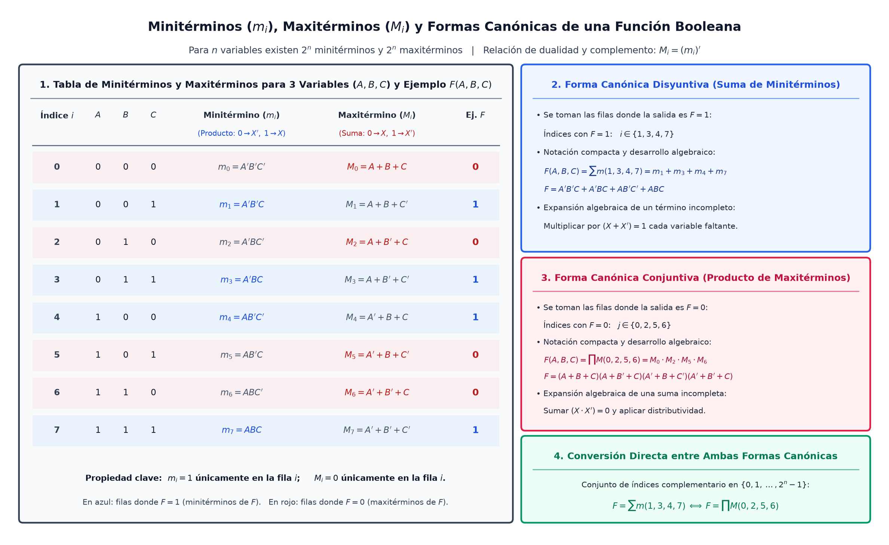
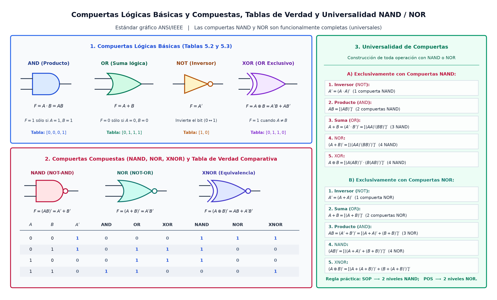
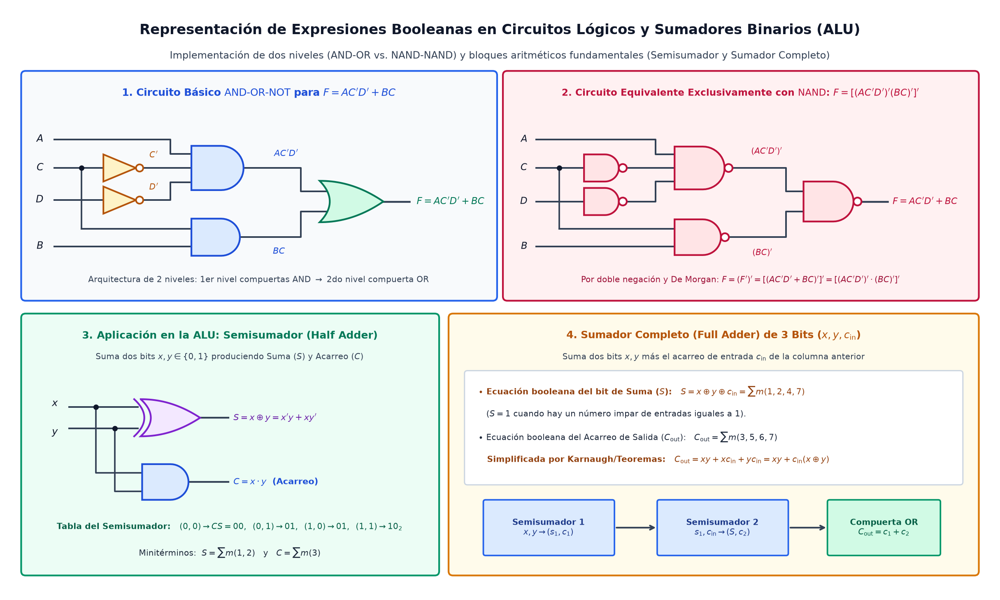

# 4.3 Aplicación del álgebra booleana (Compuertas lógicas)

## Introducción: Del Modelo Matemático al Hardware Digital

El objetivo central del álgebra booleana en las ciencias de la computación y la electrónica digital es transformar especificaciones lógicas o tablas de verdad —provenientes de sensores industriales, protocolos de comunicación o instrucciones de un microprocesador— en **circuitos lógicos físicos** eficientes (Jiménez Murillo, 2012, Cap. 5.2, 5.5 y 5.6; Johnsonbaugh, 2005, Cap. 11.4–11.5; Epp, 2012, Secc. 2.4–2.5).

Este proceso de ingeniería digital consta de dos fases fundamentales que corresponden a los dos subtemas de esta sección:
1. **Síntesis matemática de la función booleana (`4.3.1 Mini y maxi términos`):** A partir de la tabla de verdad de un sistema de $n$ entradas o de una expresión algebraica incompleta, expresar la función de manera única y estandarizada mediante sus **formas canónicas**: la **Suma de Minitérminos** (Forma Canónica Disyuntiva) o el **Producto de Maxitérminos** (Forma Canónica Conjuntiva).
2. **Implementación mediante bloques o compuertas lógicas (`4.3.2 Representación de expresiones`):** Representar y construir la función booleana optimizada utilizando **compuertas lógicas básicas** (`AND`, `OR`, `NOT`, `XOR`) o **compuertas compuestas y universales** (`NAND`, `NOR`, `XNOR`), aplicándolas al diseño de circuitos de control, unidades lógico-aritméticas (**ALU**), sumadores binarios y memorias de computadora.

---

## 4.3.1 Mini y maxi términos

Para que cualquier tabla de verdad de $n$ variables ($x_1, x_2, \dots, x_n$ o $A, B, C, \dots$) pueda traducirse directamente a una expresión algebraica booleana y viceversa, se definen dos bloques constructivos canónicos: los **minitérminos** y los **maxitérminos** (Jiménez Murillo, 2012, pp. 180, 185, 188–191; Lipschutz & Lipson, 2009, Secc. 15.8, p. 374; Johnsonbaugh, 2005, Secc. 11.4, pp. 489–491).

### 1. Minitérminos ($m_i$) y Forma Canónica Disyuntiva (Suma de Minitérminos)

#### Definición de Minitérmino
Dadas $n$ variables booleanas $x_1, x_2, \dots, x_n$, un **minitérmino** (también llamado *mintérmino* o *producto canónico*) es un **producto fundamental en el que aparecen absolutamente todas las $n$ variables**, cada una exactamente una vez, ya sea en forma directa ($x_k$) o complementada ($x_k'$) (Lipschutz & Lipson, 2009, p. 374; Johnsonbaugh, 2005, Def. 11.4.5, p. 489):

$$m_i = y_1 \cdot y_2 \cdots y_n \qquad \text{donde para la fila } i = (a_1 a_2 \dots a_n)_2:\quad y_k = \begin{cases} x_k, & \text{si } a_k = 1, \\ x_k', & \text{si } a_k = 0. \end{cases}$$

- **Regla nemotécnica para un minitérmino ($m_i$):** Se construye como un **producto (`AND`)** donde un bit **$0$ se asocia a la variable complementada ($X'$)** y un bit **$1$ a la variable sin complementar ($X$)**.
- **Propiedad fundamental:** Existen exactamente **$2^n$ minitérminos distintos** ($m_0, m_1, \dots, m_{2^n-1}$). Cada minitérmino $m_i$ toma el valor **$1$ única y exclusivamente en la fila $i$** de la tabla de verdad (cuando $x_1 = a_1, \dots, x_n = a_n$) y vale **$0$ en las $2^n - 1$ filas restantes** (Lipschutz & Lipson, 2009, Ej. 15.13).

#### Teorema de la Forma Canónica Disyuntiva (Suma de Minitérminos)
> **Teorema 15.8 de Lipschutz (p. 374) / Teorema 11.4.6 de Johnsonbaugh (p. 490):**  
> *Toda función booleana $F(x_1, x_2, \dots, x_n)$ que no sea idénticamente cero puede representarse de **manera única** como la suma lógica (`OR`) de los minitérminos correspondientes a los renglones de la tabla de verdad donde $F = 1$.*

Esta representación única recibe los nombres equivalentes de:
- **Suma de Minitérminos (SOM)**
- **Forma Completa de Suma de Productos** (Lipschutz & Lipson, 2009)
- **Forma Normal Disyuntiva (FND) o Forma Canónica Disyuntiva** (Johnsonbaugh, 2005)

Se denota de manera compacta mediante el símbolo de sumatoria $\sum$:

$$\boxed{F(A, B, C, \dots) = \sum m(i_1, i_2, \dots, i_k) = m_{i_1} + m_{i_2} + \dots + m_{i_k} \qquad (\text{índices } i \text{ donde } F = 1)}$$

---

### 2. Maxitérminos ($M_i$) y Forma Canónica Conjuntiva (Producto de Maxitérminos)

#### Definición de Maxitérmino
Por el **Principio de Dualidad**, un **maxitérmino** (o *maxtérmino* o *suma canónica*), denotado por $M_i$, es una **suma lógica (`OR`) en la que aparecen todas las $n$ variables**, cada una exactamente una vez, definida para la fila $i = (a_1 a_2 \dots a_n)_2$ como (Johnsonbaugh, 2005, ec. 11.4.8, p. 491):

$$M_i = y_1 + y_2 + \dots + y_n \qquad \text{donde para la fila } i = (a_1 a_2 \dots a_n)_2:\quad y_k = \begin{cases} x_k, & \text{si } a_k = 0, \\ x_k', & \text{si } a_k = 1. \end{cases}$$

- **Regla nemotécnica para un maxitérmino ($M_i$):** Se construye como una **suma (`OR`)** con la convención **inversa** al minitérmino: un bit **$0$ se asocia a la variable sin complementar ($X$)** y un bit **$1$ a la variable complementada ($X'$)** (para lograr que toda la suma valga $0$ en esa combinación).
- **Relación de De Morgan entre minitérmino y maxitérmino del mismo índice $i$:**
  $$\boxed{M_i = (m_i)' \qquad \text{y} \qquad m_i = (M_i)'}$$
  Por ejemplo, para $n = 3$ en la fila $i = 5$ ($101_2$):
  $$m_5 = AB'C \implies (m_5)' = (AB'C)' = A' + B + C' = M_5$$
- **Propiedad fundamental:** Cada maxitérmino $M_i$ toma el valor **$0$ única y exclusivamente en la fila $i$** de la tabla de verdad y vale **$1$ en las $2^n - 1$ filas restantes**.

#### Forma Canónica Conjuntiva (Producto de Maxitérminos)
Toda función booleana $F(x_1, x_2, \dots, x_n)$ que no sea idénticamente igual a $1$ se expresa de **manera única** como el producto lógico (`AND`) de los maxitérminos correspondientes a los renglones de la tabla de verdad donde **$F = 0$** (Johnsonbaugh, 2005, ec. 11.4.7, p. 491).

Esta representación única se denomina **Producto de Maxitérminos (POM)** o **Forma Normal Conjuntiva (FNC) / Forma Canónica Conjuntiva**, y se denota mediante el símbolo de productoria $\prod$:

$$\boxed{F(A, B, C, \dots) = \prod M(j_1, j_2, \dots, j_r) = M_{j_1} \cdot M_{j_2} \cdots M_{j_r} \qquad (\text{índices } j \text{ donde } F = 0)}$$

---

### 3. Catálogo de Minitérminos y Maxitérminos ($n = 3$) y Conversión entre Formas Canónicas

| Índice decimal ($i$) | Binario ($A B C$) | Minitérmino $m_i$ ($0 \to X',\; 1 \to X$) | Maxitérmino $M_i = (m_i)'$ ($0 \to X,\; 1 \to X'$) |
| :---: | :---: | :---: | :---: |
| **$0$** | `000` | $m_0 = A'B'C'$ | $M_0 = A + B + C$ |
| **$1$** | `001` | $m_1 = A'B'C$ | $M_1 = A + B + C'$ |
| **$2$** | `010` | $m_2 = A'BC'$ | $M_2 = A + B' + C$ |
| **$3$** | `011` | $m_3 = A'BC$ | $M_3 = A + B' + C'$ |
| **$4$** | `100` | $m_4 = AB'C'$ | $M_4 = A' + B + C$ |
| **$5$** | `101` | $m_5 = AB'C$ | $M_5 = A' + B + C'$ |
| **$6$** | `110` | $m_6 = ABC'$ | $M_6 = A' + B' + C$ |
| **$7$** | `111` | $m_7 = ABC$ | $M_7 = A' + B' + C'$ |

*(Para $n = 4$ variables $A, B, C, D$, la tabla se extiende idénticamente desde $m_0 = A'B'C'D'$ y $M_0 = A + B + C + D$ en `0000` hasta $m_{15} = ABCD$ y $M_{15} = A' + B' + C' + D'$ en `1111`).*

#### Regla de Conversión Directa entre $\sum m$ y $\prod M$
Como en cada fila $i \in \{0, 1, \dots, 2^n - 1\}$ de la tabla de verdad la función $F$ vale o bien $1$ o bien $0$, el conjunto de índices de los maxitérminos es exactamente el **complemento conjuntista** del conjunto de índices de los minitérminos respecto a $U = \{0, 1, \dots, 2^n - 1\}$:
- Si $S \subseteq \{0, 1, \dots, 2^n - 1\}$ es el conjunto de índices donde $F = 1$, entonces:
  $$F = \sum_{i \in S} m_i = \prod_{j \notin S} M_j$$
- Y para la función complemento $F'$:
  $$F' = \sum_{j \notin S} m_j = \prod_{i \in S} M_i$$

---

### 4. Algoritmos Algebraicos para Expandir Expresiones Incompletas a su Forma Canónica

Cuando una función booleana viene dada por una expresión algebraica en lugar de una tabla de verdad, se transforma en su forma canónica sin necesidad de construir toda la tabla mediante los siguientes algoritmos (Lipschutz & Lipson, 2009, Algoritmos 15.1 y 15.2, pp. 373–374; Jiménez Murillo, 2012, Ej. 5.6, 5.8 y 5.14c):

#### A) Expansión a Suma de Minitérminos (Algoritmo 15.2 de Lipschutz)
1. Se desarrolla primero la expresión como una suma de productos aplicando Leyes de De Morgan y distributividad (`8a`).
2. Si a algún término producto $P$ le falta una variable $X$, se **multiplica $P$ por el neutro multiplicativo $1 = (X + X')$**:
   $$P = P \cdot 1 = P(X + X') = PX + PX'$$
3. Se repite el paso anterior para todas las variables faltantes y al final se eliminan los minitérminos duplicados usando idempotencia ($m_i + m_i = m_i$).

#### B) Expansión a Producto de Maxitérminos (Dual del Algoritmo 15.2)
1. Se lleva la expresión a un producto de sumas aplicando la ley distributiva de la suma sobre el producto (`8b`: $X + YZ = (X + Y)(X + Z)$).
2. Si a algún factor suma $S$ le falta una variable $X$, se **le suma el neutro aditivo $0 = (X \cdot X')$ y se aplica la distributividad (`8b`)**:
   $$S = S + 0 = S + X \cdot X' = (S + X)(S + X')$$
3. Se repite para cada variable faltante y se eliminan los maxitérminos repetidos ($M_j \cdot M_j = M_j$).

---

## 4.3.2 Representación de expresiones (Compuertas lógicas y Circuitos Combinatorios)

Un **bloque lógico** o **compuerta lógica** (*logic gate*) es la representación simbólica gráfica de un dispositivo físico que recibe una o más señales binarias de entrada ($0$ o $1$) y produce una señal binaria de salida determinada por un operador booleano (Jiménez Murillo, 2012, Cap. 5.5, p. 197; Lipschutz & Lipson, 2009, Secc. 15.10, p. 377; Johnsonbaugh, 2005, Def. 11.5.1, p. 493).
- En **mecánica o neumática** estos bloques corresponden a *válvulas* (paso de aire o aceite); en **electricidad** a *interruptores o relevadores* (paso de corriente); y en **electrónica digital y computación** a **compuertas lógicas** construidas con transistores dentro de circuitos integrados (*chips*).

### 1. Catálogo de Compuertas Lógicas Básicas y Compuestas

De acuerdo con las **Tablas 5.2 y 5.3 de Jiménez Murillo (2012, pp. 197–199)** y Lipschutz & Lipson (2009, pp. 377–380), en electrónica digital existen cuatro compuertas consideradas básicas (`OR`, `AND`, `NOT`, `XOR`) y tres compuertas compuestas (`NOR`, `NAND`, `XNOR`):

| Categoría | Compuerta | Expresión Booleana | Descripción Funcional | Tabla de Verdad `(00, 01, 10, 11)` |
| :---: | :---: | :---: | :--- | :---: |
| **Básica** | **`OR`** *(Suma lógica)* | $F = A + B$ *(o $A \lor B$)* | La salida es **$1$** si **al menos una** entrada es $1$. Sólo vale $0$ cuando todas las entradas son $0$. | `[0, 1, 1, 1]` |
| **Básica** | **`AND`** *(Producto lógico)* | $F = A \cdot B = AB$ *(o $A \land B$)* | La salida es **$1$** única y exclusivamente cuando **todas** las entradas son $1$. | `[0, 0, 0, 1]` |
| **Básica** | **`NOT`** *(Inversor)* | $F = A'$ *(o $\neg A, \bar{A}$)* | Recibe **una sola entrada** y produce su complemento ($0 \to 1,\; 1 \to 0$). El pequeño círculo en la punta indica inversión. | Para $A \in (0, 1)$: `[1, 0]` |
| **Básica / Especial** | **`XOR`** *(OR Exclusivo)* | $F = A \oplus B$ $= AB' + A'B$ | Detector de desigualdad (o paridad impar): la salida es **$1$** cuando las entradas son **diferentes** ($A \neq B$). | `[0, 1, 1, 0]` |
| **Compuesta (Universal)** | **`NAND`** *(NOT-AND)* | $F = (AB)'$ $= A' + B'$ *(Barra de Sheffer $A \uparrow B$)* | Equivale a una compuerta `AND` seguida de un inversor `NOT`. Su salida es **$0$ sólo si todas las entradas son $1$**. | `[1, 1, 1, 0]` |
| **Compuesta (Universal)** | **`NOR`** *(NOT-OR)* | $F = (A + B)'$ $= A'B'$ *(Flecha de Peirce $A \downarrow B$)* | Equivale a una compuerta `OR` seguida de un inversor `NOT`. Su salida es **$1$ sólo si todas las entradas son $0$**. | `[1, 0, 0, 0]` |
| **Compuesta** | **`XNOR`** *(Equivalencia)* | $F = (A \oplus B)'$ $= AB + A'B'$ | Comparador de igualdad (bicondicional): la salida es **$1$** cuando ambas entradas son **iguales** ($A = B$). | `[1, 0, 0, 1]` |

> **Nota sobre compuertas de múltiples entradas y el círculo de inversión (Lipschutz & Lipson, 2009, pp. 377–380; Jiménez Murillo, 2012, p. 200):**
> - Mientras que la compuerta `NOT` admite estrictamente **una sola señal de entrada**, las compuertas `AND`, `OR`, `NAND` y `NOR` pueden recibir **$2, 3, 4$ o más señales de entrada** simultáneas (por ejemplo, una compuerta `NAND` de $3$ entradas con señales $A, C', D'$ calcula directamente $(AC'D')'$).
> - Cuando a una compuerta `NAND` o `NOR` se le introduce **una sola señal** (o se unen sus entradas entre sí), actúa exactamente como un **inversor `NOT`**: $(A \cdot A)' = A'$ y $(A + A)' = A'$.

---

### 2. Completitud Funcional y Universalidad de las Compuertas `NAND` y `NOR`

En la industria de semiconductores (tecnologías CMOS y TTL), los circuitos digitales reales se fabrican preferentemente utilizando un único tipo de compuerta: **`NAND`** o **`NOR`**, debido a que requieren menos transistores, conmutan más rápido y son más económicas de integrar en un mismo chip (Jiménez Murillo, 2012, p. 199; Johnsonbaugh, 2005, p. 494).

- **Definición de conjunto funcionalmente completo (Johnsonbaugh, 2005, Def. 11.5.3, p. 493):** Un conjunto de compuertas es *funcionalmente completo* si con ellas es posible construir un circuito combinatorio que calcule cualquier función booleana $F: B^n \to B$.
  - El conjunto básico $\{\text{AND}, \text{OR}, \text{NOT}\}$ es funcionalmente completo (por el Teorema de Suma de Minitérminos).
  - Por las Leyes de De Morgan ($A + B = (A'B')'$ y $AB = (A' + B')'$), los subconjuntos $\{\text{AND}, \text{NOT}\}$ y $\{\text{OR}, \text{NOT}\}$ también son funcionalmente completos (Teorema 11.5.5 de Johnsonbaugh). En cambio, $\{\text{AND}, \text{OR}\}$ sin inversor **no** es funcionalmente completo.
  - **Teorema de Universalidad (Teorema 11.5.7 de Johnsonbaugh; Problemas 5.9 y 5.10 de Jiménez Murillo, p. 214):** Tanto el conjunto unitario **$\{\text{NAND}\}$** por sí solo como el conjunto unitario **$\{\text{NOR}\}$** por sí solo son **funcionalmente completos (compuertas universales)**.

#### Tabla de Construcción de todas las Compuertas usando exclusivamente `NAND` o exclusivamente `NOR`

| Operación Objetivo | Construcción exclusivamente con **`NAND`** (Prob. 5.9) | Construcción exclusivamente con **`NOR`** (Prob. 5.10) |
| :--- | :--- | :--- |
| **1. `NOT` ($A'$)** | $A' = (A \cdot A)'$ *(1 compuerta `NAND`)* | $A' = (A + A)'$ *(1 compuerta `NOR`)* |
| **2. `AND` ($AB$)** | $AB = \big[(AB)'\big]'$ *(2 compuertas `NAND`: una `NAND` seguida de un inversor `NAND`)* | $AB = (A' + B')' = \big[(A + A)' + (B + B)'\big]'$ *(3 compuertas `NOR`)* |
| **3. `OR` ($A + B$)** | $A + B = (A' \cdot B')' = \big[(AA)' \cdot (BB)'\big]'$ *(3 compuertas `NAND`)* | $A + B = \big[(A + B)'\big]'$ *(2 compuertas `NOR`: una `NOR` seguida de un inversor `NOR`)* |
| **4. `NOR` ($(A+B)'$)** | $(A + B)' = \Big[\big[(AA)' \cdot (BB)'\big]'\Big]'$ *(4 compuertas `NAND`)* | $(A + B)'$ *(1 compuerta `NOR`)* |
| **5. `NAND` ($(AB)'$)** | $(AB)'$ *(1 compuerta `NAND`)* | $(AB)' = \Big[\big[(A+A)' + (B+B)'\big]'\Big]'$ *(4 compuertas `NOR`)* |
| **6. `XOR` ($A \oplus B$)** | $A \oplus B = (A'B + AB')'' = \big[(A'B)' \cdot (AB')'\big]'$ o con $4$ `NAND`: $\Big[\big(A(AB)'\big)' \cdot \big(B(AB)'\big)'\Big]'$ | $A \oplus B = \Big[\big(A + B'\big)' + \big(A' + B\big)'\Big]'$ o con $5$ `NOR`: $\Big[\big[\big(A+(A+B)'\big)' + \big(B+(A+B)'\big)'\big]'\Big]'$ |
| **7. `XNOR` ($(A\oplus B)'$)** | $(A \oplus B)' = \big[(AB)' \cdot (A'B')'\big]'$ *(5 compuertas `NAND`)* | $(A \oplus B)' = \Big[\big(A + (A+B)'\big)' + \big(B + (A+B)'\big)'\Big]'$ *(4 `NOR`)* |

---

### 3. Metodología de Diseño de Circuitos en Tres Arquitecturas (`AND-OR`, sólo `NAND`, sólo `NOR`)

Como demuestra Jiménez Murillo (2012, Ej. 5.11–5.14, pp. 198–206), cualquier expresión booleana puede implementarse sistemáticamente en tres arquitecturas:

1. **Arquitectura con compuertas básicas (`AND-OR-NOT` o `OR-AND-NOT`):**
   - Si la expresión está en **Suma de Productos (SOP)**, como $F = AC'D' + BC$, se emplea un **circuito `AND-OR`** de dos niveles: en el primer nivel se coloca una compuerta `AND` por cada término producto ($AC'D'$ y $BC$, usando inversores `NOT` para las literales complementadas), y en el segundo nivel las salidas de todas las compuertas `AND` entran a una única compuerta `OR` final (Lipschutz & Lipson, 2009, p. 379).
2. **Arquitectura exclusivamente con compuertas `NAND` (ideal a partir de Suma de Productos, SOP):**
   - Se parte de la expresión en **Suma de Productos**: $F = P_1 + P_2 + \dots + P_k$.
   - Se aplica **doble complementación (involución)** $F = (F')'$ y se aplica la **Ley de De Morgan (`7b`)** únicamente al complemento interior:
     $$F = \big(P_1 + P_2 + \dots + P_k\big)'' = \Big[(P_1)' \cdot (P_2)' \cdots (P_k)'\Big]'$$
   - ¡Observe que toda suma se ha transformado en productos negados (`NAND`)! Esto significa que **basta reemplazar cada compuerta `AND`, cada compuerta `OR` y cada inversor `NOT` de un circuito `AND-OR` de dos niveles por compuertas `NAND`** (Jiménez Murillo, 2012, Ej. 5.12 y 5.14g, pp. 199–200, 206).
3. **Arquitectura exclusivamente con compuertas `NOR` (ideal a partir de Producto de Sumas, POS):**
   - Se parte de la expresión en **Producto de Sumas**: $F = S_1 \cdot S_2 \cdots S_m$.
   - Se aplica **doble complementación** $F = (F')'$ y la **Ley de De Morgan (`7a`)** al complemento interior:
     $$F = \big(S_1 \cdot S_2 \cdots S_m\big)'' = \Big[(S_1)' + (S_2)' + \dots + (S_m)'\Big]'$$
   - Ahora toda multiplicación se ha convertido en sumas negadas (`NOR`), implementándose directamente con dos niveles de compuertas `NOR` (Jiménez Murillo, 2012, Ej. 5.13 y 5.14h, pp. 201, 206).

---

### 4. Aplicaciones en la Computación: Unidad Lógico-Aritmética (ALU), Sumadores, Memorias y Robótica

Como expone Jiménez Murillo (2012, Cap. 5.6, pp. 207–209), Johnsonbaugh (2005, Secc. 11.5, pp. 497–499) y Epp (2012, Secc. 2.5, pp. 78–90), la totalidad del hardware de una computadora digital descansa sobre circuitos combinatorios y secuenciales derivados del álgebra booleana:

#### A) Circuitos Aritméticos en la ALU: Semisumador (*Half Adder*) y Sumador Completo (*Full Adder*)
La **Unidad Lógico-Aritmética (ALU)** del microprocesador realiza tanto las operaciones lógicas bit a bit (`AND`, `OR`, `XOR`, `NOT`) como las operaciones aritméticas binarias mediante dos circuitos combinatorios de salidas múltiples:

1. **Semisumador (*Half Adder*):**
   Suma dos bits individuales de entrada $x, y \in \{0, 1\}$ (la columna menos significativa de una suma binaria, donde no hay acarreo previo) y produce dos bits de salida: el bit de **Suma ($S$)** y el bit de **Acarreo de salida ($C$, *carry*)** tales que $(CS)_2 = x + y$:

   | $x$ | $y$ | Acarreo $C$ | Suma $S$ | Ecuaciones Booleanas Canónicas y Simplificadas |
   | :---: | :---: | :---: | :---: | :--- |
   | $0$ | $0$ | $0$ | $0$ | **Bit de Suma ($S$):** $\quad S = x'y + xy' = x \oplus y = \sum m(1, 2)$ *(1 compuerta `XOR`)* |
   | $0$ | $1$ | $0$ | $1$ | **Bit de Acarreo ($C$):** $\quad C = x \cdot y = \sum m(3)$ *(1 compuerta `AND`)* |
   | $1$ | $0$ | $0$ | $1$ | *(Si no se dispone de `XOR`, se implementa como $S = (x + y)(xy)'$ con 4 compuertas básicas).* |
   | $1$ | $1$ | $1$ | $0$ | |

2. **Sumador Completo (*Full Adder*):**
   Suma **tres bits de entrada**: dos bits de datos $x, y$ y un tercer bit **$z = c_{\text{in}}$** (el acarreo de entrada procedente de la columna anterior), produciendo la suma binaria de dos bits $(C_{\text{out}}S)_2 = x + y + c_{\text{in}}$ (desde $0+0+0 = 00_2$ hasta $1+1+1 = 11_2 = 3_{10}$):
   - **Ecuación del bit de Suma ($S$):** Vale $1$ cuando hay $1$ o $3$ entradas iguales a $1$ (minitérminos $1, 2, 4, 7$):
     $$S(x, y, c_{\text{in}}) = \sum m(1, 2, 4, 7) = x'y'c_{\text{in}} + x'yc_{\text{in}}' + xy'c_{\text{in}}' + xyc_{\text{in}} = \mathbf{x \oplus y \oplus c_{\text{in}}}$$
   - **Ecuación del bit de Acarreo de salida ($C_{\text{out}}$):** Vale $1$ cuando al menos **dos** de las tres entradas son $1$ (función de mayoría, minitérminos $3, 5, 6, 7$):
     $$C_{\text{out}}(x, y, c_{\text{in}}) = \sum m(3, 5, 6, 7) = x'yc_{\text{in}} + xy'c_{\text{in}} + xyc_{\text{in}}' + xyc_{\text{in}}$$
     Simplificando por mapa de Karnaugh o teoremas:
     $$\boxed{C_{\text{out}} = xy + xc_{\text{in}} + yc_{\text{in}} = xy + c_{\text{in}}(x \oplus y) \quad \big(\text{o bien } xy + c_{\text{in}}(x + y)\big)}$$
   - **Sumador binario en cascada de $n$ bits (*Ripple-Carry Adder*):** Conectando $1$ semisumador para el bit menos significativo ($x_1 + y_1 \to z_1$, con acarreo $c_1$) seguido de $n - 1$ sumadores completos en serie, la ALU suma dos números binarios de $n$ bits y utiliza el último bit de acarreo como bandera de desbordamiento (*overflow*) (Johnsonbaugh, 2005, Ej. 11.5.15, p. 499).

#### B) Memorias de Computadora (`ROM`, `EEPROM`, `SRAM`, `DRAM`) y Robótica Mecatrónica
- **Memorias `ROM` y `EEPROM` (BIOS/UEFI):** Almacenan el firmware de arranque en código binario manipulando matrices de compuertas lógicas grabables y borrables eléctricamente (Jiménez Murillo, 2012, pp. 207–208).
- **Memorias `SRAM` y `DRAM`:** La memoria estática (`SRAM`, usada en la memoria caché del procesador) almacena cada bit en un pestillo biestable (*flip-flop*) construido con compuertas `NAND` o `NOR` acopladas que mantienen el dato mientras exista energía; la memoria dinámica (`DRAM`) almacena cada bit como carga en un condensador controlado por transistores.
- **Robótica y automatización mecatrónica:** El «cerebro» o controlador de un robot recibe señales binarias ($0$/$1$) de sensores ópticos, magnéticos, ultrasónicos, térmicos o de nivel, las evalúa en un circuito combinatorio optimizado por álgebra booleana y activa motores eléctricos, pistones o tenazas (Jiménez Murillo, 2012, pp. 208–209).

---

## Ejemplos de Práctica (Resueltos Paso a Paso)

### Ejemplo 4.3.1: Obtención de las Formas Canónicas Disyuntiva (Minitérminos) y Conjuntiva (Maxitérminos) desde una Tabla de Verdad
Considere un circuito detector de mayoría de $3$ entradas ($A, B, C$) cuya salida $F$ es $1$ si y sólo si **dos o tres** de sus entradas son iguales a $1$ (Johnsonbaugh, 2005, Ejerc. 11.5.25, p. 500):
a) Construya la tabla de verdad indicando cada minitérmino $m_i$ y cada maxitérmino $M_i$.  
b) Exprese $F(A, B, C)$ en su **Forma Canónica Disyuntiva (Suma de Minitérminos)** tanto en notación compacta $\sum m$ como algebraica.  
c) Exprese $F(A, B, C)$ en su **Forma Canónica Conjuntiva (Producto de Maxitérminos)** tanto en notación compacta $\prod M$ como algebraica.

**Solución:**
- **a) Tabla de verdad:**
  Las combinaciones que tienen dos o tres unos son las filas $3$ (`011`), $5$ (`101`), $6$ (`110`) y $7$ (`111`), donde $F = 1$. En las filas $0$ (`000`), $1$ (`001`), $2$ (`010`) y $4$ (`100`) hay menos de dos unos, por lo que $F = 0$.

- **b) Forma Canónica Disyuntiva (Suma de Minitérminos — filas donde $F = 1$):**
  $$F(A, B, C) = \sum m(3, 5, 6, 7) = m_3 + m_5 + m_6 + m_7$$
  Sustituyendo cada minitérmino ($0 \to X',\; 1 \to X$):
  $$\boxed{F(A, B, C) = A'BC + AB'C + ABC' + ABC}$$

- **c) Forma Canónica Conjuntiva (Producto de Maxitérminos — filas donde $F = 0$):**
  $$F(A, B, C) = \prod M(0, 1, 2, 4) = M_0 \cdot M_1 \cdot M_2 \cdot M_4$$
  Sustituyendo cada maxitérmino ($0 \to X,\; 1 \to X'$):
  $$\boxed{F(A, B, C) = (A + B + C)(A + B + C')(A + B' + C)(A' + B + C)}$$

---

### Ejemplo 4.3.2: Expansión algebraica de una expresión a sus Formas Canónicas Completa de Minitérminos y de Maxitérminos
Sea la expresión booleana de tres variables (Lipschutz & Lipson, 2009, Ej. 15.6, p. 374):
$$E(x, y, z) = x(y'z)'$$
a) Utilice los Algoritmos 15.1 y 15.2 para transformar algebraicamente $E(x, y, z)$ en su **forma completa de suma de productos (Suma de Minitérminos)**.  
b) Deduzca a partir del inciso (a) su **Producto de Maxitérminos** $\prod M$.

**Solución:**
- **a) Expansión algebraica a Suma de Minitérminos:**
  1. *Paso 1 (De Morgan y distributividad — Algoritmo 15.1):*
     $$E(x, y, z) = x(y'z)' = x\big((y')' + z'\big) = x(y + z') = xy + xz'$$
  2. *Paso 2 (Inclusión de variables faltantes — Algoritmo 15.2):*
     Al primer término $xy$ le falta $z$, por lo que multiplicamos por $(z + z') = 1$; al segundo término $xz'$ le falta $y$, por lo que multiplicamos por $(y + y') = 1$:
     $$\begin{aligned}
     E(x, y, z) &= xy(z + z') + xz'(y + y') \\
                &= xyz + xyz' + xyz' + xy'z' && \text{(Distributividad)} \\
                &= \mathbf{xyz + xyz' + xy'z'} && \text{(Por idempotencia } xyz' + xyz' = xyz'\text{)}
     \end{aligned}$$
     Identificando los índices binarios de cada minitérmino ($xy'z' \to 100_2 = 4$, $xyz' \to 110_2 = 6$, $xyz \to 111_2 = 7$):
     $$E(x, y, z) = m_4 + m_6 + m_7 = \sum m(4, 6, 7)$$

- **b) Obtención del Producto de Maxitérminos:**
  Los índices de $\{0, 1, 2, 3, 4, 5, 6, 7\}$ que no pertenecen a $\{4, 6, 7\}$ son $\{0, 1, 2, 3, 5\}$. Por lo tanto:
  $$E(x, y, z) = \prod M(0, 1, 2, 3, 5) = (x+y+z)(x+y+z')(x+y'+z)(x+y'+z')(x'+y+z')$$
  *(Observación: los primeros cuatro maxitérminos tienen en común a $x$, pues $x = (x+y+z)(x+y+z')(x+y'+z)(x+y'+z')$, y el quinto es $M_5 = x'+y+z'$, verificando que $x(x'+y+z') = x(y+z')$).*

---

### Ejemplo 4.3.3: Representación de expresiones booleanas con compuertas básicas, sólo `NAND` y sólo `NOR`
Dadas las siguientes expresiones booleanas (Jiménez Murillo, 2012, Ej. 5.11, 5.12 y 5.13, pp. 198–201):
1. $F_1 = A(B + C') + A'D$
2. $F_2 = (A + B' + C)(B + C' + D)$

a) Transforme algebraicamente $F_1$ para implementarla **exclusivamente con compuertas `NAND`** e indique la estructura de cada nivel del circuito.  
b) Transforme algebraicamente $F_2$ para implementarla **exclusivamente con compuertas `NOR`** y también **exclusivamente con compuertas `NAND`**.

**Solución:**
- **a) Implementación de $F_1 = A(B + C') + A'D$ sólo con compuertas `NAND` (Jiménez Murillo, Ej. 5.12, pp. 199–200):**
  1. Primero llevamos $F_1$ a **Suma de Productos (SOP)** aplicando la propiedad distributiva:
     $$F_1 = AB + AC' + A'D$$
  2. Aplicamos doble complementación $F_1 = (F_1')'$ y aplicamos la Ley de De Morgan al complemento interior:
     $$F_1 = \big(AB + AC' + A'D\big)'' = \Big[\big(AB\big)' \cdot \big(AC'\big)' \cdot \big(A'D\big)'\Big]'$$
  3. **Estructura del circuito `NAND`:**
     - *Inversores de entrada:* $2$ compuertas `NAND` de $1$ entrada para generar $A' = (AA)'$ y $C' = (CC)'$.
     - *Primer nivel:* $3$ compuertas `NAND` de $2$ entradas que calculan $N_1 = (AB)'$, $N_2 = (AC')'$ y $N_3 = (A'D)'$.
     - *Segundo nivel (salida):* $1$ compuerta `NAND` de $3$ entradas que recibe $N_1, N_2, N_3$ y produce $F_1 = (N_1 \cdot N_2 \cdot N_3)' = AB + AC' + A'D$.

- **b) Implementación de $F_2 = (A + B' + C)(B + C' + D)$ con `NOR` y con `NAND` (Jiménez Murillo, Ej. 5.13, p. 201):**
  - **Exclusivamente con compuertas `NOR`:** Como $F_2$ ya está en **Producto de Sumas (POS)**, aplicamos doble negación y la Ley de De Morgan al producto interior:
    $$F_2 = \Big[\big(A + B' + C\big) \cdot \big(B + C' + D\big)\Big]'' = \Big[\big(A + B' + C\big)' + \big(B + C' + D\big)'\Big]'$$
    Se implementa directamente con $2$ compuertas `NOR` de $1$ entrada (para $B'$ y $C'$), $2$ compuertas `NOR` de $3$ entradas en el primer nivel —que calculan $R_1 = (A + B' + C)'$ y $R_2 = (B + C' + D)'$— y $1$ compuerta `NOR` de $2$ entradas en la salida que calcula $(R_1 + R_2)' = F_2$.
  - **Exclusivamente con compuertas `NAND`:** Como el producto final es una operación `AND` entre dos factores $S_1 = (A + B' + C)$ y $S_2 = (B + C' + D)$, por De Morgan cada suma se expresa como una `NAND` de sus literales negadas:
    $$S_1 = A + B' + C = \big(A' \cdot B \cdot C'\big)' \qquad \text{y} \qquad S_2 = B + C' + D = \big(B' \cdot C \cdot D'\big)'$$
    Y el producto $F_2 = S_1 \cdot S_2$ se obtiene con una `NAND` seguida de un inversor `NAND`:
    $$F_2 = \Big[\big(S_1 \cdot S_2\big)'\Big]' = \Big[\Big(\big(A'BC'\big)' \cdot \big(B'CD'\big)'\Big)'\Big]'$$

---

### Ejemplo 4.3.4: Problema integrador completo de análisis, optimización y rediseño de un circuito lógico
Considere un circuito combinatorio cuya estructura de compuertas entrega a la salida la siguiente expresión booleana sin simplificar (Jiménez Murillo, 2012, Ej. 5.14, pp. 202–206):
$$F(A, B, C, D) = AC'(C + D') + BC(A' + B)$$
Realice el análisis e ingeniería completa del circuito:
a) Simplifique $F$ mediante los **teoremas del álgebra booleana**.  
b) Verifique la simplificación mediante un **Mapa de Karnaugh** obteniendo la **Suma de Productos (SOP)** mínima.  
c) A partir del mismo mapa de Karnaugh, agrupe los ceros para obtener el **Producto de Sumas (POS)** mínimo.  
d) Compruebe mediante una **tabla de verdad** que las expresiones SOP y POS son lógicamente equivalentes.  
e) Deduzca las expresiones estructuradas para implementar el circuito óptimo en tres versiones: (i) con compuertas básicas (`AND-OR-NOT`), (ii) exclusivamente con compuertas `NAND`, y (iii) exclusivamente con compuertas `NOR`.

**Solución:**
- **a) Simplificación por teoremas del álgebra booleana:**
  $$\begin{aligned}
  F &= AC'C + AC'D' + A'BC + BBC && \text{(Por 8a: Propiedad distributiva)} \\
    &= A(0) + AC'D' + A'BC + BC && \text{(Por 4a: } C'C = 0 \text{ y por 3a: } BB = B\text{)} \\
    &= 0 + AC'D' + BC(A' + 1) && \text{(Por 1a: } A \cdot 0 = 0 \text{ y por 8a: factorizando } BC\text{)} \\
    &= \mathbf{AC'D' + BC} && \text{(Por 1b y 2a: } A' + 1 = 1,\; BC(1) = BC\text{)}
  \end{aligned}$$

- **b) Obtención de SOP por Mapa de Karnaugh:**
  Expandiendo los términos $AC'D' + A'BC + BC$ en minitérminos de $4$ variables:
  - $AC'D' = AB'C'D' + ABC'D'$ (celdas `1000` y `1100`).
  - $BC = A'BCD' + A'BCD + ABCD' + ABCD$ (celdas `0110`, `0111`, `1110`, `1111`, que ya incluyen a $A'BC$).
  El mapa de Karnaugh tiene exactamente $6$ unos (ver Figura en subtema `4.2`, panel 4a), agrupados en un bloque de $4$ celdas (**$BC$**) y un bloque de $2$ celdas (**$AC'D'$**):
  $$F_{\text{SOP}} = AC'D' + BC$$

- **c) Obtención de POS por Mapa de Karnaugh:**
  Agrupando los $10$ ceros restantes en tres bloques de $4$ celdas (ver Figura en subtema `4.2`, panel 4b):
  - Bloque 1 (filas `00, 01` con columnas `00, 01`): $A'C'$
  - Bloque 2 (filas `00, 10` con columnas `11, 10`): $B'C$
  - Bloque 3 (toda la columna `01`): $C'D$
  Por tanto, $F' = A'C' + B'C + C'D$. Aplicando Leyes de De Morgan:
  $$F_{\text{POS}} = (F')' = (A + C)(B + C')(C + D')$$

- **d) Verificación por Tabla de Verdad ($16$ filas):**

  | $A$ | $B$ | $C$ | $D$ | $AC'D'$ | $BC$ | **$F_{\text{SOP}} = AC'D' + BC$** | $A+C$ | $B+C'$ | $C+D'$ | **$F_{\text{POS}} = (A+C)(B+C')(C+D')$** |
  | :---: | :---: | :---: | :---: | :---: | :---: | :---: | :---: | :---: | :---: | :---: |
  | $0$ | $0$ | $0$ | $0$ | $0$ | $0$ | **$0$** | $0$ | $1$ | $1$ | **$0$** |
  | $0$ | $0$ | $0$ | $1$ | $0$ | $0$ | **$0$** | $0$ | $1$ | $0$ | **$0$** |
  | $0$ | $0$ | $1$ | $0$ | $0$ | $0$ | **$0$** | $1$ | $0$ | $1$ | **$0$** |
  | $0$ | $0$ | $1$ | $1$ | $0$ | $0$ | **$0$** | $1$ | $0$ | $1$ | **$0$** |
  | $0$ | $1$ | $0$ | $0$ | $0$ | $0$ | **$0$** | $0$ | $1$ | $1$ | **$0$** |
  | $0$ | $1$ | $0$ | $1$ | $0$ | $0$ | **$0$** | $0$ | $1$ | $0$ | **$0$** |
  | $0$ | $1$ | $1$ | $0$ | $0$ | $1$ | **$1$** | $1$ | $1$ | $1$ | **$1$** |
  | $0$ | $1$ | $1$ | $1$ | $0$ | $1$ | **$1$** | $1$ | $1$ | $1$ | **$1$** |
  | $1$ | $0$ | $0$ | $0$ | $1$ | $0$ | **$1$** | $1$ | $1$ | $1$ | **$1$** |
  | $1$ | $0$ | $0$ | $1$ | $0$ | $0$ | **$0$** | $1$ | $1$ | $0$ | **$0$** |
  | $1$ | $0$ | $1$ | $0$ | $0$ | $0$ | **$0$** | $1$ | $0$ | $1$ | **$0$** |
  | $1$ | $0$ | $1$ | $1$ | $0$ | $0$ | **$0$** | $1$ | $0$ | $1$ | **$0$** |
  | $1$ | $1$ | $0$ | $0$ | $1$ | $0$ | **$1$** | $1$ | $1$ | $1$ | **$1$** |
  | $1$ | $1$ | $0$ | $1$ | $0$ | $0$ | **$0$** | $1$ | $1$ | $0$ | **$0$** |
  | $1$ | $1$ | $1$ | $0$ | $0$ | $1$ | **$1$** | $1$ | $1$ | $1$ | **$1$** |
  | $1$ | $1$ | $1$ | $1$ | $0$ | $1$ | **$1$** | $1$ | $1$ | $1$ | **$1$** |

  Las columnas de $F_{\text{SOP}}$ y $F_{\text{POS}}$ coinciden en las $16$ filas (valen $1$ exactamente en `0110, 0111, 1000, 1100, 1110, 1111`), quedando demostrada su equivalencia lógica.

- **e) Ecuaciones para las tres arquitecturas de compuertas (ver Figuras 1 y 2 del panel superior):**
  - **(i) Con compuertas básicas (`AND-OR-NOT`):** $F = (A \cdot C' \cdot D') + (B \cdot C)$ ($2$ inversores `NOT`, $2$ compuertas `AND` y $1$ compuerta `OR`).
  - **(ii) Exclusivamente con compuertas `NAND`:**
    $$F = \Big[\big(AC'D'\big)' \cdot \big(BC\big)'\Big]' \qquad (\text{con } C' = (CC)' \text{ y } D' = (DD)')$$
  - **(iii) Exclusivamente con compuertas `NOR` (Jiménez Murillo, p. 206):**
    - A partir de $F_{\text{POS}}$: $F = \Big[(A + C)' + (B + C')' + (C + D')'\Big]'$.
    - O bien a partir de $F_{\text{SOP}}$: como $AC'D' = (A' + C + D)'$ y $BC = (B' + C')'$, se escribe:
      $$F = \Big[\big((A' + C + D)' + (B' + C')'\big)'\Big]'$$

---

### Ejemplo 4.3.5: Evaluación rápida de circuitos mediante secuencias especiales de bits (Algoritmo 15.5)
Utilice el método de las **secuencias especiales de bits** (Lipschutz & Lipson, 2009, Ej. 15.11–15.12 y Prob. 15.31, pp. 382, 398) para obtener la secuencia de salida $T(Y)$ del circuito lógico de $3$ entradas:
$$Y(A, B, C) = A \cdot B \cdot C + A \cdot B' \cdot C + A' \cdot B$$

**Solución:**
1. **Paso 1 (Secuencias especiales de $2^3 = 8$ bits para $A, B, C$ y sus complementos):**
   Corresponden a las columnas de entrada de la tabla de verdad leídas horizontalmente de `000` a `111`:
   $$\begin{aligned}
   A &= 00001111 \quad\implies\quad A' = 11110000 \\
   B &= 00110011 \quad\implies\quad B' = 11001100 \\
   C &= 01010101 \quad\implies\quad C' = 10101010
   \end{aligned}$$
2. **Paso 2 (Cálculo bit a bit de cada producto `AND`):**
   Un bit de un producto es $1$ si y sólo si todas sus secuencias factores tienen $1$ en esa posición:
   - $A \cdot B \cdot C = (00001111) \cdot (00110011) \cdot (01010101) = \mathbf{00000001}$ *(sólo la 8.ª posición)*
   - $A \cdot B' \cdot C = (00001111) \cdot (11001100) \cdot (01010101) = \mathbf{00000100}$ *(sólo la 6.ª posición)*
   - $A' \cdot B = (11110000) \cdot (00110011) = \mathbf{00110000}$ *(posiciones 3.ª y 4.ª)*
3. **Paso 3 (Suma lógica `OR` bit a bit de los productos):**
   $$Y = 00000001 + 00000100 + 00110000 = \mathbf{00110101}$$
   Por lo tanto, la tabla de verdad del circuito es $T(A, B, C; Y) = 00110101$ (vale $1$ en los minitérminos $m_2, m_3, m_5, m_7$).

---

### Ejemplo 4.3.6: Diseño de un sistema automático de seguridad y alarma industrial con sensores
En una planta química se desea diseñar el circuito digital que activa una válvula de emergencia y alarma ($F = 1$) a partir de tres sensores digitales:
- Sensor $A$ (**Presión**): $A = 1$ si la presión supera el límite crítico; $A = 0$ si es normal.
- Sensor $B$ (**Temperatura**): $B = 1$ si la temperatura supera $120\,^\circ\text{C}$; $B = 0$ si es normal.
- Sensor $C$ (**Nivel de refrigerante**): $C = 1$ si el tanque tiene nivel adecuado; **$C = 0$ si el nivel de refrigerante es peligrosamente bajo**.

La alarma $F$ debe activarse ($F = 1$) en cualquiera de las dos situaciones siguientes:
1. La presión o la temperatura superan su límite crítico **y** al mismo tiempo el nivel de refrigerante es bajo ($C = 0$).
2. Tanto la presión como la temperatura superan simultáneamente sus límites críticos, sin importar el nivel de refrigerante.

a) Obtenga la tabla de verdad del sistema, exprese $F(A, B, C)$ en **Suma de Minitérminos** ($\sum m$) y en **Producto de Maxitérminos** ($\prod M$).  
b) Simplifique $F(A, B, C)$ mediante Mapa de Karnaugh o teoremas y escriba su implementación óptima tanto con compuertas básicas como sólo con compuertas `NAND`.

**Solución:**
- **a) Tabla de verdad y Formas Canónicas:**
  Analizando las $8$ combinaciones de $(A, B, C)$:
  - `000`: Presión y temperatura normales ($A=0, B=0$). Aunque $C=0$, no hay sobrepresión ni sobrecalentamiento $\implies F = 0$.
  - `001`: Todo normal $\implies F = 0$.
  - `010`: Alta temperatura ($B=1$) y refrigerante bajo ($C=0$) $\implies \mathbf{F = 1}$ ($m_2$).
  - `011`: Alta temperatura ($B=1$), pero refrigerante normal ($C=1$) y presión normal ($A=0$) $\implies F = 0$.
  - `100`: Alta presión ($A=1$) y refrigerante bajo ($C=0$) $\implies \mathbf{F = 1}$ ($m_4$).
  - `101`: Alta presión ($A=1$), pero refrigerante normal ($C=1$) y temperatura normal ($B=0$) $\implies F = 0$.
  - `110`: Alta presión ($A=1$), alta temperatura ($B=1$) y refrigerante bajo ($C=0$) $\implies \mathbf{F = 1}$ ($m_6$).
  - `111`: Alta presión ($A=1$) y alta temperatura ($B=1$) simultáneas $\implies \mathbf{F = 1}$ ($m_7$).

  - **Suma de Minitérminos:**
    $$F(A, B, C) = \sum m(2, 4, 6, 7) = A'BC' + AB'C' + ABC' + ABC$$
  - **Producto de Maxitérminos:**
    $$F(A, B, C) = \prod M(0, 1, 3, 5) = (A+B+C)(A+B+C')(A+B'+C')(A'+B+C')$$

- **b) Simplificación e implementación con compuertas:**
  Agrupando algebraicamente (o en el mapa de Karnaugh):
  $$\begin{aligned}
  F &= (A'BC' + ABC') + (AB'C' + ABC') + (ABC' + ABC) \\
    &= BC'(A' + A) + AC'(B' + B) + AB(C' + C) \\
    &= \mathbf{BC' + AC' + AB} \qquad \big(\text{o factorizado: } F = C'(A + B) + AB\big)
  \end{aligned}$$
  - **Con compuertas básicas (forma factorizada óptima):** $1$ inversor `NOT` para $C'$, $1$ compuerta `OR` para $(A + B)$, $2$ compuertas `AND` para $C'(A + B)$ y $AB$, y $1$ compuerta `OR` final.
  - **Exclusivamente con compuertas `NAND` (a partir de SOP):**
    $$F = \Big[\big(BC'\big)' \cdot \big(AC'\big)' \cdot \big(AB\big)'\Big]' \qquad \text{con } C' = (CC)'$$

---

## Ejercicios de Tarea (Práctica en Casa)

> **Instrucciones:** Resuelva cada uno de los siguientes problemas mostrando todas las transformaciones algebraicas, tablas de verdad, mapas de Karnaugh y diagramas o ecuaciones de compuertas correspondientes.

1. **Formas Canónicas Disyuntiva y Conjuntiva a partir de expresiones algebraicas (Lipschutz & Lipson, Probs. 15.11–15.13, p. 393; Johnsonbaugh, Ejerc. 11.4.11–11.4.26, pp. 492–493):**  
   Para cada una de las siguientes funciones booleanas de tres variables ($x, y, z$):  
   (i) Exprésela primero como una suma de productos fundamentales.  
   (ii) Expándala algebraicamente a su **Forma Canónica Disyuntiva (Suma de Minitérminos)** indicando también su notación $\sum m(\dots)$.  
   (iii) Deduzca su **Forma Canónica Conjuntiva (Producto de Maxitérminos)** en notación $\prod M(\dots)$ y desarrollada.  
   a) $E_1(x, y, z) = z(x' + y) + y'$  
   b) $E_2(x, y, z) = (x' + y)' + x'y$
   <!--
   Solución del Ejercicio 1:
   - Inciso a): E1(x, y, z) = z(x' + y) + y'
     (i) Suma de productos fundamentales:
         E1 = x'z + yz + y' = x'z + z + y' = z + y'  (o antes de absorber yz+y': x'z + yz + y').
     (ii) Expansión algebraica a Suma de Minitérminos (Algoritmo 15.2):
          Multiplicando cada término por las variables que le faltan:
          - x'z = x'z(y + y') = x'yz + x'y'z   (m3 + m1)
          - yz  = yz(x + x')  = xyz + x'yz     (m7 + m3)
          - y'  = y'(x + x')(z + z') = xy'z + xy'z' + x'y'z + x'y'z'  (m5 + m4 + m1 + m0)
          Eliminando repetidos por idempotencia:
          E1(x, y, z) = x'y'z' + x'y'z + x'yz + xy'z' + xy'z + xyz
                      = m0 + m1 + m3 + m4 + m5 + m7 = \sum m(0, 1, 3, 4, 5, 7).
     (iii) Producto de Maxitérminos (índices faltantes donde E1 = 0: {2, 6}):
           E1(x, y, z) = \prod M(2, 6) = M2 * M6 = (x + y' + z)(x' + y' + z).

   - Inciso b): E2(x, y, z) = (x' + y)' + x'y
     (i) Por Ley de De Morgan e involución: (x' + y)' = x'' y' = xy'.
         Queda la suma de productos: E2 = xy' + x'y (que es x XOR y, independiente de z).
     (ii) Expansión a Suma de Minitérminos en las 3 variables (x, y, z):
          E2 = xy'(z + z') + x'y(z + z')
             = xy'z + xy'z' + x'yz + x'yz'
             = m2 + m3 + m4 + m5 = \sum m(2, 3, 4, 5).
     (iii) Producto de Maxitérminos (índices faltantes donde E2 = 0: {0, 1, 6, 7}):
           E2(x, y, z) = \prod M(0, 1, 6, 7) = M0 * M1 * M6 * M7
                       = (x + y + z)(x + y + z')(x' + y' + z)(x' + y' + z').
   -->

2. **Representación de una función en Suma de Productos con compuertas básicas, sólo `NAND` y sólo `NOR` (Jiménez Murillo, Prob. 5.7, p. 214):**  
   Dada la expresión booleana:
   $$F(A, B, C, D) = AB'C + A'B'D' + AD$$
   a) Diseñe y describa detalladamente (indicando las ecuaciones de salida de cada compuerta nivel por nivel) el circuito lógico usando **compuertas básicas (`AND`, `OR`, `NOT`)**.  
   b) Transforme algebraicamente la expresión y describa el circuito equivalente usando **exclusivamente compuertas `NAND`**.  
   c) Transforme algebraicamente la expresión y describa el circuito equivalente usando **exclusivamente compuertas `NOR`**.
   <!--
   Solución del Ejercicio 2:
   - a) Con compuertas básicas (AND, OR, NOT):
        - Nivel 0 (Inversores NOT): 3 compuertas NOT para obtener A', B' y D'.
        - Nivel 1 (Compuertas AND):
          * Compuerta AND_1 (3 entradas: A, B', C) -> salida P1 = A B' C.
          * Compuerta AND_2 (3 entradas: A', B', D') -> salida P2 = A' B' D'.
          * Compuerta AND_3 (2 entradas: A, D) -> salida P3 = A D.
        - Nivel 2 (Compuerta OR de salida):
          * Compuerta OR (3 entradas: P1, P2, P3) -> salida F = A B' C + A' B' D' + A D.

   - b) Exclusivamente con compuertas NAND:
        Aplicando doble complemento y Ley de De Morgan al complemento interior:
        F = (AB'C + A'B'D' + AD)'' = [ (AB'C)' * (A'B'D')' * (AD)' ]'
        - Nivel 0: 3 compuertas NAND de 1 entrada para obtener A' = (AA)', B' = (BB)', D' = (DD)'.
        - Nivel 1: 3 compuertas NAND (dos de 3 entradas y una de 2 entradas) que producen N1 = (AB'C)', N2 = (A'B'D')' y N3 = (AD)'.
        - Nivel 2: 1 compuerta NAND de 3 entradas que recibe N1, N2, N3 y produce F = (N1 * N2 * N3)'.

   - c) Exclusivamente con compuertas NOR:
        Por De Morgan, cada producto se escribe como una operación NOR de sus literales complementadas:
        - AB'C = (A' + B + C')'
        - A'B'D' = (A + B + D)'
        - AD = (A' + D')'
        Entonces la suma F = AB'C + A'B'D' + AD se escribe con doble negación en la salida como dos compuertas NOR en serie al final:
        F = [ ( (A' + B + C')' + (A + B + D)' + (A' + D')' )' ]'
        - Nivel 0: 3 compuertas NOR de 1 entrada para obtener A' = (A+A)', C' = (C+C)', D' = (D+D')'.
        - Nivel 1: 3 compuertas NOR que calculan R1 = (A' + B + C')', R2 = (A + B + D)' y R3 = (A' + D')'.
        - Nivel 2: 1 compuerta NOR de 3 entradas que calcula R4 = (R1 + R2 + R3)' = F'.
        - Nivel 3: 1 compuerta NOR de 1 entrada (inversor) que calcula F = (R4 + R4)' = (F')'.
   -->

3. **Representación de una función factorizada (Producto de Sumas) con compuertas básicas, sólo `NAND` y sólo `NOR` (Jiménez Murillo, Prob. 5.8, p. 214):**  
   Dada la expresión lógica:
   $$F(A, B, C, D) = (B' + C + D')(A + C' + D)B'$$
   a) Simplifique primero la expresión $F$ mediante los teoremas del álgebra booleana (¡observe qué ocurre al distribuir o absorber el factor exterior $B'$!).  
   b) Implemente tanto la expresión original como la expresión simplificada usando: (i) compuertas básicas (`AND`, `OR`, `NOT`), (ii) exclusivamente compuertas `NOR`, y (iii) exclusivamente compuertas `NAND`.
   <!--
   Solución del Ejercicio 3:
   - a) Simplificación algebraica previa (observación clave):
        En F = [B' + (C + D')] * B' * (A + C' + D), los factores (B' + C + D') y B' cumplen exactamente el Teorema de Absorción 10b: X(X + Y) = X con X = B' y Y = C + D'!
        Por lo tanto:
        (B' + C + D') * B' = B'.
        Así, la expresión se reduce inmediatamente a:
        F = B'(A + C' + D) = AB' + B'C' + B'D.

   - b) Implementaciones en las 3 arquitecturas:
        1) Para la expresión original F = (B' + C + D')(A + C' + D)B':
           - (i) Básicas: 3 inversores NOT (B', C', D'), 2 compuertas OR de 3 entradas para S1 = (B'+C+D') y S2 = (A+C'+D), y 1 compuerta AND de 3 entradas que multiplica S1 * S2 * B'.
           - (ii) Sólo NOR (a partir de POS): Aplicando doble negación y De Morgan al producto:
                  F = [ (B' + C + D')' + (A + C' + D)' + B ]'  (ya que (B')' = B).
                  Requiere 3 compuertas NOR de 1 entrada (para B', C', D'), 2 compuertas NOR de 3 entradas para R1 = (B'+C+D')' y R2 = (A+C'+D)', y 1 compuerta NOR final de 3 entradas con entradas R1, R2 y B: F = (R1 + R2 + B)'.
           - (iii) Sólo NAND: Como S1 = (B C' D)' y S2 = (A' C D')', el producto F = S1 * S2 * B' es una NAND de 3 entradas seguida de un inversor NAND:
                   F = [ ( (BC'D)' * (A'CD')' * B' )' ]'.

        2) Para la expresión simplificada F = B'(A + C' + D) = AB' + B'C' + B'D:
           - (i) Básicas: 2 inversores NOT (B', C'), 1 compuerta OR de 3 entradas (A + C' + D) y 1 compuerta AND de 2 entradas con B'.
           - (ii) Sólo NOR (desde POS: F = B'(A + C' + D)):
                  F = [ (B')' + (A + C' + D)' ]' = [ B + (A + C' + D)' ]' (¡sólo 3 compuertas NOR en total: una para C', una para (A+C'+D)' y una para [B + (A+C'+D)']'!).
           - (iii) Sólo NAND (desde SOP: F = AB' + B'C' + B'D):
                   F = [ (AB')' * (B'C')' * (B'D)' ]'.
   -->

4. **Demostración completa de la Universalidad de las compuertas `NAND` y `NOR` (Jiménez Murillo, Probs. 5.9 y 5.10, p. 214; Johnsonbaugh, Ejerc. 11.5.17–11.5.20, p. 500):**  
   a) Obtenga y demuestre algebraicamente las expresiones para construir las $6$ compuertas `NOT`, `AND`, `OR`, `NOR`, `XOR` y `XNOR` utilizando **exclusivamente compuertas `NAND`**.  
   b) Obtenga y demuestre algebraicamente las expresiones para construir las $6$ compuertas `NOT`, `OR`, `AND`, `NAND`, `XNOR` y `XOR` utilizando **exclusivamente compuertas `NOR`**.
   <!--
   Solución del Ejercicio 4:
   - a) Construcción exclusivamente con compuertas NAND, donde NAND(X, Y) = (X * Y)':
        1) NOT(A): Uniendo las dos entradas de una NAND:
           (A * A)' = A' (por idempotencia 3a: AA = A). [1 NAND]
        2) AND(A, B): Aplicando NOT (con una NAND) a la salida de una NAND(A, B):
           [ (A * B)' * (A * B)' ]' = ((AB)')' = AB (por involución). [2 NAND]
        3) OR(A, B): Por Ley de De Morgan e involución, A + B = (A'' + B'') = (A' * B')':
           Sustituyendo A' = (AA)' y B' = (BB)':
           A + B = [ (A * A)' * (B * B)' ]'. [3 NAND]
        4) NOR(A, B): Invirtiendo la salida de la construcción OR anterior con otra NAND:
           (A + B)' = [ ( (AA)' * (BB)' )' ]'. [4 NAND]
        5) XOR(A, B): Sabemos que A (+) B = AB' + A'B = A(A'+B') + B(A'+B') = A(AB)' + B(AB)'.
           Aplicando doble negación y De Morgan:
           A (+) B = [ ( A * (AB)' )' * ( B * (AB)' )' ]'.
           Sea N1 = (AB)'. Entonces N2 = (A * N1)', N3 = (B * N1)', y la salida es (N2 * N3)'. [4 NAND]
        6) XNOR(A, B): Invirtiendo la salida del XOR anterior con una quinta compuerta NAND:
           (A (+) B)' = [ ( (A(AB)')' * (B(AB)')' )' ]'
           (o bien como (AB + A'B')'' = [ (AB)' * ((AA)'(BB)')' ]'). [5 NAND]

   - b) Construcción exclusivamente con compuertas NOR, donde NOR(X, Y) = (X + Y)':
        1) NOT(A): Uniendo las entradas de una NOR:
           (A + A)' = A' (por idempotencia 3b: A + A = A). [1 NOR]
        2) OR(A, B): Invirtiendo la salida de una NOR(A, B) con otra NOR:
           [ (A + B)' ]' = A + B (por involución). [2 NOR]
        3) AND(A, B): Por Ley de De Morgan, A * B = (A' + B')':
           Sustituyendo A' = (A+A)' y B' = (B+B)':
           A * B = [ (A + A)' + (B + B)' ]'. [3 NOR]
        4) NAND(A, B): Invirtiendo la salida del AND anterior con otra NOR:
           (A * B)' = [ ( (A+A)' + (B+B)' )' ]'. [4 NOR]
        5) XNOR(A, B): Como (A (+) B)' = AB + A'B' = (A' + B)(A + B') = [ (A' + B)' + (A + B')' ]', o usando R1 = (A + B)' = A'B':
           Notemos que (A + R1)' = (A + A'B')' = (A + B')' = A'B, y (B + R1)' = (B + A'B')' = (B + A')' = AB'.
           Al aplicar NOR a ambas salidas:
           [ (A + (A+B)')' + (B + (A+B)')' ]' = (A'B + AB')' = (A (+) B)' = XNOR(A, B). [4 NOR]
        6) XOR(A, B): Invirtiendo la salida del XNOR anterior con una quinta compuerta NOR:
           A (+) B = [ ( (A + (A+B)')' + (B + (A+B)')' )' ]'. [5 NOR]
   -->

5. **Análisis e ingeniería inversa de un circuito lógico completo (Jiménez Murillo, Prob. 5.11, p. 215):**  
   Considere el circuito lógico de la página 215 de Jiménez Murillo (Problema 5.11), en el cual tres ramas alimentan una compuerta `OR` final de salida $F$:
   - La rama superior multiplica en una compuerta `AND` la señal $A'$ con la salida de una compuerta `OR` que suma $B$ y $C'$, es decir: $A'(B + C')$.
   - La rama central proviene de una compuerta `AND` con entradas $A, B, C'$, es decir: $ABC'$.
   - La rama inferior multiplica en una compuerta `AND` la señal $C'$ con $(B' + D)$, es decir: $C'(B' + D)$.
   De modo que la función booleana de salida sin simplificar es:
   $$F(A, B, C, D) = A'(B + C') + ABC' + C'(B' + D)$$
   a) Obtenga la función booleana simplificada en **Suma de Productos (SOP)** usando teoremas y Mapa de Karnaugh.  
   b) Obtenga la función booleana simplificada en **Producto de Sumas (POS)**.  
   c) Elabore la tabla de verdad comprobando que las expresiones de los incisos (a) y (b) son equivalentes a la expresión original.  
   d) Escriba la ecuación estructural del circuito del inciso (a) usando **exclusivamente compuertas `NAND`** y la del inciso (b) usando **exclusivamente compuertas `NOR`**.
   <!--
   Solución del Ejercicio 5:
   - a) Simplificación en Suma de Productos (SOP):
        Desarrollando por propiedad distributiva (8a):
        F = A'B + A'C' + ABC' + B'C' + C'D
        Agrupamos los términos que contienen C':
        A'C' + ABC' + B'C' + C'D = C'(A' + AB + B' + D)
        Pero por el teorema 11a, A' + AB = A' + B; y luego (A' + B) + B' = A' + (B + B') = A' + 1 = 1!
        Por lo tanto:
        C'(A' + AB + B' + D) = C'(1 + D) = C'(1) = C'.
        Sustituyendo en F:
        F = A'B + C'.
        ¡Toda la expresión se simplifica a sólo dos términos y tres literales: F_SOP = A'B + C'!
        - Verificación en el Mapa de Karnaugh:
          * C' cubre las 8 celdas de las columnas `00` y `01` en las 4 filas.
          * A'B cubre las 4 celdas de la fila `01` (columnas `00, 01, 11, 10`).
          Resulta el octeto C' y el cuádruplo A'B: F_SOP = A'B + C'.

   - b) Simplificación en Producto de Sumas (POS):
        Aplicando directamente el postulado distributivo 8b (X + YZ = (X + Y)(X + Z)) a F = C' + A'B:
        F_POS = (C' + A')(C' + B) = (A' + C')(B + C').
        (Verificación agrupando los 6 ceros en el K-mapa: los ceros están en las columnas `11` y `10` de las filas `00, 11, 10`. Se cubren con el bloque de 4 ceros en filas `11, 10` [AC] y el bloque de 4 ceros en filas `00, 10` [B'C], dando F' = AC + B'C => F_POS = (A' + C')(B + C')).

   - c) Equivalencia en la Tabla de Verdad (16 filas):
        - F vale 1 siempre que C = 0 (las 8 filas donde C = 0: 0, 1, 4, 5, 8, 9, 12, 13) y además cuando A = 0, B = 1, C = 1 (filas 6 [0110] y 7 [0111]).
        - En esas 10 filas tanto F_original como F_SOP = A'B + C' y F_POS = (A'+C')(B+C') valen 1, y en las 6 filas restantes (2, 3, 10, 11, 14, 15) valen 0.

   - d) Implementaciones con compuertas universales:
        - Exclusivamente con NAND (a partir de F_SOP = A'B + C'):
          Aplicando doble negación y De Morgan:
          F = (A'B + C')'' = [ (A'B)' * (C')' ]' = [ ( (AA)' * B )' * C ]'
          (¡Sólo requiere 3 compuertas NAND en total: una para A'=(AA)', una para N1=(A'B)' y una final para (N1 * C)'!).
        - Exclusivamente con NOR (a partir de F_POS = (A' + C')(B + C')):
          Aplicando doble negación y De Morgan:
          F = [ (A' + C')' + (B + C')' ]'  con A' = (A+A)' y C' = (C+C)'.
   -->

6. **Diseño de un Multiplicador Binario Combinatorio de $2 \times 2$ bits en la ALU (Johnsonbaugh, Ejerc. 11.5.26, p. 500):**  
   Diseñe un circuito combinatorio que multiplique dos números binarios sin signo de $2$ bits cada uno: $X = (x_2 x_1)_2$ y $Y = (y_2 y_1)_2$, produciendo como salida el producto binario de $4$ bits $Z = (z_4 z_3 z_2 z_1)_2$ (donde el producto máximo es $3 \times 3 = 9_{10} = 1001_2$).  
   a) Construya la tabla de verdad o el esquema de multiplicación binaria parcial para deducir las ecuaciones booleanas simplificadas de cada uno de los cuatro bits de salida: $z_1$, $z_2$, $z_3$ y $z_4$.  
   b) Explique cómo se implementa el circuito utilizando compuertas `AND` y dos **Semisumadores (*Half Adders*)**.
   <!--
   Solución del Ejercicio 6:
   - a) Análisis aritmético y ecuaciones booleanas del multiplicador de 2x2 bits:
        Realizando la multiplicación binaria posicional de (x2 x1) por (y2 y1):
                  x2    x1
              x   y2    y1
              ------------
                x2y1  x1y1   (primer producto parcial)
        + x2y2  x1y2         (segundo producto parcial desplazado 1 posición)
        ------------------
           z4    z3    z2    z1

        Analizando columna por columna de derecha a izquierda:
        1) Columna 1 (bit menos significativo z1):
           z1 = x1 * y1.
        2) Columna 2 (bit z2 y acarreo c2 hacia la columna 3):
           Se suman los dos bits x2*y1 y x1*y2 mediante un Semisumador (Half Adder 1):
           - Suma:    z2 = (x2 y1) (+) (x1 y2) = x2 y1 (x1' + y2') + x1 y2 (x2' + y1') = x2 x1' y1 + x2 y2' y1 + x2' x1 y2 + x1 y2 y1'.
           - Acarreo: c2 = (x2 y1) * (x1 y2) = x1 x2 y1 y2.
        3) Columnas 3 y 4 (bits z3 y z4):
           En la columna 3 se suma el producto parcial x2*y2 con el acarreo c2 = x1 x2 y1 y2 mediante un segundo Semisumador (Half Adder 2):
           - Suma:    z3 = (x2 y2) (+) c2 = (x2 y2) (+) (x1 x2 y1 y2) = x2 y2 (1 (+) x1 y1) = x2 y2 (x1 y1)' = x2 y2 (x1' + y1') = x1' x2 y2 + x2 y1' y2.
           - Acarreo: z4 = (x2 y2) * c2 = (x2 y2) * (x1 x2 y1 y2) = x1 x2 y1 y2.
           (En efecto, z4 sólo vale 1 cuando X = 11_2 = 3 y Y = 11_2 = 3, cuyo producto es 9 = 1001_2).

   - b) Implementación física con compuertas AND y Semisumadores:
        - Se utilizan 4 compuertas AND de 2 entradas para generar los 4 productos parciales bit a bit: P11 = x1*y1, P21 = x2*y1, P12 = x1*y2 y P22 = x2*y2.
        - La salida P11 es directamente el bit z1.
        - Las señales P21 y P12 entran al Semisumador 1 (1 XOR + 1 AND), cuya salida de suma es z2 y cuyo acarreo es c2.
        - Las señales P22 y c2 entran al Semisumador 2 (1 XOR + 1 AND), cuya salida de suma es z3 y cuyo acarreo de salida es z4.
        Total de componentes: 4 compuertas AND + 2 Semisumadores (= 6 compuertas AND y 2 compuertas XOR en total).
   -->
