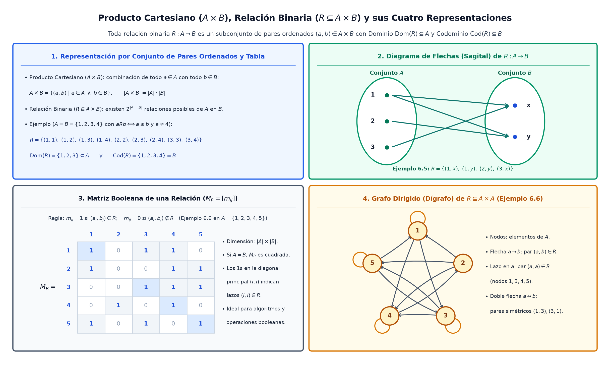

# 5.1 Conceptos básicos

## Introducción

En la vida cotidiana y en las ciencias computacionales constantemente vinculamos objetos de distinta o igual naturaleza: un profesor con las asignaturas que imparte, un número de control con el expediente de un alumno, una página web con los hipervínculos que apuntan a otras páginas, o dos computadoras que pueden intercambiar paquetes dentro de una red (Jiménez Murillo, 2012, Cap. 6.1–6.2, pp. 220–221).

Para formalizar matemáticamente cualquier vínculo entre objetos, la teoría de conjuntos introduce el concepto de **par ordenado**, a partir del cual se construyen el **producto cartesiano** y las **relaciones binarias**, mismas que pueden manipularse mediante **conjuntos, tablas, diagramas de flechas, matrices booleanas y grafos dirigidos**.

---

## 5.1.1 Producto cartesiano

### 1. Par Ordenado y $n$-tupla Ordenada
A diferencia de un conjunto ordinario $\{a, b\}$ donde el orden de los elementos es irrelevante ($\{a, b\} = \{b, a\}$), un **par ordenado**, denotado por $(a, b)$, es una pareja de objetos en la cual $a$ se designa como el **primer elemento** (o *primera componente*) y $b$ como el **segundo elemento** (o *segunda componente*) (Lipschutz & Lipson, 2009, Cap. 2.2, p. 23).
- **Criterio de igualdad de pares ordenados:** Dos pares ordenados $(a, b)$ y $(c, d)$ son iguales si y sólo si coinciden componente a componente:
  $$(a, b) = (c, d) \iff a = c \quad\land\quad b = d$$
  En consecuencia, si $a \neq b$, entonces $(a, b) \neq (b, a)$. *(Conjuntistamente, Kazimierz Kuratowski definió en $1921$ el par ordenado como $(a, b) = \{\{a\}, \{a, b\}\}$).*

### 2. Definición de Producto Cartesiano ($A \times B$)
Dados dos conjuntos no vacíos $A$ y $B$, el **producto cartesiano** de $A$ y $B$, denotado por **$A \times B$** (se lee *«$A$ cruz $B$»*, en honor a **René Descartes**), es el conjunto de **todos los pares ordenados posibles** $(a, b)$ tales que el primer elemento pertenece a $A$ y el segundo elemento pertenece a $B$ (Jiménez Murillo, 2012, Cap. 6.2.1, p. 222; Lipschutz & Lipson, 2009, p. 23):

$$\boxed{A \times B = \big\{(a, b) \;\big|\; a \in A \;\land\; b \in B\big\}}$$

- **Caso particular $A = B$:** El producto cartesiano de un conjunto consigo mismo $A \times A$ suele denotarse por **$A^2$**.
- **Propiedades fundamentales del producto cartesiano:**
  1. **No conmutatividad:** En general, si $A \neq B$ y ambos son no vacíos, entonces:
     $$A \times B \neq B \times A$$
  2. **Producto con el conjunto vacío:** $A \times \emptyset = \emptyset \times B = \emptyset$.
  3. **Cardinalidad de $A \times B$:** Si $A$ y $B$ son conjuntos finitos con $|A| = m$ elementos y $|B| = n$ elementos, el número total de pares ordenados en su producto cartesiano es:
     $$|A \times B| = |A| \cdot |B| = m \cdot n$$
  4. **Leyes distributivas del producto cartesiano sobre operaciones de conjuntos:** Para cualesquiera conjuntos $A, B, C$:
     - $A \times (B \cup C) = (A \times B) \cup (A \times C)$
     - $A \times (B \cap C) = (A \times B) \cap (A \times C)$
     - $A \times (B - C) = (A \times B) - (A \times C)$

### 3. Producto Cartesiano Generalizado ($A_1 \times A_2 \times \dots \times A_n$)
Dados $n$ conjuntos $A_1, A_2, \dots, A_n$, su producto cartesiano se define como el conjunto de todas las **$n$-tuplas ordenadas** $(a_1, a_2, \dots, a_n)$:
$$A_1 \times A_2 \times \dots \times A_n = \big\{(a_1, a_2, \dots, a_n) \;\big|\; a_1 \in A_1,\; a_2 \in A_2, \dots, a_n \in A_n\big\}$$
cuya cardinalidad es $|A_1 \times A_2 \times \dots \times A_n| = |A_1| \cdot |A_2| \cdots |A_n|$.

---

## 5.1.2 Relación binaria

### 1. Definición de Relación Binaria
Dados dos conjuntos no vacíos $A$ y $B$, una **relación binaria** $R$ de $A$ en $B$ (denotada por $R: A \to B$) es **cualquier subconjunto del producto cartesiano $A \times B$** en el cual el primer elemento $a \in A$ está vinculado con el segundo elemento $b \in B$ mediante cierta propiedad o regla de correspondencia (Jiménez Murillo, 2012, Cap. 6.2 y 6.2.2, pp. 220–224; Lipschutz & Lipson, 2009, Cap. 2.3):

$$\boxed{R \subseteq A \times B \qquad \text{donde}\qquad R = \big\{(a, b) \in A \times B \;\big|\; P(a, b)\text{ es verdadera}\big\}}$$

- **Notación infija:** Si $(a, b) \in R$, se escribe **$a R b$** y se lee *«$a$ está relacionado con $b$ (mediante $R$)»*. Si $(a, b) \notin R$, se escribe $a \not\mathrel{R} b$.
- **El producto cartesiano como conjunto universo de las relaciones (Jiménez Murillo, 2012, p. 222):** En el estudio de las relaciones de $A$ en $B$, el producto cartesiano $U = A \times B$ desempeña el papel del **conjunto universo**. En particular:
  - La **relación vacía** $\emptyset \subseteq A \times B$ y la **relación universal (o total)** $A \times B \subseteq A \times B$ son casos extremos de relaciones binarias.
  - **Número total de relaciones binarias de $A$ en $B$:** Como toda relación $R$ es un subconjunto de $A \times B$ (es decir, un elemento del conjunto potencia $\mathcal{P}(A \times B)$), si $|A| = m$ y $|B| = n$, entonces existen exactamente:
    $$\boxed{\text{Número de relaciones de } A \text{ en } B \;=\; 2^{|A \times B|} = 2^{m \cdot n}}$$
- **Relaciones en un conjunto $A$:** Cuando $A = B$, se dice simplemente que $R \subseteq A \times A$ es una **relación sobre $A$** (o *de $A$*) (Jiménez Murillo, 2012, p. 227).
- **Relaciones $n$-arias (ternarias, cuaternarias, etc.):** Como señala Jiménez Murillo (2012, p. 223), no todas las relaciones constan de pares ordenados: un subconjunto $R \subseteq A \times B \times C$ formado por **tercias ordenadas** $(a, b, c)$ se denomina **relación ternaria** (o *terciaria*), y en general $R \subseteq A_1 \times \dots \times A_n$ es una **relación $n$-aria** (base de las tablas con $n$ columnas en las bases de datos relacionales). Sin embargo, la **relación binaria** es la más utilizada porque puede representarse y operarse directamente mediante matrices bidimensionales y grafos.

### 2. Dominio y Codominio (Rango) de una Relación Binaria
Dada una relación binaria $R \subseteq A \times B$, se definen dos subconjuntos fundamentales (Jiménez Murillo, 2012, p. 224; Lipschutz & Lipson, 2009, p. 24):
1. **Dominio de $R$ ($\operatorname{Dom}(R)$):** Es el conjunto de todos los **primeros elementos** de los pares ordenados que pertenecen a $R$. Es un subconjunto de $A$:
   $$\operatorname{Dom}(R) = \big\{a \in A \;\big|\; \exists b \in B \text{ tal que } (a, b) \in R\big\} \subseteq A$$
2. **Codominio (o Rango / Imagen) de $R$ ($\operatorname{Cod}(R)$ o $\operatorname{Ran}(R)$):** En la terminología de Jiménez Murillo (2012, p. 224), el $\operatorname{Cod}(R)$ es el conjunto formado por los **segundos elementos** de los pares ordenados que pertenecen efectivamente a la relación $R$, y es un subconjunto de $B$:
   $$\operatorname{Cod}(R) = \big\{b \in B \;\big|\; \exists a \in A \text{ tal que } (a, b) \in R\big\} \subseteq B$$
   *(Nota terminológica: otros autores como Lipschutz, Rosen y Epp llaman **rango** o **imagen** $\operatorname{Ran}(R)$ al conjunto de los segundos elementos que aparecen en $R$, y reservan la palabra **codominio** para todo el conjunto de llegada $B$. En estas notas indicaremos ambos términos con total claridad).*

---

## 5.1.3 Representación de relaciones (matrices, conjuntos, grafos, diagrama de flechas)

Una misma relación binaria $R: A \to B$ puede representarse de **cinco maneras equivalentes**, cada una con ventajas específicas según el problema (Jiménez Murillo, 2012, Cap. 6.2.1–6.2.4, pp. 221–227):

### 1. Representación mediante Conjuntos (por Extensión y por Comprensión) y Tablas
- **Por extensión:** Listando explícitamente entre llaves todos los pares ordenados:
  $$R = \{(1, 2), (1, 3), (2, 2), (2, 5), (3, 2), (3, 7), (4, 2), (4, 5), (5, 6)\}$$
- **Por comprensión:** Especificando la regla matemática o verbal que deben satisfacer $a \in A$ y $b \in B$:
  $$R = \{(a, b) \mid a \in A,\; b \in B,\; b \text{ es divisible entre } a\}$$
- **En forma de Tabla:** Colocando dos columnas (por ejemplo, `Maestro` y `Materia`) donde cada renglón representa un par ordenado $(a, b) \in R$ (Jiménez Murillo, 2012, p. 221).

### 2. Representación mediante Diagrama de Flechas (Diagrama Sagital)
Cuando $A$ y $B$ son conjuntos finitos pequeños, se dibujan dos óvalos o diagramas de Venn separados —el de la izquierda para $A$ y el de la derecha para $B$— y se traza una **flecha desde $a \in A$ hasta $b \in B$** por cada par ordenado $(a, b) \in R$ (Jiménez Murillo, 2012, Ej. 6.2, p. 223).

### 3. Representación Matricial: Matriz Booleana de una Relación ($M_R$)
Si $A = \{a_1, a_2, \dots, a_m\}$ y $B = \{b_1, b_2, \dots, b_n\}$ son conjuntos finitos ordenados con $m$ y $n$ elementos respectivamente, la relación $R: A \to B$ se representa mediante una **matriz booleana** $M_R = [m_{ij}]$ de dimensión **$m \times n$** (los elementos de $A$ etiquetan las **filas** y los elementos de $B$ etiquetan las **columnas**), cuyas entradas se definen como (Jiménez Murillo, 2012, Cap. 6.2.3, p. 224):

$$\boxed{m_{ij} = \begin{cases} 1, & \text{si } (a_i, b_j) \in R, \\ 0, & \text{si } (a_i, b_j) \notin R. \end{cases}}$$

- Cuando $A = B$ con $|A| = n$, la matriz $M_R$ es **cuadrada de orden $n \times n$**.
- La representación matricial es fundamental en ciencias de la computación porque permite programar y ejecutar todas las operaciones entre relaciones grandes usando **álgebra de matrices booleanas** en memoria.

### 4. Representación mediante Grafos: Grafo Dirigido (Dígrafo) de una Relación
Una relación $R$ también puede representarse visualmente mediante una gráfica compuesta por **nodos (o vértices)** y **flechas (aristas dirigidas)**, denominada **grafo dirigido** o **dígrafo** de $R$ (Jiménez Murillo, 2012, Cap. 6.2.4, pp. 225–227):
- **Si $A \neq B$:** Se colocan los elementos de $A$ y de $B$ como nodos y se dibuja una flecha de $a$ hacia $b$ por cada $(a, b) \in R$.
- **Si $A = B$ ($R$ es una relación sobre $A$):** Se dibuja **un solo nodo por cada elemento de $A$**:
  - Si $(a, b) \in R$ con $a \neq b$, se traza una **flecha dirigida** que sale del nodo $a$ y entra al nodo $b$ ($a \to b$).
  - Si $(a, a) \in R$ (un elemento relacionado consigo mismo), se dibuja una flecha que sale de $a$ y regresa al propio nodo $a$, llamada **lazo** (o *bucle*).
  - Si tanto $(a, b) \in R$ como $(b, a) \in R$ para todo par relacionado (y la relación es en ambos sentidos, como en una red carretera o de computadoras), las dos flechas opuestas pueden sustituirse por una sola línea sin cabeza de flecha, obteniéndose un **grafo no dirigido** (Jiménez Murillo, 2012, p. 226).

---

## 5.1.4 Operaciones entre Relaciones (Conjuntistas y Matriciales Booleanas)

Dado que las relaciones binarias son conjuntos de pares ordenados, es posible combinarlas mediante las operaciones de la teoría de conjuntos y mediante operaciones exclusivas de las relaciones como la **inversa** y la **composición**, tanto en forma de conjuntos como mediante sus **matrices booleanas** (Jiménez Murillo, 2012, Cap. 6.5, pp. 242–246; Lipschutz & Lipson, 2009, Cap. 2.4–2.5).

Sean $R, S \subseteq A \times B$ dos relaciones de $A$ en $B$ con matrices booleanas $M_R = [r_{ij}]$ y $M_S = [s_{ij}]$ de tamaño $m \times n$, y sea $T \subseteq B \times C$ una relación de $B$ en $C$ con matriz $M_T = [t_{jk}]$ de tamaño $n \times p$:

| Operación | Notación | Definición por Conjuntos de Pares Ordenados | Operación equivalente con Matrices Booleanas |
| :--- | :---: | :--- | :--- |
| **1. Complemento** | $R'$ (o $\bar{R}$) | $R' = (A \times B) - R = \{(a, b) \in A \times B \mid (a, b) \notin R\}$ *(Todos los pares de $A \times B$ que no están en $R$).* | **$M_{R'} = (M_R)'$:** Se cambian todos los **$1\text{s}$ por $0\text{s}$** y todos los **$0\text{s}$ por $1\text{s}$** en la matriz $M_R$. |
| **2. Intersección** | $R \cap S$ | $R \cap S = \{(a, b) \in A \times B \mid (a, b) \in R \;\land\; (a, b) \in S\}$ *(Pares ordenados comunes a ambas relaciones).* | **$M_{R \cap S} = M_R \cap M_S$:** Multiplicación lógica (`AND`) **elemento por elemento**: $[r_{ij} \cdot s_{ij}]$. |
| **3. Unión** | $R \cup S$ | $R \cup S = \{(a, b) \in A \times B \mid (a, b) \in R \;\lor\; (a, b) \in S\}$ *(Pares que están en $R$, en $S$ o en ambas).* | **$M_{R \cup S} = M_R \cup M_S = M_R + M_S$:** Suma lógica (`OR`) **elemento por elemento**: $[r_{ij} + s_{ij}]$ (donde $1 + 1 = 1$). |
| **4. Diferencia** | $R - S$ | $R - S = R \cap S' = \{(a, b) \mid (a, b) \in R \;\land\; (a, b) \notin S\}$ | **$M_{R - S} = M_R \cap (M_S)'$:** Elemento a elemento $[r_{ij} \cdot s_{ij}']$. |
| **5. Relación Inversa** | $R^{-1}$ | $R^{-1} = \{(b, a) \in B \times A \mid (a, b) \in R\}$ *(Se invierte el orden de cada par $(a, b) \to (b, a)$).* | **$M_{R^{-1}} = (M_R)^T$ (Matriz Transpuesta):** Se intercambian las **filas por las columnas** de $M_R$ ($[r_{ji}]$). |
| **6. Composición** | $R \circ T$ | $R \circ T = \{(a, c) \in A \times C \mid \exists b \in B \text{ tal que } (a, b) \in R \;\land\; (b, c) \in T\}$ *(Puente transitivo: $(a, b) \in R$ y $(b, c) \in T \implies (a, c) \in R \circ T$).* | **$M_{R \circ T} = M_R \odot M_T$ (Multiplicación Booleana de Matrices):** Fila $i$ de $M_R$ por columna $k$ de $M_T$: $c_{ik} = \sum_{j=1}^n r_{ij} \cdot t_{jk}$ (con suma booleana $1+1=1$). |

> **Nota sobre la notación de composición de relaciones $R \circ T$ (Jiménez Murillo, 2012, p. 243; Lipschutz & Lipson, 2009, p. 25):**  
> En la teoría de relaciones y matrices booleanas se escribe $R \circ T$ en el orden de lectura de izquierda a derecha: primero se recorre un par $(a, b) \in R$ y luego un par $(b, c) \in T$ para formar $(a, c) \in R \circ T$, de modo que su matriz es exactamente el producto matricial booleano $M_{R \circ T} = M_R \odot M_T$.

---

## Ejemplos de Práctica (Resueltos Paso a Paso)

### Ejemplo 5.1.1: Construcción de una relación binaria por comprensión, dominio y codominio
Sean los conjuntos (Jiménez Murillo, 2012, Ej. 6.1 y 6.3, pp. 222, 224):
1. $A_1 = \{a \in \mathbb{Z} \mid 10 < a < 30\}$ y $B_1 = \{b \in \mathbb{Z}^+ \mid b \le 20\}$, con la relación $R_1: A_1 \to B_1$ donde $a$ es divisible entre $13$ y $b$ es un número primo.
2. $A_2 = \{2, 4, 5, 6, 7, 11\}$ y $B_2 = \{b \in \mathbb{Z} \mid 1 \le b \le 10\}$, con la relación $R_2: A_2 \to B_2$ definida por $a R_2 b \iff b$ es divisible entre $a$.

Determine por extensión los pares ordenados de $R_1$ y $R_2$, así como sus respectivos dominios y codominios.

**Solución:**
- **1. Para la relación $R_1: A_1 \to B_1$:**
  - Los únicos enteros estrictamente entre $10$ y $30$ divisibles entre $13$ son $\{13, 26\}$.
  - Los números primos menores o iguales a $20$ en $B_1$ son $\{2, 3, 5, 7, 11, 13, 17, 19\}$ ($8$ primos).
  - Como la condición no restringe qué múltiplo de $13$ se asocia con qué primo, se relacionan ambos múltiplos con los $8$ primos ($2 \times 8 = 16$ pares ordenados):
    $$R_1 = \big\{(13, 2), (13, 3), (13, 5), (13, 7), (13, 11), (13, 13), (13, 17), (13, 19), (26, 2), (26, 3), (26, 5), (26, 7), (26, 11), (26, 13), (26, 17), (26, 19)\big\}$$
  - $\operatorname{Dom}(R_1) = \{13, 26\} \subset A_1$ y $\operatorname{Cod}(R_1) = \{2, 3, 5, 7, 11, 13, 17, 19\} \subset B_1$.

- **2. Para la relación $R_2: A_2 \to B_2$ ($b$ es divisible entre $a$):**
  Evaluando cada $a \in \{2, 4, 5, 6, 7, 11\}$ frente a $b \in \{1, 2, \dots, 10\}$:
  - Para $a = 2$: divide a $2, 4, 6, 8, 10$.
  - Para $a = 4$: divide a $4, 8$.
  - Para $a = 5$: divide a $5, 10$.
  - Para $a = 6$: divide a $6$.
  - Para $a = 7$: divide a $7$.
  - Para $a = 11$: no divide a ningún elemento de $B_2$.
  Por lo tanto:
  $$R_2 = \big\{(2, 2), (2, 4), (2, 6), (2, 8), (2, 10), (4, 4), (4, 8), (5, 5), (5, 10), (6, 6), (7, 7)\big\}$$
  - **Dominio:** $\operatorname{Dom}(R_2) = \{2, 4, 5, 6, 7\} \subset A_2$ *(el $11$ no pertenece al dominio)*.
  - **Codominio (Rango):** $\operatorname{Cod}(R_2) = \{2, 4, 5, 6, 7, 8, 10\} \subset B_2$ *(los números $1, 3, 9$ no pertenecen al codominio de $R_2$)*.

---

### Ejemplo 5.1.2: Producto cartesiano y conteo de relaciones binarias
Sean los conjuntos $A = \{1, 2, 3\}$ y $B = \{a, b\}$ (Jiménez Murillo, 2012, Ej. 6.2, p. 223).
a) Obtenga por extensión $A \times B$ y $B \times A$, y compruebe que $A \times B \neq B \times A$.  
b) ¿Cuántas relaciones binarias distintas pueden definirse de $A$ en $B$?

**Solución:**
- **a) Productos cartesianos:**
  $$A \times B = \big\{(1, a),\; (1, b),\; (2, a),\; (2, b),\; (3, a),\; (3, b)\big\}$$
  $$B \times A = \big\{(a, 1),\; (a, 2),\; (a, 3),\; (b, 1),\; (b, 2),\; (b, 3)\big\}$$
  Como los pares ordenados tienen sus componentes invertidas —por ejemplo, $(1, a) \in A \times B$ pero $(1, a) \notin B \times A$—, se comprueba que $A \times B \neq B \times A$, aunque ambos tienen la misma cardinalidad $|A \times B| = |B \times A| = 3 \times 2 = 6$.
- **b) Número total de relaciones binarias de $A$ en $B$:**
  Como $|A \times B| = 6$, existen exactamente $2^{|A \times B|} = 2^6 = \mathbf{64}$ relaciones binarias posibles de $A$ en $B$ (incluyendo la relación vacía $\emptyset$ y la relación total $A \times B$).

---

### Ejemplo 5.1.3: Matriz booleana de una relación rectangular $R: A \to B$
Sean los conjuntos $A = \{1, 2, 3, 4, 5\}$ y $B = \{1, 2, 3, 4, 5, 6, 7\}$, y sea la relación $R: A \to B$ dada por (Jiménez Murillo, 2012, Ej. 6.4, p. 225):
$$R = \{(1, 2), (1, 3), (2, 2), (2, 5), (3, 2), (3, 7), (4, 2), (4, 5), (5, 6)\}$$
Construya la matriz booleana $M_R$ de la relación e identifique a partir de las filas y columnas de $M_R$ el dominio y el codominio de $R$.

**Solución:**
Colocamos los $5$ elementos de $A$ como filas y los $7$ elementos de $B$ como columnas, escribiendo $1$ en las posiciones de los pares que pertenecen a $R$ y $0$ en las demás:

$$M_R = \begin{array}{c|ccccccc}
A \setminus B & 1 & 2 & 3 & 4 & 5 & 6 & 7 \\
\hline
1 & 0 & \mathbf{1} & \mathbf{1} & 0 & 0 & 0 & 0 \\
2 & 0 & \mathbf{1} & 0 & 0 & \mathbf{1} & 0 & 0 \\
3 & 0 & \mathbf{1} & 0 & 0 & 0 & 0 & \mathbf{1} \\
4 & 0 & \mathbf{1} & 0 & 0 & \mathbf{1} & 0 & 0 \\
5 & 0 & 0 & 0 & 0 & 0 & \mathbf{1} & 0
\end{array}$$

- **Lectura del Dominio en $M_R$:** Un elemento $a_i \in A$ pertenece a $\operatorname{Dom}(R)$ si y sólo si su **fila $i$ tiene al menos un $1$**. Como las filas $1, 2, 3, 4, 5$ tienen al menos un $1$, $\operatorname{Dom}(R) = \{1, 2, 3, 4, 5\} = A$.
- **Lectura del Codominio en $M_R$:** Un elemento $b_j \in B$ pertenece a $\operatorname{Cod}(R)$ si y sólo si su **columna $j$ tiene al menos un $1$**. Las columnas con al menos un $1$ son $2, 3, 5, 6, 7$ (las columnas $1$ y $4$ son de puros ceros), por lo que $\operatorname{Cod}(R) = \{2, 3, 5, 6, 7\}$.

---

### Ejemplo 5.1.4: Operaciones combinadas entre relaciones mediante Conjuntos y Matrices Booleanas
Sean los conjuntos $A = B = C = D = \{1, 2, 3, 4\}$ y las relaciones $R: A \to B$, $S: B \to C$ y $T: C \to D$ definidas por (Jiménez Murillo, 2012, Ej. 6.10, pp. 243–246):
$$\begin{aligned}
R &= \{(1, 1), (1, 3), (1, 4), (2, 1), (2, 2), (2, 4), (3, 2), (3, 3), (4, 1), (4, 3), (4, 4)\} \\
S &= \{(1, 2), (1, 3), (2, 3), (2, 4), (3, 1), (3, 2), (3, 3), (4, 2), (4, 3)\} \\
T &= \{(1, 3), (1, 4), (2, 1), (2, 3), (2, 4), (3, 1), (3, 2), (4, 2)\}
\end{aligned}$$
Determine el resultado de la operación compuesta:
$$W = (S^{-1} \cap R)' \circ (T \cup R')$$
primero mediante conjuntos de pares ordenados y después verificando mediante operaciones de matrices booleanas.

**Solución:**
- **Método 1: Mediante Conjuntos de Pares Ordenados:**
  1. *Relación inversa $S^{-1}$ (invirtiendo cada par de $S$):*
     $$S^{-1} = \{(2, 1), (3, 1), (3, 2), (4, 2), (1, 3), (2, 3), (3, 3), (2, 4), (3, 4)\}$$
  2. *Intersección $S^{-1} \cap R$ (pares comunes a $S^{-1}$ y $R$):*
     $$S^{-1} \cap R = \{(1, 3), (2, 1), (2, 4), (3, 2), (3, 3)\}$$
  3. *Complemento $(S^{-1} \cap R)'$ respecto a $A \times B$ ($16 - 5 = 11$ pares):*
     $$(S^{-1} \cap R)' = \{(1, 1), (1, 2), (1, 4), (2, 2), (2, 3), (3, 1), (3, 4), (4, 1), (4, 2), (4, 3), (4, 4)\}$$
  4. *Complemento $R'$ respecto a $A \times B$ ($16 - 11 = 5$ pares) y unión $T \cup R'$:*
     $$R' = \{(1, 2), (2, 3), (3, 1), (3, 4), (4, 2)\}$$
     $$T \cup R' = \{(1, 2), (1, 3), (1, 4), (2, 1), (2, 3), (2, 4), (3, 1), (3, 2), (3, 4), (4, 2)\}$$
  5. *Composición $W = (S^{-1} \cap R)' \circ (T \cup R')$:*
     Enlazando cada par $(a, b) \in (S^{-1} \cap R)'$ con cada par $(b, c) \in (T \cup R')$:
     - Desde $a = 1$ (tiene $b \in \{1, 2, 4\}$): con $b=1 \to \{2, 3, 4\}$; con $b=2 \to \{1, 3, 4\}$; con $b=4 \to \{2\}$. Da $(1, 1), (1, 2), (1, 3), (1, 4)$.
     - Desde $a = 2$ (tiene $b \in \{2, 3\}$): con $b=2 \to \{1, 3, 4\}$; con $b=3 \to \{1, 2, 4\}$. Da $(2, 1), (2, 2), (2, 3), (2, 4)$.
     - Desde $a = 3$ (tiene $b \in \{1, 4\}$): con $b=1 \to \{2, 3, 4\}$; con $b=4 \to \{2\}$. Da $(3, 2), (3, 3), (3, 4)$ *(no se genera $(3, 1)$)*.
     - Desde $a = 4$ (tiene $b \in \{1, 2, 3, 4\}$): genera $(4, 1), (4, 2), (4, 3), (4, 4)$.
     Por tanto, $W$ contiene todos los pares de $A \times D$ **excepto $(3, 1)$**:
     $$W = \{(1, 1), (1, 2), (1, 3), (1, 4), (2, 1), (2, 2), (2, 3), (2, 4), (3, 2), (3, 3), (3, 4), (4, 1), (4, 2), (4, 3), (4, 4)\}$$

- **Método 2: Verificación mediante Matrices Booleanas:**
  Escribimos las matrices $M_R, M_S, M_T$:
  $$M_R = \begin{pmatrix} 1 & 0 & 1 & 1 \\ 1 & 1 & 0 & 1 \\ 0 & 1 & 1 & 0 \\ 1 & 0 & 1 & 1 \end{pmatrix}, \qquad M_S = \begin{pmatrix} 0 & 1 & 1 & 0 \\ 0 & 0 & 1 & 1 \\ 1 & 1 & 1 & 0 \\ 0 & 1 & 1 & 0 \end{pmatrix}, \qquad M_T = \begin{pmatrix} 0 & 0 & 1 & 1 \\ 1 & 0 & 1 & 1 \\ 1 & 1 & 0 & 0 \\ 0 & 1 & 0 & 0 \end{pmatrix}$$
  Calculamos $M_{S^{-1}} = M_S^T$, luego $M_{S^{-1} \cap R}$, su complemento $M_{(S^{-1}\cap R)'}$ y la unión $M_{T \cup R'}$:
  $$M_{S^{-1}} = \begin{pmatrix} 0 & 0 & 1 & 0 \\ 1 & 0 & 1 & 1 \\ 1 & 1 & 1 & 1 \\ 0 & 1 & 0 & 0 \end{pmatrix} \implies M_{S^{-1} \cap R} = \begin{pmatrix} 0 & 0 & 1 & 0 \\ 1 & 0 & 0 & 1 \\ 0 & 1 & 1 & 0 \\ 0 & 0 & 0 & 0 \end{pmatrix} \implies M_{(S^{-1} \cap R)'} = \begin{pmatrix} 1 & 1 & 0 & 1 \\ 0 & 1 & 1 & 0 \\ 1 & 0 & 0 & 1 \\ 1 & 1 & 1 & 1 \end{pmatrix}$$
  $$M_{R'} = \begin{pmatrix} 0 & 1 & 0 & 0 \\ 0 & 0 & 1 & 0 \\ 1 & 0 & 0 & 1 \\ 0 & 1 & 0 & 0 \end{pmatrix} \implies M_{T \cup R'} = M_T + M_{R'} = \begin{pmatrix} 0 & 1 & 1 & 1 \\ 1 & 0 & 1 & 1 \\ 1 & 1 & 0 & 1 \\ 0 & 1 & 0 & 0 \end{pmatrix}$$
  Finalmente, realizamos la multiplicación booleana de matrices $M_W = M_{(S^{-1} \cap R)'} \odot M_{T \cup R'}$:
  $$M_W = \begin{pmatrix} 1 & 1 & 0 & 1 \\ 0 & 1 & 1 & 0 \\ 1 & 0 & 0 & 1 \\ 1 & 1 & 1 & 1 \end{pmatrix} \odot \begin{pmatrix} 0 & 1 & 1 & 1 \\ 1 & 0 & 1 & 1 \\ 1 & 1 & 0 & 1 \\ 0 & 1 & 0 & 0 \end{pmatrix} = \begin{pmatrix} 1 & 1 & 1 & 1 \\ 1 & 1 & 1 & 1 \\ \mathbf{0} & 1 & 1 & 1 \\ 1 & 1 & 1 & 1 \end{pmatrix}$$
  El único cero está en la fila $3$, columna $1$ —par $(3, 1)$—, coincidiendo de manera exacta con el resultado por conjuntos.

---

## Ejercicios de Tarea (Práctica en Casa)

> **Instrucciones:** Resuelva cada uno de los siguientes ejercicios mostrando claramente los pares ordenados, matrices booleanas y diagramas o grafos solicitados.

1. **Construcción de relaciones por comprensión, matriz y grafo (Jiménez Murillo, Prob. 6.1, p. 272):**  
   En cada uno de los siguientes incisos, determine por extensión los pares ordenados de la relación $R: A \to B$, indique su dominio $\operatorname{Dom}(R)$ y codominio $\operatorname{Cod}(R)$, construya la matriz booleana $M_R$ y describa su representación gráfica:  
   a) $A = \{a, b, c, d\}$, $B = \{1, 2, 3, 4, 5\}$, y la relación $R$ está integrada por todos los pares $(x, y)$ en donde $x$ es una vocal y $y$ es un número par.  
   b) $A = B = \{1, 2, 3, 4, 5\}$ y la relación es $R = \{(x, y) \mid x \in A,\; y \in B,\; 2x \ge y^2\}$.
   <!--
   Solución del Ejercicio 1:
   - Inciso a):
     - En A = {a, b, c, d}, la única vocal es {a}.
     - En B = {1, 2, 3, 4, 5}, los números pares son {2, 4}.
     - Por lo tanto:
       R = {(a, 2), (a, 4)}.
     - Dominio: Dom(R) = {a}. Codominio (Rango): Cod(R) = {2, 4}.
     - Matriz booleana M_R (4 filas x 5 columnas):
       Fila a: [0, 1, 0, 1, 0]
       Fila b: [0, 0, 0, 0, 0]
       Fila c: [0, 0, 0, 0, 0]
       Fila d: [0, 0, 0, 0, 0]
     - Grafo dirigido: Flechas únicamente del nodo 'a' hacia '2' y del nodo 'a' hacia '4'.

   - Inciso b):
     Evaluamos 2x >= y^2 para x, y in {1, 2, 3, 4, 5} (donde y^2 toma los valores 1, 4, 9, 16, 25 y 2x toma los valores 2, 4, 6, 8, 10):
     - Para x = 1 (2x = 2): cumple y^2 <= 2 => y = 1. Par: (1, 1).
     - Para x = 2 (2x = 4): cumple y^2 <= 4 => y in {1, 2}. Pares: (2, 1), (2, 2).
     - Para x = 3 (2x = 6): cumple y^2 <= 6 => y in {1, 2}. Pares: (3, 1), (3, 2).
     - Para x = 4 (2x = 8): cumple y^2 <= 8 => y in {1, 2}. Pares: (4, 1), (4, 2).
     - Para x = 5 (2x = 10): cumple y^2 <= 10 => y in {1, 2, 3}. Pares: (5, 1), (5, 2), (5, 3).
     Por lo tanto:
     R = {(1, 1), (2, 1), (2, 2), (3, 1), (3, 2), (4, 1), (4, 2), (5, 1), (5, 2), (5, 3)} (10 pares ordenados).
     - Dominio: Dom(R) = {1, 2, 3, 4, 5} = A.
     - Codominio: Cod(R) = {1, 2, 3}.
     - Matriz booleana M_R (5 x 5):
       1: [1, 0, 0, 0, 0]
       2: [1, 1, 0, 0, 0]
       3: [1, 1, 0, 0, 0]
       4: [1, 1, 0, 0, 0]
       5: [1, 1, 1, 0, 0]
   -->

2. **Operaciones entre relaciones mediante conjuntos y matrices booleanas (Jiménez Murillo, Prob. 6.7a y 6.7b, p. 274):**  
   Sean $A = B = C = \{1, 2, 3, 4\}$ y las relaciones:
   $$\begin{aligned}
   R &= \{(1, 1), (1, 2), (2, 3), (3, 1), (4, 2), (4, 4)\} \\
   S &= \{(1, 2), (1, 3), (2, 1), (3, 3), (3, 4), (4, 2)\} \\
   T &= \{(1, 4), (2, 2), (2, 3), (3, 2), (4, 1)\}
   \end{aligned}$$
   Calcule por medio de conjuntos y verifique mediante matrices booleanas:  
   a) $(R \cup S) \circ T^{-1}$  
   b) $(R^{-1} \cap S)' \circ T$
   <!--
   Solución del Ejercicio 2:
   Matrices originales:
   M_R = [[1,1,0,0], [0,0,1,0], [1,0,0,0], [0,1,0,1]]
   M_S = [[0,1,1,0], [1,0,0,0], [0,0,1,1], [0,1,0,0]]
   M_T = [[0,0,0,1], [0,1,1,0], [0,1,0,0], [1,0,0,0]]

   - Inciso a): (R u S) o T^-1
     1) R u S = {(1,1), (1,2), (1,3), (2,1), (2,3), (3,1), (3,3), (3,4), (4,2), (4,4)}
        M_{R u S} = [[1,1,1,0], [1,0,1,0], [1,0,1,1], [0,1,0,1]].
     2) T^-1 = {(4,1), (2,2), (3,2), (2,3), (1,4)}
        M_{T^-1} = M_T^T = [[0,0,0,1], [0,1,1,0], [0,1,0,0], [1,0,0,0]].
     3) Composición (R u S) o T^-1 (multiplicando M_{R u S} por M_{T^-1}):
        - Fila 1 [1,1,1,0] con T^-1: da [0, 1, 1, 1] -> (1,2), (1,3), (1,4).
        - Fila 2 [1,0,1,0] con T^-1: da [0, 1, 0, 1] -> (2,2), (2,4).
        - Fila 3 [1,0,1,1] con T^-1: da [1, 1, 0, 1] -> (3,1), (3,2), (3,4).
        - Fila 4 [0,1,0,1] con T^-1: da [1, 1, 1, 0] -> (4,1), (4,2), (4,3).
        Conjunto resultante:
        (R u S) o T^-1 = {(1,2), (1,3), (1,4), (2,2), (2,4), (3,1), (3,2), (3,4), (4,1), (4,2), (4,3)}.

   - Inciso b): (R^-1 n S)' o T
     1) R^-1 = {(1,1), (2,1), (3,2), (1,3), (2,4), (4,4)}.
     2) R^-1 n S = {(1,3), (2,1)} (sólo 2 pares en común).
        M_{R^-1 n S} = [[0,0,1,0], [1,0,0,0], [0,0,0,0], [0,0,0,0]].
     3) (R^-1 n S)' contiene los otros 14 pares de A x B:
        M_{(R^-1 n S)'} = [[1,1,0,1], [0,1,1,1], [1,1,1,1], [1,1,1,1]].
     4) Multiplicando booleanamente M_{(R^-1 n S)'} por M_T:
        - Fila 1 [1,1,0,1] (tiene b in {1,2,4}): produce [1, 1, 1, 1].
        - Fila 2 [0,1,1,1] (tiene b in {2,3,4}): produce [1, 1, 1, 0] (falta el 1 en col 4 porque no tiene b=1).
        - Fila 3 [1,1,1,1]: produce [1, 1, 1, 1].
        - Fila 4 [1,1,1,1]: produce [1, 1, 1, 1].
        Por lo tanto, (R^-1 n S)' o T contiene 15 pares (todos los de A x C excepto el par (2, 4)).
   -->

3. **Conversión entre Dígrafo, Matriz Booleana y Conjunto de Pares Ordenados:**  
   Sea $A = \{1, 2, 3, 4, 5\}$ y sea $R$ la relación sobre $A$ cuya matriz booleana es:
   $$M_R = \begin{pmatrix} 1 & 1 & 0 & 0 & 1 \\ 0 & 0 & 1 & 1 & 0 \\ 1 & 0 & 1 & 0 & 0 \\ 0 & 1 & 0 & 1 & 1 \\ 1 & 0 & 0 & 0 & 0 \end{pmatrix}$$
   a) Escriba la relación $R$ y la relación inversa $R^{-1}$ como conjuntos de pares ordenados.  
   b) Determine para cada nodo $v \in A$ su **grado de salida** (número de flechas que salen de $v$) y su **grado de entrada** (número de flechas que entran a $v$) directamente a partir de las sumas de filas y columnas de $M_R$.
   <!--
   Solución del Ejercicio 3:
   - a) Conjunto de pares de R (leyendo los 1s por fila):
        R = {(1,1), (1,2), (1,5), (2,3), (2,4), (3,1), (3,3), (4,2), (4,4), (4,5), (5,1)} (11 pares).
        Relación inversa R^-1 (invirtiendo cada par o leyendo por columnas):
        R^-1 = {(1,1), (2,1), (5,1), (3,2), (4,2), (1,3), (3,3), (2,4), (4,4), (5,4), (1,5)}.
   - b) Grados de salida (suma de cada fila de M_R) y grados de entrada (suma de cada columna de M_R):
        - Nodo 1: Grado de salida = 3 (fila 1: 1+1+0+0+1); Grado de entrada = 3 (col 1: 1+0+1+0+1).
        - Nodo 2: Grado de salida = 2 (fila 2: 0+0+1+1+0); Grado de entrada = 2 (col 2: 1+0+0+1+0).
        - Nodo 3: Grado de salida = 2 (fila 3: 1+0+1+0+0); Grado de entrada = 2 (col 3: 0+1+1+0+0).
        - Nodo 4: Grado de salida = 3 (fila 4: 0+1+0+1+1); Grado de entrada = 2 (col 4: 0+1+0+1+0).
        - Nodo 5: Grado de salida = 1 (fila 5: 1+0+0+0+0); Grado de entrada = 2 (col 5: 1+0+0+1+0).
        (Verificación: Suma de grados de salida = 3+2+2+3+1 = 11 = Suma de grados de entrada = 3+2+2+2+2 = 11 = |R|).
   -->

4. **Demostración de las leyes distributivas del Producto Cartesiano (Lipschutz & Lipson, Prob. 2.3, p. 29):**  
   Sean $A, B, C$ conjuntos cualesquiera. Demuestre formalmente mediante doble inclusión de elementos (tomando un par ordenado arbitrario $(x, y)$) que:  
   a) $A \times (B \cap C) = (A \times B) \cap (A \times C)$  
   b) $A \times (B - C) = (A \times B) - (A \times C)$
   <!--
   Solución del Ejercicio 4:
   - a) Demostración de A x (B n C) = (A x B) n (A x C):
        Sea (x, y) un par ordenado arbitrario:
        (x, y) in A x (B n C)
        <=> x in A  ^  y in (B n C)                         (Definición de producto cartesiano)
        <=> x in A  ^  (y in B  ^  y in C)                  (Definición de intersección)
        <=> (x in A  ^  x in A)  ^  (y in B  ^  y in C)     (Idempotencia lógica de x in A)
        <=> (x in A  ^  y in B)  ^  (x in A  ^  y in C)     (Conmutatividad y asociatividad de ^)
        <=> (x, y) in (A x B)  ^  (x, y) in (A x C)         (Definición de producto cartesiano)
        <=> (x, y) in (A x B) n (A x C).                    (Definición de intersección) Q.E.D.

   - b) Demostración de A x (B - C) = (A x B) - (A x C):
        (x, y) in A x (B - C)
        <=> x in A  ^  (y in B  ^  y notin C)               (Definición de producto cartesiano y diferencia)
        <=> (x in A  ^  y in B)  ^  ~(x in A  ^  y in C)    (Ya que x in A es verdadero, ~y in C equivale a ~(x in A ^ y in C))
        <=> (x, y) in (A x B)  ^  (x, y) notin (A x C)      (Definición de producto cartesiano)
        <=> (x, y) in (A x B) - (A x C).                    (Definición de diferencia de conjuntos) Q.E.D.
   -->
