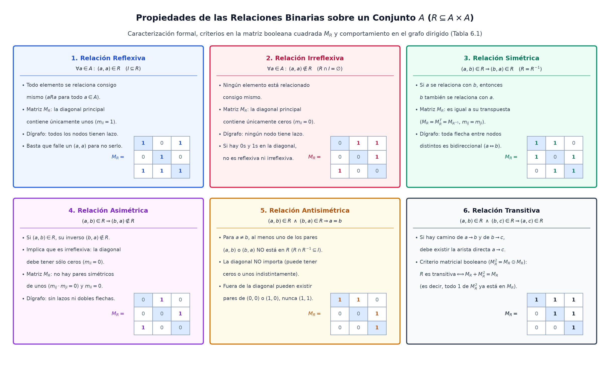

# 5.2 Propiedades de las relaciones

## Introducción

Cuando una relación binaria se define sobre un mismo conjunto ($R \subseteq A \times A$, es decir, $A = B$), su matriz booleana $M_R$ es siempre **cuadrada** de orden $n \times n$ y su grafo dirigido tiene como vértices a los elementos de $A$. En este contexto, las relaciones se clasifican de acuerdo con seis propiedades estructurales fundamentales (Jiménez Murillo, 2012, Cap. 6.3 y Tabla 6.1, pp. 227–235):

$$\text{1. Reflexiva} \qquad \text{2. Irreflexiva} \qquad \text{3. Simétrica} \qquad \text{4. Asimétrica} \qquad \text{5. Antisimétrica} \qquad \text{6. Transitiva}$$

Dominar estas seis propiedades es indispensable porque de ellas se desprenden las dos grandes familias de relaciones utilizadas en ciencias de la computación:
- Las **Relaciones de Equivalencia** (Reflexiva + Simétrica + Transitiva, subtema `5.3`), que particionan datos y modelan redes de comunicación.
- Las **Relaciones de Orden Parcial** (Reflexiva + Antisimétrica + Transitiva), que estructuran jerarquías de tareas, ordenamiento topológico y retículos booleanos.

---

## 1. Definición Formal, Caracterización Matricial y en Dígrafos de las 6 Propiedades

Sea $A$ un conjunto no vacío con $|A| = n$, sea $R \subseteq A \times A$ una relación sobre $A$, sea $M_R = [m_{ij}]$ su matriz booleana cuadrada de $n \times n$, y sea $I = \{(a, a) \mid a \in A\}$ la relación identidad sobre $A$ (cuya matriz es la matriz identidad $I_n$ con $1\text{s}$ en la diagonal principal y $0\text{s}$ fuera de ella).

### 1.1 Relación Reflexiva
- **Definición formal (Jiménez Murillo, 2012, Cap. 6.3.1, p. 228):** Una relación $R$ sobre $A$ es **reflexiva** si **todo** elemento de $A$ está relacionado consigo mismo:
  $$\boxed{\forall a \in A:\quad (a, a) \in R \qquad (\text{es decir, } a R a \;\;\forall a \in A, \text{ o bien } I \subseteq R)}$$
- **Criterio en la matriz $M_R$:** La **diagonal principal** de $M_R$ contiene **únicamente unos** ($m_{ii} = 1$ para todo $i \in \{1, \dots, n\}$). Los elementos fuera de la diagonal pueden ser $0$ o $1$.
- **Criterio en el dígrafo:** Todos y cada uno de los vértices del grafo dirigido tienen un **lazo**.
- **Cómo refutarla:** Basta exhibir **un solo elemento** $a_0 \in A$ tal que $(a_0, a_0) \notin R$ (un $0$ en la diagonal principal).

---

### 1.2 Relación Irreflexiva (o Antirreflexiva)
- **Definición formal (Jiménez Murillo, 2012, Cap. 6.3.2, p. 228):** Una relación $R$ sobre $A$ es **irreflexiva** cuando **ningún** elemento del conjunto $A$ está relacionado consigo mismo:
  $$\boxed{\forall a \in A:\quad (a, a) \notin R \qquad (\text{es decir, } R \cap I = \emptyset)}$$
- **Criterio en la matriz $M_R$:** La **diagonal principal** de $M_R$ contiene **únicamente ceros** ($m_{ii} = 0$ para todo $i \in \{1, \dots, n\}$).
- **Criterio en el dígrafo:** **Ningún** vértice del grafo dirigido tiene lazo.

> **Advertencia crítica: «No ser reflexiva» NO es lo mismo que «ser irreflexiva» (Jiménez Murillo, 2012, p. 228):**  
> Si la diagonal principal de la matriz $M_R$ contiene **tanto ceros como unos** (algunos elementos tienen lazo y otros no), entonces la relación **NO es reflexiva ni tampoco es irreflexiva**.

---

### 1.3 Relación Simétrica
- **Definición formal (Jiménez Murillo, 2012, Cap. 6.3.3, p. 229):** Una relación $R$ sobre $A$ es **simétrica** si siempre que un elemento $a$ está relacionado con $b$, entonces $b$ también está relacionado con $a$:
  $$\boxed{\forall a, b \in A:\quad (a, b) \in R \implies (b, a) \in R \qquad (\text{es decir, } R = R^{-1})}$$
- **Criterio en la matriz $M_R$:** Los pares de elementos colocados simétricamente respecto a la diagonal principal son iguales ($m_{ij} = m_{ji}$, ambos $1$ o ambos $0$). Esto equivale a que la matriz de la relación sea igual a su transpuesta (la matriz de la inversa):
  $$M_R = (M_R)^T = M_{R^{-1}}$$
  *(La diagonal principal puede tener cualesquiera valores $0$ o $1$).*
- **Criterio en el dígrafo:** Toda flecha entre dos nodos distintos va acompañada de su flecha de regreso ($a \leftrightarrow b$).

---

### 1.4 Relación Asimétrica
- **Definición formal (Jiménez Murillo, 2012, Cap. 6.3.4, pp. 229–230):** Una relación $R$ sobre $A$ es **asimétrica** si siempre que $(a, b) \in R$, entonces su inverso $(b, a) \notin R$ (incluyendo el caso $a = b$, por lo que ningún elemento puede estar relacionado consigo mismo):
  $$\boxed{\forall a, b \in A:\quad (a, b) \in R \implies (b, a) \notin R \qquad (\text{es decir, } R \cap R^{-1} = \emptyset)}$$
- **Criterio en la matriz $M_R$:** Deben cumplirse simultáneamente dos condiciones:
  1. **La diagonal principal debe contener solamente ceros** ($m_{ii} = 0$, es decir, toda relación asimétrica es necesariamente **irreflexiva**).
  2. Para los pares simétricos fuera de la diagonal ($i \neq j$), si $m_{ij} = 1$, entonces obligatoriamente $m_{ji} = 0$ (pueden existir pares simétricos de ceros $(0, 0)$, pero **nunca pares simétricos de unos $(1, 1)$**: $m_{ij} \cdot m_{ji} = 0$).
- **Criterio en el dígrafo:** No existen lazos y entre dos nodos cualesquiera hay a lo sumo una flecha en una sola dirección (nunca doble flecha).

---

### 1.5 Relación Antisimétrica
- **Definición formal (Jiménez Murillo, 2012, Cap. 6.3.5, p. 230; Lipschutz & Lipson, 2009, p. 27):** Una relación $R$ sobre $A$ es **antisimétrica** si para cualesquiera elementos **distintos** $a \neq b$, no pueden estar simultáneamente $(a, b) \in R$ y $(b, a) \in R$; dicho de otra forma, si $(a, b) \in R$ y $(b, a) \in R$, entonces necesariamente $a = b$:
  $$\boxed{\forall a, b \in A:\quad \big[(a, b) \in R \;\land\; (b, a) \in R\big] \implies a = b \qquad (\text{es decir, } R \cap R^{-1} \subseteq I)}$$
  Equivalentemente (Jiménez Murillo, 2012, Tabla 6.1, p. 233): para $a \neq b$, $(a, b) \notin R$ o bien $(b, a) \notin R$.
- **Criterio en la matriz $M_R$:**
  1. **La diagonal principal NO importa** (puede contener ceros, unos o una mezcla de ambos).
  2. Fuera de la diagonal principal ($i \neq j$), al menos uno de cada par de elementos simétricos $m_{ij}$ y $m_{ji}$ debe ser $0$ (pueden ser $(0, 0)$, $(1, 0)$ o $(0, 1)$, pero **jamás $(1, 1)$** para $i \neq j$).
- **Criterio en el dígrafo:** Pueden existir o no lazos, pero entre dos vértices distintos **nunca hay una flecha de ida y vuelta ($a \leftrightarrow b$)**.

> **Relación entre Simétrica, Asimétrica y Antisimétrica:**
> - Toda relación **asimétrica** es automáticamente **antisimétrica** (e irreflexiva). De hecho:
>   $$\text{Asimétrica} \iff \text{Antisimétrica} \;\land\; \text{Irreflexiva}$$
> - ¿Puede una relación ser **simétrica y antisimétrica a la vez**? ¡Sí! Cualquier subconjunto de la diagonal identidad ($R \subseteq I$, donde todas las entradas fuera de la diagonal son $0$) es simultáneamente simétrico y antisimétrico.

---

### 1.6 Relación Transitiva y Prueba Matricial Booleana ($M_R = M_R + M_R^2$)
- **Definición formal (Jiménez Murillo, 2012, Cap. 6.3.6, pp. 230–232):** Una relación $R$ sobre $A$ es **transitiva** si siempre que $a$ está relacionado con $b$ y $b$ está relacionado con $c$, entonces $a$ también está directamente relacionado con $c$:
  $$\boxed{\forall a, b, c \in A:\quad \big[(a, b) \in R \;\land\; (b, c) \in R\big] \implies (a, c) \in R \qquad (\text{es decir, } R^2 = R \circ R \subseteq R)}$$
- **Método matricial booleano para verificar la transitividad (Jiménez Murillo, 2012, pp. 231–232):**
  Cuando una relación tiene muchos pares ordenados, revisar manualmente por tabulación todas las combinaciones $(a, b)$ y $(b, c)$ es lento y propenso a omisiones. El método algorítmico exacto consiste en calcular el **cuadrado booleano de la matriz de la relación**:
  $$M_R^2 = M_R \odot M_R$$
  (multiplicando booleanamente las filas de $M_R$ por las columnas de $M_R$, donde los unos de $M_R^2$ representan exactamente todos los pares $(a, c)$ conectados por un camino de longitud $2$). Entonces:
  $$\boxed{R \text{ es transitiva} \iff M_R + M_R^2 = M_R \qquad (\text{es decir, } M_R^2 \subseteq M_R)}$$
  En palabras sencillas: **$R$ es transitiva si y sólo si en ninguna posición donde $M_R$ tenía un $0$ aparece un $1$ en $M_R^2$**. Si aparece al menos un $1$ en $M_R^2$ en una celda $(i, k)$ donde $M_R$ tenía un $0$, entonces falta el par $(a_i, a_k)$ en $R$ y la relación **no es transitiva**.

---

## 2. Cuadro Sinóptico Maestro de las 6 Propiedades (Tabla 6.1)

| Propiedad | Condición Lógica para todo $a, b, c \in A$ | Caracterización con Operaciones | Condición en la Matriz Cuadrada $M_R = [m_{ij}]$ |
| :--- | :--- | :---: | :--- |
| **1. Reflexiva** | $\forall a \in A:\; (a, a) \in R$ | $I \subseteq R$ | Toda la diagonal principal tiene $1\text{s}$ ($m_{ii} = 1$). |
| **2. Irreflexiva** | $\forall a \in A:\; (a, a) \notin R$ | $R \cap I = \emptyset$ | Toda la diagonal principal tiene $0\text{s}$ ($m_{ii} = 0$). |
| **3. Simétrica** | $(a, b) \in R \implies (b, a) \in R$ | $R = R^{-1}$ | Matriz simétrica: $M_R = M_R^T$ ($m_{ij} = m_{ji}$). |
| **4. Asimétrica** | $(a, b) \in R \implies (b, a) \notin R$ | $R \cap R^{-1} = \emptyset$ | Diagonal de puros $0\text{s}$ ($m_{ii} = 0$) y si $m_{ij} = 1 \implies m_{ji} = 0$. |
| **5. Antisimétrica** | $(a, b) \in R \land (b, a) \in R \implies a = b$ | $R \cap R^{-1} \subseteq I$ | Diagonal libre ($0$ o $1$), pero para $i \neq j$ nunca $m_{ij} = m_{ji} = 1$. |
| **6. Transitiva** | $(a, b) \in R \land (b, c) \in R \implies (a, c) \in R$ | $R \circ R \subseteq R$ | Al calcular $M_R^2 = M_R \odot M_R$, se cumple $M_R + M_R^2 = M_R$. |

---

## 3. Propiedades Algebraicas Generales de las Relaciones y Órdenes Parciales

### 3.1 Teoremas sobre Operaciones y Propiedades de las Relaciones (Jiménez Murillo, 2012, Cap. 6.6, pp. 246–247)
Sean $R, S: A \to B$, $T: B \to C$ y $W: C \to D$ relaciones binarias. Se cumplen siempre las siguientes leyes generales:
1. **Monotonía de la inversa y inversión del complemento:** Si $R \subseteq S$, entonces $R^{-1} \subseteq S^{-1}$ y $S' \subseteq R'$.
2. **Distributividad de la inversa respecto a la intersección y la unión:**
   $$(R \cap S)^{-1} = R^{-1} \cap S^{-1} \qquad \text{y} \qquad (R \cup S)^{-1} = R^{-1} \cup S^{-1}$$
3. **Asociatividad de la composición de relaciones:**
   $$(R \circ T) \circ W = R \circ (T \circ W)$$
4. **Regla de la inversa de una composición (invierte el orden):**
   $$(R \circ T)^{-1} = T^{-1} \circ R^{-1}$$
5. **Distributividad de la composición respecto a la unión:**
   $$(R \cup S) \circ T = (R \circ T) \cup (S \circ T)$$
6. **Conservación de reflexividad y simetría (cuando $A = B$):**
   - Si $R$ es reflexiva, entonces $R^{-1}$ es reflexiva, y $R$ es reflexiva $\iff R'$ es irreflexiva.
   - Si $R$ y $S$ son reflexivas, entonces $R \cap S$ y $R \cup S$ también son reflexivas.
   - Si $R$ es simétrica, entonces $R^{-1}$ y $R'$ también son simétricas.
   - Si $R$ y $S$ son simétricas, entonces $R \cap S$ y $R \cup S$ también son simétricas.

### 3.2 Relaciones de Orden Parcial (Conjuntos Parcialmente Ordenados — *Posets*)
Una relación $R$ sobre un conjunto $A$ se denomina una **relación de orden parcial** (y el par $(A, R)$ se llama un **conjunto parcialmente ordenado** o *poset*) si $R$ cumple simultáneamente las tres propiedades siguientes (Lipschutz & Lipson, 2009, Cap. 14.2, p. 337; Epp, 2012, Secc. 8.5):
1. **Reflexiva:** $a R a$ para todo $a \in A$.
2. **Antisimétrica:** Si $a R b$ y $b R a$, entonces $a = b$.
3. **Transitiva:** Si $a R b$ y $b R c$, entonces $a R c$.

*(Ejemplos clásicos de órdenes parciales son la desigualdad menor o igual $(\mathbb{R}, \le)$, la inclusión de conjuntos $(\mathcal{P}(U), \subseteq)$ y la relación de divisibilidad $(\mathbb{Z}^+, \mid)$).*

---

## Ejemplos de Práctica (Resueltos Paso a Paso)

### Ejemplo 5.2.1: Análisis completo de las 6 propiedades de una relación mediante matrices booleanas
Sea el conjunto $A = \{1, 2, 3, 4\}$ y sea la relación sobre $A$ (Jiménez Murillo, 2012, Ej. 6.7, pp. 233–235):
$$R = \{(1, 1), (1, 2), (2, 1), (2, 4), (3, 4), (4, 2), (4, 3), (4, 4)\}$$
Determine razonadamente si $R$ es reflexiva, irreflexiva, simétrica, asimétrica, antisimétrica y/o transitiva, justificando cada respuesta con su matriz booleana $M_R$.

**Solución:**
Construimos primero la matriz booleana $M_R$ de $4 \times 4$:

$$M_R = \begin{array}{c|cccc}
& 1 & 2 & 3 & 4 \\
\hline
1 & \mathbf{1} & 1 & 0 & 0 \\
2 & 1 & \mathbf{0} & 0 & 1 \\
3 & 0 & 0 & \mathbf{0} & 1 \\
4 & 0 & 1 & 1 & \mathbf{1}
\end{array}$$

1. **¿Es reflexiva?** **No**, porque la diagonal principal no contiene únicamente unos: faltan los pares $(2, 2) \notin R$ y $(3, 3) \notin R$.
2. **¿Es irreflexiva?** **No**, porque la diagonal principal no contiene únicamente ceros: existen los pares $(1, 1) \in R$ y $(4, 4) \in R$.
3. **¿Es simétrica?** **Sí**, porque todos los pares colocados simétricamente respecto a la diagonal principal son iguales: $(1, 2)$ y $(2, 1)$ valen $1$; $(2, 4)$ y $(4, 2)$ valen $1$; $(3, 4)$ y $(4, 3)$ valen $1$; y los demás pares simétricos valen $0$. Es decir, $M_R = M_R^T = M_{R^{-1}}$.
4. **¿Es asimétrica?** **No**, tanto porque la diagonal tiene unos como porque existen pares simétricos de unos como $(1, 2) \in R$ y $(2, 1) \in R$.
5. **¿Es antisimétrica?** **No**, porque fuera de la diagonal principal existen pares simétricos donde ambos valen $1$, por ejemplo $(1, 2) \in R$ y $(2, 1) \in R$ con $1 \neq 2$ (también falla en $(2, 4),(4, 2)$ y en $(3, 4),(4, 3)$).
6. **¿Es transitiva?** Calculamos el cuadrado booleano $M_R^2 = M_R \odot M_R$ y la suma booleana $M_R + M_R^2$:
   $$M_R^2 = \begin{pmatrix} 1 & 1 & 0 & 0 \\ 1 & 0 & 0 & 1 \\ 0 & 0 & 0 & 1 \\ 0 & 1 & 1 & 1 \end{pmatrix} \odot \begin{pmatrix} 1 & 1 & 0 & 0 \\ 1 & 0 & 0 & 1 \\ 0 & 0 & 0 & 1 \\ 0 & 1 & 1 & 1 \end{pmatrix} = \begin{pmatrix} 1 & 1 & 0 & \mathbf{1} \\ 1 & \mathbf{1} & \mathbf{1} & 1 \\ 0 & \mathbf{1} & \mathbf{1} & 1 \\ \mathbf{1} & 1 & 1 & 1 \end{pmatrix}$$
   $$M_R + M_R^2 = \begin{pmatrix} 1 & 1 & 0 & 1 \\ 1 & 1 & 1 & 1 \\ 0 & 1 & 1 & 1 \\ 1 & 1 & 1 & 1 \end{pmatrix} \neq M_R$$
   Como $M_R \neq M_R + M_R^2$, la relación **NO es transitiva** (por ejemplo, $(2, 4) \in R$ y $(4, 2) \in R$, pero $(2, 2) \notin R$; o $(1, 2) \in R$ y $(2, 4) \in R$, pero $(1, 4) \notin R$).

---

### Ejemplo 5.2.2: Identificación de los pares faltantes para la transitividad mediante tabulación y $M_R^2$
Sea $A = \{1, 2, 3, 4\}$ y sea la relación cuya matriz booleana es (Jiménez Murillo, 2012, Secc. 6.3.6, pp. 230–232):
$$M_R = \begin{pmatrix} 0 & 0 & 1 & 0 \\ 0 & 1 & 1 & 1 \\ 1 & 0 & 1 & 1 \\ 0 & 0 & 1 & 0 \end{pmatrix}$$
Determine mediante multiplicación booleana de matrices si $R$ es transitiva y, en caso de no serlo, indique exactamente qué pares ordenados le faltan a $R$ en esta iteración.

**Solución:**
Multiplicamos booleanamente $M_R$ por sí misma ($M_R^2 = M_R \odot M_R$):
- **Fila 1** $[0, 0, 1, 0]$ por las 4 columnas: reproduce la fila 3 de $M_R$, dando **$[1, 0, 1, 1]$**.
- **Fila 2** $[0, 1, 1, 1]$ por las 4 columnas: suma booleanamente las filas 2, 3 y 4 de $M_R$, dando **$[1, 1, 1, 1]$**.
- **Fila 3** $[1, 0, 1, 1]$ por las 4 columnas: suma las filas 1, 3 y 4 de $M_R$, dando **$[1, 0, 1, 1]$**.
- **Fila 4** $[0, 0, 1, 0]$ por las 4 columnas: reproduce la fila 3 de $M_R$, dando **$[1, 0, 1, 1]$**.

$$M_R^2 = \begin{pmatrix} \mathbf{1} & 0 & 1 & \mathbf{1} \\ \mathbf{1} & 1 & 1 & 1 \\ 1 & 0 & 1 & 1 \\ \mathbf{1} & 0 & 1 & \mathbf{1} \end{pmatrix}$$

Comparando $M_R^2$ con $M_R$, observamos que aparecen cinco unos nuevos (resaltados en negritas) en posiciones donde $M_R$ tenía $0$. Por lo tanto, **$R$ no es transitiva**, y los $5$ pares ordenados que le faltan en este paso son exactamente:
- $(1, 1)$ [por $(1, 3) \land (3, 1)$] y $(1, 4)$ [por $(1, 3) \land (3, 4)$].
- $(2, 1)$ [por $(2, 3) \land (3, 1)$].
- $(4, 1)$ [por $(4, 3) \land (3, 1)$] y $(4, 4)$ [por $(4, 3) \land (3, 4)$].

---

### Ejemplo 5.2.3: Clasificación de relaciones definidas sobre los números enteros $\mathbb{Z}$
Sobre el conjunto de los números enteros $A = \mathbb{Z}$, analice cuáles de las 6 propiedades (reflexiva, irreflexiva, simétrica, asimétrica, antisimétrica, transitiva) cumple cada una de las siguientes relaciones (adaptado de Lipschutz & Lipson, 2009, Cap. 2.6; Epp, 2012, Cap. 8.2):
a) $R_1 = \{(a, b) \in \mathbb{Z}^2 \mid a \le b\}$  
b) $R_2 = \{(a, b) \in \mathbb{Z}^2 \mid a < b\}$  
c) $R_3 = \{(a, b) \in \mathbb{Z}^2 \mid a + b = 10\}$

**Solución:**
- **a) Relación menor o igual $R_1$ ($a \le b$):**
  - **Reflexiva:** **Sí**, pues $a \le a$ para todo $a \in \mathbb{Z}$.
  - **Irreflexiva:** **No** (pues $1 \le 1$).
  - **Simétrica:** **No** (pues $2 \le 5$, pero $5 \not\le 2$).
  - **Asimétrica:** **No** (porque es reflexiva: $(1, 1) \in R_1$).
  - **Antisimétrica:** **Sí**, porque si $a \le b$ y $b \le a$, entonces necesariamente $a = b$.
  - **Transitiva:** **Sí**, porque si $a \le b$ y $b \le c$, entonces $a \le c$.
  *(Como es reflexiva, antisimétrica y transitiva, $(\mathbb{Z}, \le)$ es un **orden parcial**).*

- **b) Relación menor estricto $R_2$ ($a < b$):**
  - **Reflexiva:** **No** (pues $a \not< a$).
  - **Irreflexiva:** **Sí**, ningún entero es estrictamente menor que sí mismo ($a \not< a$).
  - **Simétrica:** **No** ($2 < 5 \implies 5 \not< 2$).
  - **Asimétrica:** **Sí**, si $a < b$, entonces jamás se cumple $b < a$.
  - **Antisimétrica:** **Sí** (vacuamente: nunca se cumple $a < b$ y $b < a$ a la vez).
  - **Transitiva:** **Sí**, si $a < b$ y $b < c$, entonces $a < c$.

- **c) Relación suma constante $R_3$ ($a + b = 10$):**
  - **Reflexiva:** **No**, pues para $a = 2$, $2 + 2 = 4 \neq 10$ (sólo el $5$ cumple $5 + 5 = 10$).
  - **Irreflexiva:** **No**, porque para $a = 5$ se tiene $(5, 5) \in R_3$ ($5 + 5 = 10$).
  - **Simétrica:** **Sí**, por conmutatividad de la suma: si $a + b = 10$, entonces $b + a = 10$.
  - **Asimétrica y Antisimétrica:** **No**, pues $(3, 7) \in R_3$ y $(7, 3) \in R_3$ con $3 \neq 7$.
  - **Transitiva:** **No**, pues $(3, 7) \in R_3$ y $(7, 3) \in R_3$, pero $(3, 3) \notin R_3$ ($3 + 3 = 6 \neq 10$).

---

### Ejemplo 5.2.4: Demostración formal de propiedades algebraicas de las relaciones
Sean $A, B, C, D$ conjuntos y sean las relaciones $R, S: A \to B$, $T: B \to C$. Demuestre formalmente (Jiménez Murillo, 2012, Ej. 6.11, p. 247):
a) $(R \cap S)^{-1} = R^{-1} \cap S^{-1}$  
b) Si $R$ y $S$ son relaciones simétricas sobre $A$, entonces $R \cup S$ también es simétrica sobre $A$.

**Solución:**
- **a) Demostración de $(R \cap S)^{-1} = R^{-1} \cap S^{-1}$:**
  Sea $(b, a) \in B \times A$ un par ordenado arbitrario:
  $$\begin{aligned}
  (b, a) \in (R \cap S)^{-1} &\iff (a, b) \in R \cap S && \text{(Definición de relación inversa)} \\
                             &\iff (a, b) \in R \;\land\; (a, b) \in S && \text{(Definición de intersección)} \\
                             &\iff (b, a) \in R^{-1} \;\land\; (b, a) \in S^{-1} && \text{(Definición de relación inversa)} \\
                             &\iff (b, a) \in R^{-1} \cap S^{-1} && \text{(Definición de intersección)} \quad \blacksquare
  \end{aligned}$$

- **b) Demostración de que si $R$ y $S$ son simétricas, entonces $R \cup S$ es simétrica:**
  Sabemos que una relación $W$ es simétrica si y sólo si $W^{-1} = W$. Por hipótesis, como $R$ y $S$ son simétricas, se cumple $R^{-1} = R$ y $S^{-1} = S$. Aplicando la propiedad distributiva de la inversa sobre la unión:
  $$(R \cup S)^{-1} = R^{-1} \cup S^{-1} = R \cup S$$
  Como $(R \cup S)^{-1} = R \cup S$, se concluye que $R \cup S$ es simétrica. $\blacksquare$

---

## Ejercicios de Tarea (Práctica en Casa)

> **Instrucciones:** En cada ejercicio construya la matriz booleana correspondiente y justifique formalmente (o con un contraejemplo puntual cuando falle) cada una de las 6 propiedades.

1. **Determinación de las 6 propiedades en relaciones finitas (Jiménez Murillo, Prob. 6.2a, 6.2b y 6.2d, p. 272):**  
   Sea el conjunto $A = \{1, 2, 3, 4\}$. Para cada una de las siguientes relaciones sobre $A$, construya su matriz booleana $M_R$, calcule $M_R^2 = M_R \odot M_R$ y determine si la relación es **reflexiva, irreflexiva, simétrica, asimétrica, antisimétrica y/o transitiva**:  
   a) $R_a = \{(1, 1), (1, 2), (1, 3), (2, 2), (2, 3), (3, 4), (4, 1), (4, 4)\}$  
   b) $R_b = \{(1, 1), (1, 2), (2, 1), (2, 2), (3, 1), (3, 3), (4, 2), (4, 3)\}$  
   c) $R_c = \{(1, 2), (1, 4), (2, 3), (2, 4), (3, 1), (4, 3)\}$
   <!--
   Solución del Ejercicio 1:
   - Inciso a): R_a = {(1,1), (1,2), (1,3), (2,2), (2,3), (3,4), (4,1), (4,4)}
     Matriz M_{R_a}:
     1: [1, 1, 1, 0]
     2: [0, 1, 1, 0]
     3: [0, 0, 0, 1]
     4: [1, 0, 0, 1]
     - Reflexiva: NO, falta (3, 3) en la diagonal principal.
     - Irreflexiva: NO, existen (1, 1), (2, 2) y (4, 4) en la diagonal.
     - Simétrica: NO, (1, 2) in R_a pero (2, 1) notin R_a.
     - Asimétrica: NO, tiene elementos en la diagonal como (1, 1).
     - Antisimétrica: SÍ, porque para todo par fuera de la diagonal (i != j), nunca hay dos unos simétricos: (1,2) tiene 0 en (2,1); (1,3) tiene 0 en (3,1); (2,3) tiene 0 en (3,2); (3,4) tiene 0 en (4,3); (4,1) tiene 0 en (1,4).
     - Transitiva: NO, por ejemplo (1, 3) in R_a y (3, 4) in R_a, pero (1, 4) notin R_a (también (3,4) y (4,1) exigirían (3,1)).

   - Inciso b): R_b = {(1,1), (1,2), (2,1), (2,2), (3,1), (3,3), (4,2), (4,3)}
     Matriz M_{R_b}:
     1: [1, 1, 0, 0]
     2: [1, 1, 0, 0]
     3: [1, 0, 1, 0]
     4: [0, 1, 1, 0]
     - Reflexiva: NO, falta (4, 4).
     - Irreflexiva: NO, están (1, 1), (2, 2), (3, 3).
     - Simétrica: NO, (3, 1) in R_b pero (1, 3) notin R_b.
     - Asimétrica: NO, tiene unos en la diagonal y además (1, 2), (2, 1) in R_b.
     - Antisimétrica: NO, porque (1, 2) in R_b y (2, 1) in R_b con 1 != 2.
     - Transitiva: NO, porque (3, 1) in R_b y (1, 2) in R_b, pero (3, 2) notin R_b; y además (4, 2) in R_b y (2, 1) in R_b, pero (4, 1) notin R_b.

   - Inciso c): R_c = {(1,2), (1,4), (2,3), (2,4), (3,1), (4,3)}
     Matriz M_{R_c}:
     1: [0, 1, 0, 1]
     2: [0, 0, 1, 1]
     3: [1, 0, 0, 0]
     4: [0, 0, 1, 0]
     - Reflexiva: NO (diagonal de puros ceros).
     - Irreflexiva: SÍ, toda la diagonal principal vale 0.
     - Simétrica: NO, (1, 2) in R_c pero (2, 1) notin R_c.
     - Asimétrica: SÍ, la diagonal es de puros ceros y no existe ningún par simétrico de unos (si (a,b) in R_c => (b,a) notin R_c).
     - Antisimétrica: SÍ (toda relación asimétrica es automáticamente antisimétrica).
     - Transitiva: NO, ya que (1, 2) in R_c y (2, 3) in R_c, pero (1, 3) notin R_c (además (3,1) y (1,2) exigirían (3,2)).
   -->

2. **Análisis de propiedades a partir de matrices booleanas de $5 \times 5$ (Jiménez Murillo, Prob. 6.3, p. 272):**  
   Dadas las siguientes matrices de relaciones sobre $A = \{1, 2, 3, 4, 5\}$:
   $$M_{R_1} = \begin{pmatrix} 1 & 1 & 0 & 0 & 0 \\ 1 & 1 & 0 & 0 & 0 \\ 0 & 0 & 1 & 1 & 1 \\ 0 & 0 & 1 & 1 & 1 \\ 0 & 0 & 1 & 1 & 1 \end{pmatrix}, \qquad M_{R_2} = \begin{pmatrix} 0 & 1 & 0 & 1 & 0 \\ 0 & 0 & 1 & 0 & 1 \\ 0 & 0 & 0 & 1 & 0 \\ 0 & 0 & 0 & 0 & 1 \\ 0 & 0 & 0 & 0 & 0 \end{pmatrix}$$
   Determine cuáles de las 6 propiedades (reflexiva, irreflexiva, simétrica, asimétrica, antisimétrica, transitiva) satisface cada matriz.
   <!--
   Solución del Ejercicio 2:
   - Para la matriz M_{R_1}:
     1) Reflexiva: SÍ, toda la diagonal principal tiene 1s.
     2) Irreflexiva: NO.
     3) Simétrica: SÍ, M_{R_1} = M_{R_1}^T (es una matriz diagonal por bloques de unos de 2x2 y 3x3).
     4) Asimétrica: NO.
     5) Antisimétrica: NO, pues m_{12} = m_{21} = 1, m_{34} = m_{43} = 1, etc.
     6) Transitiva: SÍ, al multiplicar cada bloque completo de unos por sí mismo en álgebra booleana vuelve a dar exactamente el mismo bloque de unos, es decir, M_{R_1}^2 = M_{R_1} y M_{R_1} + M_{R_1}^2 = M_{R_1}. (De hecho, R_1 es una relación de equivalencia con clases {1, 2} y {3, 4, 5}).

   - Para la matriz M_{R_2} (matriz triangular estrictamente superior):
     1) Reflexiva: NO.
     2) Irreflexiva: SÍ, toda la diagonal principal contiene 0s.
     3) Simétrica: NO, pues m_{12} = 1 pero m_{21} = 0.
     4) Asimétrica: SÍ, porque la diagonal es 0 y como todos los 1s están por encima de la diagonal y debajo de la diagonal sólo hay 0s, nunca ocurre m_{ij} = m_{ji} = 1.
     5) Antisimétrica: SÍ.
     6) Transitiva: Calculamos M_{R_2}^2 = M_{R_2} (.) M_{R_2}:
        En R_2 están (1, 2) y (2, 3), lo que exige que esté (1, 3), ¡pero en la fila 1 columna 3 de M_{R_2} hay un 0! (También están (2, 3) y (3, 4), pero (2, 4) = 0). Por lo tanto, R_2 NO es transitiva.
   -->

3. **Demostración de propiedades algebraicas de las relaciones (Jiménez Murillo, Prob. 6.8, p. 275):**  
   Sean $R$ y $S$ relaciones sobre un conjunto $A$. Demuestre formalmente las siguientes afirmaciones o dé un contraejemplo cuando corresponda:  
   a) $R$ es antisimétrica si y sólo si $(R \cap R^{-1}) \subseteq I$.  
   b) Si $R$ y $S$ son transitivas, demuestre que su intersección $R \cap S$ **siempre es transitiva**, pero muestre mediante un contraejemplo en $A = \{1, 2, 3\}$ que su unión $R \cup S$ **no necesariamente es transitiva**.
   <!--
   Solución del Ejercicio 3:
   - a) Demostración de que R es antisimétrica <=> (R n R^-1) c= I:
        - (=>) Supongamos que R es antisimétrica y sea (a, b) in R n R^-1. Entonces (a, b) in R y (a, b) in R^-1, lo que significa que (a, b) in R y (b, a) in R. Por definición de antisimetría, esto implica que a = b, luego (a, b) = (a, a) in I. Por tanto, R n R^-1 c= I.
        - (<=) Supongamos que R n R^-1 c= I, y sean a, b in A tales que (a, b) in R y (b, a) in R. Entonces (a, b) in R y (a, b) in R^-1, es decir, (a, b) in R n R^-1. Como R n R^-1 c= I, se sigue que (a, b) in I, lo cual significa por definición de la relación identidad que a = b. Luego R es antisimétrica. Q.E.D.

   - b) Intersección y unión de relaciones transitivas:
        1) Demostración de que R n S es transitiva:
           Sean a, b, c in A tales que (a, b) in R n S y (b, c) in R n S.
           Entonces (a, b) in R y (b, c) in R; como R es transitiva, se tiene (a, c) in R.
           Asimismo, (a, b) in S y (b, c) in S; como S es transitiva, se tiene (a, c) in S.
           Por lo tanto, (a, c) in R n S, quedando demostrado que R n S es transitiva. Q.E.D.
        2) Contraejemplo para la unión R u S en A = {1, 2, 3}:
           Tomemos R = {(1, 2)} (que es transitiva vacuamente) y S = {(2, 3)} (que también es transitiva vacuamente).
           Sin embargo, su unión es R u S = {(1, 2), (2, 3)}, la cual NO es transitiva porque contiene a (1, 2) y (2, 3), pero no contiene al par (1, 3).
   -->

4. **Relación de divisibilidad y Orden Parcial (Lipschutz & Lipson, Cap. 14.2):**  
   Sea $A = \{1, 2, 3, 4, 6, 12\}$ el conjunto de divisores de $12$, y sea $R$ la relación de divisibilidad sobre $A$ definida por $a R b \iff a \mid b$ ($a$ divide exactamente a $b$).  
   a) Construya la matriz booleana $M_R$ de $6 \times 6$.  
   b) Demuestre que $(A, \mid)$ es un **conjunto parcialmente ordenado** (verificando que es reflexiva, antisimétrica y transitiva) y explique por qué **no** es un orden total (lineal).
   <!--
   Solución del Ejercicio 4:
   - a) Matriz booleana M_R para A = {1, 2, 3, 4, 6, 12}:
        - Fila 1 (1 divide a todos):  [1, 1, 1, 1, 1, 1]
        - Fila 2 (2 divide a 2,4,6,12):[0, 1, 0, 1, 1, 1]
        - Fila 3 (3 divide a 3,6,12): [0, 0, 1, 0, 1, 1]
        - Fila 4 (4 divide a 4,12):   [0, 0, 0, 1, 0, 1]
        - Fila 6 (6 divide a 6,12):   [0, 0, 0, 0, 1, 1]
        - Fila 12 (12 divide a 12):   [0, 0, 0, 0, 0, 1]
   - b) Verificación de Orden Parcial:
        1) Reflexiva: Todo entero positivo se divide a sí mismo (a | a, diagonal de puros 1s).
        2) Antisimétrica: En Z^+, si a | b y b | a, entonces a = b (la matriz es triangular superior con 0s debajo de la diagonal).
        3) Transitiva: Si a | b (b = ka) y b | c (c = mb), entonces c = (mk)a, luego a | c.
        - ¿Por qué es un orden PARCIAL y no total? Porque existen pares de elementos en A que son INCOMPARABLES bajo la divisibilidad; por ejemplo, entre 2 y 3, ni 2 divide a 3 ni 3 divide a 2 (y lo mismo ocurre entre 3 y 4, o entre 4 y 6).
   -->
