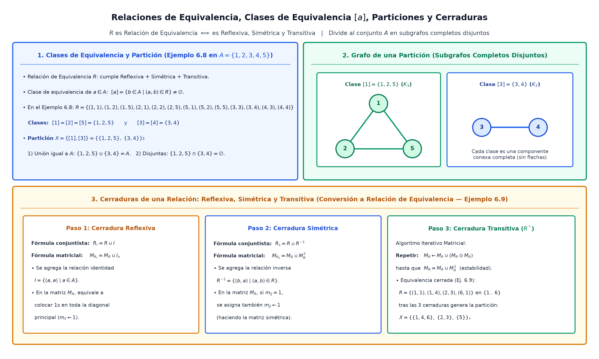

# 5.3 Relaciones de equivalencia (Cerraduras, Clases de equivalencia, Particiones)

## Introducción

En matemáticas y ciencias de la computación, la igualdad ordinaria ($a = b$) no es la única manera de considerar que dos objetos son «equivalentes» para cierto propósito. Por ejemplo, dos programas que producen la misma salida son funcionalmente equivalentes, dos enteros que dejan el mismo residuo al dividirse entre $m$ son congruentes módulo $m$, y dos computadoras en una red local que pueden enviarse paquetes mutuamente pertenecen a la misma subred o componente conexa (Jiménez Murillo, 2012, Cap. 6.4, pp. 235–242).

Toda relación que generaliza el concepto de igualdad cumpliendo las propiedades **reflexiva, simétrica y transitiva** se denomina una **relación de equivalencia**, y posee la propiedad extraordinaria de dividir al conjunto $A$ en bloques disjuntos llamados **clases de equivalencia** que forman una **partición** de $A$. Además, cuando una relación inicial no es de equivalencia, podemos transformarla en una agregándole el mínimo número de pares ordenados mediante el cálculo de sus **cerraduras**.

---

## 1. Relaciones de Equivalencia

### Definición Formal
Una relación binaria $R \subseteq A \times A$ definida sobre un conjunto no vacío $A$ es una **relación de equivalencia** si y sólo si cumple simultáneamente las tres propiedades siguientes para cualesquiera $a, b, c \in A$ (Jiménez Murillo, 2012, Cap. 6.4, p. 235; Lipschutz & Lipson, 2009, Cap. 2.8, p. 28; Johnsonbaugh, 2005, Def. 3.2.1):

1. **Reflexiva:** $\forall a \in A,\; (a, a) \in R \quad$ *(en la matriz $M_R$: toda la diagonal principal tiene unos, $I_n \subseteq M_R$)*.
2. **Simétrica:** Si $(a, b) \in R$, entonces $(b, a) \in R \quad$ *(en la matriz $M_R$: es igual a su transpuesta, $M_R = M_R^T = M_{R^{-1}}$)*.
3. **Transitiva:** Si $(a, b) \in R$ y $(b, c) \in R$, entonces $(a, c) \in R \quad$ *(en la matriz $M_R$: se cumple $M_R = M_R + M_R^2$)*.

> **Interpretación en Redes de Computadoras (Jiménez Murillo, 2012, p. 238):**  
> En una red de computadoras, la relación de comunicación debe ser una **relación de equivalencia**:
> - *Reflexiva:* Toda computadora tiene comunicación consigo misma (*loopback* `127.0.0.1`).
> - *Simétrica:* Si la computadora $1$ puede enviar información a la computadora $2$, entonces la computadora $2$ también puede responder y comunicarse con la $1$.
> - *Transitiva:* Si existe un enlace de comunicación de la computadora $1$ a la $2$, y otro de la $2$ a la $5$, entonces existe comunicación entre la $1$ y la $5$.

---

## 2. Clases de Equivalencia ($[a]$)

Sea $R$ una relación de equivalencia sobre un conjunto $A$. Para cada elemento $a \in A$, la **clase de equivalencia de $a$**, denotada por **$[a]$** (o $[a]_R$), es el subconjunto de $A$ formado por **todos los elementos que están relacionados con $a$** (Jiménez Murillo, 2012, p. 235; Lipschutz & Lipson, 2009, p. 28):

$$\boxed{[a] = \big\{b \in A \;\big|\; (a, b) \in R\big\} = \big\{b \in A \;\big|\; a R b\big\}}$$

*(A cualquier elemento $x \in [a]$ se le llama un **representante** de la clase $[a]$).*

### Propiedades Fundamentales de las Clases de Equivalencia (Lema de Equivalencia)
Para cualesquiera elementos $a, b \in A$ bajo una relación de equivalencia $R$:
1. **Ninguna clase de equivalencia es vacía ($[a] \neq \emptyset$):** Por la propiedad **reflexiva**, todo elemento se relaciona consigo mismo ($(a, a) \in R$), por lo que siempre **$a \in [a]$** (Jiménez Murillo, 2012, p. 237).
2. **Lectura directa en la matriz $M_R$:** En la matriz booleana $M_R$, la clase de equivalencia $[a_i]$ está integrada exactamente por los elementos cuyas columnas tienen un **$1$ en la fila $a_i$**.
3. **Igualdad o disjunción total de dos clases:** Dos clases de equivalencia $[a]$ y $[b]$ o son **idénticas** o son **mutuamente disjuntas** (no tienen ningún elemento en común):
   $$[a] = [b] \iff (a, b) \in R, \qquad\text{y}\qquad [a] \neq [b] \iff [a] \cap [b] = \emptyset$$

---

## 3. Particiones y Subgrafos Completos

### Definición de Partición de un Conjunto
Una **partición** $X$ (o $\mathcal{P}$) de un conjunto no vacío $A$ es un conjunto de subconjuntos no vacíos (un conjunto de clases de equivalencia distintas) $X = \{A_1, A_2, \dots, A_k\}$ que satisface las siguientes propiedades (Jiménez Murillo, 2012, pp. 235–236; Lipschutz & Lipson, 2009, Teorema 2.6, p. 28):
1. **No vacuidad de cada bloque:** $A_i \neq \emptyset$ para todo $i \in \{1, \dots, k\}$.
2. **Cobertura total (Unión exhaustiva):** En la partición están contenidos todos los elementos del conjunto $A$:
   $$A_1 \cup A_2 \cup \dots \cup A_k = A$$
3. **Disjunción por pares:** La intersección entre dos clases distintas de la partición es siempre vacía:
   $$A_i \cap A_j = \emptyset \qquad \text{para todo } A_i \neq A_j$$

En notación de clases de equivalencia (Jiménez Murillo, 2012, p. 236):
$$X = \big\{[a] \;\big|\; a \in A,\;\text{eligiendo un solo representante por cada clase distinta}\big\}$$

### Teorema Fundamental de las Relaciones de Equivalencia y Grafos de Partición
> **Teorema Fundamental (Lipschutz & Lipson, 2009, Teorema 2.6, p. 28; Jiménez Murillo, 2012, p. 238):**  
> 1. *Toda relación de equivalencia $R$ sobre un conjunto $A$ induce de manera única una **partición** $X = A/R$ de $A$, cuyos bloques son las clases de equivalencia distintas de $R$.*  
> 2. *Recíprocamente, toda partición $X = \{A_1, A_2, \dots, A_k\}$ de $A$ define una única relación de equivalencia $R$ sobre $A$ dada por:*
>    $$R = (A_1 \times A_1) \cup (A_2 \times A_2) \cup \dots \cup (A_k \times A_k)$$

- **Representación gráfica de una partición (Jiménez Murillo, 2012, p. 238):**
  El grafo de una relación de equivalencia $R$ queda **partido en subgrafos completos aislados entre sí**, uno por cada clase de equivalencia de la partición $X$. Como en una relación de equivalencia toda conexión es simétrica y reflexiva, habitualmente se suprimen las cabezas de flecha y los lazos para representar cada clase de la partición como un **grafo no dirigido completo ($K_m$)** independiente.

---

## 4. Cerraduras de una Relación (Reflexiva, Simétrica y Transitiva)

Cuando una relación $R$ sobre $A$ **no** es una relación de equivalencia porque le falta ser reflexiva, simétrica o transitiva, podemos agregarle el **conjunto mínimo de pares ordenados necesarios** para que adquiera dichas propiedades. Este proceso se denomina aplicar las **cerraduras** (o *clausuras*) de la relación (Jiménez Murillo, 2012, Cap. 6.4.1, pp. 239–242; Lipschutz & Lipson, 2009, Cap. 2.7, p. 27):

### 4.1 Cerradura Reflexiva ($R_r$)
Es la relación reflexiva más pequeña que contiene a $R$. Se obtiene agregando a $R$ todos los pares de la diagonal principal que le falten, es decir, uniendo $R$ con la **relación identidad $I = \{(a, a) \mid a \in A\}$**:

$$\boxed{\text{Por conjuntos:}\quad R_r = R \cup I \qquad\qquad \text{Por matrices:}\quad M_{R_r} = M_R \cup I_n}$$

*(En la matriz $M_R$, consiste simplemente en poner **$1\text{s}$ en toda la diagonal principal**).*

### 4.2 Cerradura Simétrica ($R_s$)
Es la relación simétrica más pequeña que contiene a $R$. Se obtiene agregando a $R$ su **relación inversa $R^{-1}$** (de modo que por cada par $(a, b) \in R$ se garantiza que también esté $(b, a)$):

$$\boxed{\text{Por conjuntos:}\quad R_s = R \cup R^{-1} \qquad\qquad \text{Por matrices:}\quad M_{R_s} = M_R \cup M_{R^{-1}} = M_R \cup M_R^T}$$

*(En la matriz $M_R$, si en la posición $(i, j)$ hay un $1$, se coloca también un $1$ en su posición simétrica $(j, i)$).*

### 4.3 Cerradura Transitiva ($R^*$ o $R_t$) y Algoritmo Iterativo Matricial
La **cerradura transitiva** de $R$ es la relación transitiva más pequeña que contiene a $R$. Se obtiene agregando a $R$ la matriz que resulta de multiplicar booleanamente la relación por sí misma ($M_R \cup M_R^2$). Sin embargo, como advierte Jiménez Murillo (2012, p. 239), al agregar nuevos pares en $M_R \cup M_R^2$ pueden surgir nuevos caminos de mayor longitud, por lo que **no siempre basta con sumar $M_R^2$ una sola vez**, sino que debe iterarse el proceso hasta alcanzar la estabilidad:

#### Algoritmo Matricial de Cerradura Transitiva (Jiménez Murillo, 2012, Diagrama de flujo p. 239)
1. **Entrada:** La matriz booleana cuadrada $M_R$ (de orden $n \times n$).
2. **Calcular el cuadrado booleano:** $M_R^2 = M_R \odot M_R$.
3. **Prueba de parada (Condición de transitividad):**
   - ¿Se cumple que $M_R \neq M_R \cup M_R^2$?
   - **Si NO** (es decir, si $M_R = M_R \cup M_R^2$): la matriz ya no cambió; **terminar**, pues $M_R$ ya es transitiva.
   - **Si SÍ** (aparecieron nuevos unos en $M_R \cup M_R^2$): actualizar la matriz haciendo:
     $$M_R \leftarrow M_R \cup M_R^2$$
     y **regresar al Paso 2** para calcular el nuevo $M_R^2$ con la matriz actualizada.

*(Nota teórica: En un conjunto finito de $n$ elementos, la cerradura transitiva equivale a $R^* = R \cup R^2 \cup R^3 \cup \dots \cup R^n$, y también puede calcularse en $n$ pasos mediante el **Algoritmo de Warshall**).*

### 4.4 Conversión de Cualquier Relación $R$ en una Relación de Equivalencia (Cerradura de Equivalencia)
Para convertir una relación arbitraria $R$ sobre $A$ en la menor **relación de equivalencia** que la contiene, se aplican en orden las tres cerraduras (Jiménez Murillo, 2012, Ej. 6.9, pp. 240–242):
$$\text{Paso 1: Cerradura Reflexiva } (M_R \leftarrow M_R \cup I) \quad\longrightarrow\quad \text{Paso 2: Cerradura Simétrica } (M_R \leftarrow M_R \cup M_R^T) \quad\longrightarrow\quad \text{Paso 3: Cerradura Transitiva iterativa } (M_R \leftarrow M_R \cup M_R^2)$$

---

## Ejemplos de Práctica (Resueltos Paso a Paso)

### Ejemplo 5.3.1: Verificación de una relación de equivalencia, clases de equivalencia, partición y grafo
Sean $A = B = \{1, 2, 3, 4, 5\}$ y la relación (Jiménez Murillo, 2012, Ej. 6.8, pp. 236–238):
$$R = \{(1, 1), (1, 2), (1, 5), (2, 1), (2, 2), (2, 5), (3, 3), (3, 4), (4, 3), (4, 4), (5, 1), (5, 2), (5, 5)\}$$
a) Demuestre mediante su matriz booleana que $R$ es una **relación de equivalencia**.  
b) Determine las **clases de equivalencia** $[1], [2], [3], [4], [5]$.  
c) Escriba la **partición** $X$ inducida sobre $A$ e interprete su grafo no dirigido.

**Solución:**
- **a) Verificación de las tres propiedades en $M_R$:**
  Construimos la matriz booleana de $R$:
  $$M_R = \begin{array}{c|ccccc}
  & 1 & 2 & 3 & 4 & 5 \\
  \hline
  1 & \mathbf{1} & 1 & 0 & 0 & 1 \\
  2 & 1 & \mathbf{1} & 0 & 0 & 1 \\
  3 & 0 & 0 & \mathbf{1} & 1 & 0 \\
  4 & 0 & 0 & 1 & \mathbf{1} & 0 \\
  5 & 1 & 1 & 0 & 0 & \mathbf{1}
  \end{array}$$
  1. **Reflexiva:** **Sí**, toda la diagonal principal contiene unos ($m_{ii} = 1$ para $i = 1, 2, 3, 4, 5$).
  2. **Simétrica:** **Sí**, la matriz coincide con su transpuesta ($M_R = M_R^T$).
  3. **Transitiva:** **Sí**, al calcular el producto booleano $M_R^2 = M_R \odot M_R$ se obtiene exactamente la misma matriz ($M_R^2 = M_R$), por lo que $M_R = M_R + M_R^2$. En conclusión, **$R$ es una relación de equivalencia**.

- **b) Clases de equivalencia ($[a] = \{b \in A \mid (a, b) \in R\}$):**
  Leyendo los elementos con $1$ en cada fila de $M_R$:
  $$\begin{aligned}
  [1] &= \{1, 2, 5\} \\
  [2] &= \{1, 2, 5\} \\
  [3] &= \{3, 4\} \\
  [4] &= \{3, 4\} \\
  [5] &= \{1, 2, 5\}
  \end{aligned}$$
  Observamos que $[1] = [2] = [5] = \{1, 2, 5\}$ y $[3] = [4] = \{3, 4\}$.

- **c) Partición $X$ y grafo de la relación:**
  Eligiendo una clase de cada grupo disjunto (por ejemplo $[1]$ y $[3]$), la **partición** de $A$ es:
  $$X = \big\{[1],\; [3]\big\} = \big\{\{1, 2, 5\},\; \{3, 4\}\big\}$$
  la cual cumple que $\{1, 2, 5\} \cup \{3, 4\} = \{1, 2, 3, 4, 5\} = A$ y $\{1, 2, 5\} \cap \{3, 4\} = \emptyset$. Su grafo no dirigido consta de **dos subgrafos completos desconectados entre sí**: un triángulo completo $K_3$ entre los nodos $\{1, 2, 5\}$ y una arista $K_2$ entre los nodos $\{3, 4\}$ (ver Figura en el panel superior derecho).

---

### Ejemplo 5.3.2: Aplicación paso a paso de las Cerraduras Reflexiva, Simétrica y Transitiva
Sean $A = B = \{1, 2, 3, 4, 5, 6\}$ y la relación inicial de sólo $4$ pares ordenados (Jiménez Murillo, 2012, Ej. 6.9, pp. 240–242):
$$R = \{(1, 1), (1, 4), (2, 3), (6, 1)\}$$
a) Explique por qué $R$ no es una relación de equivalencia.  
b) Aplique sucesivamente las **cerraduras reflexiva, simétrica y transitiva** usando matrices booleanas para convertir a $R$ en una relación de equivalencia.  
c) Determine las **clases de equivalencia** y la **partición** final obtenida.

**Solución:**
- **a) Diagnóstico inicial:**
  $R$ **no es reflexiva** (faltan $(2,2), (3,3), (4,4), (5,5), (6,6)$), **no es simétrica** (está $(2,3)$ pero no $(3,2)$; está $(1,4)$ pero no $(4,1)$; está $(6,1)$ pero no $(1,6)$) y **no es transitiva** (están $(6,1)$ y $(1,4)$, pero no está $(6,4)$).

- **b) Aplicación matricial de las tres cerraduras:**
  1. **Cerradura Reflexiva ($M_R \leftarrow M_R \cup I_6$):**
     Agregamos unos en toda la diagonal principal:
     $$M_{R_r} = M_R \cup I_6 = \begin{pmatrix} 1 & 0 & 0 & 1 & 0 & 0 \\ 0 & 1 & 1 & 0 & 0 & 0 \\ 0 & 0 & 1 & 0 & 0 & 0 \\ 0 & 0 & 0 & 1 & 0 & 0 \\ 0 & 0 & 0 & 0 & 1 & 0 \\ 1 & 0 & 0 & 0 & 0 & 1 \end{pmatrix}$$
  2. **Cerradura Simétrica ($M_R \leftarrow M_{R_r} \cup M_{R_r}^T$):**
     Agregamos los pares inversos $(4, 1), (3, 2)$ y $(1, 6)$ haciendo la matriz simétrica:
     $$M_{R_{rs}} = \begin{pmatrix} 1 & 0 & 0 & 1 & 0 & 1 \\ 0 & 1 & 1 & 0 & 0 & 0 \\ 0 & 1 & 1 & 0 & 0 & 0 \\ 1 & 0 & 0 & 1 & 0 & 0 \\ 0 & 0 & 0 & 0 & 1 & 0 \\ 1 & 0 & 0 & 0 & 0 & 1 \end{pmatrix}$$
  3. **Cerradura Transitiva ($M_R \leftarrow M_R \cup M_R^2$):**
     - *Primera iteración:* Multiplicamos booleanamente $M_{R_{rs}} \odot M_{R_{rs}}$. Como $(4, 1)$ se conecta con $(1, 6)$ y $(6, 1)$ se conecta con $(1, 4)$, aparecen los pares $(4, 6)$ y $(6, 4)$:
       $$M_R^{(1)} = M_{R_{rs}} \cup M_{R_{rs}}^2 = \begin{pmatrix} 1 & 0 & 0 & 1 & 0 & 1 \\ 0 & 1 & 1 & 0 & 0 & 0 \\ 0 & 1 & 1 & 0 & 0 & 0 \\ 1 & 0 & 0 & 1 & 0 & \mathbf{1} \\ 0 & 0 & 0 & 0 & 1 & 0 \\ 1 & 0 & 0 & \mathbf{1} & 0 & 1 \end{pmatrix}$$
     - *Segunda iteración (verificación de parada):* Calculamos el cuadrado booleano de $M_R^{(1)}$ y comprobamos que $(M_R^{(1)})^2 = M_R^{(1)}$, es decir, $M_R^{(1)} = M_R^{(1)} \cup (M_R^{(1)})^2$. ¡El algoritmo termina y la relación resultante ya es transitiva!

- **c) Clases de equivalencia y Partición resultante:**
  Leyendo las filas de la matriz final $M_R^{(1)}$:
  $$[1] = [4] = [6] = \{1, 4, 6\}, \qquad [2] = [3] = \{2, 3\}, \qquad [5] = \{5\}$$
  Por lo tanto, la **partición** de $A = \{1, 2, 3, 4, 5, 6\}$ está integrada por tres clases disjuntas:
  $$\boxed{X = \big\{[1],\; [2],\; [5]\big\} = \big\{\{1, 4, 6\},\; \{2, 3\},\; \{5\}\big\}}$$

---

### Ejemplo 5.3.3: Relación de Congruencia Módulo $m$ sobre los números enteros $\mathbb{Z}$
Sea $m \ge 2$ un entero positivo fijo y considérese sobre $A = \mathbb{Z}$ la relación de **congruencia módulo $m$** (Epp, 2012, Secc. 8.3; Lipschutz & Lipson, 2009, Ej. 2.11):
$$a R b \iff a \equiv b \pmod{m} \iff m \text{ divide a } (a - b) \quad (\text{es decir, } a - b = k \cdot m \text{ para algún } k \in \mathbb{Z})$$
a) Demuestre que la congruencia módulo $m$ es una relación de equivalencia sobre $\mathbb{Z}$.  
b) Describa las clases de equivalencia y la partición que induce para $m = 3$.

**Solución:**
- **a) Demostración de las tres propiedades para todo $a, b, c \in \mathbb{Z}$:**
  1. **Reflexiva:** Para todo $a \in \mathbb{Z}$, $a - a = 0 = 0 \cdot m$, por lo que $m \mid (a - a)$ y así $(a, a) \in R$.
  2. **Simétrica:** Si $(a, b) \in R$, existe $k \in \mathbb{Z}$ tal que $a - b = km$. Multiplicando por $-1$, se tiene $b - a = (-k)m$ con $-k \in \mathbb{Z}$, luego $(b, a) \in R$.
  3. **Transitiva:** Si $(a, b) \in R$ y $(b, c) \in R$, existen $k_1, k_2 \in \mathbb{Z}$ tales que $a - b = k_1 m$ y $b - c = k_2 m$. Sumando ambas ecuaciones:
     $$a - c = (a - b) + (b - c) = (k_1 + k_2)m$$
     Como $k_1 + k_2 \in \mathbb{Z}$, se cumple $(a, c) \in R$. Por tanto, es una relación de equivalencia. $\blacksquare$

- **b) Clases de equivalencia y partición para $m = 3$:**
  Al dividir cualquier entero entre $3$, los únicos residuos posibles son $0, 1$ y $2$. Esto divide a $\mathbb{Z}$ en exactamente **tres clases de equivalencia disjuntas** (las clases residuales módulo $3$):
  $$\begin{aligned}
  [0] &= \{\dots, -6, -3, 0, 3, 6, 9, \dots\} = \{3k \mid k \in \mathbb{Z}\} \\
  [1] &= \{\dots, -5, -2, 1, 4, 7, 10, \dots\} = \{3k + 1 \mid k \in \mathbb{Z}\} \\
  [2] &= \{\dots, -4, -1, 2, 5, 8, 11, \dots\} = \{3k + 2 \mid k \in \mathbb{Z}\}
  \end{aligned}$$
  La partición de $\mathbb{Z}$ es $X = \mathbb{Z}_3 = \{[0], [1], [2]\}$.

---

### Ejemplo 5.3.4: Reconstrucción de la relación de equivalencia y su matriz a partir de una partición
Sea el conjunto $A = \{1, 2, 3, 4, 5, 6\}$ y sea la colección de subconjuntos $X = \big\{\{1, 3, 5\},\; \{2, 6\},\; \{4\}\big\}$.
a) Verifique que $X$ cumple las condiciones para ser una **partición** de $A$.  
b) Obtenga el conjunto de pares ordenados y la matriz booleana $M_R$ de la relación de equivalencia $R$ inducida por $X$.

**Solución:**
- **a) Verificación de partición:**
  1. Ningún bloque es vacío: $\{1, 3, 5\} \neq \emptyset$, $\{2, 6\} \neq \emptyset$, $\{4\} \neq \emptyset$.
  2. Su unión es todo $A$: $\{1, 3, 5\} \cup \{2, 6\} \cup \{4\} = \{1, 2, 3, 4, 5, 6\} = A$.
  3. Son disjuntos dos a dos: $\{1, 3, 5\} \cap \{2, 6\} = \emptyset$, $\{1, 3, 5\} \cap \{4\} = \emptyset$ y $\{2, 6\} \cap \{4\} = \emptyset$.
  Por tanto, $X$ es una partición válida de $A$.

- **b) Relación de equivalencia $R$ y matriz $M_R$:**
  Por el Teorema Fundamental, $R$ es la unión de los productos cartesianos de cada bloque consigo mismo:
  $$\begin{aligned}
  R &= \{1, 3, 5\}^2 \cup \{2, 6\}^2 \cup \{4\}^2 \\
    &= \{(1,1),(1,3),(1,5),(3,1),(3,3),(3,5),(5,1),(5,3),(5,5)\} \cup \{(2,2),(2,6),(6,2),(6,6)\} \cup \{(4,4)\}
  \end{aligned}$$
  *(Total: $3^2 + 2^2 + 1^2 = 9 + 4 + 1 = 14$ pares ordenados).* Su matriz booleana es:
  $$M_R = \begin{pmatrix}
  1 & 0 & 1 & 0 & 1 & 0 \\
  0 & 1 & 0 & 0 & 0 & 1 \\
  1 & 0 & 1 & 0 & 1 & 0 \\
  0 & 0 & 0 & 1 & 0 & 0 \\
  1 & 0 & 1 & 0 & 1 & 0 \\
  0 & 1 & 0 & 0 & 0 & 1
  \end{pmatrix}$$

---

## Ejercicios de Tarea (Práctica en Casa)

> **Instrucciones:** En cada ejercicio muestre todas las operaciones matriciales booleanas paso a paso, listando claramente las clases de equivalencia y la partición resultante.

1. **Verificación de relaciones de equivalencia, clases y particiones (Jiménez Murillo, Prob. 6.4a y 6.4c, p. 273):**  
   Sea $A = \{1, 2, 3, 4, 5\}$. Para cada una de las siguientes relaciones sobre $A$, determine si es una relación de equivalencia; en caso afirmativo, obtenga todas sus clases de equivalencia, su partición $X$ y describa su grafo no dirigido:  
   a) $R_1 = \{(1, 1), (1, 3), (1, 5), (2, 2), (2, 4), (3, 1), (3, 3), (3, 5), (4, 2), (4, 4), (5, 1), (5, 3), (5, 5)\}$  
   b) $R_2 = \{(1, 1), (1, 2), (2, 1), (2, 2), (2, 3), (3, 2), (3, 3), (4, 4), (4, 5), (5, 4), (5, 5)\}$
   <!--
   Solución del Ejercicio 1:
   - Inciso a):
     1) Matriz booleana M_{R_1}:
        1: [1, 0, 1, 0, 1]
        2: [0, 1, 0, 1, 0]
        3: [1, 0, 1, 0, 1]
        4: [0, 1, 0, 1, 0]
        5: [1, 0, 1, 0, 1]
     2) Es reflexiva (diagonal de 1s), simétrica (M_{R_1} = M_{R_1}^T) y transitiva (M_{R_1}^2 = M_{R_1}). Por lo tanto, R_1 SÍ es una relación de equivalencia.
     3) Clases de equivalencia:
        [1] = [3] = [5] = {1, 3, 5}
        [2] = [4] = {2, 4}
     4) Partición: X = {[1], [2]} = {{1, 3, 5}, {2, 4}}.
     5) Grafo no dirigido: Dos componentes completas disjuntas: un triángulo K_3 con vértices {1, 3, 5} y un segmento K_2 con vértices {2, 4}.

   - Inciso b):
     1) Matriz booleana M_{R_2}:
        1: [1, 1, 0, 0, 0]
        2: [1, 1, 1, 0, 0]
        3: [0, 1, 1, 0, 0]
        4: [0, 0, 0, 1, 1]
        5: [0, 0, 0, 1, 1]
     2) Es reflexiva (diagonal de 1s) y es simétrica (M_{R_2} = M_{R_2}^T).
        Sin embargo, ¡NO es transitiva! Porque (1, 2) in R_2 y (2, 3) in R_2, pero (1, 3) notin R_2 (ni (3, 1) in R_2).
        Por lo tanto, R_2 NO es una relación de equivalencia (si se le aplicara la cerradura transitiva agregando (1,3) y (3,1), entonces tendría la partición {{1, 2, 3}, {4, 5}}).
   -->

2. **Aplicación de cerraduras para obtener una relación de equivalencia (Jiménez Murillo, Prob. 6.5a y 6.5b, p. 273):**  
   Sea el conjunto $A = \{1, 2, 3, 4, 5, 6\}$. Para cada una de las siguientes relaciones iniciales:  
   (i) Aplique paso a paso las **cerraduras reflexiva, simétrica y transitiva** usando matrices booleanas hasta obtener una relación de equivalencia.  
   (ii) Determine las clases de equivalencia y la partición $X$ de la relación cerrada.  
   a) $R_a = \{(1, 2), (2, 6), (4, 5)\}$  
   b) $R_b = \{(1, 5), (2, 4), (4, 3), (6, 6)\}$
   <!--
   Solución del Ejercicio 2:
   - Inciso a): R_a = {(1, 2), (2, 6), (4, 5)} en A = {1, 2, 3, 4, 5, 6}
     1) Cerradura Reflexiva (R_a u I_6):
        Se agregan (1,1), (2,2), (3,3), (4,4), (5,5), (6,6).
     2) Cerradura Simétrica (agregando inversos):
        Se agregan (2, 1), (6, 2) y (5, 4).
        Hasta aquí están conectados: 1 <-> 2 <-> 6,  4 <-> 5,  y el 3 solo.
     3) Cerradura Transitiva (iterando M_R <- M_R u M_R^2):
        - En la primera multiplicación M_R^2, como están (1, 2) y (2, 6) se agrega (1, 6), y como están (6, 2) y (2, 1) se agrega (6, 1).
        - En la segunda iteración ya se cumple M_R = M_R u M_R^2.
     4) Clases de equivalencia de la relación cerrada:
        [1] = [2] = [6] = {1, 2, 6}
        [3] = {3}
        [4] = [5] = {4, 5}
     5) Partición: X = {[1], [3], [4]} = {{1, 2, 6}, {3}, {4, 5}}.

   - Inciso b): R_b = {(1, 5), (2, 4), (4, 3), (6, 6)} en A = {1, 2, 3, 4, 5, 6}
     1) Cerradura Reflexiva (R_b u I_6):
        Se agregan (1,1), (2,2), (3,3), (4,4), (5,5) (el (6,6) ya estaba).
     2) Cerradura Simétrica:
        Se agregan (5, 1), (4, 2) y (3, 4).
     3) Cerradura Transitiva:
        Por los caminos 2 <-> 4 <-> 3, al multiplicar M_R por sí misma se agregan los pares (2, 3) y (3, 2). En la siguiente iteración ya no hay cambios.
     4) Clases de equivalencia:
        [1] = [5] = {1, 5}
        [2] = [3] = [4] = {2, 3, 4}
        [6] = {6}
     5) Partición: X = {[1], [2], [6]} = {{1, 5}, {2, 3, 4}, {6}}.
   -->

3. **Cerradura transitiva pura de una cadena dirigida:**  
   Sea $A = \{1, 2, 3, 4\}$ y sea la relación dirigida $R = \{(1, 2), (2, 3), (3, 4)\}$.  
   Calcule únicamente la **cerradura transitiva** $R^*$ aplicando el algoritmo matricial iterativo $M_R \leftarrow M_R \cup M_R^2$ (sin aplicar cerradura reflexiva ni simétrica) e indique cuántas iteraciones requiere.
   <!--
   Solución del Ejercicio 3:
   Matriz inicial M_R:
   1: [0, 1, 0, 0]
   2: [0, 0, 1, 0]
   3: [0, 0, 0, 1]
   4: [0, 0, 0, 0]
   - Iteración 1:
     Calculamos M_R^2 = M_R (.) M_R, que descubre los caminos de longitud 2: (1, 3) y (2, 4).
     Actualizamos M_R^(1) = M_R u M_R^2:
     1: [0, 1, 1, 0]
     2: [0, 0, 1, 1]
     3: [0, 0, 0, 1]
     4: [0, 0, 0, 0]
   - Iteración 2:
     Calculamos (M_R^(1))^2 = M_R^(1) (.) M_R^(1), que descubre el camino (1, 4) (por (1,2)+(2,4) y (1,3)+(3,4)).
     Actualizamos M_R^(2) = M_R^(1) u (M_R^(1))^2:
     1: [0, 1, 1, 1]
     2: [0, 0, 1, 1]
     3: [0, 0, 0, 1]
     4: [0, 0, 0, 0]
   - Iteración 3 (Verificación):
     Al elevar M_R^(2) al cuadrado, no aparece ningún 1 nuevo: M_R^(2) u (M_R^(2))^2 = M_R^(2).
     Por lo tanto, la cerradura transitiva es:
     R^* = {(1, 2), (1, 3), (1, 4), (2, 3), (2, 4), (3, 4)}.
   -->

4. **Relación de equivalencia sobre pares ordenados y números de Bell:**  
   Sea $A = \{1, 2, 3, 4\}$ y defínase sobre el conjunto de pares $S = A \times A$ la relación $R$ dada por:
   $$(a, b) R (c, d) \iff a + d = b + c$$
   a) Demuestre que $R$ es una relación de equivalencia sobre $S$ *(Sugerencia: reescriba la condición como $a - b = c - d$)*.  
   b) Encuentre todas las clases de equivalencia en que se divide $S = A \times A$ e indique la cardinalidad de cada clase.
   <!--
   Solución del Ejercicio 4:
   - a) Demostración:
        Observemos que en los enteros, a + d = b + c <=> a - b = c - d.
        Definamos f(x, y) = x - y. Entonces (a, b) R (c, d) <=> f(a, b) = f(c, d).
        - Reflexiva: a - b = a - b => a + b = b + a, luego (a, b) R (a, b).
        - Simétrica: Si a - b = c - d, entonces c - d = a - b, luego (c, d) R (a, b).
        - Transitiva: Si a - b = c - d y c - d = e - f, por transitividad de la igualdad se tiene a - b = e - f, es decir, a + f = b + e, luego (a, b) R (e, f).
        Por tanto, R es una relación de equivalencia sobre S.

   - b) Clases de equivalencia en S = {1, 2, 3, 4} x {1, 2, 3, 4} (16 pares en total):
        Dos pares pertenecen a la misma clase si y sólo si su diferencia d_0 = a - b es la misma. Como a, b in {1, 2, 3, 4}, los valores posibles de a - b van desde 1 - 4 = -3 hasta 4 - 1 = +3 (7 clases de equivalencia):
        1) Clase con a - b = -3 (1 par):   [(1, 4)] = {(1, 4)}
        2) Clase con a - b = -2 (2 pares): [(1, 3)] = {(1, 3), (2, 4)}
        3) Clase con a - b = -1 (3 pares): [(1, 2)] = {(1, 2), (2, 3), (3, 4)}
        4) Clase con a - b =  0 (4 pares): [(1, 1)] = {(1, 1), (2, 2), (3, 3), (4, 4)}
        5) Clase con a - b = +1 (3 pares): [(2, 1)] = {(2, 1), (3, 2), (4, 3)}
        6) Clase con a - b = +2 (2 pares): [(3, 1)] = {(3, 1), (4, 2)}
        7) Clase con a - b = +3 (1 par):   [(4, 1)] = {(4, 1)}
        Suma de cardinalidades: 1 + 2 + 3 + 4 + 3 + 2 + 1 = 16 = |S|.
   -->
