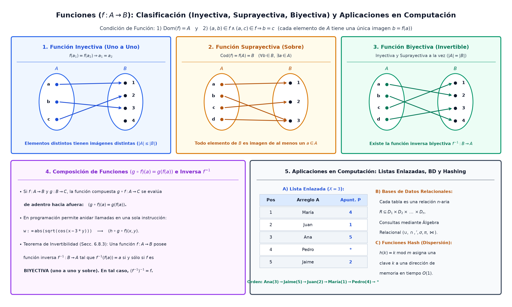

# 5.4 Funciones (Inyectiva, Suprayectiva, Biyectiva)

## Introducción

Las **funciones** constituyen una clase especial y fundamental de relaciones binarias. Mientras que en una relación general un elemento del primer conjunto puede estar vinculado con varios elementos del segundo conjunto (o con ninguno), en una **función** cada entrada válida produce de manera determinista **un único resultado** (Jiménez Murillo, 2012, Cap. 6.8, p. 257; Lipschutz & Lipson, 2009, Cap. 3.2; Epp, 2012, Cap. 7.1).

Tanto las matemáticas clásicas (álgebra, cálculo, geometría analítica) como la totalidad de los lenguajes de programación modernos (`C++`, `Java`, `Python`, `Pascal`) descansan sobre el concepto de función: un bloque que recibe uno o más **argumentos** (o parámetros de entrada) y devuelve **un único valor de retorno** o imagen.

---

## 1. Definición Formal de Función, Argumento e Imagen

### 1.1 Condiciones para que una Relación sea una Función
Sean $A$ y $B$ dos conjuntos no vacíos. Una **función** $f$ de $A$ en $B$, denotada por:

$$f: A \to B$$

es una relación binaria $f \subseteq A \times B$ que asigna a **cada** elemento $a \in A$ **un único** elemento $b \in B$ (Jiménez Murillo, 2012, Cap. 6.8, p. 257).

> **Principio fundamental:**  
> *Todas las funciones son relaciones, pero **no** todas las relaciones son funciones.*

Para que una relación $f \subseteq A \times B$ sea considerada una **función de $A$ en $B$**, debe satisfacer obligatoriamente **dos condiciones** (Jiménez Murillo, 2012, p. 257):
1. **Condición de existencia (Dominio total):**
   $$\operatorname{Dom}(f) = A$$
   Es decir, **todos y cada uno** de los elementos del conjunto de partida $A$ deben aparecer como primer elemento en algún par ordenado de $f$ *(ningún elemento de $A$ puede quedarse sin relacionar)*.
2. **Condición de unicidad (Valor único):**
   $$\text{Si } (a, b) \in f \quad\land\quad (a, c) \in f \implies b = c$$
   Es decir, cada elemento $a \in A$ debe estar relacionado con **exactamente un solo elemento** de $B$ *(de un mismo nodo $a \in A$ nunca pueden salir dos flechas distintas)*.

- **Criterio en la Matriz Booleana $M_f$:** Una matriz booleana $M_f$ de dimensión $|A| \times |B|$ representa una función $f: A \to B$ si y sólo si **en cada fila de $M_f$ hay exactamente un solo $1$** (y todos los demás elementos de esa fila son $0$).

### 1.2 Notación Funcional: Variable Independiente, Argumento e Imagen
Por la condición de unicidad, si $(a, b) \in f$, el elemento $b \in B$ queda determinado de manera única por $a \in A$, por lo que se escribe:

$$\boxed{b = f(a)}$$

En esta expresión (Jiménez Murillo, 2012, p. 258):
- **$a \in A$:** Se denomina **variable independiente**, **preimagen** o, en computación, **argumento (o parámetro)** de la función.
- **$b = f(a) \in B$:** Se denomina **variable dependiente**, **valor de la función** para el argumento $a$, o **imagen de $a$ bajo $f$**.
- **Conjunto Imagen o Codominio activo de la función ($\operatorname{Cod}(f)$ o $f(A)$):** Es el subconjunto de $B$ formado por todas las imágenes de los elementos de $A$:
  $$\operatorname{Cod}(f) = f(A) = \big\{f(a) \;\big|\; a \in A\big\} \subseteq B$$

### 1.3 Criterio Geométrico de la Recta Vertical
Cuando una relación entre números reales ($\mathbb{R} \to \mathbb{R}$) se representa mediante su gráfica en el plano cartesiano $(x, y)$, el **criterio de la recta vertical** permite distinguir visualmente si se trata de una función (Jiménez Murillo, 2012, p. 261):
- Si al trazar cualquier recta vertical (perpendicular al eje de las abscisas $X$) ésta corta a la gráfica en **a lo sumo un punto** (un único punto para cada $x \in \operatorname{Dom}(f)$), entonces la gráfica **corresponde a una función** (por ejemplo, $y = x^2 + 3x - 1$, $y = x^3 + 2$, $y = \cos(x)$).
- Si existe alguna recta vertical que corte a la gráfica en **dos o más puntos**, entonces a un mismo valor de $x$ le corresponden dos o más valores distintos de $y$, por lo que la gráfica **NO es una función, sino únicamente una relación** (por ejemplo, una circunferencia $x^2 + y^2 = r^2$ o una parábola horizontal $y^2 = x$).

---

## 2. Clasificación de las Funciones: Inyectiva, Suprayectiva y Biyectiva

De acuerdo con la forma en que los elementos del dominio $A$ se proyectan sobre los elementos del conjunto de llegada $B$, las funciones $f: A \to B$ se clasifican en tres tipos esenciales (Jiménez Murillo, 2012, Cap. 6.8.2, pp. 262–264; Lipschutz & Lipson, 2009, Cap. 3.4, pp. 46–47; Epp, 2012, Secc. 7.2):

### 2.1 Función Inyectiva (Uno a Uno)
Una función $f: A \to B$ se llama **inyectiva** (o **uno a uno**) si a elementos distintos del conjunto $A$ les corresponden siempre imágenes distintas en el conjunto $B$:

$$\boxed{\forall a, a' \in A:\quad f(a) = f(a') \implies a = a' \qquad \big(\text{o por contrapositiva: }\; a \neq a' \implies f(a) \neq f(a')\big)}$$

- **En el diagrama de flechas:** A cada elemento de $B$ le llega **cuando mucho una flecha** (una o ninguna; jamás dos flechas apuntan al mismo elemento de $B$).
- **En la matriz booleana $M_f$:** Cada fila tiene exactamente un $1$, y **cada columna tiene a lo sumo un $1$** (ceros o un solo $1$).
- **En una gráfica cartesiana (Criterio de la recta horizontal):** Toda recta horizontal corta a la gráfica en **a lo sumo un punto**.
- **Condición de cardinalidad en conjuntos finitos:** Si existe una función inyectiva $f: A \to B$, entonces necesariamente $|A| \le |B|$ *(Principio del Palomar o de las Casillas)*.

---

### 2.2 Función Suprayectiva (Sobre o Sobreyectiva)
Una función $f: A \to B$ se llama **suprayectiva** (también llamada **sobre** o **sobreyectiva**) si el conjunto de los segundos elementos de los pares ordenados de la función coincide con **todo** el conjunto $B$, es decir, si cada elemento de $B$ es imagen de **al menos un** elemento de $A$ (Jiménez Murillo, 2012, p. 263):

$$\boxed{\operatorname{Cod}(f) = f(A) = B \qquad \big(\text{es decir, }\; \forall b \in B,\; \exists a \in A \text{ tal que } f(a) = b\big)}$$

- **En el diagrama de flechas:** A **todos** los elementos de $B$ les llega **por lo menos una flecha** (una, dos o más; ningún elemento de $B$ queda vacío o suelto).
- **En la matriz booleana $M_f$:** Cada fila tiene exactamente un $1$, y **cada columna tiene por lo menos un $1$** (ninguna columna es de puros ceros).
- **Condición de cardinalidad en conjuntos finitos:** Si existe una función suprayectiva $f: A \to B$, entonces necesariamente $|A| \ge |B|$.

---

### 2.3 Función Biyectiva (Correspondencia Uno a Uno / Biunívoca)
Una función $f: A \to B$ se llama **biyectiva** (o una **biyección** o *correspondencia uno a uno*) si es **inyectiva y suprayectiva a la vez**:

$$\boxed{f \text{ es biyectiva} \iff f \text{ es inyectiva (uno a uno)} \quad\land\quad f \text{ es suprayectiva (sobre)}}$$

- **En el diagrama de flechas:** A cada elemento de $B$ le llega **exactamente una y sólo una flecha** desde $A$ (emparejamiento perfecto entre $A$ y $B$).
- **En la matriz booleana $M_f$:** Es una **matriz de permutación** cuadrada donde cada fila tiene exactamente un $1$ y cada columna tiene exactamente un $1$.
- **Condición de cardinalidad:** En conjuntos finitos, existe una biyección $f: A \to B$ si y sólo si **$|A| = |B|$**.

### Resumen Comparativo y Conteo Combinatorio de Funciones Finitas
Si $|A| = m$ y $|B| = n$:
- **Total de funciones $f: A \to B$:** $n^m = |B|^{|A|}$ (pues cada uno de los $m$ elementos de $A$ tiene $n$ opciones en $B$).
- **Total de funciones inyectivas ($m \le n$):** $P(n, m) = \frac{n!}{(n - m)!} = n(n - 1)\cdots(n - m + 1)$.
- **Total de funciones biyectivas ($m = n$):** $n! = n(n - 1)(n - 2)\cdots 1$.

---

## 3. Composición de Funciones y Funciones Invertibles

### 3.1 Composición de Funciones ($g \circ f$)
Sean $f: A \to B$ y $g: B \to C$ dos funciones tales que el conjunto de llegada de $f$ coincide con el dominio de $g$. La **función compuesta** de $f$ y $g$, denotada por **$g \circ f: A \to C$**, es la función que asigna a cada $a \in A$ el elemento $g(f(a)) \in C$ (Jiménez Murillo, 2012, Cap. 6.8.1, pp. 261–262; Lipschutz & Lipson, 2009, p. 45):

$$\boxed{(g \circ f)(a) = g\big(f(a)\big) \qquad \forall a \in A}$$

- **Regla de evaluación (de adentro hacia afuera):** Primero se evalúa la función interna $b = f(a)$, y el resultado obtenido se pasa como argumento a la función externa $c = g(b)$.
- **No conmutatividad:** En general, la composición de funciones **no es conmutativa**:
  $$g \circ f \neq f \circ g$$
- **Asociatividad:** Si $f: A \to B$, $g: B \to C$ y $h: C \to D$, entonces $(h \circ g) \circ f = h \circ (g \circ f)$.

### 3.2 Funciones Invertibles ($f^{-1}$)
Dada una función $f: A \to B$, sabemos que como relación siempre posee una relación inversa $f^{-1} = \{(b, a) \in B \times A \mid (a, b) \in f\}$. Sin embargo, esa relación inversa $f^{-1}$ **no siempre es una función** de $B$ en $A$:
- Si $f$ **no es suprayectiva**, habrá algún elemento $b \in B$ sin preimagen, por lo que $\operatorname{Dom}(f^{-1}) \neq B$ (falla la primera condición de función).
- Si $f$ **no es inyectiva**, existirán $a_1 \neq a_2$ con $f(a_1) = f(a_2) = b$, por lo que en $f^{-1}$ al elemento $b$ le corresponderán dos imágenes distintas $(b, a_1)$ y $(b, a_2)$ (falla la segunda condición de función).

De aquí se deduce el teorema fundamental de invertibilidad (Jiménez Murillo, 2012, Cap. 6.8.3, p. 265; Lipschutz & Lipson, 2009, Teorema 3.2, p. 47):

> **Teorema de las Funciones Invertibles:**  
> 1. *Una función $f: A \to B$ es **invertible** (es decir, su relación inversa $f^{-1}: B \to A$ es una función) **si y sólo si $f$ es biyectiva** (inyectiva y suprayectiva).*  
> 2. *Si $f: A \to B$ es biyectiva, entonces su función inversa $f^{-1}: B \to A$ también es biyectiva, $(f^{-1})^{-1} = f$, y para todo $a \in A$ y $b \in B$ se cumple:*
>    $$b = f(a) \iff a = f^{-1}(b), \qquad (f^{-1} \circ f)(a) = a \;\; (I_A), \qquad (f \circ f^{-1})(b) = b \;\; (I_B)$$

- **Procedimiento algebraico para hallar $f^{-1}$ en funciones reales biyectivas:** Se escribe la ecuación $b = f(a)$ (o $y = f(x)$) y se **despeja la variable independiente $a$ en función de $b$**, obteniendo $a = f^{-1}(b)$ (Jiménez Murillo, 2012, Ej. 6.20, p. 266).

---

## Ejemplos de Práctica (Resueltos Paso a Paso)

### Ejemplo 5.4.1: Identificación de funciones frente a relaciones
Sean los conjuntos $A = \{1, 2, 3, 4\}$ y $B = \{a, b, c\}$. Determine cuáles de las siguientes relaciones de $A$ en $B$ son **funciones** y justifique por qué fallan las que no lo son (Jiménez Murillo, 2012, Ej. 6.14, pp. 257–258):
a) $R_1 = \{(1, b), (2, c), (3, a), (4, b)\}$  
b) $R_2 = \{(1, a), (2, c), (1, b), (3, a), (4, c)\}$  
c) $R_3 = \{(1, c), (2, c), (3, c), (4, c)\}$  
d) $R_4 = \{(1, b), (2, c), (4, a)\}$

**Solución:**
- **a) $R_1 = \{(1, b), (2, c), (3, a), (4, b)\}$:** **SÍ es una función**, porque cumple ambas condiciones: $\operatorname{Dom}(R_1) = \{1, 2, 3, 4\} = A$, y cada elemento de $A$ aparece como primera componente una única vez.
- **b) $R_2 = \{(1, a), (2, c), (1, b), (3, a), (4, c)\}$:** **NO es una función**, porque viola la **segunda condición (unicidad)**: el elemento $1 \in A$ está relacionado con dos elementos distintos de $B$, ya que $(1, a) \in R_2$ y $(1, b) \in R_2$ con $a \neq b$.
- **c) $R_3 = \{(1, c), (2, c), (3, c), (4, c)\}$:** **SÍ es una función** (llamada *función constante*), ya que $\operatorname{Dom}(R_3) = A$ y a cada elemento de $A$ se le asigna un único elemento de $B$ (el elemento $c$).
- **d) $R_4 = \{(1, b), (2, c), (4, a)\}$:** **NO es una función** de $A$ en $B$, porque viola la **primera condición**: $\operatorname{Dom}(R_4) = \{1, 2, 4\} \neq A$ (el elemento $3 \in A$ no tiene imagen asignada).

---

### Ejemplo 5.4.2: Clasificación de funciones como inyectivas, suprayectivas o biyectivas
En cada uno de los siguientes incisos, determine si la función dada $f: A \to B$ es **inyectiva**, **suprayectiva** y/o **biyectiva**, justificando detalladamente (Jiménez Murillo, 2012, Ej. 6.18, p. 264):
a) $A = \{a, b, c, d\}$, $B = \{1, 2, 3\}$ y $f = \{(a, 2), (b, 3), (c, 2), (d, 1)\}$.  
b) $A = B = \{1, 2, 3, 4, 5\}$ y $f = \{(1, 3), (2, 5), (4, 3), (3, 5), (5, 1)\}$.  
c) $A = B = \mathbb{R}$ y $f(a) = |a|$ (función valor absoluto).  
d) $A = B = \{1, 2, 3, 4, 5\}$ y $f = \{(1, 2), (2, 5), (3, 1), (4, 4), (5, 3)\}$.

**Solución:**
- **a) $f = \{(a, 2), (b, 3), (c, 2), (d, 1)\}$:**
  - *Inyectiva:* **No**, porque elementos distintos tienen la misma imagen: $f(a) = 2$ y $f(c) = 2$ con $a \neq c$.
  - *Suprayectiva:* **Sí**, porque $\operatorname{Cod}(f) = \{1, 2, 3\} = B$.
  - *Biyectiva:* **No** (porque no es inyectiva).
- **b) $f = \{(1, 3), (2, 5), (4, 3), (3, 5), (5, 1)\}$:**
  - *Inyectiva:* **No**, ya que $f(1) = f(4) = 3$ y $f(2) = f(3) = 5$.
  - *Suprayectiva:* **No**, ya que $\operatorname{Cod}(f) = \{1, 3, 5\} \neq B$ (faltan el $2$ y el $4$).
  - *Biyectiva:* **No**.
- **c) $f: \mathbb{R} \to \mathbb{R}$ con $f(a) = |a|$:**
  - *Inyectiva:* **No**, porque para cualquier real no nulo, como $a = -1.7$ y $a' = 1.7$, se tiene $|-1.7| = |1.7| = 1.7$ con $-1.7 \neq 1.7$.
  - *Suprayectiva:* **No**, porque $|a| \ge 0$ siempre, de modo que $\operatorname{Cod}(f) = [0, \infty) \neq \mathbb{R}$ (ningún número real negativo es imagen de la función).
  - *Biyectiva:* **No**.
- **d) $f = \{(1, 2), (2, 5), (3, 1), (4, 4), (5, 3)\}$:**
  - *Inyectiva:* **Sí**, las cinco imágenes $\{2, 5, 1, 4, 3\}$ son todas distintas entre sí.
  - *Suprayectiva:* **Sí**, porque $\operatorname{Cod}(f) = \{1, 2, 3, 4, 5\} = B$.
  - *Biyectiva:* **Sí**, por ser inyectiva y suprayectiva simultáneamente (además es invertible, con $f^{-1} = \{(2, 1), (5, 2), (1, 3), (4, 4), (3, 5)\}$).

---

### Ejemplo 5.4.3: Evaluación numérica y algebraica de composición de funciones
Sean $A = B = C = \mathbb{R}$ y las funciones $f: A \to B$ y $g: B \to C$ definidas por (Jiménez Murillo, 2012, Ej. 6.16, p. 262):
$$f(a) = a^2 - 1 \qquad \text{y} \qquad g(b) = b + 2$$
Calcule paso a paso:
a) $(g \circ f)(3)$  
b) $(f \circ g)(-1)$  
c) $(g \circ f)(x - 1)$ y $(f \circ g)(x - 1)$  
d) $(g \circ g \circ f)(1)$

**Solución:**
Evaluando siempre de adentro hacia afuera:
- **a) $(g \circ f)(3)$:**
  $$(g \circ f)(3) = g\big(f(3)\big) = g\big(3^2 - 1\big) = g(8) = 8 + 2 = \mathbf{10}$$
- **b) $(f \circ g)(-1)$:**
  $$(f \circ g)(-1) = f\big(g(-1)\big) = f(-1 + 2) = f(1) = 1^2 - 1 = \mathbf{0}$$
- **c) Expresiones algebraicas para $(g \circ f)(x - 1)$ y $(f \circ g)(x - 1)$:**
  - Primero calculamos $f(x - 1) = (x - 1)^2 - 1 = (x^2 - 2x + 1) - 1 = x^2 - 2x$. Entonces:
    $$(g \circ f)(x - 1) = g\big(f(x - 1)\big) = g(x^2 - 2x) = \mathbf{x^2 - 2x + 2}$$
  - Para $(f \circ g)(x - 1)$, calculamos primero $g(x - 1) = (x - 1) + 2 = x + 1$. Entonces:
    $$(f \circ g)(x - 1) = f\big(g(x - 1)\big) = f(x + 1) = (x + 1)^2 - 1 = \mathbf{x^2 + 2x}$$
    *(Esto comprueba además que $g \circ f \neq f \circ g$).*
- **d) $(g \circ g \circ f)(1)$:**
  $$(g \circ g \circ f)(1) = g\Big(g\big(f(1)\big)\Big) = g\big(g(1^2 - 1)\big) = g\big(g(0)\big) = g(0 + 2) = g(2) = 2 + 2 = \mathbf{4}$$

---

### Ejemplo 5.4.4: Determinación de la biyectividad y cálculo de la función inversa $f^{-1}$
Sea $A = B = \mathbb{R}$ y sea la función definida por (Jiménez Murillo, 2012, Ej. 6.20, pp. 265–266):
$$f(a) = a^3 + 2$$
Demuestre algebraicamente que $f$ es biyectiva, obtenga la expresión de su función inversa $f^{-1}$ y verifique que $(f^{-1} \circ f)(a) = a$.

**Solución:**
1. **Prueba de inyectividad:** Sean $a_1, a_2 \in \mathbb{R}$ tales que $f(a_1) = f(a_2)$:
   $$a_1^3 + 2 = a_2^3 + 2 \implies a_1^3 = a_2^3 \implies \sqrt[3]{a_1^3} = \sqrt[3]{a_2^3} \implies a_1 = a_2$$
   Como en los números reales la raíz cúbica es única, $f$ es **inyectiva**.
2. **Prueba de suprayectividad y despeje de $f^{-1}$:** Sea $b \in \mathbb{R}$ cualquier número real en el codominio. Planteamos $b = f(a)$ y despejamos $a$:
   $$b = a^3 + 2 \implies a^3 = b - 2 \implies a = (b - 2)^{1/3} = \sqrt[3]{b - 2}$$
   Como para todo $b \in \mathbb{R}$ el número real $a = \sqrt[3]{b - 2} \in \mathbb{R}$ existe siempre y cumple $f(a) = (\sqrt[3]{b - 2})^3 + 2 = (b - 2) + 2 = b$, la función $f$ es **suprayectiva**.
3. **Conclusión e inversa:** Al ser inyectiva y suprayectiva, $f$ es **biyectiva e invertible**, y su función inversa es:
   $$\boxed{f^{-1}(b) = \sqrt[3]{b - 2} = (b - 2)^{1/3} \qquad \big(\text{o con variable } x:\;\; f^{-1}(x) = \sqrt[3]{x - 2}\big)}$$
4. **Comprobación de identidad:**
   $$(f^{-1} \circ f)(a) = f^{-1}(a^3 + 2) = \sqrt[3]{(a^3 + 2) - 2} = \sqrt[3]{a^3} = a \quad \blacksquare$$

---

## Ejercicios de Tarea (Práctica en Casa)

> **Instrucciones:** En cada ejercicio argumente formalmente el cumplimiento o incumplimiento de las condiciones de función, inyectividad, suprayectividad, biyectividad e invertibilidad.

1. **Identificación y clasificación de relaciones y funciones finitas (Jiménez Murillo, Prob. 6.13, p. 278):**  
   Sean los conjuntos $A = \{1, 2, 3, 4, 5\}$ y $B = \{a, b, c, d, e\}$. Para cada uno de los siguientes incisos, determine primero si la relación dada es una **función** de $A$ en $B$; en caso de serlo, clasifíquela como **inyectiva, suprayectiva y/o biyectiva**, y si es biyectiva escriba su función inversa $f^{-1}$:  
   a) $R_1 = \{(1, d), (2, b), (3, e), (4, a), (5, c)\}$  
   b) $R_2 = \{(1, a), (2, b), (3, c), (3, d), (4, e), (5, a)\}$  
   c) $R_3 = \{(1, b), (2, d), (3, b), (4, e), (5, a)\}$  
   d) $R_4 = \{(1, e), (2, c), (4, b), (5, d)\}$
   <!--
   Solución del Ejercicio 1:
   - a) R_1 = {(1, d), (2, b), (3, e), (4, a), (5, c)}:
        - ¿Es función? SÍ, porque Dom(R_1) = {1, 2, 3, 4, 5} = A y cada elemento de A tiene una sola imagen.
        - ¿Es inyectiva? SÍ, las 5 imágenes {d, b, e, a, c} son todas distintas.
        - ¿Es suprayectiva? SÍ, Cod(R_1) = {a, b, c, d, e} = B.
        - ¿Es biyectiva? SÍ, por ser inyectiva y suprayectiva.
        - Función inversa: R_1^-1 = {(a, 4), (b, 2), (c, 5), (d, 1), (e, 3)}.

   - b) R_2 = {(1, a), (2, b), (3, c), (3, d), (4, e), (5, a)}:
        - ¿Es función? NO, porque el elemento 3 del dominio está relacionado con dos elementos distintos: (3, c) y (3, d) con c != d.

   - c) R_3 = {(1, b), (2, d), (3, b), (4, e), (5, a)}:
        - ¿Es función? SÍ, porque Dom(R_3) = {1, 2, 3, 4, 5} = A y cada elemento de A tiene una única imagen.
        - ¿Es inyectiva? NO, porque f(1) = b y f(3) = b con 1 != 3.
        - ¿Es suprayectiva? NO, porque Cod(R_3) = {a, b, d, e} != B (falta el elemento 'c').
        - ¿Es biyectiva? NO.

   - d) R_4 = {(1, e), (2, c), (4, b), (5, d)}:
        - ¿Es función de A en B? NO, porque Dom(R_4) = {1, 2, 4, 5} != A (el elemento 3 no está relacionado).
   -->

2. **Composición de tres funciones algebraicas (Jiménez Murillo, Prob. 6.14, p. 279):**  
   Sean las funciones reales $f, g, h: \mathbb{R} \to \mathbb{R}$ definidas por:
   $$f(x) = 2x - 3, \qquad g(x) = x^2 + 1, \qquad h(x) = 3x + 2$$
   Determine:  
   a) $(f \circ g)(-2)$ y $(g \circ f)(-2)$  
   b) $(h \circ g \circ f)(3)$  
   c) La expresión algebraica simplificada de $(g \circ h)(x)$ y de $(f \circ h \circ g)(x)$.
   <!--
   Solución del Ejercicio 2:
   - a) Evaluación en x = -2:
        * (f o g)(-2) = f(g(-2)) = f((-2)^2 + 1) = f(5) = 2(5) - 3 = 10 - 3 = 7.
        * (g o f)(-2) = g(f(-2)) = g(2(-2) - 3) = g(-7) = (-7)^2 + 1 = 49 + 1 = 50.
   - b) Evaluación de (h o g o f)(3):
        * f(3) = 2(3) - 3 = 3.
        * g(f(3)) = g(3) = 3^2 + 1 = 10.
        * h(g(f(3))) = h(10) = 3(10) + 2 = 32.
   - c) Expresiones algebraicas en función de x:
        * (g o h)(x) = g(h(x)) = g(3x + 2) = (3x + 2)^2 + 1 = (9x^2 + 12x + 4) + 1 = 9x^2 + 12x + 5.
        * (f o h o g)(x) = f(h(g(x))) = f(h(x^2 + 1)) = f(3(x^2 + 1) + 2) = f(3x^2 + 5) = 2(3x^2 + 5) - 3 = 6x^2 + 7.
   -->

3. **Análisis de biyectividad e inversa según el dominio y codominio:**  
   Analice la función definida por la fórmula $f(x) = 3x + 1$ en los dos casos siguientes:  
   a) Cuando se define sobre los números enteros: $f_1: \mathbb{Z} \to \mathbb{Z}$. ¿Es inyectiva? ¿Es suprayectiva? ¿Es invertible en $\mathbb{Z}$?  
   b) Cuando se define sobre los números reales: $f_2: \mathbb{R} \to \mathbb{R}$. Demuestre que es biyectiva y encuentre su función inversa $f_2^{-1}(x)$.
   <!--
   Solución del Ejercicio 3:
   - a) En los números enteros f_1: Z -> Z con f_1(x) = 3x + 1:
        - ¿Es inyectiva? SÍ, porque si 3x_1 + 1 = 3x_2 + 1 => 3x_1 = 3x_2 => x_1 = x_2.
        - ¿Es suprayectiva sobre Z? NO, porque la imagen de cualquier entero x es de la forma 3x + 1 (deja residuo 1 al dividirse entre 3). Por ejemplo, para y = 0 o y = 2 no existe ningún entero x en Z tal que 3x + 1 = 0 (pues x = -1/3 no pertenece a Z).
        - Por lo tanto, f_1 NO es biyectiva sobre Z y NO tiene función inversa definida en todo Z.

   - b) En los números reales f_2: R -> R con f_2(x) = 3x + 1:
        - Inyectiva: 3x_1 + 1 = 3x_2 + 1 => x_1 = x_2 (Sí).
        - Suprayectiva: Para todo y in R, despejando x de y = 3x + 1 se obtiene x = (y - 1) / 3, que siempre es un número real válido en R y cumple f_2((y - 1)/3) = 3((y - 1)/3) + 1 = y.
        - Por lo tanto, f_2 SÍ es biyectiva sobre R, y su función inversa es:
          f_2^-1(x) = (x - 1) / 3.
   -->

4. **Demostración de teoremas sobre composición de funciones inyectivas y suprayectivas (Lipschutz & Lipson, Prob. 3.18, p. 54; Epp, Secc. 7.3):**  
   Sean $f: A \to B$ y $g: B \to C$ dos funciones. Demuestre formalmente que:  
   a) Si $f$ y $g$ son **inyectivas**, entonces la función compuesta $g \circ f: A \to C$ también es **inyectiva**.  
   b) Si $f$ y $g$ son **suprayectivas**, entonces la función compuesta $g \circ f: A \to C$ también es **suprayectiva**.
   <!--
   Solución del Ejercicio 4:
   - a) Demostración de que si f y g son inyectivas => g o f es inyectiva:
        Sean a_1, a_2 in A tales que (g o f)(a_1) = (g o f)(a_2).
        Por definición de composición:
        g(f(a_1)) = g(f(a_2)).
        Como por hipótesis g es inyectiva, igualar las imágenes bajo g implica que sus argumentos en B son iguales:
        f(a_1) = f(a_2).
        Y como por hipótesis f también es inyectiva, esto implica que:
        a_1 = a_2.
        Por lo tanto, g o f es inyectiva. Q.E.D.

   - b) Demostración de que si f y g son suprayectivas => g o f es suprayectiva:
        Sea c in C un elemento arbitrario del conjunto de llegada C.
        Como por hipótesis g: B -> C es suprayectiva, existe al menos un elemento b in B tal que:
        g(b) = c.
        Ahora bien, para ese elemento b in B, como por hipótesis f: A -> B también es suprayectiva, existe al menos un elemento a in A tal que:
        f(a) = b.
        Sustituyendo b = f(a) en la primera igualdad obtenemos:
        (g o f)(a) = g(f(a)) = g(b) = c.
        Como para todo c in C hemos encontrado a in A tal que (g o f)(a) = c, se concluye que g o f es suprayectiva. Q.E.D.
   -->
