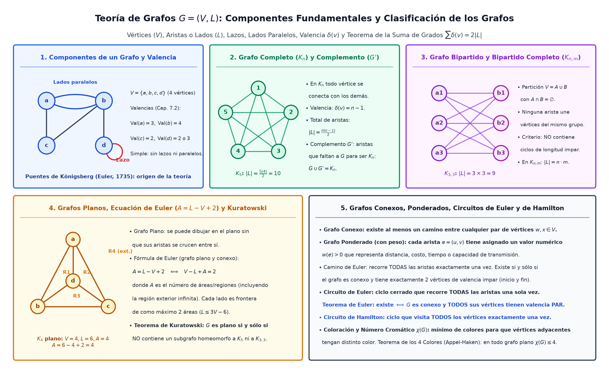

# 6.1 Elementos y características de los grafos

## Introducción: El Problema de los Puentes de Königsberg y el Nacimiento de la Teoría de Grafos

En $1735$, los habitantes de la ciudad prusiana de **Königsberg** (actual Kaliningrado) se planteaban el reto de cruzar los **siete puentes** que conectaban dos islas del río Pregel con las dos orillas firmes de la ciudad, pasando por cada puente **exactamente una vez** y regresando al punto de partida. **Leonhard Euler** ($1707\text{–}1783$) resolvió el problema reemplazando cada una de las $4$ porciones de tierra ($A, B, C, D$) por un punto (**vértice**) y cada uno de los $7$ puentes por una línea (**arista o lado**), creando el primer **grafo** de la historia (Jiménez Murillo, 2012, Cap. 7.1, pp. 286–287).

Euler observó que cada vez que un caminante entra a un vértice por un puente y sale de él por otro puente distinto, utiliza un par ($2$) de aristas incidentes en dicho vértice. Por consiguiente, para que exista un recorrido cerrado que pase por todas las aristas una sola vez, **todos los vértices del grafo deben tener un número par de aristas incidentes (valencia par)**. Como en Königsberg los cuatro vértices tenían valencias impares ($5, 3, 3, 3$), Euler demostró rigurosamente que tal recorrido era imposible.

---

## 6.1.1 Componentes de un grafo (vértices, aristas, lazos, valencia)

Formalmente, un **grafo** $G = (V, L)$ (o $G = (V, E)$) es una estructura discreta que consta de un conjunto no vacío de **vértices** $V$ y un conjunto de **lados o aristas** $L$ que relacionan pares de vértices (Jiménez Murillo, 2012, Cap. 7.2, pp. 287–288; Lipschutz & Lipson, 2009, Cap. 8.2):

### Definición de los Componentes Fundamentales

| Componente | Símbolo | Definición y Propiedades (Jiménez Murillo, 2012, pp. 287–288) |
| :--- | :---: | :--- |
| **1. Vértices (o Nodos)** | $V$ | Se representan gráficamente mediante pequeños círculos o puntos etiquetados con letras o números, por ejemplo $V = \{a, b, c, d\}$. Representan las entidades del sistema (ciudades, computadoras, transformadores, registros). |
| **2. Aristas (Lados o Ramas)** | $L$ o $A$ | Son las líneas que unen un vértice con otro, etiquetadas con números o letras, por ejemplo $L = \{r_1, r_2, \dots, r_k\}$. Si la arista une a los vértices $u$ y $v$, se dice que $u$ y $v$ son **vértices adyacentes** y que la arista es **incidente** en $u$ y en $v$. |
| **3. Lados Paralelos (o Aristas Múltiples)** | $P$ | Son dos o más aristas distintas que conectan exactamente al **mismo par de vértices** $(u, v)$. *(Un grafo que posee lados paralelos se denomina también **multigrafo**).* |
| **4. Lazo (o Bucle)** | $A$ / $L_z$ | Es aquella arista que **sale de un vértice y regresa al mismo vértice** $(v, v)$. |
| **5. Valencia (o Grado) de un vértice** | $\operatorname{Val}(v)$ o $\delta(v)$ | Es el **número de lados (aristas) que salen o entran a un vértice $v$**. Un vértice con valencia $0$ se llama **vértice aislado**; un vértice con valencia $1$ se llama **vértice colgante (u hoja)**. |

> **Nota sobre el conteo de un lazo en la valencia de un vértice (Jiménez Murillo, 2012, pp. 288, 293–294 vs. Lipschutz, 2009, p. 155):**
> - **Convención de Jiménez Murillo (2012, p. 288 y Matriz de Incidencia p. 293):** Al calcular la valencia de un vértice que tiene un lazo, **el lazo se contabiliza una sola vez** (como entrada o salida, pero no ambas). Por ejemplo, si al vértice $d$ llegan $2$ aristas normales y tiene $1$ lazo, Jiménez Murillo reporta $\operatorname{Val}(d) = 2 + 1 = 3$.
> - **Convención algebraica clásica (Euler / Lipschutz / Johnsonbaugh / Rosen):** Cada lazo aporta **$2$ unidades** al grado $\delta(v)$ del vértice (por sus dos extremos unidos a $v$), con el fin de que se cumpla siempre sin excepción el **Teorema de la Suma de Grados (Lema del apretón de manos)** de Euler:
>   $$\sum_{v \in V} \delta(v) = 2|L|$$
>   del cual se deduce que *en todo grafo el número de vértices de grado impar es siempre par*. *(En los ejemplos sin lazos ambas convenciones coinciden de manera idéntica; cuando exista un lazo indicaremos explícitamente ambas lecturas para total claridad).*

---

## 6.1.2 Tipos de grafos (Simples, completos, bipartidos, planos, conexos, ponderados)

De acuerdo con su topología y las propiedades de sus aristas, los grafos se clasifican en las siguientes familias fundamentales (Jiménez Murillo, 2012, Cap. 7.3, 7.5, 7.7, 7.8 y 7.9, pp. 288–332):

### 1. Grafo Simple
Es aquel grafo que **no tiene lazos ni lados paralelos** (entre cualquier par de vértices distintos existe cuando mucho una sola arista, y ningún vértice está unido consigo mismo) (Jiménez Murillo, 2012, p. 288).

---

### 2. Grafo Completo de $n$ Vértices ($K_n$) y Complemento de un Grafo ($G'$)
- **Grafo Completo ($K_n$):** Es un grafo **simple** de $n$ vértices en el que **cada vértice está conectado por una arista con todos y cada uno de los demás $n - 1$ vértices** (Jiménez Murillo, 2012, pp. 289–290).
  - **Valencia de cada vértice en $K_n$:** Todos los vértices tienen exactamente la misma valencia (es un grafo *regular* de grado $n - 1$):
    $$\operatorname{Val}(v) = n - 1$$
  - **Número total de lados (aristas) de $K_n$:**
    $$\boxed{\text{Núm. de lados de } K_n = |L(K_n)| = \frac{n(n - 1)}{2} = \binom{n}{2}}$$
    Por ejemplo: $|L(K_3)| = \frac{3(2)}{2} = 3$; $\quad |L(K_4)| = \frac{4(3)}{2} = 6$; $\quad |L(K_5)| = \frac{5(4)}{2} = 10$; $\quad |L(K_6)| = \frac{6(5)}{2} = 15$.
- **Complemento de un grafo simple ($G'$):** Dado un grafo simple $G$ de $n$ vértices, su **complemento $G'$** es el grafo simple que tiene exactamente los **mismos $n$ vértices** que $G$, pero cuyas aristas son precisamente **aquellas que le faltan a $G$ para formar el grafo completo $K_n$** (Jiménez Murillo, 2012, Ej. 7.4, p. 290):
  $$L(G) \cap L(G') = \emptyset \qquad \text{y} \qquad L(G) \cup L(G') = L(K_n) \implies |L(G')| = \frac{n(n - 1)}{2} - |L(G)|$$
  *(Si un grafo NO es simple porque tiene lazos o lados paralelos, no tiene complemento simple $G'$).*

---

### 3. Grafo Bipartido y Grafo Bipartido Completo ($K_{n,m}$)
- **Grafo Bipartido (o Bipartito):** Es un grafo cuyo conjunto de vértices $V$ puede dividirse en **dos subconjuntos disjuntos** $A = \{a_1, a_2, \dots, a_n\}$ y $B = \{b_1, b_2, \dots, b_m\}$ ($V = A \cup B$ con $A \cap B = \emptyset$) tales que **toda arista del grafo une un vértice de $A$ con un vértice de $B$, pero entre vértices de un mismo subconjunto ($A$ o $B$) no existe ninguna arista que los una** (Jiménez Murillo, 2012, p. 291).
  - **Teorema de caracterización de König:** *Un grafo es bipartido si y sólo si **no contiene ningún ciclo de longitud impar** (y no tiene lazos).*
- **Grafo Bipartido Completo ($K_{n,m}$):** Es aquel grafo bipartido con conjuntos de vértices $A$ ($|A| = n$) y $B$ ($|B| = m$) en el que **cada vértice de $A$ está unido con absolutamente todos los vértices de $B$** (Jiménez Murillo, 2012, pp. 291–292).
  - **Valencias en $K_{n,m}$:** Todo vértice $a \in A$ tiene valencia $m$, y todo vértice $b \in B$ tiene valencia $n$.
  - **Número total de lados de $K_{n,m}$:**
    $$\boxed{\text{Núm. de lados de } K_{n,m} = |L(K_{n,m})| = n \cdot m}$$
    Por ejemplo, en $K_{3,3}$ hay $3 \times 3 = 9$ aristas; en $K_{4,2}$ hay $4 \times 2 = 8$ aristas.

---

### 4. Caminos, Circuitos, Grafos Conexos, Euler y Hamilton

En un grafo $G$, la información se recorre siguiendo secuencias de vértices y aristas adyacentes (Jiménez Murillo, 2012, Cap. 7.5, pp. 294–302):

| Concepto de Recorrido | Definición Formal y Condiciones de Existencia (Jiménez Murillo, 2012, pp. 294–302) |
| :--- | :--- |
| **Camino** | Sucesión de lados contiguos $\{v_0, v_1, \dots, v_k\}$ que van de un vértice inicial $x = v_0$ a un vértice final $w = v_k$ *(los lados y vértices pueden repetirse)*. Su **longitud** es el número de aristas recorridas ($k = \text{núm. de vértices en la lista} - 1$). |
| **Camino simple de longitud $n$** | Camino de $x$ a $w$ compuesto por $n$ aristas **todas distintas entre sí** (no pasa dos veces por una misma arista). |
| **Circuito (o Ciclo)** | Camino cerrado que inicia en un vértice $w$ y **regresa al mismo vértice $w$** ($v_0 = v_k = w$). |
| **Circuito simple de longitud $n$** | Camino cerrado de $w$ a $w$ que contiene **un único ciclo** en toda su ruta y no repite aristas. |
| **Grafo Conexo (Conectado)** | Es aquel grafo en el que **para cualquier par de vértices distintos $w, x \in V$ existe al menos un camino para ir de $w$ a $x$** (está formado por una sola pieza). Si existen vértices incomunicados entre sí, el grafo es **no conexo (o disconexo)**. |
| **Lado Puente** | Es una arista de un grafo conexo tal que, **si se elimina, el grafo deja de ser conexo** (se divide en dos componentes desconectadas). |
| **Camino de Euler** | Camino que recorre todos los vértices **pasando por TODAS las aristas del grafo exactamente una sola vez**. **Condición de existencia:** El grafo debe ser conexo y tener **exactamente $2$ vértices de valencia impar**; todo camino de Euler comienza obligatoriamente en uno de esos dos vértices impares y termina en el otro. |
| **Circuito de Euler** | Ciclo cerrado que recorre todos los vértices **pasando por TODAS las aristas exactamente una sola vez** y regresando al vértice inicial. **Teorema de Euler:** *Un grafo tiene circuito de Euler si y sólo si es **conexo** y **TODOS sus vértices tienen valencia par**.* |
| **Circuito de Hamilton** | Ciclo cerrado que **pasa por cada VÉRTICE del grafo exactamente una sola vez** (excepto el vértice inicial y final que coinciden), sin necesidad de recorrer todas las aristas. *(El problema del **Agente Viajero / TSP** busca el circuito de Hamilton de peso mínimo en un grafo ponderado).* |

#### Algoritmo de Fleury para construir un Circuito de Euler (Jiménez Murillo, 2012, p. 297)
1. Verificar que el grafo sea conexo y que todos sus vértices tengan valencia par.
2. Seleccionar cualquier vértice arbitrario para iniciar el recorrido.
3. En cada paso, elegir una arista incidente al vértice actual cuidando que **NO sea un «lado puente»** del subgrafo restante, a menos que no exista ninguna otra alternativa.
4. Registrar la arista en el recorrido y eliminarla (desconectarla) del grafo (eliminando también los vértices que queden aislados).
5. Repetir desde el paso 3 hasta agotar todas las aristas.

---

### 5. Grafos Planos, Ecuación de Euler y Teorema de Kuratowski
- **Definición de Grafo Plano (Jiménez Murillo, 2012, Cap. 7.7, p. 307):** Un grafo es **plano** si se puede dibujar en un solo plano de tal manera que **sus aristas no se crucen entre sí** (excepto en los vértices donde coinciden).
- **Áreas (Regiones o Caras) y Ecuación de Euler:** Un dibujo plano de un grafo conexo divide al plano en un número $A$ de **áreas o regiones** cerradas más **$1$ área exterior infinita** que rodea a todo el grafo. **Leonhard Euler** demostró que en todo grafo plano y conexo con $V$ vértices, $L$ lados y $A$ áreas se cumple invariablemente la **Fórmula de Euler**:
  $$\boxed{A = L - V + 2 \qquad \Longleftrightarrow \qquad V - L + A = 2}$$
- **Propiedades necesarias de planaridad:**
  1. En un grafo plano sin hojas colgantes, **cada lado es frontera de como máximo $2$ áreas**.
  2. En todo grafo simple, plano y conexo con $V \ge 3$ vértices se cumple la desigualdad:
     $$L \le 3V - 6 \qquad (\text{y si además es bipartido o no tiene triángulos: }\; L \le 2V - 4)$$
- **Los dos grafos no planos fundamentales ($K_5$ y $K_{3,3}$) y el Teorema de Kuratowski (Jiménez Murillo, 2012, pp. 308–312):**
  - El grafo completo **$K_4$ SÍ es plano** ($V=4, L=6, A=4 \implies 4 = 6 - 4 + 2$).
  - En cambio, el grafo completo de $5$ vértices **$K_5$** ($V=5, L=10 > 3(5)-6=9$) y el grafo bipartido completo de los tres servicios **$K_{3,3}$** ($V=6, L=9 > 2(6)-4=8$) **NO son planos**: es geométricamente imposible dibujarlos en el plano sin que al menos dos aristas se crucen.
  - **Teorema de Kuratowski ($1930$):** *Un grafo $G$ es plano si y sólo si **no contiene en su interior ningún subgrafo homeomorfo (o reducible por eliminación de aristas y contracción de vértices de grado 2) a $K_5$ ni a $K_{3,3}$**.* (Por ejemplo, el famoso **Grafo de Petersen** de $10$ vértices y $15$ aristas no es plano porque contiene un subgrafo $K_{3,3}$).

---

### 6. Grafos Ponderados y Coloración de Grafos ($\chi(G)$)
- **Grafo Ponderado (o Etiquetado con Pesos):** Es aquel grafo en el que a cada arista $e = (u, v)$ se le asigna un número real positivo $w(e)$ llamado **ponderación o peso**, que representa la distancia en kilómetros, el costo monetario, el tiempo de traslado o la capacidad de un enlace entre dos nodos (Jiménez Murillo, 2012, Cap. 7.9.2, p. 328).
- **Coloración de un Grafo y Número Cromático $\chi(G)$ (Jiménez Murillo, 2012, Cap. 7.8, pp. 312–324):**
  - Una **coloración propia** de los vértices de un grafo simple $G = (V, L)$ mediante un conjunto de colores $C$ es una función $f: V \to C$ tal que **dos vértices adyacentes nunca tengan el mismo color**: $(u, v) \in L \implies f(u) \neq f(v)$.
  - El **número cromático** de $G$, denotado por **$X(G)$** o **$\chi(G)$**, es el **número mínimo de colores necesarios** para colorear válidamente todos los vértices de $G$.
  - **Propiedades del número cromático (Jiménez Murillo, 2012, pp. 316–320):**
    1. Si $G$ tiene $n$ vértices aislados (sin aristas): $\chi(G) = 1$.
    2. Si $G$ es un **grafo bipartido** con al menos una arista (o un **árbol**, o un ciclo $C_n$ de longitud **par**): $\chi(G) = 2$.
    3. Si $G$ es un ciclo simple $C_n$ de longitud **impar** ($n \ge 3$): $\chi(G) = 3$.
    4. Si $G$ es un **grafo completo $K_n$**: $\chi(K_n) = n$ (y si $G$ contiene un subgrafo completo $K_m$, entonces $\chi(G) \ge m$).
    5. **Teorema de los Cuatro Colores (Appel y Haken, $1976$):** *Todo grafo plano puede colorearse con un máximo de **$4$ colores** ($\chi(G) \le 4$).*

---

## Ejemplos de Práctica (Resueltos Paso a Paso)

### Ejemplo 6.1.1: Identificación de componentes, valencias y clasificación de recorridos
Considere un grafo $G = (V, L)$ con vértices $V = \{a, b, c, d, e\}$ y aristas:
- $r_1 = (a, b)$, $r_2 = (a, b)$ *(paralela)*, $r_3 = (b, b)$ *(lazo en $b$)*, $r_4 = (d, e)$, $r_5 = (a, e)$, $r_6 = (a, e)$ *(paralela)*, $r_7 = (a, c)$, $r_8 = (e, e)$ *(lazo en $e$)* (Jiménez Murillo, 2012, Ej. 7.8, p. 293).
Determine:
a) El conjunto de vértices $V$, el conjunto de lados $L$, el conjunto de lados paralelos $P$ y el conjunto de lazos $A$.  
b) La valencia de cada vértice y explique por qué $G$ no es un grafo simple.

**Solución:**
- **a) Conjuntos de componentes:**
  - **Vértices:** $V = \{a, b, c, d, e\}$ ($5$ vértices).
  - **Lados (Aristas):** $L = \{r_1, r_2, r_3, r_4, r_5, r_6, r_7, r_8\}$ ($8$ lados).
  - **Lados paralelos:** $P = \{r_1, r_2, r_5, r_6\}$ (ya que $r_1, r_2$ unen simultáneamente a $(a, b)$, y $r_5, r_6$ unen simultáneamente a $(a, e)$).
  - **Lazos:** $A = \{r_3, r_8\}$ (en los vértices $b$ y $e$).
- **b) Valencias de cada vértice:**
  - $\operatorname{Val}(a) = 5$ (inciden $r_1, r_2, r_5, r_6, r_7$).
  - $\operatorname{Val}(b) = 3$ en la convención de Jiménez Murillo ($r_1, r_2$ más el lazo $r_3$ contado una vez; o $\delta(b) = 4$ contando el lazo por dos).
  - $\operatorname{Val}(c) = 1$ (sólo incide $r_7$; es un vértice colgante).
  - $\operatorname{Val}(d) = 1$ (sólo incide $r_4$).
  - $\operatorname{Val}(e) = 4$ en la convención de Jiménez Murillo ($r_4, r_5, r_6$ más el lazo $r_8$; o $\delta(e) = 5$ contando el lazo por dos).
  - **¿Es grafo simple?** **No**, porque posee tanto lazos ($r_3, r_8$) como lados paralelos ($r_1, r_2$ y $r_5, r_6$).

---

### Ejemplo 6.1.2: Grafo completo $K_n$, complemento $G'$ y grafo bipartido completo $K_{n,m}$
Sea $G$ un grafo simple con $V = \{1, 2, 3, 4, 5, 6\}$ y conjunto de aristas:
$$L(G) = \{(1, 4), (1, 5), (1, 6), (2, 4), (2, 5), (2, 6), (3, 4), (3, 5), (3, 6)\}$$
a) ¿Es $G$ un grafo bipartido o bipartido completo? Si es así, identifique la partición $(A, B)$ y su notación $K_{n,m}$.  
b) ¿Cuántas aristas tendría el grafo completo $K_6$ sobre los mismos vértices? Obtenga el conjunto de aristas del **grafo complemento $G'$** y describa su estructura.

**Solución:**
- **a) Clasificación bipartita:**
  Observamos que los vértices se dividen en dos conjuntos disjuntos $A = \{1, 2, 3\}$ ($n = 3$) y $B = \{4, 5, 6\}$ ($m = 3$), de tal manera que **todo** vértice de $A$ está conectado con **todos** los vértices de $B$ ($3 \times 3 = 9$ aristas) y no existe ninguna arista entre elementos de $A$ ni entre elementos de $B$. Por lo tanto, $G$ es el **grafo bipartido completo $K_{3,3}$**.
- **b) Comparación con $K_6$ y obtención de $G'$:**
  - En el grafo completo $K_6$ ($n = 6$), cada vértice tiene valencia $6 - 1 = 5$ y el número total de aristas es:
    $$|L(K_6)| = \frac{6(6 - 1)}{2} = \frac{30}{2} = 15\text{ aristas}$$
  - Como $G$ ya tiene $9$ aristas, a su complemento $G'$ le corresponden las **$15 - 9 = 6$ aristas faltantes**, que son exactamente las aristas internas de $A$ y las aristas internas de $B$:
    $$L(G') = \big\{(1, 2), (1, 3), (2, 3), (4, 5), (4, 6), (5, 6)\big\}$$
    Geométricamente, $G'$ consta de dos triángulos disjuntos ($K_3 \cup K_3$).

---

### Ejemplo 6.1.3: Verificación de la Ecuación de Euler en un Grafo Plano y cálculo del Número Cromático $\chi(G)$
Considere el grafo plano y conexo del Ejemplo 7.15 de Jiménez Murillo (2012, pp. 307–308), el cual tiene $V = 6$ vértices $\{a, b, c, d, e, f\}$ dispuestos como un rectángulo exterior con dos vértices interiores conectados por $L = 11$ aristas:
$$L = \{(a, b), (b, c), (c, d), (d, a), (a, f), (b, f), (b, e), (c, e), (d, e), (d, f), (e, f)\}$$
a) Determine cuántas áreas (regiones) $A$ delimita el grafo en el plano verificando la **ecuación de Euler**.  
b) ¿Tiene el grafo camino o circuito de Euler? ¿Tiene circuito de Hamilton?  
c) Encuentre su **número cromático $\chi(G)$** asignando un color a cada vértice.

**Solución:**
- **a) Verificación de la Ecuación de Euler ($A = L - V + 2$):**
  Con $V = 6$ vértices y $L = 11$ lados, la fórmula de Euler establece que el dibujo plano debe dividir al plano en:
  $$A = L - V + 2 = 11 - 6 + 2 = \mathbf{7\text{ áreas}}$$
  En efecto, el dibujo forma $6$ regiones triangulares internas cerradas $\{1, 2, 3, 4, 5, 6\}$ más la región exterior $\{7\}$ que rodea al grafo, y cada una de las $11$ aristas es frontera de exactamente $2$ áreas.
- **b) Análisis de Euler y Hamilton:**
  Calculamos la valencia de cada vértice:
  $$\operatorname{Val}(a) = 3, \quad \operatorname{Val}(b) = 4, \quad \operatorname{Val}(c) = 3, \quad \operatorname{Val}(d) = 4, \quad \operatorname{Val}(e) = 4, \quad \operatorname{Val}(f) = 4$$
  - **¿Tiene Circuito de Euler?** **No**, porque existen vértices de valencia impar ($a$ y $c$ tienen valencia $3$).
  - **¿Tiene Camino de Euler?** **Sí**, porque el grafo es conexo y tiene **exactamente dos vértices de valencia impar** ($a$ y $c$). Cualquier camino de Euler debe iniciar en $a$ y terminar en $c$ (o viceversa), por ejemplo: $\{a, b, c, d, a, f, b, e, d, f, e, c\}$.
  - **¿Tiene Circuito de Hamilton?** **Sí**, por ejemplo el ciclo $\{a, b, c, e, f, d, a\}$ visita los $6$ vértices exactamente una vez y regresa a $a$.
- **c) Coloración y Número Cromático $\chi(G)$:**
  - Como los vértices $\{b, e, f\}$ (y también $\{d, e, f\}$) forman triángulos ($K_3$), se requieren al menos $3$ colores ($\chi(G) \ge 3$).
  - Aplicando el algoritmo voraz por mayor valencia:
    - Asignamos **Color 1** a $f$ (no adyacente a $c$) y también **Color 1** a $c$.
    - Asignamos **Color 2** a $e$ (adyacente a $f$ y $c$) y también **Color 2** a $a$ (no adyacente a $e$).
    - Asignamos **Color 3** a $b$ y también **Color 3** a $d$ (no adyacentes entre sí).
  - Ningún par de vértices adyacentes comparte color, por lo que el número cromático es **$\chi(G) = 3$**.

---

## Ejercicios de Tarea (Práctica en Casa)

> **Instrucciones:** Resuelva cada uno de los siguientes problemas justificando claramente sus cálculos y criterios teóricos.

1. **Análisis integral de un grafo (Jiménez Murillo, Prob. 7.2, p. 336):**  
   Considere el grafo $G = (V, L)$ con $V = \{a, b, c, d, e\}$ ($5$ vértices) y las $8$ aristas siguientes:
   $$L = \{(a, b), (a, c), (a, d), (b, c), (b, e), (c, d), (c, e), (d, e)\}$$
   a) ¿Es un grafo simple? ¿Es un grafo conexo? Calcule la valencia de cada uno de sus $5$ vértices.  
   b) ¿Tiene camino de Euler? ¿Tiene circuito de Euler? ¿Tiene circuito de Hamilton? Si existen, exhiba una secuencia explícita para cada uno.  
   c) ¿Es un grafo plano? En caso afirmativo, calcule el número de áreas $A$ mediante la ecuación de Euler $A = L - V + 2$.  
   d) Obtenga las aristas del grafo complemento $G'$, e indique qué valencia debería tener cada vértice de $G$ y cuántas aristas en total debería tener para ser el grafo completo $K_5$.
   <!--
   Solución del Ejercicio 1:
   - a) Simple, conexo y valencias:
        - Sí es un grafo SIMPLE (no tiene lazos ni aristas paralelas).
        - Sí es CONEXO (cualquier vértice se comunica con todos los demás).
        - Valencias:
          * Val(a) = 3 (conectado con b, c, d)
          * Val(b) = 3 (conectado con a, c, e)
          * Val(c) = 4 (conectado con a, b, d, e)
          * Val(d) = 3 (conectado con a, c, e)
          * Val(e) = 3 (conectado con b, c, d)
          (Suma de valencias = 3+3+4+3+3 = 16 = 2 * 8).

   - b) Caminos/Circuitos de Euler y de Hamilton:
        - ¿Tiene Circuito de Euler? NO, porque tiene 4 vértices de valencia impar (a, b, d, e tienen valencia 3).
        - ¿Tiene Camino de Euler? NO, porque para tener camino de Euler debe tener exactamente 2 vértices de valencia impar, y aquí tiene 4 vértices impares.
        - ¿Tiene Circuito de Hamilton? SÍ, por ejemplo: {a, b, e, d, c, a} (visita los 5 vértices una sola vez y regresa a 'a').

   - c) Planaridad y Ecuación de Euler:
        - Sí es un grafo PLANO (es una pirámide de base cuadrada {a, b, e, d} con el vértice 'c' en el centro conectado a las 4 esquinas, sin ningún cruce de aristas).
        - Por la ecuación de Euler: A = L - V + 2 = 8 - 5 + 2 = 5 áreas (los 4 triángulos internos más la región exterior).

   - d) Complemento G' y comparación con K_5:
        - Para ser el grafo completo K_5 (n = 5), cada vértice debería tener valencia n - 1 = 4, y el total de aristas debería ser n(n-1)/2 = 5(4)/2 = 10 aristas.
        - Como G tiene 8 aristas, al complemento G' le faltan sólo 10 - 8 = 2 aristas:
          L(G') = {(a, e), (b, d)}.
   -->

2. **Clasificación de grafos bipartidos, completos y no planos:**  
   Determine para cada uno de los siguientes grafos: (i) cuántas aristas tiene, (ii) si es bipartido, (iii) si es plano, y (iv) cuál es su número cromático $\chi(G)$:  
   a) El grafo completo $K_6$.  
   b) El grafo bipartido completo $K_{4,3}$.  
   c) El grafo rueda $W_5$ (formado por un ciclo exterior de $5$ vértices $\{1, 2, 3, 4, 5\}$ más un vértice central $6$ conectado a los $5$ vértices del ciclo).
   <!--
   Solución del Ejercicio 2:
   - a) Grafo completo K_6 (n = 6):
        (i) Aristas: |L| = 6(5)/2 = 15 aristas.
        (ii) ¿Es bipartido? NO, contiene triángulos C_3 (ciclos de longitud impar).
        (iii) ¿Es plano? NO, porque contiene a K_5 como subgrafo (además 15 > 3(6) - 6 = 12).
        (iv) Número cromático: X(K_6) = 6 (todos los vértices son mutuamente adyacentes).

   - b) Grafo bipartido completo K_{4,3} (n = 4, m = 3, V = 7):
        (i) Aristas: |L| = 4 * 3 = 12 aristas.
        (ii) ¿Es bipartido? SÍ, por definición.
        (iii) ¿Es plano? NO, porque contiene a K_{3,3} como subgrafo (por el Teorema de Kuratowski).
        (iv) Número cromático: X(K_{4,3}) = 2 (color 1 para los 4 vértices de A y color 2 para los 3 vértices de B).

   - c) Grafo rueda W_5 (V = 6 vértices):
        (i) Aristas: 5 del ciclo exterior + 5 rayos al centro = 10 aristas.
        (ii) ¿Es bipartido? NO, contiene ciclos impares (tanto triángulos como el pentágono exterior C_5).
        (iii) ¿Es plano? SÍ, el pentágono exterior con el nodo central en su interior se dibuja sin cruces (cumple A = 10 - 6 + 2 = 6 áreas).
        (iv) Número cromático: El ciclo exterior impar C_5 requiere 3 colores, y como el nodo central 6 es adyacente a los 5 vértices del ciclo, requiere un 4.º color distinto. Por lo tanto, X(W_5) = 4.
   -->

3. **Aplicación del Teorema de la Suma de Grados y Ecuación de Euler:**  
   a) ¿Es posible construir un grafo simple de $7$ vértices en el que todos los vértices tengan valencia $3$? Justifique matemáticamente.  
   b) Un grafo plano, conexo y simple tiene $V = 8$ vértices, y todos sus vértices tienen valencia $3$ (como el grafo de un cubo). ¿Cuántas aristas $L$ tiene el grafo y en cuántas áreas $A$ divide al plano?
   <!--
   Solución del Ejercicio 3:
   - a) Si existiera un grafo con 7 vértices de grado 3, la suma de las valencias sería:
        \sum \delta(v) = 7 * 3 = 21.
        Pero por el Teorema de la Suma de Grados (\sum \delta(v) = 2|L|), la suma de las valencias de cualquier grafo debe ser un número PAR (o equivalentemente, el número de vértices de grado impar debe ser par, y aquí 7 es impar). Como 21 no es divisible entre 2, es IMPOSIBLE construir tal grafo.
   - b) Para V = 8 vértices cada uno de valencia 3:
        1) Por la fórmula de suma de grados: 2L = 8 * 3 = 24 => L = 12 aristas.
        2) Por la ecuación de Euler para grafos planos:
           A = L - V + 2 = 12 - 8 + 2 = 6 áreas (exactamente las 6 caras de un cubo vistas en proyección plana).
   -->
