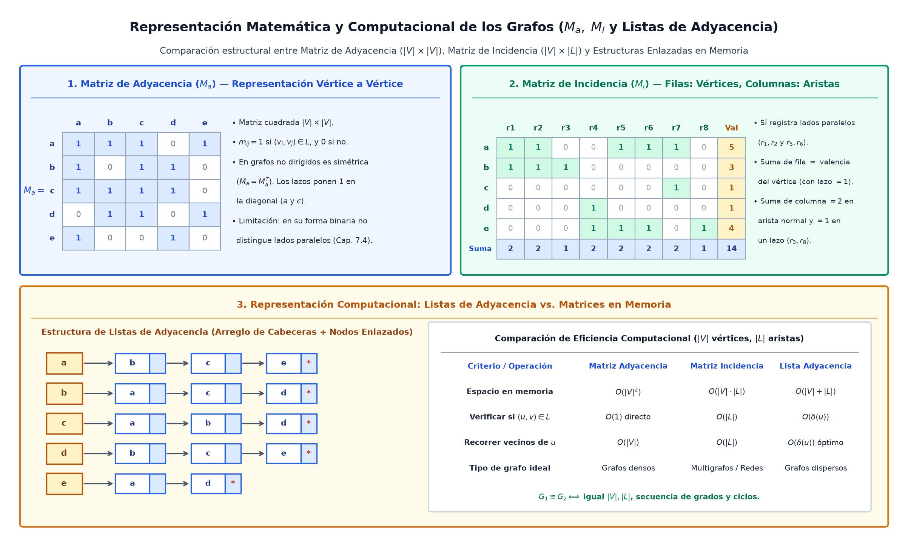

# 6.2 Representación de los grafos

## Introducción

Si bien el dibujo geométrico de un grafo resulta sumamente intuitivo para el ojo humano cuando tiene pocos nodos, una computadora digital no «ve» dibujos: necesita almacenar y procesar la topología del grafo mediante **estructuras algebraicas matriciales** o **estructuras de datos dinámicas con apuntadores**.

Como expone Jiménez Murillo (2012, Cap. 7.4 y 7.6, pp. 292–294, 303–306), Lipschutz & Lipson (2009, Cap. 8.8 y 9.3–9.4) y Johnsonbaugh (2005, Cap. 8.3–8.4), el estudio de la representación de los grafos se divide en dos vertientes complementarias:
- **6.2.1 Representación matemática:** Conjuntos de vértices y aristas, **Matriz de Adyacencia ($M_a$)** y **Matriz de Incidencia ($M_i$)**, junto con su aplicación al cálculo de caminos y a la prueba de **isomorfismo de grafos**.
- **6.2.2 Representación computacional:** Implementación eficiente en memoria principal mediante **Listas de Adyacencia**, arreglos indexados de punteros y listas de aristas, seleccionando la estructura óptima según la densidad del grafo.

---

## 6.2.1 Representación Matemática

Matemáticamente, un grafo $G$ se especifica mediante el par ordenado de conjuntos $G = (V, L)$ (donde $V$ es el conjunto de vértices y $L$ el conjunto de lados o aristas) o mediante dos matrices fundamentales: la **matriz de adyacencia** y la **matriz de incidencia** (Jiménez Murillo, 2012, Cap. 7.4, pp. 292–294).

### 1. Matriz de Adyacencia ($M_a$)

Sea $G = (V, L)$ un grafo con $n = |V|$ vértices ordenados $v_1, v_2, \dots, v_n$. La **matriz de adyacencia** de $G$, denotada por **$M_a$**, es una **matriz cuadrada de orden $n \times n$** en la cual los vértices del grafo etiquetan tanto las filas como las columnas (en el mismo orden), y cuyas entradas se definen como (Jiménez Murillo, 2012, p. 292):

$$\boxed{M_a = [a_{ij}]_{n \times n} \qquad \text{donde}\qquad a_{ij} = \begin{cases} 1, & \text{si existe una arista entre el vértice } v_i \text{ y el vértice } v_j, \\ 0, & \text{si no existe relación alguna entre } v_i \text{ y } v_j. \end{cases}}$$

*(Nota: En textos como Johnsonbaugh, 2005, Secc. 8.3, o Lipschutz, 2009, p. 163, si el grafo es un multigrafo se permite colocar en $a_{ij}$ el número entero de aristas paralelas que unen a $v_i$ con $v_j$, y si es un grafo ponderado se coloca el peso $w_{ij}$ de la arista; sin embargo, en la representación booleana estándar de Jiménez Murillo, 2012, p. 293, sólo se colocan $1\text{s}$ y $0\text{s}$).*

#### Propiedades y Características de la Matriz de Adyacencia ($M_a$)
1. **Simetría en grafos no dirigidos:** Como toda arista sin flecha entre $v_i$ y $v_j$ relaciona tanto a $v_i$ con $v_j$ como a $v_j$ con $v_i$, la matriz de adyacencia de un grafo no dirigido es siempre **simétrica respecto a su diagonal principal** ($a_{ij} = a_{ji}$, es decir, $M_a = M_a^T$).
2. **Representación de lazos:** Un lazo en el vértice $v_i$ se representa con un **$1$ en la posición $(i, i)$ de la diagonal principal** (a diferencia de las aristas normales entre dos vértices distintos, que aparecen dos veces en la matriz: en $(i, j)$ y en $(j, i)$).
3. **Limitación frente a lados paralelos (Jiménez Murillo, 2012, p. 293):** En la matriz de adyacencia booleana ($0/1$) **no es posible distinguir si entre dos vértices hay una sola arista o varias aristas paralelas**, por lo que no registra toda la información de un multigrafo.
4. **Teorema de las potencias de la Matriz de Adyacencia ($M_a^k$):**
   Si se multiplica la matriz de adyacencia $M_a$ de un grafo simple por sí misma utilizando la **multiplicación matricial aritmética ordinaria**, la entrada $(i, j)$ de la potencia $k$-ésima $(M_a)^k$ indica exactamente el **número de caminos distintos de longitud $k$** que van del vértice $v_i$ al vértice $v_j$ (Johnsonbaugh, 2005, Teorema 8.3.4, p. 345).

---

### 2. Matriz de Incidencia ($M_i$)

Sea $G = (V, L)$ un grafo con $n = |V|$ vértices $\{v_1, v_2, \dots, v_n\}$ y $m = |L|$ aristas $\{r_1, r_2, \dots, r_m\}$. La **matriz de incidencia** de $G$, denotada por **$M_i$**, es una matriz rectangular de dimensión **$n \times m$** en la cual **los vértices se colocan como filas y las aristas (ramas) se colocan como columnas** (Jiménez Murillo, 2012, p. 293):

$$\boxed{M_i = [b_{ik}]_{n \times m} \qquad \text{donde}\qquad b_{ik} = \begin{cases} 1, & \text{si la arista } r_k \text{ incide en (toca a) el vértice } v_i, \\ 0, & \text{si la arista } r_k \text{ no incide en el vértice } v_i. \end{cases}}$$

#### Propiedades Clave de la Matriz de Incidencia ($M_i$) (Jiménez Murillo, 2012, pp. 293–294)
A diferencia de la matriz de adyacencia, la matriz de incidencia **sí registra el $100\%$ de la información topológica de cualquier grafo**, incluyendo lados paralelos y lazos:
1. **Identificación de lados paralelos:** Dos o más aristas son **lados paralelos** si y sólo si **sus columnas correspondientes en $M_i$ son idénticas**.
2. **Suma de los elementos de cada columna (identificación de lazos):**
   - Si la columna $r_k$ corresponde a una **arista normal** que une dos vértices distintos, la suma de los elementos de esa columna es exactamente **$2$** (tiene dos unos).
   - Si la columna $r_k$ corresponde a un **lazo**, sólo toca a un único vértice, por lo que la suma de los elementos de su columna es exactamente **$1$** (tiene un solo uno).
3. **Suma de los elementos de cada fila (cálculo directo de la valencia):**
   Al sumar todos los unos de la fila correspondiente al vértice $v_i$ en $M_i$, se obtiene directamente la **valencia del vértice $v_i$** (bajo la convención de Jiménez Murillo donde cada lazo suma $1$).

---

### 3. Isomorfismo de Grafos ($G_1 \cong G_2$) y Criterio Matricial

Con frecuencia dos grafos $G_1$ y $G_2$ están dibujados con apariencias geométricas completamente distintas y sus vértices tienen etiquetas diferentes, pero en realidad poseen **exactamente la misma estructura de conexiones**. En tal caso se dice que $G_1$ y $G_2$ son **grafos isomorfos** ($G_1 \cong G_2$) (Jiménez Murillo, 2012, Cap. 7.6, pp. 303–307; Epp, 2012, Secc. 10.4):

#### A) Verificación exacta mediante Matrices de Incidencia (o de Adyacencia)
Dos grafos $G_1$ y $G_2$ son isomorfos si y sólo si, mediante una serie de **intercambios de filas (renombramiento de vértices) y/o intercambios de columnas (renombramiento de aristas)** en la matriz de incidencia de $G_2$, se logra que las matrices de incidencia $M_i(G_1)$ y $M_i(G_2)$ **coincidan posición por posición** (Jiménez Murillo, 2012, Ej. 7.14, pp. 303–305).

#### B) Verificación rápida mediante Invariantes Estructurales (Tabla de la p. 306 de Jiménez Murillo)
Como intercambiar filas y columnas en grafos grandes requiere hasta $n! \cdot m!$ combinaciones, en la práctica se comparan primero sus **propiedades invariantes bajo isomorfismo**:
1. **Mismo número de vértices ($|V_1| = |V_2|$).**
2. **Mismo número de lados o aristas ($|L_1| = |L_2|$).**
3. **Mismo multiconjunto de valencias** (igual cantidad de vértices de cada grado).
4. **Misma conectividad** (ambos son conexos o ambos tienen el mismo número de componentes conexas).
5. **Misma existencia de camino de Euler, circuito de Euler y circuito de Hamilton.**
6. **Mismo número de circuitos simples de longitud $k$** (por ejemplo, igual número de triángulos de longitud $3$, ciclos de longitud $4$, etc.).

*(Si dos grafos difieren en cualquiera de estas propiedades, se concluye inmediatamente que **NO son isomorfos**).*

---

## 6.2.2 Representación Computacional

Cuando se implementan algoritmos de grafos en un lenguaje de programación, almacenar una matriz de adyacencia o de incidencia de tamaño $|V| \times |V|$ o $|V| \times |L|$ puede desperdiciar una enorme cantidad de memoria RAM si el grafo es **disperso** (*sparse*, es decir, tiene pocas aristas en comparación con el máximo posible $|V|^2$, como ocurre en una red carretera o en la Web, donde cada página sólo enlaza a unas cuantas decenas de páginas entre miles de millones).

Para optimizar el uso de memoria y el tiempo de ejecución, en ciencias de la computación se utilizan tres estructuras de datos principales (Lipschutz & Lipson, 2009, Cap. 8.8 y 9.4, pp. 165–168, 205–208; Johnsonbaugh, 2005, Cap. 8.3):

### 1. Listas de Adyacencia (Arreglo de Cabeceras + Listas Enlazadas)
Consiste en un arreglo o tabla principal de longitud $|V|$ donde cada entrada $i$ corresponde a un vértice $v_i$ y contiene un apuntador a una **lista simplemente enlazada** que almacena únicamente los **vértices adyacentes (vecinos)** a $v_i$:
- **En un grafo no dirigido:** Cada arista $(u, v)$ aparece dos veces (el nodo $v$ aparece en la lista de vecinos de $u$, y el nodo $u$ aparece en la lista de vecinos de $v$), por lo que la suma total de nodos en todas las listas enlazadas es exactamente $\sum \delta(v) = 2|L|$.
- **En un grafo dirigido:** En la lista de $u$ sólo se guardan los vértices hacia los cuales sale una flecha desde $u$, ocupando en total $|L|$ nodos enlazados.
- **En un grafo ponderado:** Cada nodo de la lista enlazada almacena una tupla `(vecino, peso, apuntador_siguiente)`.

### 2. Representación mediante Arreglos Paralelos (Sin memoria dinámica)
En lenguajes o sistemas embebidos donde se prefiere usar arreglos estáticos en lugar de punteros dinámicos (como en la Sección 6.7.1 de Jiménez Murillo y Cap. 8.8 de Lipschutz), las listas de adyacencia se implementan mediante:
- Un arreglo de cabeceras `INICIO[1..|V|]` que indica en qué índice comienza la lista de vecinos de cada vértice.
- Dos arreglos paralelos `VECINO[1..2|L|]` y `SIGUIENTE[1..2|L|]` (más `PESO[1..2|L|]` si es ponderado) que encadenan los vecinos mediante índices enteros terminados en `*`.

### 3. Lista de Aristas (Arreglo de Tuplas)
Es la representación más compacta para algoritmos que procesan las aristas globalmente por su peso (como el **algoritmo de Kruskal** para el árbol generador mínimo): consiste en una tabla o arreglo de $|L|$ registros donde cada fila contiene la terna `(origen, destino, peso)`.

### 4. Cuadro Comparativo de Complejidad Computacional ($|V|$ vértices, $|L|$ aristas)

| Característica / Operación | Matriz de Adyacencia ($M_a$) | Matriz de Incidencia ($M_i$) | Listas de Adyacencia |
| :--- | :---: | :---: | :---: |
| **Memoria requerida (Espacio)** | $\Theta(|V|^2)$ | $\Theta(|V| \cdot |L|)$ | **$\Theta(|V| + |L|)$** *(Óptima)* |
| **Consultar si $u$ y $v$ son adyacentes** | **$O(1)$** *(acceso directo $M_a[u][v]$)* | $O(|L|)$ | $O(\delta(u))$ |
| **Recorrer todos los vecinos de $u$** | $O(|V|)$ *(recorre toda la fila)* | $O(|L|)$ | **$O(\delta(u))$** *(sólo visita vecinos reales)* |
| **Recorrer todo el grafo (BFS o DFS)** | $O(|V|^2)$ | $O(|V| \cdot |L|)$ | **$O(|V| + |L|)$** *(Lineal)* |
| **Insertar una nueva arista $(u, v)$** | **$O(1)$** | $O(|V|)$ (nueva columna) | **$O(1)$** (inserción al inicio de la lista) |
| **Caso de uso recomendado** | **Grafos densos** ($|L| \approx |V|^2$) y operaciones matriciales booleanas. | **Multigrafos** con lados paralelos y lazos, y análisis algebraico de redes. | **Grafos dispersos** ($|L| \ll |V|^2$), redes viales, redes sociales y algoritmos BFS/DFS/Dijkstra. |

---

## Ejemplos de Práctica (Resueltos Paso a Paso)

### Ejemplo 6.2.1: Construcción comparativa de la Matriz de Adyacencia ($M_a$), Matriz de Incidencia ($M_i$) y Listas de Adyacencia
Considere el grafo $G$ del Ejemplo 7.7 de Jiménez Murillo (2012, p. 293) con vértices $V = \{a, b, c, d, e\}$ y las $9$ aristas siguientes:
- $r_1 = (a, a)$ *(lazo en $a$)*, $r_2 = (a, b)$, $r_3 = (a, c)$, $r_4 = (a, e)$, $r_5 = (b, c)$, $r_6 = (b, d)$, $r_7 = (b, d)$ *(paralela a $r_6$)*, $r_8 = (c, c)$ *(lazo en $c$)* y $r_9 = (c, d)$, $r_{10} = (d, e)$.
a) Construya su **Matriz de Adyacencia ($M_a$)** booleana y señale qué información se pierde en ella.  
b) Construya su **Matriz de Incidencia ($M_i$)** verificando las sumas por fila y por columna.  
c) Represente las **Listas de Adyacencia** de los vértices del grafo.

**Solución:**
- **a) Matriz de Adyacencia ($M_a$ de $5 \times 5$, Jiménez Murillo, Ej. 7.7, p. 293):**

  $$M_a = \begin{array}{c|ccccc}
  & a & b & c & d & e \\
  \hline
  a & \mathbf{1} & 1 & 1 & 0 & 1 \\
  b & 1 & 0 & 1 & \mathbf{1} & 0 \\
  c & 1 & 1 & \mathbf{1} & 1 & 0 \\
  d & 0 & \mathbf{1} & 1 & 0 & 1 \\
  e & 1 & 0 & 0 & 1 & 0
  \end{array}$$

  *Observación:* Los unos en $(a, a)$ y $(c, c)$ representan los lazos $r_1$ y $r_8$. Sin embargo, en las posiciones $(b, d)$ y $(d, b)$ sólo se coloca un $1$, por lo que **en $M_a$ se pierde la información de que entre $b$ y $d$ existen dos lados paralelos ($r_6$ y $r_7$)**.

- **b) Matriz de Incidencia ($M_i$ de $5 \times 10$):**

  $$M_i = \begin{array}{c|cccccccccc|c}
  V \setminus L & r_1 & r_2 & r_3 & r_4 & r_5 & r_6 & r_7 & r_8 & r_9 & r_{10} & \textbf{Valencia} \\
  \hline
  a & \mathbf{1} & 1 & 1 & 1 & 0 & 0 & 0 & 0 & 0 & 0 & \mathbf{4} \\
  b & 0 & 1 & 0 & 0 & 1 & \mathbf{1} & \mathbf{1} & 0 & 0 & 0 & \mathbf{4} \\
  c & 0 & 0 & 1 & 0 & 1 & 0 & 0 & \mathbf{1} & 1 & 0 & \mathbf{4} \\
  d & 0 & 0 & 0 & 0 & 0 & \mathbf{1} & \mathbf{1} & 0 & 1 & 1 & \mathbf{4} \\
  e & 0 & 0 & 0 & 1 & 0 & 0 & 0 & 0 & 0 & 1 & \mathbf{2} \\
  \hline
  \textbf{Suma col.} & \mathbf{1} & 2 & 2 & 2 & 2 & 2 & 2 & \mathbf{1} & 2 & 2 & 18
  \end{array}$$

  *Verificación:* Las columnas $r_1$ y $r_8$ suman $1$ (son los dos **lazos**), mientras que las columnas $r_6$ y $r_7$ son **idénticas** (son los **lados paralelos** entre $b$ y $d$).

- **c) Listas de Adyacencia en memoria:**
  - `a` $\longrightarrow [a] \to [b] \to [c] \to [e] \to *$
  - `b` $\longrightarrow [a] \to [c] \to [d] \to [d] \to *$
  - `c` $\longrightarrow [a] \to [b] \to [c] \to [d] \to *$
  - `d` $\longrightarrow [b] \to [b] \to [c] \to [e] \to *$
  - `e` $\longrightarrow [a] \to [d] \to *$

---

### Ejemplo 6.2.2: Cálculo del número de caminos de longitud $k$ mediante potencias de $M_a$
Considere el grafo simple $G$ con vértices $V = \{1, 2, 3, 4\}$ y aristas $L = \{(1, 2), (1, 3), (2, 3), (2, 4), (3, 4)\}$.
a) Escriba su matriz de adyacencia $M_a$.  
b) Calcule la potencia aritmética $(M_a)^2 = M_a \cdot M_a$ e interprete el significado de la entrada $(1, 4)$ y de las entradas de la diagonal principal de $(M_a)^2$.

**Solución:**
- **a) Matriz de adyacencia $M_a$:**
  $$M_a = \begin{pmatrix} 0 & 1 & 1 & 0 \\ 1 & 0 & 1 & 1 \\ 1 & 1 & 0 & 1 \\ 0 & 1 & 1 & 0 \end{pmatrix}$$
- **b) Producto matricial aritmético $(M_a)^2 = M_a \cdot M_a$:**
  $$(M_a)^2 = \begin{pmatrix} 0 & 1 & 1 & 0 \\ 1 & 0 & 1 & 1 \\ 1 & 1 & 0 & 1 \\ 0 & 1 & 1 & 0 \end{pmatrix} \begin{pmatrix} 0 & 1 & 1 & 0 \\ 1 & 0 & 1 & 1 \\ 1 & 1 & 0 & 1 \\ 0 & 1 & 1 & 0 \end{pmatrix} = \begin{pmatrix} \mathbf{2} & 1 & 1 & \mathbf{2} \\ 1 & \mathbf{3} & 2 & 1 \\ 1 & 2 & \mathbf{3} & 1 \\ \mathbf{2} & 1 & 1 & \mathbf{2} \end{pmatrix}$$
  - **Interpretación de la entrada $(1, 4)$ que vale $2$:** Existen exactamente **$2$ caminos de longitud $2$** para ir del vértice $1$ al vértice $4$: el camino $\{1, 2, 4\}$ y el camino $\{1, 3, 4\}$.
  - **Interpretación de la diagonal principal $(2, 3, 3, 2)$:** En un grafo simple, la entrada $(i, i)$ de $(M_a)^2$ es exactamente igual a la **valencia (grado) del vértice $i$**, ya que cada arista incidente en $i$ permite ir de $i$ a un vecino y regresar inmediatamente a $i$ en $2$ pasos ($\operatorname{Val}(1)=2,\; \operatorname{Val}(2)=3,\; \operatorname{Val}(3)=3,\; \operatorname{Val}(4)=2$).

---

### Ejemplo 6.2.3: Prueba de Isomorfismo entre dos grafos mediante Invariantes y Biyección
Determine si los dos grafos siguientes son **isomorfos** ($G_1 \cong G_2$):
- **Grafo $G_1$:** Vértices $V_1 = \{a, b, c, d, e\}$ dispuestos como un pentágono ciclo $\{a, b, c, d, e, a\}$.
- **Grafo $G_2$:** Vértices $V_2 = \{1, 2, 3, 4, 5\}$ dibujados como una estrella de cinco puntas con las aristas $\{(1, 3), (3, 5), (5, 2), (2, 4), (4, 1)\}$.

**Solución:**
1. **Comparación de invariantes estructurales:**
   - **Número de vértices:** $|V_1| = 5$ y $|V_2| = 5$ *(coinciden)*.
   - **Número de lados:** $|L_1| = 5$ y $|L_2| = 5$ *(coinciden)*.
   - **Valencias:** En $G_1$ todos los vértices tienen valencia $2$ ($2, 2, 2, 2, 2$); en $G_2$ también todos los vértices tienen valencia $2$ ($2, 2, 2, 2, 2$) *(coinciden)*.
   - **Conectividad y circuitos:** Ambos son conexos, ambos tienen circuito de Euler y ambos consisten en un único circuito simple de longitud $5$.
2. **Construcción explícita del isomorfismo (correspondencia biyectiva $f: V_1 \to V_2$):**
   Siguiendo el orden del ciclo en ambos grafos ($a \to b \to c \to d \to e \to a$ en $G_1$, y $1 \to 3 \to 5 \to 2 \to 4 \to 1$ en $G_2$), establecemos la biyección:
   $$f(a) = 1, \qquad f(b) = 3, \qquad f(c) = 5, \qquad f(d) = 2, \qquad f(e) = 4$$
   Al reordenar las filas y columnas de la matriz de adyacencia de $G_2$ en el orden $(1, 3, 5, 2, 4)$, su matriz queda idéntica a la de $G_1$. Por lo tanto, **$G_1$ y $G_2$ son isomorfos ($G_1 \cong G_2$)**.

---

## Ejercicios de Tarea (Práctica en Casa)

> **Instrucciones:** En cada ejercicio muestre las matrices de adyacencia e incidencia completas, las listas de adyacencia y el análisis de invariantes de isomorfismo.

1. **Reconstrucción de un grafo a partir de su Matriz de Incidencia:**  
   Sea $G = (V, L)$ un grafo con vértices $V = \{a, b, c, d\}$ y aristas $L = \{r_1, r_2, r_3, r_4, r_5, r_6, r_7\}$ cuya matriz de incidencia es:
   $$M_i = \begin{array}{c|ccccccc}
   & r_1 & r_2 & r_3 & r_4 & r_5 & r_6 & r_7 \\
   \hline
   a & 1 & 1 & 0 & 0 & 1 & 0 & 0 \\
   b & 1 & 1 & 1 & 1 & 0 & 0 & 0 \\
   c & 0 & 0 & 1 & 0 & 1 & 1 & 0 \\
   d & 0 & 0 & 0 & 1 & 0 & 1 & 1
   \end{array}$$
   a) Identifique qué aristas une cada rama $r_1, \dots, r_7$, cuáles son **lados paralelos** y cuáles son **lazos**.  
   b) Calcule la **valencia** de cada vértice directamente de $M_i$.  
   c) Escriba la **Matriz de Adyacencia ($M_a$)** booleana y las **Listas de Adyacencia** de $G$.
   <!--
   Solución del Ejercicio 1:
   - a) Identificación de las aristas leyendo cada columna de M_i:
        * r_1: une (a, b).
        * r_2: une (a, b).
        * r_3: une (b, c).
        * r_4: une (b, d).
        * r_5: une (a, c).
        * r_6: une (c, d).
        * r_7: sólo tiene un 1 en la fila 'd' (suma de columna = 1) => es un LAZO en el vértice 'd': (d, d).
        - Lados paralelos: P = {r_1, r_2} (columnas idénticas que unen a 'a' y 'b').
        - Lazos: L_z = {r_7} (en el vértice 'd').

   - b) Valencias (suma de cada fila de M_i):
        * Val(a) = 1 + 1 + 0 + 0 + 1 + 0 + 0 = 3.
        * Val(b) = 1 + 1 + 1 + 1 + 0 + 0 + 0 = 4.
        * Val(c) = 0 + 0 + 1 + 0 + 1 + 1 + 0 = 3.
        * Val(d) = 0 + 0 + 0 + 1 + 0 + 1 + 1 = 3 (en la convención de Jiménez Murillo; o \delta(d) = 4 contando el lazo doble).

   - c) Matriz de Adyacencia booleana M_a (4 x 4):
        a: [0, 1, 1, 0]
        b: [1, 0, 1, 1]
        c: [1, 1, 0, 1]
        d: [0, 1, 1, 1]   (el 1 en (d,d) corresponde al lazo r_7).
        Listas de Adyacencia:
        * a -> b -> c -> *
        * b -> a -> c -> d -> *
        * c -> a -> b -> d -> *
        * d -> b -> c -> d -> *
   -->

2. **Determinación de Isomorfismo entre pares de grafos (Jiménez Murillo, Prob. 7.12, p. 342):**  
   Determine razonadamente (mediante la tabla de invariantes estructurales: número de vértices, número de lados, secuencia de valencias y número de ciclos de longitud $3$ y $4$) si los siguientes pares de grafos simples son **isomorfos** o **no son isomorfos**:  
   a) **Par 1:** $G_1$ tiene $V_1 = \{a, b, c, d, e, f\}$ con aristas $\{(a,b), (b,c), (c,a), (d,e), (e,f), (f,d), (a,d), (b,e), (c,f)\}$ (prisma triangular), y $G_2$ es el grafo bipartido completo $K_{3,3}$ con partición $\{1, 2, 3\}$ y $\{4, 5, 6\}$.  
   b) **Par 2:** $H_1$ tiene $V = \{a, b, c, d\}$ con aristas $\{(a,b), (b,c), (c,d), (d,a), (a,c)\}$, y $H_2$ tiene $V = \{1, 2, 3, 4\}$ con aristas $\{(1,2), (2,3), (3,4), (4,1), (2,4)\}$.
   <!--
   Solución del Ejercicio 2:
   - Inciso a): Comparación entre el prisma triangular G_1 y K_{3,3} (G_2):
     1) Número de vértices: |V_1| = 6 y |V_2| = 6 (coinciden).
     2) Número de aristas: |L_1| = 9 y |L_2| = 9 (coinciden).
     3) Valencias: En G_1 todos los 6 vértices tienen valencia 3 (3,3,3,3,3,3); en G_2 todos los 6 vértices también tienen valencia 3 (coinciden).
     4) Circuitos de longitud 3 (triángulos):
        - En G_1 existen DOS circuitos simples de longitud 3: {a, b, c, a} y {d, e, f, d}.
        - En cambio, como G_2 = K_{3,3} es un grafo BIPARTIDO, no tiene ningún ciclo de longitud impar, es decir, tiene CERO circuitos de longitud 3 (además G_1 es plano y G_2 no es plano).
        Por lo tanto, G_1 y G_2 NO SON ISOMORFOS.

   - Inciso b): Comparación entre H_1 y H_2:
     1) Número de vértices: 4 y 4. Número de aristas: 5 y 5.
     2) Valencias: En H_1 son Val(a)=3, Val(c)=3, Val(b)=2, Val(d)=2. En H_2 son Val(2)=3, Val(4)=3, Val(1)=2, Val(3)=2 (coinciden: dos vértices de grado 3 y dos de grado 2).
     3) Ciclos: Ambos constan de un ciclo de longitud 4 con una sola diagonal que une los dos vértices de grado 3 formando 2 triángulos.
     4) Biyección explícita (emparejando los vértices de grado 3 {a, c} con {2, 4} y los de grado 2 {b, d} con {1, 3}):
        f(a) = 2, f(b) = 3, f(c) = 4, f(d) = 1.
        Se preservan exactamente las 5 aristas, por lo que H_1 y H_2 SÍ SON ISOMORFOS (H_1 ~= H_2).
   -->

3. **Selección de representación computacional y consumo de memoria:**  
   Una red de transporte nacional consta de $|V| = 10\,000$ intersecciones (vértices) y $|L| = 18\,000$ tramos de carretera de doble sentido (aristas no dirigidas).  
   a) ¿Cuántas entradas tendría la **Matriz de Adyacencia** $M_a$ y qué porcentaje de la matriz estaría lleno de ceros?  
   b) ¿Cuántas entradas tendría la **Matriz de Incidencia** $M_i$?  
   c) ¿Cuántos nodos enlazados en total requeriría la representación mediante **Listas de Adyacencia** y por qué es la estructura óptima para este sistema?
   <!--
   Solución del Ejercicio 3:
   - a) Matriz de Adyacencia M_a:
        Tendría |V| x |V| = 10,000 x 10,000 = 100,000,000 (cien millones) de entradas.
        Como hay 18,000 aristas bidireccionales, sólo 2 * 18,000 = 36,000 entradas valdrían 1, y las restantes 99,964,000 entradas (el 99.964% de la matriz) serían puros ceros.
   - b) Matriz de Incidencia M_i:
        Tendría |V| x |L| = 10,000 x 18,000 = 180,000,000 (ciento ochenta millones) de entradas, de las cuales sólo 36,000 serían unos (99.98% de ceros).
   - c) Listas de Adyacencia:
        Requeriría únicamente |V| = 10,000 cabeceras en el arreglo principal más 2|L| = 36,000 nodos enlazados (en total 46,000 elementos en lugar de 100 millones), reduciendo el uso de memoria en más de 2,000 veces y permitiendo que algoritmos como BFS, DFS y Dijkstra recorran sólo las carreteras realmente existentes en cada intersección.
   -->
