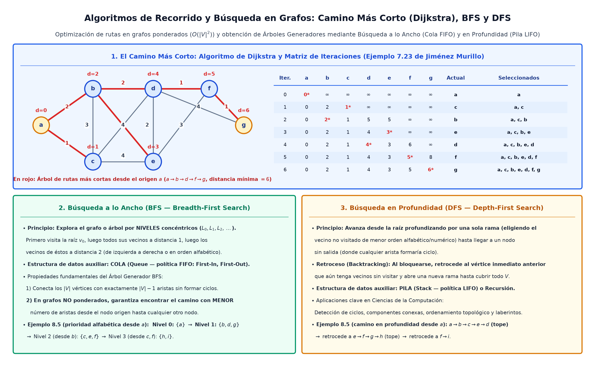

# 6.3 Algoritmos de Recorrido y Búsqueda

Un problema fundamental en la ciencia de la computación, las redes de telecomunicaciones y la inteligencia artificial consiste en recorrer sistemáticamente todos los vértices de un grafo o encontrar la ruta óptima entre un nodo origen y un nodo destino. Dependiendo de si las aristas poseen pesos (costos, distancias, latencias) o si se desea explorar exhaustivamente la estructura del grafo o árbol, se emplean tres algoritmos clásicos fundamentales: el **algoritmo del camino más corto de Dijkstra**, la **búsqueda a lo ancho (BFS)** y la **búsqueda en profundidad (DFS)**.

---

## 6.3.1 El camino más corto

Cuando se trabaja con un **grafo ponderado** $G = (V, L, w)$ donde cada arista $e = (u, v) \in L$ tiene asociado un peso no negativo $w(u, v) \ge 0$ (que puede representar distancia en kilómetros, retardo en milisegundos, costo financiero o consumo energético), el **problema del camino más corto** consiste en hallar una trayectoria desde un vértice inicial $v_0$ hasta un vértice final $v_f$ cuya suma total de pesos sea mínima:

$$d(v_0, v_f) = \min_{P \text{ de } v_0 \text{ a } v_f} \sum_{e \in P} w(e)$$

### Algoritmo de Dijkstra

Formulado por el científico de la computación holandés **Edsger W. Dijkstra** en 1959, este algoritmo voraz (*greedy*) determina la distancia más corta desde un nodo origen hacia todos los demás nodos del grafo (o hasta alcanzar el nodo destino).

#### Procedimiento paso a paso (Método de tabla de iteraciones)

1. **Inicialización:**
   - Se define el conjunto de nodos seleccionados (visitados definitivamente) como $S = \{\text{nodo inicial}\}$.
   - Al nodo inicial se le asigna distancia acumulada $0$ y a todos los demás vértices se les asigna distancia $\infty$ (o se evalúa directamente la distancia desde el nodo inicial en la primera iteración).
   - Se coloca el nodo inicial como el nodo `Actual`.

2. **Relajación de aristas (Iteración general):**
   - Desde el nodo `Actual` ($u$), se identifican todos sus vértices adyacentes $v$ que **no** pertenezcan aún al conjunto de `Seleccionados` ($v \notin S$).
   - Para cada vecino no visitado $v$, se calcula la distancia tentativa sumando la distancia acumulada hasta el nodo `Actual` más el peso de la arista que los une:
     $$d_{\text{tentativa}}(v) = d(u) + w(u, v)$$
   - Si esta distancia tentativa es menor que la distancia registrada previamente en la columna del nodo $v$ ($d(u) + w(u, v) < d(v)$), se actualiza el valor de la celda escribiendo la nueva distancia mínima junto con el subíndice del nodo predecesor: **$[d(u) + w(u, v)]_u$**. Si no es menor, se conserva el valor anterior de la columna.

3. **Selección del siguiente nodo actual:**
   - Entre todas las columnas de los nodos que **no** pertenecen a `Seleccionados`, se elige aquel que posea la **menor distancia acumulada** (en caso de empate, puede elegirse cualquiera de los empatados, por ejemplo en orden alfabético).
   - Ese nodo pasa a ser el nuevo nodo `Actual` en la siguiente fila y se agrega al conjunto `Seleccionados`.
   - En la tabla, su distancia mínima queda fija (suele marcarse con un asterisco $*$ o sombrearse) y ya no vuelve a modificarse en iteraciones posteriores.

4. **Condición de paro y reconstrucción de la ruta:**
   - El algoritmo termina cuando el nodo destino es agregado a `Seleccionados` (o cuando todos los nodos conexos han sido seleccionados).
   - Para reconstruir el **camino más corto**, se realiza un rastreo inverso (*backtracking*) desde el nodo destino leyendo los subíndices predecesores hasta regresar al nodo origen.

---

## 6.3.2 A lo ancho

La **búsqueda a lo ancho** (*Breadth-First Search*, **BFS**) es un procedimiento sistemático para recorrer todos los vértices de un árbol o de un grafo conexo explorando los nodos **nivel por nivel** (en orden creciente de su distancia en número de aristas respecto al vértice inicial).

### Búsqueda a lo ancho en árboles
Si se tiene un árbol con raíz en el nivel $0$:
1. Se visita primero la raíz (nivel $0$).
2. A continuación se visitan de izquierda a derecha todos los vértices del nivel $1$ (hijos de la raíz).
3. Luego se visitan de izquierda a derecha todos los vértices del nivel $2$ (nietos de la raíz), y así sucesivamente hasta agotar el último nivel del árbol.

### Búsqueda a lo ancho en grafos y Árbol Generador BFS
En un grafo general $G = (V, L)$ (que puede contener ciclos), el recorrido BFS construye simultáneamente un **árbol generador a lo ancho** $T = (V, L_T)$ libre de ciclos:

1. **Estructura de datos auxiliar:** Utiliza una **cola** (*Queue*, estructura **FIFO**: *First-In, First-Out*, primero en entrar, primero en salir) y un conjunto de nodos visitados $V_T$.
2. **Paso inicial:** Se elige un vértice arbitrario $r$ como raíz, se marca como visitado ($V_T = \{r\}$) y se inserta en la cola $Q$.
3. **Exploración por capas:** Mientras la cola $Q$ no esté vacía:
   - Se extrae (desencola) el vértice $u$ ubicado al frente de la cola.
   - Se examinan todos los vértices $v$ adyacentes a $u$ en el grafo $G$ (siguiendo un orden predefinido, usualmente alfabético o numérico).
   - Para cada vecino $v$: si $v \notin V_T$ (no ha sido visitado), se marca como visitado ($V_T \leftarrow V_T \cup \{v\}$), se agrega la arista $(u, v)$ al árbol generador ($L_T \leftarrow L_T \cup \{(u, v)\}$) y se inserta $v$ al final de la cola $Q$.

> **Propiedad fundamental de BFS:** En cualquier grafo **no ponderado** (donde todas las aristas valen $1$), el árbol generador construido por BFS garantiza el camino con el **menor número de aristas** (saltos) desde la raíz $r$ hasta cualquier otro vértice del grafo.

---

## 6.3.3 En profundidad

La **búsqueda en profundidad** (*Depth-First Search*, **DFS**) —también llamada **búsqueda en fondo**— es una estrategia que avanza a lo largo de una sola rama del árbol o grafo tan profundo como sea posible antes de retroceder (*backtracking*) para explorar ramas alternativas.

### Búsqueda en profundidad en árboles
1. Partiendo de la raíz, se desciende siempre hacia el primer hijo no visitado (usualmente el de más a la izquierda) hasta alcanzar una **hoja** (nodo sin hijos).
2. Al llegar a una hoja, se retrocede (*backtrack*) un nivel hacia su nodo padre y se verifica si dicho padre posee otros hijos no visitados; de ser así, se vuelve a descender a profundidad por esa nueva rama.
3. Si todos los hijos de un nodo ya fueron visitados, se continúa retrocediendo hacia su abuelo, y así sucesivamente hasta haber recorrido todos los nodos del árbol.

### Búsqueda en profundidad en grafos y Árbol Generador DFS
Dado un grafo conexo $G = (V, L)$, el recorrido DFS construye un **árbol generador en profundidad** $T = (V, L_T)$ mediante una **pila** (*Stack*, estructura **LIFO**: *Last-In, First-Out*, último en entrar, primero en salir) o mediante llamadas recursivas:

1. **Paso inicial:** Se selecciona un vértice inicial $r$ como raíz, se marca como visitado ($V_T = \{r\}$) y se convierte en el vértice activo $u = r$.
2. **Avance profundo:** Si el vértice activo $u$ tiene al menos un vértice adyacente $v$ que aún **no** pertenece a $V_T$:
   - Se elige el primer vecino no visitado $v$ (p. ej., en orden alfabético).
   - Se incorpora $v$ a $V_T$ y se añade la arista $(u, v)$ a $L_T$.
   - El vértice $v$ se convierte en el nuevo vértice activo ($u \leftarrow v$) y se repite el paso 2 para seguir profundizando.
3. **Retroceso (*Backtracking*):** Si el vértice activo $u$ ya no tiene ningún vecino sin visitar en $G$:
   - Se retrocede por la arista del árbol $T$ hacia el nodo padre de $u$, haciendo que dicho padre sea nuevamente el vértice activo.
   - Desde ahí se intenta el paso 2 hacia otra rama no visitada.
4. **Terminación:** El proceso finaliza cuando todos los vértices del grafo han sido incorporados a $V_T$ (o cuando se regresa a la raíz $r$ y ésta ya no tiene vecinos por explorar).

### Comparación entre Dijkstra, BFS y DFS

| Característica | Algoritmo de Dijkstra | Búsqueda a lo Ancho (BFS) | Búsqueda en Profundidad (DFS) |
| :--- | :--- | :--- | :--- |
| **Tipo de grafo** | Ponderado con pesos $w(e) \ge 0$ | No ponderado (o pesos iguales) | No ponderado / Estructural |
| **Estructura auxiliar** | Cola de prioridad (Min-Heap) / Tabla | Cola (**FIFO**) | Pila (**LIFO**) / Recursión |
| **Estrategia de avance** | Voraz por menor distancia acumulada | Por niveles o capas concéntricas | Por ramas hasta el fondo con retroceso |
| **Complejidad temporal** | $O(\|V\|^2)$ en tabla; $O((\|V\|+\|L\|)\log \|V\|)$ con heap | $O(\|V\| + \|L\|)$ | $O(\|V\| + \|L\|)$ |
| **Aplicación típica** | Rutas GPS, protocolo OSPF en redes IP | Camino con menos saltos, redes P2P | Detección de ciclos, laberintos, orden topológico |

---

## Ejemplos de Práctica (Resueltos Paso a Paso)

### Ejemplo 1: Camino más corto mediante el Algoritmo de Dijkstra (Tabla de iteraciones)

**Problema:**  
Sea el grafo ponderado cuyos vértices son $V = \{a, b, c, d, e, f, g, h\}$ y cuyas aristas con peso son:
- Desde $a$: $(a, b) = 3$, $(a, c) = 5$, $(a, d) = 2$
- Desde $b$: $(b, c) = 1$, $(b, e) = 4$, $(b, g) = 6$
- Desde $c$: $(c, d) = 4$, $(c, e) = 2$, $(c, f) = 1$
- Desde $d$: $(d, f) = 7$
- Desde $e$: $(e, f) = 5$, $(e, g) = 2$, $(e, h) = 3$
- Desde $f$: $(f, h) = 5$
- Desde $g$: $(g, h) = 1$

Aplicando el **Algoritmo de Dijkstra**, encuentre el camino más corto y su distancia mínima desde el nodo inicial **$a$** hasta el nodo destino **$h$**.

**Solución paso a paso:**

1. **Iteración 1 (`Actual` = $a$, distancia acumulada = $0$):**
   - Nodos adyacentes a $a$:
     - Hacia $b$: $0 + 3 = \mathbf{3_a}$
     - Hacia $c$: $0 + 5 = \mathbf{5_a}$
     - Hacia $d$: $0 + 2 = \mathbf{2_a}$
     - Los demás nodos ($e, f, g, h$) permanecen en $\infty$.
   - El menor valor entre los no seleccionados $\{3_a, 5_a, 2_a\}$ es **$2_a^*$'** (nodo **$d$**). Pasa a `Actual` = $d$ y `Seleccionados` = $\{a, d\}$.

2. **Iteración 2 (`Actual` = $d$, distancia acumulada = $2$):**
   - Nodos adyacentes a $d$ fuera de $\{a, d\}$: $c$ y $f$.
     - Hacia $c$: $2 + 4 = 6_d$. Como en la columna $c$ ya tenemos $5_a$ y $5 < 6$, **se conserva $5_a$**.
     - Hacia $f$: $2 + 7 = \mathbf{9_d}$ (mejora $\infty$).
   - Entre los no seleccionados $\{b: 3_a, c: 5_a, f: 9_d\}$, el mínimo es **$3_a^*$** (nodo **$b$**). Pasa a `Actual` = $b$ y `Seleccionados` = $\{a, d, b\}$.

3. **Iteración 3 (`Actual` = $b$, distancia acumulada = $3$):**
   - Nodos adyacentes a $b$ fuera de $\{a, d, b\}$: $c, e, g$.
     - Hacia $c$: $3 + 1 = \mathbf{4_b}$ (mejora a $5_a$, pues $4 < 5$).
     - Hacia $e$: $3 + 4 = \mathbf{7_b}$ (mejora $\infty$).
     - Hacia $g$: $3 + 6 = \mathbf{9_b}$ (mejora $\infty$).
   - Entre los no seleccionados $\{c: 4_b, e: 7_b, f: 9_d, g: 9_b\}$, el mínimo es **$4_b^*$** (nodo **$c$**). Pasa a `Actual` = $c$ y `Seleccionados` = $\{a, d, b, c\}$.

4. **Iteración 4 (`Actual` = $c$, distancia acumulada = $4$):**
   - Nodos adyacentes a $c$ fuera de $\{a, d, b, c\}$: $e$ y $f$.
     - Hacia $e$: $4 + 2 = \mathbf{6_c}$ (mejora a $7_b$, pues $6 < 7$).
     - Hacia $f$: $4 + 1 = \mathbf{5_c}$ (mejora a $9_d$, pues $5 < 9$).
   - Entre los no seleccionados $\{e: 6_c, f: 5_c, g: 9_b\}$, el mínimo es **$5_c^*$** (nodo **$f$**). Pasa a `Actual` = $f$ y `Seleccionados` = $\{a, d, b, c, f\}$.

5. **Iteración 5 (`Actual` = $f$, distancia acumulada = $5$):**
   - Nodos adyacentes a $f$ fuera de `Seleccionados`: $e$ y $h$.
     - Hacia $e$: $5 + 5 = 10_f > 6_c \implies$ se conserva $6_c$.
     - Hacia $h$: $5 + 5 = \mathbf{10_f}$ (mejora $\infty$).
   - Entre los no seleccionados $\{e: 6_c, g: 9_b, h: 10_f\}$, el mínimo es **$6_c^*$** (nodo **$e$**). Pasa a `Actual` = $e$ y `Seleccionados` = $\{a, d, b, c, f, e\}$.

6. **Iteración 6 (`Actual` = $e$, distancia acumulada = $6$):**
   - Nodos adyacentes a $e$ fuera de `Seleccionados`: $g$ y $h$.
     - Hacia $g$: $6 + 2 = \mathbf{8_e}$ (mejora a $9_b$).
     - Hacia $h$: $6 + 3 = \mathbf{9_e}$ (mejora a $10_f$).
   - Entre los no seleccionados $\{g: 8_e, h: 9_e\}$, el mínimo es **$8_e^*$** (nodo **$g$**). Pasa a `Actual` = $g$ y `Seleccionados` = $\{a, d, b, c, f, e, g\}$.

7. **Iteración 7 (`Actual` = $g$, distancia acumulada = $8$):**
   - Único vecino no seleccionado de $g$: $h$.
     - Hacia $h$: $8 + 1 = 9_g$. Como ya teníamos $9_e$, existe un empate de longitud mínima **$9^*$** (tanto por $e$ como por $g$). Se selecciona $h$ y el algoritmo termina.

#### Tabla resumen de iteraciones de Dijkstra

| Iteración | Actual | Seleccionados | $a$ | $b$ | $c$ | $d$ | $e$ | $f$ | $g$ | $h$ |
| :---: | :---: | :--- | :---: | :---: | :---: | :---: | :---: | :---: | :---: | :---: |
| **1** | $a$ | $\{a\}$ | $0^*$ | $3_a$ | $5_a$ | **$2_a^*$** | $\infty$ | $\infty$ | $\infty$ | $\infty$ |
| **2** | $d$ | $\{a, d\}$ | $0^*$ | **$3_a^*$** | $5_a$ | $2_a^*$ | $\infty$ | $9_d$ | $\infty$ | $\infty$ |
| **3** | $b$ | $\{a, d, b\}$ | $0^*$ | $3_a^*$ | **$4_b^*$** | $2_a^*$ | $7_b$ | $9_d$ | $9_b$ | $\infty$ |
| **4** | $c$ | $\{a, d, b, c\}$ | $0^*$ | $3_a^*$ | $4_b^*$ | $2_a^*$ | $6_c$ | **$5_c^*$** | $9_b$ | $\infty$ |
| **5** | $f$ | $\{a, d, b, c, f\}$ | $0^*$ | $3_a^*$ | $4_b^*$ | $2_a^*$ | **$6_c^*$** | $5_c^*$ | $9_b$ | $10_f$ |
| **6** | $e$ | $\{a, d, b, c, f, e\}$ | $0^*$ | $3_a^*$ | $4_b^*$ | $2_a^*$ | $6_c^*$ | $5_c^*$ | **$8_e^*$** | $9_e$ |
| **7** | $g$ | $\{a, d, b, c, f, e, g, h\}$ | $0^*$ | $3_a^*$ | $4_b^*$ | $2_a^*$ | $6_c^*$ | $5_c^*$ | $8_e^*$ | **$9_{e,g}^*$** |

8. **Reconstrucción del camino más corto (rastreo inverso de subíndices):**
   - Ruta 1 (vía $e$): $h \leftarrow 9_e \leftarrow 6_c \leftarrow 4_b \leftarrow 3_a \implies$ **$a \to b \to c \to e \to h$** (Pesos: $3 + 1 + 2 + 3 = \mathbf{9}$).
   - Ruta 2 (vía $g$): $h \leftarrow 9_g \leftarrow 8_e \leftarrow 6_c \leftarrow 4_b \leftarrow 3_a \implies$ **$a \to b \to c \to e \to g \to h$** (Pesos: $3 + 1 + 2 + 2 + 1 = \mathbf{9}$).

---

### Ejemplo 2: Obtención de Árboles Generadores mediante BFS y DFS

**Problema:**  
Considere el grafo conexo $G = (V, L)$ con vértices $V = \{a, b, c, d, e, f, g, h\}$ cuyas listas de adyacencia (ordenadas alfabéticamente) son:
- $\text{Adj}(a) = \{b, d\}$
- $\text{Adj}(b) = \{a, c, d, e\}$
- $\text{Adj}(c) = \{b, e, f\}$
- $\text{Adj}(d) = \{a, b, e, g\}$
- $\text{Adj}(e) = \{b, c, d, f, g, h\}$
- $\text{Adj}(f) = \{c, e, h\}$
- $\text{Adj}(g) = \{d, e, h\}$
- $\text{Adj}(h) = \{e, f, g\}$

Tomando al nodo **$e$** como raíz y respetando el orden alfabético para elegir vecinos:
1. Construya el **árbol generador a lo ancho (BFS)** indicando el orden de visita y las aristas seleccionadas.
2. Construya el **árbol generador en profundidad (DFS)** indicando la traza de avance/retroceso y las aristas seleccionadas.

**Solución paso a paso:**

#### 1. Búsqueda a lo Ancho (BFS) desde la raíz $e$
- **Inicio:** Raíz $e$ (Nivel $0$). $V_T = \{e\}$, Cola $Q = [e]$.
- **Desencolar $e$:** Sus vecinos en $G$ son $\{b, c, d, f, g, h\}$. Ninguno ha sido visitado. Se agregan todos en el Nivel $1$ como hijos de $e$:
  - Aristas añadidas: $(e, b), (e, c), (e, d), (e, f), (e, g), (e, h)$.
  - $V_T = \{e, b, c, d, f, g, h\}$, Cola $Q = [b, c, d, f, g, h]$.
- **Desencolar $b$:** Sus vecinos en $G$ son $\{a, c, d, e\}$. De ellos, el único que no pertenece a $V_T$ es **$a$**. Se agrega $a$ en el Nivel $2$ como hijo de $b$:
  - Arista añadida: $(b, a)$.
  - $V_T = \{e, b, c, d, f, g, h, a\}$.
- Como $V_T = V$ (ya están los $8$ vértices), el algoritmo termina.
- **Orden de visita BFS:** $e, b, c, d, f, g, h, a$.
- **Aristas del árbol generador BFS ($|L_T| = 8 - 1 = 7$):**
  $$L_{\text{BFS}} = \{(e, b), (e, c), (e, d), (e, f), (e, g), (e, h), (b, a)\}$$

#### 2. Búsqueda en Profundidad (DFS) desde la raíz $e$
- **Paso 1:** Inicia en $e$. Primer vecino alfabético no visitado de $e$: **$b$**. Arista $(e, b)$, $V_T = \{e, b\}$.
- **Paso 2:** Desde $b$, su primer vecino alfabético no visitado es **$a$**. Arista $(b, a)$, $V_T = \{e, b, a\}$.
- **Paso 3:** Desde $a$, su único vecino no visitado es **$d$**. Arista $(a, d)$, $V_T = \{e, b, a, d\}$.
- **Paso 4:** Desde $d$, sus vecinos son $\{a, b, e, g\}$. Como $a, b, e$ ya están visitados, elige **$g$**. Arista $(d, g)$, $V_T = \{e, b, a, d, g\}$.
- **Paso 5:** Desde $g$, su único vecino no visitado es **$h$**. Arista $(g, h)$, $V_T = \{e, b, a, d, g, h\}$.
- **Paso 6:** Desde $h$, su único vecino no visitado es **$f$**. Arista $(h, f)$, $V_T = \{e, b, a, d, g, h, f\}$.
- **Paso 7:** Desde $f$, su único vecino no visitado es **$c$**. Arista $(f, c)$, $V_T = \{e, b, a, d, g, h, f, c\}$.
- Como ya se visitaron los $8$ vértices sin necesidad siquiera de retroceder (formando un camino hamiltoniano desde $e$), el proceso concluye.
- **Orden de visita DFS:** $e \to b \to a \to d \to g \to h \to f \to c$.
- **Aristas del árbol generador DFS ($|L_T| = 7$):**
  $$L_{\text{DFS}} = \{(e, b), (b, a), (a, d), (d, g), (g, h), (h, f), (f, c)\}$$

---

### Ejemplo 3: Recorridos BFS y DFS con retroceso (*backtracking*)

**Problema:**  
Sea el grafo conexo con vértices $V = \{1, 2, 3, 4, 5, 6, 7\}$ y aristas:
$$(1, 2), (1, 3), (2, 4), (2, 5), (3, 6), (4, 7), (5, 7), (6, 7)$$
Partiendo del vértice **$1$** y eligiendo siempre el vecino de menor número:
1. Determine la secuencia de visita en **anchura (BFS)** mostrando la evolución de la cola.
2. Determine la secuencia de visita en **profundidad (DFS)** mostrando los retrocesos (*backtracking*).

**Solución paso a paso:**

1. **Traza de Búsqueda a lo Ancho (BFS):**
   - Inicio: Visitar **$1$**. Cola: $[1]$.
   - Extraer $1 \to$ encolar vecinos no visitados $2, 3$. Cola: $[2, 3]$. Aristas: $(1, 2), (1, 3)$.
   - Extraer $2 \to$ encolar vecinos no visitados $4, 5$. Cola: $[3, 4, 5]$. Aristas: $(2, 4), (2, 5)$.
   - Extraer $3 \to$ encolar vecino no visitado $6$. Cola: $[4, 5, 6]$. Aristas: $(3, 6)$.
   - Extraer $4 \to$ encolar vecino no visitado $7$. Cola: $[5, 6, 7]$. Arista: $(4, 7)$.
   - Extraer $5, 6, 7 \to$ no quedan vecinos sin visitar.
   - **Secuencia BFS:** **$1, 2, 3, 4, 5, 6, 7$**.

2. **Traza de Búsqueda en Profundidad (DFS):**
   - Inicio en **$1$** $\to$ avanza al menor vecino **$2$** (arista $(1, 2)$) $\to$ avanza a **$4$** (arista $(2, 4)$) $\to$ avanza a **$7$** (arista $(4, 7)$) $\to$ desde $7$, sus vecinos son $\{4, 5, 6\}$; el menor no visitado es **$5$** (arista $(7, 5)$).
   - En **$5$**, sus vecinos son $\{2, 7\}$, ambos ya visitados. **Retrocede (*backtrack*)** de $5$ a $7$.
   - Desde **$7$**, aún tiene un vecino no visitado: **$6$** $\to$ avanza a **$6$** (arista $(7, 6)$) $\to$ desde $6$ avanza a su vecino no visitado **$3$** (arista $(6, 3)$).
   - Todos los $7$ vértices han sido visitados.
   - **Secuencia DFS:** **$1, 2, 4, 7, 5, 6, 3$**.

---

## Ejercicios de Tarea (Práctica en Casa)

### Ejercicio 1: Algoritmo de Dijkstra en una red de routers
Una red de telecomunicaciones consta de $6$ routers $V = \{A, B, C, D, E, F\}$ interconectados mediante enlaces bidireccionales cuyos retardos en milisegundos son:
$$(A, B)=4,\; (A, C)=2,\; (B, C)=1,\; (B, D)=5,\; (C, D)=8,\; (C, E)=10,\; (D, E)=2,\; (D, F)=6,\; (E, F)=3$$
1. Construya la tabla completa de iteraciones del **Algoritmo de Dijkstra** partiendo del router origen **$A$** hasta el router destino **$F$**.
2. Indique la ruta óptima de menor latencia entre $A$ y $F$ y su tiempo total en milisegundos.
3. Determine también la ruta más corta y la latencia mínima desde $A$ hasta cada uno de los demás routers ($B, C, D, E$).

<!--
SOLUCIÓN DEL EJERCICIO 1:

1. Tabla de iteraciones del Algoritmo de Dijkstra (Origen: A):

| Iter. | Actual | Seleccionados | A | B | C | D | E | F |
| :---: | :---: | :--- | :---: | :---: | :---: | :---: | :---: | :---: |
| 1 | A | {A} | 0* | 4_A | 2_A* | inf | inf | inf |
| 2 | C | {A, C} | 0* | 3_C* | 2_A* | 10_C | 12_C | inf |
| 3 | B | {A, C, B} | 0* | 3_C* | 2_A* | 8_B* | 12_C | inf |
| 4 | D | {A, C, B, D} | 0* | 3_C* | 2_A* | 8_B* | 10_D* | 14_D |
| 5 | E | {A, C, B, D, E} | 0* | 3_C* | 2_A* | 8_B* | 10_D* | 13_E* |
| 6 | F | {A, C, B, D, E, F} | 0* | 3_C* | 2_A* | 8_B* | 10_D* | 13_E* |

Detalle de relajaciones:
- Iter 1 (desde A, d=0): d(B)=4_A, d(C)=2_A. Mínimo = 2_A* (nodo C).
- Iter 2 (desde C, d=2): d(B) = min(4, 2+1) = 3_C; d(D) = 2+8 = 10_C; d(E) = 2+10 = 12_C. Mínimo = 3_C* (nodo B).
- Iter 3 (desde B, d=3): d(D) = min(10, 3+5) = 8_B. Mínimo = 8_B* (nodo D).
- Iter 4 (desde D, d=8): d(E) = min(12, 8+2) = 10_D; d(F) = 8+6 = 14_D. Mínimo = 10_D* (nodo E).
- Iter 5 (desde E, d=10): d(F) = min(14, 10+3) = 13_E. Mínimo = 13_E* (nodo F).

2. Ruta óptima de A a F (rastreo inverso de subíndices):
   F <- 13_E <- 10_D <- 8_B <- 3_C <- 2_A
   Ruta: A -> C -> B -> D -> E -> F
   Latencia total mínima: 2 + 1 + 5 + 2 + 3 = 13 ms.

3. Rutas más cortas desde A hacia todos los demás routers:
   - A -> C: ruta A -> C (2 ms)
   - A -> B: ruta A -> C -> B (3 ms)
   - A -> D: ruta A -> C -> B -> D (8 ms)
   - A -> E: ruta A -> C -> B -> D -> E (10 ms)
   - A -> F: ruta A -> C -> B -> D -> E -> F (13 ms)
-->

---

### Ejercicio 2: Árboles generadores por búsqueda a lo ancho (BFS) y en profundidad (DFS)
Sea el grafo conexo con conjunto de vértices $V = \{a, b, c, d, e, f, g, h, i\}$ y aristas:
$$(a, b), (a, c), (a, d), (b, c), (b, e), (c, e), (c, f), (d, f), (d, g), (e, h), (f, g), (f, h), (f, i), (g, i), (h, i)$$
Tomando el vértice **$a$** como raíz y desempatando siempre en **orden alfabético**:
1. Ejecute el algoritmo **BFS**, indique el orden de visita de los $9$ vértices, el nivel en el que queda cada vértice y las $8$ aristas del árbol generador $T_{\text{BFS}}$.
2. Ejecute el algoritmo **DFS**, indique el orden de visita de los $9$ vértices, las $8$ aristas del árbol generador $T_{\text{DFS}}$ y en qué nodos ocurrió retroceso (*backtracking*).

<!--
SOLUCIÓN DEL EJERCICIO 2:

Listas de adyacencia ordenadas alfabéticamente:
- Adj(a) = {b, c, d}
- Adj(b) = {a, c, e}
- Adj(c) = {a, b, e, f}
- Adj(d) = {a, f, g}
- Adj(e) = {b, c, h}
- Adj(f) = {c, d, g, h, i}
- Adj(g) = {d, f, i}
- Adj(h) = {e, f, i}
- Adj(i) = {f, g, h}

1. Búsqueda a lo Ancho (BFS) desde la raíz a:
   - Nivel 0: {a}. Cola = [a].
   - Desencola a -> descubre b, c, d (Nivel 1). Aristas: (a, b), (a, c), (a, d). Cola = [b, c, d].
   - Desencola b -> descubre e (Nivel 2). Arista: (b, e). Cola = [c, d, e].
   - Desencola c -> descubre f (Nivel 2). Arista: (c, f). Cola = [d, e, f].
   - Desencola d -> descubre g (Nivel 2). Arista: (d, g). Cola = [e, f, g].
   - Desencola e -> descubre h (Nivel 3). Arista: (e, h). Cola = [f, g, h].
   - Desencola f -> descubre i (Nivel 3). Arista: (f, i). Cola = [g, h, i].
   - Orden de visita BFS: a, b, c, d, e, f, g, h, i.
   - Niveles: Nivel 0: {a}; Nivel 1: {b, c, d}; Nivel 2: {e, f, g}; Nivel 3: {h, i}.
   - Aristas de T_BFS: {(a, b), (a, c), (a, d), (b, e), (c, f), (d, g), (e, h), (f, i)}.

2. Búsqueda en Profundidad (DFS) desde la raíz a:
   - a -> b (arista (a, b))
   - b -> c (arista (b, c))
   - c -> e (arista (c, e))
   - e -> h (arista (e, h))
   - h -> f (arista (h, f))
   - f -> d (arista (f, d))
   - d -> g (arista (d, g))
   - g -> i (arista (g, i))
   - En el nodo i, sus vecinos {f, g, h} ya están todos visitados (y ya se completaron los 9 vértices). Si continuara para vaciar la pila, retrocedería desde i -> g -> d -> f -> h -> e -> c -> b -> a.
   - Orden de visita DFS: a, b, c, e, h, f, d, g, i.
   - Aristas de T_DFS: {(a, b), (b, c), (c, e), (e, h), (h, f), (f, d), (d, g), (g, i)}.
-->

---

### Ejercicio 3: Comparación entre el camino con menos aristas (BFS) y el camino de menor peso (Dijkstra)
Considere un grafo ponderado con vértices $V = \{S, A, B, C, D, T\}$ y aristas no dirigidas:
$$(S, A) = 10,\; (A, T) = 10,\; (S, B) = 2,\; (B, C) = 2,\; (C, D) = 2,\; (D, T) = 3,\; (A, C) = 1$$
1. Si se ignora el peso de las aristas y se ejecuta **BFS** desde $S$ hasta $T$, ¿cuál es el camino encontrado, cuántas aristas (saltos) tiene y cuál sería su costo real si se suman sus pesos?
2. Si se ejecuta el **Algoritmo de Dijkstra** desde $S$ hasta $T$, ¿cuál es el camino más corto en peso, cuántas aristas tiene y cuál es su costo total?
3. Explique por qué los protocolos de enrutamiento modernos (como OSPF) utilizan Dijkstra en lugar de BFS, mientras que protocolos antiguos (como RIP) utilizaban conteo de saltos.

<!--
SOLUCIÓN DEL EJERCICIO 3:

1. Camino mediante BFS (menor número de saltos):
   - Nivel 0: S
   - Nivel 1 (a 1 salto de S): A, B
   - Nivel 2 (a 2 saltos de S): Desde A se alcanza directamente T (y C).
   - Por tanto, BFS encuentra la ruta S -> A -> T con tan solo 2 aristas (saltos).
   - Sin embargo, su costo real sumando los pesos es 10 + 10 = 20.

2. Camino mediante el Algoritmo de Dijkstra (menor peso acumulado):
   - Iter 1 (S, d=0): d(A)=10_S, d(B)=2_S*. Selecciona B.
   - Iter 2 (B, d=2): d(C)=2+2=4_B*. Selecciona C.
   - Iter 3 (C, d=4): d(A)=min(10, 4+1)=5_C*, d(D)=4+2=6_C. Selecciona A.
   - Iter 4 (A, d=5): d(T)=5+10=15_A. Selecciona D (con d(D)=6_C*).
   - Iter 5 (D, d=6): d(T)=min(15, 6+3)=9_D*. Selecciona T.
   - Ruta óptima de Dijkstra: S -> B -> C -> D -> T.
   - Tiene 4 aristas (saltos), pero su costo total es 2 + 2 + 2 + 3 = 9 (menos de la mitad del costo de la ruta de 2 saltos).

3. Explicación técnica:
   - RIP (Routing Information Protocol) minimizaba el conteo de saltos (equivalente a pesos unitarios / BFS), lo que podía enviar paquetes por enlaces lentos o congestionados solo porque había menos routers intermedios.
   - OSPF (Open Shortest Path First) asigna pesos inversamente proporcionales al ancho de banda de cada enlace y ejecuta el Algoritmo de Dijkstra, garantizando que el tráfico fluya por la trayectoria de mayor velocidad y menor latencia acumulada aunque atraviese más saltos.
-->
