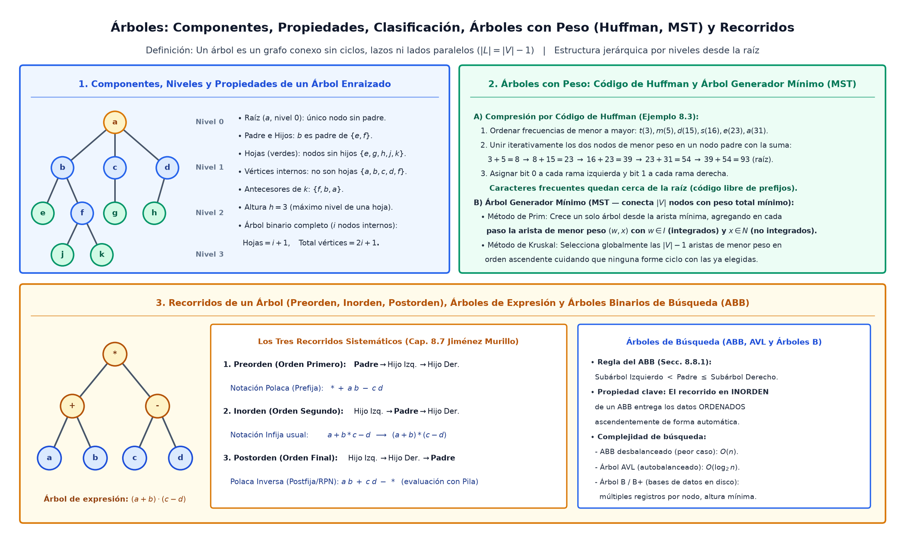

# 6.4 Árboles

En la teoría de grafos y en las ciencias de la computación, un **árbol** es un grafo simple, conexo y **acíclico** (que no contiene ningún ciclo ni lazo). Los árboles constituyen la estructura de datos no lineal más importante de la informática moderna: modelan jerarquías de sistemas de archivos, el árbol del DOM en páginas web, árboles de sintaxis abstracta en compiladores, códigos de compresión óptima (Huffman) e índices de búsqueda logarítmica en bases de datos.

---

## 6.4.1 Componentes (raíz, hoja, padre, hijo, descendientes, ancestros)

Un **árbol con raíz** (o árbol dirigido) es un árbol en el cual se ha distinguido un vértice especial denominado **raíz**, a partir del cual se establece una relación jerárquica de parentesco entre todos los demás nodos:

1. **Raíz (*Root*):** Es el único nodo superior del árbol que no tiene padre (su grado de entrada es $0$). Se ubica en el **nivel $0$** de la jerarquía.
2. **Padre (*Parent*):** Si existe una rama dirigida desde el vértice $u$ hacia el vértice $v$ (alejándose de la raíz), se dice que $u$ es el **padre** de $v$. En todo árbol con raíz, cada nodo —excepto la raíz— tiene **exactamente un único padre**.
3. **Hijo (*Child*):** En la relación anterior, $v$ es **hijo** de $u$. Un nodo puede tener cero, uno, dos o más hijos.
4. **Hermanos (*Siblings*):** Son los nodos que comparten el **mismo nodo padre** (y por ende se encuentran en el mismo nivel del árbol).
5. **Hoja o vértice terminal (*Leaf*):** Es cualquier nodo que **no tiene hijos** (se ubica en el extremo final de una rama).
6. **Vértice interno (o nodo rama):** Es cualquier nodo que **tiene al menos un hijo** (es decir, todos los nodos que no son hojas; incluye a la raíz salvo que el árbol conste de un solo vértice).
7. **Ancestros (o antecesores):** Los ancestros de un nodo $v$ son todos los vértices situados en el único camino simple desde la raíz hasta el padre de $v$ (su padre, su abuelo, su bisabuelo, ..., hasta llegar a la raíz).
8. **Descendientes:** Los descendientes de un nodo $u$ son todos los vértices para los cuales $u$ es un ancestro (sus hijos, nietos, bisnietos, etc.).
9. **Subárbol (*Subtree*):** Dado cualquier vértice $u$ del árbol, el subárbol con raíz en $u$ está formado por el nodo $u$ junto con todos sus descendientes y las ramas que los conectan.
10. **Nivel de un nodo:** Es la longitud (número de aristas) del único camino desde la raíz hasta dicho nodo. La raíz está en el nivel $0$, sus hijos en el nivel $1$, sus nietos en el nivel $2$, etcétera.

---

## 6.4.2 Propiedades

Sea $T = (V, L)$ un grafo simple con $n = |V|$ vértices y $m = |L|$ aristas. Las siguientes proposiciones son **equivalentes** y caracterizan matemáticamente las propiedades fundamentales de todo árbol:

1. **Conexidad y ausencia de ciclos:** $T$ es un grafo **conexo** y **no contiene ciclos**.
2. **Relación exacta entre vértices y aristas:** Todo árbol con $|V|$ vértices tiene exactamente $|V| - 1$ aristas:
   $$|L| = |V| - 1$$
3. **Unicidad del camino:** Entre cualquier par de vértices distintos $u, v \in V$ existe **uno y sólo un camino simple** que los conecta.
4. **Conexidad mínima (puentes):** $T$ es conexo, pero si se elimina cualquiera de sus aristas, el grafo resultante deja de ser conexo y se divide exactamente en $2$ componentes conexas (toda arista de un árbol es un *puente*).
5. **Aciclicidad máxima:** $T$ no contiene ciclos, pero si se agrega cualquier arista nueva entre dos vértices no adyacentes de $T$, se forma **exactamente un ciclo**.

### Bosques (*Forests*)
Un **bosque** es un grafo acíclico (no necesariamente conexo) cuyas componentes conexas son todas **árboles**. Si un bosque tiene $|V|$ vértices, $|L|$ aristas y $k$ componentes conexas (es decir, está formado por $k$ árboles disjuntos), entonces cumple la relación generalizada:
$$|L| = |V| - k$$

### Propiedades de los árboles binarios completos
En un **árbol binario completo** (aquel donde cada nodo interno tiene exactamente $2$ hijos, izquierdo y derecho), si denotamos por $i$ al número de **vértices internos**, se cumplen siempre las siguientes identidades exactas:
- **Número de hojas ($h_0$):**
  $$\text{Hojas} = i + 1$$
- **Número total de vértices ($|V|$):**
  $$|V| = 2i + 1$$
- **Número total de aristas ($|L|$):**
  $$|L| = 2i$$

---

## 6.4.3 Clasificación (altura, número de nodos)

Los árboles con raíz se clasifican principalmente bajo dos criterios estructurales: el **número máximo de hijos por nodo** y su **altura / balanceo**.

### 1. Clasificación por el número de hijos de sus nodos ($m$-arios)
Un árbol con raíz se denomina **$m$-ario** si cada vértice interno tiene como máximo $m$ hijos. Se dice que es un árbol **$m$-ario completo** (o lleno) si cada vértice interno tiene **exactamente $m$ hijos**:
- **Árbol binario ($m = 2$):** Cada nodo tiene a lo sumo $2$ hijos (denominados *hijo izquierdo* e *hijo derecho*). Es **binario completo** si todo nodo interno tiene exactamente $2$ hijos.
- **Árbol trinario o ternario ($m = 3$):** Cada nodo tiene a lo sumo $3$ hijos.
- **Árbol cuaternario ($m = 4$):** Cada nodo tiene a lo sumo $4$ hijos.

### 2. Clasificación por su altura y balanceo
- **Altura de un árbol ($h$):** Es el **nivel máximo** que alcanzan sus hojas (es decir, la longitud del camino más largo desde la raíz hasta una hoja). Un árbol con altura $h$ posee en total $h + 1$ niveles (numerados desde $0$ hasta $h$).
- **Cota máxima de nodos en un árbol $m$-ario de altura $h$:**
  - En el nivel $k$ puede haber a lo sumo $m^k$ nodos (para un árbol binario, a lo sumo $2^k$ nodos en el nivel $k$).
  - Un árbol binario de altura $h$ tiene en total a lo sumo:
    $$|V|_{\max} = 2^0 + 2^1 + 2^2 + \dots + 2^h = 2^{h+1} - 1 \text{ vértices}$$
- **Árbol balanceado (equilibrado) vs. desbalanceado:**
  - Un árbol de altura $h$ está **balanceado** si todas sus hojas se encuentran en el último nivel **$h$** o en el penúltimo nivel **$h - 1$** (de modo que para cualquier nodo del árbol, las alturas de sus subárboles izquierdo y derecho difieren a lo sumo en $1$ unidad: $|h_{\text{izq}} - h_{\text{der}}| \le 1$).
  - En caso contrario (por ejemplo, si existen hojas en el nivel $1$ y hojas en el nivel $4$), el árbol está **desbalanceado** (o degenerado), lo que degrada el rendimiento de las búsquedas.

---

## 6.4.4 Árboles con peso

Cuando a las ramas o a las hojas de un árbol (o a las aristas de un grafo del cual se extraerá un árbol generador) se les asignan valores numéricos no negativos llamados **pesos** (frecuencias, probabilidades, distancias o costos), surgen dos aplicaciones fundamentales: la **codificación óptima de Huffman** y el **Árbol Generador Mínimo (MST)**.

### 1. Código de Huffman (Compresión de datos libre de prefijos)
Desarrollado por **David A. Huffman** en 1952, este algoritmo construye un **árbol binario con peso** óptimo a partir de las frecuencias de aparición de los caracteres de un archivo o mensaje, asignando cadenas de bits cortas a los caracteres más frecuentes y cadenas más largas a los caracteres raros:

1. Se ordenan los símbolos (caracteres) de **menor a mayor frecuencia** (o probabilidad). Cada símbolo inicia como una hoja independiente con su peso.
2. Se toman los **dos nodos de menor peso**, se unen bajo un nuevo nodo padre cuyo peso es la **suma de ambos pesos** ($w_{\text{padre}} = w_1 + w_2$), colocando el menor a la izquierda y el mayor a la derecha.
3. Se inserta este nuevo nodo suma en la lista manteniendo el orden ascendente de pesos (en caso de empate, se respeta la convención establecida, por ejemplo colocar el nodo recién creado a la izquierda o derecha de los empatados).
4. Se repiten los pasos 2 y 3 hasta que quede un único nodo raíz que contenga la suma total de todas las frecuencias.
5. **Asignación de códigos binarios:** A cada rama izquierda se le asigna el bit **$0$** y a cada rama derecha el bit **$1$** (o viceversa). El código de Huffman de cada carácter se lee recorriendo el camino desde la raíz hasta su hoja.

> **Propiedad libre de prefijos:** Como todos los caracteres quedan ubicados en las **hojas** del árbol binario, ningún código de un carácter es prefijo del código de otro carácter, lo que permite decodificar cualquier secuencia binaria sin ambigüedad y sin necesidad de separadores.

### 2. Árbol Generador Mínimo (*Minimum Spanning Tree*, MST)
Dado un grafo conexo ponderado $G = (V, L, w)$, un **árbol generador** es un subgrafo $T = (V, L_T)$ que conecta a **todos** los vértices de $G$ sin formar ciclos ($|L_T| = |V| - 1$). El **Árbol Generador Mínimo (MST)** es aquel cuya suma total de pesos de sus aristas es mínima:
$$W(T) = \sum_{e \in L_T} w(e) = \text{mínimo}$$

Existen dos algoritmos voraces clásicos que garantizan encontrar el MST exacto:

#### A) Método de Prim (Crecimiento desde un nodo)
1. Se divide el conjunto de vértices en dos conjuntos: $I$ (nodos **incluidos** en el árbol) y $N$ (nodos **no incluidos** aún).
2. Se elige un vértice inicial arbitrario $v_0$, haciendo $I = \{v_0\}$ y $N = V \setminus \{v_0\}$.
3. En cada iteración se busca la arista de **menor peso** $(u, v)$ tal que un extremo esté en $I$ ($u \in I$) y el otro esté en $N$ ($v \in N$).
4. Se agrega la arista $(u, v)$ al árbol $T$, se pasa el vértice $v$ del conjunto $N$ al conjunto $I$, y se repite el paso 3 hasta realizar $|V| - 1$ iteraciones ($N = \emptyset$).

#### B) Método de Kruskal (Selección global de aristas por peso)
1. Se ordenan todas las aristas del grafo $G$ de **menor a mayor peso**.
2. Se inicia con los $|V|$ vértices desconectados ($L_T = \emptyset$).
3. Se recorre la lista ordenada de aristas y se agrega la siguiente arista más ligera $e = (u, v)$ a $L_T$ **si y sólo si no forma un ciclo** con las aristas ya seleccionadas previamente en $L_T$. Si forma un ciclo, se descarta.
4. El algoritmo termina cuando se han seleccionado exactamente $|V| - 1$ aristas.

---

## 6.4.5 Recorrido de un árbol: Preorden, Inorden, Postorden

Recorrer un árbol binario consiste en visitar cada uno de sus nodos exactamente una vez siguiendo un orden recursivo sistemático entre la **Raíz ($R$)**, el **Subárbol Izquierdo ($I$)** y el **Subárbol Derecho ($D$)**:

| Recorrido | Nombre alternativo | Regla recursiva | Notación algebraica asociada |
| :--- | :--- | :---: | :--- |
| **Preorden** | Orden primero | **Raíz $\to$ Izquierdo $\to$ Derecho** ($R \to I \to D$) | Notación **Prefija** (Polaca: $+ \; a \; b$) |
| **Inorden** | Orden segundo (simétrico) | **Izquierdo $\to$ Raíz $\to$ Derecho** ($I \to R \to D$) | Notación **Infija** ($a + b$) |
| **Postorden** | Orden final | **Izquierdo $\to$ Derecho $\to$ Raíz** ($I \to D \to R$) | Notación **Postfija** (Polaca Inversa / RPN: $a \; b \; +$) |

### Árboles de Expresiones Algebraicas y Evaluación con Pilas
Cualquier expresión aritmética o algebraica puede representarse mediante un **árbol binario de expresión**, donde:
- Las **hojas** contienen los **operandos** (constantes numéricas o variables).
- Los **nodos internos** contienen los **operadores** binarios ($+, -, *, /, \uparrow$), respetando su jerarquía (el operador de menor precedencia o el último en evaluarse ocupa la **raíz** del árbol).

#### Evaluación mediante una Pila (*Stack*)
- **Evaluación en Postorden (Izquierda a Derecha):** Se lee la cadena postfija de izquierda a derecha. Si el elemento es un **operando**, se inserta (*push*) en la pila; si es un **operador** $\circ$, se extraen (*pop*) los dos elementos superiores de la pila ($B$ en el tope y $A$ debajo), se calcula $A \circ B$ y el resultado se vuelve a insertar en la pila.
- **Evaluación en Preorden (Derecha a Izquierda):** Se lee la cadena prefija de derecha a izquierda (o bien de izquierda a derecha reduciendo cada patrón `operador operando1 operando2` inmediato).

### Árboles Binarios de Búsqueda (ABB / *Binary Search Trees*)
Un **Árbol Binario de Búsqueda (ABB)** es un árbol binario en el cual cada nodo almacena una clave (número o cadena alfabética) que satisface la **propiedad de orden de búsqueda**:
- Todos los nodos en el **subárbol izquierdo** de un vértice $u$ tienen claves **estrictamente menores** que la clave de $u$ ($\text{clave}(x) < \text{clave}(u)$).
- Todos los nodos en el **subárbol derecho** de $u$ tienen claves **estrictamente mayores** que la clave de $u$ ($\text{clave}(y) > \text{clave}(u)$).

> **Propiedad clave:** El recorrido en **Inorden** ($I \to R \to D$) de cualquier Árbol Binario de Búsqueda imprime todos sus elementos **ordenados de forma estrictamente ascendente**.

#### Operaciones en un ABB:
1. **Inserción y Búsqueda:** Se compara el dato buscado $x$ con la raíz; si $x < \text{raíz}$ se desciende a la izquierda, y si $x > \text{raíz}$ se desciende a la derecha, hasta encontrar el dato o llegar a una posición vacía donde se inserta como nueva hoja.
2. **Eliminación (Baja) de un nodo en un ABB:**
   - *Caso 1 (El nodo a eliminar es una hoja):* Simplemente se suprime del árbol.
   - *Caso 2 (El nodo tiene un solo hijo):* El único hijo sube a ocupar el lugar del nodo eliminado.
   - *Caso 3 (El nodo tiene dos hijos):* Siguiendo la convención de **dar prioridad al hijo izquierdo**, el hijo izquierdo sube a ocupar el lugar del nodo eliminado, y el hijo derecho (junto con su subárbol) se reubica colgado como hijo derecho del nodo de mayor valor dentro de ese subárbol izquierdo (o bien se reemplaza el dato por el mayor de los menores —predecesor inorden— o el menor de los mayores —sucesor inorden—).

---

## Ejemplos de Práctica (Resueltos Paso a Paso)

### Ejemplo 1: Componentes y propiedades de un árbol binario completo

**Problema:**  
Un árbol binario completo $T$ posee exactamente $i = 9$ vértices internos.
1. Determine cuántos vértices hoja tiene $T$, cuántos vértices en total ($|V|$) y cuántas aristas ($|L|$).
2. ¿Cuál es la altura mínima posible $h_{\min}$ y la altura máxima posible $h_{\max}$ que puede tener dicho árbol?

**Solución paso a paso:**

1. **Cálculo de hojas, vértices totales y aristas:**
   - Por las fórmulas de árboles binarios completos con $i = 9$ nodos internos:
     $$\text{Hojas} = i + 1 = 9 + 1 = \mathbf{10 \text{ hojas}}$$
     $$|V| = 2i + 1 = 2(9) + 1 = \mathbf{19 \text{ vértices en total}}$$
     $$|L| = |V| - 1 = 19 - 1 = \mathbf{18 \text{ aristas}}$$

2. **Altura mínima y máxima:**
   - **Altura mínima ($h_{\min}$):** Un árbol binario de altura $h$ tiene a lo sumo $2^{h+1} - 1$ vértices. Para alojar $|V| = 19$ vértices:
     $$2^{h+1} - 1 \ge 19 \implies 2^{h+1} \ge 20 \implies h + 1 \ge 5 \implies h_{\min} = \mathbf{4}$$
     (En efecto, con altura $h = 3$ caben máximo $2^4 - 1 = 15$ nodos, por lo que necesita al menos altura $4$, estando balanceado con sus hojas en los niveles $3$ y $4$).
   - **Altura máxima ($h_{\max}$):** Ocurre cuando en cada nivel un nodo interno tiene un hijo hoja y un hijo interno (formando una cadena sesgada). Con $i = 9$ nodos internos encadenados uno debajo de otro, la altura máxima es $h_{\max} = i = \mathbf{9}$.

---

### Ejemplo 2: Codificación óptima mediante el Árbol de Huffman

**Problema:**  
En un mensaje de texto aparecen $6$ caracteres con las siguientes frecuencias:
$$\text{E}: 5,\quad \text{I}: 15,\quad \text{N}: 6,\quad \text{R}: 9,\quad \text{S}: 9,\quad \text{T}: 18$$
1. Construya paso a paso el **árbol de Huffman** fusionando los nodos de menor frecuencia.
2. Obtenga la tabla de códigos binarios de Huffman asignando **$0$** a las ramas izquierdas y **$1$** a las ramas derechas.
3. Codifique la palabra **`TRES`** y calcule el porcentaje de ahorro frente al código ASCII estándar ($8$ bits por carácter).

**Solución paso a paso:**

1. **Ordenamiento inicial y fusiones sucesivas:**
   - **Lista inicial ordenada:** $\text{E}(5), \text{N}(6), \text{R}(9), \text{S}(9), \text{I}(15), \text{T}(18)$.
   - **Fusión 1:** Se unen los dos menores, $\text{E}(5)$ (izq.) y $\text{N}(6)$ (der.), formando el nodo interno **$N_1(11)$**.
     - Nueva lista ordenada: $\text{R}(9), \text{S}(9), N_1(11), \text{I}(15), \text{T}(18)$.
   - **Fusión 2:** Se unen $\text{R}(9)$ (izq.) y $\text{S}(9)$ (der.), formando el nodo interno **$N_2(18)$**.
     - Nueva lista ordenada: $N_1(11), \text{I}(15), \text{T}(18), N_2(18)$.
   - **Fusión 3:** Se unen $N_1(11)$ (izq.) e $\text{I}(15)$ (der.), formando el nodo interno **$N_3(26)$**.
     - Nueva lista ordenada: $\text{T}(18), N_2(18), N_3(26)$.
   - **Fusión 4:** Se unen $\text{T}(18)$ (izq.) y $N_2(18)$ (der.), formando el nodo interno **$N_4(36)$**.
     - Nueva lista ordenada: $N_3(26), N_4(36)$.
   - **Fusión 5 (Raíz):** Se unen $N_3(26)$ (izq.) y $N_4(36)$ (der.), formando la raíz **$R(62)$**.

2. **Tabla de códigos de Huffman (Rama izquierda = $0$, Rama derecha = $1$):**

| Carácter | Frecuencia ($f_i$) | Ruta desde la raíz $R(62)$ | Código de Huffman | Longitud ($l_i$) | Bits totales ($f_i \cdot l_i$) |
| :---: | :---: | :--- | :---: | :---: | :---: |
| **E** | $5$ | $R \xrightarrow{0} N_3 \xrightarrow{0} N_1 \xrightarrow{0} \text{E}$ | **`000`** | $3$ bits | $15$ |
| **N** | $6$ | $R \xrightarrow{0} N_3 \xrightarrow{0} N_1 \xrightarrow{1} \text{N}$ | **`001`** | $3$ bits | $18$ |
| **I** | $15$ | $R \xrightarrow{0} N_3 \xrightarrow{1} \text{I}$ | **`01`** | $2$ bits | $30$ |
| **T** | $18$ | $R \xrightarrow{1} N_4 \xrightarrow{0} \text{T}$ | **`10`** | $2$ bits | $36$ |
| **R** | $9$ | $R \xrightarrow{1} N_4 \xrightarrow{1} N_2 \xrightarrow{0} \text{R}$ | **`110`** | $3$ bits | $27$ |
| **S** | $9$ | $R \xrightarrow{1} N_4 \xrightarrow{1} N_2 \xrightarrow{1} \text{S}$ | **`111`** | $3$ bits | $27$ |
| **Total** | **$62$** | — | — | $\bar{L} = 2.47\text{ bits/car.}$ | **$153$ bits** |

3. **Codificación de la palabra `TRES` y ahorro de memoria:**
   -Concatenando los códigos de cada letra:
     $$\text{T}(\mathtt{10}) \; \text{R}(\mathtt{110}) \; \text{E}(\mathtt{000}) \; \text{S}(\mathtt{111}) \implies \mathbf{\mathtt{10110000111}} \quad (11\text{ bits})$$
   - En código ASCII de $8$ bits por carácter, las $4$ letras de `TRES` ocuparían $4 \times 8 = 32$ bits (y el mensaje completo de $62$ caracteres ocuparía $62 \times 8 = 496$ bits frente a $153$ bits con Huffman, logrando un **ahorro del $69.15\%$**).

---

### Ejemplo 3: Árbol Generador Mínimo (MST) mediante Prim y Kruskal

**Problema:**  
Sea el grafo conexo ponderado con $6$ vértices $V = \{a, b, c, d, e, f\}$ y $10$ aristas:
$$(a, b)=6,\; (a, c)=1,\; (a, d)=5,\; (b, c)=5,\; (b, e)=3,\; (c, d)=5,\; (c, e)=6,\; (c, f)=4,\; (d, f)=2,\; (e, f)=6$$
Encuentre el **Árbol Generador Mínimo (MST)** y su peso total aplicando:
1. El **Método de Prim** iniciando en el vértice $a$.
2. El **Método de Kruskal**.

**Solución paso a paso:**

1. **Método de Prim (Iniciando con $I = \{a\}$, $N = \{b, c, d, e, f\}$):**
   - **Iteración 1:** Aristas desde $\{a\}$ hacia $N$: $(a, b)=6, (a, c)=1, (a, d)=5$. La menor es **$(a, c) = 1$**.
     - $I = \{a, c\}$, $N = \{b, d, e, f\}$.
   - **Iteración 2:** Aristas desde $\{a, c\}$ hacia $N$: $(a, b)=6, (a, d)=5, (c, b)=5, (c, d)=5, (c, e)=6, (c, f)=4$. La menor es **$(c, f) = 4$**.
     - $I = \{a, c, f\}$, $N = \{b, d, e\}$.
   - **Iteración 3:** Aristas desde $\{a, c, f\}$ hacia $N$: la menor es **$(f, d) = 2$**.
     - $I = \{a, c, f, d\}$, $N = \{b, e\}$.
   - **Iteración 4:** Aristas desde $\{a, c, f, d\}$ hacia $\{b, e\}$: $(b, c)=5, (a, b)=6, (c, e)=6, (f, e)=6$. La menor es **$(c, b) = 5$**.
     - $I = \{a, c, f, d, b\}$, $N = \{e\}$.
   - **Iteración 5:** Aristas desde $\{a, c, f, d, b\}$ hacia $\{e\}$: $(b, e)=3, (c, e)=6, (f, e)=6$. La menor es **$(b, e) = 3$**.
     - $I = \{a, c, f, d, b, e\}$, $N = \emptyset$.

2. **Método de Kruskal (Ordenando aristas de menor a mayor peso):**
   - $(a, c) = 1 \to$ **Se acepta** (1.ª arista).
   - $(d, f) = 2 \to$ **Se acepta** (2.ª arista).
   - $(b, e) = 3 \to$ **Se acepta** (3.ª arista).
   - $(c, f) = 4 \to$ **Se acepta** (4.ª arista; une $\{a, c\}$ con $\{d, f\}$).
   - $(a, d) = 5 \to$ **Se rechaza** (formaría el ciclo $a - c - f - d - a$).
   - $(c, d) = 5 \to$ **Se rechaza** (formaría el ciclo $c - f - d - c$).
   - $(b, c) = 5 \to$ **Se acepta** (5.ª arista; une $\{b, e\}$ con $\{a, c, d, f\}$).
   - Se completaron $|V| - 1 = 5$ aristas.

3. **Peso total del Árbol Generador Mínimo (idéntico por ambos métodos):**
   $$W(\text{MST}) = 1 + 4 + 2 + 5 + 3 = \mathbf{15}$$

---

### Ejemplo 4: Árbol de expresión algebraica, recorridos y evaluación con pila

**Problema:**  
Dada la expresión aritmética en notación infija:
$$((7 - 3) * (2 + 4)) / (5 + 1)$$
1. Identifique la raíz y la estructura de su árbol binario de expresión.
2. Escriba sus recorridos en **Preorden**, **Inorden** y **Postorden**.
3. Evalúe paso a paso la expresión en **Postorden** utilizando una **pila**.

**Solución paso a paso:**

1. **Estructura del árbol binario de expresión:**
   - El operador principal que une los dos grandes bloques es la división **`/`** (Raíz en el nivel $0$).
   - Hijo izquierdo de `/`: el operador **`*`**, cuyo hijo izquierdo es **`-`** (con hojas $7$ y $3$) y cuyo hijo derecho es **`+`** (con hojas $2$ y $4$).
   - Hijo derecho de `/`: el operador **`+`**, con hojas $5$ y $1$.

2. **Recorridos del árbol:**
   - **Preorden ($R \to I \to D$):** `/ * - 7 3 + 2 4 + 5 1`
   - **Inorden ($I \to R \to D$):** `7 - 3 * 2 + 4 / 5 + 1`
   - **Postorden ($I \to D \to R$):** `7 3 - 2 4 + * 5 1 + /`

3. **Evaluación de la cadena en Postorden (`7 3 - 2 4 + * 5 1 + /`) con una pila:**
   - Leer `7`, `3` (operandos) $\to$ Pila: `[7, 3]`.
   - Leer `-` (operador) $\to$ extrae $3$ y $7$, calcula $7 - 3 = 4$, inserta $4$ $\to$ Pila: `[4]`.
   - Leer `2`, `4` (operandos) $\to$ Pila: `[4, 2, 4]`.
   - Leer `+` (operador) $\to$ extrae $4$ y $2$, calcula $2 + 4 = 6$, inserta $6$ $\to$ Pila: `[4, 6]`.
   - Leer `*` (operador) $\to$ extrae $6$ y $4$, calcula $4 * 6 = 24$, inserta $24$ $\to$ Pila: `[24]`.
   - Leer `5`, `1` (operandos) $\to$ Pila: `[24, 5, 1]`.
   - Leer `+` (operador) $\to$ extrae $1$ y $5$, calcula $5 + 1 = 6$, inserta $6$ $\to$ Pila: `[24, 6]`.
   - Leer `/` (operador) $\to$ extrae $6$ y $24$, calcula $24 / 6 = \mathbf{4}$, inserta $4$ $\to$ Pila final: **`[4]`**.

---

## Ejercicios de Tarea (Práctica en Casa)

### Ejercicio 1: Propiedades estructurales de árboles y bosques
1. Un bosque $B$ está compuesto por $k = 4$ árboles disjuntos y cuenta en total con $|V| = 27$ vértices. ¿Cuántas aristas $|L|$ tiene el bosque $B$?
2. Un árbol cuaternario completo ($m = 4$, donde cada nodo interno tiene exactamente $4$ hijos) posee $i = 8$ nodos internos. Calcule el número total de vértices $|V|$, el número de aristas $|L|$ y el número de hojas $h_0$ del árbol.
3. Demuestre o verifique si puede existir un árbol con $12$ vértices cuya secuencia de grados sea $(4, 3, 3, 2, 2, 1, 1, 1, 1, 1, 1, 1)$.

<!--
SOLUCIÓN DEL EJERCICIO 1:

1. Aristas del bosque:
   En un bosque con k componentes conexas (árboles):
   |L| = |V| - k = 27 - 4 = 23 aristas.

2. Árbol cuaternario completo (m = 4) con i = 8 nodos internos:
   - Como cada uno de los 8 nodos internos genera exactamente 4 aristas hacia sus hijos, el número de aristas es:
     |L| = m * i = 4 * 8 = 32 aristas.
   - En todo árbol se cumple |V| = |L| + 1, por lo que:
     |V| = 32 + 1 = 33 vértices en total.
   - El número de hojas es el total de vértices menos los nodos internos:
     Hojas = |V| - i = 33 - 8 = 25 hojas (o usando la fórmula general (m - 1)*i + 1 = 3(8) + 1 = 25).

3. Verificación de la secuencia de grados en un árbol de 12 vértices:
   - Un árbol con |V| = 12 vértices debe tener exactamente |L| = 12 - 1 = 11 aristas.
   - Por el Teorema del Apretón de Manos, la suma de los grados de los 12 vértices debe ser exactamente 2|L| = 2(11) = 22.
   - Sumando los grados dados: 4 + 3 + 3 + 2 + 2 + 1 + 1 + 1 + 1 + 1 + 1 + 1 = 21.
   - Como 21 != 22 (de hecho es impar, lo cual es imposible en cualquier grafo), NO puede existir ningún árbol (ni grafo) con esa secuencia de grados.
-->

---

### Ejercicio 2: Compresión mediante Código de Huffman
Considere la palabra **`MATEMATICAS_DISCRETAS`** (o un archivo cuyos símbolos tienen las frecuencias: $\text{A}: 12,\; \text{B}: 4,\; \text{C}: 7,\; \text{D}: 3,\; \text{E}: 10,\; \text{F}: 14$).
Usando la distribución de frecuencias $\text{A}: 12,\; \text{B}: 4,\; \text{C}: 7,\; \text{D}: 3,\; \text{E}: 10,\; \text{F}: 14$:
1. Construya el árbol binario de Huffman ordenando de menor a mayor frecuencia.
2. Obtenga el código binario de cada símbolo ($0$ a la izquierda, $1$ a la derecha).
3. Decodifique la trama binaria recibida **`100001100111`** e indique qué palabra representa.

<!--
SOLUCIÓN DEL EJERCICIO 2:

1. Construcción del árbol de Huffman (Suma total de frecuencias = 50):
   - Orden inicial: D(3), B(4), C(7), E(10), A(12), F(14).
   - Fusión 1: D(3) izq. + B(4) der. = N1(7).
     Lista: N1(7), C(7), E(10), A(12), F(14).
   - Fusión 2: N1(7) izq. + C(7) der. = N2(14).
     Lista: E(10), A(12), N2(14), F(14).
   - Fusión 3: E(10) izq. + A(12) der. = N3(22).
     Lista: N2(14), F(14), N3(22).
   - Fusión 4: N2(14) izq. + F(14) der. = N4(28).
     Lista: N3(22), N4(28).
   - Fusión 5 (Raíz): N3(22) izq. + N4(28) der. = R(50).

2. Códigos de Huffman resultantes (0 = izquierda, 1 = derecha):
   - E (10): R -0-> N3 -0-> E           => Código = 00   (2 bits)
   - A (12): R -0-> N3 -1-> A           => Código = 01   (2 bits)
   - D (3):  R -1-> N4 -0-> N2 -0-> N1 -0-> D => Código = 1000 (4 bits)
   - B (4):  R -1-> N4 -0-> N2 -0-> N1 -1-> B => Código = 1001 (4 bits)
   - C (7):  R -1-> N4 -0-> N2 -1-> C   => Código = 101  (3 bits)
   - F (14): R -1-> N4 -1-> F           => Código = 11   (2 bits)

3. Decodificación de la trama 100001100111:
   - 1000 -> D
   - 01   -> A
   - 1001 -> B
   - 11   -> F
   Palabra decodificada: DABF (con un total de 12 bits).
-->

---

### Ejercicio 3: Árboles Binarios de Búsqueda (ABB) y Recorridos
Se desea almacenar la siguiente secuencia de claves numéricas en un **Árbol Binario de Búsqueda (ABB)** insertándolas exactamente en el orden dado:
$$50, \; 30, \; 70, \; 20, \; 40, \; 60, \; 80, \; 35, \; 45$$
1. Construya el ABB e indique la altura $h$ del árbol resultante y si se encuentra balanceado.
2. Escriba los recorridos en **Preorden**, **Inorden** y **Postorden** del árbol construido.
3. Si se da de baja (elimina) el nodo **`30`** dando prioridad al hijo izquierdo, indique qué nodo ocupa su lugar y cómo quedan conectados los hijos de la rama izquierda de $50$.

<!--
SOLUCIÓN DEL EJERCICIO 3:

1. Construcción del ABB:
   - Nivel 0 (Raíz): 50
   - Nivel 1: 30 (izq. de 50), 70 (der. de 50)
   - Nivel 2: 20 (izq. de 30), 40 (der. de 30), 60 (izq. de 70), 80 (der. de 70)
   - Nivel 3: 35 (izq. de 40), 45 (der. de 40)
   - Altura del árbol: h = 3 (tiene 4 niveles: 0, 1, 2 y 3).
   - ¿Está balanceado? SÍ está balanceado, porque todas sus hojas (20, 35, 45, 60, 80) se encuentran en el último nivel (h = 3) o en el penúltimo nivel (h - 1 = 2).

2. Recorridos del ABB:
   - Preorden (R -> I -> D): 50, 30, 20, 40, 35, 45, 70, 60, 80
   - Inorden (I -> R -> D):  20, 30, 35, 40, 45, 50, 60, 70, 80 (orden ascendente exacto)
   - Postorden (I -> D -> R): 20, 35, 45, 40, 30, 60, 80, 70, 50

3. Baja del nodo 30 dando prioridad al hijo izquierdo:
   - El nodo 30 tiene como hijo izquierdo a 20 (que es hoja) y como hijo derecho a 40 (con hijos 35 y 45).
   - Al eliminar 30 dando prioridad al hijo izquierdo, el nodo 20 sube a ser el nuevo hijo izquierdo de 50, y el nodo 40 (con sus hijos 35 y 45) queda colgado como hijo derecho de 20.
   (Alternativamente, si se reemplaza por el predecesor/sucesor inorden para mantener la altura balanceada, subiría el 20 o el 35).
-->
