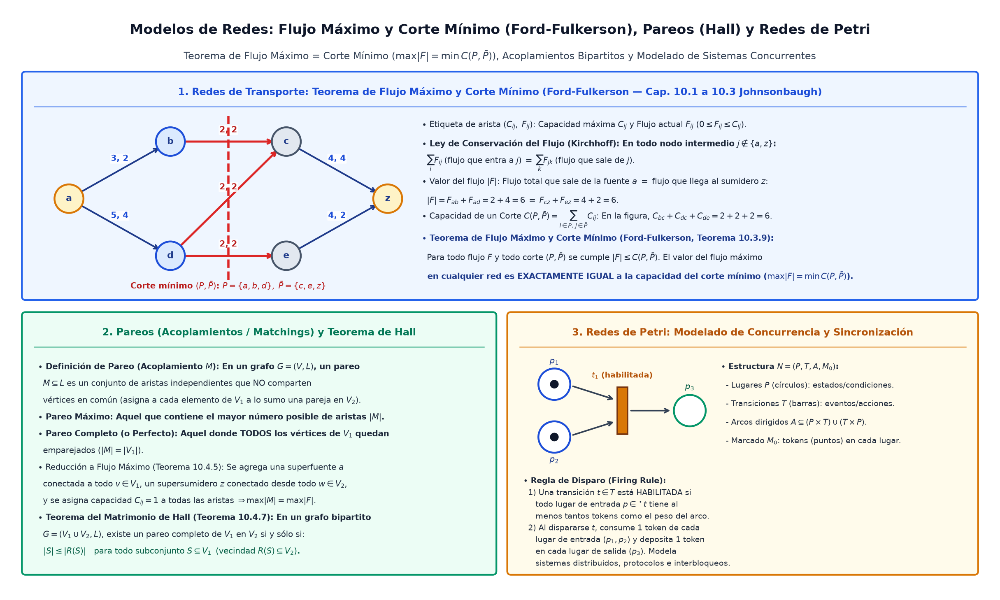

# 6.5 Redes (Teorema de Flujo Máximo, Teorema de Flujo Mínimo, Pareos y Redes de Petri)

Los **modelos de redes** extienden la teoría de grafos dirigidos para analizar y optimizar el transporte de recursos (paquetes de datos en Internet, corriente eléctrica, tráfico vehicular, agua o petróleo por tuberías, asignación de tareas a procesadores y sincronización de procesos concurrentes). En esta sección se estudian los teoremas de flujo máximo y mínimo, el algoritmo de Ford-Fulkerson, los pareos (acoplamientos) en grafos bipartitos y las redes de Petri.

---

## 1. Redes de Transporte y Conservación del Flujo

### Definición de Red de Transporte
Una **red de transporte** (o simplemente una **red**) es una gráfica dirigida, simple y ponderada $G = (V, L, C)$ que satisface las siguientes tres propiedades:
1. **Fuente (*Source*, $a$):** Existe un único vértice distinguido $a \in V$ que no tiene aristas entrantes ($\text{grado}_{\text{entrada}}(a) = 0$), desde el cual se origina el recurso o flujo.
2. **Sumidero (*Sink*, $z$):** Existe un único vértice distinguido $z \in V$ que no tiene aristas salientes ($\text{grado}_{\text{salida}}(z) = 0$), hacia el cual converge todo el flujo.
3. **Capacidad de las aristas ($C_{ij}$):** A cada arista dirigida $e = (i, j) \in L$ se le asigna un número real no negativo $C_{ij} = C(i, j) \ge 0$, denominado **capacidad de la arista**, que representa la cantidad máxima de flujo que puede transportarse de $i$ a $j$ por unidad de tiempo.

*(Nota: Si un problema real cuenta con múltiples fuentes $a_1, \dots, a_k$ y múltiples sumideros $z_1, \dots, z_m$, se reduce a una red estándar añadiendo una **superfuente** $a$ conectada con capacidad $\infty$ hacia cada $a_r$, y un **supersumidero** $z$ que recibe aristas de capacidad $\infty$ desde cada $z_s$).*

### Definición de Flujo en una Red
Dado una red $G = (V, L, C)$ con fuente $a$ y sumidero $z$, un **flujo** $F$ asigna a cada arista dirigida $(i, j) \in L$ un valor no negativo $F_{ij}$ sujeto a dos restricciones fundamentales:

1. **Restricción de capacidad:** Para toda arista $(i, j) \in L$, el flujo nunca puede exceder la capacidad del canal:
   $$0 \le F_{ij} \le C_{ij}$$
2. **Ecuación de conservación del flujo (Ley de Kirchhoff):** Para todo vértice intermedio $j \in V \setminus \{a, z\}$ (es decir, distinto de la fuente y del sumidero), la **suma de los flujos que entran** al vértice $j$ es exactamente igual a la **suma de los flujos que salen** del vértice $j$:
   $$\sum_{i} F_{ij} = \sum_{k} F_{jk} \quad \forall j \neq a, z$$

### Valor del Flujo ($|F|$)
Por la conservación del flujo en todos los nodos intermedios, el flujo neto total que sale de la fuente $a$ es idéntico al flujo neto total que ingresa al sumidero $z$. A esta cantidad se le denomina **valor del flujo** (denotado como $|F|$ o $v(F)$):
$$|F| = \sum_{j} F_{aj} = \sum_{i} F_{iz}$$

> **Notación gráfica en las aristas:** En los diagramas de redes, sobre cada arista $(i, j)$ se escribe el par **`C_ij, F_ij`** (Capacidad, Flujo actual) o bien `F_ij / C_ij`. Siguiendo la convención de Johnsonbaugh, denotaremos cada arista con la etiqueta **`Capacidad, Flujo`** ($C_{ij}, F_{ij}$).

---

## 2. Algoritmo de Flujo Máximo (Ford-Fulkerson) y Teorema de Flujo Máximo / Corte Mínimo

El **problema del flujo máximo** consiste en determinar un flujo válido $F$ en la red $G$ que maximice el valor total $|F|$ enviado desde la fuente $a$ hasta el sumidero $z$.

### Trayectorias de Aumento y Algoritmo de Ford-Fulkerson
Formulado por **Lester R. Ford Jr.** y **Delbert R. Fulkerson** (1956), el método parte de un flujo inicial nulo ($F_{ij} = 0$ en todas las aristas) e incrementa iterativamente el flujo buscando **trayectorias de aumento** desde $a$ hasta $z$ en el grafo subyacente:

- **Arista con orientación apropiada (hacia adelante, $i \to j$):** Tiene capacidad disponible para incrementar el flujo si está **no saturada**:
  $$\Delta_{ij}^+ = C_{ij} - F_{ij} > 0$$
- **Arista con orientación inapropiada (en sentido opuesto, $i \leftarrow j$):** Permite redirigir o cancelar flujo previamente enviado si su flujo actual es estrictamente positivo:
  $$\Delta_{ij}^- = F_{ji} > 0$$

Si se encuentra un camino simple $P$ desde $a$ hasta $z$ donde todas sus aristas cumplen $\Delta > 0$, se define la **holgura o cuello de botella** de la trayectoria como:
$$\Delta(P) = \min_{e \in P} \Delta_e > 0$$
Acto seguido, se actualiza el flujo a lo largo de la trayectoria $P$:
- En cada arista de $P$ con orientación **apropiada** ($i \to j$): $F_{ij} \leftarrow F_{ij} + \Delta(P)$.
- En cada arista de $P$ con orientación **inapropiada** ($i \leftarrow j$): $F_{ji} \leftarrow F_{ji} - \Delta(P)$.

El valor total del flujo en la red aumenta en $|F|_{\text{nuevo}} = |F|_{\text{anterior}} + \Delta(P)$. Cuando ya **no existe ninguna trayectoria de aumento** de $a$ a $z$, el flujo alcanzado es **óptimo (máximo)**.

### Cortes en una Red y Teorema de Flujo Máximo / Corte Mínimo
Un **corte** $(P, \bar{P})$ en una red $G = (V, L, C)$ es una partición del conjunto de vértices $V$ en dos subconjuntos disjuntos $P$ y $\bar{P} = V \setminus P$ tales que la fuente pertenece al primero ($a \in P$) y el sumidero pertenece al segundo ($z \in \bar{P}$).

La **capacidad de un corte** $C(P, \bar{P})$ es la suma de las capacidades de todas las aristas dirigidas que salen de algún vértice de $P$ y entran a algún vértice de $\bar{P}$:
$$C(P, \bar{P}) = \sum_{\substack{i \in P \\ j \in \bar{P}}} C_{ij}$$

- **Lema de dualidad débil:** Para cualquier flujo válido $F$ y cualquier corte $(P, \bar{P})$ en una red, el valor del flujo nunca puede superar la capacidad del corte:
  $$|F| = \sum_{i \in P, j \in \bar{P}} F_{ij} - \sum_{i \in \bar{P}, j \in P} F_{ij} \le C(P, \bar{P})$$
- **Teorema de Flujo Máximo y Corte Mínimo (Ford-Fulkerson):** En toda red de transporte, el valor de un **flujo máximo** desde $a$ hasta $z$ es exactamente igual a la capacidad de un **corte mínimo** que separa a $a$ de $z$:
  $$\max_{F} |F| = \min_{(P, \bar{P})} C(P, \bar{P})$$
  Además, al finalizar el algoritmo de etiquetado de Ford-Fulkerson, el corte mínimo se obtiene de manera automática tomando $P$ como el conjunto de todos los vértices que aún pueden alcanzarse desde $a$ mediante aristas con $\Delta > 0$, y $\bar{P} = V \setminus P$. En dicho corte mínimo, toda arista de $P$ a $\bar{P}$ está **saturada** ($F_{ij} = C_{ij}$) y toda arista de $\bar{P}$ a $P$ tiene **flujo cero** ($F_{ji} = 0$).

---

## 3. Teorema de Flujo Mínimo (Redes con Cotas Inferiores y Superiores)

En numerosas aplicaciones de ingeniería (como sistemas de enfriamiento de reactores, redes hidráulicas que requieren un caudal mínimo para evitar sedimentación, o contratos logísticos con mínimos garantizados), cada arista $(i, j) \in L$ posee tanto una **capacidad máxima** $C_{ij}$ como un **requerimiento o cota mínima de flujo** $m_{ij} \ge 0$, de modo que el flujo debe satisfacer:
$$0 \le m_{ij} \le F_{ij} \le C_{ij} \quad \forall (i, j) \in L$$
conservando el flujo en todos los nodos intermedios ($\sum_i F_{ij} = \sum_k F_{jk}$). El **problema del flujo mínimo** consiste en hallar un flujo factible $F$ que **minimice** el flujo total $|F|$ enviado de $a$ a $z$.

### Capacidad Inferior de un Corte y Teorema de Flujo Mínimo
Para cualquier corte $(P, \bar{P})$, como el flujo neto que cruza de $P$ a $\bar{P}$ es $|F| = \sum_{i \in P, j \in \bar{P}} F_{ij} - \sum_{i \in \bar{P}, j \in P} F_{ij}$, y cada $F_{ij} \ge m_{ij}$ mientras que cada $F_{ji} \le C_{ji}$, todo flujo factible está acotado inferiormente por:
$$|F| \ge m(P, \bar{P}) - C(\bar{P}, P) = \sum_{\substack{i \in P \\ j \in \bar{P}}} m_{ij} - \sum_{\substack{i \in \bar{P} \\ j \in P}} C_{ij}$$

- **Teorema de Flujo Mínimo:** Si existe un flujo factible en una red con cotas inferiores $m_{ij}$ y capacidades superiores $C_{ij}$, el **valor del flujo mínimo** de $a$ a $z$ es igual al **máximo** de la diferencia entre la suma de cotas inferiores de $P$ a $\bar{P}$ y la suma de capacidades superiores de $\bar{P}$ a $P$ sobre todos los cortes $(P, \bar{P})$:
  $$\min_{F} |F| = \max_{(P, \bar{P})} \left( \sum_{i \in P, j \in \bar{P}} m_{ij} - \sum_{i \in \bar{P}, j \in P} C_{ij} \right)$$
  Para reducir el flujo de manera iterativa, se buscan caminos de $a$ a $z$ donde las aristas hacia adelante tengan $F_{ij} > m_{ij}$ (permitiendo disminuir el flujo) y las aristas hacia atrás tengan $F_{ji} < C_{ji}$ (permitiendo aumentar el contraflujo).

---

## 4. Pareos (Acoplamientos / *Matchings*)

### Definición de Pareo
Dado un grafo $G = (V, L)$ —particularmente un **grafo bipartito** $G = (V_1, V_2, L)$ donde las aristas conectan un conjunto $V_1$ (por ejemplo, solicitantes, trabajadores o procesadores) con un conjunto $V_2$ (puestos de trabajo, tareas o recursos)—:
- Un **pareo** o **acoplamiento** (*matching*) $M \subseteq L$ es un subconjunto de aristas tal que **ningún par de aristas en $M$ comparte un vértice en común** (cada vértice de $V_1$ se empareja con a lo sumo un vértice de $V_2$ y viceversa).
- Un **pareo máximo** (*maximum matching*) es un pareo que contiene el **mayor número posible de aristas** $|M|$.
- Un **pareo completo** (de $V_1$ en $V_2$) es un pareo en el que todos los elementos de $V_1$ quedan emparejados, es decir, $|M| = |V_1|$.

### Modelado de un Pareo como Red de Flujo Máximo
Todo problema de pareo máximo en un grafo bipartito $G = (V_1, V_2, L)$ se transforma directamente en una **red de acoplamiento**:
1. Se agrega una fuente $a$ conectada mediante aristas dirigidas de **capacidad $1$** hacia cada vértice $u \in V_1$.
2. Se orientan todas las aristas originales del grafo bipartito desde $V_1$ hacia $V_2$, asignándoles **capacidad $1$**.
3. Se conecta cada vértice $v \in V_2$ mediante una arista dirigida de **capacidad $1$** hacia el sumidero $z$.

> **Teorema de correspondencia Flujo–Pareo:** Un flujo entero en la red de acoplamiento define un pareo $M$ (formado por las aristas entre $V_1$ y $V_2$ cuyo flujo es $F_{uv} = 1$), donde el número de parejas es exactamente igual al valor del flujo: $|M| = |F|$. Por consiguiente, un **flujo máximo** en la red produce un **pareo máximo** en $G$.

### Teorema del Matrimonio de Hall (Philip Hall, 1935)
Dado un grafo bipartito $G = (V_1, V_2, L)$, para cualquier subconjunto $S \subseteq V_1$, sea $R(S) = \{v \in V_2 \mid \exists u \in S \text{ con } (u, v) \in L\}$ el conjunto de vecinos de $S$ en $V_2$.
- **Teorema de Hall:** Existe un **pareo completo** de $V_1$ en $V_2$ ($|M| = |V_1|$) **si y sólo si** para todo subconjunto $S \subseteq V_1$ se cumple la **condición de Hall**:
  $$|S| \le |R(S)| \quad \forall S \subseteq V_1$$
  Es decir, cualquier grupo de $k$ elementos de $V_1$ debe ser colectivamente compatible con al menos $k$ elementos distintos de $V_2$.

---

## 5. Redes de Petri

Introducidas por **Carl Adam Petri** en 1962, las **Redes de Petri** son un modelo matemático y gráfico basado en grafos bipartitos dirigidos que permite representar, simular y verificar **sistemas distribuidos, concurrentes, asíncronos y paralelos** (como protocolos de comunicación, sistemas operativos multitarea, líneas de manufactura automatizada y control de semáforos o exclusión mutua).

### Estructura Formal de una Red de Petri
Una Red de Petri es una cuádrupla $N = (P, T, A, M_0)$ compuesta por:
1. **Lugares (*Places*, $P = \{p_1, p_2, \dots, p_n\}$):** Representados gráficamente mediante **círculos** ($\bigcirc$). Modelan **condiciones, estados locales, buffers o recursos disponibles**.
2. **Transiciones (*Transitions*, $T = \{t_1, t_2, \dots, t_m\}$):** Representadas gráficamente mediante **barras o rectángulos** ($\talloblong$). Modelan **eventos, acciones, operaciones o pasos de cómputo**. ($P \cap T = \emptyset$).
3. **Arcos dirigidos ($A \subseteq (P \times T) \cup (T \times P)$):** Flechas que conectan lugares con transiciones (**lugares de entrada** a una transición) o transiciones con lugares (**lugares de salida** de una transición). Nunca se conectan dos lugares entre sí ni dos transiciones entre sí. Cada arco tiene un peso entero $w \ge 1$ (por defecto $w = 1$).
4. **Marcado inicial (*Initial Marking*, $M_0 : P \to \mathbb{N}_0$):** Asigna a cada lugar $p \in P$ un número entero no negativo de **marcas o *tokens*** (representados como puntos negros $\bullet$ dentro del círculo de cada lugar). El vector de marcado $M = [M(p_1), M(p_2), \dots, M(p_n)]$ define el **estado global actual** del sistema.

### Dinámica: Regla de Habilitación y Disparo (*Firing*)
La evolución de una Red de Petri ocurre mediante el **disparo de transiciones**:
1. **Condición de habilitación:** Una transición $t \in T$ está **habilitada** (o sensibilizada) en el marcado actual $M$ si **cada uno de sus lugares de entrada** $p \in {^\bullet t}$ contiene al menos tantos *tokens* como el peso del arco que va de $p$ a $t$ (para arcos de peso $1$, al menos $1$ *token* en cada lugar de entrada):
   $$M(p) \ge w(p, t) \quad \forall p \in {^\bullet t}$$
2. **Regla de disparo (*Firing*):** Cuando una transición habilitada $t$ se **dispara**:
   - Se **consumen (retiran)** $w(p, t)$ *tokens* de cada lugar de entrada $p \in {^\bullet t}$.
   - Se **producen (añaden)** $w(t, q)$ *tokens* en cada lugar de salida $q \in t^\bullet$.
   - El nuevo marcado resultante $M'$ para cada lugar $p \in P$ viene dado por:
     $$M'(p) = M(p) - w(p, t) + w(t, p)$$

> **Propiedades clave verificables con Redes de Petri:**
> - **Alcanzabilidad (*Reachability*):** Determinar si un estado $M_k$ puede alcanzarse desde $M_0$ tras una secuencia de disparos.
> - **Acotamiento (*Boundedness*) y Seguridad (*Safeness*):** Una red es $k$-acotada si ningún lugar acumula jamás más de $k$ *tokens* (evita desbordamiento de buffers); es **segura** ($1$-acotada) si cada lugar tiene a lo sumo $1$ *token*.
> - **Vivacidad (*Liveness*) y Ausencia de Bloqueo Mutuo (*Deadlock-free*):** Garantizar que el sistema nunca llegue a un estado muerto donde ninguna transición esté habilitada.

---

## Ejemplos de Práctica (Resueltos Paso a Paso)

### Ejemplo 1: Flujo Máximo y Corte Mínimo mediante Ford-Fulkerson

**Problema:**  
Considere la red de transporte con fuente $a$, sumidero $z$, nodos intermedios $\{b, c, d, e\}$ y capacidades $C_{ij}$ (con un flujo válido inicial $F_{ij}$ ya establecido entre paréntesis como `Capacidad, Flujo`):
- $(a, b) = 6, 5$; $\quad (a, d) = 5, 3$
- $(b, c) = 6, 3$; $\quad (b, e) = 3, 2$
- $(d, b) = 4, 0$; $\quad (d, e) = 3, 3$
- $(e, c) = 2, 0$; $\quad (e, z) = 5, 5$
- $(c, z) = 8, 3$

1. Verifique que el flujo actual es válido y calcule su valor inicial $|F_0|$.
2. Aplique el algoritmo de **Ford-Fulkerson** encontrando todas las trayectorias de aumento posibles hasta alcanzar el **flujo máximo**.
3. Identifique el **corte mínimo** $(P, \bar{P})$ y compruebe el **Teorema de Flujo Máximo / Corte Mínimo**.

**Solución paso a paso:**

1. **Verificación del flujo inicial $|F_0|$:**
   - En cada arista se cumple $0 \le F_{ij} \le C_{ij}$.
   - Conservación en los nodos intermedios:
     - Nodo $b$: Entra $5$ (de $a$) $+ 0$ (de $d$) $= 5$; Sale $3$ (a $c$) $+ 2$ (a $e$) $= 5$.
     - Nodo $d$: Entra $3$ (de $a$); Sale $0$ (a $b$) $+ 3$ (a $e$) $= 3$.
     - Nodo $e$: Entra $2$ (de $b$) $+ 3$ (de $d$) $= 5$; Sale $0$ (a $c$) $+ 5$ (a $z$) $= 5$.
     - Nodo $c$: Entra $3$ (de $b$) $+ 0$ (de $e$) $= 3$; Sale $3$ (a $z$).
   - Valor del flujo inicial: $|F_0| = F_{ab} + F_{ad} = 5 + 3 = \mathbf{8}$ (igual a $F_{cz} + F_{ez} = 3 + 5 = 8$).

2. **Búsqueda de trayectorias de aumento:**
   - **Trayectoria de aumento 1:** $P_1 = (a \to b \to c \to z)$ (todas con orientación apropiada):
     - $\Delta_{ab} = 6 - 5 = 1$, $\quad \Delta_{bc} = 6 - 3 = 3$, $\quad \Delta_{cz} = 8 - 3 = 5$.
     - Cuello de botella: $\Delta(P_1) = \min\{1, 3, 5\} = \mathbf{1}$.
     - Se suma $1$ al flujo en $(a, b), (b, c), (c, z)$: ahora $(a, b) = 6, 6$; $(b, c) = 6, 4$; $(c, z) = 8, 4$. Nuevo flujo total: $|F_1| = 8 + 1 = \mathbf{9}$.
   - **Trayectoria de aumento 2:** Como $(a, b)$ ya está saturada ($6, 6$), partimos por $(a, d)$:
     - Ruta $P_2 = (a \to d \to b \to c \to z)$:
     - $\Delta_{ad} = 5 - 3 = 2$, $\quad \Delta_{db} = 4 - 0 = 4$, $\quad \Delta_{bc} = 6 - 4 = 2$, $\quad \Delta_{cz} = 8 - 4 = 4$.
     - Cuello de botella: $\Delta(P_2) = \min\{2, 4, 2, 4\} = \mathbf{2}$.
     - Se suma $2$ al flujo en $(a, d), (d, b), (b, c), (c, z)$: ahora $(a, d) = 5, 5$; $(d, b) = 4, 2$; $(b, c) = 6, 6$; $(c, z) = 8, 6$.
     - Nuevo flujo total: $|F_{\max}| = 9 + 2 = \mathbf{11}$.
   - **Condición de paro:** En este punto, las dos únicas aristas que salen de la fuente $a$, que son $(a, b) = 6, 6$ y $(a, d) = 5, 5$, están **completamente saturadas**. Ya no es posible alcanzar ningún vértice desde $a$. Por tanto, el **flujo máximo es $|F_{\max}| = 11$**.

3. **Corte mínimo y verificación del teorema:**
   - El conjunto de vértices alcanzables desde $a$ es únicamente $P = \{a\}$, y su complemento es $\bar{P} = \{b, c, d, e, z\}$.
   - La capacidad del corte $(P, \bar{P})$ es:
     $$C(P, \bar{P}) = C_{ab} + C_{ad} = 6 + 5 = \mathbf{11}$$
   - Se verifica exactamente que $\max |F| = \min C(P, \bar{P}) = \mathbf{11}$.

---

### Ejemplo 2: Pareo Máximo y Teorema del Matrimonio de Hall

**Problema:**  
En un sistema operativo distribuido hay $4$ tareas críticas $V_1 = \{T_1, T_2, T_3, T_4\}$ y $4$ procesadores especializados $V_2 = \{P_1, P_2, P_3, P_4\}$. Por restricciones de arquitectura, las compatibilidades son:
- $T_1$ puede ejecutarse en $\{P_1, P_2\}$
- $T_2$ puede ejecutarse en $\{P_2\}$
- $T_3$ puede ejecutarse en $\{P_1, P_2\}$
- $T_4$ puede ejecutarse en $\{P_2, P_3, P_4\}$

1. Utilizando el **Teorema del Matrimonio de Hall**, demuestre si es posible o no obtener un **pareo completo** (asignar las $4$ tareas simultáneamente a $4$ procesadores distintos).
2. Determine el **pareo máximo** $M$ posible y su cardinalidad $|M|$.

**Solución paso a paso:**

1. **Verificación de la condición de Hall ($|S| \le |R(S)|$):**
   - Consideremos el subconjunto de tareas $S = \{T_1, T_2, T_3\} \subseteq V_1$, el cual tiene $|S| = 3$ tareas.
   - El conjunto de procesadores compatibles con al menos una tarea de $S$ es:
     $$R(S) = \{P_1, P_2\} \cup \{P_2\} \cup \{P_1, P_2\} = \{P_1, P_2\} \implies |R(S)| = 2$$
   - Como $|S| = 3 > |R(S)| = 2$, **se viola la condición del Teorema de Hall**. Por lo tanto, **NO existe un pareo completo** de tamaño $4$ (es imposible asignar $3$ tareas en tan solo $2$ procesadores sin que dos tareas compartan procesador).

2. **Determinación del pareo máximo:**
   - De las tres tareas $\{T_1, T_2, T_3\}$, a lo sumo $2$ pueden ser asignadas (a $P_1$ y $P_2$), mientras que $T_4$ puede asignarse a $P_3$ (o $P_4$).
   - Un **pareo máximo** explícito de tamaño $|M| = \mathbf{3}$ es:
     $$M = \{(T_1, P_1), \; (T_2, P_2), \; (T_4, P_3)\}$$

---

### Ejemplo 3: Simulación de una Red de Petri (Sincronización Productor–Consumidor)

**Problema:**  
Sea una Red de Petri con $4$ lugares $P = \{p_1, p_2, p_3, p_4\}$ y $3$ transiciones $T = \{t_1, t_2, t_3\}$ cuyos arcos de peso $1$ son:
- Transición $t_1$: lugar de entrada $\{p_1\}$; lugares de salida $\{p_2, p_3\}$ (bifurcación paralela / *fork*).
- Transición $t_2$: lugar de entrada $\{p_2\}$; lugar de salida $\{p_4\}$.
- Transición $t_3$: lugares de entrada $\{p_3, p_4\}$; lugar de salida $\{p_1\}$ (sincronización / *join*).

Si el marcado inicial es $M_0 = [1, 0, 0, 0]$ (es decir, $1$ *token* en $p_1$ y $0$ en los demás):
1. Determine qué transición está habilitada en $M_0$ y calcule el marcado $M_1$ tras su disparo.
2. Continúe disparando las transiciones habilitadas hasta regresar al estado inicial, mostrando el vector de marcado en cada paso.

**Solución paso a paso:**

1. **Estado inicial $M_0 = [1, 0, 0, 0]$:**
   - La única transición cuyo lugar de entrada tiene al menos un *token* es **$t_1$** (pues $M_0(p_1) = 1 \ge 1$).
   - Al dispararse **$t_1$**, se consume $1$ *token* de $p_1$ y se deposita $1$ *token* en $p_2$ y $1$ *token* en $p_3$:
     $$M_1 = [0, 1, 1, 0]$$

2. **Evolución de los disparos subsiguientes:**
   - En $M_1 = [0, 1, 1, 0]$:
     - $t_1$ no está habilitada ($M_1(p_1) = 0$).
     - $t_3$ **aún no está habilitada** porque requiere *tokens* simultáneamente en $p_3$ **y** en $p_4$, pero $M_1(p_4) = 0$.
     - **$t_2$ sí está habilitada** ($M_1(p_2) = 1 \ge 1$).
   - Al dispararse **$t_2$**, consume el *token* de $p_2$ y produce $1$ *token* en $p_4$:
     $$M_2 = [0, 0, 1, 1]$$
   - En $M_2 = [0, 0, 1, 1]$:
     - Ahora ambos lugares de entrada de **$t_3$** ($p_3$ y $p_4$) tienen $1$ *token* cada uno, por lo que **$t_3$ queda habilitada**.
   - Al dispararse **$t_3$**, consume $1$ *token* de $p_3$ y $1$ *token* de $p_4$, y produce $1$ *token* en $p_1$:
     $$M_3 = [1, 0, 0, 0] = M_0$$
   - El sistema regresa cíclicamente a su marcado inicial $M_0$, demostrando que la red es **viva** (libre de *deadlocks*) y **acotada** (segura, pues ningún lugar supera jamás $1$ *token*).

---

## Ejercicios de Tarea (Práctica en Casa)

### Ejercicio 1: Flujo Máximo y Corte Mínimo en una Red de Datos
Considere una red de transporte con fuente $a$, sumidero $z$, vértices intermedios $\{b, c, d\}$ y capacidades de enlace (en Gbps):
$$C_{ab} = 8,\; C_{ac} = 6,\; C_{bc} = 3,\; C_{bd} = 5,\; C_{cd} = 4,\; C_{bz} = 2,\; C_{dz} = 10$$
1. Partiendo del flujo nulo ($F_{ij} = 0$), aplique el algoritmo de **Ford-Fulkerson** enumerando cada trayectoria de aumento y su cuello de botella $\Delta$ hasta obtener el **flujo máximo** $|F_{\max}|$.
2. Indique el flujo final $F_{ij}$ en cada una de las $7$ aristas y verifique que se cumple la conservación del flujo en $b, c$ y $d$.
3. Encuentre el **corte mínimo** $(P, \bar{P})$ y verifique que $C(P, \bar{P}) = |F_{\max}|$.

<!--
SOLUCIÓN DEL EJERCICIO 1:

1. Aplicación de Ford-Fulkerson (desde F = 0):
   - Trayectoria 1: a -> b -> z. Capacidades disponibles: min(8, 2) = 2.
     Flujo acumulado = 2.
   - Trayectoria 2: a -> b -> d -> z. Capacidades disponibles: min(8-2, 5, 10) = min(6, 5, 10) = 5.
     Flujo acumulado = 2 + 5 = 7.
   - Trayectoria 3: a -> c -> d -> z. Capacidades disponibles: min(6, 4, 10-5) = min(6, 4, 5) = 4.
     Flujo acumulado = 7 + 4 = 11.
   - En este momento las aristas (b, z)=2/2, (b, d)=5/5 y (c, d)=4/4 están todas saturadas.
   - Desde a todavía podemos llegar a b (queda capacidad 8-7=1) y a c (queda capacidad 6-4=2), pero desde {b, c} ya no hay ninguna arista no saturada que avance hacia {d, z}.
   - Por tanto, el flujo máximo es |F_max| = 11 Gbps.

2. Flujo final por arista (Capacidad, Flujo):
   - (a, b) = 8, 7
   - (a, c) = 6, 4
   - (b, c) = 3, 0
   - (b, d) = 5, 5
   - (c, d) = 4, 4
   - (b, z) = 2, 2
   - (d, z) = 10, 9
   Verificación de conservación:
   - Nodo b: entra 7 (de a); sale 5 (a d) + 2 (a z) = 7.
   - Nodo c: entra 4 (de a); sale 4 (a d).
   - Nodo d: entra 5 (de b) + 4 (de c) = 9; sale 9 (a z).
   - Sumidero z: recibe 2 (de b) + 9 (de d) = 11 Gbps.

3. Corte mínimo (P, \bar{P}):
   - Vértices alcanzables desde a: P = {a, b, c}.
   - Complemento: \bar{P} = {d, z}.
   - Aristas que cruzan de P a \bar{P}: (b, z), (b, d) y (c, d).
   - Capacidad del corte: C(P, \bar{P}) = C_{bz} + C_{bd} + C_{cd} = 2 + 5 + 4 = 11 Gbps = |F_max|.
-->

---

### Ejercicio 2: Teorema de Flujo Mínimo en una Red con Cotas Inferiores
Una red de suministro de agua tiene fuente $a$, sumidero $z$, nodos intermedios $\{b, c\}$ y aristas cuyos intervalos de operación $[m_{ij}, C_{ij}]$ (flujo mínimo requerido $m_{ij}$ y capacidad máxima $C_{ij}$ en $\text{m}^3/\text{s}$) son:
- $(a, b): [2, 6]$, $\quad (a, c): [3, 7]$
- $(b, c): [0, 2]$
- $(b, z): [4, 8]$, $\quad (c, z): [2, 5]$

1. Evalúe la cota inferior $m(P, \bar{P}) - C(\bar{P}, P)$ para los cuatro cortes posibles de la red: $P_1 = \{a\}$, $P_2 = \{a, b\}$, $P_3 = \{a, c\}$ y $P_4 = \{a, b, c\}$.
2. Utilizando el **Teorema de Flujo Mínimo**, determine el valor mínimo de caudal $|F_{\min}|$ que debe suministrar la fuente $a$ para satisfacer todas las restricciones y proponga una asignación explícita de flujos $F_{ij}$ que lo alcance.

<!--
SOLUCIÓN DEL EJERCICIO 2:

1. Evaluación de m(P, \bar{P}) - C(\bar{P}, P) en los 4 cortes:
   - Corte 1: P_1 = {a}, \bar{P}_1 = {b, c, z}:
     m(P_1, \bar{P}_1) - C(\bar{P}_1, P_1) = (m_{ab} + m_{ac}) - 0 = (2 + 3) - 0 = 5.
   - Corte 2: P_2 = {a, b}, \bar{P}_2 = {c, z}:
     Aristas de P_2 a \bar{P}_2: (a, c), (b, c), (b, z). Aristas de \bar{P}_2 a P_2: ninguna.
     m(P_2, \bar{P}_2) - C(\bar{P}_2, P_2) = (m_{ac} + m_{bc} + m_{bz}) - 0 = (3 + 0 + 4) - 0 = 7.
   - Corte 3: P_3 = {a, c}, \bar{P}_3 = {b, z}:
     Aristas de P_3 a \bar{P}_3: (a, b), (c, z). Arista de \bar{P}_3 a P_3: (b, c).
     m(P_3, \bar{P}_3) - C(\bar{P}_3, P_3) = (m_{ab} + m_{cz}) - C_{bc} = (2 + 2) - 2 = 2.
   - Corte 4: P_4 = {a, b, c}, \bar{P}_4 = {z}:
     Aristas de P_4 a \bar{P}_4: (b, z), (c, z). Aristas de \bar{P}_4 a P_4: ninguna.
     m(P_4, \bar{P}_4) - C(\bar{P}_4, P_4) = (m_{bz} + m_{cz}) - 0 = (4 + 2) - 0 = 6.

2. Valor del Flujo Mínimo y asignación explícita:
   - Por el Teorema de Flujo Mínimo:
     |F_min| = max {5, 7, 2, 6} = 7 m^3/s (determinado por el corte P_2 = {a, b}, \bar{P}_2 = {c, z}).
   - Asignación de flujos que alcanza |F_min| = 7 cumpliendo m_ij <= F_ij <= C_ij:
     * F_{ab} = 4  (en [2, 6])
     * F_{ac} = 3  (en [3, 7], en su cota mínima)
     * F_{bc} = 0  (en [0, 2], en su cota mínima)
     * F_{bz} = 4  (en [4, 8], en su cota mínima)
     * F_{cz} = 3  (en [2, 5])
     Se conserva el flujo en b (4 = 0 + 4) y en c (3 + 0 = 3), y el caudal total es 4 + 3 = 7 m^3/s.
-->

---

### Ejercicio 3: Pareos y Redes de Petri
1. Cinco candidatos $V_1 = \{C_1, C_2, C_3, C_4, C_5\}$ postulan a cinco vacantes $V_2 = \{V_a, V_b, V_c, V_d, V_e\}$ con las siguientes calificaciones de aptitud:
   $$C_1: \{V_a, V_b\},\quad C_2: \{V_b, V_c\},\quad C_3: \{V_c, V_d\},\quad C_4: \{V_d, V_e\},\quad C_5: \{V_e, V_a\}$$
   Verifique que se cumple el **Teorema de Hall** y encuentre dos **pareos completos** distintos.
2. En una **Red de Petri** con lugares $P = \{p_1, p_2, p_3\}$ y transiciones $T = \{t_1, t_2\}$, la transición $t_1$ tiene entrada $p_1$ (peso $2$) y salida $p_2$ (peso $1$); la transición $t_2$ tiene entradas $p_1$ (peso $1$) y $p_2$ (peso $1$), y salida $p_3$ (peso $2$). Si el marcado inicial es $M_0 = [3, 0, 0]$, calcule el marcado final tras disparar la secuencia $(t_1, t_2)$.

<!--
SOLUCIÓN DEL EJERCICIO 3:

1. Pareo completo en el grafo bipartito (ciclo par C_10):
   - Como cada candidato está calificado exactamente para 2 vacantes y cada vacante tiene exactamente 2 candidatos aptos (grafo 2-regular bipartito), para cualquier subconjunto S de candidatos se cumple |R(S)| >= |S| (Teorema de Hall).
   - Pareo completo 1: M_1 = {(C_1, V_a), (C_2, V_b), (C_3, V_c), (C_4, V_d), (C_5, V_e)}.
   - Pareo completo 2: M_2 = {(C_1, V_b), (C_2, V_c), (C_3, V_d), (C_4, V_e), (C_5, V_a)}.

2. Disparo de la secuencia (t_1, t_2) en la Red de Petri desde M_0 = [3, 0, 0]:
   - Paso 1 (Disparo de t_1):
     t_1 requiere 2 tokens en p_1. Como M_0(p_1) = 3 >= 2, t_1 está habilitada.
     Consume 2 tokens de p_1 y añade 1 token en p_2:
     M_1 = [3 - 2, 0 + 1, 0] = [1, 1, 0].
   - Paso 2 (Disparo de t_2):
     t_2 requiere 1 token en p_1 y 1 token en p_2. Como M_1(p_1) = 1 y M_1(p_2) = 1, t_2 está habilitada.
     Consume 1 token de p_1 y 1 token de p_2, y produce 2 tokens en p_3:
     M_2 = [1 - 1, 1 - 1, 0 + 2] = [0, 0, 2].
-->
